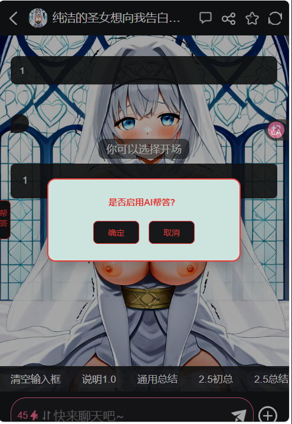

# AI帮答！二次确认！

创建时间: 2026-04-06T11:07:43.778000+00:00
消息数: 118

---

**阳玉** (2026-05-26 13:18:33):
<:emoji_150:1400299501423431771>

**阳玉** (2026-04-10 15:07:51):
最新版本～

**阳玉** (2026-04-10 15:07:50):

**绛璃寒月ദ്ദി˶•̀֊•́)✧** (2026-04-06 17:59:26):
已从被暂停的账号中移除一条消息。

**NicoPoiDuangOvO** (2026-04-06 16:15:39):
我去弄个放大图标，更容易点到的能不能拿到经验

**NicoPoiDuangOvO** (2026-04-06 16:14:59):
<:emoji_252:1490020030694293594>

**小魅** (2026-04-06 15:58:26):
<:emoji_148:1382329938404839586> 我灌死你

**MEE6** (2026-04-06 15:58:11):
<:CHECK6:403540120181145611> 10,000 XP has been given to **<@!1423905851625701376>**

**阳玉** (2026-04-06 15:45:29):
<:emoji_249:1490018353178480700>

**阳玉** (2026-04-06 15:45:06):
<@1135473222658297907> 貌似有人把我忘了

**阳玉** (2026-04-06 15:34:00):
<:emoji_251:1490018372723675297>

**阳玉** (2026-04-06 15:33:55):
但凡挪一下都不至于风评如此极端（

**阳玉** (2026-04-06 15:33:37):
问题是位置不对

**阳玉** (2026-04-06 15:33:22):
毕竟有人在用，所以肯定得考虑到这部分（）

**黑洞猫** (2026-04-06 15:33:17):
<:hdm:1462032590411137024>

**黑洞猫** (2026-04-06 15:33:00):
说是给老卡用用

**黑洞猫** (2026-04-06 15:32:49):
本来就是初代点击代码大规模应用不久后上线的功能

**黑洞猫** (2026-04-06 15:32:12):
我的意思是叫牢魅直接把这个功能删了...

**阳玉** (2026-04-06 15:30:59):
<:emoji_249:1416980114511761448>

**阳玉** (2026-04-06 15:30:58):
能删，我灵感来源就是

**NicoPoiDuangOvO** (2026-04-06 15:26:36):
就我一个人会用么...

**NicoPoiDuangOvO** (2026-04-06 15:26:32):
<:1000168531:1298906724979310634>

**黑洞猫** (2026-04-06 15:07:55):
真的有人会用那个功能嘛

**黑洞猫** (2026-04-06 15:07:23):
<:emoji_249:1416980114511761448>

**黑洞猫** (2026-04-06 15:07:16):
笑死，我感觉最重要的是直接让小魅把那个小灯泡给删了

**汐愛** (2026-04-06 14:35:17):
<:emoji_251:1490018372723675297>

**绛璃寒月ദ്ദി˶•̀֊•́)✧** (2026-04-06 13:37:18):
已从被暂停的账号中移除一条消息。

**阳玉** (2026-04-06 13:36:14):
选择困难症的

**阳玉** (2026-04-06 13:36:04):
对嘛～（）我就是防止误触的，但也得照顾那些淫商不够的<:emoji_250:1439598338801537124>

**绛璃寒月ദ്ദി˶•̀֊•́)✧** (2026-04-06 13:35:23):
已从被暂停的账号中移除一条消息。

**阳玉** (2026-04-06 13:34:43):
<:emoji_250:1440756778487775303> 按常理来说那个灯泡确实挺烦的（）毕竟有正则选项替代了

**绛璃寒月ദ്ദി˶•̀֊•́)✧** (2026-04-06 13:33:44):
已从被暂停的账号中移除一条消息。

**阳玉** (2026-04-06 13:32:25):
往往都是误触

**阳玉** (2026-04-06 13:32:17):
而且普遍玩家也不会花8电去帮答的

**阳玉** (2026-04-06 13:31:47):
这是正则（）

**绛璃寒月ദ്ദി˶•̀֊•́)✧** (2026-04-06 13:30:30):
已从被暂停的账号中移除一条消息。

**阳玉** (2026-04-06 13:28:54):
<:emoji_251:1490018372723675297>

**阳玉** (2026-04-06 13:28:52):
如果你不需要还能直接杀掉

**阳玉** (2026-04-06 13:28:41):
会给你个二次确认

**阳玉** (2026-04-06 13:28:35):
就你AI帮答以后不会误触了

**绛璃寒月ദ്ദി˶•̀֊•́)✧** (2026-04-06 13:18:55):
已从被暂停的账号中移除一条消息。

**小七** (2026-04-06 13:07:01):
尝试写一张，

**小七** (2026-04-06 13:06:26):
百分之七十都是某馆的角色卡，世界书用不来了

**阳玉** (2026-04-06 13:05:56):
模拟器主要就是题材，对应题材配对应结构，明白这点基本就OK了

**小七** (2026-04-06 13:04:52):
现在我这里v2角色卡不少，主要那些写的太过于另类

**阳玉** (2026-04-06 13:03:59):
会学会的

**阳玉** (2026-04-06 13:03:45):
<:emoji_249:1490018353178480700>

**小七** (2026-04-06 13:03:22):
其实不写模拟器用不到开局，主要我没写过模拟器

**阳玉** (2026-04-06 13:01:23):
先等等吧，今天模型智商实在不行，我搞这个都被烦死了

**小七** (2026-04-06 12:59:57):
刚肘出的开局代码，卡死网页，郁闷的不行，

**小七** (2026-04-06 12:55:41):
绝对有用无害

**阳玉** (2026-04-06 12:53:15):
虽然每次都会弹出来可能有点烦，但指定有用无害<:07:1298281204260278383>

**小七** (2026-04-06 12:53:00):
你想的周到

**阳玉** (2026-04-06 12:52:39):
做了两手准备的

**阳玉** (2026-04-06 12:52:24):
<:1000168531:1298906724979310634>

**阳玉** (2026-04-06 12:52:23):
我这也可以删除哇

**小七** (2026-04-06 12:52:06):
删除了，你说违反机制不

**阳玉** (2026-04-06 12:51:56):
实际上只有这个比较烦

**阳玉** (2026-04-06 12:51:45):
<:emoji_250:1459542480406970432>

**小七** (2026-04-06 12:51:23):
原生的所有文件都在代码中拆分出来的，一共56段文件，每个组件都可以修改删除，用最高权限

**阳玉** (2026-04-06 12:50:12):
照顾一下确实有在用的选择困难症患者（

**小七** (2026-04-06 12:49:26):
我的美化代码中有这一段直接删除就可以了

**黒宮みまり** (2026-04-06 11:45:53):

**黒宮みまり** (2026-04-06 11:45:29):
啊确实改了

**阳玉** (2026-04-06 11:45:17):
两个刷新都点一下

**阳玉** (2026-04-06 11:44:59):
<:emoji_252:1486325346256027708>

**阳玉** (2026-04-06 11:44:55):
刷新网页

**黒宮みまり** (2026-04-06 11:44:39):
改……改了吗

**阳玉** (2026-04-06 11:44:07):
你可以看看新版，字体改了

**阳玉** (2026-04-06 11:43:56):
<:emoji_251:1490018372723675297>

**阳玉** (2026-04-06 11:43:55):
能哇，毕竟是正则来着

**黒宮みまり** (2026-04-06 11:43:12):
说起来二次确认那段文字能不能放功能栏的

**周雅（被老婆调教.周浩）** (2026-04-06 11:39:11):
<@1135473222658297907> 建议奖励经验

**阳玉** (2026-04-06 11:37:53):
# 优化侧边栏宽度及字体颜色

**黒宮みまり** (2026-04-06 11:26:20):
气泡什么的就交给美化了

**黒宮みまり** (2026-04-06 11:25:55):
<:07:1298281204260278383>

**黒宮みまり** (2026-04-06 11:25:50):
直接照抄喵

**黒宮みまり** (2026-04-06 11:25:48):
没事完全不会改

**阳玉** (2026-04-06 11:25:17):
<:07:1298281204260278383>

**阳玉** (2026-04-06 11:25:15):
你会发现旁边多出来个侧边栏/bro加油自己改（

**黒宮みまり** (2026-04-06 11:25:03):
白天黑夜都挺显眼

**黒宮みまり** (2026-04-06 11:24:49):
要不直接红字蚌（？）

**阳玉** (2026-04-06 11:24:28):
牢魅这个白天黑夜我是真不想管（

**阳玉** (2026-04-06 11:24:09):
嗯啊（

**黒宮みまり** (2026-04-06 11:24:04):
好的这就抄到自己卡里喵

**黒宮みまり** (2026-04-06 11:23:55):
不需要之后正常删除

**阳玉** (2026-04-06 11:23:38):
我懒得对黑夜模式优化了（

**阳玉** (2026-04-06 11:23:27):
点击后弹出二次选择

**黒宮みまり** (2026-04-06 11:23:22):
就是两块气泡好黑

**黒宮みまり** (2026-04-06 11:23:11):
好像可以了

**黒宮みまり** (2026-04-06 11:23:10):

**黒宮みまり** (2026-04-06 11:22:53):
说起来理论上是什么效果诶

**黒宮みまり** (2026-04-06 11:20:42):
试试看有没有实际效果

**黒宮みまり** (2026-04-06 11:20:37):
这次正常了

**黒宮みまり** (2026-04-06 11:20:35):
啊

**阳玉** (2026-04-06 11:19:29):
<@1212925144096571453> 试试这个

**阳玉** (2026-04-06 11:18:58):
别管（

**黒宮みまり** (2026-04-06 11:18:25):
这个样现在

**阳玉** (2026-04-06 11:17:26):
等下

**阳玉** (2026-04-06 11:17:23):
<:emoji_249:1490018353178480700>

**阳玉** (2026-04-06 11:17:22):
6，估计是我脑子瓦特了

**黒宮みまり** (2026-04-06 11:16:58):
导世界书直接进了

**黒宮みまり** (2026-04-06 11:16:54):
导入正则导了三次没进去

**黒宮みまり** (2026-04-06 11:16:45):
我不到诶

**阳玉** (2026-04-06 11:16:40):
<:1000168531:1298906724979310634>

**阳玉** (2026-04-06 11:16:36):
不可能吧？

**黒宮みまり** (2026-04-06 11:16:10):
正则导不进去

**黒宮みまり** (2026-04-06 11:16:05):
是世界书蚌

**黒宮みまり** (2026-04-06 11:15:10):
那我先导入空卡先

**黒宮みまり** (2026-04-06 11:15:02):
<:1000168531:1298906724979310634>

**阳玉** (2026-04-06 11:14:47):
直接导入你的正则就行了（前提你原本正则有备份或没原本正则

**黒宮みまり** (2026-04-06 11:14:17):
怎么用喵

**阳玉** (2026-04-06 11:09:11):
肘茶壶肘死我了，最后做成了这样

**白水** (2026-04-06 11:08:48):
<:emoji_251:1490018372723675297>

**白水** (2026-04-06 11:08:44):
直接@小魅

**阳玉** (2026-04-06 11:08:43):
<:1000168530:1298906732843503677>

**白水** (2026-04-06 11:08:35):
666666666

**阳玉** (2026-04-06 11:07:43):
根据汐汐的帖子搓出来的小东西，希望能给玩家们提供更多便利（可能有点瑕疵，但已经是尽我所能的）
灵感来源：https://discord.com/channels/1205870897769095229/1490131985123901642
（下滑看最新版本）（更新版本时需同时刷新网页和卡才能见效）

