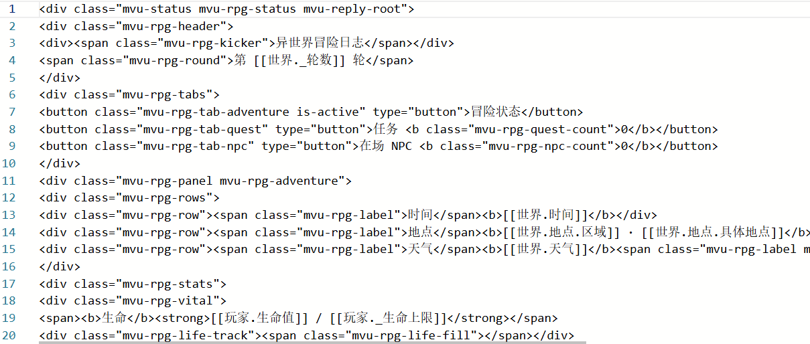

# MVU变量 填空式前端构建框架 v1.0.0【9.16】

来源: Discord 魅魔藏经阁 thread 1549726941123317830

创建: 2026-09-16T10:21:35.298000+00:00
消息数: 17

---

**小魅** (2026-09-17 02:41:50):
感谢宝宝开源<:emoji_140:1379454014852436038>

**MEE6** (2026-09-17 02:41:44):
<:CHECK6:403540120181145611> 100,000 XP has been given to **<@!1333081294564888618>**

**sRay(锐)（MVU框架发布）** (2026-09-17 02:38:42):
MVU变量 填空式前端构建框架 v1.0.0【9.16】

**sRay(锐)（MVU框架发布）** (2026-09-17 02:36:25):
<@1135473222658297907>

**sRay(锐)（MVU框架发布）** (2026-09-16 14:41:15):
如果是最基础的状态栏，只需要像这样放好完整HTML结构，用[[变量.路径]]放置需要的变量，就可以做好。会自动填写对应的本轮状态值，回复内不需要触发标记

**阿海** (2026-09-16 14:25:17):
学习学习！<:emoji_242:1435092848029728878>

**三国** (2026-09-16 13:53:29):
大佬✋ 😭 🤚

**𝓨𝓞𝓕𝓮𝓷𝓰** (2026-09-16 10:56:49):
锐锐万岁~<:heart_red:1539956801699582041>

**sRay(锐)（MVU框架发布）** (2026-09-16 10:22:43):
## 9.可用拓展函数
- 获取正文：`CARD.messages.at(index, role)`，根据轮数和身份获取对应的正文，支持负数索引
- 获取变量快照：`CARD.variables.reply(index)`，根据轮数获取对应的变量快照，支持负数索引
- 获取当前变量快照：`CARD.variables.current()`，获取当前已提交的最终变量快照
主动变量操作，可主动发起变量更新：
- 替换变量：`MVU.replace(path, value)`，将指定路径的变量替换为新值
- 变量增量：`MVU.delta(path, value)`，将指定路径的变量增量更新为新值
- 变量插入：`MVU.insert(path, value)`，在指定路径的数组或对象中插入新值
- 变量删除：`MVU.remove(path)`，删除指定路径的变量

**sRay(锐)（MVU框架发布）** (2026-09-16 10:22:35):
## 8.辅助插件
建议使用前三个，变量管理器视情况使用
### - 更新状态显示
将<变量更新>块正则替换为更新状态显示条，显示是否更新出错，并能展开查看本轮更新的具体内容和错误信息
### - 发送变量折叠
将[当前变量]块正则替换折叠，减少占用空间，能展开查看本轮变量快照
### - 旧变量清理
自动清理几轮前发送的[当前变量]块，减少上下文占用，可以设置保留轮数，默认保留3轮
### - 变量管理器
可以查看和编辑当前变量快照，编辑内容立即校验并储存

**sRay(锐)（MVU框架发布）** (2026-09-16 10:22:28):
## 7.触发时机
给出三个游玩过程中的重要时机，可以配置需要在对应时机自动触发的代码
### 7.1.作者配置-发送处理
对应玩家点击发送按钮之后，正式发送之前。可以在这里进行内容注入等操作

- 代码触发时，可以拿到已经排除了“当前变量”块的输入框内容（如果玩家复制过去发送内容又粘贴的话）
- 可以运行判断逻辑，在输入框内容上新增注入内容，例如骰子等。注意自行去重
- 将处理后的输入框内容返回后，会继续追加“当前变量”块，并完成发送

### 7.2.作者配置-流式更新
- 这里的代码在流式生成期间反复触发，能获取到不断追加的正文
- 利用这一功能，可以不需要等待完全生成，就能通过代码正则抓取已有文本，进行界面内容显示。例如galgame
- 要注意使用“追加”而不是“刷新”，否则可能会不断跳回开头

### 7.3.作者配置-完成更新
- 这里的代码在任何最新回复发生变化时触发，包括正常生成后、重新生成后、回溯后、编辑当前回复变化后等
- 此处可以拿到最新回复对应的变量状态，可以利用正文和变量更新界面内容或实现一些功能

**sRay(锐)（MVU框架发布）** (2026-09-16 10:22:17):
## 6.界面内容

### 6.1.功能栏
功能栏没有给出专门的正则入口，仍可按照过去的方式使用，即新增正则条目并将标记写入功能栏

仍然将功能栏作为单例固定界面的设置方式，可以不考虑新增的“舞台”功能

### 6.2.作者配置-舞台
这是本次新增的功能，我其实没有完全理解其优势，姑且将其视为更高级的功能栏

舞台部分可以放置舞台结构HTML、舞台css、舞台初始化代码

- 舞台结构HTML：舞台的基本结构，在启动时直接复制进舞台
- 舞台css：舞台相关的美化style
- 舞台初始化代码：在启动时运行一次，可以调整舞台布局等

### 6.3.作者配置-回复状态栏
状态栏编写极度简化，你只需要填写三个部分：状态栏结构HTML、状态栏css、状态栏渲染代码。不需要标记触发，每段回复的状态栏能得到该回复对应的变量状态快照

- 状态栏结构HTML：状态栏的基本结构，这部分会直接复制进每个回复的最后，在其中你可以使用`[[变量.路径]]`来直接放置本轮对应的变量，会自动替换
- 状态栏css：状态栏相关的美化style
- 状态栏渲染代码：在每个状态栏显示时各运行一次，可以拿到该轮回复的位置、正文、变量快照。可以利用这些构建状态栏的可变部分

例如：要做选项，不需要平台正则，利用代码内的正则处理正文，捕捉选项内容，再利用代码在状态栏后构建即可

**sRay(锐)（MVU框架发布）** (2026-09-16 10:22:04):
## 5.作者配置-全局美化
参考了黑洞猫的颜色变量方案，只需要填写一组颜色，就可以自动映射到各个部分。

提供了两个配色槽位，一个通用的，一个默认light。只填写通用的一个就始终生效，同时填写两个就根据平台的日/夜状态，夜状态使用通用槽配色，日状态使用light槽配色。（light可改为dark，效果交换）

如果有更复杂的需求，也可以在本入口内进一步修改

**sRay(锐)（MVU框架发布）** (2026-09-16 10:21:53):
## 4.作者配置-变量注入
这个入口中你可以自行控制每次要注入的变量内容。默认将全部变量以YAML格式注入发送内容最后

你可以进一步进行拓展。例如：根据好感度数值，在注入内容中增加一句当前阶段应该有的表现；读取上下文和变量状态，控制本次发送的NPC名单；持续注入关键词，控制世界书触发……

原版有使用EJS的提示词模版，我认为都是用AI写逻辑，应该不需要引入其他方法

**sRay(锐)（MVU框架发布）** (2026-09-16 10:21:44):
## 3.变量配置
要想构建你自己角色卡的变量系统，至少需要4个部分。属于提示词的`变量含义和更新规则`、`变量输出格式`，和属于代码的`初始变量`、`变量结构`

- `变量含义和更新规则`：相当于状态栏内容含义和更新规则，AI也通过这部分内容理解变量树结构。文档中给出了写法说明，可以利用AI完成编写。结构上大体沿用了原版常用的写法，将英文转为中文以节省字符
- `变量输出格式`：用来向AI说明如何输出操作变量更新，相当于状态栏结构。已内置一版，可直接使用
- `作者配置-初始变量`：你可以设置第一句话时的变量状态，后续的变量都以此为基础衍生
- `作者配置-变量结构`：本变量系统引入了zod进行变量的校验。我的理解就是引入一个程序对AI生成的变量更新进行审核，避免出现非法的变量导致程序等出错，也可以自动调整避免超过上下限等。因此需要使用这个文件来表达各个变量的审核规则，让AI生成即可。目前的策略是如果一组变量更新中存在出错的项，就整组不更新

### 变量说明
- 变量采用JSON格式存储在mmd服务器上，各个对话天然不互通
- 变量仅在最新变量发生变化时进行更新和存储。例如AI生成新回复、重生成、编辑等。更新过程为“使用<变量更新>块更新→使用derive函数处理→使用zod校验→保存到本轮快照”
- 变量通常设计为多级结构，可以嵌套对象、数组
- 变量提供三种形式：普通变量AI可读可写，`_变量`AI只读不能修改，`$变量`不提供给AI完全为后台使用。三种形式通过前缀区分
- 两部分变量提示词在AI生成后会位于`persona.txt`中，可直接复制进人设或世界书
- zod使用zod3 UMD导入（我也不懂），变量结构限制不要太死，避免经常报错
- 变量更新后，一些变量可能需要进行推导计算，可以在变量结构部分完成，也可以使用该部分额外的derive函数，该函数会在变量更新后、校验前触发处理
- ……

**档案管理员** (2026-09-16 10:21:35):
[本帖尚未声明授权]()
发帖人尚未完成授权设置，或已选择跳过。本状态不代表允许转载、二次创作、商业使用或重新分发。

**sRay(锐)（MVU框架发布）** (2026-09-16 10:21:35):
## 1.基本说明
你可以把MVU变量理解为一套数值状态存档，存着每次回复后的数值状态。你可以使用这套变量进行计算、判定、界面更新等程序操作。

同时，AI不需要每次回复都完整输出全部数值，不仅可以只修改一部分，也可以让AI只输出数值变化而不需要进行计算

但这么做了之后，为了能让AI知道当前的实际数值情况以辅助叙事，必须在每次发送时会将数值状态注入发送内容

在这个基础上，既然要将变量作为发送提示词，就会有很多拓展的用法，例如根据数值阶段增加提示词，放置关键词触发世界书等等

不止是变量系统，本框架实际上还搭建了一个便利的前端基底，一些必要的触发方法已经内置，例如状态栏只需要填写HTML和css，就能稳定地在每个回复上自动加上状态栏，而不需要考虑如何触发

## 2.使用方法
## 项目地址：`github.com/szhRay/mmd_MVU_frame`

下载该项目到本地，使用能编写文件的AI工具，向AI描述需求。AI会输出可直接导入的正则文件

基于新版沙盒开发，导入时请选择`使用新版`

正则中提供了9个`作者配置-`入口，编写时只需要将内容填入对应的入口即可

说明文档已基本涵盖AI需要的信息，可以让AI进行编写。如果仍有问题，请使用写卡skills

可能还存在未知bug，如果使用时出现问题可以在下方反馈

如果不需要变量系统，可使用不依赖变量的版本https://discord.com/channels/1205870897769095229/1549968526423621733

注意：旧版开源组件在新版由于一些限制无法直接使用，但方法思路结构仍可利用，拿给AI审核重构后理论上仍可使用

