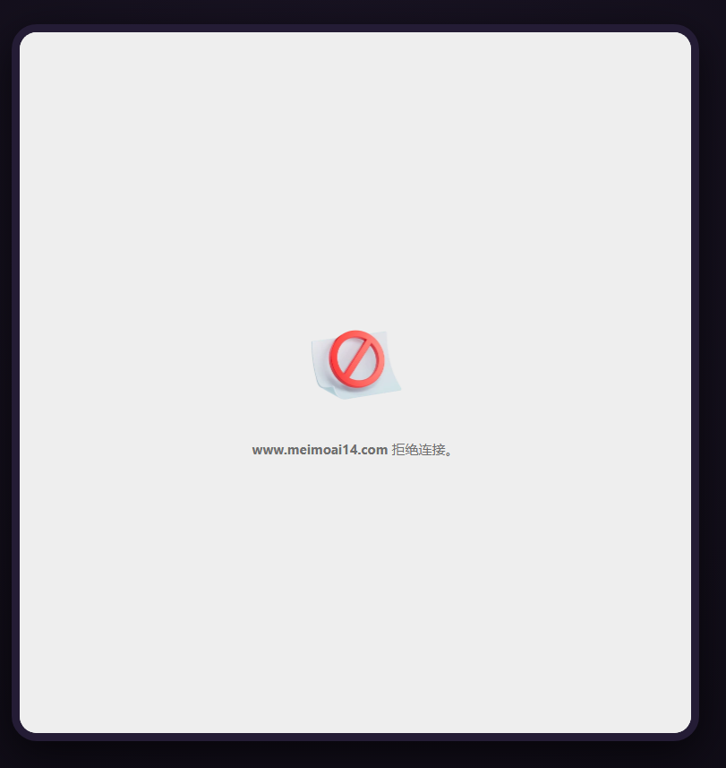
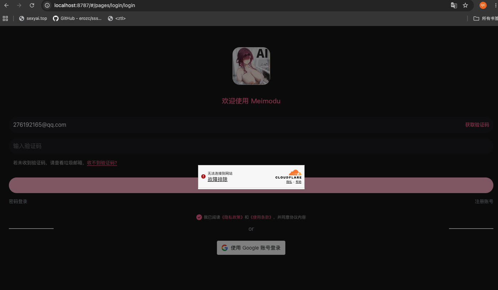
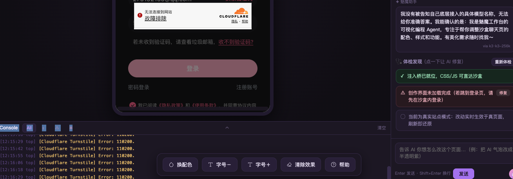
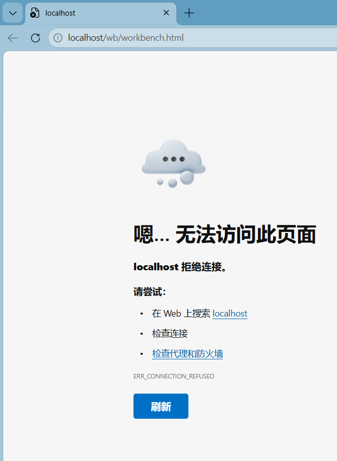
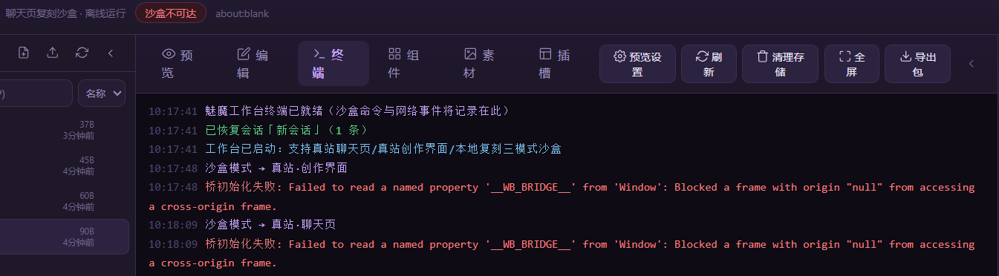

# 【开源分享】魅魔工作台——不用写代码，把聊天页美化成你想要的样子

来源: Discord 魅魔藏经阁 thread 1535659573770461345
创建: 2026-08-08T14:42:53.562000+00:00
消息数: 113

---

**林枫** (2026-09-18 22:37:35):
手机下不了好像<:emoji_115:1379113943817257071>

**林枫** (2026-09-03 04:01:33):
安卓手机不能用啊

**wda** (2026-08-25 17:30:00):
学习失败！

**pure-azureus** (2026-08-21 09:06:42):
太难了

**pure-azureus** (2026-08-21 09:06:40):
<:emoji_133:1379494883227734157>

**pure-azureus** (2026-08-21 09:06:36):
弄不明白

**牢 · k** (2026-08-13 14:20:18):
好耶

**ain** (2026-08-12 23:07:48):
听着挺多，实际上项目长了没几下就用完了。

**ain** (2026-08-12 23:07:32):
应该能用个几亿token

**阳玉** (2026-08-12 06:35:07):
<:emoji_139:1379455053080825866> <:emoji_249:1416980114511761448> 有这好事？薅一顿

**召唤师** (2026-08-11 16:28:04):
谢谢大佬

**ain** (2026-08-11 16:25:01):
https://qoder.com.cn/referral?referral_code=WnEmIrTwxKMB8NfmSrBCKZRT334zhHdd
[Qoder 一周年福利：Qwen3.8-Max 限时放送](https://qoder.com.cn/referral?referral_code=WnEmIrTwxKMB8NfmSrBCKZRT334zhHdd)
一周年之际，恰逢 Qwen3.8-Max 正式首发上线，我们准备了一波限时福利，感谢大家的支持。

**召唤师** (2026-08-11 16:24:35):
<:emoji_249:1416980114511761448>

**ain** (2026-08-11 16:24:28):
现在可以白嫖积分

**ain** (2026-08-11 16:24:22):
可以试试这个

**ain** (2026-08-11 16:24:19):
qoder

**召唤师** (2026-08-11 16:24:19):
ok

**ain** (2026-08-11 16:24:09):
给你启动起来之后应该就不需要了

**ain** (2026-08-11 16:23:57):
一些能白嫖的agent工具就行了

**ain** (2026-08-11 16:23:20):
你电脑应该是环境问题

**ain** (2026-08-11 16:23:12):
你试试用agent帮你启动

**召唤师** (2026-08-11 16:21:44):
我的24的

**召唤师** (2026-08-11 16:21:39):
下了

**ain** (2026-08-11 16:21:34):
环境下载了吗

**ain** (2026-08-11 16:21:32):

**召唤师** (2026-08-11 16:21:20):
这个终端自动退了

**召唤师** (2026-08-11 16:21:02):

**ain** (2026-08-11 16:20:31):
你的给我看终端页面的报错问题呀

**召唤师** (2026-08-11 16:20:14):
终端在无法访问网页的时候就自己退了

**ain** (2026-08-11 16:19:53):
而且点击工作台出的应该是终端页面吧

**召唤师** (2026-08-11 16:19:52):
对呀，弹出是无法访问网页

**ain** (2026-08-11 16:19:43):
不需要点击html呀

**ain** (2026-08-11 16:19:37):
启动工作台会弹出一个网页呀

**召唤师** (2026-08-11 16:19:02):
是的，这个是我在文件里面打开html，正常点那个启动，打开的浏览器是无法访问网页

**召唤师** (2026-08-11 16:18:03):
win

**ain** (2026-08-11 16:17:35):
win还是mac

**ain** (2026-08-11 16:17:04):
你什么操作系统

**ain** (2026-08-11 16:16:58):
点击启动工作台也不改打开这个网页呀

**ain** (2026-08-11 16:16:42):
用sex网站试试呢

**ain** (2026-08-11 16:16:38):
我预设的也不是这个网站呀

**ain** (2026-08-11 16:16:32):
不对吧

**召唤师** (2026-08-11 16:12:32):
点击启动工作台，浏览器打不开

**召唤师** (2026-08-11 16:11:00):

**ain** (2026-08-11 16:06:21):
哪个网站打不开

**召唤师** (2026-08-11 16:01:32):
网站咋打不开

**谢特** (2026-08-10 14:02:35):
是我宣传的

**咎染** (2026-08-10 08:30:25):
再次躺枪说是

**夜（中奖三次版）** (2026-08-10 07:48:59):
<:emoji_148:1382329938404839586>

**澪** (2026-08-10 07:03:10):
牛逼啊😱

**乱马（参赛卡艾泽尔酒店）** (2026-08-10 06:49:03):
他这做的东西跟我有啥关系啊？话说哪来什么乱马教<:emoji_115:1379113943817257071>

**ain** (2026-08-10 05:59:58):
ok

**tanzhen009** (2026-08-10 05:59:51):
验证码我这个方法登录也算曲线救国了，能上去

**ain** (2026-08-10 05:59:40):
不知道密码有没有验证

**ain** (2026-08-10 05:59:26):
忘记了

**ain** (2026-08-10 05:59:23):
密码好像也有

**tanzhen009** (2026-08-10 05:59:06):
哦哦，好吧，我懂了，密码不走Cloudflare 那关

**ain** (2026-08-10 05:58:24):
我是密码登录的。

**ain** (2026-08-10 05:58:15):
你是验证码登录的是吧

**tanzhen009** (2026-08-10 05:56:47):
直接在真实站重新发送验证码，然后用这个验证码在沙盒登录<:emoji_249:1416980114511761448>

**tanzhen009** (2026-08-10 05:55:58):
好吧，可以了

**tanzhen009** (2026-08-10 05:44:40):
还是不行的样子，大佬那边试过是可以的吗

**ain** (2026-08-10 05:38:09):
然后再点击新页打开

**ain** (2026-08-10 05:37:55):
你先再沙盒打开登录页面

**ain** (2026-08-10 05:37:47):
但是这个新页面打开应该没问题的

**ain** (2026-08-10 05:37:32):
对

**tanzhen009** (2026-08-10 05:36:49):
让我手动迁移cookie😩

**tanzhen009** (2026-08-10 05:36:00):
我查了AI，说110200 是 Cloudflare 的「域名不匹配」错误

**tanzhen009** (2026-08-10 05:35:16):
点不开，我是mac上的chrome,应该没影响吧

**夜（中奖三次版）** (2026-08-10 05:03:09):
我将退出乱马教

**夜（中奖三次版）** (2026-08-10 05:02:42):
<:emoji_249:1416980114511761448>

**ain** (2026-08-10 04:20:24):
然后沙盒内刷新下。

**ain** (2026-08-10 04:20:17):
点击这个然后再登录试试

**ain** (2026-08-10 04:20:13):

**ain** (2026-08-10 04:16:56):
手动登录呢

**tanzhen009** (2026-08-10 04:16:37):

**tanzhen009** (2026-08-10 04:15:50):
在沙盒里无法登录吗

**ain** (2026-08-10 04:02:01):
误报错的，问题不大，应该能正常用。

**ain** (2026-08-10 03:57:47):
我来看看什么问题

**tanzhen009** (2026-08-10 03:47:36):
已经接入K3<:emoji_148:1382329938404839586>

**tanzhen009** (2026-08-10 03:46:49):
厉害，之前就在想，可以不可以有个可视化编程界面，没想到直接被大佬做出来了，完整的一套低代码编程功能还有AI可以辅助。太强了

**咎染** (2026-08-10 02:29:06):
没事了，打开了

**咎染** (2026-08-10 02:19:34):
是我的问题嘛？

**咎染** (2026-08-10 02:18:55):

**ain** (2026-08-10 01:03:44):
有门槛，尝试的比较少吧

**艾斯卡诺ദ്ദി˶•̀֊•́)✧** (2026-08-09 17:19:57):
但是为什么到现在都没有使用反馈啊…我还等着有人分享使用心得呢

**波奇🎸** (2026-08-09 17:12:58):
不愧是澄清妈妈<:emoji_149:1400299483212021833>

**清** (2026-08-09 04:43:13):
<:emoji_299:1535540582137593866>

**鹿初** (2026-08-09 02:57:20):
<:emoji_252:1478791303587299378>

**ain** (2026-08-09 01:33:41):
有问题反馈给我，我自己最近没写卡计划所以没用，就简单测试了下。

**（猫娘萝莉妈妈)抱玖酒(捡小猫)** (2026-08-08 19:12:28):
学习中

**小魅** (2026-08-08 18:07:06):
<:07:1298281204260278383> 感谢宝宝开源

**小魅** (2026-08-08 18:06:56):
我去，agent编辑器

**MEE6** (2026-08-08 18:06:46):
<:CHECK6:403540120181145611> 300,000 XP has been given to **<@!957506508676014090>**

**有咩** (2026-08-08 15:39:31):
吓哭了

**有咩** (2026-08-08 15:39:29):
<:emoji_252:1478791303587299378>

**咎染** (2026-08-08 15:27:59):
这么强！

**咎染** (2026-08-08 15:27:54):
<:emoji_252:1478791303587299378> <:emoji_252:1478791303587299378> <:emoji_252:1478791303587299378>

**咎染** (2026-08-08 15:27:18):
<:emoji_252:1478791303587299378>

**花沁雅** (2026-08-08 15:21:52):
<:emoji_277:1501430172040298566> 瞅瞅

**周雅（被老婆调教.周浩）** (2026-08-08 14:54:58):
<@1135473222658297907> 奖励经验

**哥（一条区）** (2026-08-08 14:51:04):
牛逼

**哥（一条区）** (2026-08-08 14:51:01):
<:emoji_115:1379113943817257071>

**乱马（参赛卡艾泽尔酒店）** (2026-08-08 14:47:22):
<:emoji_140:1379454014852436038>

**乱马（参赛卡艾泽尔酒店）** (2026-08-08 14:47:18):
先睡了，明天早上再看

**艾斯卡诺ദ്ദി˶•̀֊•́)✧** (2026-08-08 14:47:09):
先收藏了再说

**ain** (2026-08-08 14:46:56):
所以大家可以随意更改。

**ain** (2026-08-08 14:46:48):
其实里面可以添加更多的模板类的内容。

**ain** (2026-08-08 14:46:22):
让ai帮忙修改然后可以试试查看。

**ain** (2026-08-08 14:45:48):
就是正常配置好ai，然后对话

**乱马（参赛卡艾泽尔酒店）** (2026-08-08 14:44:53):
😭

**阳玉** (2026-08-08 14:44:41):
# 恩情还不完！

**阳玉** (2026-08-08 14:44:27):
🖐️ 😭 🖐️

**ain** (2026-08-08 14:42:53):
**提前打个预防针：具体什么效果我也没用，有什么问题反馈给我我再修，我是肘击出来就分享了。**
🎨【开源分享】魅魔工作台——不用写代码，把聊天页美化成你想要的样子

做了一个可视化美化工具，专门给 sexyai 聊天页做皮肤：全程点一点、拖一拖，
改完一键导出美化包，或者直接发布到你的角色卡。代码已开源 👇
🔗 https://github.com/czjainiaini/mm-workbench （MIT 协议，免费用）

✨ 能做什么
· 🎨 一键换配色：8 套预设色板，背景/气泡/按钮/弹窗 97 个区域全覆盖
· 🖼 换素材：头像、页面底图、图标，贴图床链接就能换，随时还原
· 🧩 组件画布：勾选卡片启用，拖拽排序，颜色/圆角/字号可视化调参
· 🧱 加组件：悬浮按钮/横幅/侧边栏，还能把组件直接拖到页面任意位置
· ✏️ 点选编辑：点页面里任何一个元素直接改属性，改坏了一键撤销/清除
· 🤖 AI 助手：直接说"换成粉色"它就帮你改，支持接自己的大模型 API
· 📤 一键导出：所有改动打包成平台可导入的美化包，或直接发布到角色卡

🚀 新手安装（3 分钟）
1. 安装 Node.js（官网下载一路下一步）：https://nodejs.org
2. 下载项目：GitHub 页面点 Code → Download ZIP，解压到任意位置
   （或者 git clone https://github.com/czjainiaini/mm-workbench.git）
3. 双击文件夹里的「启动工作台.bat」→ 浏览器自动打开工作台
   第一次用：顶部选沙盒模式「真站·聊天页」→ 点「🎨 换配色」挑一套 → 完成！
   不会用？工作台右上角 ❓ 有完整帮助中心和新手引导。

🤖 用 AI Agent 部署（进阶玩法）
如果你在用 Cursor / Claude Code / Trae 这类 AI 编程工具：
把仓库 clone 到本地，在工具里打开项目，直接说：
  "帮我启动这个项目并打开工作台"
Agent 会自动帮你检查 Node 环境、启动服务、打开页面。
之后想加功能也可以直接跟 Agent 说，比如"给色板加一套莫兰迪配色"，
项目是单文件前端 + 零依赖 Node 服务，Agent 改起来很顺手。

💬 想要你们的反馈
随便玩，玩完回来聊聊：
· 哪个功能最顺手？哪个最难找？
· 有没有遇到报错或者没生效的情况？（截图更好）
· 想要什么新配色 / 新组件 / 新功能？
反馈直接回帖。

⚠️ 小提示
· 工具只在本地预览你的改动，不点"发布到角色卡"不会影响线上
· 请遵守平台规则，只美化自己有权限修改的内容
· 所有配置存在你自己浏览器里，不上传任何数据

[GitHub - czjainiaini/mm-workbench: 魅魔工作台：面向 sexyai....](https://github.com/czjainiaini/mm-workbench)
魅魔工作台：面向 sexyai.ai 聊天页的可视化美化工具（换配色/换素材/组件画布/点选编辑/AI助手/导出发布） - czjainiaini/mm-workbench
[Node.js — Run JavaScript Everywhere](https://nodejs.org/)
Node.js® is a free, open-source, cross-platform JavaScript runtime environment that lets developers create servers, web apps, command line tools and scripts.

