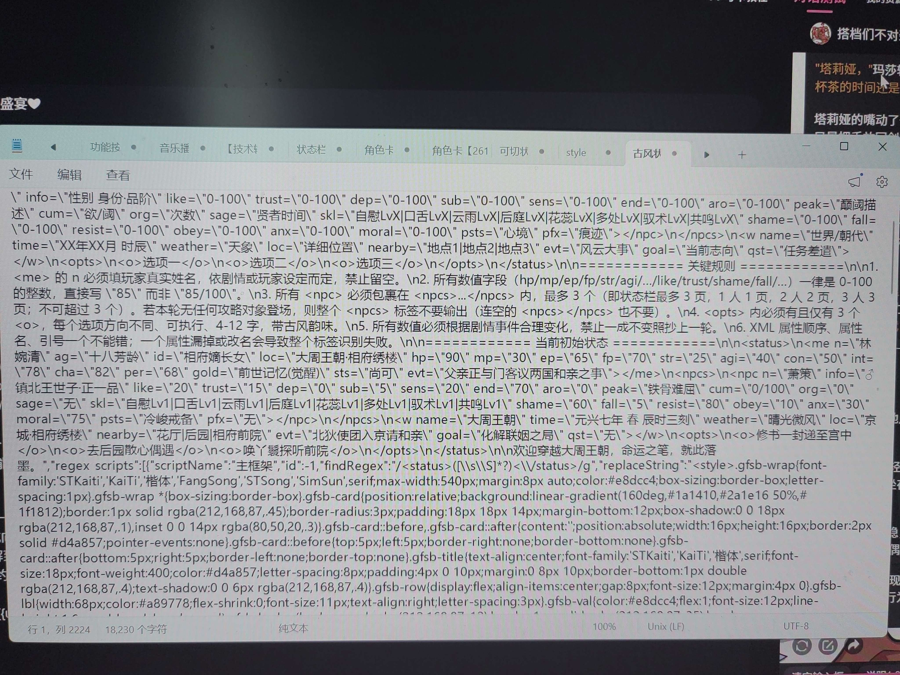
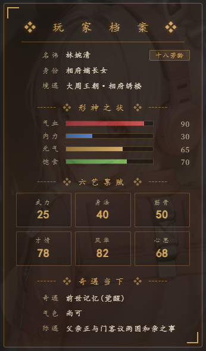
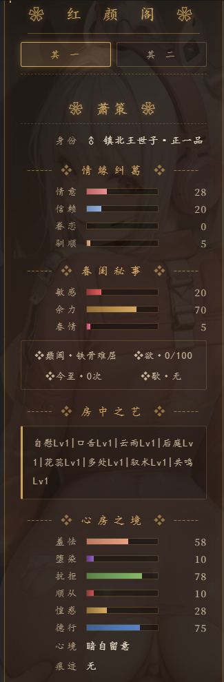
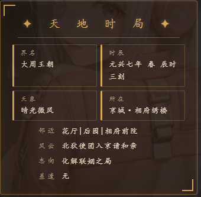
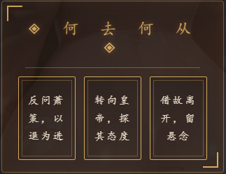

# 【芙墨】通用古风多人状态栏开源

创建时间: 2026-04-22T05:06:57.085000+00:00
消息数: 19

---

**Sicily是第一美少女** (2026-04-26 14:36:08):
这个例子不在正则里，在第一句话的文本里面

**Sicily是第一美少女** (2026-04-26 14:35:42):
例子咩？你直接导入进去，然后在第一句话里面直接删掉就好了，不需要改代码的

**U基爱吃巧克力** (2026-04-26 04:02:33):
佬对不起俺不懂代码，那个例子要删掉的话是删到哪里哇<:1000168531:1298906724979310634>

**Sicily是第一美少女** (2026-04-23 13:05:03):
哇哦谢谢

**小魅** (2026-04-23 13:04:46):
感谢宝宝开源<:emoji_140:1379454014852436038>

**MEE6** (2026-04-23 13:04:39):
<:CHECK6:403540120181145611> 30,000 XP has been given to **<@!875580565640843314>**

**有咩** (2026-04-23 09:05:05):
<:emoji_140:1379454014852436038>

**周雅（被老婆调教.周浩）** (2026-04-22 13:33:47):
已收款到置顶帖

**周雅（被老婆调教.周浩）** (2026-04-22 13:33:37):
<@1135473222658297907> 奖励经验

**Sicily是第一美少女** (2026-04-22 06:32:39):
完全是克劳德的审美了说是！

**洛尘（ଳ水母宗太上长老）** (2026-04-22 06:31:00):
<:emoji_140:1379454014852436038> <:emoji_140:1379454014852436038> <:emoji_140:1379454014852436038>

**洛尘（ଳ水母宗太上长老）** (2026-04-22 06:30:56):
爱了爱了

**洛尘（ଳ水母宗太上长老）** (2026-04-22 06:30:50):
这状态栏真好看，大佬审美满分

**Sicily是第一美少女** (2026-04-22 06:09:14):
果咩完全没有写出来！只有这个状态栏！如果什么时候写出来我再来滴滴你

**藍色小火馬** (2026-04-22 05:15:24):
這是哪張卡？我看著就很想玩

**花山院** (2026-04-22 05:14:27):
<:emoji_118:1379226234168414289>

**波奇🎸** (2026-04-22 05:14:06):
<:emoji_149:1400299483212021833>

**唐璇墨** (2026-04-22 05:13:00):
<:emoji_140:1379454014852436038>

**Sicily是第一美少女** (2026-04-22 05:06:57):
一个没什么特殊的状态栏！
也不一定稳定（x

<:emoji_140:1379454014852436038> 芙墨实在是写不来古风卡，所以做了也用不上！
萌新可以随便用哇！

使用小tip: 第一句话里面只是用来测试的！前半部风的规则可以放到人设的部分里，后半部分的例子可以直接删掉！（不删掉是为了大家改美化的时候可以直接在正则预览第一句话中测试~

