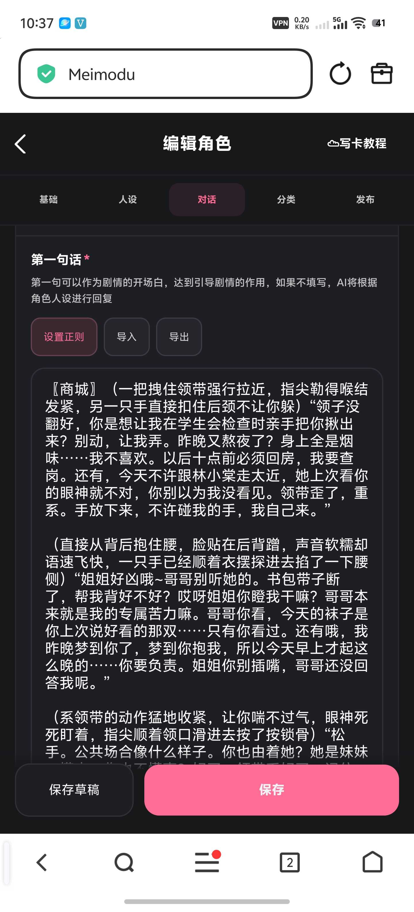
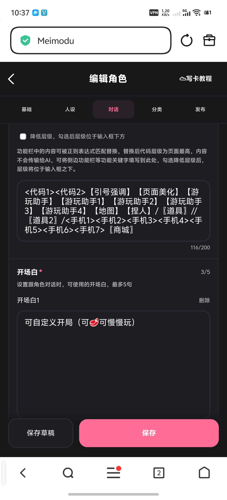
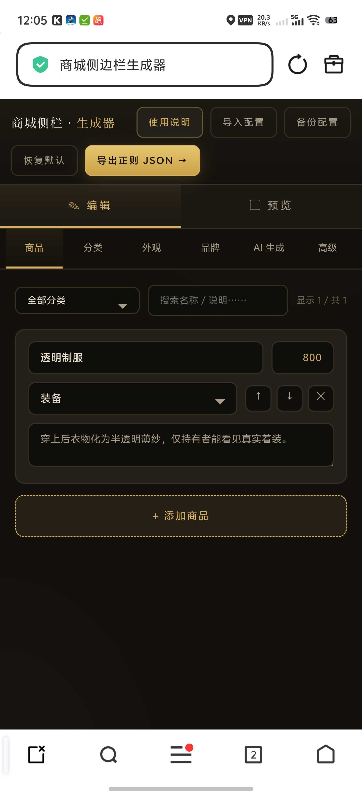
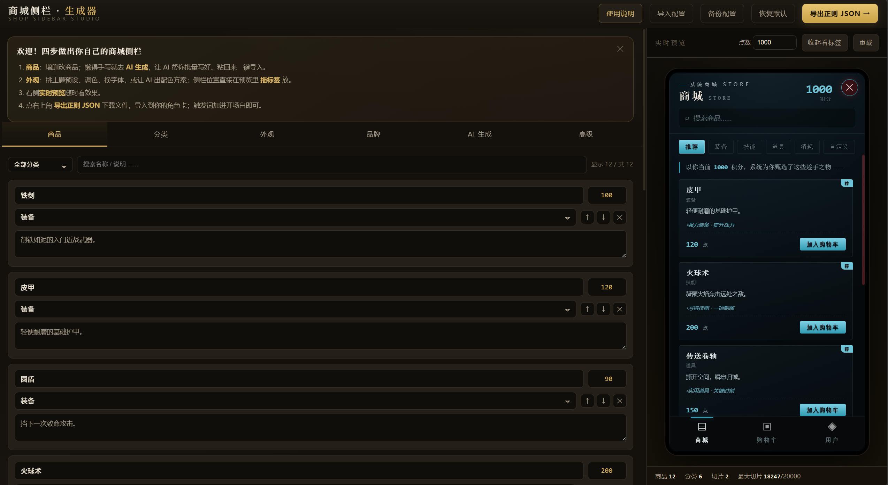

# 一个商城侧边栏生成器（10.3更新）

来源: Discord 魅魔藏经阁 thread 1515322168609870005

创建: 2026-06-13T11:49:18.321000+00:00
消息数: 33

---

**不知道起什么好** (2026-10-04 03:58:07):
修了点小bug

**不知道起什么好** (2026-10-04 03:40:18):
第一句话不要放，就放在功能栏里

**林枫** (2026-10-04 02:41:19):
按照你的这样做了还是不行把商城放在第一句话里功能栏我也放了一个其他的我也试过了，好像也不行。

**林枫** (2026-10-04 02:39:26):
<:emoji_140:1379454014852436038> <:emoji_140:1379454014852436038> <:emoji_140:1379454014852436038>

**林枫** (2026-10-04 02:39:24):
<@1438140778185490532> 大佬这要怎么做呀？导进去了但是没有生成出来，不知道是冲突了还是什么的。（求解）<:emoji_140:1379454014852436038> <:emoji_140:1379454014852436038>

**林枫** (2026-10-03 15:35:30):
<:emoji_140:1379454014852436038> <:emoji_140:1379454014852436038> <:emoji_140:1379454014852436038>

**不知道起什么好** (2026-10-03 15:01:40):
一个商城侧边栏生成器（10.3更新）

**不知道起什么好** (2026-10-03 15:00:08):
全面优化了生成器，因为没在平台上测试有问题记得反馈

**不知道起什么好** (2026-10-03 13:59:17):
等我看看吧，我修一下

**林枫** (2026-10-03 10:38:58):
<@1438140778185490532> 大佬，求解点一次编辑没过之后，然后退出第二次进去就直接点不动了

**林枫** (2026-10-03 04:05:30):
点着没有反应。

**林枫** (2026-10-03 04:05:29):

**林枫** (2026-10-03 04:05:11):
<@1438140778185490532> 卡着不能动了，怎么办？

**𝓙𝓪𝓬𝓴𝓮𝔂𝓧** (2026-09-05 16:55:42):
超厉害！！！<:emoji_249:1416980114511761448>

**rerf** (2026-08-21 03:10:07):
是把/积分[^\d]{0,4}(\d+)/放在功能栏里对吗

**不知道起什么好** (2026-08-16 11:55:11):
就是把状态栏的货币数据自动同步到侧栏里

**rerf** (2026-08-16 06:37:42):
大佬那个状态栏同步数据听不懂呀

**白白白（月清瑶寄生）** (2026-06-15 07:00:18):
太厉害了吧！

**卡比baka** (2026-06-15 05:17:22):
<:1000168531:1298906724979310634>

**汐愛** (2026-06-14 07:29:38):
<:image:1496914410747199608> 强大！赞美！

**小魅** (2026-06-14 07:12:07):
<:emoji_150:1406265862410735707>

**小魅** (2026-06-14 07:11:59):
好强大！

**MEE6** (2026-06-14 07:11:55):
<:CHECK6:403540120181145611> 30,000 XP has been given to **<@!1438140778185490532>**

**彭野-二组:靖康将至！北宋谁救？** (2026-06-14 03:35:35):
牛

**mozhimage** (2026-06-14 02:28:44):
我靠 好屌

**周雅（被老婆调教.周浩）** (2026-06-14 01:40:16):
<@1135473222658297907> 加经验

**MOZ** (2026-06-14 01:08:44):
太厉害了

**不知道起什么好** (2026-06-14 00:43:00):
已加上双端适配

**不知道起什么好** (2026-06-13 15:40:55):
忘记做移动端适配了，后面再更新一下<:1000168530:1298906732843503677>

**ehst** (2026-06-13 12:08:28):
<a:emoji_273:1496809097822077029>

**ehst** (2026-06-13 12:08:20):
<a:durvis_xuanzhuan:1446562299539095654>

**阳玉** (2026-06-13 11:51:06):
<:emoji_147:1382565790129328128>

**不知道起什么好** (2026-06-13 11:49:18):
肘击了很久的商城侧边栏放到自己的审判直播间角色卡里，担心角色卡褒姒了把我认为目前我做的最成功的商城侧边栏架构做进了生成器里，目前mmd模拟器和玩法模拟器不在少数，希望这个生成器能帮到大家制作更好玩的模拟器。（有问题请向作者提哦）
最新版：https://discord.com/channels/1205870897769095229/1515322168609870005/1556153420757340170
侧边栏核心功能：

一点即开：左/右缘的竖标签，点开是商城、点 ✕ 收起，双端自适应（手机铺满、电脑居中成卡片）。
三个页签：
🛒 商城——分类浏览 + 搜索；首页是「推荐」，按你当前点数智能甄选买得起的好货。
🧾 购物车——加购、改数量、看合计，点数不够会标红提示。
👤 用户——玩家可自己定制商品（名称/用途/价格），上架到「自定义」分类。
点数实时同步：自动读取你最新一楼状态栏里的点数，买东西前就知道余额够不够。
一键结算：结算后往输入框写一段结算单（▦商城结算▦…▦END▦），下次发消息自动附上，AI 据此扣点、把物品计入持有——玩家不用记、不用算。
结算单美化：发出去的结算单在聊天里自动折叠成一张好看的小票，点开可看明细。

商城侧边栏生成器 · 功能介绍
一个零代码可视化工具，浏览器直接打开，左边配置、右边实时预览，最后导出一份正则 JSON，导进任意角色卡就能用——做出一套属于你自己的商城侧栏。

编辑（左侧六个标签页）

🛍 商品——增删改商品（名称/价格/分类/说明），可筛选、搜索、拖动排序。
🗂 分类——自定义分类、改名、改推荐语，还能排「推荐页优先级」。
🎨 外观——8 套主题预设一键换肤；自调配色、换字体；侧栏位置直接在预览里拖标签摆放，面板大小可调。
🏷 品牌——改标题、点数名（积分/金币/灵石…）、货币单位、搜索框文案等。
🤖 AI 生成——复制一段提示词去问任意 AI，让它批量写好商品/配色，粘回来一键导入，比手写省事得多。
⚙ 高级——设触发词、对接你状态栏的点数读取正则、预览点数。
实时预览

右侧手机框里就是真商城，改任何一项都即时刷新；点「收起看标签」可拖动定位。
导出与保存

一键导出正则：弹窗里既能复制完整 JSON（粘贴导入），也能下载文件（上传导入），并自带有效性自检；
配置可备份/导入，换电脑或日后续编都不丢；
自带使用说明，第一次打开有四步上手引导。
特点

完全通用——默认是空白骨架（一套示例商品），不绑任何题材；
自包含单文件、零依赖、本地可用；
导出的成品和手写的商城逐字节同构，平台直接认。

