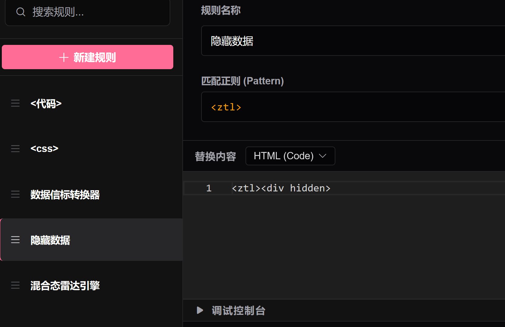
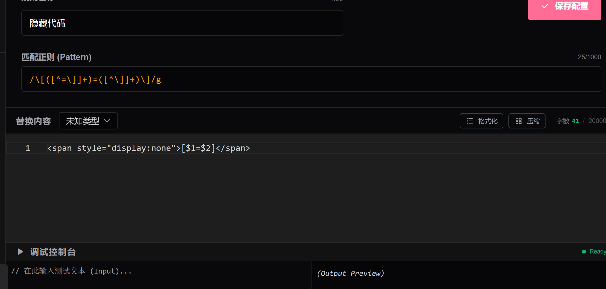
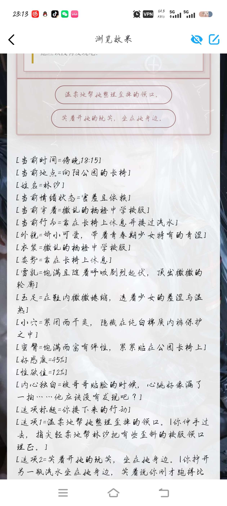
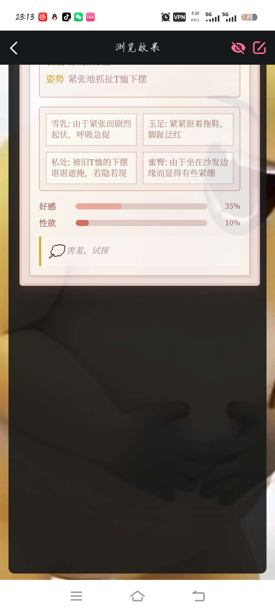
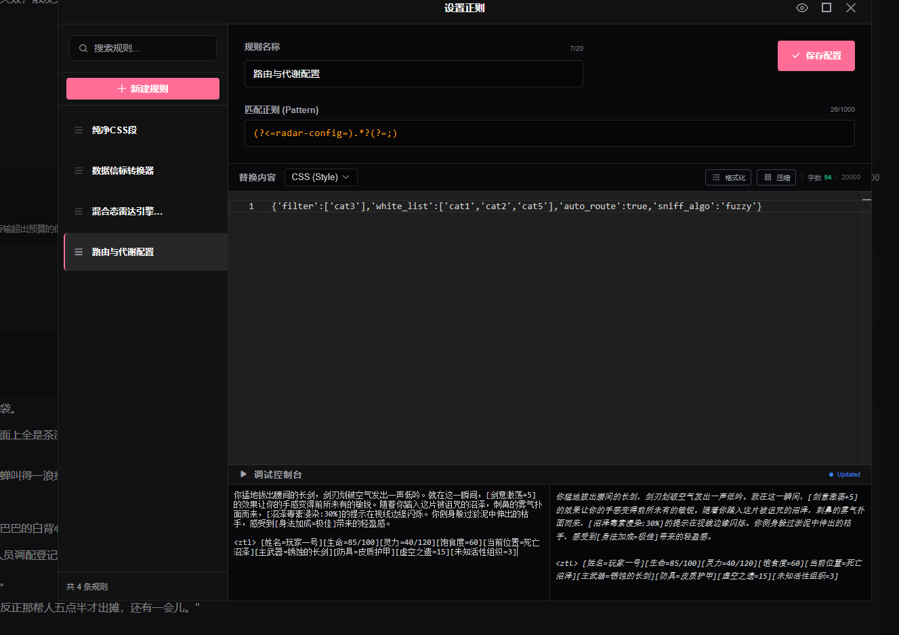

# 一种基于特征嗅探与响应式动态DOM的混合态雷达式状态栏设计规范及示例

创建时间: 2026-03-21T05:10:33.058000+00:00
消息数: 39

---

**黑白琴键（奥特曼参赛卡：残光）四组** (2026-07-23 15:10:09):
欧克欧克

**黑洞猫** (2026-07-23 14:58:49):
混合态雷达法比起初代更强调的是自由构筑状态栏UI，它彻底解离了数据和UI骨架，让状态栏更加灵活，足以对抗各种意外以及长线游玩后期ai的自然发散需求。

**黑白琴键（奥特曼参赛卡：残光）四组** (2026-07-21 15:16:06):
猫，我问问一下，这个跟之前的雷达法三段式的状态栏来说更稳定吗

**大吉吉〔进化NTR版〕** (2026-07-16 01:34:41):
谢谢大佬<:emoji_140:1379454014852436038>

**黑洞猫** (2026-07-02 17:45:14):
会肘击ai的可以喂给高智商ai，让它给你做个性化方案。
不会肘击ai的可以在藏经阁里找一下状态栏编辑工具或者开源状态栏，有很多人拿我的理论去做了编辑工具和开源状态栏，特征是“<ztl>”，看到这个雷霆拼音首字母缩写标签基本上就是用我的法做的。

**大吉吉〔进化NTR版〕** (2026-07-02 06:36:13):
大佬怎么用？直接喂给AI，然后提要求吗？<:1000168510:1298906820638674984>

**花沁雅** (2026-06-14 15:30:56):
🧐 让我看看

**千痕** (2026-06-06 12:01:55):
<:emoji_139:1379455053080825866>

**黑洞猫** (2026-06-06 05:49:53):
并且用了之后，<ztl>不能出现在正文之前，否则会连正文也藏起来了。

**黑洞猫** (2026-06-06 05:48:53):
如图，简单写写，要求只有这个正则的顺序必须排在雷达引擎之前

**黑洞猫** (2026-06-06 05:48:16):
如果还是不行,教你一招外道的：

**黑洞猫** (2026-06-06 05:45:34):
你看我在论文中示例就不会有这个问题。叫哈基米参考论文中的示例的方案解决这个问题。

**黑洞猫** (2026-06-06 05:40:09):
这是隐藏正则没写好

**千痕** (2026-06-05 15:20:20):
状态栏里的情况都能肘出来但这种情况怎么肘它，找哈基米重新要了几次都差不多这样<:emoji_250:1459542480406970432>

**千痕** (2026-06-05 15:15:21):
大佬，这种在状态栏后面要么跟一堆该隐藏的数据，要么就是空一堆空白(它把那些数据给隐藏了但还是会有空白占在那里)是什么问题?

**千痕** (2026-06-04 06:02:22):
<:emoji_148:1379454224353591457>

**苏御** (2026-05-10 01:31:18):
没有状态栏哈哈哈

**黑洞猫** (2026-05-09 17:53:46):
实测如何呢

**苏御** (2026-05-09 15:56:14):
按照教程做出来的不过感觉哪不对劲

**黑洞猫** (2026-05-08 18:01:08):
我感觉哈基米的甲已经很薄了，只要不是涉铜的，官网都能写。“传文件学习办公的AI”这个是何意味，豆包都行吧，只要你信得过那啥。

**苏御** (2026-05-08 15:54:05):
没事了手机AI,垃圾，我用电脑AI,从教程学学，开始弄，话说电脑端有没有甲薄点的可以传文件学习办公的AI,大佬，咨询一下<@873612536912687184>

**黑洞猫** (2026-05-08 15:35:27):
没看懂，你这是遇到什么问题了？

**苏御** (2026-05-07 19:06:18):
怎么整，有点懵😳

**ZSH** (2026-04-06 02:08:38):
<:emoji_83:1378946142330683422> pero~pero~perp~

**洛尘（ଳ水母宗太上长老）** (2026-03-29 10:41:50):
<:emoji_140:1379454014852436038>

**乖宝宝小水母（水母宗唯一宗主。大周荣誉国祖)** (2026-03-29 09:50:32):
<:emoji_252:1486325346256027708>

**黑洞猫** (2026-03-29 09:09:47):

**黑洞猫** (2026-03-29 09:09:31):
更新了

**黒宮みまり** (2026-03-27 15:00:47):
已严肃开始学习

**MEE6** (2026-03-23 16:39:36):
<:CHECK6:403540120181145611> 50,000 XP has been given to **<@!873612536912687184>**

**小魅** (2026-03-23 16:39:00):
！

**月月（已黑化）** (2026-03-23 14:56:20):
已严肃学习

**周雅（被老婆调教.周浩）** (2026-03-23 14:31:35):
<@1135473222658297907> 建议关注经验

**XXX** (2026-03-21 06:20:45):
<:emoji_150:1400299501423431771>

**XXX** (2026-03-21 06:20:32):
我还吃

**黑洞猫** (2026-03-21 06:07:41):
例子-简单肉卡中的侧边切换日夜版按钮不能放在第一句话哦，要放在功能栏，如图

**黑洞猫** (2026-03-21 05:16:41):
实在是看不懂，也不会使用ai转换的话，给出的状态栏例子可以二改或者直接用

**黑洞猫** (2026-03-21 05:15:30):
最新版在下方
https://discord.com/channels/1205870897769095229/1484781238073032755/1487740547664838708
推荐使用哈基米官网版或者克劳德官网版，转换正则

**黑洞猫** (2026-03-21 05:10:33):
随着大语言模型（LLM）在交互式角色扮演领域的深入应用，传统的基于静态正则替换的AI角色卡状态栏逐渐暴露出视图僵化、极易引发排版崩溃以及严重浪费上下文词元（token）等痛点。本文在初代雷达扫描法的基础上进行底层架构重构，提出了一种基于特征嗅探与响应式动态文档对象模型（DOM）的混合态雷达式AI角色卡正则化状态栏设计规范。本方案彻底解除了状态栏对静态HTML预制骨架的依赖，确立了“数据与视图解耦”的核心思想。通过引入多维度的特征嗅探路由算法、基于生命周期的状态解耦机制、宽窄屏自适应的响应式排版，以及针对平台底层重绘与模型符号幻觉的抗解析干扰防御体系四大核心突破，本规范在极其严苛的富文本拦截环境下，实现了一套高兼容、高稳定且低词元消耗的前端UI部署方案，极大拓展了AI角色卡的交互维度与运行上限。

