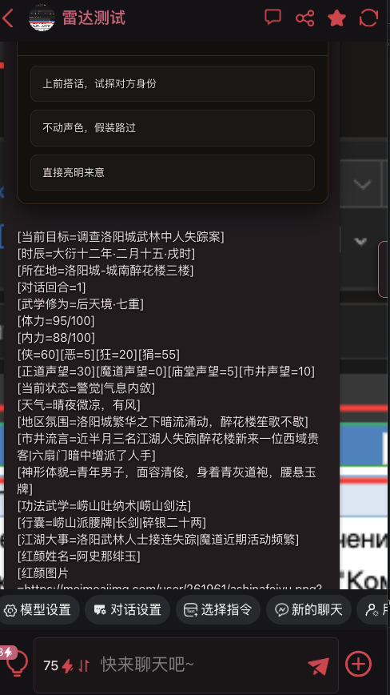
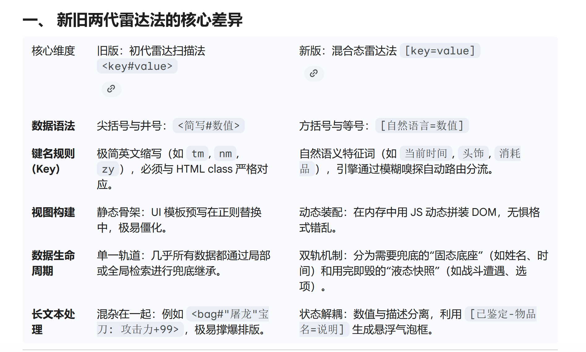

# 一种基于雷达扫描机制的正则美化状态栏设计规范及示例

创建时间: 2026-01-30T16:49:07.622000+00:00
消息数: 65

---

**tanzhen009** (2026-07-22 01:08:07):
必须要说一句，我自己不太懂html，但是看上去应该是用了解耦的思想？厉害了，搞色色的mmd看到编程大佬，惊了<:07:1298281204260278383>

**tanzhen009** (2026-07-22 01:03:24):
后来我对比了你提供的demo改成了第二个

**tanzhen009** (2026-07-22 01:03:12):
一开始的这个是我将文档丢给AI，AI直接生成的

**tanzhen009** (2026-07-22 01:02:42):
没事了，已经解决了，之前用的是\[([^=\[\]]+)=([^\[\]]+)\]\s*    后来改成/\[([^=\[\]]+)=([^\[\]]+)\]\s*/g

**黑洞猫** (2026-07-21 13:50:53):
先是用雷达引擎手搓正则藏起这个格式，然后进化到直接销毁ai气泡做一体式美化，现在最新的是加上shadow dom的一体式美化方案

**黑洞猫** (2026-07-21 13:49:04):
不过这个隐藏正则依赖mmd的原生正则系统，早就被我优化掉了

**黑洞猫** (2026-07-21 13:48:02):
怎么会出现这个问题呢，是忘了写还是写错了？

**tanzhen009** (2026-07-21 10:10:22):
知道了，是信标转换器正则的问题

**tanzhen009** (2026-07-21 09:58:15):

**tanzhen009** (2026-07-21 09:57:57):
<@873612536912687184> 大佬大佬，求救，我用了最新版的混合态雷达法。现在状态栏出来了，但是输出内容后面怎么还跟着一大串数据

**鹤南飞(接定制看简介)** (2026-06-17 18:29:24):
大佬能问一下你用的哪个ai吗？能不能给个网址

**黑洞猫** (2026-06-03 14:36:57):
你要不试试最新版的https://discord.com/channels/1205870897769095229/1484781238073032755
不仅架构更先进，稳定性也更高。
而且，这个旧版的新手指南我自己都感觉写得太抽象了

**千痕** (2026-06-01 15:42:50):
抱歉，我好像说了一堆不知道在说啥的话

**千痕** (2026-06-01 15:42:17):
其实主要就是状态栏这个问题<:emoji_248:1427157732770844783>

**千痕** (2026-06-01 11:54:02):
我全喂给ai之后，它给了正则，状态栏生成规范和第一句话共三种东西，我全替换成ai给的，状态栏就一直丢东西，如果只替换一部分，状态栏就没了

**黑洞猫** (2026-06-01 11:23:00):
不是很懂你在说啥...

**千痕** (2026-05-30 05:13:24):
大佬，ai给的第一句话要用吗，我用上去它给的第一句话，那状态栏就直接大变样了

**黑洞猫** (2026-03-21 08:54:49):

**黑洞猫** (2026-03-21 05:13:09):
https://discord.com/channels/1205870897769095229/1484781238073032755

**黑洞猫** (2026-03-21 05:13:05):
更新了，测了一周没什么问题发DC了

**安心院同學** (2026-03-11 19:22:40):
嚴肅學習

**ZSH** (2026-03-04 11:32:55):
那得狠狠期待了<:1000168531:1298906724979310634>

**黑洞猫** (2026-03-04 10:35:59):
下一代以自由组合、随意生成为主要改进方向，适合大世界、模拟器这种自由度高的卡

**黑洞猫** (2026-03-04 10:32:08):
下一代正则法马上出了，现在这个高度预制化的比较适合单人卡或者肉卡

**ZSH** (2026-03-04 05:57:32):
哇，是技术力超强的猫猫，已严肃学习<:emoji_140:1379454014852436038>

**天星问** (2026-02-26 16:22:17):
唉，ai的小巧思，改着改着就把一些功能省略了<:emoji_115:1379113943817257071>

**黑洞猫** (2026-02-26 16:21:17):
如果你自己试玩卡没问题，请问问那名玩家是用什么浏览器的

**黑洞猫** (2026-02-26 16:21:12):
你的浏览器环境是什么？自己试玩自己的卡是否出现这种情况，如果是，可以试试我自己用雷达法的卡，id=245979，看看这种问题是否能复现。

**黑洞猫** (2026-02-26 16:16:37):
ai给你改错了吧，我自己用的不会有这种情况啊。甚至就是为了避免过去的状态栏被改才让<ztl>里包括JS代码并且写自毁机制啊

**天星问** (2026-02-26 02:50:57):
黑洞猫大佬，用你这套做的最近才在评论区被反应一个问题。
就是每个静态骨架都捕获了最新的标签，前端上看就是每次生成新的状态栏，以前的状态栏都会被同步成最新的。
该怎么修改

**乖宝宝小水母（水母宗唯一宗主。大周荣誉国祖)** (2026-02-18 14:59:42):
<:emoji_150:1400299501423431771>

**黑洞猫** (2026-02-18 14:43:24):
这个故事告诉我们，提交审核前在写卡界面Ctrl+f查一下有没有自己的作者id还是很有必要的

**黑洞猫** (2026-02-18 14:42:14):
再开一次

**黑洞猫** (2026-02-18 14:41:59):
我居然也忘记删{{user}}=黑洞猫了

**贫穷** (2026-02-18 02:31:16):
谢谢黑洞猫喵，这就偷学一下

**秋天的鼹鼠** (2026-02-16 20:50:02):
太强大了

**Liliac Snow** (2026-02-15 05:50:50):
太帅了！！这个正则好好看！这就拿去学习！黑猫大佬真厉害！！

**黑洞猫** (2026-02-14 14:42:06):
可以直接导入mmd写卡界面查看，正则数据在下方，旧的有一点点小问题，删了

**黑洞猫** (2026-02-14 14:41:34):
分享一下我用雷达扫描法做的状态栏和运行规则

**小魅** (2026-02-09 07:48:19):
<:emoji_249:1416980114511761448> 好强大的样子

**MEE6** (2026-02-09 07:47:46):
<:CHECK6:403540120181145611> 50,000 XP has been given to **<@!873612536912687184>**

**波奇🎸** (2026-02-07 10:59:12):
<@1135473222658297907> 灌注妈妈

**波奇🎸** (2026-02-07 10:58:58):
妈妈你好厉害<:emoji_140:1379454014852436038>

**洛尘（ଳ水母宗太上长老）** (2026-01-31 14:32:30):
<:emoji_139:1379455053080825866>

**清** (2026-01-31 01:50:24):
<:emoji_139:1379455053080825866>

**乖宝宝小水母（水母宗唯一宗主。大周荣誉国祖)** (2026-01-30 19:56:37):
掃描雷達...時刻檢測文本內容？
完蛋，小水母聽不懂

**乖宝宝小水母（水母宗唯一宗主。大周荣誉国祖)** (2026-01-30 19:55:46):
<:emoji_250:1440756778487775303>

**黑洞猫** (2026-01-30 17:27:47):
除了状态栏规则要自己手动改改之外，生成的正则都能直接用

**黑洞猫** (2026-01-30 17:27:16):
我用那个提示词发给哈基米3Pro，再把文档和示例当成参考资料发给哈基米，让它给我改成正则的顺便写了状态栏规则

**黑洞猫** (2026-01-30 17:26:45):
自己改太累了

**黑洞猫** (2026-01-30 17:26:37):
那不挺好

**天星问** (2026-01-30 17:26:22):
<:emoji_140:1379454014852436038> ，我都是先写好完整的html再让ai把代码改成正则格式

**黑洞猫** (2026-01-30 17:25:40):
不过前提是要自己写好或者从别的ai那拿到完整的html状态栏

**黑洞猫** (2026-01-30 17:24:51):
直接发给哈基米叫他帮你改

**黑洞猫** (2026-01-30 17:24:33):
我写了给ai看的提示词

**宁天一绪** (2026-01-30 17:22:28):
摸摸黑洞猫

**玲璃亲** (2026-01-30 17:19:58):
<:emoji_250:1440756778487775303>

**天星问** (2026-01-30 17:19:04):
看不懂，但能感觉到好牛<:emoji_140:1379454014852436038>

**hwp** (2026-01-30 17:18:45):
<:emoji_140:1379454014852436038>

**黑洞猫** (2026-01-30 16:56:30):
如果你的状态栏整体没有过多性能占用的话，推荐将扫描间隔改为200ms

**黑洞猫** (2026-01-30 16:55:18):
另外，在实测中，发现每隔 500ms 扫描一次周围的数据还是有点慢了，玩家会很明显地感知到状态栏是“刷”出来的。

**黑洞猫** (2026-01-30 16:50:09):

**黑洞猫** (2026-01-30 16:49:59):

**黑洞猫** (2026-01-30 16:49:31):

**黑洞猫** (2026-01-30 16:49:07):
本文是基于柑硕“抓取式状态栏” 概念的改良与重构，提出了一种基于 textContent（标签纯文本）存储数据与“主动雷达扫描+全局兜底”策略的新型正则状态栏设计规范，简称“雷达扫描法”

“雷达扫描法”是指在大语言模型交互式叙事中，利用预置在 UI 容器中的 JS 脚本建立短期高频监听（即“雷达”），主动搜寻并同步页面数据节点的交互模式。本方案旨在解决传统正则替换及早期全局抓取法中存在的逻辑串线、数据截断及渲染时序不同步等痛点。通过将数据与视图彻底分离，利用隐藏 DOM 节点作为临时数据库，结合“雷达”脚本的动态嗅探，实现在长上下文或复杂富文本环境中，也能精准、稳定地呈现角色卡状态栏。

本帖是旧版的雷达法，最新的可以看这个帖子：
https://discord.com/channels/1205870897769095229/1484781238073032755

