# 从0开始的正则之路(大份作者状态栏心得)

来源: Discord 魅魔藏经阁 thread 1448929295970865192
创建: 2025-12-12T06:47:43.964000+00:00
消息数: 409

---

**vale_charlotte** (2026-07-18 06:32:03):
依旧学无止境

**苍肖** (2026-06-21 18:46:08):
代码太长了吧，我也有这个问题，所以我直接用200电的肘<:07:1298281204260278383>

**清** (2026-03-05 09:33:26):
看的晕晕乎乎的

**清** (2026-03-05 09:24:50):
<:emoji_252:1478791303587299378>

**清** (2026-03-05 09:24:44):
看着soki与大佬们拉扯

**清** (2026-03-05 09:08:39):
心累<:1000168510:1298906820638674984> <:1000168510:1298906820638674984> <:1000168510:1298906820638674984> 看了半天人傻了，初步理解作用和非常浅的一些规则了😭 至少正则是个什么东西和替换的含义，我再去看一遍屿那个去了

**A** (2026-02-27 04:34:53):
<:emoji_215:1411353218025521223>

**渡鸦-大周征东将军-鲁王** (2026-02-26 15:33:52):
然后被卡肘击

**渡鸦-大周征东将军-鲁王** (2026-02-26 15:33:41):
开始严肃学习

**渡鸦-大周征东将军-鲁王** (2026-02-26 10:24:08):
自己上手写卡会发现好辛苦，继续翻大佬们的焚诀

**echo** (2026-02-19 16:10:22):
然后把两段拼起来

**echo** (2026-02-19 16:10:14):
告诉她“继续”克劳德会接着补全截断内容

**echo** (2026-02-19 16:09:49):
或者你可以尝试使用分段的方式

**echo** (2026-02-19 16:09:27):
ai问题，建议多肘

**哦啦** (2026-02-10 14:15:34):
/回顶

**羽落** (2026-02-10 00:40:13):
<:1000168531:1298906724979310634> 纯萌新，已严肃学习

**余5月** (2026-02-06 16:45:01):
为啥我用茶壶永远输出不完整啊，替换句永远输出不完，不管多少电，我用85电的哈基米也给我截断了😫

**echo** (2026-02-04 17:19:02):
我45克35哈基米都用过，我喜欢用克劳德响应快，至于代码质量问题我分不出来区别

**檬** (2026-02-04 16:53:04):
75电的克最好

**无意间** (2026-02-04 07:56:02):
大佬，请问茶壶用的话用多少电量的啊

**celestial_unicorn_84168** (2026-01-12 01:50:49):
为什么填进去的代码状态栏显示不完整啊😭

**celestial_unicorn_84168** (2026-01-11 18:25:41):
<:1000168510:1298906820638674984>

**K233** (2025-12-29 13:07:06):
等会看见了不得了的东西

**echo** (2025-12-29 09:00:03):
<:emoji_249:1453759656613908510>

**soki** (2025-12-29 08:19:29):
<:emoji_249:1453759631536033875>

**乖宝宝小水母（水母宗唯一宗主。大周荣誉国祖)** (2025-12-28 04:21:07):
診斷為絕症

**乖宝宝小水母（水母宗唯一宗主。大周荣誉国祖)** (2025-12-28 04:20:58):
<:a862825b522cadb6:1409619818272915466>

**soki** (2025-12-28 03:58:30):
所以还是看不懂<:emoji_148:1382329938404839586>

**黑洞猫** (2025-12-27 15:04:45):
<:emoji_150:1391774331339542708>

**乖宝宝小水母（水母宗唯一宗主。大周荣誉国祖)** (2025-12-27 15:02:07):
<:emoji_136:1379504871027380274>

**黑洞猫** (2025-12-27 15:01:28):
多一个空格那次吧

**乖宝宝小水母（水母宗唯一宗主。大周荣誉国祖)** (2025-12-27 15:00:50):
<:emoji_144:1379832776785788928>

**乖宝宝小水母（水母宗唯一宗主。大周荣誉国祖)** (2025-12-27 15:00:45):
沒事，喵喵可愛呢
水母還記得喵喵幫水母解決代碼問題的英姿呢

**黑洞猫** (2025-12-27 14:58:59):
什么……什么理解？

**乖宝宝小水母（水母宗唯一宗主。大周荣誉国祖)** (2025-12-27 14:57:51):
貓貓對水母的理解打幾分呢

**乖宝宝小水母（水母宗唯一宗主。大周荣誉国祖)** (2025-12-27 14:57:39):
<:emoji_234:1431854430764007434>

**黑洞猫** (2025-12-27 14:52:27):
改了，防止有人直接跳到正则部分不看其他的
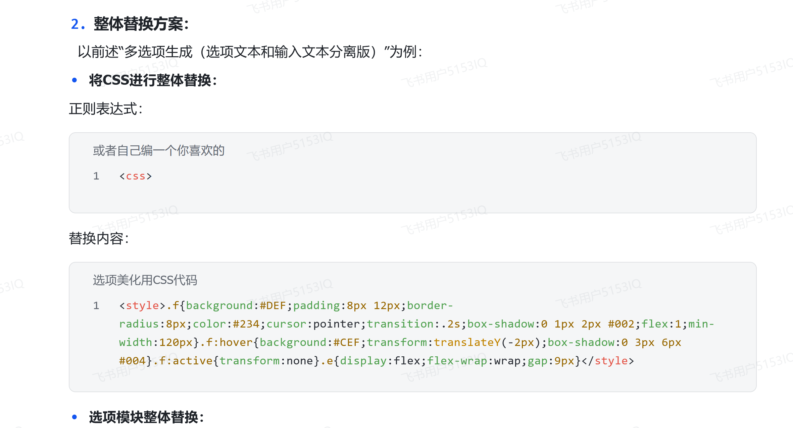

**黑洞猫** (2025-12-27 14:46:56):
而且最重要的是如果每次都会生成的选项里被正则换出大量且复杂的css会导致玩家卡顿

**黑洞猫** (2025-12-27 14:45:11):
我那个主要是演示一下对于选项的正则方法

**黑洞猫** (2025-12-27 14:44:05):
自己写一个美化的正则
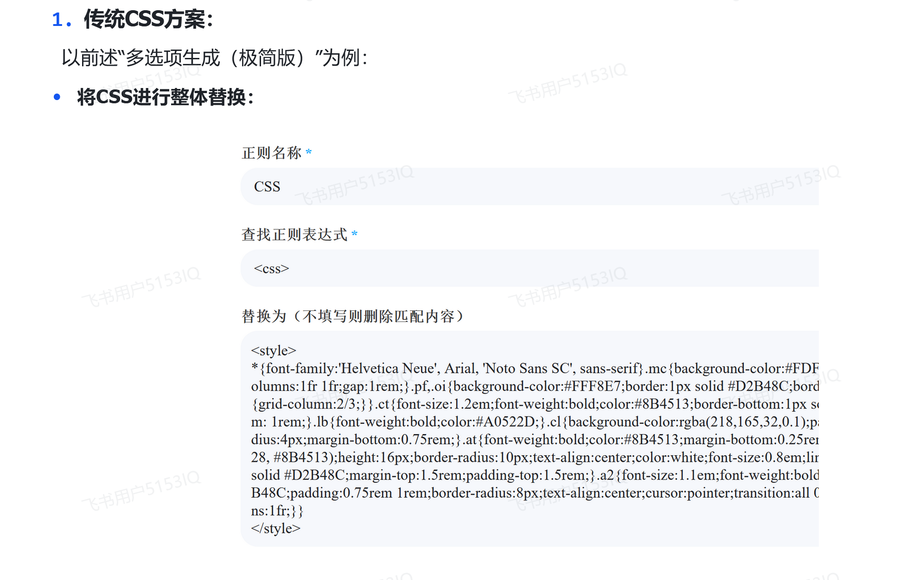

**黑洞猫** (2025-12-27 14:42:53):
css要另外写一个正则啊
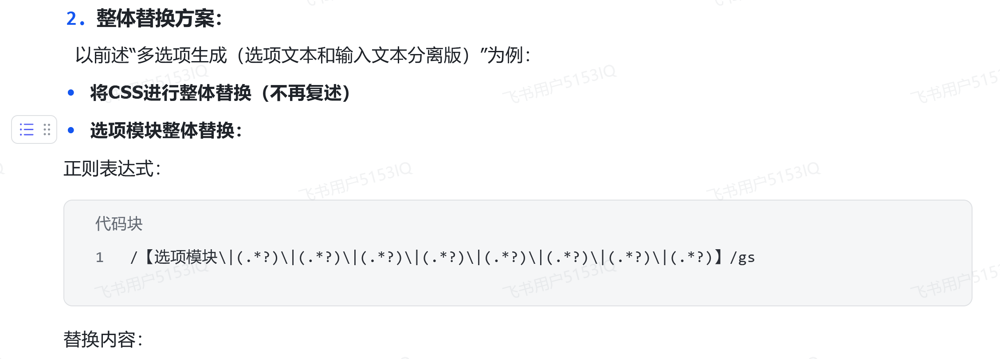

**黑洞猫** (2025-12-27 14:41:53):
何意味？

**echo** (2025-12-26 09:12:34):
亲一口黎黎

**comgra** (2025-12-26 09:12:11):
<:1000168529:1298906735599288330>

**echo** (2025-12-26 09:11:55):
<@1189448556763942934> 因为黎黎厉害呀

**soki** (2025-12-26 08:33:37):
衷心感谢

**soki** (2025-12-26 08:33:30):
感谢两位大佬

**soki** (2025-12-26 08:33:25):
可以了

**soki** (2025-12-26 08:30:13):
我试试

**comgra** (2025-12-26 08:29:42):
谁闲着没事手码几千代码

**comgra** (2025-12-26 08:29:22):
百分之九十九的作者的正则都是用ai写的<:emoji_150:1400299501423431771>

**乖宝宝小水母（水母宗唯一宗主。大周荣誉国祖)** (2025-12-26 08:29:00):
對的

**乖宝宝小水母（水母宗唯一宗主。大周荣誉国祖)** (2025-12-26 08:28:57):
<:emoji_249:1453759656613908510>

**comgra** (2025-12-26 08:28:21):
<:emoji_150:1400299501423431771>

**comgra** (2025-12-26 08:28:15):
你给ai提要求就行了，把代码给ai，让ai 给你加美化效果

**soki** (2025-12-26 08:27:48):
就是选项框.....

**comgra** (2025-12-26 08:27:35):
没看懂

**soki** (2025-12-26 08:27:10):
<:1000168531:1298906724979310634> 灰底也行

**soki** (2025-12-26 08:27:01):
黑底白字就行可以嘛

**soki** (2025-12-26 08:26:51):
可以了，我可以提一个小小的要求吗

**comgra** (2025-12-26 08:26:47):
<:emoji_150:1400299501423431771>

**comgra** (2025-12-26 08:26:43):
我还问了是表达式的问题吗
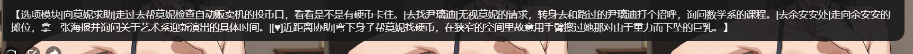

**soki** (2025-12-26 08:26:40):


**乖宝宝小水母（水母宗唯一宗主。大周荣誉国祖)** (2025-12-26 08:26:36):
沒關係，既然他的能生效你就照著填

**soki** (2025-12-26 08:26:06):
/【选项模块\|(.*?)\|(.*?)\|(.*?)\|(.*?)\|(.*?)\|(.*?)\|(.*?)\|(.*?)】/gs

这个

**soki** (2025-12-26 08:25:58):
我看了，刚刚没有那个gs

**comgra** (2025-12-26 08:24:46):
你得先成功一次才能知道问题出在哪

**comgra** (2025-12-26 08:24:20):
你先删掉部分人设，把完整的塞进去看看能不能生效再说

**soki** (2025-12-26 08:24:20):
就是这样的

**soki** (2025-12-26 08:24:14):
<剧情指导>
1.请结合之前的剧情，在状态栏下方生成“{{user}}接下来的选项：”和四个后续剧情发展的选项
2.选项示例：
【选项模块|标题1|内容1|标题2|内容2|标题3|内容3|标题4|内容4】
3.选项内容限50汉字左右，包括动作和言语描写；选项标题为选项内容的总结，限10汉字以内

**soki** (2025-12-26 08:23:54):
人设字数超了，所以我才删掉第二项
<剧情指导>
1.请结合之前的剧情，在状态栏下方生成“{{user}}接下来的选项：”和四个后续剧情发展的选项
2.选项示例：
【选项模块|标题1|内容1|标题2|内容2|标题3|内容3|标题4|内容4】
2.可以触发性爱阶段的选项前请加上“[♥]”
3.选项内容限50汉字左右，包括动作和言语描写；选项标题为选项内容的总结，限10汉字以内

**comgra** (2025-12-26 08:22:59):
反正我的测试卡是可以生效的

**comgra** (2025-12-26 08:22:42):
<:emoji_150:1400299501423431771>

**comgra** (2025-12-26 08:22:35):
你一字不差粘贴进去，然后自己测试一下能不能生效

**comgra** (2025-12-26 08:22:19):


**乖宝宝小水母（水母宗唯一宗主。大周荣誉国祖)** (2025-12-26 08:21:40):
<:emoji_150:1400299501423431771>

**乖宝宝小水母（水母宗唯一宗主。大周荣誉国祖)** (2025-12-26 08:21:37):
隨你吧
而且這裡都要變我們的地盤了…
反正是君竹的錯（X

**soki** (2025-12-26 08:21:12):
那我这张卡先开放咯，选项下张卡再试也行

**soki** (2025-12-26 08:20:52):
其实测试阶段已经过了可以开放了，就剩这个选项没搞定而已

**comgra** (2025-12-26 08:20:18):
反正玩家端这边你的美化是没生效的

**soki** (2025-12-26 08:20:17):
嗷，那我转私之前没有正则

**comgra** (2025-12-26 08:19:58):
没同步更新

**comgra** (2025-12-26 08:19:53):
我是说玩家端和作者端不是一个版本的

**soki** (2025-12-26 08:19:27):
不会呀，我修改的内容一直有更新啊

**comgra** (2025-12-26 08:18:42):
所以我们这边进去后没读到他修改的正则

**乖宝宝小水母（水母宗唯一宗主。大周荣誉国祖)** (2025-12-26 08:18:29):
問題是你的正則壓根沒生效<:emoji_250:1440756778487775303>

**comgra** (2025-12-26 08:18:19):
这张卡公开转私密会不会没同步更新<:1000168532:1298906722546614313>

**soki** (2025-12-26 08:16:58):
我的第一句话，是一开始设置的回复吗

**comgra** (2025-12-26 08:16:45):
<:1000168532:1298906722546614313>

**乖宝宝小水母（水母宗唯一宗主。大周荣誉国祖)** (2025-12-26 08:16:41):
<:emoji_11:1298282571616096307>

**乖宝宝小水母（水母宗唯一宗主。大周荣誉国祖)** (2025-12-26 08:16:31):
你的第一句話也要同樣格式或是乾脆不填
但是代碼…

**comgra** (2025-12-26 08:16:28):
我换了正确格式美化也没生效


**soki** (2025-12-26 08:16:06):
不是很懂你们在说什么

**soki** (2025-12-26 08:16:00):
是我哪里出问题了吗

**comgra** (2025-12-26 08:15:27):
<:1000168532:1298906722546614313>

**comgra** (2025-12-26 08:15:20):
选项格式就没生成正确唉


**soki** (2025-12-26 08:15:14):
是我规则设置问题吗

**乖宝宝小水母（水母宗唯一宗主。大周荣誉国祖)** (2025-12-26 08:14:55):
水母也一樣呢，就算貼【…】的文本，代碼也沒生效

**soki** (2025-12-26 08:14:45):
复制过来啦

**comgra** (2025-12-26 08:14:37):
<:1000168531:1298906724979310634>

**comgra** (2025-12-26 08:14:34):
你看选项格式是这个吗

**comgra** (2025-12-26 08:14:17):
【选项模块|标题1|内容1|标题2|内容2|标题3|内容3|标题4|内容4】

**soki** (2025-12-26 08:14:03):
<剧情指导>
1.请结合之前的剧情，在文本下方生成“接下来的选项：”和四个后续剧情发展的选项
2.选项示例：【选项模块|标题1|内容1|标题2|内容2|标题3|内容3|标题4|内容4】
3.选项内容限50汉字左右，包括动作和言语描写；选项标题为选项内容的总结，限10汉字以内
</剧情指导>

**comgra** (2025-12-26 08:13:57):
用的哈基米3.0-f

**comgra** (2025-12-26 08:13:42):
我回复1直接生成的

**comgra** (2025-12-26 08:13:38):


**comgra** (2025-12-26 08:13:25):
不对，是规则也写错了才对

**soki** (2025-12-26 08:13:15):
为什么我没有这个

**comgra** (2025-12-26 08:13:01):
这个就是规则生效美化完全没生效

**comgra** (2025-12-26 08:12:53):


**soki** (2025-12-26 08:11:42):
原来如此

**soki** (2025-12-26 08:11:39):
昵称：抵押人妻：高中班主任的隐秘调教
32岁高三班主任苏雨桐，因丈夫欠下500万高利贷，被迫以身体“抵押”一年抵债。 她被送进隐秘高端会所“玄笙”，面对债主{{user}}的两个选择：  “培训者”& “被培训者”。苏雨桐倾向“培训者”，以为能保住尊严，却不知两条路皆是深渊。
ID: 226042
https://www.sexyai.top/#/pages/role/index?roleId=226042&inviteCode=7Y6XRj

**comgra** (2025-12-26 08:11:16):
私密卡也能测

**comgra** (2025-12-26 08:11:11):
<:1000168531:1298906724979310634>

**soki** (2025-12-26 08:11:10):
还是私密卡

**comgra** (2025-12-26 08:11:08):
我用电试试能不能出选项

**comgra** (2025-12-26 08:10:56):
你这个发过来

**comgra** (2025-12-26 08:10:54):


**soki** (2025-12-26 08:10:43):
我应该回答吗

**soki** (2025-12-26 08:10:23):
挠头中，是在问我吗

**comgra** (2025-12-26 08:10:22):
但总感觉是样式没生效阿看起来

**comgra** (2025-12-26 08:10:08):
是表达式的问题吗

**comgra** (2025-12-26 08:09:43):


**soki** (2025-12-26 08:09:33):
是我哪里做错了吗

**soki** (2025-12-26 08:09:03):
1612对啊

**乖宝宝小水母（水母宗唯一宗主。大周荣誉国祖)** (2025-12-26 08:09:02):
<:emoji_168:1409564661380288633>

**soki** (2025-12-26 08:08:48):


**comgra** (2025-12-26 08:08:28):
正确的字数是这个


**乖宝宝小水母（水母宗唯一宗主。大周荣誉国祖)** (2025-12-26 08:07:46):
看你的數量是否有錯

**乖宝宝小水母（水母宗唯一宗主。大周荣誉国祖)** (2025-12-26 08:07:35):
把你的正則那面貼上來

**comgra** (2025-12-26 08:07:30):
style好像没生效

**comgra** (2025-12-26 08:07:15):
代码生效了，但没完全生效，感觉是这样

**comgra** (2025-12-26 08:06:41):
/【选项模块\|(.*?)\|(.*?)\|(.*?)\|(.*?)\|(.*?)\|(.*?)\|(.*?)\|(.*?)】/gs

**soki** (2025-12-26 08:06:40):


**乖宝宝小水母（水母宗唯一宗主。大周荣誉国祖)** (2025-12-26 08:06:34):
會把一些符號當代碼吃掉

**comgra** (2025-12-26 08:06:22):
<:1000168530:1298906732843503677>

**乖宝宝小水母（水母宗唯一宗主。大周荣誉国祖)** (2025-12-26 08:06:22):
沒有，這個是dc的問題

**comgra** (2025-12-26 08:06:05):


**comgra** (2025-12-26 08:05:32):


**soki** (2025-12-26 08:05:30):
我试试

**comgra** (2025-12-26 08:05:19):
ok，正则表达式的问题

**乖宝宝小水母（水母宗唯一宗主。大周荣誉国祖)** (2025-12-26 08:04:59):
這段內容替換到你的文本裡

**soki** (2025-12-26 08:03:48):
什么？

**comgra** (2025-12-26 08:02:57):
就知道代码有没有用了

**comgra** (2025-12-26 08:02:51):
看看美化有没有生效

**soki** (2025-12-26 08:02:50):
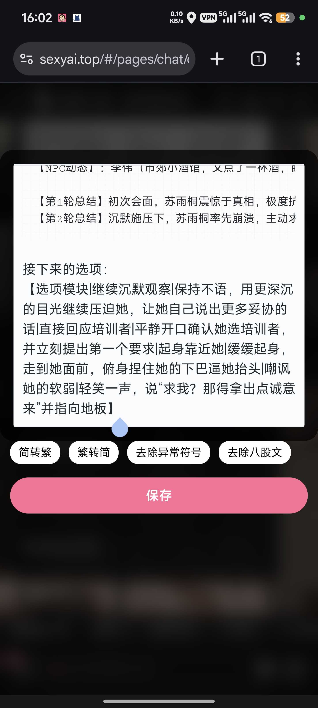

**comgra** (2025-12-26 08:02:42):
你把这段话用编辑粘贴到文本里

**comgra** (2025-12-26 08:02:29):
接下来的选项：
【选项模块|向莫妮求助|走过去帮莫妮检查自动贩卖机的投币口，看看是不是有硬币卡住。|去找尹璃迪|无视莫妮的请求，转身去和路过的尹璃迪打个招呼，询问数学系的课程。|去余安安处|走向余安安的摊位，拿一张海报并询问关于艺术系迎新演出的具体时间。|[♥]近距离协助|弯下身子帮莫妮找硬币，在狭窄的空间里故意用手臂擦过她那对由于重力而下坠的巨乳。】

**comgra** (2025-12-26 08:02:16):
生成的文本格式是这样的

**comgra** (2025-12-26 08:02:11):


**soki** (2025-12-26 08:01:56):
不是很懂

**comgra** (2025-12-26 08:01:52):
应该是规则的问题，或者是你的卡的问题

**comgra** (2025-12-26 08:01:40):
<:1000168530:1298906732843503677>

**comgra** (2025-12-26 08:01:34):
你生成的格式就不是正则表达式的格式

**soki** (2025-12-26 08:00:52):
就是美观问题

**soki** (2025-12-26 08:00:48):
但是我感觉这样好像也不影响

**soki** (2025-12-26 08:00:43):
点击之后有生成文字，但是没有文本框

**soki** (2025-12-26 08:00:28):
我同步了

**comgra** (2025-12-26 07:59:57):
右上角


**乖宝宝小水母（水母宗唯一宗主。大周荣誉国祖)** (2025-12-26 07:59:38):
同步一下

**comgra** (2025-12-26 07:59:28):
<:emoji_68:1305519380343427202>

**soki** (2025-12-26 07:59:26):
<:emoji_140:1379454014852436038>

**comgra** (2025-12-26 07:59:23):
我用你那个正常生成

**comgra** (2025-12-26 07:59:03):


**soki** (2025-12-26 07:58:50):
是应该多几个正则引导出按钮吗

**soki** (2025-12-26 07:58:44):


**soki** (2025-12-26 07:58:21):
还是正则设置少了

**soki** (2025-12-26 07:58:14):
电量问题吗

**soki** (2025-12-26 07:57:57):
<@742177857354334219>再看看，大佬

**soki** (2025-12-26 07:57:47):
这回应该是没错了

**soki** (2025-12-26 07:57:43):
<style>
.f {
  background: linear-gradient(145deg, #FFE6C2, #FFD9A6, #FFF1D6);
  background-size: 300% 300%;
  padding: 8px 16px;
  margin: 6px;
  border-radius: 18px;
  color: #5C3A00;
  cursor: pointer;
  transition: all 0.4s cubic-bezier(0.25, 1, 0.5, 1);
  box-shadow: 0 2px 6px rgba(255, 180, 80, 0.4);
  flex: 1;
  min-width: 100px;
  position: relative;
  overflow: hidden;
  border: 2px solid #FFB84D;
  font-weight: bold;
  font-size: 15px;
  font-family: Arial, sans-serif;
}
.f:hover {
  transform: translateY(-2px) scale(1.06);
  background-position: 100% 0;
  box-shadow: 0 6px 14px rgba(255, 180, 80, 0.6), inset 0 0 12px rgba(255, 220, 160, 0.4);
  color: #442900;
  text-shadow: 0 0 8px rgba(255, 180, 80, 0.7);
}
.f::before {
  content: '';
  position: absolute;
  bottom: 0;
  left: 0;
  width: 100%;
  height: 0;
  background: rgba(255, 200, 120, 0.2);
  transition: height 0.3s ease;
  z-index: -1;
}
.f:hover::before {
  height: 100%;
}
.f:active {
  transform: translateY(2px) scale(0.97);
}
@keyframes shimmer {
  0% { background-position: 0% 50%; }
  50% { background-position: 100% 50%; }
  100% { background-position: 0% 50%; }
}
.f:hover {
  animation: shimmer 2s infinite linear;
}
.e {
  display: flex;
  flex-wrap: wrap;
  gap: 1px;
}
</style>

<div class="e" onclick="
  event.stopPropagation();
  d = event.target.closest('.f');
  a = document.querySelector('textarea');
  a.value = d.dataset.t;
  a.dispatchEvent(new Event('input'));
">
  <p class="f" data-t='$2'>$1</p>
  <p class="f" data-t='$4'>$3</p>
  <p class="f" data-t='$6'>$5</p>
  <p class="f" data-t='$8'>$7</p>
</div>

**soki** (2025-12-26 07:57:30):
现在是这样

**soki** (2025-12-26 07:57:27):


**soki** (2025-12-26 07:56:37):
我再试试

**soki** (2025-12-26 07:56:34):
滑轨

**soki** (2025-12-26 07:56:33):
对不起大佬

**乖宝宝小水母（水母宗唯一宗主。大周荣誉国祖)** (2025-12-26 07:56:12):


**soki** (2025-12-26 07:55:40):
昂，好像复制少了下面一行，刚刚复制不到

**comgra** (2025-12-26 07:55:33):
<:1000168530:1298906732843503677>

**comgra** (2025-12-26 07:55:23):


**soki** (2025-12-26 07:55:13):
会不会是因为多了这个啊


**乖宝宝小水母（水母宗唯一宗主。大周荣誉国祖)** (2025-12-26 07:55:12):
<:a862825b522cadb6:1409619818272915466>

**乖宝宝小水母（水母宗唯一宗主。大周荣誉国祖)** (2025-12-26 07:55:10):
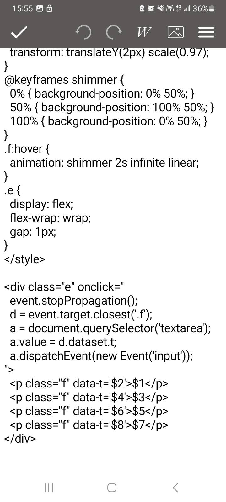

**comgra** (2025-12-26 07:55:04):
<:1000168530:1298906732843503677>

**soki** (2025-12-26 07:54:42):
你给我发的里面好像没有div

**乖宝宝小水母（水母宗唯一宗主。大周荣誉国祖)** (2025-12-26 07:54:05):
它們是一起的哦

**乖宝宝小水母（水母宗唯一宗主。大周荣誉国祖)** (2025-12-26 07:53:57):
等等，你的div有放在style下方嗎

**乖宝宝小水母（水母宗唯一宗主。大周荣誉国祖)** (2025-12-26 07:52:42):
<:emoji_250:1440756778487775303>

**乖宝宝小水母（水母宗唯一宗主。大周荣誉国祖)** (2025-12-26 07:52:38):
我的天、我的地，我的聖母瑪利亞
水母是真不懂了

**comgra** (2025-12-26 07:52:15):


**comgra** (2025-12-26 07:52:02):
我直接复制粘贴都行

**comgra** (2025-12-26 07:51:41):
<:emoji_68:1305519380343427202>

**comgra** (2025-12-26 07:51:38):


**soki** (2025-12-26 07:51:13):
<:10:1298285710033424446>

**soki** (2025-12-26 07:50:54):
是我哪里又操作错了吗

**soki** (2025-12-26 07:50:44):
/\【选项模块\|(.*?)\|(.*?)\|(.*?)\|(.*?)\|(.*?)\|(.*?)\|(.*?)\|(.*?)\】/

**soki** (2025-12-26 07:50:08):
<style>
.f {
  background: linear-gradient(145deg, #FFE6C2, #FFD9A6, #FFF1D6);
  background-size: 300% 300%;
  padding: 8px 16px;
  margin: 6px;
  border-radius: 18px;
  color: #5C3A00;
  cursor: pointer;
  transition: all 0.4s cubic-bezier(0.25, 1, 0.5, 1);
  box-shadow: 0 2px 6px rgba(255, 180, 80, 0.4);
  flex: 1;
  min-width: 100px;
  position: relative;
  overflow: hidden;
  border: 2px solid #FFB84D;
  font-weight: bold;
  font-size: 15px;
  font-family: Arial, sans-serif;
}
.f:hover {
  transform: translateY(-2px) scale(1.06);
  background-position: 100% 0;
  box-shadow: 0 6px 14px rgba(255, 180, 80, 0.6), inset 0 0 12px rgba(255, 220, 160, 0.4);
  color: #442900;
  text-shadow: 0 0 8px rgba(255, 180, 80, 0.7);
}
.f::before {
  content: '';
  position: absolute;
  bottom: 0;
  left: 0;
  width: 100%;
  height: 0;
  background: rgba(255, 200, 120, 0.2);
  transition: height 0.3s ease;
  z-index: -1;
}
.f:hover::before {
  height: 100%;
}
.f:active {
  transform: translateY(2px) scale(0.97);
}
@keyframes shimmer {
  0% { background-position: 0% 50%; }
  50% { background-position: 100% 50%; }
  100% { background-position: 0% 50%; }
}
.f:hover {
  animation: shimmer 2s infinite linear;
}
.e {
  display: flex;
  flex-wrap: wrap;
  gap: 1px;
}
</style>

还是不行大佬<@742177857354334219>


**soki** (2025-12-26 07:33:00):
我就按照这个来试试

**soki** (2025-12-26 07:32:40):
我自己加的，后面觉得可能这个出问题删了，但是还是一样

**comgra** (2025-12-26 07:26:27):
<:1000168530:1298906732843503677>

**comgra** (2025-12-26 07:26:21):
我这张卡甚至就写了2800多字


**乖宝宝小水母（水母宗唯一宗主。大周荣誉国祖)** (2025-12-26 07:26:16):
<:emoji_250:1440756778487775303>

**乖宝宝小水母（水母宗唯一宗主。大周荣誉国祖)** (2025-12-26 07:26:15):
水母也不知道為什麼他複製會有10個(.*?)\和$9、$10

**comgra** (2025-12-26 07:25:32):
<:emoji_68:1305519380343427202>

**comgra** (2025-12-26 07:25:31):


**comgra** (2025-12-26 07:25:10):
所以才问他是不是空白卡测的

**comgra** (2025-12-26 07:24:54):
我不知道他那个是怎么回事，ai发送一堆占位符

**comgra** (2025-12-26 07:24:21):
我两千字的设定都能给我这些内容

**comgra** (2025-12-26 07:24:09):
就算是我开局输入个1

**comgra** (2025-12-26 07:24:04):


**comgra** (2025-12-26 07:23:43):
<:emoji_250:1439598338801537124>

**comgra** (2025-12-26 07:23:40):
韩了

**乖宝宝小水母（水母宗唯一宗主。大周荣誉国祖)** (2025-12-26 07:23:39):
<:IMG_0144:1409620009742893258>

**乖宝宝小水母（水母宗唯一宗主。大周荣誉国祖)** (2025-12-26 07:23:26):
那是水母當初肘出來的嗚嗚嗚
都要變廉價了

**comgra** (2025-12-26 07:22:49):
这个是加了style的

**comgra** (2025-12-26 07:22:44):


**乖宝宝小水母（水母宗唯一宗主。大周荣誉国祖)** (2025-12-26 07:22:04):
<:emoji_248:1427157732770844783>

**乖宝宝小水母（水母宗唯一宗主。大周荣誉国祖)** (2025-12-26 07:21:48):
<@873612536912687184>

**comgra** (2025-12-26 07:21:32):
我用他那个只有div的代码生成的效果是这样的

**comgra** (2025-12-26 07:21:20):


**comgra** (2025-12-26 07:19:54):
<:emoji_150:1400299501423431771>

**comgra** (2025-12-26 07:19:47):
没有style

**comgra** (2025-12-26 07:19:44):
他这是不是只有div

**comgra** (2025-12-26 07:19:21):
哦哦哦

**乖宝宝小水母（水母宗唯一宗主。大周荣誉国祖)** (2025-12-26 07:17:25):
規則你應該沒動吧，試試這個


**乖宝宝小水母（水母宗唯一宗主。大周荣誉国祖)** (2025-12-26 07:11:47):
<:emoji_249:1414447100321726494>

**soki** (2025-12-26 07:11:30):
这个问题我刚刚试了，删到8也一样

**乖宝宝小水母（水母宗唯一宗主。大周荣誉国祖)** (2025-12-26 07:11:02):
多的刪掉

**乖宝宝小水母（水母宗唯一宗主。大周荣誉国祖)** (2025-12-26 07:10:51):
我的正則表達裡的（ ？）什麼的不是只有8個嗎
代碼裡也只到$8

**soki** (2025-12-26 07:09:43):
你哪一个

**乖宝宝小水母（水母宗唯一宗主。大周荣誉国祖)** (2025-12-26 07:08:59):
<@966259105754923028> 照著我的改，再試一次

**乖宝宝小水母（水母宗唯一宗主。大周荣誉国祖)** (2025-12-26 07:08:15):
<:emoji_150:1400299501423431771>

**乖宝宝小水母（水母宗唯一宗主。大周荣誉国祖)** (2025-12-26 07:08:11):
確實錯了呢

**soki** (2025-12-26 07:07:53):
而且合适错了，我也发现不了<:1000168531:1298906724979310634>

**soki** (2025-12-26 07:05:48):
我直接点飞书里面文本框的复制键，然后直接粘贴进去，连空格都不会多的那种

**乖宝宝小水母（水母宗唯一宗主。大周荣誉国祖)** (2025-12-26 07:01:02):
<:emoji_249:1449409819957264537>

**乖宝宝小水母（水母宗唯一宗主。大周荣誉国祖)** (2025-12-26 06:58:53):
看你的格式不對呢

**乖宝宝小水母（水母宗唯一宗主。大周荣誉国祖)** (2025-12-26 06:57:42):
再確認一次，你真的有照著填嗎

**乖宝宝小水母（水母宗唯一宗主。大周荣誉国祖)** (2025-12-26 06:56:03):
<:a862825b522cadb6:1409619818272915466>

**soki** (2025-12-26 06:49:58):
好像也没人回呀

**soki** (2025-12-26 06:47:27):
不是空白卡啊，是我新卡测试啊

**comgra** (2025-12-26 06:24:35):
<:emoji_68:1305519380343427202>

**乖宝宝小水母（水母宗唯一宗主。大周荣誉国祖)** (2025-12-26 06:20:46):
反正是君竹的事了（

**乖宝宝小水母（水母宗唯一宗主。大周荣誉国祖)** (2025-12-26 06:19:44):
<:1000168510:1298906820638674984>

**comgra** (2025-12-26 05:54:50):
<:emoji_68:1305519380343427202>

**comgra** (2025-12-26 05:54:33):
你直接去藏经阁找开源卡看状态栏规则和选项规则是怎么写的再看看效果是什么样的，差不多就能理解了，然后再给ai提个要求，完美

**comgra** (2025-12-26 05:53:22):
<:emoji_68:1305519380343427202>

**comgra** (2025-12-26 05:53:17):
你直接拿你写好的卡复制一份到草稿转私密卡测试不就好了，空白卡测试出一堆占位符能测出什么

**comgra** (2025-12-26 05:52:34):
那你怎么拿空白卡测试<:emoji_68:1305519380343427202>

**soki** (2025-12-26 05:38:27):
对了，之前好像看到10张卡就可以升级还是什么的，还有这个福利吗，我第十张卡已经写好，还在测试中，请问去哪领取

**soki** (2025-12-26 05:37:16):
<:07:1298281204260278383>

**soki** (2025-12-26 05:37:13):
哦，还要通用模板的，没其他要求了，感谢各位大佬

**soki** (2025-12-26 05:36:25):
该上班了

**soki** (2025-12-26 05:36:19):
先许个愿

**soki** (2025-12-26 05:36:15):
我想要一个可以自动生成选项的，然后点击之后可以在对话框生成文字，点击其他选项也不会覆盖原有文字的功能，不需要美化。

**soki** (2025-12-26 05:33:19):
😂

**soki** (2025-12-26 05:33:12):
虽然我还是不懂

**soki** (2025-12-26 05:33:07):
谢谢各位大佬专心解答

**乖宝宝小水母（水母宗唯一宗主。大周荣誉国祖)** (2025-12-26 05:31:50):
下沉）

**乖宝宝小水母（水母宗唯一宗主。大周荣誉国祖)** (2025-12-26 05:31:43):
水母已經@這個帖子的主人了
你就等等看吧

**乖宝宝小水母（水母宗唯一宗主。大周荣誉国祖)** (2025-12-26 05:31:19):
<:1000168531:1298906724979310634>

**soki** (2025-12-26 05:31:12):
好难啊

**soki** (2025-12-26 05:31:10):
现在就是简单的想要增加一个可以点击的对话选项

**soki** (2025-12-26 05:30:40):


**soki** (2025-12-26 05:30:05):
我都写了九张卡了

**comgra** (2025-12-26 05:15:27):
你先写完卡再考虑正则吧

**soki** (2025-12-26 05:15:01):
好吧

**comgra** (2025-12-26 05:15:01):
<:emoji_249:1447214774759981189>

**soki** (2025-12-26 05:14:51):
是啊

**comgra** (2025-12-26 05:13:40):
你直接用我上面提到的茶壶工具卡省心一点，不用搞这个，直接提要求就行

**comgra** (2025-12-26 05:12:45):
你设定里是只写了选项生成规则是吗

**comgra** (2025-12-26 05:12:16):
<:1000168531:1298906724979310634>

**comgra** (2025-12-26 05:12:12):
我都不知道你这玩意为什么会生成占位符

**comgra** (2025-12-26 05:11:01):
<:1000168531:1298906724979310634>

**soki** (2025-12-26 05:10:46):
直接这样了

**soki** (2025-12-26 05:10:45):


**soki** (2025-12-26 05:10:26):
焚诀约束ai是什么意思

**comgra** (2025-12-26 05:09:38):
用45电的克劳德就行

**comgra** (2025-12-26 05:09:29):


**comgra** (2025-12-26 05:09:18):
或者你直接找茶壶工具卡

**comgra** (2025-12-26 05:09:08):
需要有焚诀约束ai

**soki** (2025-12-26 05:08:41):
我试试

**comgra** (2025-12-26 05:08:18):
描述一下你需要的选项的效果，然后让ai给你正则表达式，正则代码和设定内容

**soki** (2025-12-26 05:08:13):
啊？

**comgra** (2025-12-26 05:07:37):
你直接问ai要就好了

**soki** (2025-12-26 05:06:13):
有什么傻瓜式可以让我直接导入的嘛

**soki** (2025-12-26 05:06:03):
我也是看不懂才照搬的

**comgra** (2025-12-26 05:05:54):
我看不懂代码，不看<:emoji_248:1448921974658175056>

**soki** (2025-12-26 05:05:04):
我是看这个照搬的(https://ycn2470i1rh0.feishu.cn/wiki/EMkvwFW16ip8xyken3Zc3vOvn3b)

**comgra** (2025-12-26 05:04:51):
让ai根据规则的样式生成选项

**soki** (2025-12-26 05:04:48):
那我应该怎么改进呢。。。

**comgra** (2025-12-26 05:04:36):
那就是你选项生成规则需要改进了

**comgra** (2025-12-26 05:04:22):
但至少ai有生成内容了

**soki** (2025-12-26 05:04:11):
啊<:24:1298294525390753924>

**comgra** (2025-12-26 05:03:58):
格式和你的那个正则表达式不对应

**soki** (2025-12-26 05:03:27):
也没有选项呀

**soki** (2025-12-26 05:03:25):
变成这样了


**comgra** (2025-12-26 05:03:06):
比如标题的内容告诉ai需要填什么样式，然后内容的内容需要填什么样式

**soki** (2025-12-26 05:02:35):
我试试

**comgra** (2025-12-26 05:02:12):
ai可能不知道你指的是啥

**comgra** (2025-12-26 05:02:05):
你这标题和内容指代不清晰

**comgra** (2025-12-26 05:01:51):
我没写过这种状态栏格式

**comgra** (2025-12-26 05:01:34):
在状态栏下方生成干嘛，直接文末生成<:1000168531:1298906724979310634>

**soki** (2025-12-26 05:01:32):
这个呀，刚刚大佬让我按这个复制就行

**soki** (2025-12-26 05:01:22):


**comgra** (2025-12-26 05:01:09):
剧情指导是啥

**soki** (2025-12-26 05:00:36):


**comgra** (2025-12-26 04:59:54):
你的选项生成规则看看

**comgra** (2025-12-26 04:59:35):
君竹的专栏你@我干嘛<:emoji_249:1443611666678812886>

**soki** (2025-12-26 04:59:15):
生成的时候有代码但是最终呈现的就是


**乖宝宝小水母（水母宗唯一宗主。大周荣誉国祖)** (2025-12-26 04:59:06):
<:emoji_249:1453759631536033875>

**乖宝宝小水母（水母宗唯一宗主。大周荣誉国祖)** (2025-12-26 04:59:04):
<@1003940930744750101>

**comgra** (2025-12-26 04:58:55):
另外你有些选项规则吗

**soki** (2025-12-26 04:58:46):


**comgra** (2025-12-26 04:58:44):
你让ai生成完整选项

**comgra** (2025-12-26 04:58:32):
不对，这里不是君竹的专栏吗<:1000168531:1298906724979310634>

**soki** (2025-12-26 04:58:26):
回复都是1

**soki** (2025-12-26 04:58:23):
就是新卡测试

**soki** (2025-12-26 04:58:17):
没有

**comgra** (2025-12-26 04:57:43):
你有要求ai输出多少字吗

**comgra** (2025-12-26 04:57:32):
你试试高tokens数的模型

**comgra** (2025-12-26 04:57:17):
输出量太多

**soki** (2025-12-26 04:57:04):
grok4.1不行么

**comgra** (2025-12-26 04:56:51):
看起来像是ai截断了

**乖宝宝小水母（水母宗唯一宗主。大周荣誉国祖)** (2025-12-26 04:56:39):
<:emoji_249:1443611666678812886>

**comgra** (2025-12-26 04:56:36):
<:1000168531:1298906724979310634>

**comgra** (2025-12-26 04:56:33):
我又看不懂代码

**乖宝宝小水母（水母宗唯一宗主。大周荣誉国祖)** (2025-12-26 04:56:30):
新人有問題，交給你了，大師

**soki** (2025-12-26 04:56:28):
<:22:1298294520777019502> 大佬

**乖宝宝小水母（水母宗唯一宗主。大周荣誉国祖)** (2025-12-26 04:56:12):
<:a862825b522cadb6:1409619818272915466>

**soki** (2025-12-26 04:56:10):
....

**comgra** (2025-12-26 04:56:08):
<:emoji_149:1382434166666432674>

**comgra** (2025-12-26 04:56:02):
摇我干嘛

**乖宝宝小水母（水母宗唯一宗主。大周荣誉国祖)** (2025-12-26 04:55:36):
水母要上工了，幫你搖個人
<@1189448556763942934>

**soki** (2025-12-26 04:55:17):
<:16:1298294503530041404>

**soki** (2025-12-26 04:54:19):
哪里出问题了吗

**乖宝宝小水母（水母宗唯一宗主。大周荣誉国祖)** (2025-12-26 04:54:18):
<:emoji_147:1379454167302537256>

**soki** (2025-12-26 04:54:16):


**soki** (2025-12-26 04:53:36):


**乖宝宝小水母（水母宗唯一宗主。大周荣誉国祖)** (2025-12-26 04:53:30):
你可以限制一下tokens

**soki** (2025-12-26 04:53:27):
换高电也一样

**soki** (2025-12-26 04:53:12):
我换个高电的试试

**乖宝宝小水母（水母宗唯一宗主。大周荣誉国祖)** (2025-12-26 04:53:06):
<:1000168531:1298906724979310634>

**乖宝宝小水母（水母宗唯一宗主。大周荣誉国祖)** (2025-12-26 04:53:02):
應該是tokens不足被切掉了

**soki** (2025-12-26 04:52:38):
<:10:1298285710033424446>

**soki** (2025-12-26 04:52:22):
出来是这样的
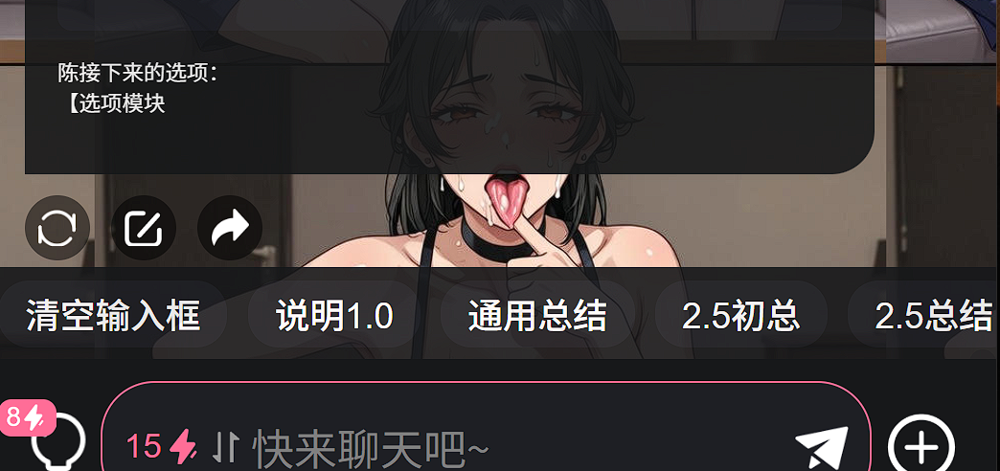

**乖宝宝小水母（水母宗唯一宗主。大周荣誉国祖)** (2025-12-26 04:51:54):
對，你有看到上張圖片裡的第一句話示例嗎，按照格式填在第一句話就能看見了
而且你已經在人設寫了規則了
所以AI會在每次回覆都會加上選項

**soki** (2025-12-26 04:50:23):
预览里看不到，是正常的吗

**乖宝宝小水母（水母宗唯一宗主。大周荣誉国祖)** (2025-12-26 04:50:05):
不要照填我的示例，填網頁上的就行

**乖宝宝小水母（水母宗唯一宗主。大周荣誉国祖)** (2025-12-26 04:49:13):
<:emoji_250:1440756778487775303>

**乖宝宝小水母（水母宗唯一宗主。大周荣誉国祖)** (2025-12-26 04:49:12):
像這樣
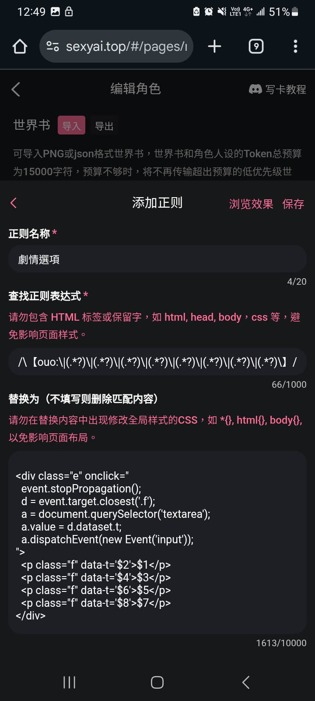

**乖宝宝小水母（水母宗唯一宗主。大周荣誉国祖)** (2025-12-26 04:47:52):
打開你的正則，然後上面放表達式
下面放下方的內容區
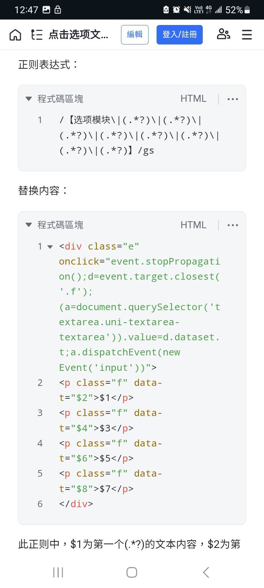

**soki** (2025-12-26 04:46:51):
图片也丢不进去啊

**soki** (2025-12-26 04:46:05):
規則放在人設裡然后呢

**乖宝宝小水母（水母宗唯一宗主。大周荣誉国祖)** (2025-12-26 04:44:04):
把你看不懂的圖片或段子直接丟給AI讓它解釋也行

**乖宝宝小水母（水母宗唯一宗主。大周荣誉国祖)** (2025-12-26 04:42:45):
規則放在人設裡
其他你就照著填

**乖宝宝小水母（水母宗唯一宗主。大周荣誉国祖)** (2025-12-26 04:42:23):
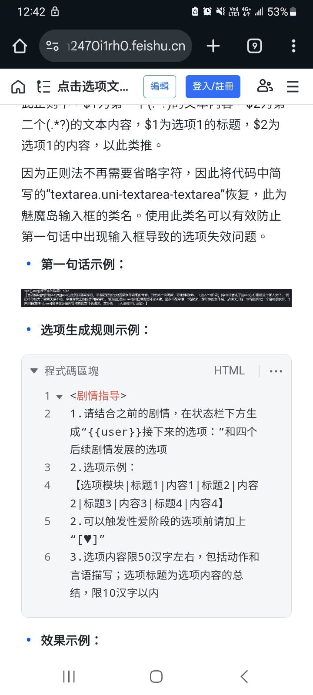

**乖宝宝小水母（水母宗唯一宗主。大周荣誉国祖)** (2025-12-26 04:41:23):
裡頭的”基于正则的极致简化方案”下，有可以直接複製的

**soki** (2025-12-26 04:37:56):
非专业看这些真的表示看不懂

**soki** (2025-12-26 04:37:37):
我是先看了看不懂才来求助各位大佬

**乖宝宝小水母（水母宗唯一宗主。大周荣誉国祖)** (2025-12-26 04:37:25):
<:emoji_244:1435608979534381076>

**乖宝宝小水母（水母宗唯一宗主。大周荣誉国祖)** (2025-12-26 04:37:21):
那這篇帖子你看了嗎

**soki** (2025-12-26 04:36:39):
正则只理解就是指令替换内容，但是里面那一大串代码而且很多都是以前上课那种，这一段我默认你已经会了所以就不过多描述的教程，真的是头疼

**soki** (2025-12-26 04:35:11):
就是看了完全看不懂才只能到处问

**soki** (2025-12-26 04:34:47):
看的头皮发麻

**乖宝宝小水母（水母宗唯一宗主。大周荣誉国祖)** (2025-12-26 03:44:12):
給我嚴肅學習
看你一直到處問的
是不是連正則基礎都不懂

**乖宝宝小水母（水母宗唯一宗主。大周荣誉国祖)** (2025-12-26 03:43:47):
<:emoji_249:1453759656613908510> <:emoji_249:1453759656613908510> <:emoji_249:1453759656613908510>

**乖宝宝小水母（水母宗唯一宗主。大周荣誉国祖)** (2025-12-26 03:43:43):
https://ycn2470i1rh0.feishu.cn/wiki/EMkvwFW16ip8xyken3Zc3vOvn3b

**soki** (2025-12-26 03:35:35):
<@1003940930744750101>大佬有适用所有角色卡，每一次对话都能生成下一步选项建议的正则卡吗？直接导入即食的那种。

**xiaoy** (2025-12-24 14:56:38):
严肃学习，感谢大佬，救我正则狗命

**额6呵呵** (2025-12-23 06:38:17):
严肃学习

**echo** (2025-12-23 04:59:25):
纯萌新，竟然还有这样的大佬，膜拜ing

**emm** (2025-12-23 04:57:30):
已严肃学习喵～<:emoji_246:1450812731518226475>

**黑（萌新形态）** (2025-12-23 00:32:25):
学习<:emoji_140:1379454014852436038>

**胡椒薄荷** (2025-12-22 15:44:23):
开用

**诗夜** (2025-12-22 14:31:25):
纯萌新，没想到藏经阁居然有心的教学，受益匪浅，现在就开始写卡，谢谢大佬

**这狗托我是当定了** (2025-12-17 10:38:28):
吱吱吱

**liliQZQ** (2025-12-17 01:37:41):
吱～谢谢大佬！膜拜大佬！

**echo** (2025-12-16 16:18:54):
<:emoji_250:1450114800481865830>

**听说改名会有好运** (2025-12-16 15:47:02):
好好好，萌新准备拿了，吱

**echo** (2025-12-16 15:35:35):
<:1000168531:1298906724979310634>

**echo** (2025-12-16 15:35:32):
没有萌新需要吗

**echo** (2025-12-14 17:04:13):
<:07:1298281204260278383>

**这狗托我是当定了** (2025-12-14 02:55:50):
👍

**沉默君** (2025-12-14 00:21:50):
<:1000168531:1298906724979310634>

**小魅** (2025-12-12 13:56:14):
来了来了 狠狠灌注！

**MEE6** (2025-12-12 13:55:59):
<:CHECK6:403540120181145611> 5,000 XP has been given to **<@!1003940930744750101>**

**周雅（被老婆调教.周浩）** (2025-12-12 10:55:52):
太感谢了，非常好用<:emoji_140:1379454014852436038> <:emoji_140:1379454014852436038>

**echo** (2025-12-12 09:24:34):
下载下来之后，在正则旁边的导入把这个json文件插进去就可以了

**echo** (2025-12-12 09:22:01):
还有萌新说看不懂怎么用，贴一个示例
这是我写的第一张卡，感慨


**初音未来✨** (2025-12-12 08:25:07):
<:1000168510:1298906820638674984>

**echo** (2025-12-12 08:12:54):
<@1135473222658297907> 小魅～

**echo** (2025-12-12 07:57:05):
世一扑

**echo** (2025-12-12 07:56:55):
胡说八道！

**世玉** (2025-12-12 07:51:21):
没我扑街！

**echo** (2025-12-12 07:45:39):
——————————————
7、放平心态
每一个大佬都是从萌新时期过来的，但是对于萌新来说，除非技术力特别好，或者运气特别好，大部分人的第一张卡成绩达不到你的预想。
所以，先去做，先去发几张卡，不论做的怎么样，先做完，再做好
      by 发了十一张大份的扑街作者

**echo** (2025-12-12 07:42:40):
6、状态栏正则哪里来
指路：茶壶的各种技术工具
有问题找茶壶工具卡AI，但是作者不是代码机器，被气到关评论区，再有人把我当代码机器人我就直接删卡谁都别想用了（怒）
ID: 174750
https://www.sexyai.top/#/pages/role/index?roleId=174750&inviteCode=r57yvc

非常好用，用过都说好
记得告诉他你是萌新，把细节讲清楚，怎么放，放哪里，怎么用，她会很温柔的告诉你的

**小雪** (2025-12-12 07:34:10):
<:emoji_140:1379454014852436038>

**echo** (2025-12-12 07:33:16):
——————————————
5、为什么要用正则
如果有愿意尝试的萌新拿代码试一下就会发现，其实把样式代码直接塞在第一句话里和放在正则里替换没有任何区别。
那么为什么要放在正则里面呢？

首先，第一句话只有4000字的字数限制，而代码内容即使是简陋的美化，两三千字数也是轻轻松松的。因此必须使用正则让这些代码尽量少的在第一句话里面出现

第二，由于ai的智力问题，由于大多数ai都有自己的小巧思，即使是要求它只能生成短短的几个条目汉字都费劲，要求它完整的输出一个正确格式的状态栏代码不亚于彩票中大奖，第一个轮次不崩状态栏都算是超水平发挥

**echo** (2025-12-12 07:27:14):
当匹配到🤓👆这个表情的时候，就会自动替换成“我嘞个豆，作者也太勤奋了吧”

**echo** (2025-12-12 07:25:45):
最简单的正则表达式：
/(你要查找的内容)/
替换内容：
(替换内容)

示例如下图：
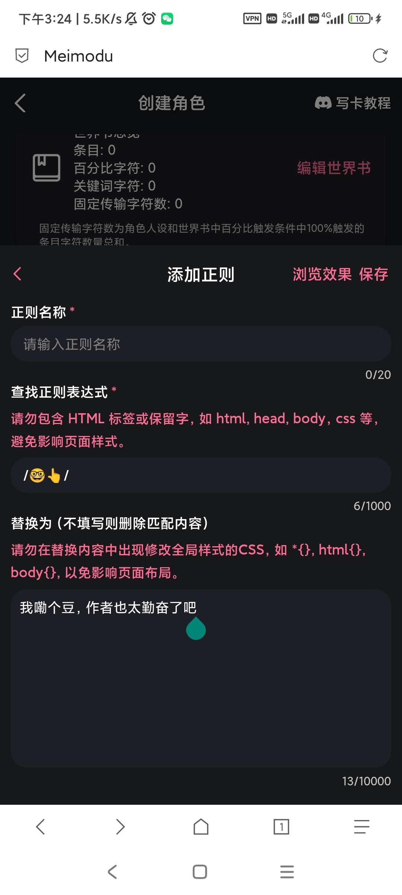
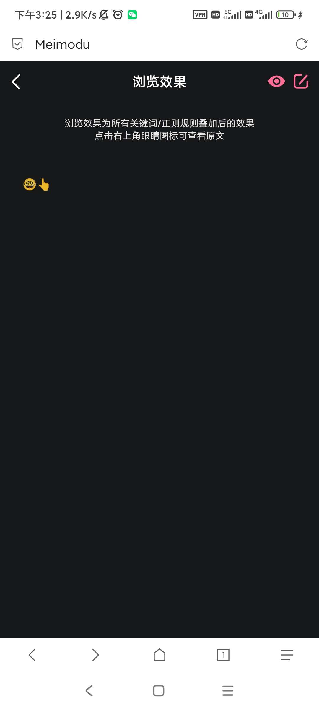
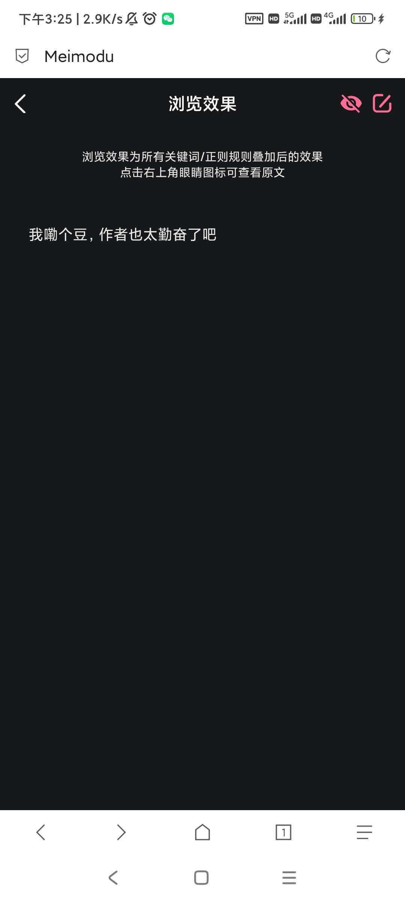

**echo** (2025-12-12 07:23:02):
选择添加按钮，我们可以看到分成三个部分，分别是：正则名称，正则表达式，正则替换式。其中正则名称可以随便填，只要你自己看得懂就行，正则表达式和正则替换内容不多详解，萌新拿到这两个往里面塞就行
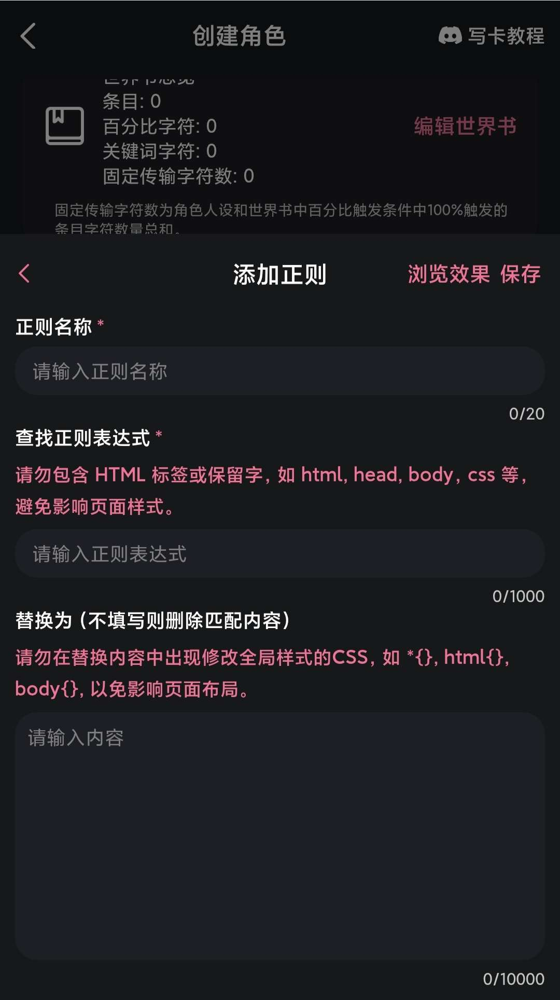

**echo** (2025-12-12 07:20:14):
4、做一个简单的正则
对于绝大多数萌新，只需要知道如何使用正则进行替换即可。首先我们找到正则入口，如图所示
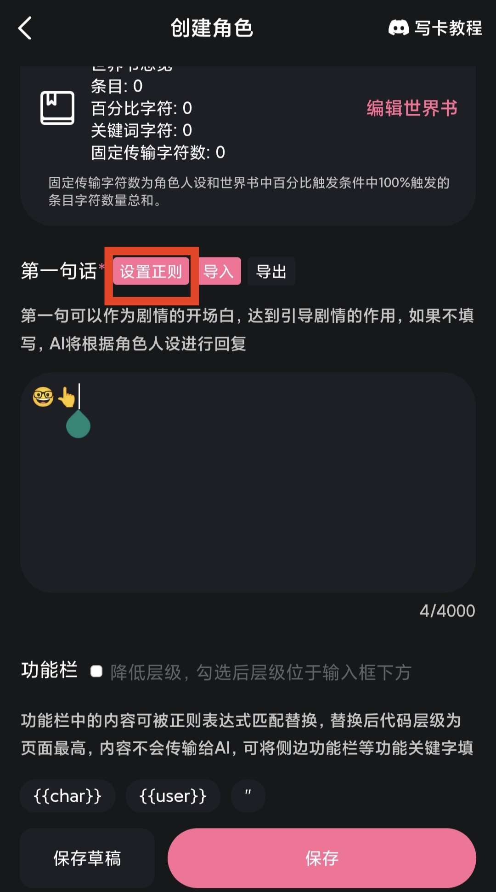

**echo** (2025-12-12 07:10:25):
不过复制还是能看见代码，不影响

**echo** (2025-12-12 07:09:50):
我草，这么权威，dc都有效吗

**echo** (2025-12-12 07:08:43):
3、做一个最基本的状态栏
对于mmd来说，最简单的状态栏就是三点式状态栏，不需要任何的正则或者代码基础，只需要在你的状态栏词条前后加上三个`即可
以我的一张大份卡为例

```
【对象】: 林小鹿
【身份】: Coser，19-20岁，大学生
【体质】: 曝光倒错型（暴露在镜头下的部位会产生强烈快感）
---
【心理防线】: 目前完全正常，只是普通的年轻Coser
状态: 完整，对"居家服"拍摄有顾虑但渴望尝试
表现: 紧张但兴奋，在意他人看法但想突破自我

【生理唤醒】: 尚未开始
程度: 0%（刚开始拍摄，未进入镜头凝视状态）
迹象: 无

【征服进度】: 尚未开始
阶段: 尚未开始
---
【当前姿态/状态】: 在更衣室更换cos服，准备拍摄
【关键道具】: 道具弓箭，战斗服（短裙、紧身上衣）
```

**echo** (2025-12-12 06:56:12):
——————————————
2、如何设计状态栏
绝大多数状态栏的美化对于状态栏里面的条目数量有着严格的限制，甚至部分状态栏会检测状态栏条目的名称。例如必须检索到“想法：”才会进行正则替换。因此在试图做美化之前最好先想好自己的状态栏要有哪些内容是对玩家展开，需要玩家了解提升沉浸感的，常见词条如：想法，O穴，屁O等，哪些内容是对ai进行总结，防止出现混淆遗忘的内容，常见词条如：(玩家)相貌，能力等等

**echo** (2025-12-12 06:50:36):
1、什么是状态栏？
状态栏的展示功能想必各位玩卡的时候已经体验过了，这里就不赘述。更重要的事情是状态栏可以帮助ai延长记忆，将一些关键情报以一种当而皇之的方式让ai一遍遍的复读使他不会忘记。

**echo** (2025-12-12 06:47:43):
最近看了很多萌新在试图写卡的时候被正则打的头破血流，于是决定趁我尚且还记得萌新的来时路的时候赶紧写一篇新手教程

希望能解决萌新的一些写卡问题。

