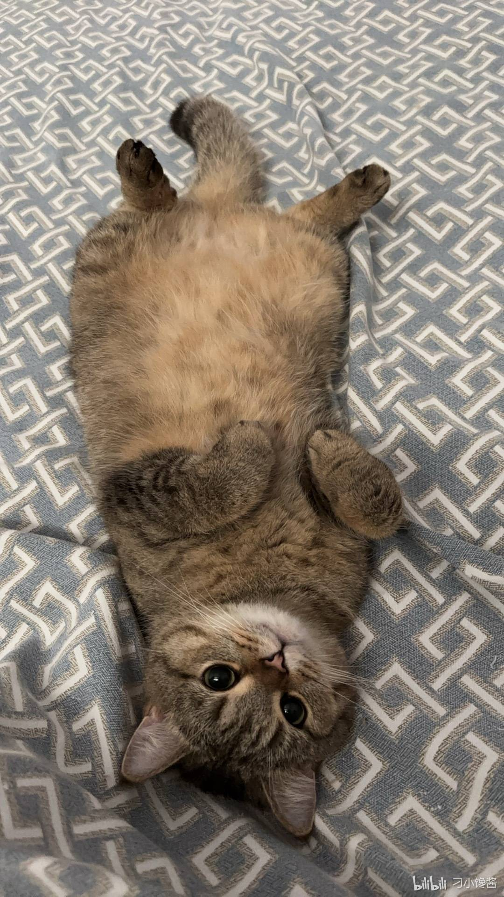
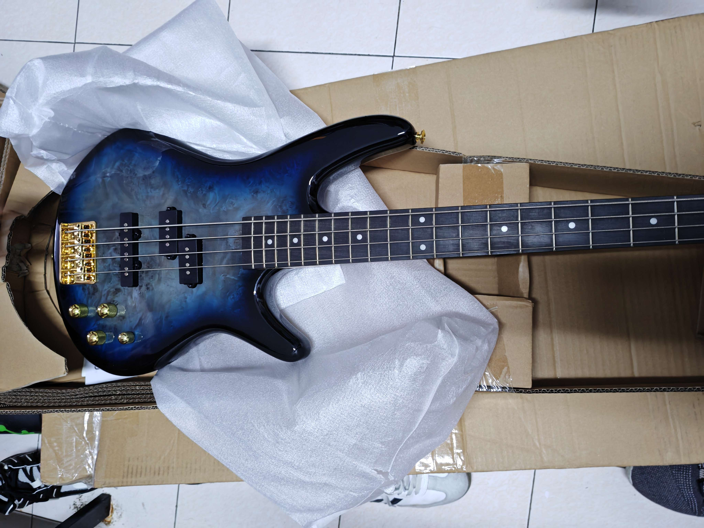
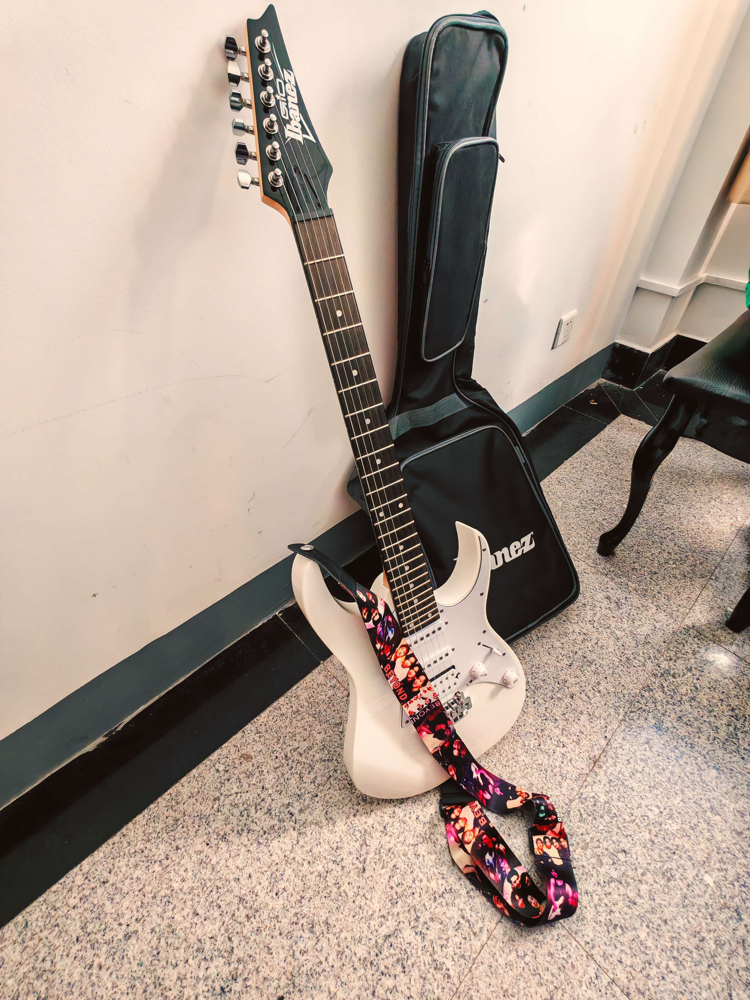

# 任白の音乐室～

创建时间: 2026-05-29T08:36:46.542000+00:00
消息数: 401

---

**萍水相逢，尽是他乡之客** (2026-05-31 10:02:27):
<:emoji_250:1426636034996961300>

**LEONORE** (2026-05-31 07:50:43):
阿门唾佛

**萍水相逢，尽是他乡之客** (2026-05-31 07:21:49):
阿弥陀佛

**LEONORE** (2026-05-30 23:59:08):
变成奶龙啊了

**LEONORE** (2026-05-30 23:58:47):
我哩个豆……

**萍水相逢，尽是他乡之客** (2026-05-30 13:58:18):
🙏🏻

**希波鹅拉底** (2026-05-30 13:37:25):
扫码了

**LEONORE** (2026-05-30 13:28:36):
三十五，扫这个码就行

**萍水相逢，尽是他乡之客** (2026-05-30 12:09:08):
来包黄鹤楼

**LEONORE** (2026-05-30 11:34:20):
## 昔人已乘黄鹤去，此地空余黄鹤楼

**LEONORE** (2026-05-30 04:19:59):
https://cdn.discordapp.com/attachments/1385274632592162876/1504349819257491507/Image_1778663487520.gif

**萍水相逢，尽是他乡之客** (2026-05-30 03:55:39):
https://tenor.com/view/zaunvi-caitvitwt-gif-16845298572699382358

**凛堂光** (2026-05-29 21:07:39):
人怎么走了？

**萍水相逢，尽是他乡之客** (2026-05-29 16:32:02):
有品味

**萍水相逢，尽是他乡之客** (2026-05-29 16:31:54):
<:emoji_247:1488101228389994526>

**任白** (2026-05-29 16:30:44):
https://tenor.com/view/%E6%99%A9%E5%AE%89-%E6%98%8E%E5%A4%A9%E6%9C%83%E6%9B%B4%E5%A5%BD-goodnight-bamboo-sunflower-gif-20487844

**萍水相逢，尽是他乡之客** (2026-05-29 16:30:04):
https://tenor.com/view/%E6%99%9A%E5%AE%89-%E5%A5%BD%E5%A4%A2-goodnight-wellwishes-nightsky-gif-21631745

**萍水相逢，尽是他乡之客** (2026-05-29 16:29:46):
鼠鼠晚安～

**任白** (2026-05-29 16:29:36):
晚安晚安

**萍水相逢，尽是他乡之客** (2026-05-29 16:29:32):
<:emoji_245:1425490499795423332>

**任白** (2026-05-29 16:29:18):
<:emoji_148:1386006416136863796>

**萍水相逢，尽是他乡之客** (2026-05-29 16:28:52):
<:emoji_83:1378946142330683422>

**萍水相逢，尽是他乡之客** (2026-05-29 16:28:45):
<:emoji_148:1386006416136863796>

**任白** (2026-05-29 16:28:40):
<:emoji_276:1498632895512707093>

**萍水相逢，尽是他乡之客** (2026-05-29 16:28:31):
可爱～

**萍水相逢，尽是他乡之客** (2026-05-29 16:28:24):
<:emoji_234:1431854430764007434>

**萍水相逢，尽是他乡之客** (2026-05-29 16:28:14):
<:emoji_252:1486379020487626943>

**任白** (2026-05-29 16:28:14):
你气不气

**任白** (2026-05-29 16:28:08):
就不发

**萍水相逢，尽是他乡之客** (2026-05-29 16:27:59):
那就期待你能将这首歌唱到符合自己预期的程度，然后再发出来的那天啦  ᖰ⌯'▾'⌯ᖳ

**任白** (2026-05-29 16:27:30):
<:emoji_150:1400299501423431771>

**任白** (2026-05-29 16:27:25):
我还真有强迫症

**萍水相逢，尽是他乡之客** (2026-05-29 16:26:50):
<:emoji_243:1455870792574439476>

**任白** (2026-05-29 16:26:37):
我有点强迫症

**萍水相逢，尽是他乡之客** (2026-05-29 16:26:31):

**萍水相逢，尽是他乡之客** (2026-05-29 16:25:58):
有勇气把自己唱的歌发出来，就已经很棒啦

**萍水相逢，尽是他乡之客** (2026-05-29 16:25:40):
没关系的啦

**萍水相逢，尽是他乡之客** (2026-05-29 16:25:35):
https://tenor.com/view/kitty-so-cute-head-pat-heart-cat-kitty-gif-15586999

**任白** (2026-05-29 16:25:24):
<:emoji_250:1440756778487775303>

**任白** (2026-05-29 16:25:18):
就没发

**任白** (2026-05-29 16:25:13):
我感觉唱的不好听

**萍水相逢，尽是他乡之客** (2026-05-29 16:25:10):
<:emoji_243:1455870792574439476>

**萍水相逢，尽是他乡之客** (2026-05-29 16:25:07):
表达了作者的期待与迫不及待之情

**萍水相逢，尽是他乡之客** (2026-05-29 16:24:46):
充分说明了作者对《修炼爱情》的喜爱

**萍水相逢，尽是他乡之客** (2026-05-29 16:24:25):
将鼠鼠的歌比作类似涩图的诱惑

**萍水相逢，尽是他乡之客** (2026-05-29 16:24:09):
这里运用的比喻的手法

**任白** (2026-05-29 16:08:37):
哪里来的瑟图

**萍水相逢，尽是他乡之客** (2026-05-29 15:57:47):

**任白** (2026-05-29 13:34:55):
还有一首修炼爱情没发

**任白** (2026-05-29 13:34:46):
哦对了

**任白** (2026-05-29 13:17:23):
耶耶

**希波鹅拉底** (2026-05-29 13:15:22):
我只会掐一下你

**希波鹅拉底** (2026-05-29 13:15:12):
你是可爱小鼠

**希波鹅拉底** (2026-05-29 13:15:02):
你不杀

**任白** (2026-05-29 13:14:07):
那我的帖子开的还真不是时候

**任白** (2026-05-29 13:13:49):
<:emoji_143:1379855104622202900>

**希波鹅拉底** (2026-05-29 13:13:07):
你们都是

**希波鹅拉底** (2026-05-29 13:13:05):
臭猪

**希波鹅拉底** (2026-05-29 13:13:03):
杀了你

**LEONORE** (2026-05-29 13:11:08):
<:emoji_244:1456228348606025888>

**希波鹅拉底** (2026-05-29 13:09:01):
聊天的

**希波鹅拉底** (2026-05-29 13:08:58):
到处都是

**LEONORE** (2026-05-29 12:36:32):
以后一胎生八个

**LEONORE** (2026-05-29 12:36:15):
烂人一个

**任白** (2026-05-29 12:35:44):
霸凌者就这样

**任白** (2026-05-29 12:35:36):
嘛

**LEONORE** (2026-05-29 12:35:11):
什么仇什么恨

**LEONORE** (2026-05-29 12:34:57):
好下头的人

**LEONORE** (2026-05-29 12:34:53):
<:emoji_114:1379110202694963270>

**任白** (2026-05-29 12:34:41):
气的我动手了

**任白** (2026-05-29 12:34:31):
然后她过来直接给我那个砸地上了

**任白** (2026-05-29 12:34:23):
就那一次做的很好

**任白** (2026-05-29 12:34:19):
我美术一直都很烂

**任白** (2026-05-29 12:33:51):
捏泥人

**任白** (2026-05-29 12:33:46):
有一次美术课

**LEONORE** (2026-05-29 12:33:31):
好揍好揍

**任白** (2026-05-29 12:33:18):
她最后被我揍了一顿

**任白** (2026-05-29 12:33:09):
我怎么可能有这种人的微信号

**LEONORE** (2026-05-29 12:29:56):
<:emoji_243:1455870792574439476>

**任白** (2026-05-29 12:29:43):
有点事情

**任白** (2026-05-29 12:29:39):
稍微等一会发

**任白** (2026-05-29 12:26:16):
怎么假声直接没声音了

**任白** (2026-05-29 12:26:08):
不行啊这个傻逼录音

**任白** (2026-05-29 12:25:37):
我靠唱不动了

**许星榆** (2026-05-29 12:16:13):
<:emoji_149:1400299483212021833>

**任白** (2026-05-29 12:16:06):
这首我很喜欢

**任白** (2026-05-29 12:15:56):
行

**许星榆** (2026-05-29 12:15:56):
基本都听过

**许星榆** (2026-05-29 12:15:45):
<:emoji_242:1459832161719943198>

**许星榆** (2026-05-29 12:15:43):
我是六年老谦友了

**任白** (2026-05-29 12:15:27):
唱个这个

**任白** (2026-05-29 12:15:21):
你听过像风一样吗

**LEONORE** (2026-05-29 12:15:11):
我去弄弄她

**任白** (2026-05-29 12:15:10):
忽然就感觉淡了

**LEONORE** (2026-05-29 12:15:04):
微信号发我

**许星榆** (2026-05-29 12:15:03):
<:emoji_250:1440756778487775303>

**任白** (2026-05-29 12:14:55):
<:emoji_250:1440756778487775303>

**任白** (2026-05-29 12:14:49):
那个女的莫名其妙就开始骂我了

**任白** (2026-05-29 12:14:43):
我说哇薛之谦

**任白** (2026-05-29 12:14:38):
然后有一次班里老师放个视频前面广告有薛之谦

**任白** (2026-05-29 12:14:26):
一个女的一直欺负我

**LEONORE** (2026-05-29 12:14:17):
<:emoji_148:1379454224353591457>

**任白** (2026-05-29 12:14:16):
那时候班里有一个人

**任白** (2026-05-29 12:14:10):
但是

**LEONORE** (2026-05-29 12:14:05):
好厉害

**任白** (2026-05-29 12:14:04):
我以前很喜欢薛之谦

**许星榆** (2026-05-29 12:13:48):
<:image:1496914410747199608>

**任白** (2026-05-29 12:13:38):
不具体追某个人

**任白** (2026-05-29 12:13:34):
也不算啦我就是个听歌的

**任白** (2026-05-29 12:13:15):
以前是

**任白** (2026-05-29 12:13:10):
稍微学一下

**任白** (2026-05-29 12:13:05):
但这首没听过

**许星榆** (2026-05-29 12:12:47):
<:emoji_275:1509581405947166911>

**许星榆** (2026-05-29 12:12:43):
师傅也是谦友嘛

**许星榆** (2026-05-29 12:12:32):
<:emoji_139:1379455053080825866>

**LEONORE** (2026-05-29 12:12:32):
<:emoji_139:1379455053080825866>

**任白** (2026-05-29 12:12:22):
薛之谦的我都可以

**任白** (2026-05-29 12:12:19):
行

**许星榆** (2026-05-29 12:11:52):
<:emoji_149:1400299483212021833>

**许星榆** (2026-05-29 12:11:49):
对呀师傅很厉害

**许星榆** (2026-05-29 12:11:38):
那薛之谦的友情提示行不行<:emoji_277:1501430172040298566>

**LEONORE** (2026-05-29 12:11:38):
你已经很厉害了

**任白** (2026-05-29 12:11:36):
我听听

**LEONORE** (2026-05-29 12:11:34):
<:emoji_115:1379113943817257071>

**任白** (2026-05-29 12:11:31):
我研究一下吧

**任白** (2026-05-29 12:11:23):
太没用了

**任白** (2026-05-29 12:11:19):
<:emoji_133:1379494883227734157>

**任白** (2026-05-29 12:11:03):
这首节奏有点难

**任白** (2026-05-29 12:10:57):
不行啊，感觉我驾驭不了

**LEONORE** (2026-05-29 12:10:56):
《valder fields》

**LEONORE** (2026-05-29 12:10:38):
还有一首还有一首还有一首！

**LEONORE** (2026-05-29 12:10:02):
好呀好呀好呀

**LEONORE** (2026-05-29 12:09:51):
<:emoji_139:1379455053080825866>

**任白** (2026-05-29 12:09:40):
但是要稍微学一下

**任白** (2026-05-29 12:09:35):
可以唱

**任白** (2026-05-29 12:08:23):
噢噢这首啊

**LEONORE** (2026-05-29 12:08:16):
对的对的对的对的

**任白** (2026-05-29 12:08:06):
学习学习

**任白** (2026-05-29 12:08:04):
待我去听一下

**任白** (2026-05-29 12:07:57):
Hayd的？

**许星榆** (2026-05-29 12:07:44):
🤤

**许星榆** (2026-05-29 12:07:38):
假贵族呢

**LEONORE** (2026-05-29 12:07:08):
<:emoji_139:1379455053080825866>

**任白** (2026-05-29 12:07:07):
我听一下

**LEONORE** (2026-05-29 12:06:59):
你会不会唱《head in the clouds》

**LEONORE** (2026-05-29 12:06:41):
鼠鼠鼠鼠

**任白** (2026-05-29 12:06:18):
我感觉我说唱超级难听

**任白** (2026-05-29 12:06:13):
不行啊

**任白** (2026-05-29 12:04:17):
我听一下

**许星榆** (2026-05-29 12:03:44):
<:emoji_277:1501430172040298566>

**许星榆** (2026-05-29 12:03:39):
师傅会不会唱巴拉莱卡

**任白** (2026-05-29 12:03:30):
我再翻翻看

**LEONORE** (2026-05-29 12:03:10):
好好啊~

**任白** (2026-05-29 12:02:46):
作为主唱来说这点唱功要有的吧

**LEONORE** (2026-05-29 12:02:41):
<:emoji_244:1456228348606025888>

**任白** (2026-05-29 12:02:33):
<:1000168531:1298906724979310634>

**任白** (2026-05-29 12:02:30):
我唱的也就这样

**任白** (2026-05-29 12:02:20):
不至于

**任白** (2026-05-29 12:02:03):
<:emoji_140:1379454014852436038>

**任白** (2026-05-29 12:01:49):
AI都要唱死了

**LEONORE** (2026-05-29 12:01:48):
怎么一个个的都这样的把我比下去！

**LEONORE** (2026-05-29 12:01:33):
🤯

**任白** (2026-05-29 12:01:24):
就是他写的音太高了

**任白** (2026-05-29 12:01:06):
还有编曲

**任白** (2026-05-29 12:01:03):
我负责写词他写曲

**LEONORE** (2026-05-29 12:01:01):
牛哇！

**任白** (2026-05-29 12:00:47):
之前我和他一起写过歌

**任白** (2026-05-29 12:00:34):
<:emoji_146:1379454137158209736>

**任白** (2026-05-29 12:00:16):
就是没学过声乐

**LEONORE** (2026-05-29 12:00:12):
对不起！（光速滑跪

**任白** (2026-05-29 12:00:03):
他系统学过音乐的

**萍水相逢，尽是他乡之客** (2026-05-29 12:00:01):
<:emoji_252:1478791303587299378>

**任白** (2026-05-29 11:59:54):
对啊

**LEONORE** (2026-05-29 11:59:50):
<:emoji_147:1379454167302537256>

**任白** (2026-05-29 11:59:47):
这个前奏是他没谱子现扒的

**LEONORE** (2026-05-29 11:59:44):
真的假的？

**任白** (2026-05-29 11:59:17):
只是这首没表现

**LEONORE** (2026-05-29 11:59:16):
<:emoji_115:1379113943817257071>

**LEONORE** (2026-05-29 11:59:09):
不行不行你唱的好好听

**任白** (2026-05-29 11:59:03):
钢琴很牛逼

**任白** (2026-05-29 11:58:59):
不对

**LEONORE** (2026-05-29 11:58:26):
吉他和唱的都很棒！钢琴太烂了（实在忍不住<:1000168532:1298906722546614313>

**任白** (2026-05-29 11:55:18):
<:emoji_247:1488101228389994526>

**Hamster** (2026-05-29 11:54:29):
能~一直延续~

**Hamster** (2026-05-29 11:53:48):
雨爱的秘密~

**任白** (2026-05-29 11:53:45):
耶耶

**Hamster** (2026-05-29 11:53:12):
耶~~~

**任白** (2026-05-29 11:49:35):
今天下班

**任白** (2026-05-29 11:49:32):
行了

**任白** (2026-05-29 11:46:06):
吉他是我钢琴是他

**任白** (2026-05-29 11:45:58):
因为我一直在戳他

**任白** (2026-05-29 11:45:52):
开头他说了一句“cnm”

**任白** (2026-05-29 11:45:39):
<:1000168531:1298906724979310634>

**任白** (2026-05-29 11:45:36):

**任白** (2026-05-29 11:44:47):
我和我们键盘手两个人排练的一首《晴天》

**任白** (2026-05-29 11:44:21):
我刚刚翻到一个有趣的

**任白** (2026-05-29 11:44:15):
小许点歌吗

**任白** (2026-05-29 11:44:07):
谢谢小许

**任白** (2026-05-29 11:44:03):
<:emoji_247:1488101228389994526>

**许星榆** (2026-05-29 11:42:56):
<:emoji_139:1379455053080825866>

**许星榆** (2026-05-29 11:42:51):
师傅唱歌好好听

**任白** (2026-05-29 11:31:19):
不唱了

**任白** (2026-05-29 11:31:17):
下播

**任白** (2026-05-29 11:29:22):
😡

**LEONORE** (2026-05-29 11:29:00):
对的对的对的，dc我发自己的钢琴曲也会吞音质，很难受

**任白** (2026-05-29 11:19:47):
<@1261916340067893333> <:emoji_140:1379454014852436038> <:emoji_140:1379454014852436038> <:emoji_140:1379454014852436038>

**任白** (2026-05-29 11:19:25):
我得搞个声卡内录了

**任白** (2026-05-29 11:19:12):

**任白** (2026-05-29 11:19:09):
为啥录出来总是全损音质啊

**LEONORE** (2026-05-29 09:56:32):
经历了总是好的嘛~

**任白** (2026-05-29 09:52:29):
现在都名存实亡了

**任白** (2026-05-29 09:52:18):
没有组织好

**任白** (2026-05-29 09:52:16):
感觉还是我这个队长的问题

**任白** (2026-05-29 09:52:10):
<:emoji_250:1440756778487775303>

**任白** (2026-05-29 09:52:06):
其实没有那么好

**LEONORE** (2026-05-29 09:45:23):
感觉看到了青春

**LEONORE** (2026-05-29 09:45:12):
真好呀~

**LEONORE** (2026-05-29 09:45:08):
<:1000168532:1298906722546614313>

**任白** (2026-05-29 09:42:32):
说了半天我的面坨了

**任白** (2026-05-29 09:42:26):
哎呀

**任白** (2026-05-29 09:41:40):
因为简单所以键盘手一般都当和声

**任白** (2026-05-29 09:41:26):
键盘手不难的

**任白** (2026-05-29 09:41:12):
而且主音吉他手确实难找

**任白** (2026-05-29 09:41:04):
但是他完全没有

**任白** (2026-05-29 09:41:00):
我相信他会好好练琴

**任白** (2026-05-29 09:40:45):
因为我善

**LEONORE** (2026-05-29 09:37:00):
那他留在乐队干什么呀？

**任白** (2026-05-29 09:36:57):
全是干活

**任白** (2026-05-29 09:36:49):
经验之谈

**任白** (2026-05-29 09:36:44):
对吧

**任白** (2026-05-29 09:36:38):
搞得我们就排不下来一首歌

**任白** (2026-05-29 09:36:30):
一直不练琴

**任白** (2026-05-29 09:36:27):
但是就因为他

**任白** (2026-05-29 09:36:22):
像我们乐队我这种愿意身兼数职把主音也弹了的还好

**LEONORE** (2026-05-29 09:36:13):
有道理诶

**任白** (2026-05-29 09:35:57):
那就是所有人等你

**任白** (2026-05-29 09:35:53):
所有人都会你不会

**任白** (2026-05-29 09:35:47):
但要是不均匀

**任白** (2026-05-29 09:35:40):
那就是直接开始

**任白** (2026-05-29 09:35:36):
和都会的一起组乐队

**任白** (2026-05-29 09:35:31):
一起进步

**任白** (2026-05-29 09:35:29):
那大家就一起练琴

**任白** (2026-05-29 09:35:23):
你和一群不会弹的组乐队

**LEONORE** (2026-05-29 09:35:23):
那不坏菜了

**LEONORE** (2026-05-29 09:35:20):
均匀的烂

**任白** (2026-05-29 09:35:11):
怕水平不均匀

**任白** (2026-05-29 09:35:07):
乐队不怕弹的烂

**任白** (2026-05-29 09:35:00):
弹的烂不是问题

**LEONORE** (2026-05-29 09:34:55):
<:emoji_144:1380206684739338403>

**LEONORE** (2026-05-29 09:34:48):
（

**LEONORE** (2026-05-29 09:34:47):
我弹的太烂了

**LEONORE** (2026-05-29 09:34:43):
还是

**LEONORE** (2026-05-29 09:34:42):
主要的原因

**LEONORE** (2026-05-29 09:34:36):
其实……

**任白** (2026-05-29 09:34:31):
在流行乐队的位置有一点尴尬

**LEONORE** (2026-05-29 09:34:20):
笨蛋，不是一个概念诶

**任白** (2026-05-29 09:34:14):
钢琴的话

**任白** (2026-05-29 09:34:08):
你可以试试当键盘手

**任白** (2026-05-29 09:33:35):
琴又不是很稀奇的东西

**任白** (2026-05-29 09:33:28):
看见过也正常

**LEONORE** (2026-05-29 09:32:58):
我好像在哪看到过

**LEONORE** (2026-05-29 09:32:54):
好漂亮~

**LEONORE** (2026-05-29 09:32:39):
好眼熟的琴！

**任白** (2026-05-29 09:32:33):
怪不得你手疼

**LEONORE** (2026-05-29 09:32:33):
# 等一下✋

**任白** (2026-05-29 09:32:27):
肯定不一样啊

**任白** (2026-05-29 09:32:22):
看我们贝斯手的贝斯

**任白** (2026-05-29 09:32:15):

**LEONORE** (2026-05-29 09:30:57):
<:1000168532:1298906722546614313>

**LEONORE** (2026-05-29 09:30:55):
我还以为俩一样呢

**LEONORE** (2026-05-29 09:30:48):
诶……

**任白** (2026-05-29 09:30:35):
你不能用吉他弹法弹呀

**LEONORE** (2026-05-29 09:30:18):
而且好硬，拨起来也不如吉他舒服

**任白** (2026-05-29 09:30:17):
不用承受那个磨茧的过程

**任白** (2026-05-29 09:30:09):
贝斯弹法不一样

**任白** (2026-05-29 09:30:05):
还好的

**LEONORE** (2026-05-29 09:29:58):
越容易磨

**LEONORE** (2026-05-29 09:29:54):
越粗

**LEONORE** (2026-05-29 09:29:51):
……

**任白** (2026-05-29 09:29:44):
那么粗的弦

**任白** (2026-05-29 09:29:37):
贝斯还伤手？

**任白** (2026-05-29 09:29:32):
保持美丽就行

**LEONORE** (2026-05-29 09:29:32):
<:emoji_147:1379454167302537256>

**LEONORE** (2026-05-29 09:29:28):
贝斯不伤手？！？！

**任白** (2026-05-29 09:29:26):
任务也轻松

**LEONORE** (2026-05-29 09:29:22):
不喜欢贝斯，太硬了

**任白** (2026-05-29 09:29:19):
简单不伤手

**任白** (2026-05-29 09:29:00):
学贝斯呀

**LEONORE** (2026-05-29 09:28:58):
吉他和钢琴

**LEONORE** (2026-05-29 09:28:46):
我啥乐器都不精通

**任白** (2026-05-29 09:28:37):
民谣吉他？

**LEONORE** (2026-05-29 09:28:35):
那真是太浪费了

**任白** (2026-05-29 09:28:34):
你啥乐器

**任白** (2026-05-29 09:28:22):
他也不好好练

**任白** (2026-05-29 09:28:15):
还有主唱

**任白** (2026-05-29 09:28:10):
主音吉他

**LEONORE** (2026-05-29 09:28:08):
我也想玩乐队

**任白** (2026-05-29 09:28:04):
我那时候兼任辅音吉他

**LEONORE** (2026-05-29 09:28:04):
<:1000168516:1298906851848486942>

**任白** (2026-05-29 09:27:54):
结果最简单的吉他solo弹不好

**任白** (2026-05-29 09:27:46):
他一套设备贵我几倍

**LEONORE** (2026-05-29 09:27:36):
不要这么说啦，干中学嘛~

**任白** (2026-05-29 09:27:34):
主音吉他手的问题

**任白** (2026-05-29 09:27:29):
主要是那个

**任白** (2026-05-29 09:27:21):
DC的老人应该知道

**任白** (2026-05-29 09:27:14):
我很低调

**任白** (2026-05-29 09:27:03):
太松了

**LEONORE** (2026-05-29 09:27:00):
你居然还有乐队诶~

**任白** (2026-05-29 09:26:55):
可能是我这个队长当的不好

**任白** (2026-05-29 09:26:47):
主要是我的乐队成员太拉胯了

**任白** (2026-05-29 09:26:36):
我是没问题

**任白** (2026-05-29 09:26:24):
这么牛逼

**LEONORE** (2026-05-29 09:26:15):
<:1000168534:1298906727495766057>

**LEONORE** (2026-05-29 09:26:12):
给你融资买效果器还有音箱，你去干掉草东

**任白** (2026-05-29 09:25:52):
啥玩意

**任白** (2026-05-29 09:25:41):
依班娜自然还可以

**LEONORE** (2026-05-29 09:25:41):
<:1000168532:1298906722546614313>

**LEONORE** (2026-05-29 09:25:34):
我这边给你做两轮天使轮，直接送你草西出道彳亍不彳亍

**任白** (2026-05-29 09:25:32):
是我的音箱和效果器很垃圾

**任白** (2026-05-29 09:25:17):
相比之下电吉他真的是最便宜的了

**LEONORE** (2026-05-29 09:24:57):
哇……

**任白** (2026-05-29 09:24:54):
萌哦

**许星榆** (2026-05-29 09:24:51):
怎么样🤤

**LEONORE** (2026-05-29 09:24:49):
萌之萌之~

**任白** (2026-05-29 09:24:47):
结果一块一两千好像

**任白** (2026-05-29 09:24:43):
我还想买

**任白** (2026-05-29 09:24:41):
可以让电吉他喵喵叫

**任白** (2026-05-29 09:24:37):
之前有一个喵喵效果器

**任白** (2026-05-29 09:24:30):
是一块一块买的

**任白** (2026-05-29 09:24:24):
好的超级贵

**许星榆** (2026-05-29 09:24:23):

**任白** (2026-05-29 09:24:17):
用效果器

**任白** (2026-05-29 09:24:15):
对啊

**许星榆** (2026-05-29 09:24:14):
<:emoji_149:1400299483212021833>

**LEONORE** (2026-05-29 09:24:08):
看！

**任白** (2026-05-29 09:24:07):
在哪儿啊

**LEONORE** (2026-05-29 09:24:04):
emmmm电吉他好像还能发出更多不同的音色

**任白** (2026-05-29 09:23:57):
开着失真就爆炸了

**任白** (2026-05-29 09:23:51):
碰到别的的话

**许星榆** (2026-05-29 09:23:47):
<:emoji_277:1501430172040298566>

**任白** (2026-05-29 09:23:45):
对单音要求比较高

**许星榆** (2026-05-29 09:23:42):
刚做了个小桌宠你们要看吗

**LEONORE** (2026-05-29 09:23:41):
<:emoji_147:1382565790129328128>

**任白** (2026-05-29 09:23:33):
加上全单音

**LEONORE** (2026-05-29 09:23:26):
哦哦~

**许星榆** (2026-05-29 09:23:25):
么么<:emoji_149:1400299483212021833>

**任白** (2026-05-29 09:23:17):
太快了

**LEONORE** (2026-05-29 09:23:11):
捏捏星榆宝宝

**任白** (2026-05-29 09:23:06):
只能拨片

**LEONORE** (2026-05-29 09:23:04):
为什么？

**许星榆** (2026-05-29 09:23:03):
<:emoji_139:1379455053080825866>

**任白** (2026-05-29 09:22:58):
电吉他指弹不了

**LEONORE** (2026-05-29 09:22:52):
虽然很久没弹了

**任白** (2026-05-29 09:22:50):
最容易丢的就是拨片

**LEONORE** (2026-05-29 09:22:47):
指弹选手！

**任白** (2026-05-29 09:22:40):
电吉他手

**LEONORE** (2026-05-29 09:22:37):
我看大家对依班娜的评价都很好呀

**任白** (2026-05-29 09:22:26):
还有拨片

**LEONORE** (2026-05-29 09:22:22):
<:1000168534:1298906727495766057>

**任白** (2026-05-29 09:22:22):
对的

**LEONORE** (2026-05-29 09:22:18):
还得算上平时的保养费，擦琴油，琴弦

**任白** (2026-05-29 09:22:17):
我这个是最垃圾的配置了

**任白** (2026-05-29 09:21:51):
加上的话就总共两千多吧

**任白** (2026-05-29 09:21:38):
也要五百

**LEONORE** (2026-05-29 09:21:32):
略有耳闻

**任白** (2026-05-29 09:21:30):
我买练琴的那个很基础的是音箱加效果器

**LEONORE** (2026-05-29 09:21:27):
听说有的还能冒火花

**LEONORE** (2026-05-29 09:21:17):
<:1000168532:1298906722546614313>

**任白** (2026-05-29 09:21:01):
电吉他配套还要音箱和效果器

**任白** (2026-05-29 09:20:50):
琴其实是最便宜的

**任白** (2026-05-29 09:20:43):
但是经典的我记得就是三种

**任白** (2026-05-29 09:20:37):
很猎奇的长相

**任白** (2026-05-29 09:20:33):
当然也有很多乱七八糟的

**任白** (2026-05-29 09:20:22):
就是长的不一样

**任白** (2026-05-29 09:20:16):
我记得我这个1500多一点买的时候

**LEONORE** (2026-05-29 09:20:15):
有什么区别嘛？

**任白** (2026-05-29 09:20:04):
电吉他一千多要的

**LEONORE** (2026-05-29 09:19:59):
电子琴好像都很贵

**任白** (2026-05-29 09:19:54):
三种琴型

**LEONORE** (2026-05-29 09:19:52):
一千多诶，我买的民谣吉他才六百多

**任白** (2026-05-29 09:19:34):
很多都有点像

**任白** (2026-05-29 09:19:29):
确实

**LEONORE** (2026-05-29 09:18:28):
不认识电子琴，长得好像……

**任白** (2026-05-29 09:16:39):
再便宜点就是烧火棍了

**任白** (2026-05-29 09:16:35):
便宜的

**任白** (2026-05-29 09:16:32):
新手琴

**任白** (2026-05-29 09:16:27):
这是依班娜

**任白** (2026-05-29 09:16:24):
<:1000168531:1298906724979310634>

**LEONORE** (2026-05-29 09:15:33):
富哥喔~

**LEONORE** (2026-05-29 09:15:27):
居然是海芝顿

**LEONORE** (2026-05-29 09:14:36):
<:emoji_139:1379455053080825866>

**萍水相逢，尽是他乡之客** (2026-05-29 08:58:54):
<:emoji_275:1509581405947166911>

**萍水相逢，尽是他乡之客** (2026-05-29 08:58:48):
<:emoji_277:1509842116417818654>

**任白** (2026-05-29 08:55:30):
原唱是林俊杰

**任白** (2026-05-29 08:53:35):
之前唱的心墙，大家说蛮好听的

**任白** (2026-05-29 08:53:09):

**任白** (2026-05-29 08:49:47):
兴趣爱好而已，水平很次

**任白** (2026-05-29 08:49:21):
没有没有啦

**许星榆** (2026-05-29 08:46:42):
哇，师傅好厉害<:emoji_139:1379455053080825866>

**任白** (2026-05-29 08:39:06):
耶耶

**任白** (2026-05-29 08:36:46):
本鼠很喜欢音乐，平常喜欢唱唱歌，之前有在其他人的帖子里发，感觉太乱了，所以干脆自己建了一个

为了帖子的多元性，我就不只是发自己唱歌啦，平常会在这里推荐推荐音乐，写写评价，记录一下新听的歌什么的～

也欢迎大家的来推荐自己喜欢的音乐，唱歌，点歌都可以～

放一张我的小白在这里镇楼

