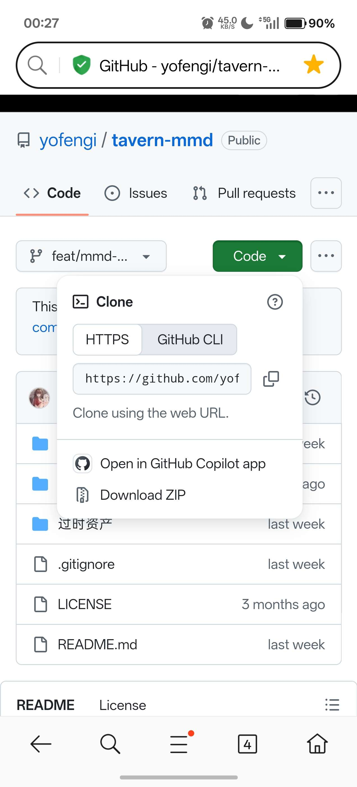

# 保存一下自己关注和用到的佬的帖子

创建时间: 2026-08-14T16:55:59.979000+00:00
消息数: 25

---

**幸宇（入境检察官构思中）** (2026-09-03 18:50:20):
部分ai创作中使用的词汇解释以及对应的作用

**幸宇（入境检察官构思中）** (2026-09-03 18:49:53):
【Agent、Skill、Harness啥意思？一次性讲明白AI技术名词！-哔哩哔哩】 https://b23.tv/LvaR8WP
[Agent、Skill、Harness啥意思？一次性讲明白AI技术名词...](https://b23.tv/LvaR8WP)
AI圈名词一波又一波LLM、Token、Prompt、RAG、Skill、Agent、Harness...这些词究竟怎么出现的，又各自解决什么问题？一条视频带你彻底搞懂, 视频播放量 458600、弹幕量 217、点赞数 19484、投硬币枚数 7292、收藏人数 33446、转发人数 5319, 视频作者 通义实验室, 作者简介 让代...

**幸宇（入境检察官构思中）** (2026-09-01 17:02:50):
不过可以直接将文件给ai也是一样的，可以不用费力自己查看

**幸宇（入境检察官构思中）** (2026-09-01 17:02:29):
手机版选择“仓库”时候将该压缩包解开后的文件所在选择为“仓库”，然后打开左上角的图标，根据自己需要进行查看即可

**幸宇（入境检察官构思中）** (2026-09-01 17:00:32):
该应用可以从Googleplay里面下载

**幸宇（入境检察官构思中）** (2026-09-01 17:00:13):
解压缩之后可以使用obsidian打开

**幸宇（入境检察官构思中）** (2026-09-01 16:36:03):
需要进行下载使用

**幸宇（入境检察官构思中）** (2026-09-01 16:35:59):

**幸宇（入境检察官构思中）** (2026-09-01 16:34:05):
https://github.com/yofengi/tavern-mmd/tree/feat/mmd-sandbox-sbk-3.0/skills/tavern-mmd
[tavern-mmd/skills/tavern-mmd at feat/mmd-sandbox-sbk-3.0 · yofengi...](https://github.com/yofengi/tavern-mmd/tree/feat/mmd-sandbox-sbk-3.0/skills/tavern-mmd)
Claude Code skill: create SillyTavern & MMD (sexyai.top) character cards, worldbooks, status bars and global CSS themes - yofengi/tavern-mmd

**幸宇（入境检察官构思中）** (2026-09-01 16:33:47):
如下

**幸宇（入境检察官构思中）** (2026-09-01 16:33:36):
增加“洛璃”大佬的skill

**幸宇（入境检察官构思中）** (2026-08-22 05:37:03):
下面的未知为正则，状态栏生成规范

**幸宇（入境检察官构思中）** (2026-08-22 05:35:51):
https://discord.com/channels/1205870897769095229/1449697564575268904

**幸宇（入境检察官构思中）** (2026-08-22 05:35:47):
https://discord.com/channels/1205870897769095229/1483684463597846539

**幸宇（入境检察官构思中）** (2026-08-21 04:07:45):
https://discord.com/channels/1205870897769095229/1511654861584990311

**幸宇（入境检察官构思中）** (2026-08-21 04:07:41):
多种侧边栏及角色创建

**幸宇（入境检察官构思中）** (2026-08-14 17:34:16):
https://discord.com/channels/1205870897769095229/1537342987766472785

**幸宇（入境检察官构思中）** (2026-08-14 17:21:14):
想要省电可以肘击站外ai，个人推荐grok，可以直接在Googleplay里面下载，免费版限制每日总对话论述和单次token。

方法可以把需要的东西切成多点来让grok输出，每日对话轮数用完之后可以切换账号继续用。

我个人就是Google和outlook邮箱轮着用，基本上每天用量都是够的

**幸宇（入境检察官构思中）** (2026-08-14 17:16:31):
需要Google三件套的可以去自己手机设置里面查看一下“系统与更新”的部分，可能存在一个“Google设置”打开那个设置就能直接在应用商店里面下载Googleplay了，不过能够来到这里的应该都不缺三件套了

**幸宇（入境检察官构思中）** (2026-08-14 17:12:34):
差点把这个超高级别的入门教程忘了

**幸宇（入境检察官构思中）** (2026-08-14 17:11:59):
https://discord.com/channels/1205870897769095229/1448988105922314261

**幸宇（入境检察官构思中）** (2026-08-14 16:57:01):
https://discord.com/channels/1205870897769095229/1515322168609870005

**幸宇（入境检察官构思中）** (2026-08-14 16:56:34):
老是找不到想要的东西直接全保存了得了<:emoji_249:1416980114511761448>

**阳玉** (2026-08-14 16:56:08):
<:emoji_298:1535537717704663092>

**幸宇（入境检察官构思中）** (2026-08-14 16:55:59):
如标题
https://discord.com/channels/1205870897769095229/1530408462834733167

https://discord.com/channels/1205870897769095229/1525435206851493888

https://discord.com/channels/1205870897769095229/1512116069912018984

https://discord.com/channels/1205870897769095229/1499811393874956560

https://discord.com/channels/1205870897769095229/1523526673427988553

https://discord.com/channels/1205870897769095229/1529141860969353416

