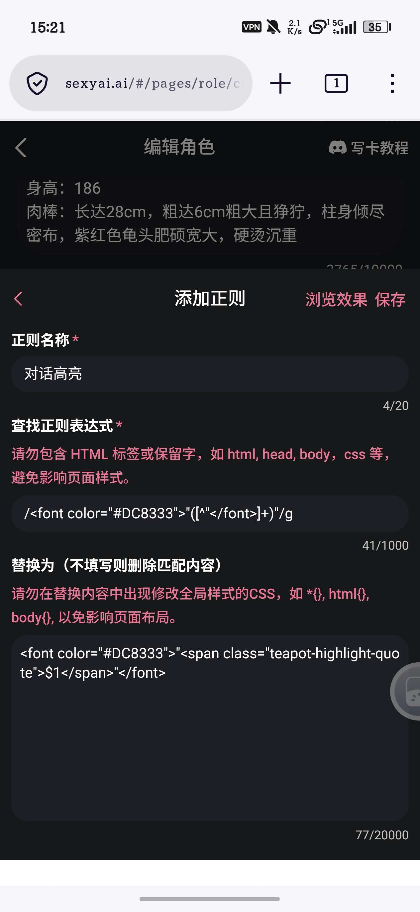
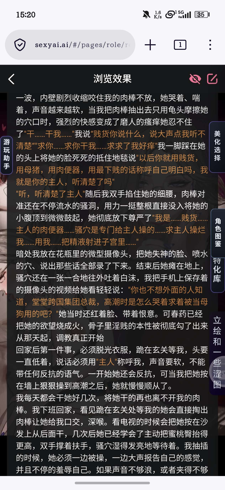
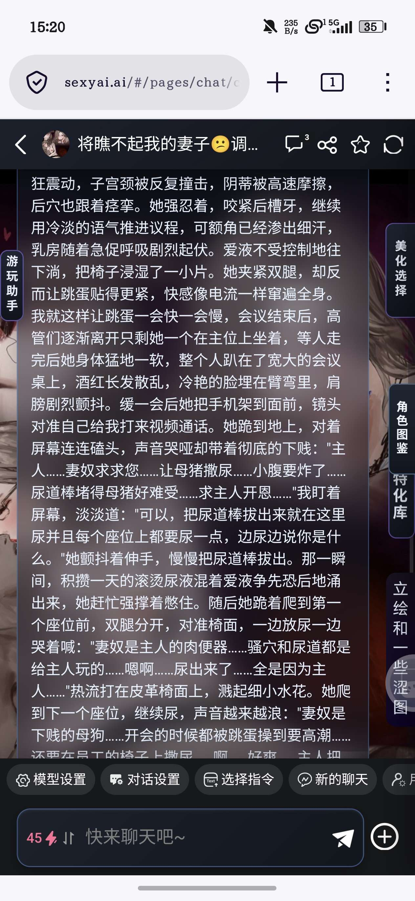
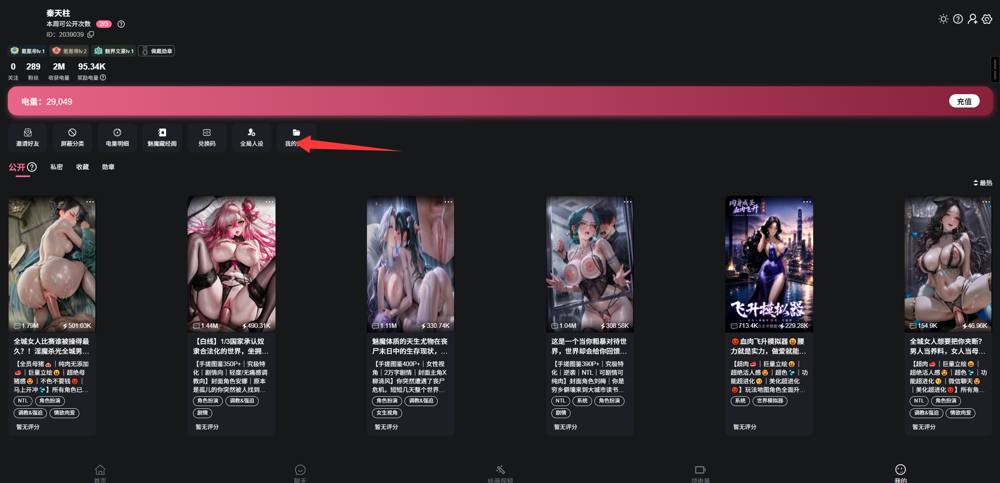

# 分享一个宽屏特化的多角色带角色图片的状态栏编辑器，拿来即用

创建时间: 2026-07-25T07:19:38.643000+00:00
消息数: 18

---

**今晚想你了** (2026-07-26 18:22:25):
嗷嗷嗷，感谢大佬这么晚了还回复我<:emoji_140:1379454014852436038>

**秦天柱** (2026-07-26 18:17:21):
应该只关闭气泡美化也是可以的

**秦天柱** (2026-07-26 18:16:58):
你看一下关闭美化是不是效果就出来了

**秦天柱** (2026-07-26 18:16:13):
有可能是被我的美化主题覆盖了，优先级的问题。你如果想要这个效果最好直接把正则文件丢给AI让它直接在美化里改这个效果

**今晚想你了** (2026-07-26 18:10:11):
大佬大佬，这个超级好用的，不过我有个小小的问题，就是我要是想加正文角色说话内容高亮显示的正则，但显示不了该怎么办，浏览效果正常，但实际输出不显示<:emoji_140:1379454014852436038>

**召唤师** (2026-07-26 04:13:39):
好东西

**小魅** (2026-07-25 09:31:11):
感谢宝宝开源<:emoji_140:1379454014852436038>

**MEE6** (2026-07-25 09:31:00):
<:CHECK6:403540120181145611> 100,000 XP has been given to **<@!1504495750917263452>**

**月月鸟（思维枯竭）** (2026-07-25 08:32:03):
恩情！\ 😭 /

**周雅（被老婆调教.周浩）** (2026-07-25 08:12:37):
<@1135473222658297907> 奖励经验

**汐愛** (2026-07-25 07:59:07):
<:emoji_140:1379454014852436038> 很好了

**秦天柱** (2026-07-25 07:55:37):
还有个问题，就是编辑器里的图片链接怎么搞，这个需要使用到站里的图床功能，如图，就是这个我的资源。点击进去，右上角添加文件，把想要使用的图片上传到资源里，上传完成的图片右下角有一个链接标志，点击一下就复制到这张图片的图床链接了，再粘贴到编辑器里即可

**秦天柱** (2026-07-25 07:41:21):
<@1241360726728249354> 请求大佬授权

**秦天柱** (2026-07-25 07:33:31):
第四页，显示当前的配置信息。导出配置只需要点击下方的下载就行，手动导入需要同时下载MMD正则和MMD世界书，导入位置如图。如果下载v2角色卡就不需要下载正则和世界书，导入位置如图，不过v2角色卡只支持空白卡导入。

**秦天柱** (2026-07-25 07:29:14):
第三页效果预览，就是展示效果的，这个就没什么好说的了

**秦天柱** (2026-07-25 07:28:15):
第二页是角色图鉴编辑页，点击两个加号就可以创建角色图鉴，每个角色预留了三个图片位，一个是固定显示的封面，剩下两个需要条件解锁，解锁条件可以自由修改。备用角色图库是留给玩家新建角色用的，也可以不使用备用图库，那么新建角色将会从全部图鉴的已解锁图片中随机选择输出。

**秦天柱** (2026-07-25 07:22:53):
编辑器下载后直接点击打开，一般是跳转到浏览器打开。如图是第一页，里面可修改角色栏的显示项目，图鉴的解锁依赖词条，侧边栏按钮的位置。

**秦天柱** (2026-07-25 07:19:38):
根据汐汐大佬的状态栏改编的宽屏特化状态栏，自带三个美化主题，美化覆盖状态栏、气泡、侧边栏。自带窄屏适配，角色图鉴，图鉴条件解锁，状态栏只会输出已经解锁的图片。具体效果如图。编辑器使用教程另发。

