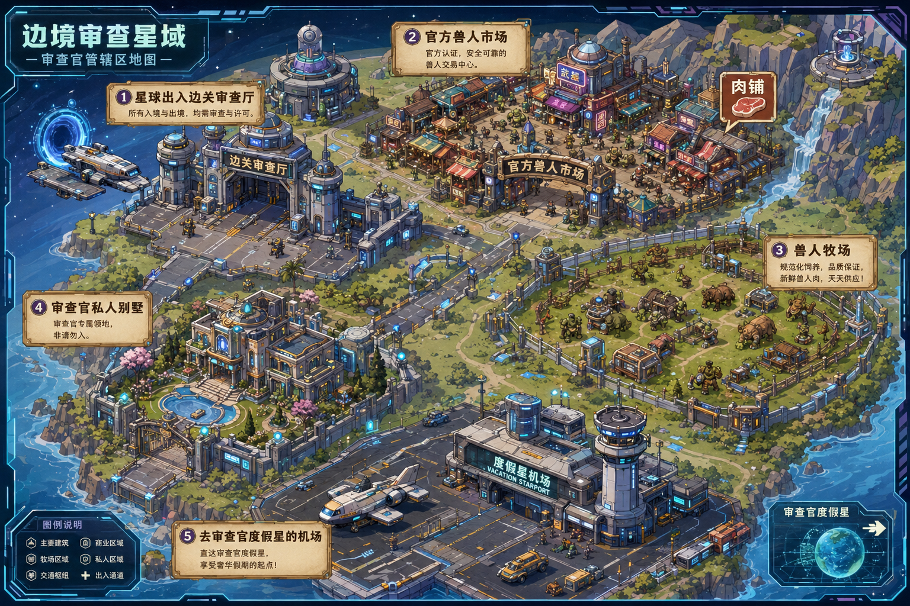

# 分享一个我自己肘出来的地图按钮的生成与编辑器

创建时间: 2026-03-05T12:55:53.560000+00:00
消息数: 38

---

**foxtone** (2026-05-25 13:19:18):
国内AI会敏感

**foxtone** (2026-05-25 13:19:10):
我去GPT跑的

**糯米辞** (2026-05-25 07:56:13):
好奇大佬们地图都在哪里跑的，我的AI模型每次跑一半就崩了🥺

**foxtone** (2026-05-24 12:49:07):
幸好导出来了

**foxtone** (2026-05-24 12:48:56):
然后差点把电脑搞中病毒了

**foxtone** (2026-05-24 12:46:12):
直接卡在第二步，找到图片的URL

**foxtone** (2026-05-24 12:45:06):

**🐷辰少安🐷** (2026-05-01 08:43:52):
牛

**普罗米修斯** (2026-03-28 07:01:39):
<:07:1298281204260278383>

**萍水相逢，尽是他乡之客** (2026-03-27 01:25:45):
妈妈早<:emoji_140:1379454014852436038>

**白水** (2026-03-27 01:03:11):
感谢

**sRay(锐)（MVU框架发布）** (2026-03-24 06:33:13):
可以在地图界面上根据地图大小设置一个font-size，然后所有按钮的大小用em相对单位设置，能保证在任何页面上比例相同

**乖宝宝小水母（水母宗唯一宗主。大周荣誉国祖)** (2026-03-06 03:10:05):
<:emoji_242:1459832161719943198>

**乖宝宝小水母（水母宗唯一宗主。大周荣誉国祖)** (2026-03-06 03:09:58):
手機端點開直接強制畫面橫向如何

**乖宝宝小水母（水母宗唯一宗主。大周荣誉国祖)** (2026-03-06 03:08:25):
掏掏白水

**绛璃寒月ദ്ദി˶•̀֊•́)✧** (2026-03-05 23:32:04):
已从被暂停的账号中移除一条消息。

**白水** (2026-03-05 23:25:31):
<:emoji_252:1478791303587299378>

**白水** (2026-03-05 23:25:23):
Pc和手机我得写两份

**白水** (2026-03-05 23:25:10):
这东西的手机端不是适配了（

**绛璃寒月ദ്ദി˶•̀֊•́)✧** (2026-03-05 23:24:44):
已从被暂停的账号中移除一条消息。

**绛璃寒月ദ്ദി˶•̀֊•́)✧** (2026-03-05 23:24:18):
已从被暂停的账号中移除一条消息。

**白水** (2026-03-05 23:23:23):
不然东西太多了

**白水** (2026-03-05 23:23:11):
手机端还得是把按钮都拆下来

**白水** (2026-03-05 23:22:45):
电脑端是没问题，我得修改一下手机端

**白水** (2026-03-05 23:22:19):
<:emoji_252:1478791303587299378>

**绛璃寒月ദ്ദി˶•̀֊•́)✧** (2026-03-05 23:21:52):
已从被暂停的账号中移除一条消息。

**白水** (2026-03-05 23:17:31):
<:emoji_252:1478791303587299378>

**绛璃寒月ദ്ദി˶•̀֊•́)✧** (2026-03-05 18:55:04):
已从被暂停的账号中移除一条消息。

**绛璃寒月ദ്ദി˶•̀֊•́)✧** (2026-03-05 18:54:55):
已从被暂停的账号中移除一条消息。

**白水** (2026-03-05 12:59:42):
至少调整位置不需要去和AI肉搏了

**白水** (2026-03-05 12:59:34):
不是什么厉害的东西，但是感觉有一个这玩意写地图按钮就挺方便了

**白水** (2026-03-05 12:59:19):
<:emoji_250:1417184938247065711>

**白水** (2026-03-05 12:59:15):
有问题可以和我反馈一下

**Dong** (2026-03-05 12:58:37):
谢谢，佬<:emoji_140:1379454014852436038>

**波奇🎸** (2026-03-05 12:58:23):
妈妈

**白水** (2026-03-05 12:58:15):
<:emoji_252:1478791303587299378>

**莫尼** (2026-03-05 12:58:09):
亲亲白水，摸摸白水小屁股

**白水** (2026-03-05 12:55:53):
生成出来的代码分为魅魔岛版本与NIX神的OCS版本，已经做了防冒泡和点击发送的功能，理论可以直接在MMD使用，但是并不是侧边栏，需要做成侧边栏可以拿生成出来的代码给其他AI做一下。

