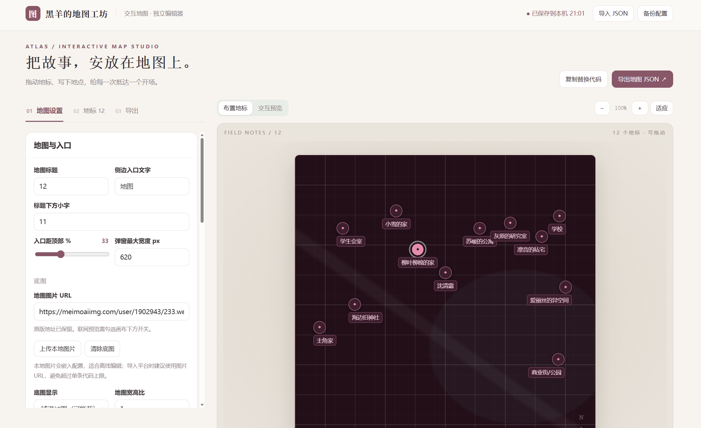

# 分享一个自制的新版地图侧边栏，支持超超超多自定义

来源: Discord 魅魔藏经阁 thread 1553394573626052730

创建: 2026-09-26T13:15:27.028000+00:00
消息数: 11

---

**Ggg「🥚」** (2026-10-06 01:26:18):
📌我丢个钉子，感谢开源

**假装是s的m** (2026-10-01 14:06:44):
<@1496464972367134730>老大，能不能再做个图鉴的这种工坊呀!!跪求老大

**TZU** (2026-10-01 12:51:58):

**战栗的黑羊** (2026-09-27 06:07:49):
<:emoji_100:1379103461014241370>

**小魅** (2026-09-26 15:34:27):
感谢宝宝开源哦<:emoji_140:1379454014852436038>

**MEE6** (2026-09-26 15:34:21):
<:CHECK6:403540120181145611> 30,000 XP has been given to **<@!1496464972367134730>**

**老贝榨** (2026-09-26 14:10:50):
<@1135473222658297907> <:emoji_140:1379454014852436038>

**战栗的黑羊** (2026-09-26 13:17:58):
灵感来源于 <@1145172864216088748> 大佬开源的那张魅魔卡，包括里面预设的地点和底图也是他的，我没改直接放上去了<:emoji_140:1379454014852436038>

**战栗的黑羊** (2026-09-26 13:15:52):

**档案管理员** (2026-09-26 13:15:27):
[本帖尚未声明授权]()
发帖人尚未完成授权设置，或已选择跳过。本状态不代表允许转载、二次创作、商业使用或重新分发。

**战栗的黑羊** (2026-09-26 13:15:27):
对代码和正则完全不了解/无基础的写卡新手也可用，
包括了自定义拖拽地标点位置、修改地标外显名称、内显标题以及展开地标简介等等一系列功能，可以说作为一个地图侧边栏可能用到的所有功能我全部都塞进去了，而且有很丝滑的侧边栏展开动画。

希望能给这次第八届魅魔杯参赛的朋友提供一些帮助，期待大伙发力<:emoji_140:1379454014852436038>
小破站有同步视频教程，不会用的可以前往查看：BV1jaho6iEw7

