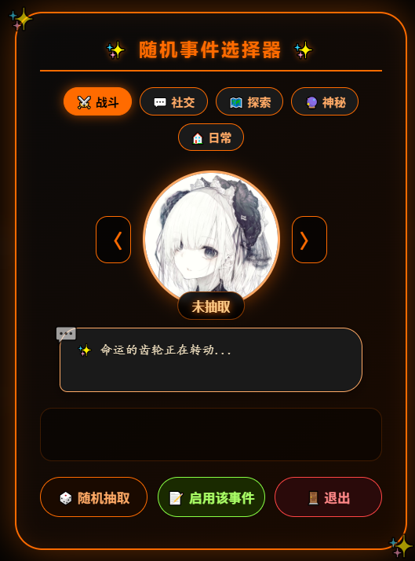

# 分享一个随机事件侧边栏

创建时间: 2026-04-25T23:32:34.999000+00:00
消息数: 13

---

**魔王大人·爆死大王（日暮宗空响长老）** (2026-04-30 15:24:07):
👍

**小魅** (2026-04-27 13:21:36):
感谢开源<:emoji_140:1379454014852436038>

**MEE6** (2026-04-27 13:21:28):
<:CHECK6:403540120181145611> 30,000 XP has been given to **<@!1459486378055303205>**

**周雅（被老婆调教.周浩）** (2026-04-27 00:05:26):
<@1135473222658297907> 奖励开源经验<:emoji_276:1497191644402028624>

**洛尘（ଳ水母宗太上长老）** (2026-04-26 10:17:40):
<:emoji_140:1379454014852436038>

**绛璃寒月ദ്ദി˶•̀֊•́)✧** (2026-04-26 06:22:58):
已从被暂停的账号中移除一条消息。

**蓝蓝（梯子不稳定，经常不在线）** (2026-04-26 04:12:49):
确实可以给每个随机事件绑一张图片，但是感觉给每个事件都绑一张图太繁琐了（我承认我懒癌晚期了<:1000168510:1298906820638674984> ），有时间可以做一版

**绛璃寒月ദ്ദി˶•̀֊•́)✧** (2026-04-26 03:38:01):
已从被暂停的账号中移除一条消息。

**绛璃寒月ദ്ദി˶•̀֊•́)✧** (2026-04-26 03:35:03):
已从被暂停的账号中移除一条消息。

**蓝蓝（梯子不稳定，经常不在线）** (2026-04-25 23:34:51):
顺便发一个测试用的html页面，可以把侧边栏之类的正则代码放进去测试功能，比在mmd上测试更快，需要一点电脑基础

**蓝蓝（梯子不稳定，经常不在线）** (2026-04-25 23:33:07):

**蓝蓝（梯子不稳定，经常不在线）** (2026-04-25 23:32:54):

**蓝蓝（梯子不稳定，经常不在线）** (2026-04-25 23:32:34):
可以把一些支线剧情、角色、特化都塞到里面，用关键词触发世界书，这样大佬的世界书就可以塞更多内容了<:emoji_249:1416980114511761448>

