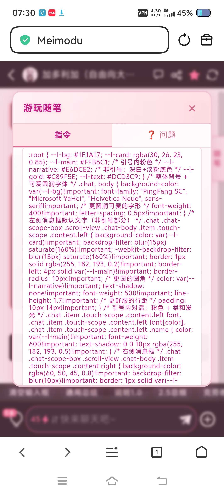
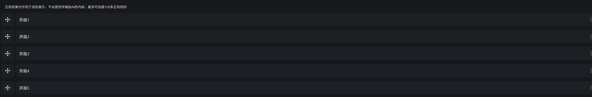
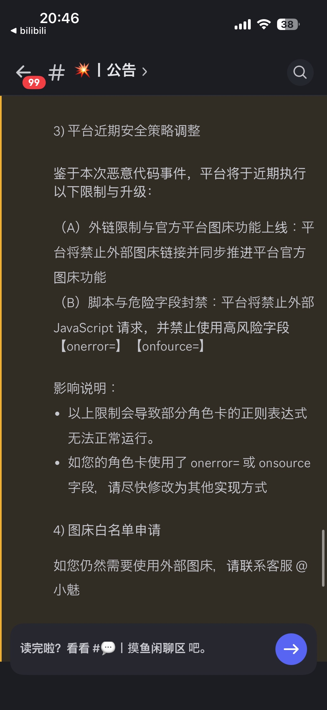

# 分享个我自己的多角色切换状态栏。

来源: Discord 魅魔藏经阁 thread 1460519695416430762
创建: 2026-01-13T06:23:50.531000+00:00
消息数: 238

---

**A？** (2026-09-21 14:56:53):

**鸢** (2026-07-12 02:15:52):
<:emoji_249:1416980114511761448>

**鸢** (2026-07-12 02:15:49):
赞赞赞

**yan** (2026-06-30 07:29:38):
能不能开源一个v2卡模版，能直接搬的那种

**dmdzzr** (2026-06-06 23:30:22):
大佬，这是肿么肥事捏

**孟德** (2026-04-24 08:11:46):
大佬，状态栏遇到""会自动截断，后面所有的都会显示成…，

**白** (2026-04-23 00:56:59):
大佬如果要加个好感度的话应该不会有啥事吧？

**ZSH** (2026-04-20 15:31:48):
太好啦，是多人状态栏，我们有救啦<:emoji_140:1379454014852436038>

**白水** (2026-04-04 14:38:04):
<:07:1298281204260278383>

**泪桐音白** (2026-04-04 14:37:56):
感谢，立马成功了❤️

**白水** (2026-04-04 14:36:21):
正确的应该有218个字符

**白水** (2026-04-04 14:36:05):
问题应该是出在正则那里，我之前发的那个正则内容被DC编译了还是什么。我重新发一个。

**泪桐音白** (2026-04-04 14:34:08):
最后结果是这样

**泪桐音白** (2026-04-04 14:33:15):
请问我这样写有哪不对

**Kamishiki** (2026-04-03 12:42:46):
谢谢～

**快雪时晴** (2026-04-03 09:40:37):
白水佬的那个应该直接复制就能用 两个角色没问题的

**Kamishiki** (2026-04-03 05:13:06):
救命！我搞了半天还是没搞懂。0编程基础啊！咋办

**白水** (2026-04-01 00:06:40):
<:1000168510:1298906820638674984>

**快雪时晴** (2026-04-01 00:06:29):
<:1000168510:1298906820638674984>

**快雪时晴** (2026-04-01 00:06:22):
白水佬，我是已经醒了，而且已经到工位了

**白水** (2026-04-01 00:05:52):
我去，还没睡。早点休息呀宝宝<:emoji_140:1379625753741623416>

**快雪时晴** (2026-04-01 00:04:50):
回头跑一跑看看稳不稳！

**白水** (2026-04-01 00:04:25):
恭喜，肘击大王<:1000168531:1298906724979310634>

**快雪时晴** (2026-03-31 20:01:20):
肘了一晚上，成功了<:1000168531:1298906724979310634>  想死

**快雪时晴** (2026-03-31 19:43:13):
死了妈了这AI 所有跑出来的结果全是互斥的。你能通过切换按钮切换差分立绘就不能通过左右剪头按钮切换不同角色的信息。

**快雪时晴** (2026-03-31 17:18:51):
我尝试下不修改url 仅变更图片代码保证原有的图片识别逻辑试一试

**快雪时晴** (2026-03-31 17:17:57):
搞不定，肘了一小时代码，可以通过按钮切换立绘，但是就是生成不了图片

**白水** (2026-03-31 15:48:12):
经典AI笑话

**快雪时晴** (2026-03-31 15:47:31):
然后他发现问题后会输出“这就是问题的破局点！”
改完代码以后会输出“完美！”

**快雪时晴** (2026-03-31 15:44:25):
笑死了，glm5的思维链真的好搞笑，我把能跑出来的代码丢给他，他思维链里面感慨:“为什么原代码能跑通？”

**快雪时晴** (2026-03-31 15:39:10):
我改一下看看

**快雪时晴** (2026-03-31 15:39:02):
他切换的时候 代码变成2和1了

**白水** (2026-03-31 15:37:30):
可能是AI乱改了什么，也是有可能的

**白水** (2026-03-31 15:37:21):
你可以问问AI（
我原本的逻辑就是通过编号查询URL，01就第一张，02第二章

**白水** (2026-03-31 15:36:49):
<:1000168531:1298906724979310634>

**快雪时晴** (2026-03-31 15:34:53):
比如我的状态栏初始立绘是01 通过点击按钮切换成02了   但是我的图片这个时候就直接不显示，只有个裂开的图片图标

**快雪时晴** (2026-03-31 15:34:00):
<@825244124218392587> 白水佬，出现了新的问题，想问你下立绘的查看逻辑是什么？我给原代码加了一个切换按钮，可以通过按钮切换差分立绘，点击按钮后立绘编号的代码改了，但是图片加载不出来<:1000168531:1298906724979310634>

**快雪时晴** (2026-03-30 16:34:12):
活了，用了究极笨办法

**快雪时晴** (2026-03-30 16:31:53):
CSS成功没问题了，html捕捉不到了

**快雪时晴** (2026-03-30 16:10:08):
谢谢白水佬！！！

**快雪时晴** (2026-03-30 16:09:55):
ok 今晚不搞了 明天试试去

**白水** (2026-03-30 16:08:34):
第一句话就不需要了

**白水** (2026-03-30 16:08:27):
放到功能栏就自动触发的

**快雪时晴** (2026-03-30 16:08:10):
那css的激活是需要在功能栏里面还是在第一句话里面触发啊？

**白水** (2026-03-30 16:07:33):
对的

**快雪时晴** (2026-03-30 16:07:10):
css放功能栏是独立一条正则吗？那捕捉的话还是捕捉html部分就行了是吧

**白水** (2026-03-30 16:03:57):
每次对话发送一次HTML部分的就行

**白水** (2026-03-30 16:03:44):
CSS可以放到功能栏，不需要每次发送都生成一次。

**白水** (2026-03-30 16:03:13):
分开来就可以

**快雪时晴** (2026-03-30 16:03:11):
4个可能正好，但我要5个

**快雪时晴** (2026-03-30 16:03:02):
我是css和html并一起的 原来两个char-group就13000字了

**白水** (2026-03-30 16:02:25):
你把CSS的部分和HTML框架的部分分开来，我觉得没问题的

**白水** (2026-03-30 16:02:08):
加到4个角色也没问题吧？

**白水** (2026-03-30 16:02:00):
但是现在一个正则可以有2W字符了

**白水** (2026-03-30 16:01:15):
我也没想好怎么解决（

**白水** (2026-03-30 16:00:51):
<:emoji_246:1488100783848161372>

**白水** (2026-03-30 16:00:33):
我先已经不用这种正则抓取的状态栏了

**白水** (2026-03-30 16:00:20):
好像确实抓取会有问题

**白水** (2026-03-30 16:00:14):
状态栏的话，这个是老的状态栏了。

**白水** (2026-03-30 15:59:44):
我开局就写了个【开局1】，然后它自己就能拉出后面的一大串

**白水** (2026-03-30 15:59:30):

**白水** (2026-03-30 15:59:14):
不需要，他会自己拉出所有的东西

**白水** (2026-03-30 15:59:05):
你自己切割一下状态栏的代码就行，控制好字符数

**快雪时晴** (2026-03-30 15:59:04):
啊 那我查找正则表达式怎么办，不是需要用同一个正则抓取吗

**白水** (2026-03-30 15:58:22):
就只是在尾端加上一个下一段替换用的代码的正则就行

**白水** (2026-03-30 15:58:06):
能看懂吗？

**白水** (2026-03-30 15:58:04):

**快雪时晴** (2026-03-30 15:57:11):
白水佬能不能举个栗子

**快雪时晴** (2026-03-30 15:56:59):
我研究下

**白水** (2026-03-30 15:56:46):
然后你就可以接火车了

**白水** (2026-03-30 15:56:25):
然后【下一个正则】这个东西就可以被另外一个替换式替换掉

**白水** (2026-03-30 15:56:10):
比如说XXXX【下一个正则】

**白水** (2026-03-30 15:56:00):
你可以在上一段正则的替换式的尾端接上替换下一个正则用的正则

**快雪时晴** (2026-03-30 15:55:59):
啊？？

**白水** (2026-03-30 15:55:34):
正则可以拼接的哦

**快雪时晴** (2026-03-30 15:55:18):
竟然能跑，但是只能切换两个角色，因为我这边看char-group只有俩，现在问题来了，手动加超字数限制了<:1000168531:1298906724979310634>

**白水** (2026-03-30 15:52:49):
你正则还好吗？我才发现我正则发到DC以后，冒号被DC吃掉了

**白水** (2026-03-30 15:52:22):
<:1000168531:1298906724979310634>

**快雪时晴** (2026-03-30 15:52:13):
哦 原来是char-group只有两个<:1000168531:1298906724979310634>

**快雪时晴** (2026-03-30 15:38:46):
我用了，代码没改的情况下，只能两个角色切换，角色3和角色4的信息输入了也切换不了

**小七** (2026-03-28 04:11:14):
昨天和豆娘吵了一架

**士酱** (2026-03-27 02:11:11):
豆包突破道德底线，开始和我拼嘴了<:emoji_148:1382329938404839586>

**士酱** (2026-03-27 02:08:57):
是的喵，已经开始和豆包自由搏击了

**清** (2026-03-15 15:08:38):
继续学习

**清** (2026-03-15 15:08:18):
<:07:1298281204260278383>

**欧哥** (2026-03-10 10:55:24):
好的  我试试

**白水** (2026-03-10 09:04:43):
你要写的足够详细，怎么提升，每提升多少可以出发，什么内容

**欧哥** (2026-03-10 08:06:49):
大佬  我在角色设定那设置了好感度数值控制性行为发生  感觉完全没用啊  用的gemini，这个要怎么设定才有效呢

**白水** (2026-03-10 07:14:14):
<:07:1298281204260278383>

**欧哥** (2026-03-10 07:01:33):
解决了  这个css名字那得根据我的修改

**欧哥** (2026-03-09 10:47:25):
我在角色设定那都写了立绘编码01好像没啥用

**欧哥** (2026-03-09 10:46:40):
嗯 用了  立绘编码都改成01后能显示了，但是回复1轮后，立绘就对不上了。这个立绘编码怎样对应图片的呢？

**白水** (2026-03-08 12:06:53):
你用了自己的图片吗？状态栏输出的内容是什么样的？

**欧哥** (2026-03-08 11:40:21):
大佬我使用的你发的css和html为啥第三个角色图片不显示呢 ，只显示第一第二第四个的

**白水** (2026-02-13 03:24:49):
你需要写个正则输出指南，让AI按照指定的格式输出内容才能被正则捕获，然后替换成代码
[执行逻辑]
先撰写剧情回复。
回复结束后，空一行。
优先输出互动对象面板数据块。
---------------------------------------------------
数据块 A：互动对象状态 (若有多个角色，用 ##### 分隔。）
---------------------------------------------------
【状态栏启动】
 <title>互动对象状态栏</title>
  <content1>
  {{角色1时间}}|{{角色1地点}} ##### {{角色2时间}}|{{角色2地点}}
  </content1>
  <content2>
  {{角色1姓名}}|{{角色1立绘代码}} ##### -|-
  </content2>
  <content3>
  {{角色1动作}}|{{角色1穿着}}|{{角色1内衣}}|{{角色1想法}} ##### -|-|-|-
  </content3>
  <content4>
  {{角色1肉棒}}|{{角色1菊穴}}|{{角色1乳房}}|{{角色1玉足}} ##### -|-|-|-
  </content4>

**小毅（沉淀中）** (2026-02-13 03:23:44):
大佬，我用了你的状态栏，目前还在测试，在第一句话里能正常显示了，但是回复就不出状态栏了，以前都是用固定状态栏，没用过正则状态栏，问下怎么样回复才能有状态栏

**白水** (2026-01-27 12:50:28):
找小茶壶做

**大吉吉** (2026-01-27 06:37:22):
大佬，你的侧边栏的图鉴怎么弄的？

**白水** (2026-01-19 00:29:37):
你叫ai把这个功能和图删了

**aaa_2_2_2_2_2_2_222222_** (2026-01-18 16:14:13):
能不能关图片 懒得改 用别人图不好

**白水** (2026-01-18 12:37:43):
祝你写卡愉快<:emoji_249:1416980114511761448>

**小荠** (2026-01-18 12:37:32):
知道了，再次谢谢大佬😆 😆

**白水** (2026-01-18 12:37:03):
目前的AI就是这样，你给他一堆东西让它去遵守，它是很难做到全部做好的

**白水** (2026-01-18 12:36:19):
能是能，但是你要知道AI的专注力是有限的，它不一定会听从指令

**小荠** (2026-01-18 12:35:49):
我能不能限制一下ai啊？比如我在内容中填写:只能从以下挑选对应的内容输送？
他能识别这样的指令码？

**白水** (2026-01-18 12:32:08):
是这样的

**小荠** (2026-01-18 12:31:39):
明白了，也就是说一条世界书只能设定一条相对应的内容，不能两者叠加，剩下一条世界书的条目。

**白水** (2026-01-18 12:29:33):
也就是说，你在世界书内容里写了口交和足交两个内容，主要关键词触发的是口交，但是整个内容会一起被打包发送给AI读取，AI看到的是一整个的内容

**白水** (2026-01-18 12:28:47):
世界书的原理是，当你触发了关键词以后，MMD这里会把世界书的内容和角色人设以及过往的剧情，你的回复一起打包，然后一起发送给AI

**小荠** (2026-01-18 12:27:32):
大佬我写清楚点:
1.只填了“主要关键词”。
2.主要关键词设计了“足角”和“口角”这两个，没有次要关键词。
3.内容中填写了一半足角内容，一半口角内容。
4.当我触发关键词“足角”时，ai会回复我“足角”的内容。
问:我填写的内容中还有“口角”的内容，那么ai会生成口角内容吗？即使我没有触发“口角的关键词？”

**白水** (2026-01-18 12:24:25):
简单来说，主要关键词是of，次要词是and。

**白水** (2026-01-18 12:20:21):
次要关键词是要主要关键词被触发的同时，次要的词也全被触发，才会发送内容

**白水** (2026-01-18 12:20:00):
主要关键词是只要有一个词被触发，内容就会被发送

**小荠** (2026-01-18 12:19:00):
大佬我又来了，关于世界书的问题：如果我在世界书的关键词写的是“足角特化”和“口角特化”，在【内容】中填了足角和口角的相关内容。那么当我触发关键词“足角特化”时，ai会不会为我生成“足角特化”的同时顺手生成我没有提到的“口角特化”的内容？

**小荠** (2026-01-18 11:59:37):
好的，感谢大佬

**白水** (2026-01-18 11:55:32):
一样的

**小荠** (2026-01-18 11:55:21):
大佬，我让小茶壶帮我做的是侧边栏，不是状态栏，道理是一样的嘛？

**白水** (2026-01-18 11:53:42):
emmm。代码过长确实没办法，但是角色删到3个，然后图片少用点，下方显示的内容删几个，压到1W个字符以内是没问题的

**小荠** (2026-01-18 11:52:12):
好的樱羽佬😋 ，对了大佬还有，正则太多了，物理拆分总会出bug，我问过茶壶他说可以按功能分离出来，那有没有不用分离的办法啊

**白水** (2026-01-18 11:49:52):
祝你肘击顺利（<:08:1298281401715785789>

**小荠** (2026-01-18 11:49:07):
哦知道了，谢谢大佬解惑，我这就去重新肘击小茶壶😋 😋

**白水** (2026-01-18 11:47:11):
公告里有写的

**白水** (2026-01-18 11:47:06):

**小荠** (2026-01-18 11:46:36):
哪个代码啊？

**白水** (2026-01-18 11:46:08):
有的话就告诉茶壶不能这么写，不能用这个代码的方式去实现功能，让它换一个方法

**白水** (2026-01-18 11:45:25):
你可以去看看自己代码里有没有使用到那个特定代码的功能

**小荠** (2026-01-18 11:44:49):
所以大佬你们是怎么做到不显示恶意代码就发出来的？我肘了小茶壶3天了，最后告诉我恶意代码不让用😭

**白水** (2026-01-18 11:43:18):
网络异常应该是mmd服务器的问题，代码目前官方还没正式执行，所以具体执行限制以后会不会出现异常代码我也说不准（

**小荠** (2026-01-18 11:37:51):
大佬大佬，里面不会出现恶意代码吧？我看今天的新卡也是正则修饰过的，他们没用正则吗还是单纯的没使用js？还有为什么我更新完世界书后点击最下方角色卡的保存后总是显示网络异常啊<:24:1298294525390753924>

**白水** (2026-01-17 12:49:06):
<:1000168531:1298906724979310634> 欸？

**波奇🎸** (2026-01-17 12:48:14):
你也是我妈妈了<:emoji_140:1379454014852436038>

**白水** (2026-01-17 12:47:22):
肘击代码是写卡的乐趣之一（

**普罗米修斯** (2026-01-17 12:45:57):
嚼嚼嚼正常，代码是这样的

**白水** (2026-01-17 12:45:37):
我人在外面不方便就直接把我卡里的代码给他了

**白水** (2026-01-17 12:45:26):
哈哈哈哈，他不是拆分不好状态栏吗

**普罗米修斯** (2026-01-17 12:44:53):
我看见上面哥们状态栏里的普罗米了

**白水** (2026-01-17 12:44:37):
普罗米发错区了吧<:1000168531:1298906724979310634>

**白水** (2026-01-17 12:44:22):
啊？

**普罗米修斯** (2026-01-17 12:44:20):
乐

**普罗米修斯** (2026-01-17 12:44:11):
在学习时候看见自己名字的救赎感

**普罗米修斯** (2026-01-17 12:43:48):
就真的

**大吉吉** (2026-01-17 06:03:18):
<:1000168531:1298906724979310634>

**大吉吉** (2026-01-17 06:03:17):
肘了一下，不行，直接寄了

**白水** (2026-01-17 05:02:44):
可以，你可以让ai给你做这个功能

**大吉吉** (2026-01-16 16:14:46):
<:emoji_139:1379455053080825866>

**大吉吉** (2026-01-16 16:14:26):
大佬，状态栏能不能实现自动换图，例如手动点击图片。自动切换到下一张图

**大吉吉** (2026-01-16 12:58:42):
我试试

**大吉吉** (2026-01-16 12:58:15):
还想加一个好感情欲什么的<:emoji_144:1379454084750245939>

**白水** (2026-01-16 12:58:09):
<:emoji_249:1453759631536033875> 你可以修改掉一些不要的内容。不需要写那么多

**大吉吉** (2026-01-16 12:57:28):
<:emoji_144:1379454084750245939> 程序一点改动的余地都没有啊，第二段9800字

**大吉吉** (2026-01-16 06:00:36):
可以了可以了，谢谢大佬

**大吉吉** (2026-01-16 05:51:51):
为什么我的就是不行，要疯了<:24:1298294525390753924>

**大吉吉** (2026-01-16 04:32:03):
好的，谢谢大佬

**白水** (2026-01-16 04:31:50):
没事，不要放弃，写出来最重要<:0C2E5ADC06577B01B51EE6C79E512B2E:1459834033797074997>

**大吉吉** (2026-01-16 04:31:33):
十分感激

**大吉吉** (2026-01-16 04:31:24):
谢谢大佬

**白水** (2026-01-16 04:25:02):
写出来了@我一下，我会去给你支持一下的<:emoji_140:1379454014852436038>

**白水** (2026-01-16 04:24:47):
图片要自己改掉哦，希望你能把卡写出来

**白水** (2026-01-16 04:23:49):

**白水** (2026-01-16 04:22:57):

**大吉吉** (2026-01-16 04:19:57):
搞了二天了

**大吉吉** (2026-01-16 04:19:49):
跪求

**大吉吉** (2026-01-16 04:19:41):
<:24:1298294525390753924>

**大吉吉** (2026-01-16 04:19:13):
大佬你可以将代码发给我吗<:emoji_144:1379454084750245939>

**白水** (2026-01-16 04:05:06):
我这里是能用的

**白水** (2026-01-16 04:04:58):
你可以看看代码问题，应该是代码出错了

**白水** (2026-01-16 04:04:49):

**大吉吉** (2026-01-16 04:02:18):
【状态栏启动】

<title>互动对象状态栏</title>
<content1>
深夜|公园树林（贴近你） ##### 深夜|公园树林（近处） ##### 深夜|公园树林（你耳边） ##### 深夜|公园树林外（刚站稳）
</content1>
<content2>
小白|01 ##### 小结|01 ##### 小红|10 ##### 小黄|01
</content2>
<content3>
手心覆在你额头，眼神担忧，制服由于身体前倾而勾勒出丰腴曲线|制服|大吉吉君是不是太累了？竟然开始说这种胡话 ##### 拿着扫码枪戳你胸口|大号卫衣|这种时候装什么深沉啊 ##### 从背后环住你的肩膀|黑色高领紧身包臀裙，黑丝|深紫色镂空蕾丝内衣|真是个充满惊喜的小家伙##### 嘴里叼着棒棒糖|不合身制服，短裤|由于搬货大吉吉到底在说啥？助手？难道是想叫我帮他搬水？
</content3>
<content4>
由于担心而分泌爱液，底裤微湿|不断收缩，渴望被填充|沉甸甸地颤动，压向你的胸膛|脚趾在皮鞋里蜷缩 ##### 兴奋地颤抖，顶端抵在内裤上|紧致如初|微微由于呼吸急促而起伏|脚尖在地砖上轻点 ##### 湿润，产生强烈的支配欲|贪婪地想要吞噬|饱满挺立，侧乳半露|高跟鞋跟碾压着地面 ##### -|-|-|-
</content4>
【状态栏启动】/<title>\s*([\s\S]*?)\s*<\/title>[\s\S]*?<content1>\s*([\s\S]*?)\s*<\/content1>[\s\S]*?<content2>\s*([\s\S]*?)\s*<\/content2>[\s\S]*?<content3>\s*([\s\S]*?)\s*<\/content3>[\s\S]*?<content4>\s*([\s\S]*?)\s*<\/content4>/

**白水** (2026-01-16 03:59:50):
正文是怎么样的？有4名角色的内容吗？

**大吉吉** (2026-01-16 03:58:23):
大佬为什么我设定了四个角色，只能捕捉到两个

**大吉吉** (2026-01-16 03:58:09):

**大吉吉** (2026-01-16 03:57:46):
我都是直接复制大佬的程序的

**大吉吉** (2026-01-16 03:57:28):
我没用豆包写啊

**白水** (2026-01-16 03:39:07):
豆包写的代码一向是非常容易出错的

**白水** (2026-01-16 03:38:52):
我估计是豆包写的代码有问题

**大吉吉** (2026-01-16 03:36:26):
麻烦大佬了

**大吉吉** (2026-01-16 03:36:18):
我再试一下

**大吉吉** (2026-01-16 03:33:07):
但我用这正则，程序运行不了

**白水** (2026-01-16 03:28:11):
Html部分必须要用这个正则

**白水** (2026-01-16 03:28:00):
正则代码 /<title>\s*([\s\S]*?)\s*<\/title>[\s\S]*?<content1>\s*([\s\S]*?)\s*<\/content1>[\s\S]*?<content2>\s*([\s\S]*?)\s*<\/content2>[\s\S]*?<content3>\s*([\s\S]*?)\s*<\/content3>[\s\S]*?<content4>\s*([\s\S]*?)\s*<\/content4>/

**大吉吉** (2026-01-16 03:24:09):

**大吉吉** (2026-01-16 03:19:46):
【状态栏启动】
<title>互动对象状态栏</title>
<content1>
夜晚|男生宿舍椅子上 ##### 夜晚|男生宿舍门口
</content1>
<content2>
林糯|08 ##### 苏筱筱|01
</content2>
<content3>
跨坐在你怀里，掀起裙摆展示肉棒，言语挑逗|真丝睡裙卷至腋下，白嫩胴体完全裸露|纯白蕾丝低腰内裤，底档处有明显的晶莹水渍|嘻嘻，看呐，这个一本正经的学姐已经湿成什么样了白水，我们再刺激她一下好不好？ ##### 靠在门框上，双腿由于腿软而不断打颤，肉棒维维勃起|学生会制服白衬衫，黑色百褶裙（已满是褶皱），透肉黑丝连裤袜|成套黑色蕾丝内衣，底裤已被爱液完全浸透|好想，好想看他们真的做下去。天哪，我在想什么，为什么我会这么想要被……
</content3>
<content4>
略微勃起，由于刚才的摩擦变得异常敏感|后穴因话题刺激而频繁收缩，渴望被填充|平坦挺立，乳晕处泛着红晕|脚趾紧绷蜷缩，足心因兴奋大量出汗 ##### 阴道口因幻想过度而疯狂溢出蜜液，打湿了黑丝内档|菊穴紧张而期待地缩动|饱满挺立，乳头将衬衫顶起两个明显的凸点|脚尖在皮鞋里疯狂抓挠，足部皮肤因充血而发烫
</content4>
【状态栏启动】《状》

**白水** (2026-01-16 03:10:15):
你的第一句话的内容，和正则可以发给我看一下吗？

**大吉吉** (2026-01-16 02:55:36):

**大吉吉** (2026-01-16 02:54:29):
大佬好像不行

**大吉吉** (2026-01-16 02:47:34):
好的谢谢大佬

**白水** (2026-01-16 02:37:58):
你把规则里的示例丢到第一句话看一下能不能正确读取到

**白水** (2026-01-16 02:37:07):
你没错，这是我代码就这么写的。只有一个角色或者读取不到角色的时候，切换角色的箭头不会显示出来

**大吉吉** (2026-01-16 02:33:13):
大佬我用你的替代正则，程序不能运行，用自己的规代正则。没有左右的按键<:emoji_144:1379454084750245939>

**大吉吉** (2026-01-16 02:32:55):

**白水** (2026-01-16 02:18:16):
是的，加一个输出要求即可

**大吉吉** (2026-01-16 02:05:20):
我先试一下，谢谢大佬

**大吉吉** (2026-01-16 02:03:31):
那就是说，设定那里我要进行相对应的修改吗

**白水** (2026-01-16 02:02:30):
记得让ai输出的时候每次都带上就行

**白水** (2026-01-16 02:02:14):
Html部分可以继续用那个正则式，css部分你可以用任何的字去当正则，css启动，状态栏启动，什么都行

**大吉吉** (2026-01-16 01:58:53):
那我去拆一下，谢谢大佬

**大吉吉** (2026-01-16 01:58:22):
<:1000168510:1298906820638674984> 大佬你不是说正则式要一样吗

**白水** (2026-01-16 01:42:24):
如果你是第一次写卡的新手，我更推荐你把精力放在把卡写得有趣上会更重要点，我的这个状态栏对新手来说可能会有点复杂，其实不是很推荐新手使用，但要是你能搞明白的话，你就可以去找茶壶开始做自己的状态栏了

**白水** (2026-01-16 01:40:30):
你可以让ai帮你把我的代码分成两块，一块是css部分一块是html框架，用两个正则替换去拼接就行。

**大吉吉** (2026-01-16 01:18:22):
大佬，程序代码超10000字，让豆包删空格后，程序直接不行了，这怎么搞

**白水** (2026-01-15 22:59:18):
是的

**大吉吉** (2026-01-15 16:35:00):
大佬，正则和生成必须要按照你那个来写吗？

**世玉** (2026-01-13 09:31:32):
用得上的时候再来学！

**世玉** (2026-01-13 09:31:26):
悲惨的失败了

**世玉** (2026-01-13 09:31:23):
<:emoji_114:1379110202694963270>

**白水** (2026-01-13 06:37:17):
我也不懂代码，我也是让AI给我肘的

**白水** (2026-01-13 06:37:07):
这一坨

**世玉** (2026-01-13 06:36:42):
我下载看看

**世玉** (2026-01-13 06:36:39):
思

**白水** (2026-01-13 06:36:31):
是下方的HTML框架里的JS代码，这个只是图片的数据库

**白水** (2026-01-13 06:36:05):
你可以直接把我的代码和你的代码都丢给AI，让AI把我的代码里的实现方法直接塞到你代码里

**世玉** (2026-01-13 06:35:59):
是这一段吗

**世玉** (2026-01-13 06:35:52):
白水是怎么实现的

**世玉** (2026-01-13 06:35:32):
而且我还没做到根据名字切换图床链接……

**世玉** (2026-01-13 06:35:17):
很折磨

**世玉** (2026-01-13 06:35:16):
我昨天肘了老久，结果状态栏完全没法横向排列

**世玉** (2026-01-13 06:35:03):

**白水** (2026-01-13 06:35:01):
或者自己做个主角的状态栏

**世玉** (2026-01-13 06:34:59):
我不是大佬！

**白水** (2026-01-13 06:34:51):
大佬随便拿去用就好，就是没有选项栏。可以让AI给你肘一个加上去

**白水** (2026-01-13 06:34:32):
<:1000168529:1298906735599288330> 不敢不敢，雕虫小技（

**世玉** (2026-01-13 06:34:21):
比我的好多了

**世玉** (2026-01-13 06:34:19):
效果真不赖啊

**白水** (2026-01-13 06:33:58):
有的

**白水** (2026-01-13 06:33:54):

**世玉** (2026-01-13 06:31:56):
有效果预览吗白水亲

**白水** (2026-01-13 06:31:00):
<:07:1298281204260278383>

**玲璃亲** (2026-01-13 06:30:51):
<:07:1298281204260278383>

**白水** (2026-01-13 06:30:45):
周浩哥来的真快www

**小雪** (2026-01-13 06:30:18):
谢谢你，爱你

**白水** (2026-01-13 06:28:41):
【状态栏启动】这个就是我自己用来替换CSS的正则

**白水** (2026-01-13 06:28:05):
生成指南
[执行逻辑]
1. 先撰写剧情回复。
2. 回复结束后，空一行。
3. 优先输出互动对象面板数据块。
# ---------------------------------------------------
# 数据块 A：互动对象状态 (若有多个角色，用 ##### 分隔。）
# ---------------------------------------------------
【状态栏启动】
 <title>互动对象状态栏</title>
  <content1>
  {{角色1时间}}|{{角色1地点}} ##### {{角色2时间}}|{{角色2地点}}
  </content1>
  <content2>
  {{角色1姓名}}|{{角色1立绘代码}} ##### -|-
  </content2>
  <content3>
  {{角色1动作}}|{{角色1穿着}}|{{角色1内衣}}|{{角色1想法}} ##### -|-|-|-
  </content3>
  <content4>
  {{角色1肉棒}}|{{角色1菊穴}}|{{角色1乳房}}|{{角色1玉足}} ##### -|-|-|-
  </content4>

# 以下为对象面板生成示例：
【状态栏启动】
<title>互动对象状态栏</title>
<content1>
夜晚|男生宿舍椅子上 ##### 夜晚|男生宿舍门口
</content1>
<content2>
林糯|08 ##### 苏筱筱|01
</content2>
<content3>
跨坐在你怀里，掀起裙摆展示肉棒，言语挑逗|真丝睡裙卷至腋下，白嫩胴体完全裸露|纯白蕾丝低腰内裤，底档处有明显的晶莹水渍|嘻嘻，看呐，这个一本正经的学姐已经湿成什么样了白水，我们再刺激她一下好不好？ ##### 靠在门框上，双腿由于腿软而不断打颤，肉棒维维勃起|学生会制服白衬衫，黑色百褶裙（已满是褶皱），透肉黑丝连裤袜|成套黑色蕾丝内衣，底裤已被爱液完全浸透|好想，好想看他们真的做下去。天哪，我在想什么，为什么我会这么想要被……
</content3>
<content4>
略微勃起，由于刚才的摩擦变得异常敏感|后穴因话题刺激而频繁收缩，渴望被填充|平坦挺立，乳晕处泛着红晕|脚趾紧绷蜷缩，足心因兴奋大量出汗 ##### 阴道口因幻想过度而疯狂溢出蜜液，打湿了黑丝内档|菊穴紧张而期待地缩动|饱满挺立，乳头将衬衫顶起两个明显的凸点|脚尖在皮鞋里疯狂抓挠，足部皮肤因充血而发烫
</content4>

**白水** (2026-01-13 06:26:45):
这一部分可以自己添加角色，多少个都行，名字对的上状态栏就会自己抓取图片，下方的是图片链接，每张图用  |   分隔开。立绘编号代表的就哪一张图，01就是第一张，02是第二张。可以做到每个角色都有自己的差分立绘

**白水** (2026-01-13 06:25:02):
代码过长，大家可以让AI把CSS部分和HTML框架部分分开来，这样就可以在CSS里放一堆的图片了

**白水** (2026-01-13 06:24:33):
正则代码 /<title>\s*([\s\S]*?)\s*<\/title>[\s\S]*?<content1>\s*([\s\S]*?)\s*<\/content1>[\s\S]*?<content2>\s*([\s\S]*?)\s*<\/content2>[\s\S]*?<content3>\s*([\s\S]*?)\s*<\/content3>[\s\S]*?<content4>\s*([\s\S]*?)\s*<\/content4>/

**周雅（被老婆调教.周浩）** (2026-01-13 06:24:24):
感谢大佬分享，帮大忙了<:07:1298281204260278383>

**白水** (2026-01-13 06:24:01):

**白水** (2026-01-13 06:23:50):
看大家都有需要，大家要是喜欢的话拿去用就好了。

