# 反对冷暴力

创建时间: 2025-04-26T12:01:57.915000+00:00
消息数: 7834

---

**萍水相逢，尽是他乡之客** (2026-06-27 12:26:38):
<:emoji_278:1514115400571555910>

**Mr.Koalefant** (2026-06-26 02:40:48):
<:emoji_278:1514115400571555910>

**羊驼** (2026-06-22 19:32:28):
<:emoji_278:1514115400571555910>

**000** (2026-06-22 07:32:45):
<:emoji_278:1514115400571555910>

**哈哈** (2026-06-21 10:10:44):
<:emoji_278:1514115400571555910>

**萍水相逢，尽是他乡之客** (2026-06-21 06:36:53):
<:emoji_278:1514115400571555910>

**Mr.Koalefant** (2026-06-21 02:19:54):
<:emoji_278:1514115400571555910>

**羊驼** (2026-06-20 13:58:32):
<:emoji_278:1514115400571555910>

**卡顺密** (2026-06-20 13:57:42):
1

**萍水相逢，尽是他乡之客** (2026-06-10 11:28:39):
<:emoji_243:1455870792574439476>

**Mr.Koalefant** (2026-06-10 09:53:03):
<:emoji_278:1514115400571555910>

**萍水相逢，尽是他乡之客** (2026-06-08 09:22:58):
<:emoji_133:1379494883227734157>

**萍水相逢，尽是他乡之客** (2026-06-08 09:22:52):
反对冷暴力！！！

**哈哈** (2026-06-08 05:49:09):
3

**卡顺密** (2026-06-07 11:35:49):
1

**萍水相逢，尽是他乡之客** (2026-05-31 07:17:46):


**Mr.Koalefant** (2026-05-31 03:59:42):
<:emoji_80:1378945762422952098>

**任白** (2026-05-28 01:54:20):
<:emoji_150:1382433856178749582>

**Mr.Koalefant** (2026-05-28 01:44:56):
<:emoji_253:1494328895120347247>

**晨** (2026-05-27 16:22:35):
rua一下

**Mr.Koalefant** (2026-05-27 09:55:49):
<:emoji_80:1378945762422952098>

**羊驼** (2026-05-27 09:48:16):
<:emoji_253:1494328895120347247>

**Mr.Koalefant** (2026-05-27 09:46:55):
<:emoji_277:1501430172040298566>

**Mr.Koalefant** (2026-05-27 09:46:30):
rue

**羊驼** (2026-05-27 09:46:21):
姆？！

**Mr.Koalefant** (2026-05-27 09:46:07):
<:emoji_147:1385908979460214866>

**羊驼** (2026-05-27 09:45:11):
<:1000168538:1298906751378133074>

**萍水相逢，尽是他乡之客** (2026-05-27 03:28:13):


**任白** (2026-05-27 02:29:46):
要变得和这个表情包一样了

**羊驼** (2026-05-27 00:12:55):
<:emoji_80:1378945762422952098>

**卡顺密** (2026-05-26 22:48:27):
左脸也开始肿了

**羊驼** (2026-05-26 14:07:10):
<:emoji_176:1409564877735071744>

**羊驼** (2026-05-26 14:07:07):
早日康复

**羊驼** (2026-05-26 14:07:03):
摸摸你

**任白** (2026-05-26 03:24:44):
噢噢我好像小学有个同学也范过

**任白** (2026-05-26 03:24:25):
这么阴

**卡顺密** (2026-05-26 02:16:14):
嘴巴很难张开 咀嚼东西也很难

**卡顺密** (2026-05-26 02:15:52):
我现在右脸确实肿的跟猪一样

**卡顺密** (2026-05-26 02:15:46):
也叫猪头皮

**卡顺密** (2026-05-26 02:15:14):
耳朵附近会肿起来

**任白** (2026-05-26 02:12:43):
有什么症状

**任白** (2026-05-26 02:12:38):
流行性腮腺炎

**卡顺密** (2026-05-26 00:25:45):
已经一个星期多了 吃了这么多药还没好

**卡顺密** (2026-05-26 00:25:34):
流行性腮腺炎

**希波鹅拉底** (2026-05-19 12:52:27):
啥玩意

**任白** (2026-05-19 06:48:16):
啥玩意

**卡顺密** (2026-05-19 00:00:20):
没招 现在吃饭已经很难了 这玩意儿还靠近耳朵 搞得我耳朵也有点痛

**哈哈** (2026-05-18 23:16:40):
<:UN_ShaShaSticks:827109657964838963>

**羊驼** (2026-05-18 23:10:46):
<:1000168539:1298906741777498162>

**赛博第一坏坏芳心纵火犯** (2026-05-18 21:26:57):
无能的羊驼

**羊驼** (2026-05-18 21:26:22):
<:emoji_148:1382329938404839586>

**萍水相逢，尽是他乡之客** (2026-05-18 19:52:38):


**赛博第一坏坏芳心纵火犯** (2026-05-18 19:46:40):
🐽

**羊驼** (2026-05-18 19:46:27):
<:1000168533:1298906730259943484>

**赛博第一坏坏芳心纵火犯** (2026-05-18 19:45:08):
<:emoji_142:1379854822315921438>

**羊驼** (2026-05-18 19:43:54):
<:emoji_89:1378950692655464492>

**赛博第一坏坏芳心纵火犯** (2026-05-18 19:42:14):
你把妹妹照片发我，我帮她检查一下有没有打疫苗

**羊驼** (2026-05-18 19:41:22):
<:emoji_139:1379455053080825866>

**希波鹅拉底** (2026-05-18 13:59:17):


**赛博第一坏坏芳心纵火犯** (2026-05-18 13:52:32):
你要是打过疫苗就基本上不会得了

**羊驼** (2026-05-18 13:50:40):
吓人

**赛博第一坏坏芳心纵火犯** (2026-05-18 13:49:58):
你干什么

**羊驼** (2026-05-18 13:49:18):
<:1000168538:1298906751378133074>

**赛博第一坏坏芳心纵火犯** (2026-05-18 13:49:07):
万一是腮腺炎还会传染的

**羊驼** (2026-05-18 13:47:36):
适应这东西

**赛博第一坏坏芳心纵火犯** (2026-05-18 13:47:30):
看你这个情况就算好了也可能留疤，不管的话

**羊驼** (2026-05-18 13:47:23):
不是这么用的啊

**赛博第一坏坏芳心纵火犯** (2026-05-18 13:47:11):
还是去医院处理吧

**羊驼** (2026-05-18 13:47:09):
Σ（・□・；）

**赛博第一坏坏芳心纵火犯** (2026-05-18 13:46:52):
🤯

**卡顺密** (2026-05-18 13:42:40):
痛得我睡不着

**卡顺密** (2026-05-18 05:20:44):
指不定哪天起来就好了

**卡顺密** (2026-05-18 05:20:33):
会适应的

**赛博第一坏坏芳心纵火犯** (2026-05-18 05:20:10):
🤨 居然不去医院检查一下？

**卡顺密** (2026-05-18 05:18:52):
<:emoji_144:1380206684739338403>

**卡顺密** (2026-05-18 05:18:46):
现在吃东西都有点难

**羊驼** (2026-05-17 22:45:25):
摸摸

**卡顺密** (2026-05-17 06:18:28):

**卡顺密** (2026-05-17 06:18:24):
大幅度张嘴有点难受

**卡顺密** (2026-05-17 06:17:58):
右脸颊有一个小肿块 硬硬的

**卡顺密** (2026-05-17 06:17:35):
有点难受

**任白** (2026-05-15 07:52:13):
被冷暴力了

**任白** (2026-05-15 07:52:09):
这里都没人了

**萍水相逢，尽是他乡之客** (2026-05-15 06:35:10):
<:emoji_278:1504527822717452368>

**crzwz** (2026-05-14 18:36:43):
俺不在

**crzwz** (2026-05-14 18:36:34):
我在梦里

**任白** (2026-05-14 18:09:21):
好久没看见你了

**任白** (2026-05-14 18:09:14):
宝宝

**crzwz** (2026-05-12 16:33:50):
举报你们

**crzwz** (2026-05-12 16:33:48):
！

**晨** (2026-05-12 16:25:50):
<:08:1298281401715785789>

**赛博第一坏坏芳心纵火犯** (2026-05-12 16:24:40):
（直接切了吧

**晨** (2026-05-12 16:14:36):
反对吉吉阳阳德

**crzwz** (2026-05-12 16:08:24):
反对反对的一切

**萍水相逢，尽是他乡之客** (2026-05-09 16:52:24):
<:emoji_250:1426636034996961300>

**参孙** (2026-05-09 16:38:08):
对不起...<:emoji_250:1473320515149238397>

**参孙** (2026-05-09 16:35:57):
反对冷暴力

**萍水相逢，尽是他乡之客** (2026-05-08 16:45:04):
蛋蛋来不来

**任白** (2026-05-08 14:56:19):
反对冷暴力

**参孙** (2026-05-08 11:45:43):
<:emoji_252:1486325346256027708>

**参孙** (2026-05-08 11:45:37):
反对冷暴力

**哈哈** (2026-05-07 04:39:46):
<:KSP_1:1156146801980735519>

**萍水相逢，尽是他乡之客** (2026-05-07 04:34:10):
<:emoji_148:1382329938404839586>

**哈哈** (2026-05-07 04:06:51):
<:KANADE_o:962696344215105616>

**萍水相逢，尽是他乡之客** (2026-05-07 02:20:50):
<:emoji_276:1498632895512707093>

**哈哈** (2026-05-07 02:14:04):
<a:sagiricoffe:798439352866308096>

**萍水相逢，尽是他乡之客** (2026-05-06 09:13:19):
<:emoji_174:1409564796625485884>

**希波鹅拉底** (2026-05-06 02:38:50):
<:emoji_278:1501230387131580416>

**萍水相逢，尽是他乡之客** (2026-05-05 22:50:51):
<:emoji_150:1391774976864161793>

**羊驼** (2026-05-05 22:48:44):
<:emoji_171:1409564723950649417>

**萍水相逢，尽是他乡之客** (2026-05-05 22:46:44):
舔洗你

**萍水相逢，尽是他乡之客** (2026-05-05 22:46:35):
<:emoji_83:1378946142330683422><:emoji_661_:1467525717943255061><:emoji_149:1400299483212021833><:emoji_150:1406265862410735707><:emoji_276:1498632895512707093>

**羊驼** (2026-05-05 22:46:28):
嘻嘻

**萍水相逢，尽是他乡之客** (2026-05-05 22:46:17):
<:emoji_249:1443611666678812886>

**羊驼** (2026-05-05 22:46:10):
所以猪猪

**萍水相逢，尽是他乡之客** (2026-05-05 22:45:52):
点歪了而已<:emoji_150:1382698990037897266>

**羊驼** (2026-05-05 22:45:42):
<:emoji_105:1379108713545335007>

**萍水相逢，尽是他乡之客** (2026-05-05 22:45:32):
<:emoji_144:1379454084750245939>

**羊驼** (2026-05-05 22:45:25):
猪

**萍水相逢，尽是他乡之客** (2026-05-05 22:45:19):
<:emoji_89:1378950692655464492>

**萍水相逢，尽是他乡之客** (2026-05-05 22:45:16):
<:emoji_89:1378950692655464492> <:emoji_89:1378950692655464492>

**萍水相逢，尽是他乡之客** (2026-05-05 22:45:11):
<:emoji_89:1378950692655464492> <:emoji_89:1378950692655464492> <:emoji_89:1378950692655464492>

**萍水相逢，尽是他乡之客** (2026-05-05 22:45:04):
<:emoji_89:1378950692655464492> <:emoji_89:1378950692655464492> <:emoji_89:1378950692655464492> <:emoji_89:1378950692655464492>

**萍水相逢，尽是他乡之客** (2026-05-05 22:44:56):
<:emoji_89:1378950692655464492> <:emoji_89:1378950692655464492> <:emoji_89:1378950692655464492>

**萍水相逢，尽是他乡之客** (2026-05-05 22:44:45):
<:emoji_89:1378950692655464492> <:emoji_89:1378950692655464492>

**萍水相逢，尽是他乡之客** (2026-05-05 22:44:40):
<:emoji_89:1378950692655464492>

**萍水相逢，尽是他乡之客** (2026-05-05 22:44:32):
<:emoji_250:1426636034996961300>

**羊驼** (2026-05-05 22:44:24):
魅魔🐖

**萍水相逢，尽是他乡之客** (2026-05-05 22:44:10):
<:emoji_250:1439598338801537124>

**萍水相逢，尽是他乡之客** (2026-05-05 22:44:01):
我是魅魔😈

**萍水相逢，尽是他乡之客** (2026-05-05 22:43:45):
<:emoji_150:1382698990037897266>

**羊驼** (2026-05-05 22:43:36):
猪猪

**萍水相逢，尽是他乡之客** (2026-05-05 22:43:11):
<:emoji_174:1409564796625485884>

**萍水相逢，尽是他乡之客** (2026-05-05 22:43:06):
你想叫爸爸或哥哥我也都喜欢哦

**萍水相逢，尽是他乡之客** (2026-05-05 22:42:51):
<:emoji_144:1380344265946828941>

**羊驼** (2026-05-05 22:42:40):
不要男妈妈

**羊驼** (2026-05-05 22:42:34):
<:emoji_252:1486379020487626943>

**萍水相逢，尽是他乡之客** (2026-05-05 22:41:49):
https://tenor.com/view/bubu-dudu-kiss-gif-23496295

**萍水相逢，尽是他乡之客** (2026-05-05 22:41:25):
小羊羊～妈妈亲洗你＾3＾

**萍水相逢，尽是他乡之客** (2026-05-05 22:41:10):
<:emoji_250:1439598338801537124>

**羊驼** (2026-05-05 22:41:02):
<:emoji_118:1379114000570126449>

**羊驼** (2026-05-05 22:40:53):
<:emoji_252:1479644342074212503>

**萍水相逢，尽是他乡之客** (2026-05-05 22:40:53):
https://tenor.com/view/genshin-impact-licking-screen-gif-10743599227998298987

**萍水相逢，尽是他乡之客** (2026-05-05 22:40:33):
<:emoji_243:1455870792574439476>

**羊驼** (2026-05-05 22:40:22):
你是🐖我是🦙

**萍水相逢，尽是他乡之客** (2026-05-05 22:36:02):
🐖🦙

**羊驼** (2026-05-05 22:02:49):
但我还是收到消息提醒

**羊驼** (2026-05-05 22:02:38):
<:emoji_252:1478825425865277500>

**羊驼** (2026-05-05 22:02:33):
结果发现根本不是回复我

**羊驼** (2026-05-05 22:02:22):
当时我还在想晨晨为什么给我回一个“怎么了”

**任白** (2026-05-05 20:22:54):
<:emoji_147:1385908979460214866>

**晨** (2026-05-05 16:57:18):
巧克力出反伤甲了

**晨** (2026-05-05 16:57:08):
白白

**晨** (2026-05-05 16:56:51):
？

**任白** (2026-05-05 16:54:29):
人白

**任白** (2026-05-05 16:54:16):
不过我确实很白

**任白** (2026-05-05 16:54:07):
被盯上了

**任白** (2026-05-05 16:54:04):
c( O.O )ɔ

**萍水相逢，尽是他乡之客** (2026-05-05 16:42:46):
任白老师和自己的ID一样，人白白嫩嫩的呢

**任白** (2026-05-05 16:41:44):
打篮球手指弄到了也会有这样的

**任白** (2026-05-05 16:41:33):
可能是打巧克力的时候

**任白** (2026-05-05 16:41:29):
也不知道怎么弄到的

**任白** (2026-05-05 16:41:12):
<:emoji_247:1488101228389994526>

**任白** (2026-05-05 16:41:04):
来自老婆大人的关心吗

**羊驼** (2026-05-05 16:40:34):
<:1000168538:1298906751378133074>

**羊驼** (2026-05-05 16:40:06):
<:1000168510:1298906820638674984>

**羊驼** (2026-05-05 16:40:04):
为什么我会收到提醒

**晨** (2026-05-05 16:39:45):
怎么了<:1000168510:1298906820638674984>

**任白** (2026-05-05 16:21:42):
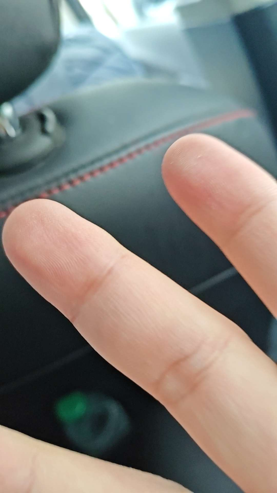

**任白** (2026-05-05 16:21:41):
肿起来了

**任白** (2026-05-05 16:21:20):
有事啊

**萍水相逢，尽是他乡之客** (2026-05-05 06:11:20):
<:1000168510:1298906820638674984>

**哈哈** (2026-05-04 23:49:37):
<:1000168510:1298906820638674984>

**羊驼** (2026-05-04 16:22:36):
没事吧

**羊驼** (2026-05-04 16:22:31):
<:1000168510:1298906820638674984>

**萍水相逢，尽是他乡之客** (2026-05-04 11:09:17):
<:emoji_105:1379108713545335007>

**任白** (2026-05-04 11:07:50):
手指崴了

**任白** (2026-05-04 11:07:47):
相当于

**羊驼** (2026-05-03 23:32:22):
手吃萝卜

**羊驼** (2026-05-03 23:32:17):
什么意思

**任白** (2026-05-03 03:01:02):
要追他搞得我手吃萝卜了

**任白** (2026-05-03 03:00:53):
巧克力跑出去了

**任白** (2026-05-03 03:00:48):
我妈回来居然没把门关好

**任白** (2026-05-03 03:00:41):
呜呜呜

**羊驼** (2026-05-03 00:38:06):
<:emoji_107:1379109456322756628>

**羊驼** (2026-05-03 00:37:58):
小心别感冒了

**羊驼** (2026-05-03 00:37:51):
原来如此

**任白** (2026-05-03 00:34:18):
而且也不能出去玩

**任白** (2026-05-03 00:34:02):
再回来家里就会到处都很湿

**任白** (2026-05-03 00:33:54):
他去院子里上厕所

**任白** (2026-05-03 00:33:38):
但是下雨了会很麻烦

**任白** (2026-05-03 00:33:33):
那也没有

**羊驼** (2026-05-03 00:28:00):
弄的满身是泥？

**羊驼** (2026-05-03 00:27:46):
怎么了嘛

**羊驼** (2026-05-03 00:27:39):
好吧

**任白** (2026-05-03 00:26:10):
不然都无所谓

**任白** (2026-05-03 00:26:06):
(´,,•ω•,,`)

**任白** (2026-05-03 00:26:02):
主要是因为巧克力

**任白** (2026-05-03 00:25:56):
睡不着了

**羊驼** (2026-05-03 00:22:39):
不多休息一下？

**羊驼** (2026-05-03 00:22:30):
我也不是非常喜欢下雨呢w

**羊驼** (2026-05-03 00:22:08):
摸摸你

**任白** (2026-05-03 00:21:59):
好烦啊每天都下雨

**任白** (2026-05-03 00:21:55):
好困

**任白** (2026-05-03 00:21:52):
早

**任白** (2026-05-03 00:21:48):
<:emoji_251:1490018372723675297>

**羊驼** (2026-05-03 00:21:12):
早上好

**羊驼** (2026-05-03 00:21:08):
<:emoji_150:1387407316369801216>

**任白** (2026-05-03 00:21:02):
抱抱

**羊驼** (2026-05-03 00:20:52):
<:emoji_251:1490018372723675297>

**羊驼** (2026-05-03 00:20:46):
任白老师抱抱

**羊驼** (2026-05-03 00:20:26):
好～

**羊驼** (2026-05-03 00:20:20):
<:emoji_251:1490018372723675297>

**任白** (2026-05-03 00:20:06):
反对冷暴力

**任白** (2026-05-03 00:20:03):
不要冷暴力我

**任白** (2026-05-03 00:20:00):
呜呜呜呜

**羊驼** (2026-05-02 21:24:36):
<:emoji_147:1385908979460214866>

**羊驼** (2026-05-02 21:24:25):
冷暴力你

**萍水相逢，尽是他乡之客** (2026-05-02 14:04:22):
<:emoji_148:1386006416136863796>

**任白** (2026-05-02 14:03:51):
支持冷暴力

**任白** (2026-05-02 14:03:05):
这么多老资历

**任白** (2026-05-02 14:03:03):
卧槽

**参孙** (2026-05-02 06:14:56):
<:emoji_252:1486325346256027708>

**参孙** (2026-05-02 06:14:52):
反对冷暴力

**希波鹅拉底** (2026-05-02 03:07:03):
咬死你

**希波鹅拉底** (2026-05-02 03:06:58):
<:emoji_142:1379854822315921438>

**希波鹅拉底** (2026-05-02 03:06:56):
捅死你

**婳** (2026-05-02 03:03:32):
你也一拳👊 👊 👊

**希波鹅拉底** (2026-05-02 03:02:05):
我去，申必老资历

**婳** (2026-05-02 02:26:51):
给你一拳👊 👊 👊

**萍水相逢，尽是他乡之客** (2026-05-01 17:39:37):
<:emoji_250:1459542480406970432>

**哈哈** (2026-05-01 17:39:25):
<a:Hifumi_Yes:1117326403558453258>

**萍水相逢，尽是他乡之客** (2026-05-01 17:01:27):
反对冷暴力<:emoji_248:1489983371848450222>

**哈哈** (2026-05-01 15:25:23):
<:Zzul_gilda:1154375118374576168>

**羊驼** (2026-05-01 15:14:54):
<:emoji_140:1379454014852436038>

**哈哈** (2026-05-01 14:32:12):
<:Seulbi_derp:1364100052674547752>

**羊驼** (2026-05-01 14:16:37):
<:emoji_250:1426636034996961300>

**卡顺密** (2026-05-01 14:16:05):

**卡顺密** (2026-05-01 14:15:22):
震天两条区

**卡顺密** (2026-05-01 14:15:07):
我去

**卡顺密** (2026-05-01 14:15:00):
我去

**羊驼** (2026-05-01 14:14:53):
哈哈可爱

**羊驼** (2026-05-01 14:14:37):
神秘老资历！

**哈哈** (2026-05-01 14:14:17):
<:emoji_136:1381162107424215091>

**希波鹅拉底** (2026-05-01 05:46:22):
<:emoji_149:1400309607783727266>

**希波鹅拉底** (2026-05-01 05:46:18):
啊，好久不见

**婳** (2026-05-01 01:38:42):
神秘老资历！

**参孙** (2026-04-30 13:31:39):
反对冷暴力

**晨** (2026-04-29 17:47:15):
wow，是...云图佬！

**𝙔𝙏𝙏𝙏** (2026-04-29 17:43:56):
😿

**𝙔𝙏𝙏𝙏** (2026-04-29 17:43:51):
时间过得真快啊

**萍水相逢，尽是他乡之客** (2026-04-28 13:19:16):
<:emoji_150:1379454421599129610>

**羊驼** (2026-04-28 13:19:00):
<:emoji_248:1447214733718720663>

**萍水相逢，尽是他乡之客** (2026-04-28 13:18:30):
<:emoji_150:1391774976864161793>

**萍水相逢，尽是他乡之客** (2026-04-28 13:18:24):
用天马流星拳给你打干

**萍水相逢，尽是他乡之客** (2026-04-28 13:17:56):


**羊驼** (2026-04-28 13:17:53):
每次都被小啊舔的粘哒哒的

**羊驼** (2026-04-28 13:17:21):
<:emoji_118:1379114000570126449>

**萍水相逢，尽是他乡之客** (2026-04-28 01:32:59):
https://tenor.com/view/bearish-bearishaf-bearish-af-kawaii-cute-gif-2861433151260981138

**羊驼** (2026-04-28 00:48:28):
<:emoji_246:1431854777603457025>

**诺顿** (2026-04-28 00:45:20):
羊驼rua一下<:emoji_150:1406265862410735707>

**羊驼** (2026-04-28 00:05:58):
<:emoji_140:1379454014852436038>

**羊驼** (2026-04-28 00:05:56):
<:1000168531:1298906724979310634>

**诺顿** (2026-04-28 00:04:42):
<:emoji_252:1486325346256027708>

**诺顿** (2026-04-28 00:04:07):
反对冷暴力

**任白** (2026-04-27 15:07:35):
支持

**羊驼** (2026-04-27 14:35:52):
<:emoji_140:1379454014852436038> <:emoji_150:1387407316369801216>

**羊驼** (2026-04-27 14:35:45):
<:emoji_248:1447214733718720663>

**哈哈** (2026-04-27 14:32:30):
<a:PGR_AlphaBiteGif:1060100333709299742>

**哈哈** (2026-04-27 14:32:28):

**诺顿** (2026-04-27 14:32:27):
<:emoji_276:1497191644402028624> <:emoji_140:1379454014852436038>

**羊驼** (2026-04-27 14:31:52):
<:emoji_251:1490018372723675297>

**羊驼** (2026-04-27 14:31:44):
<:emoji_245:1475855412757663938>

**萍水相逢，尽是他乡之客** (2026-04-27 14:30:50):
https://tenor.com/view/mocha-and-milk-bears-milk-mocha-cuddle-squeeze-gif-7102673578086768359

**哈哈** (2026-04-27 14:30:02):
<:Triss_loading:1399771142725566474>

**萍水相逢，尽是他乡之客** (2026-04-27 14:28:38):
哈哈的反应好迟钝<:emoji_174:1409564796625485884>

**哈哈** (2026-04-27 14:17:44):
<:BaiWhat:919176468511207504>

**诺顿** (2026-04-27 14:16:45):
<:emoji_242:1459832161719943198>

**羊驼** (2026-04-27 14:16:21):
<:emoji_276:1497191644402028624>

**羊驼** (2026-04-27 14:16:17):
上了

**羊驼** (2026-04-27 14:16:09):
<:emoji_250:1426636034996961300>

**伊特尔诺** (2026-04-27 13:43:43):
<:emoji_150:1400299501423431771>

**伊特尔诺** (2026-04-27 13:43:41):
有时间聊天不上洛克王国？

**诺顿** (2026-04-27 13:43:16):
昨天拉下你了，我还是太善良，没忍心对你下头

**羊驼** (2026-04-27 13:42:33):
<:daroubangqingnichi:1411320597241139260>

**诺顿** (2026-04-27 13:42:23):
我也要吃<:emoji_252:1486325346256027708>

**羊驼** (2026-04-27 13:42:19):
<:emoji_248:1427157732770844783>

**萍水相逢，尽是他乡之客** (2026-04-27 13:42:13):
<:emoji_252:1476549537547161662>

**羊驼** (2026-04-27 13:42:04):
我还没去买

**诺顿** (2026-04-27 13:41:40):
<:emoji_249:1416980114511761448>

**诺顿** (2026-04-27 13:41:29):
你看笨到自己都不自知，笨蛋小啊...
嘶...感觉笨蛋小男娘也很有吸引力啊

**萍水相逢，尽是他乡之客** (2026-04-27 13:40:17):
我哪里笨啦<:emoji_149:1382626041352159263>

**萍水相逢，尽是他乡之客** (2026-04-27 13:40:08):
<:emoji_150:1382698990037897266>

**诺顿** (2026-04-27 13:39:56):
小啊也是笨笨的

**诺顿** (2026-04-27 13:39:41):
<:emoji_276:1497191644402028624>

**诺顿** (2026-04-27 13:39:36):
羊驼忘吃午饭？
其实是被我偷拿走吃了

**羊驼** (2026-04-27 13:33:56):
<:emoji_246:1488100783848161372>

**萍水相逢，尽是他乡之客** (2026-04-27 13:33:53):
不好好吃饭就要被我嘲笑<:emoji_144:1380344265946828941>

**萍水相逢，尽是他乡之客** (2026-04-27 13:33:37):
<:emoji_136:1381162107424215091>

**萍水相逢，尽是他乡之客** (2026-04-27 13:33:32):
笨羊羊

**羊驼** (2026-04-27 13:33:11):
忘记吃午饭了

**羊驼** (2026-04-27 13:33:07):
啊

**羊驼** (2026-04-27 13:32:59):
<:23:1298294522945605756> <:emoji_147:1382565790129328128>

**萍水相逢，尽是他乡之客** (2026-04-27 13:32:50):
<:emoji_83:1378946142330683422> <:emoji_661_:1467525717943255061> <:emoji_149:1400299483212021833> <:emoji_150:1406265862410735707>

**萍水相逢，尽是他乡之客** (2026-04-27 13:32:41):
<:emoji_243:1455870792574439476>

**羊驼** (2026-04-27 13:32:30):
<:emoji_251:1490018372723675297>

**萍水相逢，尽是他乡之客** (2026-04-27 12:30:30):


**羊驼** (2026-04-27 12:07:45):
哈哈

**哈哈** (2026-04-27 04:11:21):
<:1000168510:1298906820638674984>

**萍水相逢，尽是他乡之客** (2026-04-26 08:02:03):
<:emoji_249:1416980128793104514>

**希波鹅拉底** (2026-04-26 07:58:00):
支持流感

**萍水相逢，尽是他乡之客** (2026-04-26 04:50:11):
反对流感

**沐 云曦** (2026-04-26 04:47:55):
反对流感

**羊驼** (2026-04-26 00:36:22):
早～

**萍水相逢，尽是他乡之客** (2026-04-26 00:36:18):


**萍水相逢，尽是他乡之客** (2026-04-26 00:36:14):
羊驼宝宝早ﾉ☀

**萍水相逢，尽是他乡之客** (2026-04-26 00:36:05):
<:emoji_243:1455870792574439476>

**羊驼** (2026-04-26 00:35:56):
<:23:1298294522945605756>

**萍水相逢，尽是他乡之客** (2026-04-26 00:35:30):
<:emoji_149:1400299483212021833> <:emoji_83:1378946142330683422>

**羊驼** (2026-04-25 22:39:58):
<:emoji_146:1379454137158209736>

**羊驼** (2026-04-25 22:39:49):
刷屏是有惩罚的你知道吗

**伊特尔诺** (2026-04-25 13:39:01):
反对反对反对反对反对反对反对反对反对反对反对反对反对反对反对反对反对反对反对反对反对反对反对反对反对反对反对反对反对反对反对反对反对反对反对反对反对反对反对反对反对反对反对反对反对反对反对反对反对反对反对反对反对反对反对反对反对反对反对反对反对反对反对反对反对反对反对反对反对反对反对反对反对反对反对反对反对反对反对反对反对反对反对反对反对反对反对反对反对反对反对反对反对反对反对反对反对反对反对反对反对反对反对反对反对反对反对反对反对反对反对反对反对反对反对反对反对反对反对反对反对反对反对反对反对反对反对反对反对反对反对反对反对反对反对反对反对反对反对反对反对反对反对反对反对反对反对反对反对反对反对反对反对反对反对反对反对反对反对反对反对反对反对反对反对反对反对反对反对反对反对反对反对反对反对反对反对反对反对反对反对反对反对反对反对反对反对反对反对反对反对反对反对反对反对反对反对反对反对反对反对反对反对反对反对反对反对反对反对反对反对反对反对反对反对反对反对反对反对反对反对反对反对反对反对反对反对反对反对反对反对反对反对反对反对反对反对反对反对反对反对反对反对反对反对反对反对反对反对反对反对反对反对反对反对反对反对反对反对反对反对反对反对反对反对反对反对反对反对反对反对反对反对反对反对反对反对反对反对反对反对反对反对反对反对反对反对反对反对反对反对反对反对反对反对反对反对反对反对反对反对反对反对反对反对反对反对反对反对反对反对反对反对反对反对反对反对反对反对反对反对反对反对反对反对反对反对反对反对反对反对反对反对反对反对反对反对反对反对反对反对反对反对反对反对反对反对反对反对反对反对反对反对反对反对反对反对反对反对反对反对反对反对反对反对反对反对反对反对反对反对反对反对反对反对反对反对反对反对反对反对反对反对反对反对反对反对反对反对反对反对反对反对反对反对反对反对反对反对反对反对反对反对反对反对反对反对反对反对反对反对反对反对反对反对反对反对反对反对反对反对反对反对反对反对反对反对反对反对反对反对反对反对反对反对反对反对反对反对反对反对反对反对反对反对反对反对反对反对反对反对反对反对反对反对反对反对反对反对反对反对反对反对反对反对反对反对反对反对反对反对反对反对反对反对反对反对反对反对反对反对反对反对反对反对反对反对反对反对反对反对反对反对反对反对反对反对反对反对反对反对反对反对反对反对反对反对反对反对反对反对反对反对反对反对反对反对反对反对反对反对反对反对反对反对反对反对反对反对反对反对反对反对反对反对反对反对反对反对反对反对反对反对反对反对反对反对反对反对反对反对反对反对反对反对反对反对反对反对反对反对反对反对反对反对反对反对反对反对反对反对反对反对反对反对反对反对反对反对反对反对反对反对反对反对反对反对反对反对反对反对反对反对反对反对反对反对反对反对反对反对反对反对反对反对反对反对反对反对反对反对反对反对反对反对反对反对反对反对反对反对反对反对反对反对反对反对反对反对反对反对反对反对反对反对反对反对反对反对反对反对反对反对反对反对反对反对反对反对反对反对反对反对反对反对反对反对反对反对反对反对反对反对反对反对反对反对反对反对反对反对反对反对反对反对反对反对反对反对反对反对反对反对反对反对反对反对反对反对反对反对反对反对反对反对反对反对反对反对反对反对反对反对反对反对反对反对反对反对反对反对反对反对反对反对反对反对反对反对反对反对反对反对反对反对反对反对反对反对反对反对反对反对反对反对反对反对反对反对反对反对反对反对反对反对反对反对反对反对反对反对反对反对反对反对反对反对反对反对反对反对反对反对反对反对反对反对反对反对反对反对反对反对反对反对反对反对反对反对反对反对反对反对反对反对反对反对反对反对反对反对反对反对反对反对反对反对反对反对反对反对反对反对反对反对反对反对反对反对反对反对反对反对反对反对反对反对反对反对反对反对反对反对反对反对反对反对反对反对反对反对反对反对反对反对反对反对反对反对反对反对反对反对反对反对反对反对反对反对反对反对反对反对反对反对反对反对反对反对反对反对反对反对反对反对反对反对反对反对反对反对反对反对反对反对反对反对反对反对反对反对反对反对反对反对反对反对反对反对反对反对反对反对反对反对反对反对反对反对反对反对反对反对反对反对反对反对反对反对反对反对反对反对反对反对反对反对反对反对反对反对反对反对反对反对反对反对反对反对反对反对反对反对反对反对反对反对反对反对反对反对反对反对反对反对反对反对反对反对反对反对反对反对反对反对反对反对反对反对反对反对反对反对反对反对反对反对反对反对反对反对反对反对反对反对反对反对反对反对反对反对反对反对反对反对反对反对反对反对反对反对反对反对反对反对反对反对反对反对反对

**萍水相逢，尽是他乡之客** (2026-04-25 13:22:09):
<:emoji_174:1409564796625485884>

**萍水相逢，尽是他乡之客** (2026-04-25 13:22:00):
鹅鹅发大财

**希波鹅拉底** (2026-04-25 13:21:40):
反对我下面这个

**希波鹅拉底** (2026-04-25 13:21:28):
反对我上面这个

**沐 云曦** (2026-04-25 13:16:39):
反对冷链

**萍水相逢，尽是他乡之客** (2026-04-23 15:24:25):
<:emoji_661_:1467525717943255061>

**赛博第一坏坏芳心纵火犯** (2026-04-23 15:23:35):
只是难得吗？我以后就是操小希都不操你了！

**萍水相逢，尽是他乡之客** (2026-04-23 15:13:48):
<:emoji_247:1488101228389994526>

**萍水相逢，尽是他乡之客** (2026-04-23 15:13:35):
难得有一次支持芳心

**萍水相逢，尽是他乡之客** (2026-04-23 15:13:24):
<:emoji_250:1426636034996961300>

**赛博第一坏坏芳心纵火犯** (2026-04-23 13:26:11):
反对羊驼动不动就哭唧唧还不给操！

**萍水相逢，尽是他乡之客** (2026-04-23 11:36:37):
<:emoji_141:1379626177068666990>

**伊特尔诺** (2026-04-23 11:29:46):
<:emoji_249:1416980114511761448>

**伊特尔诺** (2026-04-23 11:29:44):
反对反对颈椎痛

**萍水相逢，尽是他乡之客** (2026-04-23 09:06:28):
反对颈椎痛！

**萍水相逢，尽是他乡之客** (2026-04-21 10:35:38):
反对胳膊疼！
反对脖子痛！

**希波鹅拉底** (2026-04-19 08:13:48):
<:emoji_149:1382330529382273116>

**希波鹅拉底** (2026-04-19 08:13:45):
转过去！自己掰开！

**萍水相逢，尽是他乡之客** (2026-04-19 06:10:20):
不如冷暴力……

**萍水相逢，尽是他乡之客** (2026-04-19 04:08:26):
反对冷暴力！

**沐 云曦** (2026-04-19 04:06:00):
壁咚！亲我

**希波鹅拉底** (2026-04-19 04:03:30):
吓人

**沐 云曦** (2026-04-19 03:40:19):
啊，雅蠛蝶，哒咩

**伊特尔诺** (2026-04-19 03:39:54):
<:emoji_249:1416980114511761448>

**伊特尔诺** (2026-04-19 03:39:53):
强健你喵

**沐 云曦** (2026-04-19 03:18:08):
可爱亲亲亲mua

**沐 云曦** (2026-04-19 03:17:55):
为什么不强奸我

**Riesky** (2026-04-18 07:24:34):


**秋之兔** (2026-04-18 07:03:57):
何意味

**伊特尔诺** (2026-04-18 06:52:37):
<:emoji_249:1416980114511761448>

**伊特尔诺** (2026-04-18 06:52:34):
强健羊驼

**沐 云曦** (2026-04-18 02:05:38):
反对冷暴力

**萍水相逢，尽是他乡之客** (2026-04-17 23:51:48):
支持羊驼<:emoji_144:1380344265946828941>

**羊驼** (2026-04-17 22:37:56):
<:emoji_148:1382329938404839586>

**羊驼** (2026-04-17 22:37:53):
反对反对羊驼

**赛博第一坏坏芳心纵火犯** (2026-04-17 13:50:04):
那羊驼真该死啊

**伊特尔诺** (2026-04-17 13:49:36):
<:emoji_150:1400299501423431771>

**伊特尔诺** (2026-04-17 13:49:34):
反对羊驼不和我在洛克王国牵手手骑骑马

**赛博第一坏坏芳心纵火犯** (2026-04-17 13:49:08):
反对羊驼不把妹妹微信给我

**伊特尔诺** (2026-04-17 13:48:47):
<:emoji_150:1400299501423431771>

**伊特尔诺** (2026-04-17 13:48:45):
还有筷子水泥连招

**希波鹅拉底** (2026-04-17 12:47:10):
用水泥封上

**希波鹅拉底** (2026-04-17 12:47:04):
支持，全部禁欲

**沐 云曦** (2026-04-17 03:10:36):
反对爱爱

**萍水相逢，尽是他乡之客** (2026-04-17 00:34:00):
反对羊驼不分我经验

**羊驼** (2026-04-16 21:58:00):
反对冷暴力

**沐 云曦** (2026-04-16 09:20:39):
反对冷暴力

**伊特尔诺** (2026-04-15 10:03:33):
https://discord.com/channels/1205870897769095229/1488113704942960680

**萍水相逢，尽是他乡之客** (2026-04-15 10:03:00):
反对反对反对反对反对！

**伊特尔诺** (2026-04-15 09:52:39):
四次元口袋丸吞这一块。

**伊特尔诺** (2026-04-15 09:52:29):
<:emoji_150:1400299501423431771>

**伊特尔诺** (2026-04-15 09:52:28):
曹哆啦A梦就有

**卡顺密** (2026-04-15 09:52:25):
最近想魂穿成大雄

**卡顺密** (2026-04-15 09:52:13):
孩子们 搞个穿越成大雄的卡有没有搞头

**卡顺密** (2026-04-15 09:51:56):
反对冷暴力

**沐 云曦** (2026-04-15 09:51:13):
唉？hentai!

**伊特尔诺** (2026-04-15 07:13:56):
<:emoji_150:1400299501423431771>

**伊特尔诺** (2026-04-15 07:13:54):
反对不让我🌿你喵

**沐 云曦** (2026-04-15 04:07:45):
反对反对反对

**萍水相逢，尽是他乡之客** (2026-04-14 16:28:31):
反对反对！！！

**沐 云曦** (2026-04-13 05:21:09):
反对褒姒

**哈哈** (2026-04-13 03:04:57):
3

**任白** (2026-04-13 01:38:00):
2

**希波鹅拉底** (2026-04-12 17:10:44):
1

**伊特尔诺** (2026-04-11 08:44:54):
https://discord.com/channels/1205870897769095229/1490900412989968384

**萍水相逢，尽是他乡之客** (2026-04-11 06:49:30):
反对反对！

**沐 云曦** (2026-04-11 05:47:35):
反对暴力

**哈哈** (2026-04-10 12:24:33):
<:1000168531:1298906724979310634>

**羊驼** (2026-04-10 08:33:35):
你知道我想说什么吗

**羊驼** (2026-04-10 08:33:21):
<:emoji_245:1458886489038393469>

**哈哈** (2026-04-10 03:43:50):
<:WOLF:1136705646046224514>

**萍水相逢，尽是他乡之客** (2026-04-09 15:30:21):
<:emoji_174:1409564796625485884>

**赛博第一坏坏芳心纵火犯** (2026-04-09 15:29:46):
味道都会文爱了

**赛博第一坏坏芳心纵火犯** (2026-04-09 15:29:39):
真的招回来脏东西了

**羊驼** (2026-04-09 15:26:26):
<:emoji_147:1382565790129328128> <:emoji_150:1387407316369801216> <:emoji_246:1431854777603457025> <:emoji_245:1431854739339087882>

**伊特尔诺** (2026-04-09 09:17:04):
<:emoji_249:1416980114511761448>

**伊特尔诺** (2026-04-09 09:16:59):
我直接抱住你把你摁在地上亲全都补回来

**沐 云曦** (2026-04-09 08:47:02):
亲亲宝宝mua

**羊驼** (2026-04-09 08:46:07):
<:emoji_115:1379113943817257071>

**羊驼** (2026-04-09 08:45:59):
<:emoji_246:1431854777603457025>

**沐 云曦** (2026-04-09 06:50:23):
找味道补一下？

**伊特尔诺** (2026-04-09 06:36:11):
<:emoji_249:1416980128793104514>

**伊特尔诺** (2026-04-09 06:36:05):
那我缺的亲亲这一块

**沐 云曦** (2026-04-09 06:33:13):
反对亲亲

**沐 云曦** (2026-04-09 06:33:08):
mua

**羊驼** (2026-04-08 18:13:29):
<:1000168538:1298906751378133074>

**萍水相逢，尽是他乡之客** (2026-04-08 17:43:35):
反对冷暴力<:emoji_133:1379494883227734157>

**沐 云曦** (2026-04-08 10:10:40):
反对瑟瑟

**萍水相逢，尽是他乡之客** (2026-04-07 17:26:59):
<:daroubangqingnichi:1411320597241139260>

**赛博第一坏坏芳心纵火犯** (2026-04-07 00:25:19):
https://tenor.com/view/anime-tongue-tongue-out-anime-girl-licks-gif-11891460351937637181

**沐 云曦** (2026-04-07 00:24:36):
抓住亲一口mua

**Riesky** (2026-04-07 00:21:33):
小宠物闹腾可爱，也只能肯定他啦<:1000168531:1298906724979310634>

**赛博第一坏坏芳心纵火犯** (2026-04-07 00:19:25):
你家那个猫咋样了

**卡顺密** (2026-04-07 00:18:25):
兄弟兄弟你的嘴怎么愁愁的

**赛博第一坏坏芳心纵火犯** (2026-04-07 00:17:58):
像只焦虑的小宠物

**赛博第一坏坏芳心纵火犯** (2026-04-07 00:17:39):
https://tenor.com/view/kiss-gif-11816971814746635421

**Riesky** (2026-04-07 00:16:34):
他自在就好<:1000168531:1298906724979310634> 不想社交，那就不要社交<:1000168532:1298906722546614313>

**萍水相逢，尽是他乡之客** (2026-04-07 00:15:28):
芳心晚上好<:heart:1438351332531765289>

**赛博第一坏坏芳心纵火犯** (2026-04-07 00:14:49):
可惜又凉了

**卡顺密** (2026-04-07 00:05:35):
味道回来了我就要继续死了

**哈哈** (2026-04-07 00:05:16):
<:sb_1:1073221244280913950>

**Riesky** (2026-04-06 23:45:41):
回光返照了<:1000168531:1298906724979310634>

**赛博第一坏坏芳心纵火犯** (2026-04-06 17:09:14):
唉，真招回了个脏东西

**沐 云曦** (2026-04-06 16:57:39):
味道魂兮归来~~~味道魂兮归来~~~味道魂兮归来~~~味道魂兮归来~~~味道魂兮归来~~~

**000** (2026-04-06 11:29:03):
<:emoji_139:1379455053080825866> <:emoji_147:1382565790129328128>

**卡顺密** (2026-04-06 10:34:19):
味道魂兮归来~~~味道魂兮归来~~~味道魂兮归来~~~味道魂兮归来~~~味道魂兮归来~~~

**沐 云曦** (2026-04-06 05:24:56):
反对魂归来兮

**萍水相逢，尽是他乡之客** (2026-04-06 00:47:34):
<:emoji_140:1379454014852436038>

**羊驼** (2026-04-06 00:24:39):
<:emoji_140:1379454014852436038>

**羊驼** (2026-04-06 00:24:37):
恭喜

**卡顺密** (2026-04-06 00:15:21):

**卡顺密** (2026-04-06 00:15:07):
昨天随手一点，没想到真中了

**诺顿** (2026-04-05 14:58:10):
味道魂兮归来<:emoji_68:1305519380343427202>

**伊特尔诺** (2026-04-05 14:28:04):
<:emoji_150:1400299501423431771>

**伊特尔诺** (2026-04-05 14:28:02):
重要是事情说七遍

**伊特尔诺** (2026-04-05 14:27:53):
味道魂兮归来～～～
味道魂兮归来～～～
味道魂兮归来～～～
味道魂兮归来～～～
味道魂兮归来～～～
味道魂兮归来～～～
味道魂兮归来～～～

**赛博第一坏坏芳心纵火犯** (2026-04-05 13:05:43):
https://tenor.com/view/anime-cute-chibi-dance-gif-430650971589874526

**卡顺密** (2026-04-05 11:56:31):
味道魂兮归来~~~

**卡顺密** (2026-04-05 11:56:28):
味道魂兮归来~~~

**卡顺密** (2026-04-05 11:56:26):
味道魂兮归来~~~

**卡顺密** (2026-04-05 11:56:23):
味道魂兮归来~~~

**卡顺密** (2026-04-05 11:56:21):
味道魂兮归来~~~

**沐 云曦** (2026-04-04 23:22:27):
反对冷暴力

**萍水相逢，尽是他乡之客** (2026-04-04 21:10:52):
味道魂兮归来<:emoji_81:1378945805263831070>

**萍水相逢，尽是他乡之客** (2026-04-04 17:47:09):
那真是太美妙了～

**萍水相逢，尽是他乡之客** (2026-04-04 17:46:44):
<:emoji_239:1431854548695384084>

**赛博第一坏坏芳心纵火犯** (2026-04-04 17:46:36):
（要是再来个狗尾巴肛塞<:1000168536:1298906745204375602>

**赛博第一坏坏芳心纵火犯** (2026-04-04 17:46:22):
https://tenor.com/view/spy-x-family-anime-cara-meme-anya-gif-26868735

**萍水相逢，尽是他乡之客** (2026-04-04 17:46:08):
真好呀，清禾姐姐和你先后出现，让我现在的心情好到不得了<:emoji_144:1380344265946828941>

**萍水相逢，尽是他乡之客** (2026-04-04 17:45:23):
芳心～muamua<:heart:1438351332531765289>

**萍水相逢，尽是他乡之客** (2026-04-04 17:45:07):
<:emoji_247:1488101228389994526>

**赛博第一坏坏芳心纵火犯** (2026-04-04 17:44:50):
https://tenor.com/view/%E6%88%91%E7%9C%8B%E4%BD%A0%E6%98%AF%E5%AE%8C%E5%85%A8%E4%B8%8D%E6%87%82-gif-23078023

**萍水相逢，尽是他乡之客** (2026-04-04 17:16:40):


**赛博第一坏坏芳心纵火犯** (2026-04-04 15:14:40):
https://tenor.com/view/run-roka-shibasaki-anime-dfrag-gif-20879082

**卡顺密** (2026-04-04 14:51:56):
味道魂兮归来~~~

**卡顺密** (2026-04-04 14:51:52):
味道魂兮归来~~~

**卡顺密** (2026-04-04 14:51:48):
味道魂兮归来~~~

**卡顺密** (2026-04-04 14:51:47):
味道魂兮归来~~~

**卡顺密** (2026-04-04 14:51:39):
味道魂兮归来~~~

**晨** (2026-04-04 04:39:10):
姆姆兽降临！

**Mr.Koalefant** (2026-04-04 01:44:30):
<:emoji_147:1385908979460214866>

**赛博第一坏坏芳心纵火犯** (2026-04-03 23:16:15):
https://tenor.com/view/dance-anime-girl-gif-12256532373203515884

**晨** (2026-04-03 23:01:57):
<:emoji_140:1379454014852436038>

**萍水相逢，尽是他乡之客** (2026-04-03 21:43:05):
魂归来兮～

**沐 云曦** (2026-04-03 21:26:49):
反对热暴力

**沐 云曦** (2026-04-03 21:19:55):
晨宝，乖宝，mua

**萍水相逢，尽是他乡之客** (2026-04-03 18:31:56):
<:emoji_247:1488101228389994526>

**晨** (2026-04-03 18:31:21):
晚上好~

**萍水相逢，尽是他乡之客** (2026-04-03 18:26:39):
晨晨早上好<:heart:1438351332531765289>

**晨** (2026-04-03 18:25:27):
有可能

**晨** (2026-04-03 18:25:23):
不知道

**任白** (2026-04-03 17:55:29):
他不回来了吗

**任白** (2026-04-03 17:55:25):
为啥退了

**晨** (2026-04-03 17:49:04):
因为味道退了

**任白** (2026-04-03 17:39:41):
我的反对冷暴力呢？

**卡顺密** (2026-04-03 09:01:06):
味道魂兮归来~~~

**卡顺密** (2026-04-03 09:01:03):
味道魂兮归来~~~

**卡顺密** (2026-04-03 09:01:00):
味道魂兮归来~~~

**卡顺密** (2026-04-03 09:00:57):
味道魂兮归来~~~

**卡顺密** (2026-04-03 09:00:47):
味道魂兮归来~~~

**卡顺密** (2026-04-03 09:00:42):
这是何意？

**MEE6** (2026-04-03 09:00:25):
**Reason:** Spam

**羊驼** (2026-04-03 08:05:30):
<:emoji_147:1382565790129328128> <:emoji_140:1379454014852436038>

**沐 云曦** (2026-04-03 01:29:19):
mua

**伊特尔诺** (2026-04-03 01:04:22):
<:emoji_150:1400299501423431771>

**伊特尔诺** (2026-04-03 01:04:20):
重要的事情说七遍

**伊特尔诺** (2026-04-03 01:04:14):
味道魂兮归来～～～
味道魂兮归来～～～
味道魂兮归来～～～
味道魂兮归来～～～
味道魂兮归来～～～
味道魂兮归来～～～
味道魂兮归来～～～

**MEE6** (2026-04-03 01:03:06):
**Reason:** Spam

**伊特尔诺** (2026-04-03 01:02:55):
大早上居然没有人为味道招魂吗

**羊驼** (2026-04-02 10:01:37):
好可爱w

**沐 云曦** (2026-04-02 02:23:58):


**赛博第一坏坏芳心纵火犯** (2026-04-02 01:18:01):
你这种真的不会招个什么脏东西回来吗？

**赛博第一坏坏芳心纵火犯** (2026-04-02 01:17:40):
🤯

**伊特尔诺** (2026-04-02 01:12:35):
<:emoji_150:1400299501423431771>

**伊特尔诺** (2026-04-02 01:12:33):
重要的事情说七遍

**伊特尔诺** (2026-04-02 01:12:30):
味道魂兮归来~~~

**伊特尔诺** (2026-04-02 01:12:28):
味道魂兮归来~~~

**伊特尔诺** (2026-04-02 01:12:26):
味道魂兮归来~~~

**伊特尔诺** (2026-04-02 01:12:23):
味道魂兮归来~~~

**伊特尔诺** (2026-04-02 01:12:21):
味道魂兮归来~~~

**伊特尔诺** (2026-04-02 01:12:19):
味道魂兮归来~~~

**伊特尔诺** (2026-04-02 01:12:15):
味道魂兮归来~~~

**卡顺密** (2026-04-02 01:11:17):
味道魂兮归来~~~

**卡顺密** (2026-04-02 01:11:14):
味道魂兮归来~~~

**卡顺密** (2026-04-02 01:11:12):
味道魂兮归来~~~

**卡顺密** (2026-04-02 01:11:11):
味道魂兮归来~~~

**卡顺密** (2026-04-02 01:11:09):
味道魂兮归来~~~

**伊特尔诺** (2026-04-01 23:15:17):
<:emoji_150:1400299501423431771>

**伊特尔诺** (2026-04-01 23:15:15):
还反对冷暴力呢，我直接支持热暴力杀杀杀杀杀杀杀

**沐 云曦** (2026-04-01 20:54:59):
反对冷暴力

**哈哈** (2026-04-01 17:57:04):
<:sb_1:1073221244280913950>

**000** (2026-04-01 15:46:15):
<:1000168510:1298906820638674984>

**赛博第一坏坏芳心纵火犯** (2026-04-01 14:41:04):
https://tenor.com/view/sono-hanabira-ni-kuchizuke-wo-anime-yuri-kiss-gif-19434907

**赛博第一坏坏芳心纵火犯** (2026-04-01 14:40:54):
简直是真爱了，专门为他改了宗门名字

**卡顺密** (2026-04-01 14:22:36):
https://tenor.com/view/edg-zmjjkk-zmjjkk-edg-kangkang-edg-kk-kangkang-gif-181779703261103765

**卡顺密** (2026-04-01 14:22:07):
niceeeeeeeeeeeee

**伊特尔诺** (2026-04-01 14:22:02):
<:emoji_150:1400299501423431771>

**伊特尔诺** (2026-04-01 14:22:00):
重要的事情说三遍

**伊特尔诺** (2026-04-01 14:21:56):
味道魂兮归来~~~

**伊特尔诺** (2026-04-01 14:21:55):
味道魂兮归来~~~

**伊特尔诺** (2026-04-01 14:21:52):
味道魂兮归来~~~

**伊特尔诺** (2026-04-01 14:21:49):
懂你意思

**羊驼** (2026-04-01 14:19:04):
<:1000168531:1298906724979310634>

**白水** (2026-04-01 14:18:25):
<:emoji_247:1488101228389994526>

**卡顺密** (2026-04-01 14:06:41):
<@1422580625730306058> 懂我意思？

**卡顺密** (2026-04-01 14:02:01):
<@1333527869594402916> 懂我意思？

**羊驼** (2026-04-01 14:00:54):
味道魂兮归来~~~

**卡顺密** (2026-04-01 13:59:49):
懂我意思？

**卡顺密** (2026-04-01 13:59:38):
<@929772344984084490>

**伊特尔诺** (2026-04-01 13:58:46):
<:emoji_150:1400299501423431771>

**卡顺密** (2026-04-01 13:55:18):
味道魂兮归来~~~

**卡顺密** (2026-04-01 13:33:18):
味道魂兮归来~~~

**卡顺密** (2026-04-01 13:33:17):
味道魂兮归来~~~

**卡顺密** (2026-04-01 13:33:16):
味道魂兮归来~~~

**卡顺密** (2026-04-01 13:33:14):
味道魂兮归来~~~

**卡顺密** (2026-04-01 13:33:12):
味道魂兮归来~~~

**伊特尔诺** (2026-04-01 11:51:42):
<:emoji_150:1400299501423431771>

**伊特尔诺** (2026-04-01 11:51:40):
我支持核平一切喵

**巴西郡牧公子炎** (2026-04-01 11:46:50):
拒绝冷暴力的反义词不就是支持热和平，也就是热核战争？

**伊特尔诺** (2026-04-01 10:28:11):
<:emoji_150:1400299501423431771>

**伊特尔诺** (2026-04-01 10:28:10):
有点天赋就炫耀

**卡顺密** (2026-04-01 10:27:58):
<:emoji_245:1425490535958839481>

**卡顺密** (2026-04-01 10:27:46):
孩子们我只剩格调了，能玩这两个吗

**卡顺密** (2026-04-01 10:27:35):


**伊特尔诺** (2026-04-01 00:53:10):
<:emoji_150:1400299501423431771>

**伊特尔诺** (2026-04-01 00:53:07):
我杀了你们所有人喵

**伊特尔诺** (2026-04-01 00:53:03):
今天反对冷暴力，支持热暴力

**萍水相逢，尽是他乡之客** (2026-03-31 18:44:32):
<:emoji_150:1382698990037897266>

**萍水相逢，尽是他乡之客** (2026-03-31 18:44:28):
咕咕嘎嘎！

**赵运（少女教神学使者）** (2026-03-31 16:53:50):
反对咕咕嘎嘎

**羊驼** (2026-03-31 13:57:47):
<:emoji_147:1382565790129328128>

**沐 云曦** (2026-03-31 13:47:04):
反对冷暴力

**卡顺密** (2026-03-31 13:37:21):


**伊特尔诺** (2026-03-31 06:33:30):
<:emoji_150:1400299501423431771>

**伊特尔诺** (2026-03-31 06:33:27):
直接从后室里砍死所有实体，再把每个层级打穿回到前厅

**卡顺密** (2026-03-31 05:01:01):
掉后室里了我操

**卡顺密** (2026-03-31 05:00:56):
白醋盖子不见了

**卡顺密** (2026-03-31 05:00:50):
操了

**哈哈** (2026-03-31 01:54:54):
<:emoji_142:1383709378925826159> <:1000168510:1298906820638674984>

**伊特尔诺** (2026-03-30 23:12:19):
<:emoji_148:1382329938404839586>

**伊特尔诺** (2026-03-30 23:12:16):
我砍死所有人喵

**伊特尔诺** (2026-03-30 23:12:13):
今天我反对冷暴力，因为我要搞热暴力

**萍水相逢，尽是他乡之客** (2026-03-29 17:41:40):
<:emoji_140:1379454014852436038>

**伊特尔诺** (2026-03-29 04:23:25):
杀杀杀杀杀杀杀

**伊特尔诺** (2026-03-29 04:23:19):
直接用热暴力解决

**伊特尔诺** (2026-03-29 04:23:13):
今天不反对冷暴力

**卡顺密** (2026-03-29 03:05:23):
<:emoji_243:1455870792574439476>

**卡顺密** (2026-03-29 03:05:19):
有点不熟练，蛋黄熟了

**卡顺密** (2026-03-29 03:05:10):
公瑾爆蛋是真好吃啊

**羊驼** (2026-03-29 01:39:37):
<:emoji_248:1427157732770844783>

**沐 云曦** (2026-03-29 01:34:02):
反对男娘

**伊特尔诺** (2026-03-28 11:41:48):
<@825244124218392587> 所以说你现在到底听不听得见我说话

**伊特尔诺** (2026-03-28 11:40:50):
<:emoji_133:1379494883227734157> <:emoji_133:1379494883227734157> <:emoji_133:1379494883227734157>

**伊特尔诺** (2026-03-28 11:40:48):
往日种种你当着不记得了吗

**伊特尔诺** (2026-03-28 11:40:39):
<@825244124218392587> 冷暴力我

**伊特尔诺** (2026-03-28 11:40:32):
反对冷暴力

**参孙** (2026-03-26 17:19:15):
<:emoji_245:1458886526984392745>

**萍水相逢，尽是他乡之客** (2026-03-26 16:49:08):
<:emoji_140:1379454014852436038>

**羊驼** (2026-03-26 16:47:09):
摸摸你

**羊驼** (2026-03-26 16:47:06):
<:emoji_148:1382433666264993864>

**萍水相逢，尽是他乡之客** (2026-03-26 01:52:15):
<:emoji_248:1447214733718720663>

**萍水相逢，尽是他乡之客** (2026-03-26 01:52:12):
反对冷暴力！

**哈哈** (2026-03-26 00:33:35):
<a:789089877379252235:1267379578184138794>

**沐 云曦** (2026-03-26 00:12:12):
反对冷暴力

**羊驼** (2026-03-26 00:04:54):
<:emoji_250:1473320515149238397>

**羊驼** (2026-03-26 00:04:50):
没有捏

**卡顺密** (2026-03-26 00:02:14):
<@929772344984084490> vw50

**伊特尔诺** (2026-03-25 23:06:06):
<:emoji_249:1416980114511761448> <:emoji_249:1416980114511761448> <:emoji_249:1416980114511761448>

**伊特尔诺** (2026-03-25 23:06:04):
孩子们，今天疯狂星期四，前面忘了后面忘了中间也忘了。
总之v我50反对冷暴力，我要吃肯德基。

**参孙** (2026-03-25 12:27:40):
反对冷暴力

**参孙** (2026-03-25 12:27:34):
<:emoji_245:1458886526984392745>

**伊特尔诺** (2026-03-25 08:48:07):
<:emoji_115:1379113943817257071> <:emoji_115:1379113943817257071> <:emoji_115:1379113943817257071>

**伊特尔诺** (2026-03-25 08:48:04):
反对冷暴力

**汐愛** (2026-03-24 05:12:36):
mua亲亲

**沐 云曦** (2026-03-24 05:12:14):
亲亲mua

**沐 云曦** (2026-03-24 05:12:07):
反对冷暴力

**汐愛** (2026-03-24 01:24:13):
<:emoji_144:1379454084750245939>

**汐愛** (2026-03-24 01:24:03):
<:emoji_139:1379455053080825866>

**伊特尔诺** (2026-03-24 01:14:49):
<:emoji_115:1379113943817257071> <:emoji_115:1379113943817257071> <:emoji_115:1379113943817257071>

**伊特尔诺** (2026-03-24 01:14:47):
原来是你们改成发起冷暴力了

**伊特尔诺** (2026-03-24 01:14:40):
今天怎么没有人反对冷暴力了？

**哈哈** (2026-03-24 00:54:55):
<a:kannadevil:798062969069895720>

**伊特尔诺** (2026-03-23 05:19:10):
反倒冷暴力()

**伊特尔诺** (2026-03-23 05:19:02):
何意味

**沐 云曦** (2026-03-23 05:07:28):
反对冷暴力

**哈哈** (2026-03-23 04:35:35):
<a:789089877379252235:1267379578184138794>

**羊驼** (2026-03-23 03:45:50):
你才死了

**羊驼** (2026-03-23 03:45:42):
<:emoji_252:1478791303587299378>

**伊特尔诺** (2026-03-23 03:45:06):
<:emoji_249:1416980114511761448> <:emoji_249:1416980114511761448> <:emoji_249:1416980114511761448>

**伊特尔诺** (2026-03-23 03:45:03):
这不还是好好的活着嘛

**伊特尔诺** (2026-03-23 03:45:00):
怎么到处都有人跟我说羊驼死了

**羊驼** (2026-03-23 03:30:48):
<:emoji_144:1379832776785788928>

**卡顺密** (2026-03-23 01:55:10):
主人~~~

**羊驼** (2026-03-23 01:10:50):
<:emoji_140:1379454014852436038>

**羊驼** (2026-03-23 01:10:47):
能在叫我一声主人嘛

**羊驼** (2026-03-23 01:10:34):


**卡顺密** (2026-03-23 00:20:59):

**伊特尔诺** (2026-03-23 00:20:47):
虽然没事，但是我就是要叫一声

**伊特尔诺** (2026-03-23 00:20:43):
孩子们

**羊驼** (2026-03-22 23:26:58):
反对冷暴力

**羊驼** (2026-03-22 23:26:51):
<:emoji_252:1482767237269160067>

**卡顺密** (2026-03-22 08:01:06):
https://tenor.com/view/meditation-gif-17436395583685247793

**卡顺密** (2026-03-22 08:00:47):
他乃是此门副门主 死的差不多了

**伊特尔诺** (2026-03-22 07:59:12):
<:emoji_249:1416980114511761448>

**伊特尔诺** (2026-03-22 07:58:57):
我上来就看见最上面的歌词

**卡顺密** (2026-03-22 07:58:25):
神秘而又宁静

**卡顺密** (2026-03-22 07:58:14):
没有之一

**伊特尔诺** (2026-03-22 07:58:12):
等会我翻一下聊天记录。

**卡顺密** (2026-03-22 07:58:11):
这里是史上最古老的宗门

**伊特尔诺** (2026-03-22 07:58:08):
<:1000168510:1298906820638674984>

**伊特尔诺** (2026-03-22 07:58:05):
啊？

**沐 云曦** (2026-03-22 07:58:01):
反对瑟瑟

**沐 云曦** (2026-03-22 07:57:58):
反对冷暴力的

**伊特尔诺** (2026-03-22 07:57:48):
<:1000168510:1298906820638674984>

**伊特尔诺** (2026-03-22 07:57:46):
这里是干什么的？

**有点毒** (2026-03-22 07:50:37):
反对冷暴力

**诺顿** (2026-03-22 03:48:11):
反对冷暴力

**沐 云曦** (2026-03-22 03:46:58):
反对冷暴力

**卡顺密** (2026-03-17 14:58:19):
<:emoji_197:1409567462235705445>

**沐 云曦** (2026-03-17 14:57:41):
宝宝写一个就有了亲亲mua

**卡顺密** (2026-03-17 12:49:56):
<:emoji_118:1379114000570126449>

**卡顺密** (2026-03-17 12:49:45):
为什么没咒术卡呢 想玩

**卡顺密** (2026-03-17 12:48:49):
难受现在吃啥都痛

**卡顺密** (2026-03-17 12:48:33):
<:emoji_144:1380206684739338403>

**卡顺密** (2026-03-17 12:48:30):
好

**卡顺密** (2026-03-17 12:48:28):
老家

**沐 云曦** (2026-03-17 08:27:45):
反对冷暴力

**哈哈** (2026-03-16 23:40:37):
<:SeulbiGood:884294630215155722>

**羊驼** (2026-03-12 23:05:54):
反对冷暴力

**沐 云曦** (2026-03-11 04:26:53):
mua

**任白** (2026-03-11 04:12:27):
反对冷暴力

**沐 云曦** (2026-03-11 02:19:16):
反对冷暴力

**任白** (2026-03-08 08:00:12):
muamua

**沐 云曦** (2026-03-08 04:57:01):
亲亲mua

**任白** (2026-03-07 17:07:10):
反对冷暴力

**任白** (2026-03-07 17:07:07):
冷暴力

**沐 云曦** (2026-03-07 14:13:42):
反对大鹅先生不理我

**哈哈** (2026-03-05 02:36:45):
<a:eatpaimon:798056870601555979>

**羊驼** (2026-03-02 23:27:41):
<:emoji_147:1382565790129328128> <:emoji_132:1379388256113917993>

**羊驼** (2026-03-02 23:27:32):
<:emoji_140:1379454014852436038>

**沐 云曦** (2026-03-02 23:27:30):
可爱亲亲mua

**羊驼** (2026-03-02 23:27:27):
沐老师好久不见

**羊驼** (2026-03-02 23:27:11):
<:1000168510:1298906820638674984>

**沐 云曦** (2026-03-02 23:25:43):
支持火拼

**沐 云曦** (2026-03-02 23:25:33):
反对冷暴力

**赛博第一坏坏芳心纵火犯** (2026-03-01 16:28:57):
https://tenor.com/view/doro-gif-1748499123257475241

**任白** (2026-03-01 12:08:12):
可以

**crzwz** (2026-03-01 11:39:33):
臭鹅能不能爬啊

**crzwz** (2026-03-01 11:39:27):
反对臭鹅

**鹤南飞(接定制看简介)** (2026-02-27 17:21:12):
不着急，等魅魔杯过了，我阴这帮老登一手

**鹤南飞(接定制看简介)** (2026-02-27 17:20:50):
有人想我吗？

**Mr.Koalefant** (2026-02-11 06:05:35):
反对勒布朗

**晨** (2026-02-07 17:20:23):
反对！

**任白** (2026-02-07 17:19:06):
反对冷暴力

**任白** (2026-02-05 01:24:50):
沐老师

**羊驼** (2026-02-04 14:22:52):
想死你了

**羊驼** (2026-02-04 14:22:34):
<:emoji_115:1379113943817257071>

**羊驼** (2026-02-04 14:22:31):
沐老师！

**味道≠天秤♎ TKN** (2026-02-04 11:16:50):
https://cdn.discordapp.com/attachments/1433905884240547870/1468245344201605150/1770124379344.gif

**沐 云曦** (2026-02-04 10:16:01):
反对冷暴力

**任白** (2026-01-31 07:41:41):
反对冷暴力

**哈哈** (2026-01-31 06:33:15):
<:sb_1:1073221244280913950> <a:kannadevil:798062969069895720>

**羊驼** (2026-01-30 22:55:34):
<:emoji_250:1459542480406970432>

**羊驼** (2026-01-30 22:55:30):
點頭X
敷衍O

**哈哈** (2026-01-30 15:27:50):
感覺如果你在那句說你是超帥群友的話 我也會點頭的(

**000** (2026-01-30 14:55:01):
<:1000168531:1298906724979310634>

**卡顺密** (2026-01-30 14:51:37):
居然只是普通的群友吗 我还以为会是什么超帅的群友之类的

**卡顺密** (2026-01-30 14:50:27):
<:emoji_111:1379109633184108614>

**哈哈** (2026-01-30 14:49:53):
對R?

**卡顺密** (2026-01-30 14:33:26):
<:emoji_109:1379109561679478837>

**卡顺密** (2026-01-30 14:33:14):
我说 虽然我都说我是你最严厉的父亲 但是你是把我当做什么看的 普通的群友？

**哈哈** (2026-01-30 14:30:44):
~~我在視奸我朋友的直播~~

**哈哈** (2026-01-30 14:30:22):
<a:Hifumi_Yes:1117326403558453258>

**卡顺密** (2026-01-30 14:30:09):
我好像好久没跟你说话了

**哈哈** (2026-01-30 14:29:22):
<:BaiWhat:919176468511207504>

**卡顺密** (2026-01-30 14:29:11):
<@703245258368090172> 你在干嘛

**任白** (2026-01-23 00:54:40):
反对冷暴力

**赛博第一坏坏芳心纵火犯** (2026-01-20 19:32:12):
（其实挺有意思的？

**赛博第一坏坏芳心纵火犯** (2026-01-20 19:31:46):
<:1000168531:1298906724979310634>

**晨** (2026-01-20 19:30:29):
（记下）

**晨** (2026-01-20 19:30:25):
发现芳心的爱好其一是打趣我（）

**赛博第一坏坏芳心纵火犯** (2026-01-20 19:29:53):
不愧是医学世家的千金<:1000168534:1298906727495766057>

**晨** (2026-01-20 19:29:16):
<:emoji_80:1378945762422952098>

**赛博第一坏坏芳心纵火犯** (2026-01-20 19:28:45):
强烈建议你这段话纳入医保，十年脑血栓看了都因为用力思考bur～的一下就通了

**晨** (2026-01-20 19:27:27):
就证明了芳心可以是芳猩

**晨** (2026-01-20 19:27:10):
芳心和猩猩没有同时出现

**晨** (2026-01-20 19:26:58):
？

**赛博第一坏坏芳心纵火犯** (2026-01-20 19:26:52):
人类和猩猩是远房亲戚的又一有力证明

**赛博第一坏坏芳心纵火犯** (2026-01-20 19:26:23):
还真呼应上了

**晨** (2026-01-20 19:26:20):
<:emoji_149:1400309607783727266>

**赛博第一坏坏芳心纵火犯** (2026-01-20 19:26:05):
https://tenor.com/view/gorilla-hmm-thinking-observing-gif-10240947

**晨** (2026-01-20 19:25:37):

**赛博第一坏坏芳心纵火犯** (2026-01-20 19:25:10):
反冷暴力被冷暴力了

**晨** (2026-01-20 19:08:54):
宗主都来小屋串门了

**晨** (2026-01-20 19:08:47):
冷暴力落寞了吗

**羊驼** (2026-01-19 18:02:25):
<:1000168510:1298906820638674984>

**希波鹅拉底** (2026-01-19 17:56:35):
反对花生和羊驼打游戏

**希波鹅拉底** (2026-01-19 17:56:26):
<:emoji_250:1459542480406970432>

**希波鹅拉底** (2026-01-19 17:56:22):
反对羊驼玩电脑

**羊驼** (2026-01-19 13:42:56):
反对冷暴力🙏
想念沐老师😭

**羊驼** (2026-01-19 13:42:17):
<:emoji_250:1459542480406970432>

**羊驼** (2026-01-19 13:42:12):
反对因纽特人玩电脑

**希波鹅拉底** (2026-01-17 14:42:01):
支持因纽特人玩鸭白

**任白** (2026-01-17 07:27:01):
因纽特人玩反对

**晨** (2026-01-17 07:23:42):
反对！

**任白** (2026-01-17 07:21:58):
反对冷暴力

**希波鹅拉底** (2026-01-10 05:53:25):
捏捏乖晨晨

**希波鹅拉底** (2026-01-10 05:53:08):
原来是味道

**希波鹅拉底** (2026-01-10 05:52:58):
这下懂了

**赛博第一坏坏芳心纵火犯** (2026-01-10 04:19:35):


**赛博第一坏坏芳心纵火犯** (2026-01-10 04:19:28):
哦这样一看，羊驼真是忠心耿耿啊

**赛博第一坏坏芳心纵火犯** (2026-01-10 04:18:58):
羊驼已经知道我是谁了，就没装了

**晨** (2026-01-10 04:18:50):
我会说前面两个字吗

**晨** (2026-01-10 04:18:43):
［模仿］

**晨** (2026-01-10 04:18:35):

**赛博第一坏坏芳心纵火犯** (2026-01-10 04:18:21):
看来我的技术有长进，都能模仿晨晨大人了

**卡顺密** (2026-01-10 04:18:07):

**赛博第一坏坏芳心纵火犯** (2026-01-10 04:18:06):
<:1000168532:1298906722546614313>

**卡顺密** (2026-01-10 04:18:04):
不然真没注意到

**卡顺密** (2026-01-10 04:17:58):
你俩同时说话我才分出来的

**赛博第一坏坏芳心纵火犯** (2026-01-10 04:17:46):
五彩斑斓的颜色和单一的颜色区别很大啊

**晨** (2026-01-10 04:17:44):
颜色挺像的

**赛博第一坏坏芳心纵火犯** (2026-01-10 04:17:23):
？

**卡顺密** (2026-01-10 04:17:19):

**卡顺密** (2026-01-10 04:17:18):
我一开始也没分出来

**赛博第一坏坏芳心纵火犯** (2026-01-10 04:16:53):
他是不是最近上班忙得眼花了都

**赛博第一坏坏芳心纵火犯** (2026-01-10 04:16:21):
是吧，这要是分不出来就不是对你关不关心的问题了，而是生理问题吧<:1000168531:1298906724979310634>

**晨** (2026-01-10 04:15:53):
<:emoji_150:1387407316369801216> 乖乖~ 摸摸

**晨** (2026-01-10 04:15:40):
是吗

**赛博第一坏坏芳心纵火犯** (2026-01-10 04:15:32):
这狗东西感觉是在配合我演出，没道理分不出来啊

**晨** (2026-01-10 04:15:28):
我看他前几句没分出来

**晨** (2026-01-10 04:15:17):
就是看他

**卡顺密** (2026-01-10 04:15:09):
<:emoji_247:1458903051908808704>

**卡顺密** (2026-01-10 04:15:05):
味道能不能分出来

**赛博第一坏坏芳心纵火犯** (2026-01-10 04:14:48):
<:1000168531:1298906724979310634>

**赛博第一坏坏芳心纵火犯** (2026-01-10 04:14:39):
这次好像玩大了啊

**赛博第一坏坏芳心纵火犯** (2026-01-10 04:14:15):
<@1063068779162108027> <:heart:1438351332531765289>

**卡顺密** (2026-01-10 04:14:13):
<:emoji_144:1379862366866641060>

**赛博第一坏坏芳心纵火犯** (2026-01-10 04:14:10):
<:emoji_249:1416980114511761448>

**晨** (2026-01-10 04:14:03):
<@1063068779162108027> <:heart:1438351332531765289>

**晨** (2026-01-10 04:13:56):
<:emoji_249:1416980114511761448>

**希波鹅拉底** (2026-01-03 17:14:12):
打的少

**希波鹅拉底** (2026-01-03 17:14:04):
FPS啊

**羊驼** (2026-01-03 01:15:24):
<:emoji_249:1453759631536033875>

**羊驼** (2026-01-03 01:11:50):
摸摸，总会遇见的，给你看看我的
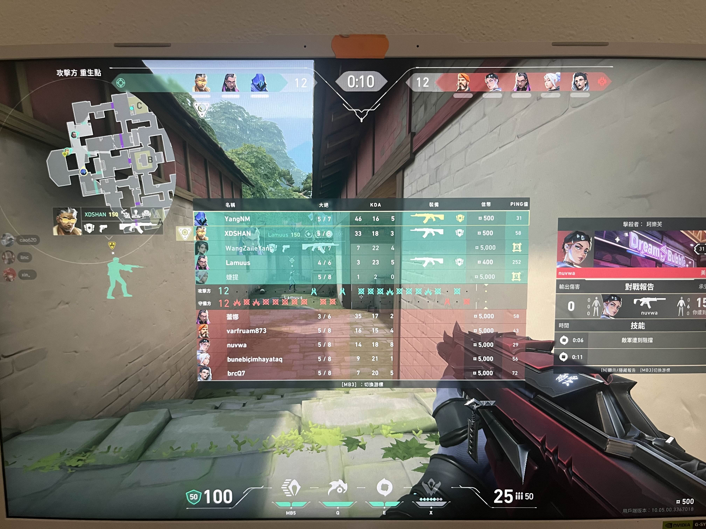
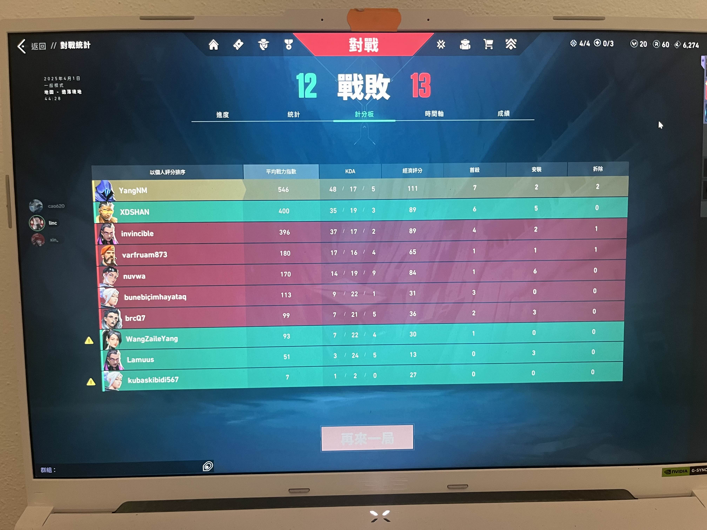

**晨** (2026-01-02 18:33:50):
摸摸头，消消气

**晨** (2026-01-02 18:33:42):
匹配机制是这样的

**卡顺密** (2026-01-02 08:28:51):
我他妈是杀了多少人才能匹配到这4条臭区

**卡顺密** (2026-01-02 08:28:34):
不想活了

**卡顺密** (2026-01-02 08:28:32):
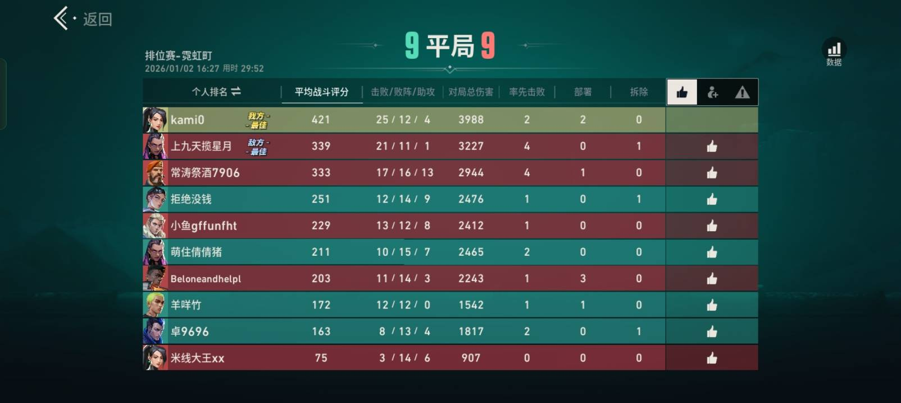

**哈哈** (2026-01-02 04:27:15):
<a:uwu:1394038723439497357>

**羊驼** (2026-01-01 23:07:55):
https://cdn.discordapp.com/attachments/1117489699771142205/1352283964848603278/5a336fd3c5db13c25af5e5b5f0ef04b810939508.gif

**哈哈** (2026-01-01 17:29:28):
<a:patpat:677725077600731156>

**诺顿** (2026-01-01 17:18:54):
诶，想念沐老师

**希波鹅拉底** (2026-01-01 17:17:23):
<:emoji_114:1379113886837506088>

**希波鹅拉底** (2026-01-01 17:17:20):
然后就不见了

**希波鹅拉底** (2026-01-01 17:17:16):
唉只记得到处亲亲人

**希波鹅拉底** (2026-01-01 17:17:04):
沐

**羊驼** (2026-01-01 15:31:44):
新年快乐🎉
反对冷暴力🙏
哈哈可爱☺️
想念沐老师😭

**希波鹅拉底** (2026-01-01 06:43:41):
晨晨

**晨** (2026-01-01 05:38:25):
<:emoji_249:1453759631536033875>

**希波鹅拉底** (2026-01-01 05:28:19):
<:emoji_249:1453759656613908510>

**卡顺密** (2026-01-01 05:25:37):
没事了

**希波鹅拉底** (2026-01-01 05:25:31):
我怎么就你

**希波鹅拉底** (2026-01-01 05:25:20):
怎么了

**卡顺密** (2025-12-31 21:57:22):
<@1363411831833759824> 鹅鹅救一下

**晨** (2025-12-31 17:57:04):
新年快乐大家

**任白** (2025-12-31 16:37:22):
新年快乐

**羊驼** (2025-12-31 01:28:35):
反对冷暴力🙏
哈哈可爱☺️
想念沐老师😭

**哈哈** (2025-12-30 01:28:47):
<:dsdPopcorn:1003582275717431306>

**哈哈** (2025-12-30 01:28:41):
如果那麼貴 不會有人買的

**赛博第一坏坏芳心纵火犯** (2025-12-30 01:12:14):
这是真的吗哈哈
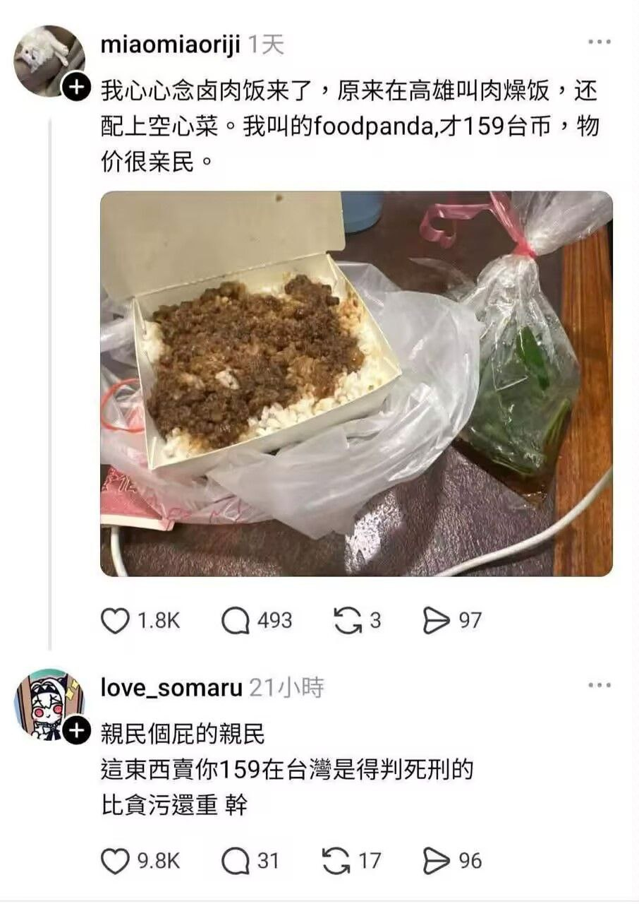

**哈哈** (2025-12-30 01:01:08):
<:3_:1134073260183670895>

**晨** (2025-12-29 18:05:39):
失眠吗

**希波鹅拉底** (2025-12-29 17:41:10):
难绷

**卡顺密** (2025-12-29 16:47:30):
睡不着，嘴角压不下去

**卡顺密** (2025-12-29 16:47:19):
<:emoji_136:1381162107424215091>

**赛博第一坏坏芳心纵火犯** (2025-12-18 23:28:13):
https://tenor.com/view/golira-gif-23322061

**赛博第一坏坏芳心纵火犯** (2025-12-18 23:27:51):
不是你喜欢我吗？

**卡顺密** (2025-12-18 23:27:31):
宝贝 我知道你很喜欢我 但是我已经名花有主了

**赛博第一坏坏芳心纵火犯** (2025-12-18 23:25:41):
mika老婆<:emoji_140:1379454014852436038>

**赛博第一坏坏芳心纵火犯** (2025-12-18 23:25:35):
不管了，先叫了再说

**赛博第一坏坏芳心纵火犯** (2025-12-18 23:23:44):
https://tenor.com/view/gorilla-hmm-thinking-observing-gif-10240947

**卡顺密** (2025-12-18 23:23:05):
那我不发了

**赛博第一坏坏芳心纵火犯** (2025-12-18 17:57:13):
等你发到999天的时候，我一定娶你

**赛博第一坏坏芳心纵火犯** (2025-12-18 14:25:21):
https://tenor.com/view/zesty-gorilla-kiss-gif-17628125705941623297

**卡顺密** (2025-12-18 04:58:55):
芳心别活了🙏
反对冷暴力🙏
安息🙏
羊驼万岁🙏

**羊驼** (2025-12-17 22:22:58):
反对冷暴力🙏
想念沐老师😭

**卡顺密** (2025-12-17 01:24:24):
芳心别活了🙏
反对冷暴力🙏
安息🙏
羊驼万岁🙏

**哈哈** (2025-12-16 16:07:07):
<:Zzul_gilda:1154375118374576168>

**晨** (2025-12-16 15:55:33):
<:emoji_144:1379832776785788928>

**希波鹅拉底** (2025-12-16 12:55:30):
骚

**卡顺密** (2025-12-16 01:00:44):
芳心别活了🙏
反对冷暴力🙏
安息🙏
羊驼万岁🙏

**哈哈** (2025-12-16 00:16:33):

**crzwz** (2025-12-15 20:04:47):
操你们所有人

**哈哈** (2025-12-15 17:58:24):

**楚冥** (2025-12-15 17:27:46):
<:1000168531:1298906724979310634>

**任白** (2025-12-15 17:26:21):

**哈哈** (2025-12-15 17:07:12):
<:SadgePray:1090017573166395524>

**卡顺密** (2025-12-15 01:14:55):
芳心别活了🙏
反对冷暴力🙏
安息🙏
羊驼万岁🙏

**羊驼** (2025-12-14 23:34:14):

**哈哈** (2025-12-14 16:20:49):
<:SadgePray:1090017573166395524>

**希波鹅拉底** (2025-12-14 15:23:18):
想念

**希波鹅拉底** (2025-12-14 15:23:13):
沐云曦老师

**希波鹅拉底** (2025-12-14 15:23:08):
沐老师是谁

**任白** (2025-12-14 12:57:12):
想念

**羊驼** (2025-12-14 01:44:15):
沐云曦老师

**卡顺密** (2025-12-13 23:28:59):
<:emoji_248:1448921974658175056>

**卡顺密** (2025-12-13 23:28:55):
沐老师是谁

**羊驼** (2025-12-13 23:28:27):
想念沐老师

**羊驼** (2025-12-13 23:28:10):
反对冷暴力

**AchenL【辰龙🐉】** (2025-12-13 17:47:15):
https://cdn.discordapp.com/attachments/1385274632592162876/1441784897017610320/1763818632633.gif

**哈哈** (2025-12-13 17:30:35):
<a:patpat:677725077600731156>

**晨** (2025-12-13 17:21:00):
<:emoji_168:1409564661380288633>

**晨** (2025-12-13 17:20:54):
哈哈宝贝

**哈哈** (2025-12-13 16:50:35):
<a:ad04:1377253900503089203>

**有点毒** (2025-12-13 08:16:08):
<a:emoji_67:1234638368948621383>

**crzwz** (2025-12-13 02:44:11):


**哈哈** (2025-12-13 02:01:42):
<a:789089877379252235:1267379578184138794>

**卡顺密** (2025-12-13 01:48:20):
芳心别活了🙏
反对冷暴力🙏
安息🙏
羊驼万岁🙏

**crzwz** (2025-12-13 01:22:28):
<:emoji_140:1379454014852436038>

**AchenL【辰龙🐉】** (2025-12-13 00:25:56):
哎呀 好久不见啊，宝贝

**crzwz** (2025-12-12 19:01:51):
你们所有人

**crzwz** (2025-12-12 19:01:48):
操

**哈哈** (2025-12-12 17:22:18):
<:dsdPopcorn:1003582275717431306>

**晨** (2025-12-12 16:48:22):
好久不见啊

**任白** (2025-12-12 15:14:32):
好久没有在这里看见你了

**任白** (2025-12-12 15:14:27):
呀

**赛博第一坏坏芳心纵火犯** (2025-12-12 14:54:32):
https://tenor.com/view/zesty-gorilla-kiss-gif-17628125705941623297

**希波鹅拉底** (2025-12-12 13:16:24):
<@1376361794515238922>

**希波鹅拉底** (2025-12-12 13:15:55):
宝宝宝宝

**哈哈** (2025-12-12 11:20:30):
<:sb_1:1073221244280913950>

**crzwz** (2025-12-12 11:19:14):
操你们所有人

**卡顺密** (2025-12-12 01:48:41):
芳心别活了🙏
反对冷暴力🙏
安息🙏
羊驼万岁🙏

**卡顺密** (2025-12-12 01:47:58):

**卡顺密** (2025-12-12 01:47:56):
欧耶 神神的话

**卡顺密** (2025-12-12 01:47:53):


**哈哈** (2025-12-10 17:05:54):
<:dsdPopcorn:1003582275717431306>

**羊驼** (2025-12-10 14:57:42):
https://tenor.com/view/%E9%A1%86%E7%A7%92-%E6%A3%92%E6%A3%92%E6%A3%92%E6%A3%92-%E7%89%B9%E6%88%B0%E8%8B%B1%E8%B1%AA-%E5%A9%95%E6%8F%90-%E8%BF%B7%E5%9B%A0-gif-3788079948547841946

**PeanutsO** (2025-12-10 12:09:32):
<:emoji_150:1388140448731762790>

**neyin** (2025-12-10 09:50:10):
<:heart:1438351332531765289>

**neyin** (2025-12-10 09:49:52):
好久没见到花生了

**希波鹅拉底** (2025-12-10 05:15:21):
ha ji mi wo nang bie lu duo

**有点毒** (2025-12-10 05:04:08):
ha ji mi wo nang bie lu duo

**PeanutsO** (2025-12-10 04:59:37):
https://tenor.com/view/%E9%A1%86%E7%A7%92-%E6%A3%92%E6%A3%92%E6%A3%92%E6%A3%92-%E7%89%B9%E6%88%B0%E8%8B%B1%E8%B1%AA-%E5%A9%95%E6%8F%90-%E8%BF%B7%E5%9B%A0-gif-3788079948547841946

**卡顺密** (2025-12-10 04:49:18):
<@929772344984084490> 你看看这个集锦拉成啥了 不知道的还以为我他嘛是挂

**卡顺密** (2025-12-10 04:48:54):


**赛博第一坏坏芳心纵火犯** (2025-12-10 02:43:41):
主播主播，不要的眼球可以放转转上回收吗？

**卡顺密** (2025-12-10 01:00:24):
芳心别活了🙏
反对冷暴力🙏
安息🙏
羊驼万岁🙏

**祈月** (2025-12-09 16:03:08):
反对冷暴力🙏
愿我能一睡不醒🙏
安息🙏

**卡顺密** (2025-12-09 01:00:21):
芳心别活了🙏
反对冷暴力🙏
安息🙏
羊驼万岁🙏

**赛博第一坏坏芳心纵火犯** (2025-12-08 14:25:29):
https://tenor.com/view/zesty-gorilla-kiss-gif-17628125705941623297

**有点毒** (2025-12-08 08:29:25):
<a:9B5742C36DE5C9820DA035CB2999B277:1420594909525704817>

**哈哈** (2025-12-08 01:58:42):
<:dsdPopcorn:1003582275717431306> <:SadgePray:1090017573166395524>

**祈月** (2025-12-08 01:13:52):
反对冷暴力🙏
安息🙏

**卡顺密** (2025-12-08 01:00:25):
芳心别活了🙏
反对冷暴力🙏
安息🙏
羊驼万岁🙏

**祈月** (2025-12-07 23:18:10):
<:emoji_68:1305519380343427202>

**赛博第一坏坏芳心纵火犯** (2025-12-07 20:16:08):
https://tenor.com/view/gorilla-tweaking-tweaking-gif-1384048928451005976

**羊驼** (2025-12-06 08:55:11):
<:emoji_140:1379454014852436038>

**羊驼** (2025-12-06 08:55:10):
鹅鹅！

**羊驼** (2025-12-06 08:54:53):
<:emoji_144:1380206684739338403>

**哈哈** (2025-12-06 08:07:31):
<:catb:1132279521203204107>

**卡顺密** (2025-12-06 07:37:18):
1

**希波鹅拉底** (2025-12-06 07:36:56):
1

**祈月** (2025-12-06 05:21:57):
前面忘了
我爱mika
后面忘了
就这样吧

**赛博第一坏坏芳心纵火犯** (2025-12-06 05:20:00):
前面忘了
我爱mika
后面忘了
就这样吧

**祈月** (2025-12-06 05:18:56):
反对冷暴力🙏
安息🙏

**晨** (2025-12-06 01:02:10):
忙羊驼

**卡顺密** (2025-12-06 01:00:22):
芳心别活了🙏
反对冷暴力🙏
安息🙏
羊驼万岁🙏

**羊驼** (2025-12-05 23:20:28):
<:1000168531:1298906724979310634>

**羊驼** (2025-12-05 23:20:26):
不是到期了吗

**卡顺密** (2025-12-05 01:00:24):
芳心别活了🙏
反对冷暴力🙏
安息🙏
羊驼万岁🙏

**卡顺密** (2025-12-04 13:41:14):
<:emoji_15:1406355558730039346>

**卡顺密** (2025-12-04 13:41:12):
爽吃

**卡顺密** (2025-12-04 13:41:07):
我才发现我妈有200多gb的流量

**卡顺密** (2025-12-04 13:40:48):
我焯

**祈月** (2025-12-04 10:45:28):
剧情够刀了

**祈月** (2025-12-04 10:45:18):
<@1063068779162108027> 不过普通玩就行

**祈月** (2025-12-04 10:41:26):
禁镇魂

**祈月** (2025-12-04 10:41:02):
有更折磨的

**祈月** (2025-12-04 10:40:48):
还行吧？

**卡顺密** (2025-12-04 10:39:31):
纯折磨啊

**祈月** (2025-12-04 10:38:43):
每天除了上班就是打这个自限

**卡顺密** (2025-12-04 10:38:27):
<:emoji_139:1379455053080825866>

**祈月** (2025-12-04 10:38:22):
打了差不多一个星期

**祈月** (2025-12-04 10:37:48):
现在他好像是吧主？

**祈月** (2025-12-04 10:37:36):
之前在他们的q群认识的大佬

**卡顺密** (2025-12-04 10:37:22):
<:emoji_249:1416980128793104514>

**卡顺密** (2025-12-04 10:37:16):
不要不要，我不要看这个

**卡顺密** (2025-12-04 10:37:09):
e

**祈月** (2025-12-04 10:37:01):
<@1063068779162108027> 打的这个大佬的自限

**祈月** (2025-12-04 10:36:09):
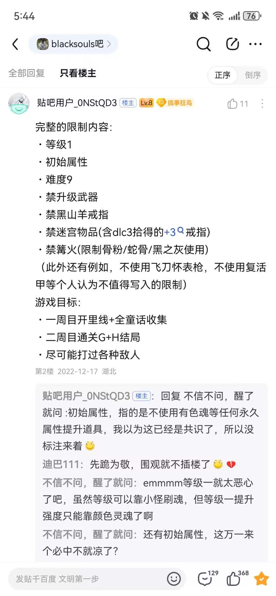

**祈月** (2025-12-04 10:36:00):
空装属性
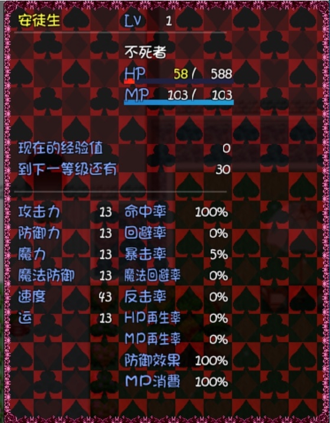

**卡顺密** (2025-12-04 10:35:02):
<:emoji_144:1379862366866641060> 我靠这也太狠了

**祈月** (2025-12-04 10:33:45):
1级9难，不坐营火，不强化，除全童话外不召队友

**祈月** (2025-12-04 10:32:13):
禁迷宫

**卡顺密** (2025-12-04 10:31:51):
<:emoji_249:1416980114511761448>

**卡顺密** (2025-12-04 10:31:49):
你黑斩多少层出的

**祈月** (2025-12-04 10:31:06):
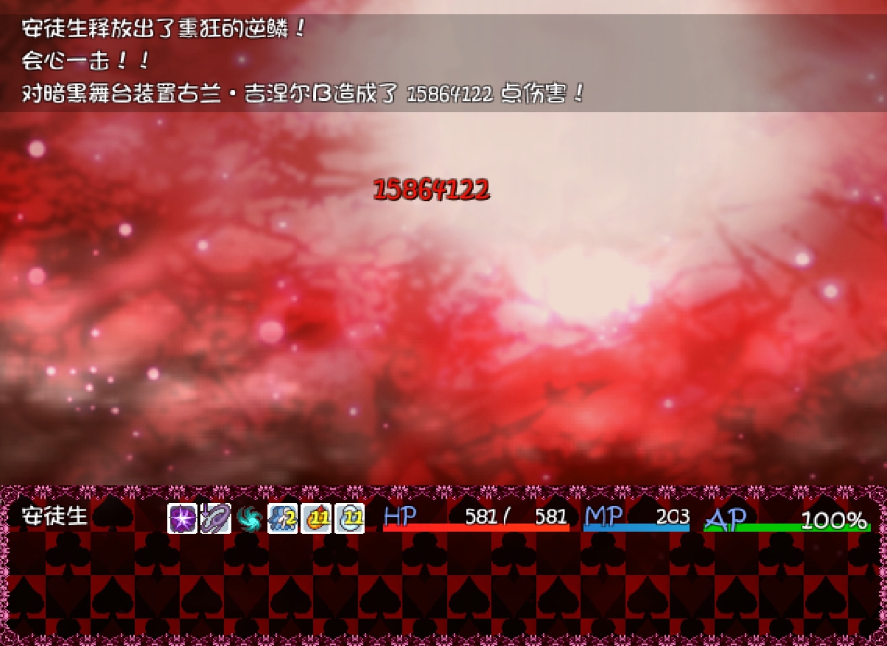

**祈月** (2025-12-04 10:29:42):
我打自限的

**卡顺密** (2025-12-04 09:06:14):
<:emoji_15:1406355558730039346> <:emoji_15:1406355558730039346> <:emoji_15:1406355558730039346> <:emoji_15:1406355558730039346> <:emoji_15:1406355558730039346> <:emoji_15:1406355558730039346> <:emoji_15:1406355558730039346>

**卡顺密** (2025-12-04 09:06:12):
<:emoji_249:1416980114511761448> <:emoji_249:1416980114511761448> <:emoji_249:1416980114511761448> <:emoji_249:1416980114511761448> <:emoji_249:1416980114511761448> <:emoji_249:1416980114511761448> <:emoji_249:1416980114511761448> <:emoji_249:1416980114511761448> <:emoji_249:1416980114511761448>

**卡顺密** (2025-12-04 09:06:08):
黑之斩击

**卡顺密** (2025-12-04 09:06:05):
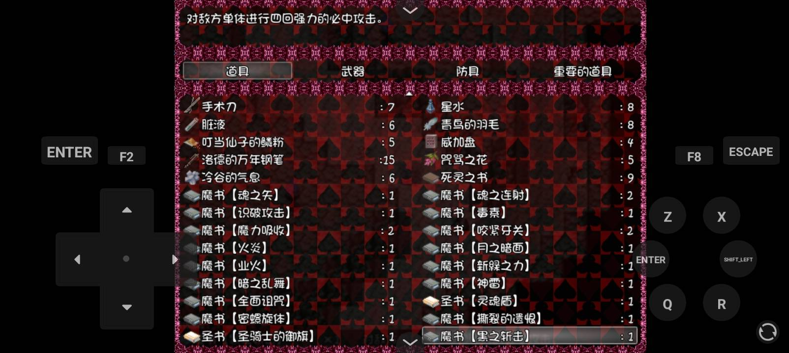

**卡顺密** (2025-12-04 01:10:42):
就是网速有点慢

**卡顺密** (2025-12-04 01:10:34):
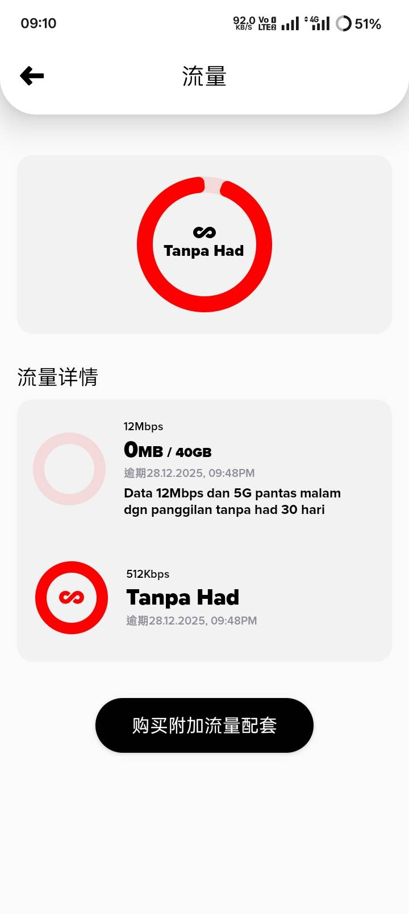

**卡顺密** (2025-12-04 01:10:31):
我去，居然是无限能源吗

**赛博第一坏坏芳心纵火犯** (2025-12-04 01:10:11):
知道了，退下吧

**卡顺密** (2025-12-04 01:09:41):
发信息什么还是可以的

**卡顺密** (2025-12-04 01:09:34):
但也没有太完蛋

**卡顺密** (2025-12-04 01:09:16):
用完了

**赛博第一坏坏芳心纵火犯** (2025-12-04 01:09:09):
<:1000168534:1298906727495766057>

**赛博第一坏坏芳心纵火犯** (2025-12-04 01:09:06):
好了，现在都知道你没事就变搓玻璃边玩小唧唧了

**卡顺密** (2025-12-04 01:03:32):
不怕，我手机里还有好多黄油

**赛博第一坏坏芳心纵火犯** (2025-12-04 01:02:44):
省点流量吧，别撸到一半没素材了

**卡顺密** (2025-12-04 01:00:20):
芳心别活了🙏
反对冷暴力🙏
安息🙏
羊驼万岁🙏

**卡顺密** (2025-12-04 00:44:54):
<:emoji_249:1443611666678812886>

**卡顺密** (2025-12-04 00:44:49):
流量也快用光了

**卡顺密** (2025-12-04 00:44:45):
用不了

**卡顺密** (2025-12-04 00:44:40):
路由器的站点被淹

**卡顺密** (2025-12-04 00:44:28):
坏事了，家人们

**卡顺密** (2025-12-03 10:49:12):
<:emoji_249:1416980114511761448>

**卡顺密** (2025-12-03 10:49:08):
认爹神国是这样的

**哈哈** (2025-12-03 10:48:55):
<:dsdPopcorn:1003582275717431306>

**哈哈** (2025-12-03 10:48:53):
土耳其沒到過中國過吧?一歷史來看的話

**卡顺密** (2025-12-03 09:01:08):
<:emoji_136:1381162107424215091>

**卡顺密** (2025-12-03 09:00:57):
刷到个好笑的 土耳其笑话之中国人的噩梦

**卡顺密** (2025-12-03 09:00:49):
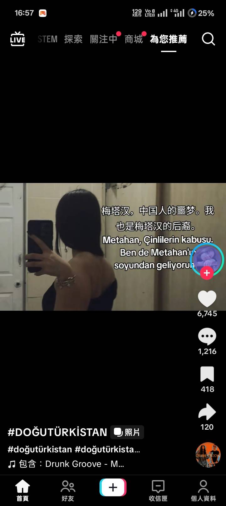
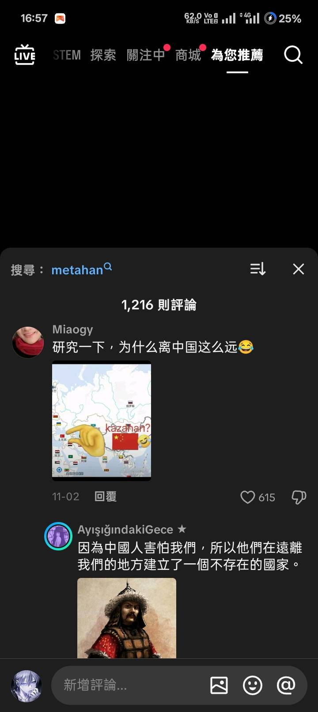
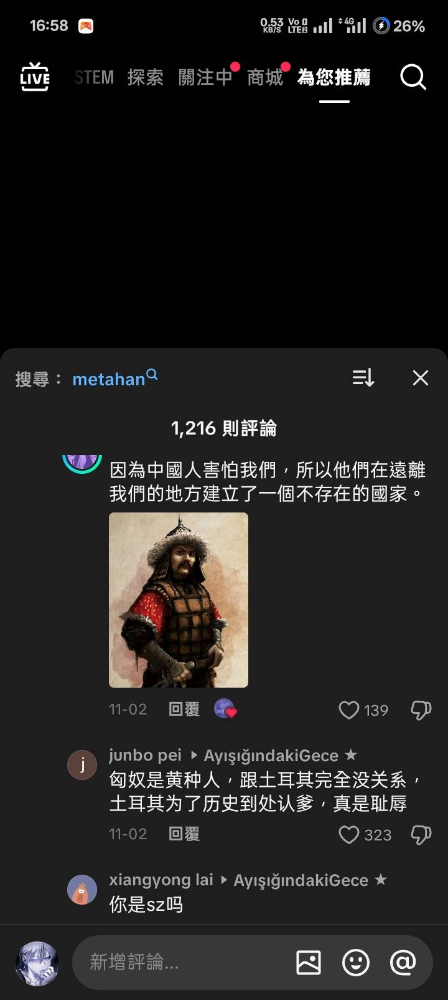

**哈哈** (2025-12-03 02:03:30):
<:dsdPopcorn:1003582275717431306>

**赛博第一坏坏芳心纵火犯** (2025-12-03 01:03:33):
https://tenor.com/view/gorilla-run-gif-21526420

**祈月** (2025-12-03 01:02:40):
我冷静下来了，非常抱歉，谢谢您

**赛博第一坏坏芳心纵火犯** (2025-12-02 23:41:28):
小小卡密，也敢造次

**哈哈** (2025-12-02 23:40:22):

**卡顺密** (2025-12-02 23:35:03):
<:emoji_249:1443611666678812886>

**卡顺密** (2025-12-02 23:34:59):
闭嘴，再叫把你拉黑

**赛博第一坏坏芳心纵火犯** (2025-12-02 23:28:17):
你抑郁个卵子，小屁孩一个

**卡顺密** (2025-12-02 23:27:29):
给我看抑郁了

**卡顺密** (2025-12-02 23:27:18):
<:16:1298294503530041404>

**哈哈** (2025-12-02 23:16:19):
<:KSP_1:1156146801980735519>

**哈哈** (2025-12-02 23:11:06):
<a:uwu:1394038723439497357>

**赛博第一坏坏芳心纵火犯** (2025-12-02 23:09:48):
一起加入https://discord.com/channels/1205870897769095229/1433905884240547870取暖吧

**赛博第一坏坏芳心纵火犯** (2025-12-02 23:09:31):
太在意别人的看法就容易被冷暴力

**祈月** (2025-12-02 23:09:00):
<:emoji_222:1412548077344002211>

**赛博第一坏坏芳心纵火犯** (2025-12-02 23:06:50):
支持热调查！
反对冷鲍里！
Kami好紧！
安息🛐

**晨** (2025-12-02 23:05:37):
<:08:1298281401715785789>

**祈月** (2025-12-02 23:03:27):
….

**赛博第一坏坏芳心纵火犯** (2025-12-02 23:01:14):
冷冷的鲍鱼里，简称冷鲍里

**祈月** (2025-12-02 22:36:40):
什么是冷暴力？

**羊驼** (2025-12-01 22:13:15):
https://tenor.com/view/%E9%A1%86%E7%A7%92-%E6%A3%92%E6%A3%92%E6%A3%92%E6%A3%92-%E7%89%B9%E6%88%B0%E8%8B%B1%E8%B1%AA-%E5%A9%95%E6%8F%90-%E8%BF%B7%E5%9B%A0-gif-7264524048457960461

**卡顺密** (2025-12-01 21:57:24):
你们无处可逃！ 棒↓棒↑棒↓棒个

**卡顺密** (2025-12-01 21:57:16):


**羊驼** (2025-12-01 09:53:32):
<:1000168528:1298906738761924722>

**卡顺密** (2025-12-01 01:01:55):
芳心别活了🙏
反对冷暴力🙏
安息🙏
羊驼万岁🙏

**卡顺密** (2025-11-30 01:02:07):
芳心别活了🙏
反对冷暴力🙏
安息🙏
羊驼万岁🙏

**任白** (2025-11-29 13:11:44):
好

**哈哈** (2025-11-29 10:30:05):
<:sb_1:1073221244280913950>

**羊驼** (2025-11-29 09:13:23):
<:emoji_179:1409564967279263809>

**卡顺密** (2025-11-29 05:43:56):
我今天就要冻死我自己

**卡顺密** (2025-11-29 05:43:53):
雨天，空调，冰饮料

**卡顺密** (2025-11-29 01:38:03):
芳心别活了🙏
反对冷暴力🙏
安息🙏
羊驼万岁🙏

**卡顺密** (2025-11-28 01:04:26):
芳心别活了🙏
反对冷暴力🙏
安息🙏
羊驼万岁🙏

**赛博第一坏坏芳心纵火犯** (2025-11-27 15:51:46):
https://tenor.com/view/inefablejuly-gorilla-monkey-splashing-the-camera-with-water-running-gif-4578675180156738365

**赛博第一坏坏芳心纵火犯** (2025-11-27 15:51:42):
你乖乖别动，我帮你洗

**有点毒** (2025-11-27 06:50:49):
<a:bianse:1394227946075590656> <a:bianse:1394227946075590656> <a:bianse:1394227946075590656> <a:bianse:1394227946075590656> <a:bianse:1394227946075590656> <a:bianse:1394227946075590656>

**哈哈** (2025-11-27 06:17:21):
<:SadgePray:1090017573166395524>

**卡顺密** (2025-11-27 05:30:37):
<:16:1298294503530041404>

**卡顺密** (2025-11-27 05:30:24):
谁来帮我洗个澡

**卡顺密** (2025-11-27 05:30:14):
洗完地了 要帮猫洗 洗完猫了 要帮自己洗

**卡顺密** (2025-11-27 05:29:44):
还偏偏拉在犄角旮旯里

**卡顺密** (2025-11-27 05:29:39):
臭猫乱拉

**卡顺密** (2025-11-27 05:29:27):
<:16:1298294503530041404>

**卡顺密** (2025-11-27 05:29:24):
累死我了

**PeanutsO** (2025-11-27 02:06:37):
<:emoji_149:1382626041352159263>

**哈哈** (2025-11-27 02:02:57):
<:dsdPopcorn:1003582275717431306>

**希波鹅拉底** (2025-11-27 01:49:21):
<:emoji_250:1442568548986650808>

**希波鹅拉底** (2025-11-27 01:49:18):
迟钝的安安

**希波鹅拉底** (2025-11-27 01:49:11):
花生被羊驼牛走了

**希波鹅拉底** (2025-11-27 01:49:05):
其实就是不爱了

**PeanutsO** (2025-11-27 01:37:34):
<:emoji_115:1379113943817257071>

**PeanutsO** (2025-11-27 01:37:28):
没办法呀，都不怎么跟安安姐聊天

**希波鹅拉底** (2025-11-27 01:36:08):
还在安安呢。你都变成羊驼的形状了

**PeanutsO** (2025-11-27 01:31:09):
花生别活了🙏
反对冷暴力🙏
安息🙏
安安万岁🙏

**希波鹅拉底** (2025-11-27 01:30:47):
花生别活了🙏
反对冷暴力🙏
安息🙏
安心万岁🙏

**PeanutsO** (2025-11-27 01:29:08):
<a:PaimonCookies:781050313934897202>

**希波鹅拉底** (2025-11-27 01:20:41):
mika别活了🙏
反对冷暴力🙏
安息🙏
羊驼万岁🙏

**卡顺密** (2025-11-27 01:03:39):
芳心别活了🙏
反对冷暴力🙏
安息🙏
羊驼万岁🙏

**羊驼** (2025-11-26 09:16:01):
<:1000168528:1298906738761924722>

**PeanutsO** (2025-11-26 01:42:51):

**哈哈** (2025-11-26 01:14:53):
<a:kannadevil:798062969069895720>

**卡顺密** (2025-11-26 01:00:43):
芳心别活了🙏
反对冷暴力🙏
安息🙏
羊驼万岁🙏

**哈哈** (2025-11-25 02:05:39):
<:sb_1:1073221244280913950>

**赛博第一坏坏芳心纵火犯** (2025-11-25 01:55:19):


**卡顺密** (2025-11-25 01:00:23):
芳心别活了🙏
反对冷暴力🙏
安息🙏
羊驼万岁🙏

**卡顺密** (2025-11-24 23:46:10):
最好笑的来了

**卡顺密** (2025-11-24 23:46:08):
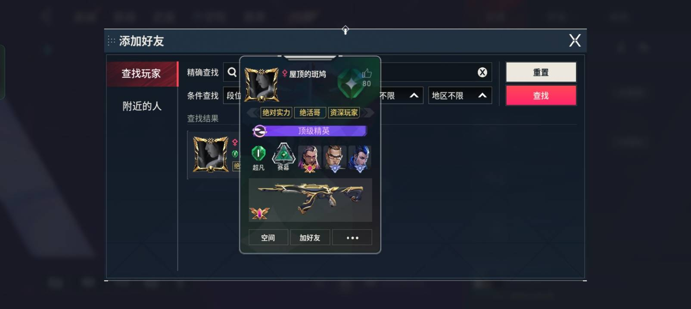

**卡顺密** (2025-11-24 23:45:41):
谁家神四玩成这个屌样

**卡顺密** (2025-11-24 23:45:39):


**卡顺密** (2025-11-24 23:45:24):
被打急眼了 说自己是神4

**卡顺密** (2025-11-24 23:45:13):
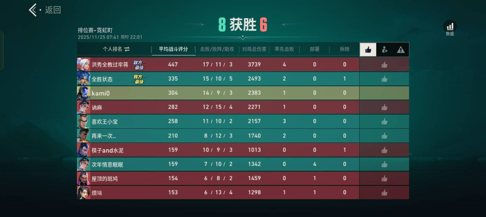

**卡顺密** (2025-11-24 23:45:06):
<@929772344984084490> 玩肉娜的是真喜欢装逼啊

**羊驼** (2025-11-24 21:18:07):
<:emoji_149:1382434166666432674>

**赛博第一坏坏芳心纵火犯** (2025-11-24 20:55:12):
https://tenor.com/view/gorilla-tweaking-tweaking-gif-1384048928451005976

**羊驼** (2025-11-24 20:46:04):
<:emoji_149:1382434166666432674>

**羊驼** (2025-11-24 20:46:00):
我说的是羊驼万岁啦

**羊驼** (2025-11-24 20:45:46):
才没有啦

**赛博第一坏坏芳心纵火犯** (2025-11-24 20:25:01):
羊驼真是欠调教了

**赛博第一坏坏芳心纵火犯** (2025-11-24 20:24:46):
你也跟小屁孩一样不希望我活过来？

**赛博第一坏坏芳心纵火犯** (2025-11-24 20:24:34):
<:emoji_109:1379109561679478837>

**羊驼** (2025-11-24 19:06:55):
<:emoji_150:1400299501423431771>

**羊驼** (2025-11-24 19:06:50):
好哦

**羊驼** (2025-11-24 19:06:36):
🙏

**希波鹅拉底** (2025-11-24 17:26:03):
1

**有点毒** (2025-11-24 03:34:51):
<a:jump_jiji:1398505566263054376>

**卡顺密** (2025-11-24 01:00:37):
芳心别活了🙏
反对冷暴力🙏
安息🙏
羊驼万岁🙏

**卡顺密** (2025-11-23 22:19:43):
<:emoji_15:1406355558730039346>

**卡顺密** (2025-11-23 22:19:43):
浮木变成拌线拌对面了


**卡顺密** (2025-11-23 22:19:40):
谁玩保安能不笑啊

**羊驼** (2025-11-23 08:24:47):
<:emoji_140:1379454014852436038>

**羊驼** (2025-11-23 08:24:44):
摸摸你

**哈哈** (2025-11-23 04:04:39):
<:ba_1:1090219942533677147>

**赛博第一坏坏芳心纵火犯** (2025-11-23 04:00:18):
也不排除Kami想练一阳指之类的神功

**晨** (2025-11-23 03:57:20):
常识（

**赛博第一坏坏芳心纵火犯** (2025-11-23 03:46:16):
冷知识：炸东西的时候可以用夹子或者筷子取代手指将食物放入油中

**赛博第一坏坏芳心纵火犯** (2025-11-23 03:45:14):
https://tenor.com/view/youngboys-nut-gorilla-gif-23790756

**卡顺密** (2025-11-23 03:39:58):
痛死我了

**卡顺密** (2025-11-23 03:39:52):
<:24:1298294525390753924>

**卡顺密** (2025-11-23 03:39:40):
两根手指差点熟了

**卡顺密** (2025-11-23 03:39:34):
我以后再也不炸东西了

**卡顺密** (2025-11-23 03:39:17):
🐴的

**哈哈** (2025-11-23 01:28:14):
<:SadgePray:1090017573166395524>

**卡顺密** (2025-11-23 01:00:21):
芳心别活了🙏
反对冷暴力🙏
安息🙏

**卡顺密** (2025-11-22 23:49:38):
？

**羊驼** (2025-11-22 17:53:18):
反对冷暴力！

**晨** (2025-11-22 17:34:17):
老师已经不算宗门的人了<:emoji_144:1379454084750245939>

**晨** (2025-11-22 17:34:05):
居然已经是疑问句了吗？

**哈哈** (2025-11-22 15:32:31):
<:3_:1134073260183670895>

**哈哈** (2025-11-22 15:32:29):
?

**任白** (2025-11-22 14:18:49):
反对冷暴力？

**哈哈** (2025-11-22 05:42:48):
<:sb_1:1073221244280913950>

**赛博第一坏坏芳心纵火犯** (2025-11-22 00:21:19):
<:1000168534:1298906727495766057>

**赛博第一坏坏芳心纵火犯** (2025-11-22 00:21:18):
我已经射精了

**卡顺密** (2025-11-22 00:20:23):
芳心别活了🙏
反对冷暴力🙏
安息🙏

**卡顺密** (2025-11-22 00:20:20):
哦，一边去吧

**赛博第一坏坏芳心纵火犯** (2025-11-22 00:19:42):
太早离开猫妈妈，没学怎么用猫砂呗，你有两个方法，一是看他快上厕所了就给他抱到猫砂上，而是把他的粪便捡一些放猫砂上，他自己闻着味就知道那里是厕所了

**赛博第一坏坏芳心纵火犯** (2025-11-22 00:18:23):
日久生情，看我以后怎么调教你

**赛博第一坏坏芳心纵火犯** (2025-11-22 00:18:05):
<:1000168532:1298906722546614313>

**赛博第一坏坏芳心纵火犯** (2025-11-22 00:16:37):
快点的

**赛博第一坏坏芳心纵火犯** (2025-11-22 00:16:34):
<:1000168532:1298906722546614313>

**卡顺密** (2025-11-22 00:15:45):
<:emoji_197:1409567434263892110>

**赛博第一坏坏芳心纵火犯** (2025-11-22 00:15:14):
你亲我一下我就告诉你

**卡顺密** (2025-11-21 23:53:38):
不拉猫砂上怎么办

**卡顺密** (2025-11-21 23:52:59):
<:16:1298294503530041404>

**卡顺密** (2025-11-21 23:52:52):
<@1422580625730306058>

**哈哈** (2025-11-21 16:43:16):
<:3_:1134073260183670895>

**赛博第一坏坏芳心纵火犯** (2025-11-21 16:04:41):
开启猩语翻译器：是的

**晨** (2025-11-21 15:48:51):
这是猩猩打招呼的方式吗

**晨** (2025-11-21 15:48:43):
？

**赛博第一坏坏芳心纵火犯** (2025-11-21 15:48:20):
嗷嗷嗷晨晨

**晨** (2025-11-21 15:47:36):
早上好芳心

**赛博第一坏坏芳心纵火犯** (2025-11-21 14:51:29):
https://tenor.com/view/gorilla-tongue-sticking-out-tongue-out-bleh-gif-13114995

**羊驼** (2025-11-21 13:49:49):
🙏

**卡顺密** (2025-11-21 12:37:42):
芳心别活了🙏
反对冷暴力🙏
安息🙏

**赛博第一坏坏芳心纵火犯** (2025-11-20 19:32:13):
https://tenor.com/view/gorilla-tongue-sticking-out-tongue-out-bleh-gif-13114995

**赛博第一坏坏芳心纵火犯** (2025-11-20 01:31:35):
Kami变魅魔🥵
反对冷暴力🥶 
安息☮️

**哈哈** (2025-11-20 01:22:01):
<:SadgePray:1090017573166395524>

**卡顺密** (2025-11-20 01:00:36):
芳心别活了🙏
反对冷暴力🙏
安息🙏

**羊驼** (2025-11-19 09:26:11):
不知道反对什么 🙏

**卡顺密** (2025-11-19 01:00:25):
芳心别活了🙏
反对冷暴力🙏
安息🙏

**卡顺密** (2025-11-18 01:00:44):
芳心别活了🙏
反对冷暴力🙏
安息🙏

**哈哈** (2025-11-17 01:39:29):
<:dsdPopcorn:1003582275717431306>

**赛博第一坏坏芳心纵火犯** (2025-11-17 01:13:02):
温柔在你心里

**卡顺密** (2025-11-17 01:12:38):
温柔在哪？纯下头

**赛博第一坏坏芳心纵火犯** (2025-11-17 01:12:06):
<:emoji_194:1409567377116495923>

**赛博第一坏坏芳心纵火犯** (2025-11-17 01:11:54):
哎呀，我怎么又温柔又下头的

**赛博第一坏坏芳心纵火犯** (2025-11-17 01:10:06):
<:1000168534:1298906727495766057>

**赛博第一坏坏芳心纵火犯** (2025-11-17 01:10:04):
那我就在合法的范围内玩弄不合法的你

**卡顺密** (2025-11-17 01:09:43):
<:emoji_144:1379862366866641060>

**卡顺密** (2025-11-17 01:09:38):
终归还是不合法的

**赛博第一坏坏芳心纵火犯** (2025-11-17 01:09:23):
<:emoji_142:1379854822315921438>

**赛博第一坏坏芳心纵火犯** (2025-11-17 01:09:20):
好了，现在你离合法年龄又近了一岁，屁股撅起来！

**卡顺密** (2025-11-17 01:09:00):
我没招了

**卡顺密** (2025-11-17 01:08:54):
<:emoji_144:1379862366866641060>

**赛博第一坏坏芳心纵火犯** (2025-11-17 01:08:29):
猜猜我昨天为什么没有出现？
因为一天不下头就是我送给你的生日礼物呀，小笨蛋<:emoji_140:1379454014852436038>

**卡顺密** (2025-11-17 01:00:36):
<:heart:1438351332531765289>

**卡顺密** (2025-11-17 01:00:29):
芳心别活了🙏
反对冷暴力🙏
安息🙏

**000** (2025-11-16 18:40:21):
<:emoji_147:1382565790129328128> <:emoji_147:1382565790129328128> <:emoji_132:1379388256113917993> <:emoji_100:1379103461014241370>

**000** (2025-11-16 18:40:15):
生日快乐~~~~

**Hamster** (2025-11-16 16:57:31):
生日快乐哦卡密

**羊驼** (2025-11-16 14:01:42):
https://tenor.com/view/wuthering-waves-%E9%B3%B4%E6%BD%AE-changl-gif-12121571992895688762

**羊驼** (2025-11-16 14:01:34):
生日快乐

**哈哈** (2025-11-16 05:20:28):
<:emoji_136:1381162107424215091>

**哈哈** (2025-11-16 05:20:23):
日樂

**哈哈** (2025-11-16 05:20:18):
生快

**卡顺密** (2025-11-16 03:39:21):
<:heart:1438351332531765289>

**晨** (2025-11-16 03:38:48):
生日快乐~

**晨** (2025-11-16 03:38:44):
原来是kami呀，么么<:emoji_140:1379454014852436038>

**晨** (2025-11-16 03:38:36):
这是谁家的可爱漂泊者宝宝呀

**灰毛总监【羞耻的一 勿扰】** (2025-11-16 03:34:26):
可爱捏，生日快乐

**任白** (2025-11-16 03:31:16):
生日快乐

**卡顺密** (2025-11-16 00:52:39):

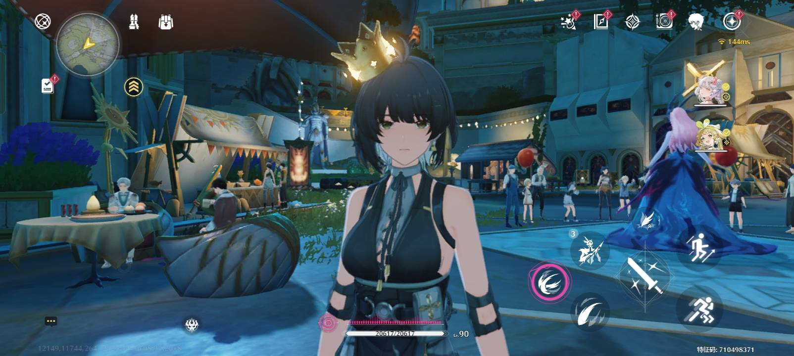

**哈哈** (2025-11-15 06:30:06):
<:an_1:1090220619192340522>

**晨** (2025-11-15 04:29:44):
可爱捏

**卡顺密** (2025-11-15 04:19:03):
<:emoji_146:1380345108821446789>

**卡顺密** (2025-11-15 04:18:54):
他甚至能和自己的尾巴玩急眼

**晨** (2025-11-15 04:17:47):
喜欢你

**卡顺密** (2025-11-15 04:13:32):
<:emoji_249:1416980128793104514>

**卡顺密** (2025-11-15 04:13:20):
他居然舔我脚趾头

**卡顺密** (2025-11-15 04:13:12):
这只臭猫是哪个舟友转世

**卡顺密** (2025-11-15 04:13:01):
tmd

**赛博第一坏坏芳心纵火犯** (2025-11-15 00:44:58):
小屁孩最娇羞的一集

**赛博第一坏坏芳心纵火犯** (2025-11-15 00:44:38):
我是怕你把猫养坏了

**卡顺密** (2025-11-15 00:42:13):
<:emoji_249:1416980114511761448>

**卡顺密** (2025-11-15 00:42:07):
芳心最有用的一集

**赛博第一坏坏芳心纵火犯** (2025-11-15 00:41:30):
小猫这个年纪最活泼好动了，你不给他弄玩具他会乱咬东西的

**赛博第一坏坏芳心纵火犯** (2025-11-15 00:41:08):
猫玩具也买几个，让他自己扑棱着玩

**卡顺密** (2025-11-15 00:40:45):
<:16:1298294503530041404>

**卡顺密** (2025-11-15 00:40:41):
买了，不知道啥时候到

**赛博第一坏坏芳心纵火犯** (2025-11-15 00:40:22):
而且你准备猫砂了没

**赛博第一坏坏芳心纵火犯** (2025-11-15 00:39:59):
把你关笼子里你也叫啊

**卡顺密** (2025-11-15 00:37:50):
现在酷酷睡

**卡顺密** (2025-11-15 00:37:36):
叫了一晚上

**卡顺密** (2025-11-15 00:37:27):
昨晚怕他乱跑 把它关在笼子里面一晚上 叫的那叫一个惨

**赛博第一坏坏芳心纵火犯** (2025-11-15 00:36:50):
<:emoji_144:1379454111174496307>

**卡顺密** (2025-11-15 00:36:15):
芳心别活了🙏
反对冷暴力🙏
安息🙏

**卡顺密** (2025-11-15 00:36:10):
<:emoji_150:1388149074133254305>

**卡顺密** (2025-11-15 00:36:02):
我在怀疑他是不是蠢的不知道碗里的是水

**卡顺密** (2025-11-15 00:35:16):
我总感觉他有点蠢<:emoji_150:1388149074133254305>

**哈哈** (2025-11-14 20:05:25):
🛐

**灰毛总监【羞耻的一 勿扰】** (2025-11-14 18:18:33):
你看，这就是专业

**赛博第一坏坏芳心纵火犯** (2025-11-14 14:05:08):
猫和狗不一样，米饭里的淀粉不吸收的，最理想的饮食搭配就是纯肉

**赛博第一坏坏芳心纵火犯** (2025-11-14 14:02:46):
猫砂也得买，不然它没地方上厕所

**赛博第一坏坏芳心纵火犯** (2025-11-14 14:02:27):
有条件还是买幼猫专用猫粮，小猫长身体的时候吃的很多，营养要给足

**赛博第一坏坏芳心纵火犯** (2025-11-14 13:53:12):
食物的话如果你买不到幼猫吃的猫粮，那就去菜市场买鸡胸肉，煮熟了撕成条看看它吃不吃

**赛博第一坏坏芳心纵火犯** (2025-11-14 13:52:18):
猫喝水喝的比较少，你接个一碗水放在一边它自己会喝的

**Hamster** (2025-11-14 10:48:34):
注意咸度（）

**Hamster** (2025-11-14 10:48:26):
湿一点好。猫是不喜欢喝水的动物，所以可以拌进去汤吧。

**Hamster** (2025-11-14 10:46:42):
能吃饭，如果一时半会没猫粮什么的，可以试试农村法子，整烂一点的米饭拌你觉得应该让它吃的东西

**Hamster** (2025-11-14 10:45:37):
小猫的话，如果还是吃奶的年纪就要用滴管、奶瓶了哦

**Hamster** (2025-11-14 10:45:08):
kami农村待过嘛

**卡顺密** (2025-11-14 09:22:37):
<:emoji_133:1379494883227734157>

**卡顺密** (2025-11-14 09:22:33):
他为什么不喝水呀？不会渴死吧？

**卡顺密** (2025-11-14 09:16:04):
不是，他就这么睡着了？

**卡顺密** (2025-11-14 09:16:00):
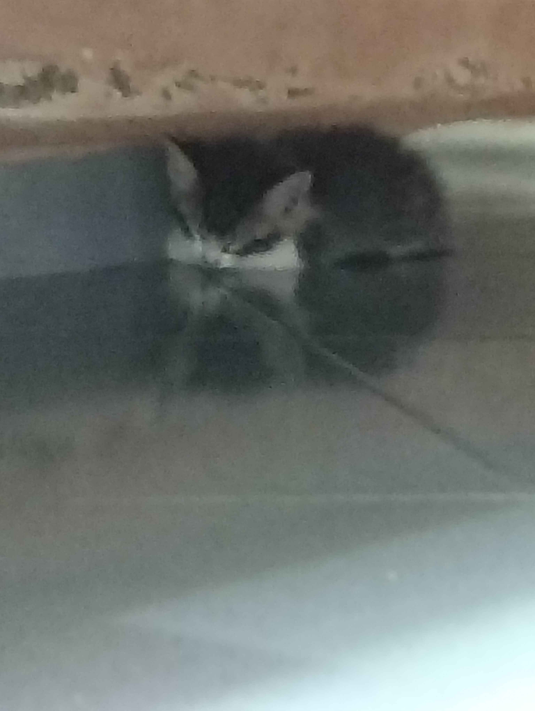

**卡顺密** (2025-11-14 09:11:45):
我从来没有这么想要见到方心

**卡顺密** (2025-11-14 09:11:20):
<@1422580625730306058> 死鬼你快醒啊，我求你了

**卡顺密** (2025-11-14 09:10:07):
<:16:1298294503530041404>

**卡顺密** (2025-11-14 09:10:03):
唉，不知道我妈会怎样

**灰毛总监【羞耻的一 勿扰】** (2025-11-14 09:09:49):
他好歹是养了两只猫儿子的

**灰毛总监【羞耻的一 勿扰】** (2025-11-14 09:09:37):
你再问问他

**灰毛总监【羞耻的一 勿扰】** (2025-11-14 09:09:34):
等芳心醒了

**灰毛总监【羞耻的一 勿扰】** (2025-11-14 09:09:24):
你Google

**灰毛总监【羞耻的一 勿扰】** (2025-11-14 09:09:09):
我除了这些能说什么呢

**卡顺密** (2025-11-14 09:09:02):
我要给他吃什么啊

**卡顺密** (2025-11-14 09:08:51):
<:emoji_133:1379494883227734157>

**卡顺密** (2025-11-14 09:08:45):
你神经啊，现在重点是这些吗

**灰毛总监【羞耻的一 勿扰】** (2025-11-14 09:06:04):
然后好好的工作存钱

**灰毛总监【羞耻的一 勿扰】** (2025-11-14 09:05:54):
好好的养它

**卡顺密** (2025-11-14 09:01:16):
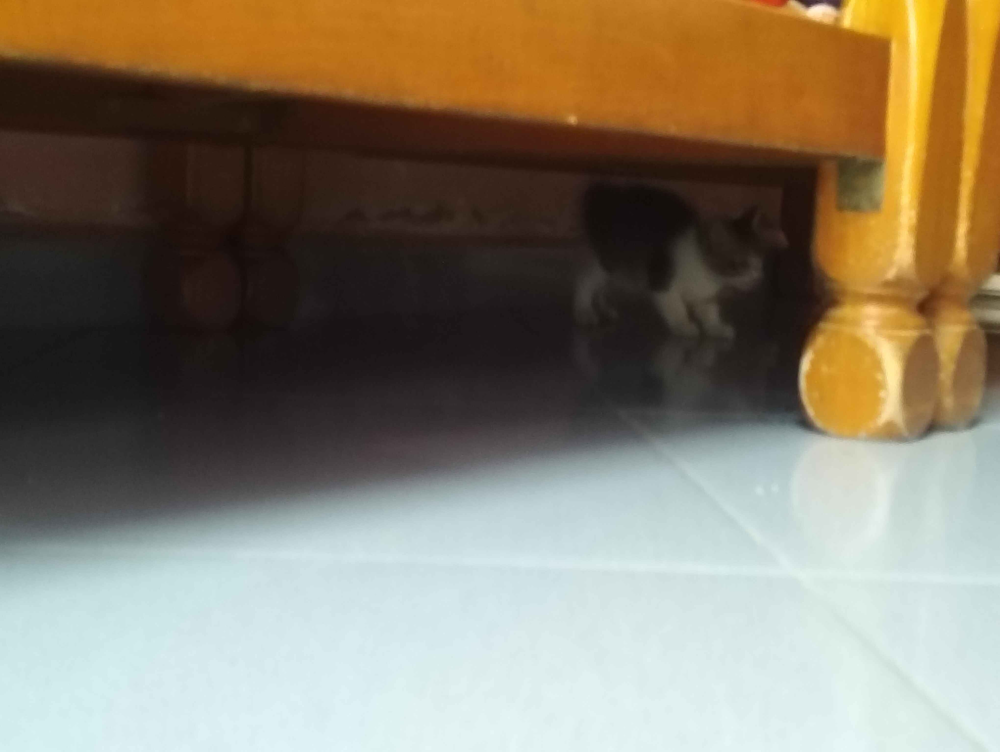

**卡顺密** (2025-11-14 08:59:35):
我现在有点手足无措

**卡顺密** (2025-11-14 08:56:36):
我舅给我抓了一只猫回来

**卡顺密** (2025-11-14 08:56:27):
<:1000168510:1298906820638674984>

**卡顺密** (2025-11-14 08:56:17):
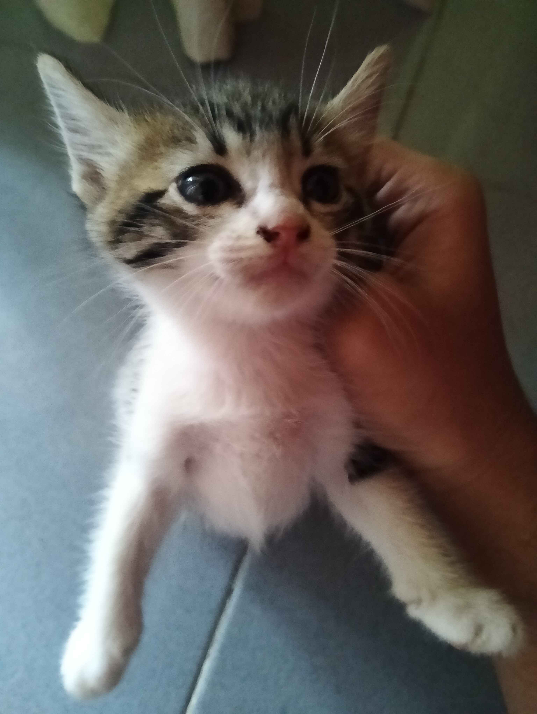

**卡顺密** (2025-11-14 08:56:12):
<@1401222792707575814>

**赛博第一坏坏芳心纵火犯** (2025-11-14 01:08:59):
求，也算时间哦

**灰毛总监【羞耻的一 勿扰】** (2025-11-14 01:01:27):
求也要排队

**卡顺密** (2025-11-14 01:00:17):
我真求你们了

**灰毛总监【羞耻的一 勿扰】** (2025-11-14 00:56:49):
<:1000168532:1298906722546614313>

**灰毛总监【羞耻的一 勿扰】** (2025-11-14 00:56:45):
小屁孩好久没有笑的这么开心过了

**赛博第一坏坏芳心纵火犯** (2025-11-14 00:50:38):
<:1000168532:1298906722546614313>

**赛博第一坏坏芳心纵火犯** (2025-11-14 00:50:35):
kami好久都没有这么开心的笑过了

**哈哈** (2025-11-14 00:50:03):
<:dsdPopcorn:1003582275717431306>

**卡顺密** (2025-11-14 00:48:53):
两条臭区

**卡顺密** (2025-11-14 00:48:40):
气笑了

**灰毛总监【羞耻的一 勿扰】** (2025-11-14 00:48:29):
我说这话他会炸

**灰毛总监【羞耻的一 勿扰】** (2025-11-14 00:48:24):
<:emoji_92:1379090128496099410>

**赛博第一坏坏芳心纵火犯** (2025-11-14 00:46:42):
我魅力这么大吗？

**赛博第一坏坏芳心纵火犯** (2025-11-14 00:46:31):
<:1000168532:1298906722546614313>

**赛博第一坏坏芳心纵火犯** (2025-11-14 00:46:28):
还是秒回

**卡顺密** (2025-11-14 00:46:07):
芳心别活了🙏
反对冷暴力🙏
安息🙏

**卡顺密** (2025-11-14 00:46:03):
<:emoji_144:1379862366866641060>

**赛博第一坏坏芳心纵火犯** (2025-11-14 00:46:03):
<:emoji_140:1379454014852436038>

**赛博第一坏坏芳心纵火犯** (2025-11-14 00:46:00):
Kami回我了

**卡顺密** (2025-11-14 00:45:49):
没有纯爱谢谢

**赛博第一坏坏芳心纵火犯** (2025-11-14 00:45:31):
就喜欢跟Kami搞纯爱

**赛博第一坏坏芳心纵火犯** (2025-11-14 00:45:19):
<:emoji_140:1379454014852436038>

**哈哈** (2025-11-13 07:05:23):
<:catb:1132279521203204107>

**任白** (2025-11-13 04:18:36):
<:emoji_150:1400299501423431771>

**哈哈** (2025-11-13 02:05:59):
<:BaiWhat:919176468511207504>

**卡顺密** (2025-11-13 02:03:29):
终于搭上话了 终于打一把了

**卡顺密** (2025-11-13 02:03:21):
<:emoji_150:1400299501423431771>

**卡顺密** (2025-11-13 02:03:04):
嘿嘿嘿嘿哈哈哈 太棒了 终于

**卡顺密** (2025-11-13 01:00:51):
芳心别活了🙏
反对冷暴力🙏
安息🙏

**晨** (2025-11-12 21:04:23):
<:emoji_144:1379832776785788928>

**羊驼** (2025-11-12 21:04:09):
<:emoji_246:1431854777603457025> <:emoji_245:1431854739339087882>

**羊驼** (2025-11-12 21:03:50):
muamuamua～

**羊驼** (2025-11-12 21:03:39):
不知道诶

**晨** (2025-11-12 21:03:38):
mua

**晨** (2025-11-12 21:03:27):
我来亲亲！

**晨** (2025-11-12 21:03:22):
对哦，沐老师呢

**羊驼** (2025-11-12 21:02:17):
<:emoji_243:1435094660505796729>

**羊驼** (2025-11-12 21:02:06):
想念沐老师的亲亲

**羊驼** (2025-11-12 21:01:53):
反对冷暴力

**卡顺密** (2025-11-12 01:00:20):
芳心别活了🙏
反对冷暴力🙏
安息🙏

**赛博第一坏坏芳心纵火犯** (2025-11-11 16:03:51):


**卡顺密** (2025-11-11 11:39:27):
芳心别活了🙏
反对冷暴力🙏
安息🙏

**哈哈** (2025-11-10 01:17:54):

**赛博第一坏坏芳心纵火犯** (2025-11-10 01:02:11):


**卡顺密** (2025-11-10 01:01:27):
芳心别活了🙏
反对冷暴力🙏
安息🙏

**哈哈** (2025-11-09 23:40:46):
<:1000168510:1298906820638674984>

**羊驼** (2025-11-09 22:06:01):
<:1000168510:1298906820638674984> <:emoji_143:1379855104622202900> <:emoji_89:1378950692655464492>

**赛博第一坏坏芳心纵火犯** (2025-11-09 16:32:25):
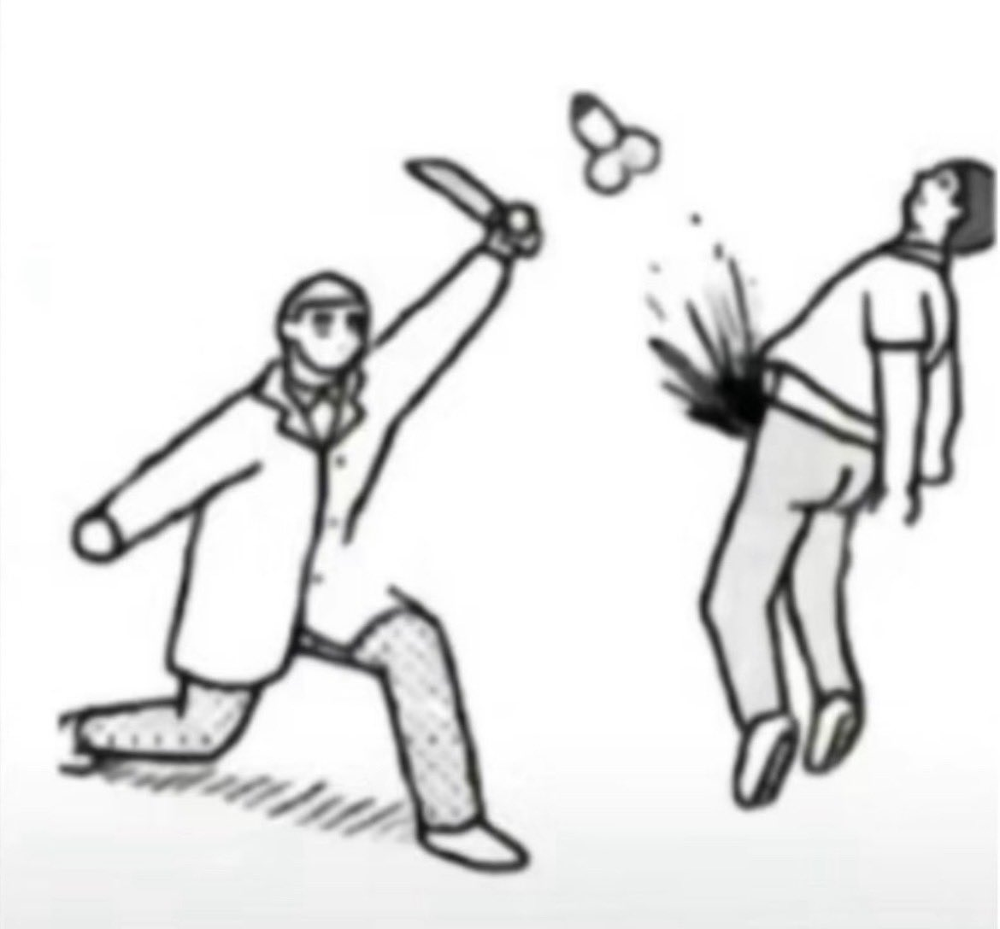

**羊驼** (2025-11-09 14:35:50):
<:1000168510:1298906820638674984>

**哈哈** (2025-11-09 05:36:50):

**赛博第一坏坏芳心纵火犯** (2025-11-09 01:03:29):


**卡顺密** (2025-11-09 01:00:20):
芳心别活了🙏
反对冷暴力🙏
安息🙏

**哈哈** (2025-11-08 07:19:31):

**赛博第一坏坏芳心纵火犯** (2025-11-08 01:23:26):


**卡顺密** (2025-11-08 01:00:20):
芳心别活了🙏
反对冷暴力🙏
安息🙏

**羊驼** (2025-11-07 18:24:04):
<:07:1298281204260278383>

**任白** (2025-11-07 15:37:12):
反对冷暴力

**赛博第一坏坏芳心纵火犯** (2025-11-07 13:34:52):
热调查卡密的冷鲍里让他欲罢不能

**羊驼** (2025-11-07 09:37:05):
反对冷暴力🙏

**哈哈** (2025-11-07 01:45:56):
<:SadgePray:1090017573166395524>

**卡顺密** (2025-11-07 01:00:20):
芳心别活了🙏
反对冷暴力🙏
安息🙏

**赛博第一坏坏芳心纵火犯** (2025-11-07 00:20:44):
卡密暗恋我😍
反对冷暴力😍
睡觉😍

**哈哈** (2025-11-06 03:34:35):
<:dsdPopcorn:1003582275717431306>

**赛博第一坏坏芳心纵火犯** (2025-11-06 01:23:16):
小鬼，谁让我宠你呢

**卡顺密** (2025-11-06 01:00:42):
芳心别活了🙏
反对冷暴力🙏
安息🙏

**哈哈** (2025-11-05 16:14:39):
<:1000168531:1298906724979310634>

**羊驼** (2025-11-05 14:55:36):
<:1000168531:1298906724979310634>

**有点毒** (2025-11-05 14:07:38):
<:1000168532:1298906722546614313>

**赛博第一坏坏芳心纵火犯** (2025-11-05 14:03:28):
你得叫羊驼花生一声义父

**有点毒** (2025-11-05 14:01:53):
<:emoji_15:1406355558730039346>

**有点毒** (2025-11-05 14:01:51):
我把mika超了

**有点毒** (2025-11-05 14:01:13):
<:1000168532:1298906722546614313>

**Hamster** (2025-11-05 13:33:42):
神人辈出啊（）

**希波鹅拉底** (2025-11-05 09:01:13):
芳心别活了🙏
反对冷暴力🙏
安息🙏

**哈哈** (2025-11-04 23:14:06):
<:emoji_136:1381162107424215091>

**羊驼** (2025-11-04 20:11:34):
<:emoji_248:1427157732770844783>

**羊驼** (2025-11-04 20:11:28):
我怎么成大人了

**羊驼** (2025-11-04 20:11:19):
Σ（・□・；）

**晨** (2025-11-04 20:10:59):
冤枉啊羊驼大人

**晨** (2025-11-04 20:10:42):
<:1000168516:1298906851848486942>

**羊驼** (2025-11-04 20:10:04):
<:emoji_183:1409565093792059413>

**羊驼** (2025-11-04 20:09:59):
乱磕是吧

**羊驼** (2025-11-04 20:09:18):
好好好

**晨** (2025-11-04 19:51:57):
你们走了谁来给我发糖<:emoji_144:1379454084750245939>

**晨** (2025-11-04 19:51:47):
瓜不要啊！

**羊驼** (2025-11-04 19:49:08):
<:emoji_183:1409565093792059413>

**羊驼** (2025-11-04 19:48:55):
下次转私聊

**羊驼** (2025-11-04 19:48:49):
<:1000168531:1298906724979310634>

**有点毒** (2025-11-04 17:41:10):
<:emoji_15:1406355558730039346> <:emoji_242:1435092848029728878>

**有点毒** (2025-11-04 17:41:04):
每个人都努力都不可小觑，人机区的未来需要每个人共同奋斗

**有点毒** (2025-11-04 17:40:08):
那天一晚上突破1000<:1000168532:1298906722546614313>

**有点毒** (2025-11-04 17:39:46):
还有一开始我与猫娘与赤石大王的努力

**赛博第一坏坏芳心纵火犯** (2025-11-04 17:23:17):
现在理解为什么武侠小说里会禁止自家弟子与其他宗门的人自由恋爱了

**晨** (2025-11-04 17:15:58):
全靠羊驼花生啊

**有点毒** (2025-11-04 13:41:56):
<:1000168532:1298906722546614313>

**有点毒** (2025-11-04 13:41:53):
嘿嘿，我的宗门要成第二了

**羊驼** (2025-11-04 13:23:22):
<:emoji_250:1428345780716179476>

**哈哈** (2025-11-04 04:50:58):
<:SadgePray:1090017573166395524>

**卡顺密** (2025-11-04 04:44:54):
还有个快破万的 超标成啥了

**卡顺密** (2025-11-04 04:44:38):
<:emoji_154:1407703394453422182>

**卡顺密** (2025-11-04 04:44:33):
史上第二宗门的位置不保了

**卡顺密** (2025-11-04 04:44:28):
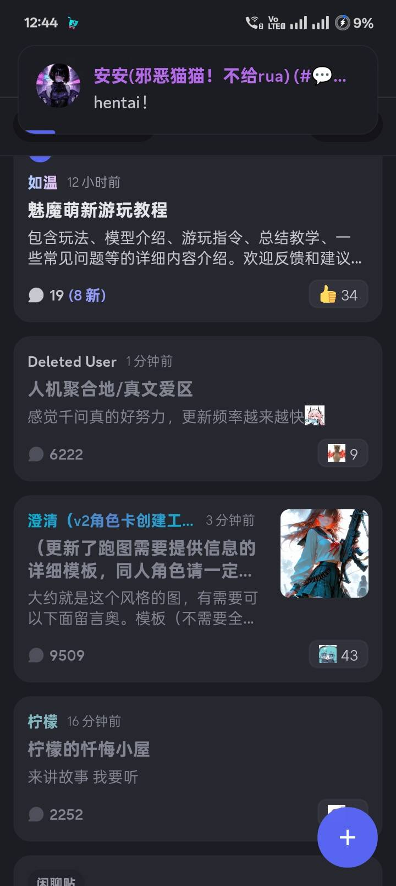

**赛博第一坏坏芳心纵火犯** (2025-11-03 22:14:58):
酸痛是初期，肌肉适应不了，坚持一周左右就不会了

**晨** (2025-11-03 22:14:32):
累还得看人

**晨** (2025-11-03 22:14:22):
做完那是酸痛

**赛博第一坏坏芳心纵火犯** (2025-11-03 22:13:05):
不累的都是发力不到位

**赛博第一坏坏芳心纵火犯** (2025-11-03 22:12:43):
正儿八经多做几组就累了

**晨** (2025-11-03 22:12:05):
这个累不了吧

**赛博第一坏坏芳心纵火犯** (2025-11-03 22:11:49):
身体累了自然就睡了

**赛博第一坏坏芳心纵火犯** (2025-11-03 22:11:32):
实在不行下地做几个俯卧撑算了

**卡顺密** (2025-11-03 22:11:30):
<:16:1298294503530041404>

**卡顺密** (2025-11-03 22:11:27):
最近头也痛眼睛痛

**赛博第一坏坏芳心纵火犯** (2025-11-03 22:09:36):
越困越不能睡

**卡顺密** (2025-11-03 22:09:21):
通常都是9点多

**卡顺密** (2025-11-03 22:09:16):
昨天而已 实在是困到受不了

**赛博第一坏坏芳心纵火犯** (2025-11-03 22:09:01):
而且你睡的也太早了吧，七点就睡

**卡顺密** (2025-11-03 22:08:53):
好久没有睡到天亮过了

**卡顺密** (2025-11-03 22:08:42):
撑死多睡一个小时

**卡顺密** (2025-11-03 22:08:38):
之前就试过了

**赛博第一坏坏芳心纵火犯** (2025-11-03 22:07:49):
你得熬一夜，把生物钟调整回来

**卡顺密** (2025-11-03 22:07:17):
比死了还难受

**卡顺密** (2025-11-03 22:07:08):
醒来之后就睡不去了 玩手机伤眼睛 躺床上很无聊

**赛博第一坏坏芳心纵火犯** (2025-11-03 22:07:01):
生物钟紊乱了

**卡顺密** (2025-11-03 22:06:37):
<:16:1298294503530041404>

**卡顺密** (2025-11-03 22:06:34):
最近几个月都这样

**卡顺密** (2025-11-03 22:06:24):
两三点就会自己醒过来

**赛博第一坏坏芳心纵火犯** (2025-11-03 22:06:00):
是不是做噩梦了<:emoji_140:1379454014852436038>

**赛博第一坏坏芳心纵火犯** (2025-11-03 22:05:49):
心疼你呀

**卡顺密** (2025-11-03 22:05:34):
<:16:1298294503530041404>

**卡顺密** (2025-11-03 22:05:28):
好难受 7点睡到2点就醒了

**卡顺密** (2025-11-03 22:04:46):
芳心别活了🙏
反对冷暴力🙏
安息🙏

**赛博第一坏坏芳心纵火犯** (2025-11-03 21:59:05):
卡密暗恋我😍
反对冷暴力😍
花生😍

**赛博第一坏坏芳心纵火犯** (2025-11-03 04:40:50):
卡密暗恋我😍
反对冷暴力😍
羊驼😍

**任白** (2025-11-03 04:13:53):
<:emoji_150:1400299501423431771>

**卡顺密** (2025-11-03 01:00:17):
芳心别复活🙏
反对冷暴力🙏
安息🙏

**哈哈** (2025-11-02 13:35:41):
<:emoji_136:1381162107424215091>

**任白** (2025-11-02 10:24:56):
是

**希波鹅拉底** (2025-11-02 07:08:30):
请问是住在🙏
马来西亚的🙏
爱玩鸣潮的🙏
手机开头是🙏
008的kami吗🙏

**卡顺密** (2025-11-02 01:00:25):
芳心别复活🙏
反对冷暴力🙏
安息🙏

**羊驼** (2025-11-01 22:49:28):
<:emoji_149:1395080631687315580>

**赛博第一坏坏芳心纵火犯** (2025-11-01 22:44:31):
卡密暗恋我😍
反对冷暴力😍
羊驼😍

**羊驼** (2025-11-01 22:39:49):
<:emoji_150:1395081181682339890>

**羊驼** (2025-11-01 22:39:32):
反对冷暴力

**哈哈** (2025-11-01 05:17:45):
<:dsdPopcorn:1003582275717431306>

**赛博第一坏坏芳心纵火犯** (2025-11-01 01:34:22):
不用怀疑，肯定有一个叫卡密的

**卡顺密** (2025-11-01 00:08:18):
那很好了

**Hamster** (2025-11-01 00:08:06):
<:emoji_234:1431854430764007434>

**Hamster** (2025-11-01 00:07:50):
小H有理由怀疑好多人暗恋我

**Hamster** (2025-11-01 00:07:32):
暗恋吗

**赛博第一坏坏芳心纵火犯** (2025-10-31 18:23:33):
日音恋口马？

**任白** (2025-10-31 18:22:40):
暗恋吗？

**哈哈** (2025-10-31 16:51:31):
<:dsdPopcorn:1003582275717431306>

**000** (2025-10-31 16:47:13):
你暗恋我吧，每天一句，怪不得你晚上睡不着，原来心里全是我

**赛博第一坏坏芳心纵火犯** (2025-10-31 13:53:00):
<:1000168532:1298906722546614313>

**赛博第一坏坏芳心纵火犯** (2025-10-31 13:52:53):
你暗恋我吧，每天一句，怪不得你晚上睡不着，原来心里全是我

**羊驼** (2025-10-31 11:02:43):
<:1000168532:1298906722546614313>

**羊驼** (2025-10-31 11:02:28):
反对冷暴力

**卡顺密** (2025-10-31 01:00:20):
芳心别复活🙏
反对冷暴力🙏
安息🙏

**羊驼** (2025-10-30 10:26:21):
居然遇见神人了

**羊驼** (2025-10-30 10:26:12):
可怜了

**羊驼** (2025-10-30 10:26:04):
摸摸你

**哈哈** (2025-10-30 06:56:08):
<:1000168510:1298906820638674984>

**卡顺密** (2025-10-30 06:52:25):
五条悟vs宿傩

**卡顺密** (2025-10-30 06:52:19):
<:16:1298294503530041404>

**卡顺密** (2025-10-30 06:52:15):
互相撕咬

**卡顺密** (2025-10-30 06:52:12):
反正就是一只鸡和他的两条狗 还有一条野狗

**liang060524** (2025-10-30 06:46:54):
<:1000168510:1298906820638674984>

**卡顺密** (2025-10-30 06:46:22):
你敢信这种神人局我一天碰到两次

**卡顺密** (2025-10-30 06:45:25):
最后我实在受不了了 让对面也给他们4个点

**卡顺密** (2025-10-30 06:44:55):
我给他们4个都点了

**卡顺密** (2025-10-30 06:44:12):
给对面报点

**卡顺密** (2025-10-30 06:44:05):
然后瑞娜演了一整局

**卡顺密** (2025-10-30 06:44:00):
<:16:1298294503530041404>

**卡顺密** (2025-10-30 06:43:56):
我真的不知道他们在吵什么 要吵也应该是我吧

**卡顺密** (2025-10-30 06:42:58):
说瑞娜声音听起来像是gay

**卡顺密** (2025-10-30 06:42:49):
他们三个咬一个

**卡顺密** (2025-10-30 06:42:29):
他们回防还慢的要死

**卡顺密** (2025-10-30 06:42:24):
在包点里面瑟瑟发抖

**卡顺密** (2025-10-30 06:42:17):
最惨的就是我了

**卡顺密** (2025-10-30 06:41:31):
然后他们四人帮就咬起来了

**卡顺密** (2025-10-30 06:40:45):
我和瑞娜单排 他们三个是一队的

**卡顺密** (2025-10-30 06:40:12):
奶妈

**卡顺密** (2025-10-30 06:39:54):
瑞纳开麦说（应该 我没听清楚

**卡顺密** (2025-10-30 06:39:41):
奶妈大脚步了

**卡顺密** (2025-10-30 06:39:33):
队友回防

**卡顺密** (2025-10-30 06:39:25):
应该是第一把

**卡顺密** (2025-10-30 06:38:59):
<:16:1298294503530041404>

**卡顺密** (2025-10-30 06:38:55):
我给你说一个有意思的一局

**卡顺密** (2025-10-30 06:38:50):
<@929772344984084490>

**卡顺密** (2025-10-30 06:38:48):
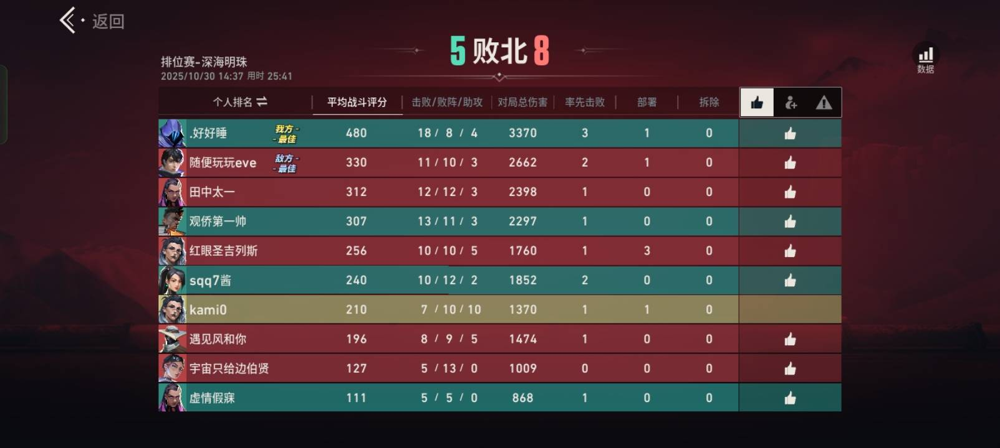

**卡顺密** (2025-10-30 02:21:32):
望周知

**卡顺密** (2025-10-30 02:21:25):
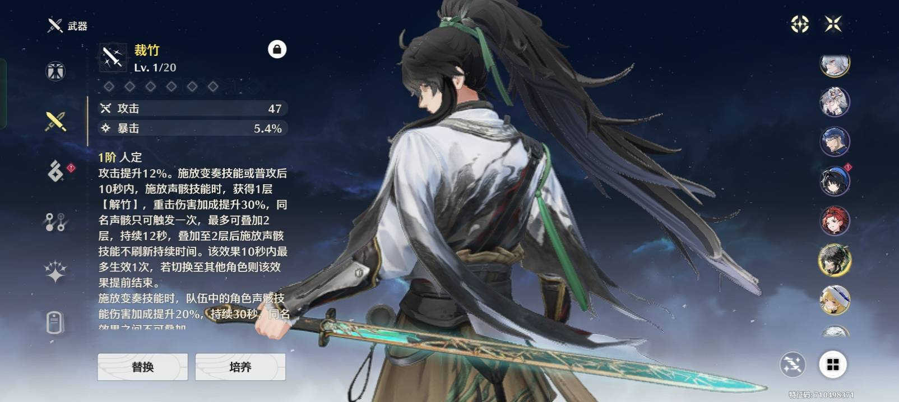

**哈哈** (2025-10-30 02:08:20):
<a:Hifumi_Yes:1117326403558453258>

**卡顺密** (2025-10-30 02:06:50):
<:16:1298294503530041404>

**卡顺密** (2025-10-30 02:06:46):
那很好了

**哈哈** (2025-10-30 02:05:39):
<:catb:1132279521203204107>

**哈哈** (2025-10-30 02:05:35):
奶茶 吐司+蛋

**卡顺密** (2025-10-30 02:05:21):
<:emoji_118:1379226234168414289>

**卡顺密** (2025-10-30 02:05:04):
你早上吃的什么

**哈哈** (2025-10-30 02:04:42):
<:dsdPopcorn:1003582275717431306>

**卡顺密** (2025-10-30 02:03:49):
芳心别复活🙏
反对冷暴力🙏
安息🙏

**哈哈** (2025-10-29 15:16:21):
<:emoji_142:1383709378925826159>

**羊驼** (2025-10-29 13:10:35):
<:emoji_15:1406355558730039346>

**哈哈** (2025-10-29 12:49:17):
<:PGR_AlphaPeek:940552387943350312>

**羊驼** (2025-10-29 11:06:09):
<:emoji_150:1400299501423431771> <:emoji_150:1388140448731762790>

**哈哈** (2025-10-29 10:47:26):
<:emoji_111:1379109633184108614>

**羊驼** (2025-10-29 10:34:15):
<:emoji_250:1418437739216633927>

**哈哈** (2025-10-29 06:37:14):
<:AnnaShy:960534438645756047> <:iiiiiiiii:1118825625407475742> <a:FeibiLap:1343217309224796281>

**晨** (2025-10-29 06:36:45):
哈哈可爱捏

**晨** (2025-10-29 06:36:38):
<:emoji_83:1378946142330683422>

**哈哈** (2025-10-29 06:36:10):
<a:Hifumi_Yes:1117326403558453258>

**羊驼** (2025-10-29 01:52:57):
<:07:1298281204260278383>

**羊驼** (2025-10-29 01:52:54):
买蚊香

**卡顺密** (2025-10-29 01:46:51):
痒的要死

**卡顺密** (2025-10-29 01:46:46):
妈的死蚊子

**羊驼** (2025-10-29 01:44:10):
<:08:1298281401715785789>

**羊驼** (2025-10-29 01:44:07):
这样就是舔脚了

**卡顺密** (2025-10-29 01:04:04):
芳心别复活🙏
反对冷暴力🙏
安息🙏

**哈哈** (2025-10-28 11:34:09):

**羊驼** (2025-10-28 10:56:48):
早知道用脚吃了

**羊驼** (2025-10-28 10:56:37):
<:1000168510:1298906820638674984>

**卡顺密** (2025-10-28 10:56:30):
你就不用洗了，我来帮你舔干净

**哈哈** (2025-10-28 10:56:20):
<:sb_9:1090528279292805130>

**羊驼** (2025-10-28 10:56:20):
<:emoji_150:1387407316369801216>

**羊驼** (2025-10-28 10:56:12):
摸摸

**羊驼** (2025-10-28 10:56:10):
哈哈是个好孩子

**羊驼** (2025-10-28 10:56:02):
<:07:1298281204260278383>

**卡顺密** (2025-10-28 10:55:27):
罪大恶极这一块

**哈哈** (2025-10-28 10:54:59):
<:dsdPopcorn:1003582275717431306>

**哈哈** (2025-10-28 10:54:58):
幸好我都會洗手 ( ? ?

**羊驼** (2025-10-28 10:27:09):
反对冷暴力
反对吃完薯片不洗手

**尹璃迪（还是埃及猫娘可爱desuwa！）** (2025-10-28 04:06:41):
https://media.discordapp.net/attachments/472720805633982466/792401419021844490/pakupaku.gif

**卡顺密** (2025-10-28 01:13:12):
芳心别复活🙏
反对冷暴力🙏
安息🙏

**羊驼** (2025-10-27 09:26:59):
https://media.discordapp.net/attachments/472720805633982466/792401419021844490/pakupaku.gif

**哈哈** (2025-10-27 03:41:28):
https://media.discordapp.net/attachments/472720805633982466/792401419021844490/pakupaku.gif

**哈哈** (2025-10-27 03:41:20):
吃（o

**Mr.Koalefant** (2025-10-27 03:28:21):
饿了

**卡顺密** (2025-10-27 01:29:39):
芳心别复活🙏
反对冷暴力🙏
安息🙏

**羊驼** (2025-10-26 18:25:54):
<:emoji_142:1383709378925826159>

**羊驼** (2025-10-26 18:25:53):
失恋了？

**羊驼** (2025-10-26 18:23:49):
<:emoji_139:1379455053080825866>

**羊驼** (2025-10-26 18:23:46):
？

**哈哈** (2025-10-26 16:13:38):
<:BaiWhat:919176468511207504>

**卡顺密** (2025-10-26 14:36:36):
半点心也没有

**卡顺密** (2025-10-26 14:35:46):
<:16:1298294503530041404>

**羊驼** (2025-10-26 14:35:35):
<:emoji_146:1379454137158209736>

**羊驼** (2025-10-26 14:35:30):
怎么了亲？

**卡顺密** (2025-10-26 14:17:34):
<@929772344984084490>

**卡顺密** (2025-10-26 14:14:03):
<:16:1298294503530041404>

**卡顺密** (2025-10-26 14:13:43):
我说这里好吗
你抬头而无话
你抱我 吻上我嘴巴
却似你吻向他
我暗中想 总有一点爱吧
可以交给我吧
总算得恋爱吧
相爱少点也罢
我却更了解是 编织梦话
半点心
请交给我 不过是个小小愿望吧
你的心
却一早已整个完完全全 交给他
怕说到你跟他
我说无穷傻话
你听了永远笑哈哈
我更言而无话
你我之间总有一点爱吧
可以交给我吧
总算得恋爱吧
相爱少点也罢
我却更了解是 编织梦话
半点心
请交给我 不过是个小小愿望吧
你的心
却一早已整个完完全全 交给他
说过爱要潇洒
错爱了回头吧
到这晚却说半点心
仍然求能留下
你我之间总有一点爱吧
可以交给我吧
总算得恋爱吧
相爱少点也罢
我却更了解是 编织梦话
半点心
请交给我 不过是个小小愿望吧
你的心
却一早已整个完完全全 交给他
他跟你好吗
一切的爱怎么都送给他
一颗心 分一半好吗
起码一半都交给我好吗
给我吗

**哈哈** (2025-10-26 06:13:31):

**赛博第一坏坏芳心纵火犯** (2025-10-26 01:03:39):
卡密好紧致🥵 
支持热调查🥵 
做爱🥵

**卡顺密** (2025-10-26 01:00:28):
芳心别复活🙏
反对冷暴力🙏
安息🙏

**希波鹅拉底** (2025-10-25 12:19:52):
亲亲

**哈哈** (2025-10-25 09:03:16):
<a:FeibiLap:1343217309224796281>

**沐 云曦** (2025-10-25 08:58:08):
亲亲mua

**沐 云曦** (2025-10-25 08:57:57):
亲亲mia

**沐 云曦** (2025-10-25 08:57:41):
反对冷暴力，反对光

**哈哈** (2025-10-25 06:25:07):
<:1000168510:1298906820638674984>

**希波鹅拉底** (2025-10-25 05:23:48):


**赛博第一坏坏芳心纵火犯** (2025-10-25 01:46:23):


**卡顺密** (2025-10-25 01:00:47):
芳心别复活🙏
反对冷暴力🙏
安息🙏

**羊驼** (2025-10-24 21:23:43):
<:emoji_140:1379454014852436038> <:emoji_140:1379454014852436038>

**希波鹅拉底** (2025-10-24 20:09:27):
反清复明

**哈哈** (2025-10-24 18:08:44):
<:sb_1:1073221244280913950>

**任白** (2025-10-24 17:20:10):
没人要听

**任白** (2025-10-24 17:20:07):
还有好多库存

**尹璃迪（还是埃及猫娘可爱desuwa！）** (2025-10-24 17:19:57):
muamua

**任白** (2025-10-24 17:19:48):
下次再更新

**任白** (2025-10-24 17:16:52):
影响了我的发挥

**任白** (2025-10-24 17:16:22):
<:1000168531:1298906724979310634>

**尹璃迪（还是埃及猫娘可爱desuwa！）** (2025-10-24 17:16:17):
是真的，听着很怪

**任白** (2025-10-24 17:16:13):
音质也很烂

**任白** (2025-10-24 17:16:09):
我上次试了直接DC发语音

**任白** (2025-10-24 17:16:00):
音质不知道为啥这么烂

**尹璃迪（还是埃及猫娘可爱desuwa！）** (2025-10-24 17:15:45):
<:emoji_150:1400299501423431771>

**尹璃迪（还是埃及猫娘可爱desuwa！）** (2025-10-24 17:15:42):
可以让我安心入眠

**任白** (2025-10-24 17:15:29):
只是挺好听吗

**任白** (2025-10-24 17:15:22):
我来念一念

**尹璃迪（还是埃及猫娘可爱desuwa！）** (2025-10-24 17:15:17):
sukiki

**尹璃迪（还是埃及猫娘可爱desuwa！）** (2025-10-24 17:15:14):
啊，没事，老师的声音挺好听的呀

**任白** (2025-10-24 17:15:13):
有没有什么文案

**任白** (2025-10-24 17:15:08):
感觉特别怪的什么

**任白** (2025-10-24 17:14:56):
压着声音唱导致

**任白** (2025-10-24 17:14:49):
后面一段我感觉一般般

**尹璃迪（还是埃及猫娘可爱desuwa！）** (2025-10-24 17:14:11):
<:1000168532:1298906722546614313>

**尹璃迪（还是埃及猫娘可爱desuwa！）** (2025-10-24 17:14:05):
发呀发呀

**任白** (2025-10-24 17:13:29):
要听吗

**任白** (2025-10-24 17:11:57):
后面还有一段

**Hamster** (2025-10-24 17:11:01):
老师！老师！爱你喵！

**尹璃迪（还是埃及猫娘可爱desuwa！）** (2025-10-24 17:10:31):
<:1000168532:1298906722546614313>

**哈哈** (2025-10-24 17:09:51):
<:catb:1132279521203204107>

**任白** (2025-10-24 17:07:27):


**任白** (2025-10-24 16:41:46):
<:emoji_146:1379454137158209736>

**任白** (2025-10-24 16:41:38):
躲在被子里压着声音唱歌感觉真奇怪

**任白** (2025-10-24 16:38:58):
只是怕亲手将我的真心葬送

**任白** (2025-10-24 16:38:44):
我开始后悔不应该太聪明的卖弄

**任白** (2025-10-24 16:38:28):
我更无处可躲

**任白** (2025-10-24 16:38:24):
被你看穿了以后

**任白** (2025-10-24 16:38:15):
不会有结果

**任白** (2025-10-24 16:38:03):
想的太多

**任白** (2025-10-24 16:38:00):
猜的没错

**任白** (2025-10-24 16:37:04):
发歌

**任白** (2025-10-24 16:33:11):
<:emoji_146:1379454137158209736>

**晨** (2025-10-24 16:32:12):
反对冷暴力

**晨** (2025-10-24 16:32:08):
总结

**赛博第一坏坏芳心纵火犯** (2025-10-24 16:16:27):
职场是常温的就行了

**任白** (2025-10-24 16:15:20):
又是怕爱你的心被你看透

**任白** (2025-10-24 16:15:09):
隐藏我的感受

**任白** (2025-10-24 16:15:07):
我总是忽冷又忽热

**任白** (2025-10-24 16:14:53):
其实也没什么

**任白** (2025-10-24 16:14:49):
在你了解了以后

**任白** (2025-10-24 16:14:43):
总以为谜一样 难懂的我

**卡顺密** (2025-10-24 01:00:29):
芳心别复活🙏
反对冷暴力🙏
安息🙏

**沐 云曦** (2025-10-23 14:07:56):
反对冷不冷

**沐 云曦** (2025-10-23 14:07:50):
反对整活

**卡顺密** (2025-10-23 01:00:19):
芳心别复活🙏
反对冷暴力🙏
安息🙏

**卡顺密** (2025-10-22 23:55:07):
虽然输了，但是我爽了

**卡顺密** (2025-10-22 23:54:57):
我让他出去别说他是赋能哥了

**卡顺密** (2025-10-22 23:54:31):
<:emoji_15:1406355558730039346>

**卡顺密** (2025-10-22 23:54:26):
然后又被我队友拿下五杀

**卡顺密** (2025-10-22 23:53:45):


**卡顺密** (2025-10-22 23:53:23):
居然敢让我投

**卡顺密** (2025-10-22 23:53:19):
谁让他偏偏要吹自己

**卡顺密** (2025-10-22 23:53:10):
本来我都想要投了的

**卡顺密** (2025-10-22 23:53:02):
我就知道事情不对了

**卡顺密** (2025-10-22 23:52:30):
一开始正义中距离颗秒

**卡顺密** (2025-10-22 23:52:12):
遇到对面pc负能哥

**卡顺密** (2025-10-22 23:51:36):
<@929772344984084490>

**羊驼** (2025-10-22 21:22:38):
<:16:1298294503530041404>

**羊驼** (2025-10-22 21:22:33):
现在已经被封了

**羊驼** (2025-10-22 21:22:25):
他是仙尊小号

**卡顺密** (2025-10-22 20:00:13):
？

**羊驼** (2025-10-22 18:02:48):
芳心复活
仙尊复活
都复活<:emoji_144:1379454084750245939>

**希波鹅拉底** (2025-10-22 17:07:12):
芳心复活
仙尊复活
都复活<:emoji_144:1379454084750245939>

**羊驼** (2025-10-22 13:03:08):
<:emoji_144:1379454084750245939>

**哈哈** (2025-10-22 10:05:10):
<a:FeibiLap:1343217309224796281>

**哈哈** (2025-10-22 10:03:01):
<:an_1:1090220619192340522><:SeulbiYeah:884294629791526923>

**羊驼** (2025-10-22 10:03:00):
<:emoji_133:1379494883227734157>

**哈哈** (2025-10-22 10:02:59):
<:PGR_AlphaPeek:940552387943350312>

**羊驼** (2025-10-22 10:02:48):
不要吃我呀

**羊驼** (2025-10-22 10:02:40):
可以吃爆米花，可以吃！

**羊驼** (2025-10-22 10:02:26):
哇！

**哈哈** (2025-10-22 09:59:32):
<a:PGR_AlphaBiteGif:1060100333709299742>

**羊驼** (2025-10-22 09:48:57):
<:emoji_136:1381162107424215091>

**哈哈** (2025-10-22 09:48:09):
<:1000168510:1298906820638674984>

**大爱仙尊** (2025-10-22 09:39:29):
<:emoji_133:1379494883227734157>

**大爱仙尊** (2025-10-22 09:39:23):
<@1063068779162108027> 我要头像

**大爱仙尊** (2025-10-22 09:27:54):
抖S魅魔复活吧🙏
反对冷暴力🙏
别安息🙏

**羊驼** (2025-10-22 08:29:29):
🙏

**羊驼** (2025-10-22 08:29:20):
反对冷暴力
反对哈哈吃爆米花

**哈哈** (2025-10-22 05:11:42):
<:dsdPopcorn:1003582275717431306>

**大爱仙尊** (2025-10-22 05:10:24):
芳心复活吧🙏
反对冷暴力🙏
别安息🙏

**沐 云曦** (2025-10-22 05:03:34):
反对反对

**卡顺密** (2025-10-22 01:45:52):
芳心别复活🙏
反对冷暴力🙏
安息🙏

**哈哈** (2025-10-21 12:48:07):
<:sb_9:1090528279292805130>

**哈哈** (2025-10-21 12:48:05):
<:PGR_AlphaPeek:940552387943350312>

**卡顺密** (2025-10-21 12:47:37):
哎哟我 这哈哈怎么这么坏呀

**哈哈** (2025-10-21 12:47:15):
<:an_1:1090220619192340522>

**卡顺密** (2025-10-21 12:47:00):
<:emoji_149:1391405133220282500>

**哈哈** (2025-10-21 12:46:54):
<:emoji_136:1381162107424215091>

**哈哈** (2025-10-21 12:46:52):
吃完了

**卡顺密** (2025-10-21 12:46:46):
我的份呢

**哈哈** (2025-10-21 12:46:27):
<:dsdPopcorn:1003582275717431306>

**哈哈** (2025-10-21 12:46:26):
小火鍋

**哈哈** (2025-10-21 12:46:21):
喔

**卡顺密** (2025-10-21 12:33:33):
我问你晚餐吃的什么<:emoji_79:1378945692537454713>

**哈哈** (2025-10-21 12:33:03):
爆米花 (? ?

**卡顺密** (2025-10-21 12:31:24):
<:16:1298294503530041404>

**卡顺密** (2025-10-21 12:31:16):
吃的什么

**哈哈** (2025-10-21 10:36:36):
<:dsdPopcorn:1003582275717431306>

**羊驼** (2025-10-21 10:12:18):
反对冷暴力

**liang060524** (2025-10-21 04:02:04):
<:1000168510:1298906820638674984>

**大爱仙尊** (2025-10-21 01:27:09):
🐔

**卡顺密** (2025-10-21 01:25:52):
芳心别复活🙏
反对冷暴力🙏
安息🙏

**希波鹅拉底** (2025-10-20 03:05:00):
<:emoji_150:1382698990037897266>

**希波鹅拉底** (2025-10-20 03:04:57):
反对冷暴力
支持全世界都变成修女

**卡顺密** (2025-10-20 01:17:06):
芳心别复活🙏
反对冷暴力🙏
安息🙏

**任白** (2025-10-20 01:16:37):
支持冷暴力

**卡顺密** (2025-10-19 20:58:29):
芳心别复活🙏
反对冷暴力🙏
安息🙏

**卡顺密** (2025-10-19 20:58:28):
芳心别复活🙏
反对冷暴力🙏
安息🙏

**卡顺密** (2025-10-19 20:58:27):
芳心别复活🙏
反对冷暴力🙏
安息🙏

**卡顺密** (2025-10-19 20:58:23):
芳心别复活🙏
反对冷暴力🙏
安息🙏

**大爱仙尊** (2025-10-19 06:32:32):
这就是我们的库里，技术能日天的库里，漂亮的假动作很帅气，Crossover很哟西<:1000168532:1298906722546614313>

**卡顺密** (2025-10-19 01:00:23):
芳心别复活🙏
反对冷暴力🙏
安息🙏

**希波鹅拉底** (2025-10-18 07:44:33):
<:20:1298294514124984323>

**卡顺密** (2025-10-18 01:00:35):
芳心别复活🙏
反对冷暴力🙏
安息🙏

**大爱仙尊** (2025-10-17 13:25:35):
芳心别复活🙏
反对冷暴力🙏
安息🙏

**哈哈** (2025-10-17 06:02:28):

**全能沙雕王（光速滑跪版）** (2025-10-17 05:12:43):
本人目前在家中，一切正常

**卡顺密** (2025-10-17 01:04:47):
芳心别复活🙏
反对冷暴力🙏
安息🙏

**哈哈** (2025-10-16 17:17:51):

**赛博第一坏坏芳心纵火犯** (2025-10-16 17:04:07):
因为我的一部分在你体内摩擦生热

**哈哈** (2025-10-16 10:03:20):
<a:Wanna_Hentai_HELL:1393901286365335572>

**希波鹅拉底** (2025-10-16 09:59:41):
<:emoji_142:1379854822315921438>

**大爱仙尊** (2025-10-16 09:58:53):
<:1000168532:1298906722546614313>

**大爱仙尊** (2025-10-16 09:58:51):
因为我是你的太阳，时刻围着你转

**大爱仙尊** (2025-10-16 09:58:17):
我反对你的反对<:emoji_250:1426507388201996390>

**卡顺密** (2025-10-16 09:15:40):
唉哟， 犯天条了，怎么这么热啊

**哈哈** (2025-10-16 07:07:10):
<:dsdPopcorn:1003582275717431306>

**希波鹅拉底** (2025-10-16 06:34:08):
反对云曦乱亲人

**沐 云曦** (2025-10-16 04:41:43):
反对冷暴力

**卡顺密** (2025-10-16 01:00:18):
芳心别复活🙏
反对冷暴力🙏
安息🙏

**卡顺密** (2025-10-15 01:00:21):
芳心别复活🙏
反对冷暴力🙏
安息🙏

**哈哈** (2025-10-14 23:08:24):
<:emoji_142:1383709378925826159>

**赛博第一坏坏芳心纵火犯** (2025-10-14 21:55:32):
我不在的时候，你很嚣张哦

**任白** (2025-10-14 04:34:32):
反对反对

**卡顺密** (2025-10-14 01:00:17):
芳心别复活🙏
反对冷暴力🙏
安息🙏

**希波鹅拉底** (2025-10-13 23:59:32):
<:emoji_83:1378946142330683422>

**哈哈** (2025-10-13 23:53:01):
<:dsdPopcorn:1003582275717431306>

**沐 云曦** (2025-10-13 18:49:13):
反对暴饮暴食

**沐 云曦** (2025-10-13 18:49:06):
反对纪念

**羊驼** (2025-10-13 15:14:31):
《念kami》

Kami病了。
风停在窗外，不敢打扰。

她的屏幕安静得像一口井，
那些涌动的词语、漂浮的表情，全都沉到底。

她不再水群，也不再泛起水花。
世界似乎少了一点声音，
连空气都变得迟钝。

数据在流动，时间在发热，
只有她停在了原地，
像信号中的一处静默。

许是水中铁生了锈，
许是心在休眠。

没人知道她什么时候会好，
就像没人知道，
光从哪一刻重新落进海面。

**大爱仙尊** (2025-10-13 09:46:52):
《念kami》

Kami病了。
风停在窗外，不敢打扰。

她的屏幕安静得像一口井，
那些涌动的词语、漂浮的表情，全都沉到底。

她不再水群，也不再泛起水花。
世界似乎少了一点声音，
连空气都变得迟钝。

数据在流动，时间在发热，
只有她停在了原地，
像信号中的一处静默。

许是水中铁生了锈，
许是心在休眠。

没人知道她什么时候会好，
就像没人知道，
光从哪一刻重新落进海面。

**希波鹅拉底** (2025-10-13 03:15:21):
<:emoji_150:1382433856178749582>

**哈哈** (2025-10-13 02:42:24):
<:SadgePray:1090017573166395524>

**鹤南飞(接定制看简介)** (2025-10-13 01:44:18):
《念kami》

Kami病了。
风停在窗外，不敢打扰。

她的屏幕安静得像一口井，
那些涌动的词语、漂浮的表情，全都沉到底。

她不再水群，也不再泛起水花。
世界似乎少了一点声音，
连空气都变得迟钝。

数据在流动，时间在发热，
只有她停在了原地，
像信号中的一处静默。

许是水中铁生了锈，
许是心在休眠。

没人知道她什么时候会好，
就像没人知道，
光从哪一刻重新落进海面。

**沐 云曦** (2025-10-13 01:08:52):
反对亲亲

**沐 云曦** (2025-10-13 01:08:40):
反对无效

**卡顺密** (2025-10-13 01:00:26):
芳心别复活🙏
反对冷暴力🙏
安息🙏

**哈哈** (2025-10-12 08:42:15):
<:SadgePray:1090017573166395524>

**000** (2025-10-12 08:15:40):
《念kami》

Kami病了。
风停在窗外，不敢打扰。

她的屏幕安静得像一口井，
那些涌动的词语、漂浮的表情，全都沉到底。

她不再水群，也不再泛起水花。
世界似乎少了一点声音，
连空气都变得迟钝。

数据在流动，时间在发热，
只有她停在了原地，
像信号中的一处静默。

许是水中铁生了锈，
许是心在休眠。

没人知道她什么时候会好，
就像没人知道，
光从哪一刻重新落进海面。

**任白** (2025-10-12 06:52:16):
<:emoji_250:1426636034996961300>

**哈哈** (2025-10-12 06:32:58):
<:qaq:1118563132797890560>

**大爱仙尊** (2025-10-12 06:13:18):
<:1000168532:1298906722546614313>

**大爱仙尊** (2025-10-12 06:10:36):
<:emoji_144:1379454084750245939>

**大爱仙尊** (2025-10-12 06:09:46):
《念kami》

Kami病了。
风停在窗外，不敢打扰。

她的屏幕安静得像一口井，
那些涌动的词语、漂浮的表情，全都沉到底。

她不再水群，也不再泛起水花。
世界似乎少了一点声音，
连空气都变得迟钝。

数据在流动，时间在发热，
只有她停在了原地，
像信号中的一处静默。

许是水中铁生了锈，
许是心在休眠。

没人知道她什么时候会好，
就像没人知道，
光从哪一刻重新落进海面。

**卡顺密** (2025-10-12 01:00:17):
芳心别复活🙏
反对冷暴力🙏
安息🙏

**哈哈** (2025-10-11 12:03:40):
<:dsdPopcorn:1003582275717431306>

**大爱仙尊** (2025-10-11 10:20:42):
<:1000168532:1298906722546614313>

**大爱仙尊** (2025-10-11 10:20:34):
想超芳心

**羊驼** (2025-10-11 10:16:36):
<:emoji_146:1379454137158209736>

**羊驼** (2025-10-11 10:16:23):
反对冷暴力

**哈哈** (2025-10-11 05:14:49):
<:dsdPopcorn:1003582275717431306>

**希波鹅拉底** (2025-10-11 01:34:10):
我超芳心

**卡顺密** (2025-10-11 01:00:36):
芳心别复活🙏
反对冷暴力🙏
安息🙏

**大爱仙尊** (2025-10-10 04:37:07):
我超芳心

**希波鹅拉底** (2025-10-10 02:13:34):
我超芳心

**卡顺密** (2025-10-10 01:00:21):
芳心别复活🙏
反对冷暴力🙏
安息🙏

**赛博第一坏坏芳心纵火犯** (2025-10-09 17:11:32):
<:emoji_149:1400299483212021833>

**晚忆** (2025-10-09 11:16:58):
芳心别复活🙏
反对冷暴力🙏
安息🙏

**000** (2025-10-09 05:02:06):
<:emoji_139:1379455053080825866> <:emoji_132:1379388256113917993>

**000** (2025-10-09 05:01:57):
<:emoji_139:1379455053080825866>

**000** (2025-10-09 05:01:49):
<:emoji_140:1379454014852436038>

**000** (2025-10-09 05:01:47):
哇呀？想你了

**哈哈** (2025-10-09 05:00:46):
<:nani:1134869744000970812>

**尹璃迪（还是埃及猫娘可爱desuwa！）** (2025-10-09 03:37:32):
<:emoji_147:1382565790129328128>

**赛博第一坏坏芳心纵火犯** (2025-10-09 03:37:24):
我在默默的等大号放出来

**赛博第一坏坏芳心纵火犯** (2025-10-09 03:37:03):
等拿到绿卡我就躺平天天水群了<:emoji_140:1379454014852436038>

**尹璃迪（还是埃及猫娘可爱desuwa！）** (2025-10-09 03:32:24):
<:emoji_140:1379454014852436038>

**尹璃迪（还是埃及猫娘可爱desuwa！）** (2025-10-09 03:32:20):
哇呀？想你了

**晨** (2025-10-09 03:07:16):
没看你说话

**晨** (2025-10-09 03:07:11):
我还以为你这个号也死了

**赛博第一坏坏芳心纵火犯** (2025-10-09 03:06:54):
<:1000168531:1298906724979310634> 我门下的吹箫小童子发癫了而已，不用在意

**晨** (2025-10-09 02:57:09):
<@1422580625730306058>

**晨** (2025-10-09 02:57:00):
芳心？

**希波鹅拉底** (2025-10-09 01:18:18):
<:1000168518:1298906830864519231>

**卡顺密** (2025-10-09 01:00:16):
芳心别复活🙏
反对冷暴力🙏
安息🙏

**任白** (2025-10-08 08:09:14):
无人在意

**羊驼** (2025-10-08 08:07:52):
厉害了

**羊驼** (2025-10-08 08:07:49):
<:emoji_139:1379455053080825866>

**卡顺密** (2025-10-08 01:30:20):
出来一看加分给我头皮都吓麻了

**卡顺密** (2025-10-08 01:30:04):
卧槽 我还以为我打的是匹配 4个决斗一个奶妈 得亏我有操作，不然就输了

**卡顺密** (2025-10-08 01:00:35):
芳心别复活🙏
反对冷暴力🙏
安息🙏

**哈哈** (2025-10-07 23:06:55):
🛐

**卡顺密** (2025-10-07 21:36:25):

**卡顺密** (2025-10-07 21:36:22):
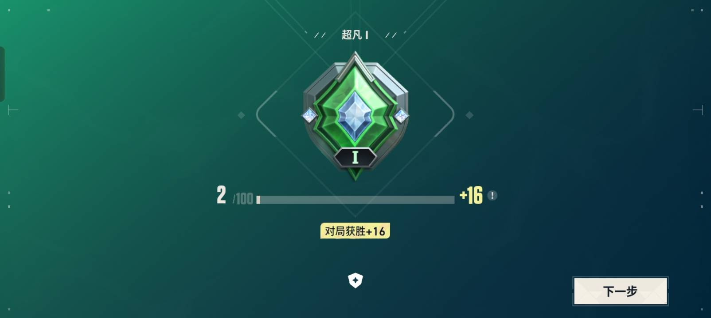


**卡顺密** (2025-10-07 21:36:15):
<@929772344984084490>

**卡顺密** (2025-10-07 21:36:14):
<@929772344984084490>

**卡顺密** (2025-10-07 21:36:14):
<@929772344984084490>

**希波鹅拉底** (2025-10-07 02:59:53):
<:1000168518:1298906830864519231>

**哈哈** (2025-10-07 01:33:08):
<:emoji_111:1379109633184108614>

**卡顺密** (2025-10-07 01:32:49):
<:emoji_250:1418437739216633927>

**哈哈** (2025-10-07 01:25:44):
<:dsdPopcorn:1003582275717431306>

**卡顺密** (2025-10-07 01:00:24):
芳心别复活🙏
反对冷暴力🙏
安息🙏

**羊驼** (2025-10-06 21:12:53):
<:emoji_184:1409565778595807282>

**哈哈** (2025-10-06 18:13:28):
<:dsdPopcorn:1003582275717431306>

**任白** (2025-10-06 17:21:53):
反……嗯啊……反对冷……啊……冷暴力

**大爱仙尊** (2025-10-06 10:34:25):
<:1000168532:1298906722546614313>

**大爱仙尊** (2025-10-06 10:34:20):
<@456226577798135808>

**000** (2025-10-06 09:51:03):
芳心别复活🙏
反对冷暴力🙏
安息🙏

**晚忆** (2025-10-06 03:59:00):
芳心别复活🙏
反对冷暴力🙏
安息🙏

**希波鹅拉底** (2025-10-06 02:29:35):
<:1000168518:1298906830864519231>

**哈哈** (2025-10-06 02:06:59):
<:sb_1:1073221244280913950>

**大爱仙尊** (2025-10-06 02:02:14):
芳心别复活🙏
反对冷暴力🙏
安息🙏

**卡顺密** (2025-10-06 01:00:28):
芳心别复活🙏
反对冷暴力🙏
安息🙏

**卡顺密** (2025-10-05 18:49:16):
芳心别复活🙏
反对冷暴力🙏
安息🙏

**卡顺密** (2025-10-05 01:00:23):
反对冷暴力
安息🙏

**哈哈** (2025-10-04 09:59:55):
<:dsdPopcorn:1003582275717431306>

**大爱仙尊** (2025-10-04 03:26:47):
🤔 <:emoji_150:1389291799322951891>

**卡顺密** (2025-10-04 03:21:58):
<:emoji_249:1419298157631770726>

**卡顺密** (2025-10-04 03:21:50):
快点给我祷告

**大爱仙尊** (2025-10-04 03:21:28):
<:emoji_146:1379454137158209736>

**卡顺密** (2025-10-04 01:37:26):
反对冷暴力
安息🙏

**任白** (2025-10-04 01:17:00):
不懂爱恨情仇煎熬的我们，还以为深情只是古老的传言

**任白** (2025-10-04 01:16:40):
反对冷暴力

**希波鹅拉底** (2025-10-02 03:13:38):
<:20:1298294514124984323>

**哈哈** (2025-10-02 03:03:52):
看來有人要篡位了（？

**任白** (2025-10-02 02:54:23):
退位了我就是宗主了

**哈哈** (2025-10-02 02:52:45):
<:dsdPopcorn:1003582275717431306> <:BaiWhat:919176468511207504>

**哈哈** (2025-10-02 02:52:43):
要退位了嗎

**大爱仙尊** (2025-10-02 02:11:08):
<:1000168510:1298906820638674984>

**卡顺密** (2025-10-02 01:33:04):
从今天开始你就是反冷宗主了

**Mr.Koalefant** (2025-10-02 01:32:13):


**羊驼** (2025-09-30 21:29:37):
<:emoji_115:1379113943817257071>

**羊驼** (2025-09-30 21:29:26):
沐老师亲亲

**希波鹅拉底** (2025-09-30 18:39:35):
哈气

**沐 云曦** (2025-09-30 08:56:35):
亲亲亲mua

**沐 云曦** (2025-09-30 08:56:20):
反对冷暴力

**XXX** (2025-09-30 07:59:35):
<:1000168531:1298906724979310634>

**任白** (2025-09-30 07:32:05):
😭😭😭

**任白** (2025-09-30 07:32:02):
飘落后才发现这幸福的碎片，要我怎么捡

**任白** (2025-09-30 07:31:51):
只让我们相恋，这一季的秋天😭😭😭

**哈哈** (2025-09-30 07:16:52):
<:an_1:1090220619192340522>

**任白** (2025-09-30 07:00:54):
反对冷暴力

**哈哈** (2025-09-30 02:17:33):
<:catb:1132279521203204107>

**大爱仙尊** (2025-09-30 01:13:16):
反对<:emoji_148:1382329938404839586>

**哈哈** (2025-09-28 11:40:15):
<:sb_1:1073221244280913950>

**穆穆** (2025-09-28 11:17:29):
<:1000168510:1298906820638674984>

**任白** (2025-09-28 11:00:18):
哦啊啊

**大爱仙尊** (2025-09-28 10:15:29):
反对我

**哈哈** (2025-09-28 06:10:18):
反...反對..？呃...嗯....欸？

**羊驼** (2025-09-27 23:41:36):
<:emoji_143:1379855104622202900>

**卡顺密** (2025-09-27 23:40:58):
反对…反对…唔…！唔…！唔…！唔…！唔…！<:22:1298294520777019502>

**羊驼** (2025-09-27 23:40:27):
<:emoji_149:1391405133220282500>

**羊驼** (2025-09-27 23:40:15):
希腊奶

**羊驼** (2025-09-27 23:40:09):
反对…反对…唔…

**任白** (2025-09-27 09:40:30):
反对冷暴力

**沐 云曦** (2025-09-27 09:34:44):
反对游戏

**哈哈** (2025-09-27 04:48:16):
<a:PGR_AlphaBiteGif:1060100333709299742>

**任白** (2025-09-27 04:31:18):
<:emoji_147:1385908979460214866>

**Mr.Koalefant** (2025-09-27 04:29:49):
<:emoji_148:1386006416136863796>

**Mr.Koalefant** (2025-09-27 04:29:44):
鼠鼠老大我要哈你

**任白** (2025-09-27 00:57:00):
欺负我老婆干嘛

**卡顺密** (2025-09-27 00:44:47):
<:emoji_250:1418437739216633927>

**卡顺密** (2025-09-27 00:44:39):
叫爸爸，不然掐似你

**哈哈** (2025-09-26 04:03:26):
<:dsdPopcorn:1003582275717431306>

**哈哈** (2025-09-26 04:03:24):
喔喔 換了呢

**哈哈** (2025-09-26 03:57:17):
<a:PGR_AlphaBiteGif:1060100333709299742>

**哈哈** (2025-09-26 03:57:11):
<:emoji_111:1379109633184108614>

**卡顺密** (2025-09-26 03:35:58):
<:emoji_250:1418437739216633927>

**哈哈** (2025-09-26 03:35:30):
🛐

**000** (2025-09-26 02:42:53):

**卡顺密** (2025-09-26 00:55:11):

**卡顺密** (2025-09-26 00:55:08):
欧耶 战战的神

**卡顺密** (2025-09-26 00:55:05):


**Mr.Koalefant** (2025-09-23 12:48:50):
<:emoji_155:1409538482417958962>

**Mr.Koalefant** (2025-09-23 12:48:39):
一把抓住大鹅

**希波鹅拉底** (2025-09-23 12:26:44):
<:1000168518:1298906830864519231>

**羊驼** (2025-09-23 09:30:16):
<:1000168529:1298906735599288330>

**大爱仙尊** (2025-09-22 13:44:53):
<:emoji_121:1379127590564134992>

**卡顺密** (2025-09-22 12:14:10):
<:emoji_154:1407703394453422182>

**卡顺密** (2025-09-22 12:14:07):
删掉就刷到一大堆保安阳光点位

**卡顺密** (2025-09-22 12:13:57):
我真得把瓦下回来了

**Mr.Koalefant** (2025-09-22 11:42:14):
<:emoji_147:1385908979460214866>

**哈哈** (2025-09-22 07:56:21):
<:catb:1132279521203204107>

**大爱仙尊** (2025-09-22 06:00:27):
<:1000168510:1298906820638674984>

**大爱仙尊** (2025-09-22 06:00:25):
又有新皮肤了

**哈哈** (2025-09-21 06:07:33):
<:AnnaShy:960534438645756047>

**希波鹅拉底** (2025-09-21 06:07:17):
可爱

**哈哈** (2025-09-21 05:38:45):
<:catb:1132279521203204107>

**希波鹅拉底** (2025-09-21 03:45:41):
<:emoji_250:1418284639436541962>

**沐 云曦** (2025-09-21 03:45:03):
亲亲mua

**希波鹅拉底** (2025-09-21 03:44:52):
<:emoji_149:1400309607783727266>

**希波鹅拉底** (2025-09-21 03:44:48):
咬你

**希波鹅拉底** (2025-09-21 03:44:42):
反对不色色

**希波鹅拉底** (2025-09-21 03:44:37):
喜欢云曦

**沐 云曦** (2025-09-21 03:16:11):
反对色色

**卡顺密** (2025-09-20 23:44:36):


**卡顺密** (2025-09-20 23:44:31):
<@1393989953591050390>

**哈哈** (2025-09-20 09:30:36):
<:dsdPopcorn:1003582275717431306>

**希波鹅拉底** (2025-09-20 09:13:02):
反对不当我小弟的

**000** (2025-09-20 08:47:49):
<:1000168531:1298906724979310634>

**哈哈** (2025-09-20 06:04:29):
<:sb_1:1073221244280913950>

**羊驼** (2025-09-20 05:29:44):
反对反对反对冷暴力

**Mr.Koalefant** (2025-09-20 05:26:47):
反对反对

**沐 云曦** (2025-09-19 16:47:56):
反对冷暴力

**羊驼** (2025-09-17 16:24:49):
<:emoji_150:1400299501423431771>

**羊驼** (2025-09-17 16:24:42):
反对反对表情包

**羊驼** (2025-09-17 16:24:29):
<:1000168531:1298906724979310634>

**希波鹅拉底** (2025-09-17 15:09:41):
支持好鹅

**希波鹅拉底** (2025-09-17 15:09:34):
反对坏鹅

**Mr.Koalefant** (2025-09-17 11:39:24):
<:emoji_135:1380973007304003684>

**000** (2025-09-17 11:29:50):
<:1000168510:1298906820638674984> <:1000168510:1298906820638674984>

**哈哈** (2025-09-17 11:08:49):

**大爱仙尊** (2025-09-17 10:50:18):
<:emoji_250:1417715953285730334>

**大爱仙尊** (2025-09-17 10:50:17):
反对表情包

**哈哈** (2025-09-17 09:55:59):
<:EunhaIDK:1352842231433658468>

**哈哈** (2025-09-17 09:55:58):
<:3_:1134073260183670895>

**羊驼** (2025-09-17 07:53:35):
<:1000168531:1298906724979310634>

**羊驼** (2025-09-17 07:53:32):
好利来是？

**沐 云曦** (2025-09-17 05:44:11):
反对好利来

**识小律** (2025-09-16 17:10:29):
<:emoji_148:1382329938404839586>

**识小律** (2025-09-16 17:10:24):
哈气了

**哈哈** (2025-09-16 16:53:31):
<:LunaO_O:1129462010585812993>

**晨** (2025-09-16 16:40:33):
那大家不回你就行了

**晨** (2025-09-16 16:40:25):
支持是吧

**识小律** (2025-09-16 15:57:47):
<:emoji_148:1382329938404839586>

**识小律** (2025-09-16 15:57:41):
支持冷暴力

**希波鹅拉底** (2025-09-16 14:39:12):
<:emoji_250:1417519640745345085>

**羊驼** (2025-09-16 10:24:56):
<:07:1298281204260278383>

**哈哈** (2025-09-16 07:38:48):

**沐 云曦** (2025-09-16 04:40:02):
反对冷暴力

**哈哈** (2025-09-16 03:34:50):
<:SadgePray:1090017573166395524>

**全能沙雕王（光速滑跪版）** (2025-09-16 03:14:15):
已经过了黄金期了（悲）

**卡顺密** (2025-09-16 03:13:49):
手感全无说是

**全能沙雕王（光速滑跪版）** (2025-09-16 03:13:17):
不是，我是说我的🦌管技术已经下降了，打不了高强度的局了……

**卡顺密** (2025-09-16 03:12:09):
现在全都死光了

**卡顺密** (2025-09-16 03:12:05):
怀念当年了

**全能沙雕王（光速滑跪版）** (2025-09-16 03:11:43):
唉，已经忆昔当年了……

**全能沙雕王（光速滑跪版）** (2025-09-16 03:11:10):


**卡顺密** (2025-09-16 03:11:02):
手淫这方面我只服你

**全能沙雕王（光速滑跪版）** (2025-09-16 03:10:44):
😅

**全能沙雕王（光速滑跪版）** (2025-09-16 03:10:42):
先把手淫玩熟再说吧

**卡顺密** (2025-09-16 03:10:04):
你别逗你银手哥笑了

**全能沙雕王（光速滑跪版）** (2025-09-16 03:09:40):
😅 👆

**全能沙雕王（光速滑跪版）** (2025-09-16 03:09:33):
连吃带拿闹麻了

**全能沙雕王（光速滑跪版）** (2025-09-16 03:09:08):
现在的你已经不是以前的你了，转世之后的在这里，只能算一个，萝莉

**卡顺密** (2025-09-16 03:08:56):
<:emoji_133:1379494883227734157>

**卡顺密** (2025-09-16 03:08:51):
我再玩三角洲我给味道当狗

**全能沙雕王（光速滑跪版）** (2025-09-16 03:08:04):
前几天直接光速撤离

**卡顺密** (2025-09-16 03:07:50):
<:emoji_148:1382329938404839586>

**卡顺密** (2025-09-16 03:07:46):
不准在我的宗门里提三角洲

**全能沙雕王（光速滑跪版）** (2025-09-16 03:07:41):
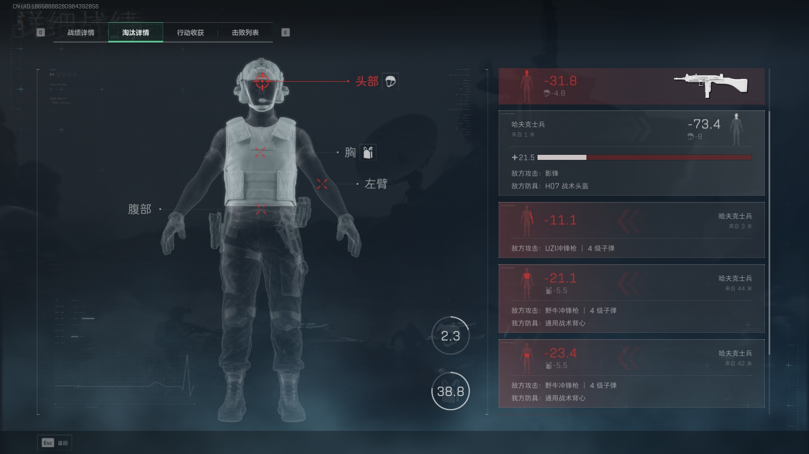

**全能沙雕王（光速滑跪版）** (2025-09-16 03:07:09):
一看就没见过钻石高端局，人机Uzi都是打的四蛋

**000** (2025-09-16 01:25:20):
<:emoji_139:1379455053080825866> <:08:1298281401715785789>

**卡顺密** (2025-09-15 23:32:14):
主要是这个屌游戏我舔个包都怕

**卡顺密** (2025-09-15 23:32:02):
我射击游戏常年铂金 灭个三队不是轻轻松松的

**卡顺密** (2025-09-15 23:31:18):
这才是我真正的实力

**卡顺密** (2025-09-15 23:31:13):
别逗我了<:emoji_146:1382329484035883068>

**晨** (2025-09-15 14:34:02):
有没有可能人机局了

**希波鹅拉底** (2025-09-15 12:27:17):
<:emoji_249:1416980128793104514> <:emoji_249:1416980128793104514> <:emoji_249:1416980128793104514> 
<:emoji_249:1416980114511761448> <:emoji_249:1416980128793104514> <:emoji_249:1416980114511761448> 
<:emoji_249:1416980128793104514> <:emoji_249:1416980128793104514> <:emoji_249:1416980128793104514>

**希波鹅拉底** (2025-09-15 12:26:59):
<:emoji_249:1416980128793104514> <:emoji_249:1416980114511761448> <:emoji_249:1416980128793104514> 
<:emoji_249:1416980114511761448> <:emoji_249:1416980128793104514> <:emoji_249:1416980114511761448> 
<:emoji_249:1416980128793104514> <:emoji_249:1416980114511761448> <:emoji_249:1416980128793104514>

**希波鹅拉底** (2025-09-15 12:26:37):
<:emoji_249:1416980114511761448> <:emoji_249:1416980128793104514> <:emoji_249:1416980114511761448> 
<:emoji_249:1416980128793104514> <:emoji_249:1416980114511761448> <:emoji_249:1416980128793104514> 
<:emoji_249:1416980114511761448> <:emoji_249:1416980128793104514> <:emoji_249:1416980114511761448>

**希波鹅拉底** (2025-09-15 12:26:22):
<:emoji_249:1416980114511761448> <:emoji_249:1416980114511761448> <:emoji_249:1416980114511761448> 
<:emoji_249:1416980114511761448> <:emoji_249:1416980128793104514> <:emoji_249:1416980114511761448> 
<:emoji_249:1416980114511761448> <:emoji_249:1416980114511761448> <:emoji_249:1416980114511761448>

**希波鹅拉底** (2025-09-15 12:26:09):
难绷

**大爱仙尊** (2025-09-15 09:13:21):
🤨

**羊驼** (2025-09-15 09:07:39):
<:1000168531:1298906724979310634>

**羊驼** (2025-09-15 09:07:36):
外出

**羊驼** (2025-09-15 09:07:31):
吃饭

**卡顺密** (2025-09-15 09:07:14):
来

**羊驼** (2025-09-15 09:06:55):
<:07:1298281204260278383>

**000** (2025-09-15 08:08:54):
<:emoji_139:1379455053080825866> <:emoji_147:1382565790129328128> <:07:1298281204260278383> <:emoji_100:1379103461014241370>

**卡顺密** (2025-09-15 08:05:08):

**卡顺密** (2025-09-15 08:05:06):
大坝灭了三队

**卡顺密** (2025-09-15 08:05:00):
脑子突然通了

**卡顺密** (2025-09-15 08:04:54):
连跪十几把

**羊驼** (2025-09-15 08:02:28):
<:emoji_249:1416980114511761448> <:emoji_249:1416980114511761448> <:emoji_249:1416980114511761448> 
<:emoji_249:1416980114511761448> <:emoji_249:1416980128793104514> <:emoji_249:1416980114511761448> 
<:emoji_249:1416980114511761448> <:emoji_249:1416980114511761448> <:emoji_249:1416980114511761448>

**000** (2025-09-15 05:04:19):
<:emoji_249:1416980128793104514> <:emoji_249:1416980128793104514> <:emoji_249:1416980128793104514> 
<:emoji_249:1416980128793104514> <:emoji_249:1416980114511761448> <:emoji_249:1416980128793104514> 
<:emoji_249:1416980128793104514> <:emoji_249:1416980128793104514> <:emoji_249:1416980128793104514>

**哈哈** (2025-09-15 03:28:06):
<:sb_1:1073221244280913950>

**大爱仙尊** (2025-09-15 03:27:25):
<:emoji_249:1416980128793104514> <:emoji_249:1416980128793104514> <:emoji_249:1416980128793104514> 
<:emoji_249:1416980128793104514> <:emoji_249:1416980114511761448> <:emoji_249:1416980128793104514> 
<:emoji_249:1416980128793104514> <:emoji_249:1416980128793104514> <:emoji_249:1416980128793104514>

**Mr.Koalefant** (2025-09-15 03:26:59):
<:emoji_249:1416980114511761448> <:emoji_249:1416980114511761448> <:emoji_249:1416980114511761448> 
<:emoji_249:1416980114511761448> <:emoji_249:1416980128793104514> <:emoji_249:1416980114511761448> 
<:emoji_249:1416980114511761448> <:emoji_249:1416980114511761448> <:emoji_249:1416980114511761448>

**哈哈** (2025-09-15 02:50:41):
<a:o0:1206214135789002752>

**大爱仙尊** (2025-09-15 02:45:33):
<:emoji_140:1379454014852436038>

**沐 云曦** (2025-09-14 22:50:44):
反对冷暴力，反对牛牛不怕困难

**卡顺密** (2025-09-14 22:15:15):
和鬼游戏有什么差别

**卡顺密** (2025-09-14 22:11:26):

**卡顺密** (2025-09-14 22:11:23):
活鸡毛 跳了
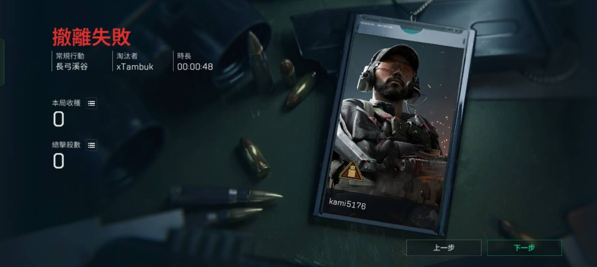

**羊驼** (2025-09-14 19:23:36):
<:emoji_139:1379455053080825866>

**晨** (2025-09-14 16:41:45):
拉了等一分钟

**晨** (2025-09-14 16:41:35):
你要去那个车站的拉闸点

**希波鹅拉底** (2025-09-14 15:04:14):
抖M

**哈哈** (2025-09-14 14:55:29):
<:sb_2:1073222172123869196>

**大爱仙尊** (2025-09-14 14:41:26):
算了，没人理我，累了，睡了<:1000168518:1298906830864519231>

**卡顺密** (2025-09-14 11:46:22):
<:emoji_146:1382329484035883068>

**卡顺密** (2025-09-14 11:46:15):
<@1303142548377960448> 第2张地图那个火车箱子怎么开 我没找到门进去

**羊驼** (2025-09-14 11:44:50):
我都可以？

**卡顺密** (2025-09-14 11:44:39):
明天打 我有点红了

**羊驼** (2025-09-14 11:43:51):
<:emoji_168:1409564661380288633>

**羊驼** (2025-09-14 11:43:47):
操作面板好怪

**羊驼** (2025-09-14 11:43:29):
<:emoji_139:1379455053080825866>

**卡顺密** (2025-09-14 11:40:33):
两张卷打水漂

**卡顺密** (2025-09-14 11:40:25):
装备太好进不去

**卡顺密** (2025-09-14 11:40:05):
😡

**羊驼** (2025-09-14 11:39:49):
下载好了

**哈哈** (2025-09-14 11:21:13):
姆

**哈哈** (2025-09-14 11:21:12):
姆

**哈哈** (2025-09-14 11:21:11):
阿

**Mr.Koalefant** (2025-09-14 11:18:39):
姆
姆
姆

**卡顺密** (2025-09-14 11:03:37):
什么新手

**羊驼** (2025-09-14 11:03:11):
任务

**羊驼** (2025-09-14 10:58:19):
有新手吗

**卡顺密** (2025-09-14 10:50:00):
<:emoji_247:1416067027264868483>

**卡顺密** (2025-09-14 10:49:56):
我总感觉慌慌的

**卡顺密** (2025-09-14 10:49:49):
<@929772344984084490> 来打一把溪谷

**大爱仙尊** (2025-09-14 06:17:48):
水一下

**晨** (2025-09-14 02:54:52):
三组也可以

**晨** (2025-09-14 02:54:48):
不算弹夹内的四组足够了

**晨** (2025-09-14 02:54:17):
低价m4

**晨** (2025-09-14 02:53:42):
金丹泼水m7，m14

**晨** (2025-09-14 02:53:23):
性价比之选腾龙

**卡顺密** (2025-09-14 02:50:16):
子弹要带多少啊我总感觉我不够用

**卡顺密** (2025-09-14 02:49:58):
枪

**卡顺密** (2025-09-14 00:59:47):
<:emoji_15:1406355558730039346>

**卡顺密** (2025-09-14 00:59:11):
舒服了

**卡顺密** (2025-09-14 00:59:07):
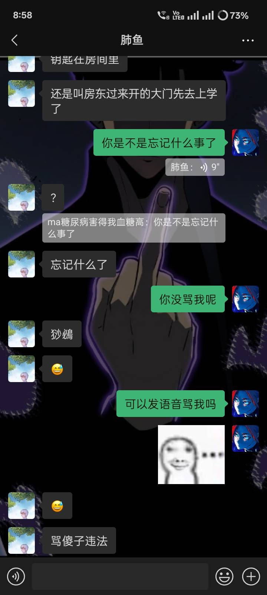

**卡顺密** (2025-09-14 00:55:29):
<:emoji_247:1416067027264868483>

**卡顺密** (2025-09-14 00:55:22):
原来不是骂我啊（失望）

**卡顺密** (2025-09-14 00:55:18):
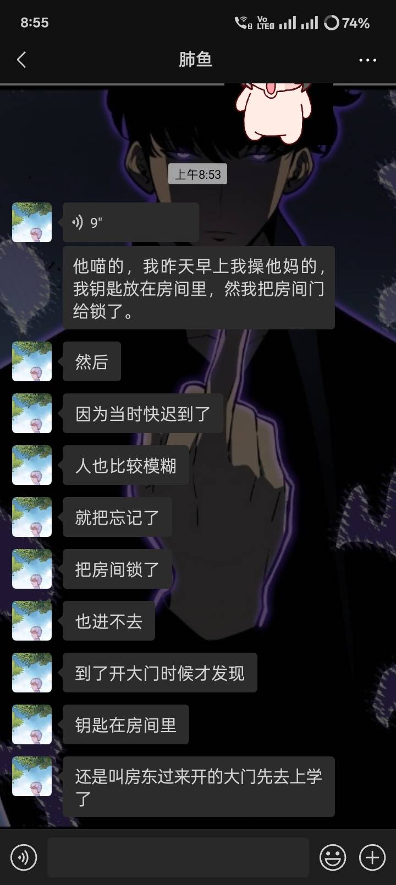

**卡顺密** (2025-09-14 00:54:21):
<:emoji_247:1416067027264868483>

**卡顺密** (2025-09-14 00:54:19):
不敢点开

**卡顺密** (2025-09-14 00:54:06):
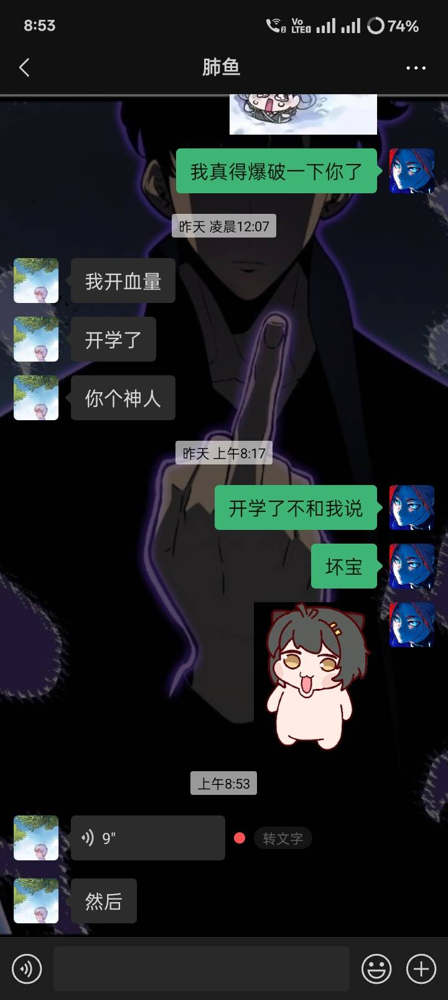

**沐 云曦** (2025-09-13 21:57:44):
反对冷，反对爆，反对力

**哈哈** (2025-09-13 17:11:09):
<:emoji_136:1381162107424215091>

**羊驼** (2025-09-13 17:01:14):
<:08:1298281401715785789>

**羊驼** (2025-09-13 17:01:11):
哈哈哈哈哈

**哈哈** (2025-09-13 16:15:34):
<a:Hifumi_Yes:1117326403558453258>

**晨** (2025-09-13 16:10:14):
字面意思

**晨** (2025-09-13 16:10:10):
队友是人机啊

**晨** (2025-09-13 16:09:28):
？

**任白** (2025-09-13 14:20:21):
儿子确实像爸爸

**任白** (2025-09-13 14:18:50):
正确的

**哈哈** (2025-09-13 13:29:30):
<:dsdPopcorn:1003582275717431306>

**哈哈** (2025-09-13 13:29:28):
2042 r?

**卡顺密** (2025-09-13 12:46:56):
<:emoji_247:1416067027264868483>

**卡顺密** (2025-09-13 12:46:53):
不和我打点缩在龟壳里面到底在干什么

**卡顺密** (2025-09-13 12:46:41):
对面看到我尿都吓漏两滴

**卡顺密** (2025-09-13 12:46:08):
101个人头都救不了他们这群废物

**卡顺密** (2025-09-13 12:45:59):
我吃柠檬

**卡顺密** (2025-09-13 12:45:57):
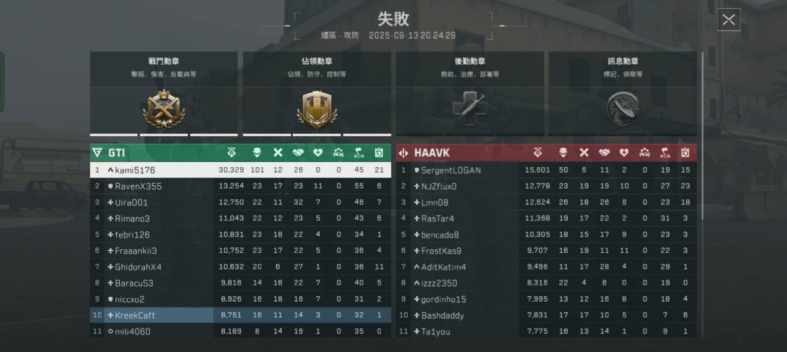

**哈哈** (2025-09-13 11:50:18):
<:dsdPopcorn:1003582275717431306>

**羊驼** (2025-09-13 11:48:00):
<:emoji_149:1382434166666432674>

**卡顺密** (2025-09-13 11:01:04):
没得选

**Mr.Koalefant** (2025-09-13 10:53:15):
呃啊！
无情铁锁
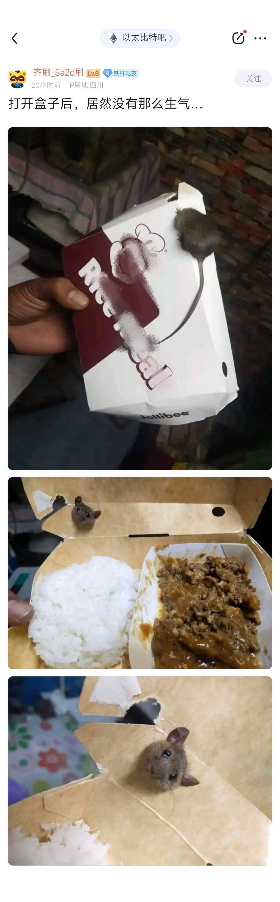

**羊驼** (2025-09-13 08:55:33):
哪个服？

**羊驼** (2025-09-13 08:55:19):
<:1000168531:1298906724979310634>

**哈哈** (2025-09-13 08:48:29):
<:BaiWhat:919176468511207504>

**任白** (2025-09-13 08:47:17):
鸡把

**卡顺密** (2025-09-13 08:35:11):
现在哪把最吊

**卡顺密** (2025-09-13 08:34:51):
<:emoji_133:1379494883227734157>

**卡顺密** (2025-09-13 08:34:45):
<@1303142548377960448>

**任白** (2025-09-13 07:59:55):
你不说其实我也知道

**任白** (2025-09-13 07:59:49):
确实蠢

**任白** (2025-09-13 07:59:46):
是的

**卡顺密** (2025-09-13 07:59:41):
我蹲着个屁股倒退出门

**卡顺密** (2025-09-13 07:59:26):
但是看不到

**卡顺密** (2025-09-13 07:59:23):
队友让回去

**卡顺密** (2025-09-13 07:59:17):
想救队友的

**卡顺密** (2025-09-13 07:59:11):
往门口扔了个烟

**卡顺密** (2025-09-13 07:59:05):
不过我那波确实蠢

**任白** (2025-09-13 07:58:50):
我也来侮辱一下

**卡顺密** (2025-09-13 07:47:44):
<:emoji_133:1379494883227734157>

**卡顺密** (2025-09-13 07:47:36):
还被队友侮辱了

**卡顺密** (2025-09-13 07:47:31):
这下真的什么都没了

**哈哈** (2025-09-13 07:28:36):
<:SadgePray:1090017573166395524>

**卡顺密** (2025-09-13 07:20:50):
<@929772344984084490> 快救我

**卡顺密** (2025-09-13 07:20:37):
一毛都没了

**卡顺密** (2025-09-13 07:20:27):
<:emoji_133:1379494883227734157>

**哈哈** (2025-09-13 06:03:56):
<:sb_1:1073221244280913950>

**沐 云曦** (2025-09-13 01:55:36):
反对冷暴力

**卡顺密** (2025-09-13 00:40:10):
扣一核弹给你当嫁妆

**卡顺密** (2025-09-13 00:39:52):
<@929772344984084490> 国际服是繁体中文唉，你看得懂吗

**哈哈** (2025-09-12 16:45:22):
怎麼變成2077的某位了R ww

**晨** (2025-09-12 16:02:52):
鹅鸭杀联动，明日杀机联动

**晨** (2025-09-12 16:02:40):
方舟联动皮肤

**晨** (2025-09-12 16:02:09):
周年庆有限时点券

**晨** (2025-09-12 16:02:02):
马上s6更新

**羊驼** (2025-09-12 12:12:31):
<:1000168531:1298906724979310634>

**羊驼** (2025-09-12 12:12:28):
我不知道

**卡顺密** (2025-09-12 11:49:56):
<:16:1298294503530041404>

**卡顺密** (2025-09-12 11:49:47):
现在入能拿到什么福利

**卡顺密** (2025-09-12 11:49:29):
州！

**羊驼** (2025-09-12 11:49:11):
州？

**卡顺密** (2025-09-12 11:45:32):
我王朝日常还没清

**卡顺密** (2025-09-12 11:45:25):
国际服 我等明天再下好了

**羊驼** (2025-09-12 11:40:35):
<:emoji_139:1379455053080825866>

**羊驼** (2025-09-12 11:40:30):
你的意思是

**沐 云曦** (2025-09-12 11:35:45):
亲亲mua

**卡顺密** (2025-09-12 11:34:43):
<:emoji_138:1379504935942488175>

**卡顺密** (2025-09-12 11:34:35):
你知道吗 搜打撤啊 不和朋友玩那就没有意义

**羊驼** (2025-09-12 11:33:11):
<:07:1298281204260278383>

**羊驼** (2025-09-12 11:33:09):
玩呗

**羊驼** (2025-09-12 11:32:58):
<:emoji_139:1379455053080825866>

**卡顺密** (2025-09-12 11:29:40):
<:emoji_138:1379504935942488175>

**卡顺密** (2025-09-12 11:29:21):
怎么办呢

**卡顺密** (2025-09-12 11:29:16):
我有点想玩三字搜打撤游戏啊

**卡顺密** (2025-09-12 11:29:00):
<@929772344984084490>

**羊驼** (2025-09-12 07:41:16):
<:emoji_147:1382565790129328128> <:1000168521:1298906817585352716>

**希波鹅拉底** (2025-09-12 06:12:38):


**希波鹅拉底** (2025-09-12 06:12:20):


**卡顺密** (2025-09-12 06:12:15):
不是这个😡

**希波鹅拉底** (2025-09-12 06:11:57):


**卡顺密** (2025-09-12 06:11:48):
有没有那个表情 这个绿毛摊手无奈的

**卡顺密** (2025-09-12 06:11:01):
<:emoji_144:1379862366866641060>

**卡顺密** (2025-09-12 06:10:58):
B站太恶毒了

**卡顺密** (2025-09-12 06:10:48):
今天晚上睡不着了

**卡顺密** (2025-09-12 06:10:45):
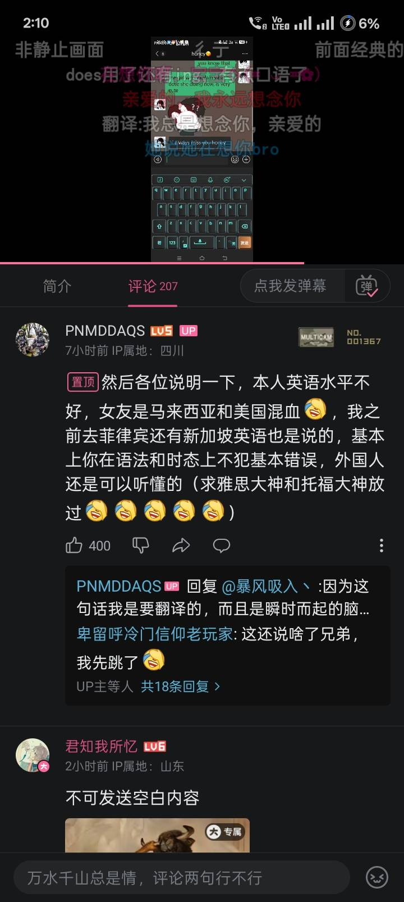

**卡顺密** (2025-09-12 06:10:17):
多么想要躺在你怀里

**希波鹅拉底** (2025-09-12 06:10:11):
<:emoji_250:1415636290396880989>

**卡顺密** (2025-09-12 06:10:01):
想念变成空气在叹息

**大爱仙尊** (2025-09-12 05:15:28):
反对羊驼的羊驼名字，还是old名字有文采😋

**卡顺密** (2025-09-12 02:11:46):
<:emoji_15:1406355558730039346>

**卡顺密** (2025-09-12 02:11:44):
最近刚把2077打通

**卡顺密** (2025-09-12 02:11:33):
总感觉一股2077味

**卡顺密** (2025-09-12 02:11:13):
想玩三角洲了

**希波鹅拉底** (2025-09-12 00:37:29):
<:1000168518:1298906830864519231>

**沐 云曦** (2025-09-12 00:00:35):
亲亲mua

**哈哈** (2025-09-11 23:38:54):
<:dsdPopcorn:1003582275717431306>

**羊驼** (2025-09-11 22:19:52):
反对冷暴力

**羊驼** (2025-09-11 22:19:46):
<:emoji_140:1379454014852436038>

**羊驼** (2025-09-11 22:19:43):
错字可爱

**沐 云曦** (2025-09-11 20:42:56):
但对冷暴力

**哈哈** (2025-09-11 16:34:21):
<:sb_2:1073222172123869196>

**大爱仙尊** (2025-09-11 15:01:31):
<:1000168518:1298906830864519231>

**大爱仙尊** (2025-09-11 15:01:29):
水一下
没有人，那我就睡了💤

**希波鹅拉底** (2025-09-11 14:18:33):
<:emoji_166:1409564556841324565>

**羊驼** (2025-09-11 11:18:06):
<:emoji_144:1379454084750245939>

**羊驼** (2025-09-11 11:18:03):
好久不见

**羊驼** (2025-09-11 11:17:53):
<:emoji_144:1379454084750245939>

**哈哈** (2025-09-11 11:16:49):
<:emoji_136:1381162107424215091>

**卡顺密** (2025-09-11 10:57:13):
<:emoji_144:1379862366866641060>

**卡顺密** (2025-09-11 10:57:04):
什么傻逼名字

**卡顺密** (2025-09-11 10:56:22):
<:emoji_144:1379862366866641060>

**大爱仙尊** (2025-09-11 10:56:01):
嘻嘻，高兴了😋 <:emoji_250:1415636290396880989>

**沐 云曦** (2025-09-11 07:37:08):
亲亲mua

**大爱仙尊** (2025-09-11 05:22:55):
<:emoji_150:1393302061453672520>

**大爱仙尊** (2025-09-11 05:22:46):
反对🦌

**大爱仙尊** (2025-09-11 05:22:33):
<:emoji_150:1395081181682339890>

**大爱仙尊** (2025-09-11 05:22:27):
反对<:emoji_149:1400299483212021833>

**大爱仙尊** (2025-09-11 05:19:26):
<:emoji_148:1401974973748346921>

**大爱仙尊** (2025-09-11 05:19:22):
反对<:emoji_249:1414447100321726494>

**希波鹅拉底** (2025-09-11 04:40:08):
<:emoji_142:1379854822315921438>

**希波鹅拉底** (2025-09-11 04:40:06):
全是裙带关系

**希波鹅拉底** (2025-09-11 04:39:48):
<:emoji_250:1414875758144393317>

**沐 云曦** (2025-09-11 04:35:37):
亲亲mua

**Mr.Koalefant** (2025-09-11 03:05:06):
rua鼠鼠

**沐 云曦** (2025-09-10 21:56:24):
反对冷暴力

**晨** (2025-09-10 21:06:46):
<:emoji_149:1382434166666432674> 为什么不回@

**任白** (2025-09-10 19:57:27):
反对我老婆？

**哈哈** (2025-09-10 14:04:13):
<:LunaO_O:1129462010585812993>

**希波鹅拉底** (2025-09-10 14:00:29):
<:daroubangqingnichi:1411320597241139260>

**希波鹅拉底** (2025-09-10 14:00:25):
你是个🥚

**希波鹅拉底** (2025-09-10 14:00:18):
反对kami

**卡顺密** (2025-09-10 13:17:28):
<:emoji_147:1389290919781470348>

**卡顺密** (2025-09-10 13:17:15):
你再说一遍

**希波鹅拉底** (2025-09-10 13:15:01):
反对哈哈

**哈哈** (2025-09-10 12:00:05):
<:3_:1134073260183670895>

**沐 云曦** (2025-09-10 11:05:43):
反对冷暴力

**哈哈** (2025-09-09 10:39:34):
<a:o0:1206214135789002752>

**羊驼** (2025-09-09 10:38:59):
<:emoji_149:1400299483212021833>

**大爱仙尊** (2025-09-09 05:31:05):
🦌

**哈哈** (2025-09-08 17:29:27):
<:Zzul_gilda:1154375118374576168>

**晨** (2025-09-08 16:52:56):
<:emoji_83:1378946142330683422>

**哈哈** (2025-09-08 14:10:18):
<:EunhaIDK:1352842231433658468>

**哈哈** (2025-09-08 14:10:14):
<:Ina_1:865509148099739668>

**哈哈** (2025-09-08 14:10:10):
<:3_:1134073260183670895>

**羊驼** (2025-09-08 13:05:31):
<:emoji_109:1379109561679478837>

**哈哈** (2025-09-08 12:09:15):
歐 你改回來了?!

**哈哈** (2025-09-08 12:08:57):
<:BaiWhat:919176468511207504>

**哈哈** (2025-09-08 12:08:54):
反对冷暴力

**羊驼** (2025-09-08 12:04:45):
<:emoji_150:1400299501423431771>

**羊驼** (2025-09-08 12:04:36):
反对冷暴力

**沐 云曦** (2025-09-08 04:38:45):
反对冷暴力

**羊驼** (2025-09-07 14:57:36):
<:1000168510:1298906820638674984>

**哈哈** (2025-09-07 14:51:53):
<:BaiWhat:919176468511207504>

**大爱仙尊** (2025-09-07 14:11:56):
<:1000168518:1298906830864519231>

**大爱仙尊** (2025-09-07 14:11:53):
偷偷在这撸一发

**卡顺密** (2025-09-07 13:15:07):
那一个是不是没了

**哈哈** (2025-09-07 13:14:10):
<a:Hifumi_Yes:1117326403558453258>

**哈哈** (2025-09-07 13:14:08):
遲早有一天

**Mr.Koalefant** (2025-09-07 02:05:17):
好久没见鼠鼠了
呜呜呜

**晨** (2025-09-06 20:52:10):
<:emoji_144:1379454084750245939>

**晨** (2025-09-06 20:52:08):
我等了三天没出来了

**晨** (2025-09-06 20:51:58):
不会

**羊驼** (2025-09-06 20:45:14):
<:emoji_142:1383709378925826159>

**哈哈** (2025-09-06 18:27:36):
你@他就會出現了(??

**哈哈** (2025-09-06 18:26:51):
<a:bocchioverload:1068187342835306516>

**哈哈** (2025-09-06 18:26:47):
鼠鼠呢

**沐 云曦** (2025-09-06 18:00:20):
那亲亲你mua

**羊驼** (2025-09-06 12:55:17):
<:emoji_140:1379454014852436038> <:emoji_140:1379454014852436038>

**希波鹅拉底** (2025-09-06 12:54:01):
给你一拳

**希波鹅拉底** (2025-09-06 12:53:58):
<:emoji_89:1378950692655464492>

**希波鹅拉底** (2025-09-06 12:53:53):
你这个狗不理包子

**希波鹅拉底** (2025-09-06 12:53:38):
不理就不理

**希波鹅拉底** (2025-09-06 12:53:33):
<:emoji_142:1379854822315921438>

**沐 云曦** (2025-09-06 10:46:44):
啧，不理你了

**希波鹅拉底** (2025-09-06 10:46:21):
你这个臭东西

**希波鹅拉底** (2025-09-06 10:46:14):
<:emoji_195:1409567418526859426>

**希波鹅拉底** (2025-09-06 10:46:03):
那你做成新奥尔良烤鸡、东安鸡、白切鸡

**希波鹅拉底** (2025-09-06 10:45:19):
<:emoji_147:1379454167302537256>

**沐 云曦** (2025-09-06 10:32:43):
到时候你的小腿腿是长在身上还是在别人肚子里面就不好说来哼哼

**沐 云曦** (2025-09-06 10:32:12):
当心把你变成烤鹅

**沐 云曦** (2025-09-06 10:31:51):
你是鹅

**希波鹅拉底** (2025-09-06 10:31:43):
<:emoji_139:1379453980375257159>

**希波鹅拉底** (2025-09-06 10:31:33):
你是鸡嘛

**哈哈** (2025-09-06 10:16:37):
<:AnnaShy:960534438645756047> <:iiiiiiiii:1118825625407475742>

**沐 云曦** (2025-09-06 10:10:28):
亲亲mua

**沐 云曦** (2025-09-06 10:10:21):
咯咯咯

**希波鹅拉底** (2025-09-06 08:52:32):
打死你

**哈哈** (2025-09-06 07:21:09):
<:dsdPopcorn:1003582275717431306>

**沐 云曦** (2025-09-06 06:53:12):
亲亲mua

**沐 云曦** (2025-09-06 06:53:01):
禁止欺负人，反对冷暴力

**沐 云曦** (2025-09-06 06:52:45):
亲亲，mua

**卡顺密** (2025-09-06 04:34:21):
<:emoji_144:1379454084750245939>

**卡顺密** (2025-09-06 04:34:16):
百灵鸟啊，我的百灵鸟

**crzwz** (2025-09-06 01:48:23):
鹅先生

**羊驼** (2025-09-05 20:08:52):
<:emoji_133:1379494883227734157>

**希波鹅拉底** (2025-09-05 20:08:32):
<:emoji_142:1379854822315921438>

**希波鹅拉底** (2025-09-05 20:08:30):
那连着你一起打死

**羊驼** (2025-09-05 20:03:07):
<:emoji_149:1382434166666432674>

**羊驼** (2025-09-05 20:02:58):
禁止欺负沐老师

**希波鹅拉底** (2025-09-05 19:41:49):
我就放过你

**希波鹅拉底** (2025-09-05 19:41:46):
或者你叫我老大

**希波鹅拉底** (2025-09-05 19:41:41):
那我打死你<:emoji_142:1379854822315921438>

**沐 云曦** (2025-09-05 18:32:00):
哼，我没有错

**哈哈** (2025-09-05 16:53:11):
~~你說的目前修養身心中~~

**哈哈** (2025-09-05 16:52:53):
<:3_:1134073260183670895>

**晨** (2025-09-05 15:34:20):
我老师呢！

**晨** (2025-09-05 15:34:11):
老师呢

**希波鹅拉底** (2025-09-05 14:18:36):
<:emoji_142:1379854822315921438>

**希波鹅拉底** (2025-09-05 14:18:33):
错哪了

**沐 云曦** (2025-09-05 12:43:36):
不要呀，我错了

**希波鹅拉底** (2025-09-05 12:42:53):
掐死你

**希波鹅拉底** (2025-09-05 12:42:48):
<:emoji_142:1379854822315921438>

**希波鹅拉底** (2025-09-05 12:42:46):
那你滚吧

**沐 云曦** (2025-09-05 12:38:40):
我要比中指了哦

**沐 云曦** (2025-09-05 12:38:26):
痛唉

**希波鹅拉底** (2025-09-05 12:35:16):
掐你

**希波鹅拉底** (2025-09-05 12:35:10):
可爱捏

**希波鹅拉底** (2025-09-05 12:35:07):
<:emoji_149:1400309607783727266>

**沐 云曦** (2025-09-05 12:33:28):
亲亲mua

**羊驼** (2025-09-05 09:41:20):
反对冷暴力，反对浪费

**希波鹅拉底** (2025-09-05 08:51:30):
笨比

**希波鹅拉底** (2025-09-05 08:51:28):
字都打错了

**哈哈** (2025-09-05 05:52:17):
<:EunhaIDK:1352842231433658468>

**沐 云曦** (2025-09-05 00:20:41):
但对冷暴力，反对浪费

**羊驼** (2025-09-04 21:57:27):
<:emoji_142:1383709378925826159>

**晨** (2025-09-04 21:47:20):
冒个泡啊

**晨** (2025-09-04 21:47:17):
老师呢

**晨** (2025-09-04 21:47:13):
<:1000168516:1298906851848486942>

**羊驼** (2025-09-03 20:49:51):
<:1000168510:1298906820638674984>

**哈哈** (2025-09-03 17:50:34):
<:1000168510:1298906820638674984> <:BaiWhat:919176468511207504>

**卡顺密** (2025-09-03 17:38:42):
<:emoji_247:1412548742757748777>

**卡顺密** (2025-09-03 17:38:34):
痒的我睡不着

**希波鹅拉底** (2025-09-03 00:08:46):
砍死你

**羊驼** (2025-09-02 21:57:53):
<:emoji_149:1382434166666432674>

**哈哈** (2025-09-02 18:58:40):
<:BaiWhat:919176468511207504>

**卡顺密** (2025-09-02 18:54:07):
<:16:1298294503530041404>

**卡顺密** (2025-09-02 18:53:53):
好他妈痒啊

**羊驼** (2025-09-02 14:33:24):
🤤

**Mr.Koalefant** (2025-09-02 04:52:16):
鹅，鹅，鹅，曲项向天歌，白毛浮绿水，红烧炖大鹅

**crzwz** (2025-09-01 21:00:25):
支持鹅先生吉吉

**希波鹅拉底** (2025-09-01 09:00:53):
杂草的

**希波鹅拉底** (2025-09-01 09:00:48):
<:emoji_142:1379854822315921438>

**Mr.Koalefant** (2025-09-01 06:11:01):
我怕了，我将永远支持烤乳鹅

**哈哈** (2025-09-01 04:47:26):
<:emoji_6:1021359813285920828>

**卡顺密** (2025-09-01 02:21:19):
<:16:1298294503530041404>

**卡顺密** (2025-09-01 02:20:51):
左手红斑 脚底红红的

**卡顺密** (2025-09-01 02:20:19):
不知道被什麼給咬了

**卡顺密** (2025-09-01 02:20:01):
這個傻逼鍵盤 服了

**晨** (2025-09-01 02:12:51):
？

**卡顺密** (2025-09-01 02:08:41):
🐴的

**crzwz** (2025-09-01 01:28:43):
打到其他一切动物

**crzwz** (2025-09-01 01:28:35):
支持鹅先生

**crzwz** (2025-09-01 01:28:31):
我错了

**crzwz** (2025-09-01 01:28:30):
鹅先生

**crzwz** (2025-09-01 01:28:28):
呜呜

**希波鹅拉底** (2025-08-31 22:16:21):
<:emoji_147:1380400101633167411>

**希波鹅拉底** (2025-08-31 22:16:15):
咬死哈哈

**希波鹅拉底** (2025-08-31 22:15:54):
<:emoji_142:1379854822315921438>

**希波鹅拉底** (2025-08-31 22:15:52):
而是我删了你

**希波鹅拉底** (2025-08-31 22:15:46):
当然我的意思不是要你删消息

**希波鹅拉底** (2025-08-31 22:15:27):
删了

**希波鹅拉底** (2025-08-31 22:15:19):
再掐死你

**希波鹅拉底** (2025-08-31 22:15:16):
捅死你

**希波鹅拉底** (2025-08-31 22:15:09):
他妈的忍不了了

**希波鹅拉底** (2025-08-31 22:14:51):
QQ内内好喝到咩噗茶

**Mr.Koalefant** (2025-08-31 10:59:53):
<:20:1298294514124984323>

**哈哈** (2025-08-31 10:48:20):
<:sb_9:1090528279292805130> <a:o0:1206214135789002752>

**羊驼** (2025-08-31 09:54:55):
可爱

**羊驼** (2025-08-31 09:54:52):
摸摸

**哈哈** (2025-08-31 09:24:26):
<:sb_9:1090528279292805130>

**哈哈** (2025-08-31 09:24:23):
不是動物的我

**羊驼** (2025-08-31 09:16:57):
<:IMG_0144:1409620009742893258>

**羊驼** (2025-08-31 09:16:46):
<:emoji_144:1379454084750245939>

**羊驼** (2025-08-31 09:16:41):
为什么反对我

**晨** (2025-08-31 05:13:21):
对鹅哈啊

**晨** (2025-08-31 05:13:15):
<:emoji_212:1410731465586507837>

**crzwz** (2025-08-31 05:11:25):
<:emoji_148:1382329938404839586> <:emoji_148:1382329938404839586>

**晨** (2025-08-31 05:11:13):
<:emoji_149:1382434166666432674> 那我@鹅先生呢

**crzwz** (2025-08-31 05:09:19):
反对大鹅，反对羊驼，反对除了姆姆兽以外的动物

**crzwz** (2025-08-31 05:09:15):
签到

**哈哈** (2025-08-31 04:36:04):
<:dsdPopcorn:1003582275717431306>

**晨** (2025-08-31 03:12:09):
姆！

**Mr.Koalefant** (2025-08-31 03:07:13):
反对大鹅，反对羊驼，反对除了姆姆兽以外的动物

**羊驼** (2025-08-31 01:33:07):
<:emoji_140:1379454014852436038>

**哈哈** (2025-08-31 01:04:01):
<:iiiiiiiii:1118825625407475742>

**羊驼** (2025-08-30 22:03:07):
<:emoji_136:1379504871027380274>

**羊驼** (2025-08-30 22:02:58):
可爱捏

**哈哈** (2025-08-30 17:22:45):
<a:Hifumi_Yes:1117326403558453258>

**晨** (2025-08-30 16:10:45):
<:emoji_88:1378950177255063633>

**哈哈** (2025-08-30 16:04:27):
qq內內好喝到咩噗茶

**辰** (2025-08-30 14:07:07):
好喝到qq内内忘记了

**羊驼** (2025-08-30 08:41:30):
<:1000168531:1298906724979310634>

**晨** (2025-08-30 05:05:15):
<:emoji_212:1410731465586507837>

**哈哈** (2025-08-30 05:03:00):
<a:Hifumi_Yes:1117326403558453258>

**哈哈** (2025-08-30 05:02:58):
沒拉 開玩笑的

**晨** (2025-08-30 05:00:37):
网警！

**哈哈** (2025-08-30 04:57:27):
https://tenor.com/view/%E8%AC%9B%E5%87%BA%E4%BE%86-gif-21981487

**哈哈** (2025-08-30 04:57:14):
<:ba_1:1090219942533677147>

**希波鹅拉底** (2025-08-30 03:31:20):
<:emoji_183:1409565093792059413>

**希波鹅拉底** (2025-08-30 03:31:09):
说出来会被王金打电话

**羊驼** (2025-08-29 23:26:12):
<:1000168531:1298906724979310634>

**羊驼** (2025-08-29 23:26:09):
反对什么？

**希波鹅拉底** (2025-08-29 23:00:38):
反对*****

**羊驼** (2025-08-29 21:48:09):
<:1000168531:1298906724979310634>

**羊驼** (2025-08-29 21:48:05):
撅呗

**crzwz** (2025-08-29 20:18:22):
反对不让我撅群友

**羊驼** (2025-08-29 18:40:02):
反对冷暴力，反对高温，反对紫外线，反对皮肤暴晒

**哈哈** (2025-08-29 18:28:57):
<a:Wanna_Hentai_HELL:1393901286365335572>

**沐 云曦** (2025-08-29 17:05:46):
反对冷暴力，反对高温，反对紫外线，反对皮肤暴晒

**羊驼** (2025-08-28 06:50:26):
<:emoji_132:1379388256113917993>

**羊驼** (2025-08-28 06:50:19):
安安

**卡顺密** (2025-08-28 06:47:42):
<:emoji_144:1379862366866641060>

**卡顺密** (2025-08-28 06:47:36):
感觉快死了

**卡顺密** (2025-08-28 06:47:32):
剧情过一半，先睡觉先

**卡顺密** (2025-08-28 06:47:25):
受不了了

**羊驼** (2025-08-28 06:46:32):
<:emoji_149:1382434166666432674>

**卡顺密** (2025-08-27 18:12:58):
<@1240985348943777816> 安息🙏

**哈哈** (2025-08-27 17:33:42):
<:dsdPopcorn:1003582275717431306>

**哈哈** (2025-08-27 17:33:40):
這裡的就很好看了R

**哈哈** (2025-08-27 17:33:25):
<:AnnaShy:960534438645756047>

**羊驼** (2025-08-27 17:28:44):

**羊驼** (2025-08-27 17:28:31):
但哈哈的表情包可爱

**羊驼** (2025-08-27 17:27:39):
嗯

**羊驼** (2025-08-27 17:27:35):
额

**哈哈** (2025-08-27 17:06:58):
這樣不是很麻煩嗎?w

**羊驼** (2025-08-27 15:53:58):

**晨** (2025-08-27 15:53:38):
天才！

**羊驼** (2025-08-27 15:50:15):

**哈哈** (2025-08-27 15:49:50):
<:3_:1134073260183670895>

**xi** (2025-08-27 15:20:11):
<:catsmile:1342644800612204615>

**羊驼** (2025-08-27 12:27:00):
摸摸

**羊驼** (2025-08-27 12:26:51):
<:emoji_92:1379090128496099410>

**羊驼** (2025-08-27 12:26:35):
那我这样是不是某种意义上可以用哈哈的表情包

**羊驼** (2025-08-27 12:25:58):
<:1000168510:1298906820638674984> ！

**羊驼** (2025-08-27 12:25:47):

**哈哈** (2025-08-27 12:09:41):
<:SadgePray:1090017573166395524>

**卡顺密** (2025-08-27 11:57:11):
没一个配得上我顶级保安

**卡顺密** (2025-08-27 11:57:06):
队友都是傻逼

**卡顺密** (2025-08-27 11:56:53):
我不玩了

**卡顺密** (2025-08-27 11:56:49):
<:emoji_115:1379113943817257071>

**哈哈** (2025-08-27 11:00:35):
<:dsdPopcorn:1003582275717431306>

**羊驼** (2025-08-27 10:50:18):
<:emoji_148:1382329938404839586>

**羊驼** (2025-08-27 10:50:14):
支持Gemini

**大爱仙尊** (2025-08-27 10:29:29):
<:emoji_148:1382329938404839586>

**大爱仙尊** (2025-08-27 10:29:27):
反对谷歌，支持Gemini

**羊驼** (2025-08-27 08:43:45):
门槛低了什么样的人都有

**羊驼** (2025-08-27 08:43:30):
毕竟是手游

**羊驼** (2025-08-27 08:43:14):
<:emoji_144:1379454111174496307>

**卡顺密** (2025-08-27 08:36:22):
<:18:1298294509389746197>

**卡顺密** (2025-08-27 08:36:08):
a我都清完了 傻逼解风愣是在中路死了 他死就死吧 他还带着包

**卡顺密** (2025-08-27 08:35:03):
拿个包往中路跑

**卡顺密** (2025-08-27 08:34:51):
你敢相信他们可以在你屁股后面蹲着 让你上去送死

**卡顺密** (2025-08-27 08:34:15):
我居然能遇到4个神人

**卡顺密** (2025-08-27 08:33:54):
<:18:1298294509389746197>

**卡顺密** (2025-08-27 08:33:40):
<@929772344984084490> 铂金局是什么狗都能打上的段位吗？

**crzwz** (2025-08-27 03:59:32):
签到

**卡顺密** (2025-08-27 03:20:04):
<:emoji_154:1407703394453422182>

**卡顺密** (2025-08-27 03:20:02):
根本带不动

**卡顺密** (2025-08-27 03:19:48):
差点被这群废物翻车

**卡顺密** (2025-08-27 03:19:42):
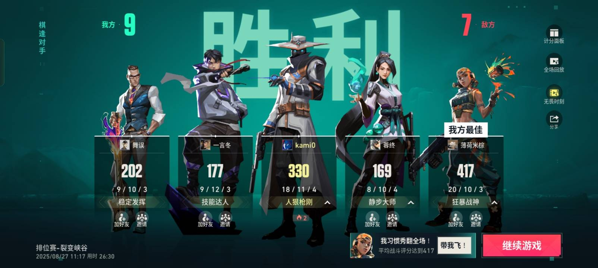

**羊驼** (2025-08-26 23:13:43):
<:1000168531:1298906724979310634>

**卡顺密** (2025-08-26 23:08:14):
<@1240985348943777816> 安息🙏

**哈哈** (2025-08-26 14:56:31):
<:dsdPopcorn:1003582275717431306>

**crzwz** (2025-08-26 14:26:36):
签到

**羊驼** (2025-08-26 09:32:13):
<:1000168531:1298906724979310634>

**羊驼** (2025-08-26 09:32:02):
<:emoji_148:1382329938404839586>

**羊驼** (2025-08-26 09:31:58):
反对反对gemini 支持cloude

**大爱仙尊** (2025-08-26 08:53:03):
<:emoji_148:1382329938404839586>

**大爱仙尊** (2025-08-26 08:52:59):
反对gemini 支持cloude

**卡顺密** (2025-08-26 08:34:06):
<:emoji_115:1379113943817257071>

**卡顺密** (2025-08-26 08:33:59):
我要玩暮蝶我要玩暮蝶我要玩暮蝶我要玩暮蝶我要玩暮蝶我要玩暮蝶我要玩暮蝶

**羊驼** (2025-08-26 08:22:39):
<:1000168512:1298906823851511901>

**卡顺密** (2025-08-26 00:37:15):
这回真卡铂金一了

**卡顺密** (2025-08-26 00:36:55):
<:emoji_154:1407703394453422182>

**卡顺密** (2025-08-26 00:36:50):
玩霓虹的真的是马都不要了

**羊驼** (2025-08-25 22:28:15):
这是

**羊驼** (2025-08-25 22:28:14):
嗯

**卡顺密** (2025-08-25 22:27:59):
有时候两面夹击真的很难受

**卡顺密** (2025-08-25 22:27:54):
主要是绊线就算被打烂我都能知道有没有人

**羊驼** (2025-08-25 22:27:40):
行

**羊驼** (2025-08-25 22:27:33):
哦～

**羊驼** (2025-08-25 22:27:08):
不知道是不是错觉

**羊驼** (2025-08-25 22:27:03):
手游保安的拌线好像很容易被看见诶

**卡顺密** (2025-08-25 22:26:55):
来打匹配，陪我练一下保安

**卡顺密** (2025-08-25 22:26:39):
<:emoji_15:1406355558730039346>

**卡顺密** (2025-08-25 22:26:34):
还是保安没脑

**羊驼** (2025-08-25 22:26:23):
<:1000168531:1298906724979310634>

**卡顺密** (2025-08-25 22:26:23):
主要是他的烟我都不知道要什么时候放

**羊驼** (2025-08-25 22:26:20):
没点熟练度会有点难受

**羊驼** (2025-08-25 22:26:00):
但被削弱过几次

**羊驼** (2025-08-25 22:25:56):
蝰蛇强的

**卡顺密** (2025-08-25 22:18:54):
我打算当保安

**卡顺密** (2025-08-25 22:18:50):
弱的要死，根本不适合我

**卡顺密** (2025-08-25 22:18:43):
<:emoji_154:1407703394453422182>

**卡顺密** (2025-08-25 22:18:26):
<@929772344984084490> 我不玩奎蛇了

**卡顺密** (2025-08-25 22:17:46):
<@1240985348943777816> 安息🙏

**卡顺密** (2025-08-25 22:16:41):
从今天开始干老本行

**卡顺密** (2025-08-25 22:16:36):
我确定了

**Mr.Koalefant** (2025-08-25 12:55:37):
<:emoji_147:1385908979460214866>

**大爱仙尊** (2025-08-25 12:34:29):
<:1000168510:1298906820638674984>

**羊驼** (2025-08-25 12:26:10):
<:1000168531:1298906724979310634>

**gg** (2025-08-25 12:23:57):
<:emoji_115:1379113943817257071>

**gg** (2025-08-25 12:23:48):
<@1240985348943777816> 想你了兄弟 能不能活一下

**gg** (2025-08-25 11:55:26):
必须出重拳

**gg** (2025-08-25 11:55:22):
这已经不是普通的变态了

**gg** (2025-08-25 11:54:04):
<:emoji_154:1407703394453422182>

**gg** (2025-08-25 11:53:59):
这是在诋毁我卡神


**羊驼** (2025-08-24 10:28:41):
<:20:1298294514124984323>

**希波鹅拉底** (2025-08-24 10:03:44):
<:20:1298294514124984323>

**羊驼** (2025-08-23 15:07:09):
<:1000168531:1298906724979310634>

**gg** (2025-08-23 09:32:41):
🙏

**gg** (2025-08-23 09:32:34):
安息

**羊驼** (2025-08-23 08:28:00):
<:1000168531:1298906724979310634>

**羊驼** (2025-08-23 08:27:54):
手游看着好不习惯呢

**卡顺密** (2025-08-22 22:38:46):

**卡顺密** (2025-08-22 22:38:41):
奥奥的丁

**卡顺密** (2025-08-22 22:38:39):


**羊驼** (2025-08-22 17:59:28):
<:emoji_148:1382329938404839586>

**羊驼** (2025-08-22 17:59:25):
反对你的反对

**哈哈** (2025-08-22 17:18:03):
<:BaiNO:1136693734583566357>

**crzwz** (2025-08-22 16:20:26):
签到

**卡顺密** (2025-08-22 12:12:53):
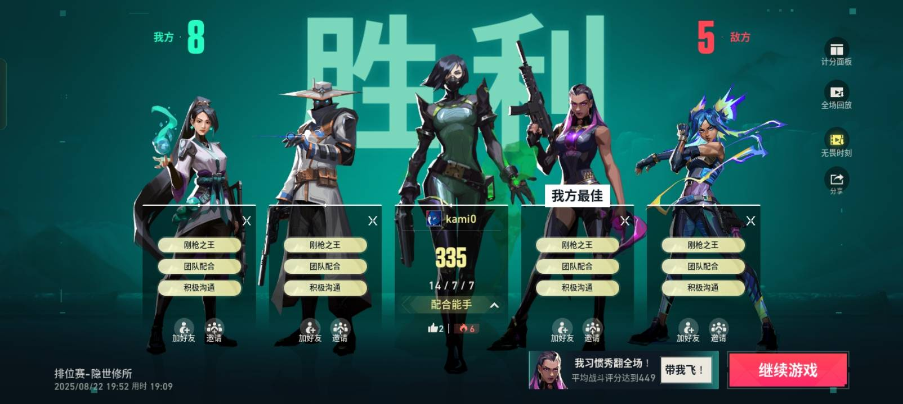


**卡顺密** (2025-08-22 12:12:51):
我的二爹 战神🙏

**大爱仙尊** (2025-08-22 12:10:09):
<:emoji_148:1382329938404839586>

**大爱仙尊** (2025-08-22 12:10:06):
反对H，反对NSFW，反对色情，反对黄

**大爱仙尊** (2025-08-22 12:09:22):
<:1000168510:1298906820638674984>

**卡顺密** (2025-08-22 10:36:58):
<:emoji_154:1407703394453422182> <:emoji_154:1407703394453422182> <:emoji_154:1407703394453422182>

**卡顺密** (2025-08-22 10:36:56):
拿几个人头给他狂的

**卡顺密** (2025-08-22 10:36:44):
天天压力队友

**羊驼** (2025-08-22 10:36:42):
<:emoji_9:1298282498454720564>

**卡顺密** (2025-08-22 10:36:37):
谁想和牢中的一起玩

**羊驼** (2025-08-22 10:36:31):
那就没办法了

**卡顺密** (2025-08-22 10:36:25):
<:emoji_154:1407703394453422182>

**羊驼** (2025-08-22 10:36:21):
<:emoji_9:1298282498454720564>

**卡顺密** (2025-08-22 10:36:21):
不然我早就玩别的区了

**卡顺密** (2025-08-22 10:36:15):
他只开国服啊

**羊驼** (2025-08-22 10:36:04):
欧服到可以

**羊驼** (2025-08-22 10:35:58):
<:emoji_115:1379113943817257071>

**卡顺密** (2025-08-22 10:34:38):
<:emoji_144:1379862366866641060>

**卡顺密** (2025-08-22 10:34:33):
你也太惨了

**羊驼** (2025-08-22 10:34:13):
<:emoji_115:1379113943817257071>

**羊驼** (2025-08-22 10:33:57):
卡

**卡顺密** (2025-08-22 10:20:18):
又怎么你了

**卡顺密** (2025-08-22 10:20:14):
<:emoji_142:1379854822315921438>

**羊驼** (2025-08-22 10:20:13):
<:emoji_9:1298282498454720564>

**羊驼** (2025-08-22 10:20:02):
那玩不了一点

**卡顺密** (2025-08-22 10:16:34):
<:emoji_15:1406355558730039346>

**卡顺密** (2025-08-22 10:16:30):
微信区

**卡顺密** (2025-08-22 10:16:26):
只有国服

**羊驼** (2025-08-22 10:16:20):
<:1000168531:1298906724979310634>

**羊驼** (2025-08-22 10:16:17):
欧服？

**卡顺密** (2025-08-22 10:15:31):
<:emoji_154:1407703394453422182>

**卡顺密** (2025-08-22 10:15:28):
那快来陪我

**羊驼** (2025-08-22 10:15:16):
<:1000168531:1298906724979310634>

**羊驼** (2025-08-22 10:15:13):
看着确实像

**卡顺密** (2025-08-22 10:14:56):
这你又不懂了 被pc的说我们手游都是人机

**卡顺密** (2025-08-22 10:14:33):
<:emoji_154:1407703394453422182>

**卡顺密** (2025-08-22 10:14:31):
你给我放侦察箭

**羊驼** (2025-08-22 10:14:17):
<:emoji_140:1379625753741623416>

**羊驼** (2025-08-22 10:14:10):
找我不如找路人

**羊驼** (2025-08-22 10:13:56):
并且我就一青铜

**卡顺密** (2025-08-22 10:13:55):
都被pc的骂给小孩玩的了

**卡顺密** (2025-08-22 10:13:43):
<:emoji_154:1407703394453422182>

**卡顺密** (2025-08-22 10:13:42):
手游很好操作的

**羊驼** (2025-08-22 10:13:24):
<:emoji_118:1379114000570126449>

**卡顺密** (2025-08-22 10:13:22):
<:emoji_133:1379494883227734157>

**羊驼** (2025-08-22 10:13:18):
了

**羊驼** (2025-08-22 10:13:16):
pc已经很坐牢

**卡顺密** (2025-08-22 10:13:15):
<:emoji_133:1379494883227734157>

**羊驼** (2025-08-22 10:13:07):
不玩

**卡顺密** (2025-08-22 10:12:27):
我要找个给我起奥丁的

**卡顺密** (2025-08-22 10:12:18):
<:emoji_154:1407703394453422182>

**卡顺密** (2025-08-22 10:12:16):
陪我玩瓦手

**羊驼** (2025-08-22 10:12:09):
被奥丁制裁了

**羊驼** (2025-08-22 10:11:51):
<:emoji_144:1379454084750245939>

**哈哈** (2025-08-22 10:07:28):
你拿連G一樣(x

**哈哈** (2025-08-22 10:07:20):
這感覺就像打CS別人拿G

**哈哈** (2025-08-22 10:07:06):
<:emoji_136:1381162107424215091>

**羊驼** (2025-08-22 09:28:48):
<:emoji_144:1379454084750245939>

**羊驼** (2025-08-22 09:28:43):
已经不是第一天了

**卡顺密** (2025-08-22 09:28:31):
<:emoji_154:1407703394453422182>

**卡顺密** (2025-08-22 09:28:28):
不玩奥丁的要被奥丁扫射一整天

**羊驼** (2025-08-22 09:28:02):
<:emoji_144:1379454084750245939>

**羊驼** (2025-08-22 09:28:00):
又一个堕入奥丁教的人

**卡顺密** (2025-08-22 09:17:29):
<:emoji_144:1379862366866641060>

**卡顺密** (2025-08-22 09:17:26):
我打半天起不了一把奥丁

**卡顺密** (2025-08-22 09:17:22):
再说了

**卡顺密** (2025-08-22 09:17:18):
笑话 奥丁是我爹 怎么可能会害我

**羊驼** (2025-08-22 09:17:16):
<:emoji_121:1379127590564134992>

**羊驼** (2025-08-22 09:16:55):
奥丁会害了你的

**羊驼** (2025-08-22 09:16:45):
你不要染上奥丁啊

**卡顺密** (2025-08-22 09:16:11):
奥丁怎么你了

**卡顺密** (2025-08-22 09:16:06):
😡

**羊驼** (2025-08-22 09:15:56):
<:20:1298294514124984323>

**羊驼** (2025-08-22 09:15:53):
不要奥丁

**羊驼** (2025-08-22 09:15:41):
<:20:1298294514124984323>

**羊驼** (2025-08-22 09:15:36):
反对冷暴力，反对反对男娘，支持bl

**哈哈** (2025-08-22 08:29:45):
🛐

**大爱仙尊** (2025-08-22 06:49:57):
<:1000168510:1298906820638674984>

**卡顺密** (2025-08-22 06:33:32):
奥丁🙏

**卡顺密** (2025-08-22 06:33:24):


**Mr.Koalefant** (2025-08-22 04:33:07):
wwe了说是

**Mr.Koalefant** (2025-08-22 04:33:03):
今天中午的发卡简直跟八角笼一样

**Mr.Koalefant** (2025-08-22 04:32:46):
支持热暴力

**沐 云曦** (2025-08-22 02:21:15):
反对冷暴力，反对男娘，支持bl

**crzwz** (2025-08-22 00:59:54):
签到

**crzwz** (2025-08-21 14:33:11):
签到

**羊驼** (2025-08-21 09:02:23):
<:1000168532:1298906722546614313>

**羊驼** (2025-08-21 09:02:17):
最支持的一句

**羊驼** (2025-08-21 09:02:08):
反对冷暴力，反对浪费

**沐 云曦** (2025-08-21 06:52:31):
反对冷暴力，反对浪费

**crzwz** (2025-08-21 04:48:49):
签到

**大爱仙尊** (2025-08-21 01:41:51):
<:emoji_148:1382329938404839586>

**大爱仙尊** (2025-08-21 01:41:49):
反对岛

**Mr.Koalefant** (2025-08-21 00:18:55):
<:emoji_149:1382434166666432674>

**Mr.Koalefant** (2025-08-21 00:18:53):
<:emoji_149:1382434166666432674>

**希波鹅拉底** (2025-08-20 18:01:45):
尿

**羊驼** (2025-08-20 17:41:06):
<:emoji_140:1379454014852436038>

**哈哈** (2025-08-20 17:29:56):
<:dsdPopcorn:1003582275717431306>

**辰** (2025-08-20 17:28:17):


**晨** (2025-08-20 17:19:36):
<:emoji_88:1378950177255063633>

**任白** (2025-08-20 17:18:53):
<:emoji_147:1385908979460214866>

**晨** (2025-08-20 17:18:07):
真变鼠了？

**晨** (2025-08-20 17:18:01):
<@1327930413070684181>

**哈哈** (2025-08-20 15:31:28):
<a:o0:1206214135789002752>

**黑白猫** (2025-08-20 15:25:18):
欠岛

**crzwz** (2025-08-20 14:38:18):
签到

**卡顺密** (2025-08-20 13:37:55):
什么玩意儿

**大爱仙尊** (2025-08-20 13:37:45):
<:20:1298294514124984323>

**大爱仙尊** (2025-08-20 13:37:30):
反对日暮岛

**黑白猫** (2025-08-20 13:22:38):
怎么天天冷群喵

**黑白猫** (2025-08-20 13:22:34):
冷暴力喵

**Mr.Koalefant** (2025-08-20 12:43:18):
<:emoji_154:1407703394453422182>

**卡顺密** (2025-08-20 12:39:33):
你是不是浅艹了

**大爱仙尊** (2025-08-20 12:38:16):
<:emoji_150:1406265862410735707>

**辰** (2025-08-20 12:11:25):
不能吃吧

**辰** (2025-08-20 12:11:23):
面包垫垫是那个面包里面的那个纸片吗

**卡顺密** (2025-08-20 12:06:43):

**卡顺密** (2025-08-20 12:06:31):
中午到晚上吃个面包垫垫

**卡顺密** (2025-08-20 12:06:07):
从今天开始进食减半

**希波鹅拉底** (2025-08-20 12:03:29):
<:emoji_101:1379103478009298985>

**辰** (2025-08-20 12:02:32):
<:emoji_140:1379454014852436038>

**羊驼** (2025-08-20 07:51:53):
反对冷暴力

**羊驼** (2025-08-20 07:51:46):
反对反对亲亲

**羊驼** (2025-08-20 07:51:28):
反对发对抽奖

**羊驼** (2025-08-20 07:51:16):
<:emoji_148:1382329938404839586>

**大爱仙尊** (2025-08-20 07:42:34):
<:emoji_148:1382329938404839586>

**大爱仙尊** (2025-08-20 07:42:32):
反对抽奖

**哈哈** (2025-08-20 04:44:46):
<a:o0:1206214135789002752>

**楚枫** (2025-08-20 04:34:58):
反对亲亲<:1000168518:1298906830864519231>

**沐 云曦** (2025-08-20 04:34:20):
反对冷暴力

**羊驼** (2025-08-20 03:17:37):
签到

**crzwz** (2025-08-20 00:58:25):
签到

**羊驼** (2025-08-19 22:08:58):
<:1000168531:1298906724979310634>

**希波鹅拉底** (2025-08-19 21:11:04):
<:emoji_117:1379113985198133360>

**希波鹅拉底** (2025-08-19 21:11:01):
那你用吧

**卡顺密** (2025-08-19 21:10:48):
<:emoji_144:1380206684739338403>

**卡顺密** (2025-08-19 21:10:40):
就用

**希波鹅拉底** (2025-08-19 21:10:13):
<:emoji_136:1379504871027380274>

**希波鹅拉底** (2025-08-19 21:10:11):
你不许用白圣女

**希波鹅拉底** (2025-08-19 21:09:59):
<:emoji_144:1380206684739338403>

**卡顺密** (2025-08-19 21:09:53):
<:emoji_144:1380206684739338403>

**希波鹅拉底** (2025-08-19 21:09:42):
<:emoji_150:1407438358778740736>

**希波鹅拉底** (2025-08-19 21:09:40):
晚安kami

**希波鹅拉底** (2025-08-19 21:09:35):
睡觉了我

**希波鹅拉底** (2025-08-19 21:09:31):
好了够了

**卡顺密** (2025-08-19 21:09:26):
<:emoji_150:1406355558730039346>

**希波鹅拉底** (2025-08-19 21:09:23):
<:emoji_150:1406355558730039346>

**卡顺密** (2025-08-19 21:09:19):
<:emoji_150:1407438358778740736>

**希波鹅拉底** (2025-08-19 21:09:16):
<:emoji_150:1407438358778740736>

**卡顺密** (2025-08-19 21:09:15):
<:emoji_150:1407438358778740736>

**希波鹅拉底** (2025-08-19 21:09:00):
<:emoji_150:1407438358778740736>

**卡顺密** (2025-08-19 21:08:59):
<:emoji_150:1407438358778740736>

**希波鹅拉底** (2025-08-19 21:08:51):
<:emoji_150:1407438358778740736>

**卡顺密** (2025-08-19 21:08:47):
<:emoji_150:1407438358778740736>

**希波鹅拉底** (2025-08-19 21:08:42):
<:emoji_150:1407438358778740736>

**卡顺密** (2025-08-19 21:08:38):
<:emoji_150:1407438358778740736>

**希波鹅拉底** (2025-08-19 21:08:33):
<:emoji_150:1407438358778740736>

**卡顺密** (2025-08-19 21:08:18):
<:emoji_150:1407438358778740736>

**希波鹅拉底** (2025-08-19 21:08:08):
<:emoji_150:1407438358778740736>

**卡顺密** (2025-08-19 21:08:04):
<:emoji_150:1407438358778740736>

**希波鹅拉底** (2025-08-19 21:07:42):
<:emoji_150:1407438358778740736>

**卡顺密** (2025-08-19 21:07:39):
<:emoji_150:1407438358778740736>

**希波鹅拉底** (2025-08-19 21:07:22):
<:emoji_150:1407438358778740736>

**卡顺密** (2025-08-19 21:07:19):
<:emoji_150:1407438358778740736>

**希波鹅拉底** (2025-08-19 21:07:15):
<:emoji_150:1407438358778740736>

**希波鹅拉底** (2025-08-19 21:07:14):
<:emoji_150:1406355558730039346>

**希波鹅拉底** (2025-08-19 21:07:10):
转移阵地<@1063068779162108027>

**希波鹅拉底** (2025-08-19 20:45:58):
<:emoji_150:1406355558730039346> <:emoji_150:1406355558730039346> <:emoji_150:1406355558730039346>

**卡顺密** (2025-08-19 20:45:48):
<:emoji_150:1406355558730039346> <:emoji_150:1406355558730039346> <:emoji_150:1406355558730039346>

**希波鹅拉底** (2025-08-19 20:45:37):
<:emoji_150:1406355558730039346>

**希波鹅拉底** (2025-08-19 20:45:16):
<:emoji_150:1406355558730039346>

**希波鹅拉底** (2025-08-19 20:45:08):
你看看他睡没睡吧

**卡顺密** (2025-08-19 20:44:56):
<:emoji_150:1406355558730039346>

**希波鹅拉底** (2025-08-19 20:44:52):
<:emoji_150:1406355558730039346>

**希波鹅拉底** (2025-08-19 20:44:49):
意大利现在是10点钟

**希波鹅拉底** (2025-08-19 20:44:18):
他是意大利佬

**卡顺密** (2025-08-19 20:44:15):
<:emoji_83:1378946142330683422>

**希波鹅拉底** (2025-08-19 20:44:13):
你可以去骚扰羊驼

**卡顺密** (2025-08-19 20:44:10):
那你睡吧

**希波鹅拉底** (2025-08-19 20:44:08):
晚安哦

**希波鹅拉底** (2025-08-19 20:44:04):
那我睡了

**希波鹅拉底** (2025-08-19 20:44:01):
4点就醒嘛

**卡顺密** (2025-08-19 20:43:59):
9:30睡，2点多醒

**卡顺密** (2025-08-19 20:43:53):
我是这样的

**卡顺密** (2025-08-19 20:43:51):
睡醒了

**希波鹅拉底** (2025-08-19 20:43:49):
<:emoji_135:1380973007304003684>

**希波鹅拉底** (2025-08-19 20:43:44):
话说你怎么还不睡

**卡顺密** (2025-08-19 20:43:28):
并非时不时

**希波鹅拉底** (2025-08-19 20:43:11):
<:emoji_150:1406355558730039346>

**希波鹅拉底** (2025-08-19 20:43:08):
你也时不时给牢魅

**卡顺密** (2025-08-19 20:42:50):
<:emoji_150:1406355558730039346>

**卡顺密** (2025-08-19 20:42:48):
时不时就给我一点

**希波鹅拉底** (2025-08-19 20:42:48):
666

**希波鹅拉底** (2025-08-19 20:42:42):
<:emoji_143:1380790663829786664>

**卡顺密** (2025-08-19 20:42:39):
那时候人少 加上我天天被牢魅摁在床上ooxx

**希波鹅拉底** (2025-08-19 20:42:23):
快说

**希波鹅拉底** (2025-08-19 20:42:21):
什么PY交易

**希波鹅拉底** (2025-08-19 20:42:13):
<:emoji_150:1389291898224640060>

**希波鹅拉底** (2025-08-19 20:42:07):
为什么给你打赏

**希波鹅拉底** (2025-08-19 20:42:00):
666

**卡顺密** (2025-08-19 20:41:55):
<:emoji_150:1406355558730039346>

**希波鹅拉底** (2025-08-19 20:41:53):
<:emoji_150:1406355558730039346>

**卡顺密** (2025-08-19 20:41:53):
一开始牢魅给我打赏了几千电

**希波鹅拉底** (2025-08-19 20:41:51):
你不在锅内卷不到我

**卡顺密** (2025-08-19 20:41:44):
我半毛钱没充过

**希波鹅拉底** (2025-08-19 20:41:41):
没事你卷吧

**希波鹅拉底** (2025-08-19 20:41:37):
才发现kami没有氪氪帝

**卡顺密** (2025-08-19 20:41:29):
<:emoji_150:1406355558730039346>

**卡顺密** (2025-08-19 20:41:27):
那就来卷谁怕谁

**希波鹅拉底** (2025-08-19 20:41:15):
<:emoji_150:1406355558730039346>

**希波鹅拉底** (2025-08-19 20:41:13):
我要狠狠的卷你们

**希波鹅拉底** (2025-08-19 20:41:07):
戒色锻练学习

**希波鹅拉底** (2025-08-19 20:40:59):
<:emoji_150:1406355558730039346>

**希波鹅拉底** (2025-08-19 20:40:57):
练出腹肌

**卡顺密** (2025-08-19 20:40:54):
大家摆的好好的，你锻炼上了

**卡顺密** (2025-08-19 20:40:46):
😡

**卡顺密** (2025-08-19 20:40:43):
你怎么还锻炼上了

**希波鹅拉底** (2025-08-19 20:40:31):
<:emoji_147:1382329842011476130>

**希波鹅拉底** (2025-08-19 20:40:27):
我要锻练锻练练点肌肉了

**希波鹅拉底** (2025-08-19 20:40:02):
<:emoji_143:1379855104622202900>

**希波鹅拉底** (2025-08-19 20:39:59):
但是饿着肚子不好受

**卡顺密** (2025-08-19 20:39:57):
<:emoji_150:1406355558730039346>

**卡顺密** (2025-08-19 20:39:50):
幸好我有面包

**希波鹅拉底** (2025-08-19 20:39:43):
又要5点去了

**卡顺密** (2025-08-19 20:39:39):
连我都干饿了

**卡顺密** (2025-08-19 20:39:34):
<:emoji_144:1379862366866641060>

**希波鹅拉底** (2025-08-19 20:39:34):
但是现在点外卖

**卡顺密** (2025-08-19 20:39:31):
<:emoji_148:1382329938404839586>

**卡顺密** (2025-08-19 20:39:28):
牢魅这个蠢蛋

**希波鹅拉底** (2025-08-19 20:39:25):
妈的熬夜给我熬饿了

**希波鹅拉底** (2025-08-19 20:39:13):
<:emoji_148:1382329938404839586>

**希波鹅拉底** (2025-08-19 20:39:10):
旅人没有魅屿魔尊吧

**卡顺密** (2025-08-19 20:38:22):
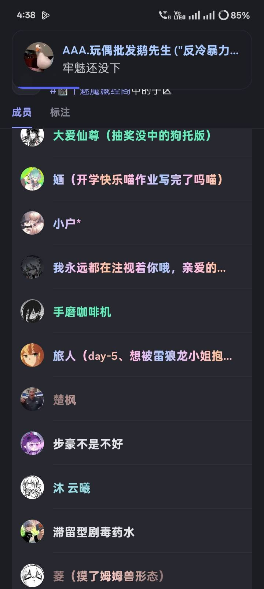
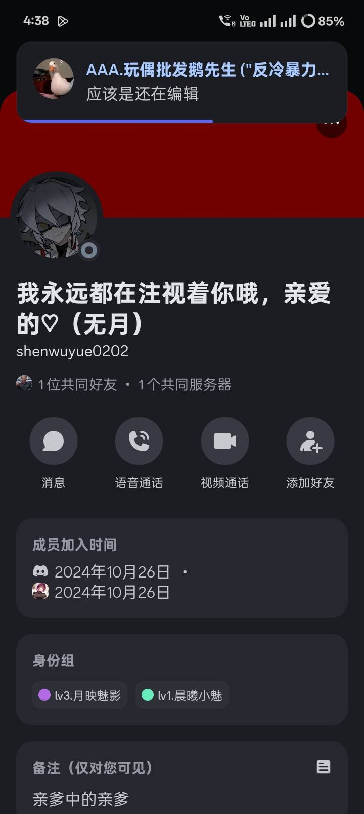

**希波鹅拉底** (2025-08-19 20:38:17):
<:emoji_146:1379454137158209736>

**希波鹅拉底** (2025-08-19 20:38:12):
之后搞定制款？

**希波鹅拉底** (2025-08-19 20:38:03):
应该是还在编辑

**希波鹅拉底** (2025-08-19 20:37:59):
牢魅还没下

**卡顺密** (2025-08-19 20:37:52):
我刚刚看到无月的颜色一样

**希波鹅拉底** (2025-08-19 20:37:49):
3级不是蓝色的那个吗？

**卡顺密** (2025-08-19 20:37:44):
没了，应该是bug

**希波鹅拉底** (2025-08-19 20:37:40):
有吗？

**卡顺密** (2025-08-19 20:37:31):
<:emoji_144:1379862366866641060>

**卡顺密** (2025-08-19 20:37:28):
怎么三级的颜色和我们一样

**希波鹅拉底** (2025-08-19 20:36:29):
<:emoji_150:1406355558730039346>

**希波鹅拉底** (2025-08-19 20:36:27):
妈的牢魅也喜欢发这个

**希波鹅拉底** (2025-08-19 20:36:17):
<:emoji_150:1406355558730039346> <:emoji_150:1406355558730039346> <:emoji_150:1406355558730039346>

**希波鹅拉底** (2025-08-19 20:36:13):
是的呢

**希波鹅拉底** (2025-08-19 20:36:10):
<:emoji_150:1406355558730039346>

**卡顺密** (2025-08-19 20:35:56):
<:emoji_150:1406355558730039346>

**卡顺密** (2025-08-19 20:35:45):
逼格蹭一下就上去了

**希波鹅拉底** (2025-08-19 20:35:35):
<:emoji_149:1382330529382273116>

**希波鹅拉底** (2025-08-19 20:35:32):
应该就是在搞这个

**希波鹅拉底** (2025-08-19 20:35:28):
也没发公告

**希波鹅拉底** (2025-08-19 20:35:22):
牢魅从2点到现在都在线

**希波鹅拉底** (2025-08-19 20:35:07):
牢魅弄的

**希波鹅拉底** (2025-08-19 20:35:04):
2、3点吧

**卡顺密** (2025-08-19 20:34:59):
<:emoji_150:1406355558730039346> <:emoji_150:1406355558730039346> <:emoji_150:1406355558730039346>

**卡顺密** (2025-08-19 20:34:56):
什么时候上的

**希波鹅拉底** (2025-08-19 20:34:54):
我喜欢

**希波鹅拉底** (2025-08-19 20:34:51):
好炫酷

**希波鹅拉底** (2025-08-19 20:34:47):
<:emoji_150:1406355558730039346>

**卡顺密** (2025-08-19 20:34:43):
<:emoji_150:1406355558730039346>

**卡顺密** (2025-08-19 20:34:38):
居然变成彩色了

**卡顺密** (2025-08-19 20:34:33):
e

**羊驼** (2025-08-19 19:48:07):
<:emoji_140:1379454014852436038>

**希波鹅拉底** (2025-08-19 18:23:30):


**希波鹅拉底** (2025-08-19 18:22:57):
<:1000168518:1298906830864519231>

**辰** (2025-08-19 16:11:31):
听歌内容不中

**辰** (2025-08-19 16:11:03):
回到当初爱你的时空

**辰** (2025-08-19 16:10:46):
从反方向开始移动

**辰** (2025-08-19 16:10:36):
穿梭时间的画面的钟

**哈哈** (2025-08-19 14:27:05):
<:1000168510:1298906820638674984>

**羊驼** (2025-08-19 14:26:34):
<:emoji_150:1406265862410735707>

**羊驼** (2025-08-19 14:26:25):
<:1000168510:1298906820638674984>

**大爱仙尊** (2025-08-19 14:25:58):
<:emoji_150:1406355558730039346>

**大爱仙尊** (2025-08-19 14:25:52):
张嘴了对吧😋

**羊驼** (2025-08-19 14:15:01):
<:emoji_148:1382329938404839586>

**羊驼** (2025-08-19 14:14:58):
发对猫猫哈气

**大爱仙尊** (2025-08-19 13:56:41):
<:emoji_148:1382329938404839586>

**大爱仙尊** (2025-08-19 13:56:40):
反对deepseekR2,反对哈吉米3.0反对Claude4.1

**羊驼** (2025-08-19 12:39:34):
╰(‵□′)╯ power！

**哈哈** (2025-08-19 12:14:42):
power 椅子

**卡顺密** (2025-08-19 12:08:32):
(一阵强劲的音乐)↑↓↑↓↑↓↑↓↑↓↑↓↑↓

**辰** (2025-08-19 12:08:05):
坏了，摇椅怎么变成大排档塑料白椅子了

**哈哈** (2025-08-19 12:03:28):
~~搖著搖著 發覺不遠處有個人影走來(??~~

**辰** (2025-08-19 12:02:09):
像楼下老爷爷一样～

**辰** (2025-08-19 12:01:53):
我承认这样真的很安详

**辰** (2025-08-19 12:01:43):
一个人窝在摇椅里乘凉

**辰** (2025-08-19 12:01:26):
记得那是一个安静的晚上

**卡顺密** (2025-08-19 11:49:12):
很久很久以前

**卡顺密** (2025-08-19 11:49:07):
这个话说起来就长了

**Mr.Koalefant** (2025-08-19 11:48:28):
所以说起来这个反冷暴力到底在反什么

**Mr.Koalefant** (2025-08-19 11:47:57):
<:emoji_150:1406355558730039346>

**xi** (2025-08-19 10:36:25):
<:emoji_150:1406265862410735707>

**羊驼** (2025-08-19 08:53:11):
<:emoji_149:1382626041352159263>

**羊驼** (2025-08-19 08:52:35):
才不废物呢

**羊驼** (2025-08-19 08:52:16):
<:emoji_143:1379855104622202900>

**卡顺密** (2025-08-19 08:46:59):

**卡顺密** (2025-08-19 08:46:54):
这辈子就这样了

**卡顺密** (2025-08-19 08:46:46):
像我这样的肺物还是老老实实玩卡吧

**卡顺密** (2025-08-19 08:46:39):
我连个背景都要想几天 我还是太肺物了

**卡顺密** (2025-08-19 08:41:24):
我现在就想出了是养母

**羊驼** (2025-08-19 08:40:43):
挺符合人设的？

**卡顺密** (2025-08-19 08:40:04):
死活想不出苏姨的背景

**卡顺密** (2025-08-19 08:39:49):
拿着手机在家里来回走了几个小时

**卡顺密** (2025-08-19 08:39:34):
🐴的

**羊驼** (2025-08-19 06:46:32):
<:1000168531:1298906724979310634>

**羊驼** (2025-08-19 06:46:30):
签到的作用是

**羊驼** (2025-08-19 06:46:17):
签到

**crzwz** (2025-08-19 06:14:10):
签到

**哈哈** (2025-08-19 05:45:41):
<a:004:1187051460534480988>

**任白** (2025-08-19 05:33:57):
滚

**卡顺密** (2025-08-19 05:33:38):
<:emoji_142:1379854822315921438>

**任白** (2025-08-19 05:33:24):
老婆贴贴

**哈哈** (2025-08-19 05:23:47):
<:sb_1:1073221244280913950>

**卡顺密** (2025-08-19 05:03:03):


**卡顺密** (2025-08-19 04:59:22):
“没钱飘唱的剑客 又怎会放过路边的玫瑰”

**卡顺密** (2025-08-19 04:58:46):
反对冷暴力

**卡顺密** (2025-08-19 04:58:43):
安息

**大爱仙尊** (2025-08-19 04:51:30):
<:emoji_148:1382329938404839586>

**大爱仙尊** (2025-08-19 04:51:27):
反对流式输出，反对截断

**crzwz** (2025-08-19 00:43:53):
签到

**沐 云曦** (2025-08-18 23:39:28):
反对冷暴，反对力

**哈哈** (2025-08-18 14:29:29):
<a:004:1187051460534480988>

**任白** (2025-08-18 12:15:19):
老婆贴贴

**哈哈** (2025-08-18 12:03:21):
<:iiiiiiiii:1118825625407475742>

**羊驼** (2025-08-18 11:56:15):
摸摸摸摸

**羊驼** (2025-08-18 11:55:54):
太可爱了

**羊驼** (2025-08-18 11:55:50):
果然还是能力可爱吧

**哈哈** (2025-08-18 09:36:18):
<a:Hifumi_Yes:1117326403558453258>

**羊驼** (2025-08-18 09:24:30):
哦～

**沐 云曦** (2025-08-18 06:45:27):
可爱晨晨，亲亲mua

**crzwz** (2025-08-18 06:45:19):
亲亲

**沐 云曦** (2025-08-18 06:45:12):
可爱吉吉，，亲亲mua

**沐 云曦** (2025-08-18 06:45:00):
qinqinmua

**crzwz** (2025-08-18 04:18:03):
签到

**哈哈** (2025-08-18 04:07:31):
<:dsdPopcorn:1003582275717431306><:nani:1134869744000970812>

**卡顺密** (2025-08-18 03:57:00):
漫画咖啡店

**哈哈** (2025-08-18 03:56:39):
<:emoji_136:1381162107424215091>

**哈哈** (2025-08-18 03:56:33):
看你上面有說一個店（x

**沐 云曦** (2025-08-18 03:52:18):
反对冷，反对暴力

**羊驼** (2025-08-18 03:27:46):
那个意大利厨师？

**哈哈** (2025-08-18 03:15:37):
還是說 你要把我變成第四部裡面的一位廚師（x

**哈哈** (2025-08-18 03:09:02):
<:emoji_136:1381162107424215091>

**哈哈** (2025-08-18 03:08:52):
殺皇也很愛但這還是算了:3

**卡顺密** (2025-08-18 03:08:34):
<:emoji_144:1379862366866641060>

**哈哈** (2025-08-18 03:08:23):
Wonder of u跟D4C （x

**卡顺密** (2025-08-18 03:06:52):
说

**哈哈** (2025-08-18 03:06:35):
雖然有兩個我很喜歡的（x

**晨** (2025-08-18 03:06:11):
<:emoji_149:1400309607783727266>

**羊驼** (2025-08-18 03:05:51):
<:emoji_139:1379455053080825866>

**哈哈** (2025-08-18 03:05:36):
<:3_:1134073260183670895>

**卡顺密** (2025-08-18 03:04:41):
你想要什么替身

**哈哈** (2025-08-18 03:04:20):
<:BaiWhat:919176468511207504>

**羊驼** (2025-08-18 02:25:47):
<:emoji_149:1400309607783727266>

**卡顺密** (2025-08-18 02:10:24):
<:emoji_144:1379862366866641060>

**卡顺密** (2025-08-18 02:10:22):
干脆叫粉色心情吧

**卡顺密** (2025-08-18 02:06:23):
中距离b或者c吧

**羊驼** (2025-08-18 02:04:49):
不知道诶

**羊驼** (2025-08-18 02:04:28):
射程呢？

**卡顺密** (2025-08-18 02:03:59):
叫什么名字好

**羊驼** (2025-08-18 02:03:28):
哦～

**卡顺密** (2025-08-18 02:03:18):
连打就给a吧反正力b

**羊驼** (2025-08-18 02:03:14):
气不是30秒吗

**羊驼** (2025-08-18 02:03:05):
连打

**卡顺密** (2025-08-18 02:02:57):
持续力是指连打还是气

**羊驼** (2025-08-18 02:01:58):
a？

**羊驼** (2025-08-18 02:01:54):
持续力呢

**卡顺密** (2025-08-18 01:57:12):
然后外形是人形 给一个力b吧

**卡顺密** (2025-08-18 01:56:53):
呼出的气30秒内 带有晕厥效果

**羊驼** (2025-08-18 01:56:09):
好吧

**卡顺密** (2025-08-18 01:55:59):
针打起来了瞬间被秒

**卡顺密** (2025-08-18 01:55:50):
想抢个东西还得让别人睡觉

**羊驼** (2025-08-18 01:55:32):
哦～

**任白** (2025-08-18 01:55:14):
死神13那个不是幻境

**任白** (2025-08-18 01:55:03):
死神13不一样吧

**卡顺密** (2025-08-18 01:54:57):
不适合

**羊驼** (2025-08-18 01:54:20):
叫“死神13”

**羊驼** (2025-08-18 01:52:46):
效果类似那样？

**羊驼** (2025-08-18 01:52:32):
第三部不是有个梦境替身

**卡顺密** (2025-08-18 01:52:21):
呼出的气30秒内吧

**羊驼** (2025-08-18 01:51:54):
一定范围内？

**任白** (2025-08-18 01:51:37):
有概率才会把AI绕成傻子

**卡顺密** (2025-08-18 01:51:09):
呼气带幻境

**卡顺密** (2025-08-18 01:50:58):
🤓☝️

**晨** (2025-08-18 01:50:11):
ai不吃概率

**卡顺密** (2025-08-18 01:50:05):
类似白蛇吧

**晨** (2025-08-18 01:49:58):
要是反派就加点精神控制的

**晨** (2025-08-18 01:49:46):
我就是觉得幻境类或者魅惑

**卡顺密** (2025-08-18 01:49:33):
毕竟我怕给ai绕成傻子了

**晨** (2025-08-18 01:49:22):
kami有没有好想法

**卡顺密** (2025-08-18 01:49:18):
要不加个概率吧 攻击弱点有75%几率能中

**晨** (2025-08-18 01:48:59):
剑姬说是

**任白** (2025-08-18 01:48:28):
就能找到个普通的弱点那和普通人有什么区别

**任白** (2025-08-18 01:48:11):
这毕竟是替身能力

**羊驼** (2025-08-18 01:48:03):
所以苏姐姐替身能力是？

**任白** (2025-08-18 01:47:55):
这个替身的攻击就是让你欧拉不掉

**任白** (2025-08-18 01:47:45):
欧拉掉

**任白** (2025-08-18 01:47:39):
就像白金之星

**晨** (2025-08-18 01:47:34):
绝对弱点不太出现的吧

**任白** (2025-08-18 01:47:29):
纯靠肉体是躲不开的

**晨** (2025-08-18 01:47:25):
那不好说啊

**卡顺密** (2025-08-18 01:47:25):
就类似 她开枪可以被白金之星捏着子弹

**任白** (2025-08-18 01:47:11):
比如说刀子砍过去

**羊驼** (2025-08-18 01:47:07):
我果然是假jo厨

**任白** (2025-08-18 01:47:01):
所以可以找个东西把自己保护一下

**羊驼** (2025-08-18 01:46:52):
<:1000168531:1298906724979310634>

**任白** (2025-08-18 01:46:45):
但是不是因果类

**羊驼** (2025-08-18 01:46:45):
好多我不认识的替身

**任白** (2025-08-18 01:46:40):
因为找到的就是本身绝对的弱点

**羊驼** (2025-08-18 01:46:31):
<:1000168531:1298906724979310634>

**任白** (2025-08-18 01:46:31):
应该说是靠自身防御不了

**羊驼** (2025-08-18 01:46:25):
米4达那种？就算改变弹道也不一定射得中？

**晨** (2025-08-18 01:45:54):
不一定，但是一定会导致对方分力防御

**卡顺密** (2025-08-18 01:45:28):
差不多

**晨** (2025-08-18 01:45:19):
给老师，然后老师当哈哈手下？

**卡顺密** (2025-08-18 01:44:55):
但是这个破绽我有点问题 找到破绽了之后就一定会命中吗

**羊驼** (2025-08-18 01:44:54):
<:1000168531:1298906724979310634>

**羊驼** (2025-08-18 01:44:49):
那本体是瑟苏姨？

**晨** (2025-08-18 01:44:19):
不好吧

**晨** (2025-08-18 01:44:12):
<@1063068779162108027>

**羊驼** (2025-08-18 01:44:03):
<:1000168518:1298906830864519231>

**羊驼** (2025-08-18 01:43:58):
双重人格？

**任白** (2025-08-18 01:43:52):
把这个替身给我

**任白** (2025-08-18 01:43:48):
那你换个瑟的苏姨

**羊驼** (2025-08-18 01:43:42):
很符合苏姐姐cos过cs的苍蝇头

**晨** (2025-08-18 01:43:37):
那我缺的瑟苏姨谁来给我补啊<:1000168516:1298906851848486942>

**任白** (2025-08-18 01:42:58):
味道很正

**任白** (2025-08-18 01:42:53):
这样确实差不多了

**任白** (2025-08-18 01:42:41):
确实

**晨** (2025-08-18 01:42:24):
<:1000168534:1298906727495766057>

**晨** (2025-08-18 01:42:14):
有枪不就好了

**任白** (2025-08-18 01:42:02):
这个强度

**任白** (2025-08-18 01:41:57):
挺好的

**任白** (2025-08-18 01:41:53):
但是刮痧没用

**任白** (2025-08-18 01:41:37):
看穿多少次

**任白** (2025-08-18 01:41:23):
但是单打独斗没什么用

**晨** (2025-08-18 01:41:20):
当不了老板啊

**任白** (2025-08-18 01:41:09):
作为辅助很强

**晨** (2025-08-18 01:41:07):
对

**任白** (2025-08-18 01:41:01):
强度没想的那么高

**任白** (2025-08-18 01:40:54):
还可以这个

**任白** (2025-08-18 01:40:48):
更辅助

**任白** (2025-08-18 01:40:45):
感觉这个其实

**晨** (2025-08-18 01:40:35):
苏姨本体应该是武道家，然后和老板一样隐藏身份<:1000168534:1298906727495766057>

**任白** (2025-08-18 01:40:22):
确实

**晨** (2025-08-18 01:40:13):
如果真用这个替身的话

**晨** (2025-08-18 01:39:52):
只给任务

**晨** (2025-08-18 01:39:44):
系统也有纯机器的

**卡顺密** (2025-08-18 01:39:41):
解析敌人的动作，然后找到破绽

**卡顺密** (2025-08-18 01:39:19):
类似系统 或者利姆路的贤者吧

**任白** (2025-08-18 01:37:41):
只能本体打伤害

**任白** (2025-08-18 01:37:36):
然后没有伤害

**任白** (2025-08-18 01:37:26):
要是一打多可能就比较吃力

**任白** (2025-08-18 01:37:19):
所以能找到破绽

**任白** (2025-08-18 01:37:15):
是因为分析力很强

**任白** (2025-08-18 01:37:08):
他这个不是因果类的

**任白** (2025-08-18 01:36:55):
可以随时解析出来对方的动作

**任白** (2025-08-18 01:36:45):
像超脑

**晨** (2025-08-18 01:36:37):
详细可见wonder of.

**任白** (2025-08-18 01:36:26):
确实无敌

**羊驼** (2025-08-18 01:36:00):
感觉

**卡顺密** (2025-08-18 01:35:55):
是纯特殊能力替身吗

**羊驼** (2025-08-18 01:35:54):
不然不好调平衡

**晨** (2025-08-18 01:35:50):
那很无敌了

**晨** (2025-08-18 01:35:47):
如果是非中立的因果替身

**羊驼** (2025-08-18 01:35:43):
先知道哈哈的能力先吧

**羊驼** (2025-08-18 01:35:31):
<:1000168531:1298906724979310634>

**任白** (2025-08-18 01:35:09):
被击中

**晨** (2025-08-18 01:35:06):
龙之梦是因果类的替身

**任白** (2025-08-18 01:35:03):
因为意外

**任白** (2025-08-18 01:35:00):
就算对方防御也会

**晨** (2025-08-18 01:34:55):
不一样吧

**任白** (2025-08-18 01:34:50):
就一定可以打到对方

**任白** (2025-08-18 01:34:42):
跟着指令做

**任白** (2025-08-18 01:34:35):
就是

**任白** (2025-08-18 01:34:34):
第六部那个龙之梦啊

**任白** (2025-08-18 01:34:22):
是他自己运气好

**任白** (2025-08-18 01:34:18):
有人说他这个替身没能力

**羊驼** (2025-08-18 01:34:10):
结果什么都不是？

**卡顺密** (2025-08-18 01:34:10):
<:emoji_144:1379862366866641060>

**卡顺密** (2025-08-18 01:34:04):
那打出什么效果

**羊驼** (2025-08-18 01:33:52):
我一直以为是最终boss

**任白** (2025-08-18 01:33:51):
薛定谔的替身

**任白** (2025-08-18 01:33:46):
黑哥那个是

**羊驼** (2025-08-18 01:33:38):
话说黑哥的作用是什么

**任白** (2025-08-18 01:33:37):
我说像龙之梦

**卡顺密** (2025-08-18 01:33:03):
类似第7部的那个吗 那个运气很好的黑哥

**任白** (2025-08-18 01:31:30):
非中立版

**任白** (2025-08-18 01:31:03):
更像龙之梦

**卡顺密** (2025-08-18 01:30:27):
佩斯利公园吗

**任白** (2025-08-18 01:30:00):
<:10:1298285710033424446>

**任白** (2025-08-18 01:29:56):
我就是忽然想到的

**任白** (2025-08-18 01:29:52):
跟谁开发的没关系

**任白** (2025-08-18 01:29:47):
打出效果

**晨** (2025-08-18 01:29:42):
是柑硕研发的

**羊驼** (2025-08-18 01:29:40):
<:1000168531:1298906724979310634>

**任白** (2025-08-18 01:29:40):
跟着替身的引导就可以

**羊驼** (2025-08-18 01:29:34):
还是得问一下

**晨** (2025-08-18 01:29:31):
那不是苏姨开发的吧

**羊驼** (2025-08-18 01:29:25):
但写苏姐姐的话要她同意

**任白** (2025-08-18 01:29:23):
类似龙之梦

**晨** (2025-08-18 01:29:18):
幻境类的或者精神迷惑

**任白** (2025-08-18 01:29:18):
替身能力是可以给出很牛逼的指导

**任白** (2025-08-18 01:29:09):
名字就叫这个

**任白** (2025-08-18 01:29:05):
『助手模式』

**任白** (2025-08-18 01:28:58):
苏姨的替身是

**羊驼** (2025-08-18 01:28:33):
支持

**羊驼** (2025-08-18 01:28:29):
wwwwww

**羊驼** (2025-08-18 01:28:24):
<:1000168510:1298906820638674984>

**晨** (2025-08-18 01:28:20):
必须魅惑向啊<:1000168534:1298906727495766057>

**卡顺密** (2025-08-18 01:28:13):

**晨** (2025-08-18 01:28:05):
另外两个是群友吗

**任白** (2025-08-18 01:28:04):
<:emoji_144:1379454111174496307>

**卡顺密** (2025-08-18 01:28:03):
苏姨的替身要怎么样

**卡顺密** (2025-08-18 01:27:52):
那先设计另外两个组织头头的吧

**羊驼** (2025-08-18 01:27:44):
<:1000168531:1298906724979310634>

**卡顺密** (2025-08-18 01:27:43):
<@703245258368090172>

**羊驼** (2025-08-18 01:27:40):
聪明

**羊驼** (2025-08-18 01:27:32):
woc

**晨** (2025-08-18 01:27:29):
没错

**任白** (2025-08-18 01:27:24):
为什么不问问哈哈想要什么替身

**羊驼** (2025-08-18 01:27:23):
<:1000168531:1298906724979310634>

**羊驼** (2025-08-18 01:27:18):
动漫小人

**羊驼** (2025-08-18 01:27:12):
哈哈替身其实也可以类似这种

**晨** (2025-08-18 01:27:00):
被吉良无伤速通了

**羊驼** (2025-08-18 01:26:56):
这是

**晨** (2025-08-18 01:26:46):
但是不会玩

**卡顺密** (2025-08-18 01:26:42):
面板怎么填

**晨** (2025-08-18 01:26:42):
是强啊

**任白** (2025-08-18 01:26:40):
量变产生质变

**卡顺密** (2025-08-18 01:26:39):
行了就这个了

**任白** (2025-08-18 01:26:36):
是的

**羊驼** (2025-08-18 01:26:27):
不也挺强的嘛

**羊驼** (2025-08-18 01:26:20):
胖重的替身“守财奴”

**羊驼** (2025-08-18 01:25:51):
其实

**任白** (2025-08-18 01:25:49):
但是被别人替身摸一下就消散掉了

**任白** (2025-08-18 01:25:39):
可以正常开枪正常伤害

**任白** (2025-08-18 01:25:34):
比如说具象化一把枪

**任白** (2025-08-18 01:25:25):
具象化出来的东西可以正常使用但是一碰就会没

**卡顺密** (2025-08-18 01:25:21):
能够具象化什么

**任白** (2025-08-18 01:25:06):
加点限制还差不多

**任白** (2025-08-18 01:24:34):
越复杂越无聊

**任白** (2025-08-18 01:24:28):
具象化就够了

**卡顺密** (2025-08-18 01:24:04):
发生洇灭会产生相当于一颗手榴弹的爆炸

**晨** (2025-08-18 01:23:50):
六a吗

**卡顺密** (2025-08-18 01:23:43):
那就添加点数值吧

**卡顺密** (2025-08-18 01:23:36):
<:emoji_144:1379862366866641060>

**羊驼** (2025-08-18 01:22:41):
？

**晨** (2025-08-18 01:22:02):
那有点废啊

**晨** (2025-08-18 01:21:56):
那没事了

**卡顺密** (2025-08-18 01:21:20):
相比于d4c更像是亲吻吧

**卡顺密** (2025-08-18 01:20:25):
非生物

**晨** (2025-08-18 01:20:22):
无条件大总统哎

**晨** (2025-08-18 01:20:14):
能湮灭有点超模了吧

**晨** (2025-08-18 01:20:02):
这么喜欢湮灭吗

**卡顺密** (2025-08-18 01:19:46):
拍下一支铅笔 能将图片里的铅笔变成现实的 如果两支铅笔靠近就会触发洇灭

**任白** (2025-08-18 01:18:59):
多酷

**任白** (2025-08-18 01:18:52):
ACT1升级版

**晨** (2025-08-18 01:18:52):
靠表情包具现

**任白** (2025-08-18 01:18:44):
飞过去

**任白** (2025-08-18 01:18:39):
能力是可以让图像里的东西变成真的

**晨** (2025-08-18 01:18:36):
嗯嗯

**任白** (2025-08-18 01:18:31):
天天发表情包

**任白** (2025-08-18 01:18:27):
还不如我想的这个

**任白** (2025-08-18 01:18:19):
哈哈的能力是可以让图像具体化

**晨** (2025-08-18 01:18:10):
小弟来打架

**任白** (2025-08-18 01:18:06):
可爱算什么能力

**卡顺密** (2025-08-18 01:17:57):
<:emoji_144:1379862366866641060>

**卡顺密** (2025-08-18 01:17:54):
太无敌了吧，而且也没战斗能力啊

**晨** (2025-08-18 01:17:26):
不是更反差了

**任白** (2025-08-18 01:17:24):
还是来给我当肉变器吧

**晨** (2025-08-18 01:17:22):
那更好了，老大的能力是可爱

**卡顺密** (2025-08-18 01:17:21):
我一时间忘记了嘛

**任白** (2025-08-18 01:17:11):
这都不知道还写替身呢

**卡顺密** (2025-08-18 01:17:05):
差不多吧 但是哈哈的只能收集一些小物品

**任白** (2025-08-18 01:17:04):
唉卡密啊卡密

**卡顺密** (2025-08-18 01:16:38):
哦，想起来了

**晨** (2025-08-18 01:16:37):
靠恐惧收人或者物品的

**晨** (2025-08-18 01:16:26):
一个反派

**晨** (2025-08-18 01:16:21):
第四部

**任白** (2025-08-18 01:14:26):
我只会胡编乱造

**任白** (2025-08-18 01:14:18):
不会

**任白** (2025-08-18 01:14:16):
<:emoji_92:1379090128496099410>

**晨** (2025-08-18 01:14:11):
你纠正我

**晨** (2025-08-18 01:14:06):
我还以为我名字说错了

**任白** (2025-08-18 01:14:06):
我说的东格玛

**任白** (2025-08-18 01:14:01):
你说的西格玛

**任白** (2025-08-18 01:13:46):
<:emoji_105:1379108713545335007>

**卡顺密** (2025-08-18 01:13:46):
<:emoji_144:1379862366866641060>

**卡顺密** (2025-08-18 01:13:43):
哪个西格玛啊

**晨** (2025-08-18 01:13:41):
？

**任白** (2025-08-18 01:13:33):
你看看我说的话呢

**晨** (2025-08-18 01:13:19):
怎么不是

**晨** (2025-08-18 01:13:17):
夹在纸里

**卡顺密** (2025-08-18 01:13:02):
不想太强也不想太弱 毕竟哈哈是第3个势力的头头

**卡顺密** (2025-08-18 01:12:41):
<:emoji_144:1379862366866641060>

**任白** (2025-08-18 01:12:34):
不是这个能力

**卡顺密** (2025-08-18 01:12:32):
哪个西格玛

**任白** (2025-08-18 01:12:30):
东格玛

**晨** (2025-08-18 01:12:04):
也是这个能力

**晨** (2025-08-18 01:11:59):
西格玛？

**卡顺密** (2025-08-18 01:11:50):

**卡顺密** (2025-08-18 01:11:48):
能把东西夹在书里

**卡顺密** (2025-08-18 01:11:44):
还是一本书吧

**羊驼** (2025-08-18 01:11:22):
确实www

**羊驼** (2025-08-18 01:11:13):
<:emoji_118:1379114000570126449>

**晨** (2025-08-18 01:11:10):
另一种方面的“无敌"

**羊驼** (2025-08-18 01:10:45):
好没用但又好有用的能力啊

**任白** (2025-08-18 01:09:37):
哈人恶兽

**任白** (2025-08-18 01:09:22):
骇人恶兽

**任白** (2025-08-18 01:09:17):
可怕

**晨** (2025-08-18 01:08:31):
可爱

**羊驼** (2025-08-18 01:06:12):
<:1000168531:1298906724979310634>

**羊驼** (2025-08-18 01:06:02):
店就是替身能力？

**任白** (2025-08-18 01:04:17):
能力是给我赚钱花

**卡顺密** (2025-08-18 01:04:04):

**卡顺密** (2025-08-18 01:03:56):
哈哈的替身能力是什么呢 没什么灵感

**羊驼** (2025-08-18 01:02:13):
反对乱花钱

**羊驼** (2025-08-18 01:01:48):
<:emoji_149:1382626041352159263>

**任白** (2025-08-18 01:01:27):
<:emoji_142:1379454037501673522>

**任白** (2025-08-18 01:01:17):
哈哈努力赚钱给我花

**羊驼** (2025-08-18 01:01:05):
<:emoji_139:1379455053080825866>

**卡顺密** (2025-08-18 01:00:50):
我打算给哈哈开个店

**羊驼** (2025-08-18 01:00:49):
<:emoji_139:1379455053080825866>

**卡顺密** (2025-08-18 01:00:45):
行吧

**晨** (2025-08-18 00:59:52):
<:1000168510:1298906820638674984> 不要吧

**羊驼** (2025-08-18 00:59:52):
<:07:1298281204260278383>

**卡顺密** (2025-08-18 00:59:47):

**卡顺密** (2025-08-18 00:59:29):
学生会会长是前男友这个设定要不要加

**晨** (2025-08-18 00:58:54):
要！

**卡顺密** (2025-08-18 00:56:08):
我打算写三个阵营

**卡顺密** (2025-08-18 00:55:34):
那就先自定义吧 反正我都还没填好几个角色

**羊驼** (2025-08-18 00:55:16):
<:1000168531:1298906724979310634>

**羊驼** (2025-08-18 00:55:13):
我不确定

**羊驼** (2025-08-18 00:55:08):
自定义吧…

**卡顺密** (2025-08-18 00:54:33):
嗯，我在想要不要

**羊驼** (2025-08-18 00:54:11):
指卡吗

**卡顺密** (2025-08-18 00:53:15):
性别要自定义吗

**羊驼** (2025-08-18 00:52:46):
<:emoji_139:1379455053080825866>

**卡顺密** (2025-08-18 00:52:34):
小户昨天太累了 做完就直接睡着了

**羊驼** (2025-08-18 00:52:22):
所以一起洗了吗

**羊驼** (2025-08-18 00:52:11):
<:emoji_139:1379455053080825866>

**任白** (2025-08-18 00:51:03):
以为可以给小户洗澡

**任白** (2025-08-18 00:50:51):
昨晚我舍得太多

**哈哈** (2025-08-17 20:17:08):
<:BaiWhat:919176468511207504>

**xi** (2025-08-17 20:13:17):

**xi** (2025-08-17 20:12:28):
行

**卡顺密** (2025-08-17 19:46:31):
“昨晚我尿的很高 以为可以遮住脸上的眼泪 ”

**卡顺密** (2025-08-17 19:46:28):
反对冷暴力

**卡顺密** (2025-08-17 19:46:26):
安息

**羊驼** (2025-08-17 19:22:08):
<:emoji_149:1382626041352159263>

**羊驼** (2025-08-17 19:22:05):
反对冷暴力

**大爱仙尊** (2025-08-17 16:00:41):
<:emoji_148:1382329938404839586>

**大爱仙尊** (2025-08-17 16:00:39):
反对机长，反对矿工

**哈哈** (2025-08-17 15:09:25):
<:worryangry:1138724676634411018>

**哈哈** (2025-08-17 15:09:20):
<:emoji_6:1021359813285920828>

**希波鹅拉底** (2025-08-17 14:14:00):
冷暴力一下

**希波鹅拉底** (2025-08-17 14:13:55):
哈哈可爱

**哈哈** (2025-08-17 12:08:22):
<:dsdPopcorn:1003582275717431306>

**羊驼** (2025-08-17 09:42:35):
<:emoji_148:1379454224353591457>

**晨** (2025-08-17 05:33:12):
把我没写完的写完

**晨** (2025-08-17 05:33:06):
kami加油

**哈哈** (2025-08-17 05:24:19):
<:catb:1132279521203204107>

**希波鹅拉底** (2025-08-17 04:31:59):
<:emoji_140:1379454014852436038>

**卡顺密** (2025-08-17 02:02:50):
让你们看一下什么叫天才

**任白** (2025-08-17 02:02:10):
又开始写卡了？

**羊驼** (2025-08-17 01:42:21):
<:07:1298281204260278383>

**卡顺密** (2025-08-17 01:41:57):
替身肯定有几个能选 自己创应该也行 敌人的话我是想要固定整一条主线

**羊驼** (2025-08-17 01:39:55):
<:1000168531:1298906724979310634>

**羊驼** (2025-08-17 01:39:30):
那替身和敌人是由ai随机生成嘛

**羊驼** (2025-08-17 01:39:02):
哦～

**卡顺密** (2025-08-17 01:38:39):
所以我只打算引用战斗系统

**卡顺密** (2025-08-17 01:38:28):
嗯 但是同人卡的话效果肯定不好

**羊驼** (2025-08-17 01:38:17):
<:1000168532:1298906722546614313>

**羊驼** (2025-08-17 01:38:12):
jojo的那种嘛

**羊驼** (2025-08-17 01:37:29):
对吧

**羊驼** (2025-08-17 01:37:27):
哈哈他老爹

**卡顺密** (2025-08-17 01:37:26):
先去找ai创一个世界观

**卡顺密** (2025-08-17 01:37:18):
写个替身战斗的好了

**羊驼** (2025-08-17 01:37:04):
<:1000168528:1298906738761924722>

**羊驼** (2025-08-17 01:37:00):
名字什么的我没记

**羊驼** (2025-08-17 01:36:47):
大概知道是谁了

**羊驼** (2025-08-17 01:36:40):
哦

**卡顺密** (2025-08-17 01:36:14):
认真的吗 真名都贴你脸上了

**羊驼** (2025-08-17 01:36:03):
？

**羊驼** (2025-08-17 01:35:58):
<:07:1298281204260278383>

**羊驼** (2025-08-17 01:35:55):
那不挺好

**卡顺密** (2025-08-17 01:35:49):
？

**羊驼** (2025-08-17 01:35:45):
<:1000168510:1298906820638674984>

**羊驼** (2025-08-17 01:35:36):
你该不会又是我认识的吧

**卡顺密** (2025-08-17 01:35:36):
我打算写个战斗爽的

**羊驼** (2025-08-17 01:34:56):
啊？

**哈哈** (2025-08-17 01:31:56):
<:sb_1:1073221244280913950>

**MEE6** (2025-08-17 01:30:58):


**卡顺密** (2025-08-17 01:29:32):
<@929772344984084490> 我要在藏经阁死一个月 给我盯着哈哈

**羊驼** (2025-08-17 01:28:49):
<:emoji_132:1379388256113917993>

**哈哈** (2025-08-17 01:28:37):
<:sb_2:1073222172123869196>

**羊驼** (2025-08-17 01:28:15):
<:emoji_132:1379388256113917993>

**羊驼** (2025-08-17 01:28:12):
晚安

**羊驼** (2025-08-17 01:27:52):
<:1000168531:1298906724979310634>

**羊驼** (2025-08-17 01:27:48):
大部分都可以

**羊驼** (2025-08-17 01:27:37):
NSFW的卡

**羊驼** (2025-08-17 01:27:06):
🤔

**卡顺密** (2025-08-17 01:26:49):
你喜欢玩什么卡

**哈哈** (2025-08-17 01:26:27):
<a:o0:1206214135789002752>

**哈哈** (2025-08-17 01:26:21):
安

**羊驼** (2025-08-17 01:25:53):
<:23:1298294522945605756>

**羊驼** (2025-08-17 01:25:45):
哦哦

**卡顺密** (2025-08-17 01:21:48):
<@703245258368090172> 早

**卡顺密** (2025-08-17 01:21:13):
这里安息指的是别人

**羊驼** (2025-08-17 01:20:42):
<:1000168510:1298906820638674984>

**羊驼** (2025-08-17 01:20:39):
反冷暴力这就死了吗

**卡顺密** (2025-08-17 01:04:44):
“你可以玩我的魔丸，因为它有两颗，但你不能玩我的心，因为它只有一颗”

**卡顺密** (2025-08-17 01:04:33):
反对冷暴力

**卡顺密** (2025-08-17 01:04:30):
安息

**哈哈** (2025-08-16 17:14:22):
<a:o0:1206214135789002752>

**任白** (2025-08-16 15:55:11):
只有搞基的

**任白** (2025-08-16 15:55:07):
没有搞艺术的

**任白** (2025-08-16 15:55:02):
<:emoji_150:1406265862410735707>

**卡顺密** (2025-08-16 15:46:28):
我这个马来西亚地头蛇身边能有什么搞艺术的

**卡顺密** (2025-08-16 15:46:11):
<:emoji_150:1389291898224640060>

**卡顺密** (2025-08-16 15:46:05):
艺术...

**任白** (2025-08-16 15:31:30):
玩玩你

**哈哈** (2025-08-16 15:00:09):
<:LunaO_O:1129462010585812993>

**希波鹅拉底** (2025-08-16 14:54:06):
<:emoji_142:1379854822315921438>

**羊驼** (2025-08-16 13:57:12):
<:emoji_133:1379494883227734157>

**哈哈** (2025-08-16 13:57:09):
<:LunaO_O:1129462010585812993>

**哈哈** (2025-08-16 13:56:58):
<:emoji_136:1381162107424215091>

**xi** (2025-08-16 13:55:55):
不行 我还要玩

**大爱仙尊** (2025-08-16 13:41:34):
<:emoji_148:1382329938404839586>

**大爱仙尊** (2025-08-16 13:41:31):
反对哈基米，反对克劳德，反对grok，反对deepseek

**希波鹅拉底** (2025-08-16 12:59:28):
<:emoji_148:1382329938404839586>

**希波鹅拉底** (2025-08-16 12:59:20):
反对羊驼，反对味道，反对云曦，反对哈哈，反对kami，反对晨晨，反对芳心，反对苏姨，反对蜥蜴，反对小户，反对任白，反对🍑，反对牢魅，反对柠檬，反对柠檬茶，反对香料，反对黑白猫，反对doro，反对咖啡姬，反对mika，反对希露菲，反对楚枫，反对三三，反对茶壶，反对菱，反对小洛，反对小卡，反对秦柩

**羊驼** (2025-08-16 08:38:59):
我看看哈

**羊驼** (2025-08-15 18:42:39):
<:1000168510:1298906820638674984>

**希波鹅拉底** (2025-08-15 17:56:24):
<:20:1298294514124984323>

**哈哈** (2025-08-15 17:44:41):
<:emoji_136:1381162107424215091>

**任白** (2025-08-15 17:05:33):
不认我了

**任白** (2025-08-15 17:05:29):
干嘛

**哈哈** (2025-08-15 16:58:38):
<:Ina_1:865509148099739668> <:BaiWhat:919176468511207504>

**任白** (2025-08-15 16:58:17):
老婆

**哈哈** (2025-08-15 16:55:42):
<:dsdPopcorn:1003582275717431306>

**晨** (2025-08-15 16:50:38):
反骨这一块

**晨** (2025-08-15 16:50:30):
<:emoji_149:1382434166666432674>

**任白** (2025-08-15 16:48:28):
那就乱涩涩

**晨** (2025-08-15 16:46:51):
不要乱瑟瑟就好

**晨** (2025-08-15 16:46:43):
不反对

**任白** (2025-08-15 16:28:14):
反对涩涩？

**哈哈** (2025-08-15 13:38:29):
<:dsdPopcorn:1003582275717431306>

**楚枫** (2025-08-15 12:43:55):
我反对亲亲可以嘛<:09:1298281821976531027>

**楚枫** (2025-08-15 12:43:38):
<:1000168518:1298906830864519231>

**沐 云曦** (2025-08-15 12:41:50):
反对冷暴力，反对色色

**哈哈** (2025-08-15 05:03:28):
<:dsdPopcorn:1003582275717431306>

**羊驼** (2025-08-14 21:22:17):
<:1000168510:1298906820638674984>

**羊驼** (2025-08-14 21:22:05):
抱抱也反对嘛

**希波鹅拉底** (2025-08-14 13:41:10):
<:20:1298294514124984323>

**希波鹅拉底** (2025-08-14 13:41:07):
<:emoji_149:1382330529382273116>

**希波鹅拉底** (2025-08-14 13:41:04):
mika和任白铁暗恋我

**希波鹅拉底** (2025-08-14 13:40:53):
<:emoji_140:1379454014852436038>

**卡顺密** (2025-08-14 11:33:49):
是我太矫情了吗

**任白** (2025-08-14 11:28:51):
说明大家都暗恋你

**任白** (2025-08-14 11:28:41):
<:emoji_149:1391405133220282500>

**卡顺密** (2025-08-14 11:26:38):
唉

**卡顺密** (2025-08-14 11:26:12):
<:1000168518:1298906830864519231>

**卡顺密** (2025-08-14 11:26:07):
<@1327930413070684181> 牢白阿 我感觉全世界都在针对我

**哈哈** (2025-08-14 05:50:10):
<:dsdPopcorn:1003582275717431306>

**大爱仙尊** (2025-08-14 05:36:47):
<:1000168518:1298906830864519231>

**沐 云曦** (2025-08-14 05:34:00):
反对冷暴力，反对抱抱

**哈哈** (2025-08-14 01:31:41):
<:iiiiiiiii:1118825625407475742>

**卡顺密** (2025-08-14 00:54:55):
<:emoji_83:1378946142330683422>

**卡顺密** (2025-08-14 00:54:52):
<@703245258368090172>

**羊驼** (2025-08-13 21:33:31):
摸摸

**crzwz** (2025-08-13 21:19:15):
签到

**哈哈** (2025-08-13 19:46:04):
<:EunhaIDK:1352842231433658468>

**羊驼** (2025-08-13 19:26:42):
<:1000168531:1298906724979310634>

**羊驼** (2025-08-13 19:26:37):
为什么反对高达

**哈哈** (2025-08-13 15:11:41):
我也偷偷的簽(X

**任白** (2025-08-13 14:52:35):
你还签到上了

**xi** (2025-08-13 14:32:35):
签到

**沐 云曦** (2025-08-13 14:16:53):
亲亲鼠鼠mua

**沐 云曦** (2025-08-13 14:16:43):
反对冷暴力，反对高达

**哈哈** (2025-08-13 14:11:14):
<:BaiWhat:919176468511207504>

**任白** (2025-08-13 13:29:19):
每日签到

**任白** (2025-08-13 13:29:15):
在哈哈那里

**卡顺密** (2025-08-13 12:50:38):
🙏

**卡顺密** (2025-08-13 12:50:34):
卡密请庇佑我们 铲除隔壁邪教

**gg** (2025-08-13 09:18:00):
卡门🙏反冷暴力!忠诚！

**哈哈** (2025-08-13 04:36:08):
<:dsdPopcorn:1003582275717431306>

**哈哈** (2025-08-13 04:36:03):
在其他地方

**晨** (2025-08-13 04:33:38):
<:emoji_147:1379454167302537256>

**晨** (2025-08-13 04:33:35):
但是没来闲聊

**任白** (2025-08-13 04:33:19):
我不是一直都在吗

**卡顺密** (2025-08-13 04:21:55):
卡门还是太强大了

**卡顺密** (2025-08-13 04:21:42):
没半天就被我击溃了

**卡顺密** (2025-08-13 04:21:37):
给你说准了

**晨** (2025-08-13 04:13:07):
<:emoji_139:1379455053080825866>

**晨** (2025-08-13 04:13:03):
老师好久不见了啊

**晨** (2025-08-13 04:12:58):
那很傻了

**任白** (2025-08-13 03:06:35):
不清楚

**卡顺密** (2025-08-13 03:06:32):
我记忆里好像没有删除按键

**卡顺密** (2025-08-13 03:06:25):
那应该是之前魅魔没给权限

**任白** (2025-08-13 03:06:09):
一不小心把整个卡区删掉了

**任白** (2025-08-13 03:05:58):
帮人删帖

**任白** (2025-08-13 03:05:55):
人家管理员脑抽

**任白** (2025-08-13 03:05:49):
隔壁类脑

**任白** (2025-08-13 03:05:42):
可以被删的

**卡顺密** (2025-08-13 03:05:16):
我怎么记得好像帖子是不能被删的

**卡顺密** (2025-08-13 03:04:39):
但是你正常滑看不到了

**卡顺密** (2025-08-13 03:04:34):
还是能搜出来

**卡顺密** (2025-08-13 03:04:31):
没被删

**任白** (2025-08-13 03:03:29):
可能是清了之后发的？

**任白** (2025-08-13 03:03:17):
我也看见一些东西不见了

**卡顺密** (2025-08-13 03:02:52):
之前我的神秘祈祷仪式好像不见了

**卡顺密** (2025-08-13 03:02:45):
大鹅的经验加三都没删呢

**任白** (2025-08-13 03:02:28):
没有被删

**任白** (2025-08-13 03:02:23):
还有你献出的py

**任白** (2025-08-13 03:02:12):
承载的记忆太多

**任白** (2025-08-13 03:02:02):
创的早

**任白** (2025-08-13 03:01:54):
我们这个是因为

**任白** (2025-08-13 03:01:50):
之前好像清过一次的

**卡顺密** (2025-08-13 03:01:37):
<:1000168510:1298906820638674984>

**卡顺密** (2025-08-13 03:01:32):
应该不能吧

**任白** (2025-08-13 03:00:50):
到时候帖子都被删了

**任白** (2025-08-13 03:00:44):
藏经阁里乱塞东西

**卡顺密** (2025-08-13 02:59:23):


**卡顺密** (2025-08-13 02:59:16):
这就是来自反冷暴力创建者之一的自信吗

**任白** (2025-08-13 02:59:01):
没活

**任白** (2025-08-13 02:58:49):
模仿者

**卡顺密** (2025-08-13 02:58:10):
<:emoji_150:1393302061453672520>

**卡顺密** (2025-08-13 02:58:06):
终究还是反冷暴力最权威

**任白** (2025-08-13 02:57:47):
杂七杂八的真多

**卡顺密** (2025-08-13 02:56:34):
曾经卡神创下的一个分支

**卡顺密** (2025-08-13 02:56:24):
顾名思义

**Deleted User** (2025-08-13 02:56:10):
是我和味道的甜蜜小家捏

**任白** (2025-08-13 02:55:32):
变态一族是什么

**小鸢（空巢小人复活）** (2025-08-13 02:53:14):
冲击波来了

**小鸢（空巢小人复活）** (2025-08-13 02:53:08):
<:20:1298294514124984323> <:20:1298294514124984323> <:20:1298294514124984323>

**卡顺密** (2025-08-13 02:30:23):
逼格拉满了

**Deleted User** (2025-08-13 02:30:16):

**卡顺密** (2025-08-13 02:30:14):
<:emoji_146:1379454137158209736>

**卡顺密** (2025-08-13 02:29:58):
你想想看啊 堂堂反冷暴力宗 和变态一族 居然都是卡门的麾下

**卡顺密** (2025-08-13 02:28:56):
卡门也不需要发扬光大 人越少越能展现我们精锐

**卡顺密** (2025-08-13 02:28:20):
<:emoji_144:1379862366866641060>

**卡顺密** (2025-08-13 02:28:17):
卡门就两个人

**卡顺密** (2025-08-13 02:28:12):
这个属实是没办法再往下跌了

**任白** (2025-08-13 02:27:37):
就拒绝

**卡顺密** (2025-08-13 02:27:28):
<:emoji_142:1379854822315921438>

**卡顺密** (2025-08-13 02:27:26):
你还拒绝上了

**任白** (2025-08-13 02:27:22):
我会把卡门搞没落

**任白** (2025-08-13 02:27:10):
我不要

**卡顺密** (2025-08-13 02:27:07):
<:emoji_83:1378946142330683422>

**卡顺密** (2025-08-13 02:27:04):
从今天开始你就是堂堂卡门的副门主

**卡顺密** (2025-08-13 02:26:53):
这里交给年轻人打理

**任白** (2025-08-13 02:26:48):
那我退出

**任白** (2025-08-13 02:26:40):
老说我把这里搞没落了

**任白** (2025-08-13 02:26:22):
没落就没落吧

**卡顺密** (2025-08-13 02:26:18):
你今天开始是卡门的副门主了

**任白** (2025-08-13 02:26:14):
懒得说了

**卡顺密** (2025-08-13 02:26:06):
emm 应该是敬仰我卡门的名号

**任白** (2025-08-13 02:25:44):
你死的时候来的也是你拉的吗

**卡顺密** (2025-08-13 02:25:23):
🐴的 这些都是我拉来的吧喂

**任白** (2025-08-13 02:25:01):
这里这么多人你看不见吗

**卡顺密** (2025-08-13 02:24:42):
有人说我们反冷暴力被你带没落了

**任白** (2025-08-13 02:24:19):
干嘛

**卡顺密** (2025-08-13 02:24:13):
😭😭😭

**卡顺密** (2025-08-13 02:24:09):
任白

**任白** (2025-08-13 02:24:02):
何意味

**任白** (2025-08-13 02:23:54):
<:1000168518:1298906830864519231>

**楚枫** (2025-08-13 02:09:01):
我也签到

**卡顺密** (2025-08-13 01:04:25):
害得我又要洗澡了

**大爱仙尊** (2025-08-13 00:45:37):
cnc->c∩c<:23:1298294522945605756>

**卡顺密** (2025-08-13 00:42:23):
<:emoji_83:1378946142330683422>

**卡顺密** (2025-08-13 00:42:19):
看看龙抬头

**大爱仙尊** (2025-08-13 00:42:07):
包的<:emoji_140:1379454014852436038>

**卡顺密** (2025-08-13 00:18:59):
宝宝醒啦？

**大爱仙尊** (2025-08-13 00:17:54):
<:1000168518:1298906830864519231>

**哈哈** (2025-08-12 21:08:41):
<a:o0:1206214135789002752>

**晨** (2025-08-12 21:05:56):
打卡

**crzwz** (2025-08-12 20:39:30):
吉吉阳阳德

**哈哈** (2025-08-12 20:39:27):
<:emoji_136:1381162107424215091>

**哈哈** (2025-08-12 20:39:23):
ok 222

**卡顺密** (2025-08-12 20:38:23):
<@703245258368090172>

**卡顺密** (2025-08-12 20:38:21):
111

**哈哈** (2025-08-12 20:38:05):
不知怎麼用R!!(？

**羊驼** (2025-08-12 20:32:34):
<:08:1298281401715785789>

**羊驼** (2025-08-12 20:32:30):
被架空了

**卡顺密** (2025-08-12 20:31:11):
不是，你们倒是签到啊

**哈哈** (2025-08-12 20:30:07):
<a:tremblerampu:1152528916871905351>

**羊驼** (2025-08-12 20:30:00):
那大运还好吗

**卡顺密** (2025-08-12 20:29:33):
不豪意思，这是我老婆 去年他被大运撞到了 智商回到了5岁 麻烦顺着他的话说就好了

**crzwz** (2025-08-12 20:29:13):
吉吉阳阳德

**crzwz** (2025-08-12 20:29:07):
比比是比比

**crzwz** (2025-08-12 20:29:03):
对的

**羊驼** (2025-08-12 20:29:03):
<:1000168531:1298906724979310634>

**羊驼** (2025-08-12 20:28:56):
比比是比比？

**卡顺密** (2025-08-12 20:28:14):
你是不是前草了

**crzwz** (2025-08-12 20:27:54):
10天的

**crzwz** (2025-08-12 20:27:51):
<:emoji_148:1382329938404839586>

**卡顺密** (2025-08-12 20:27:46):
<:emoji_150:1393302061453672520>

**卡顺密** (2025-08-12 20:27:42):
从现在开始算

**crzwz** (2025-08-12 20:27:31):
kimi

**卡顺密** (2025-08-12 20:27:29):
<@703245258368090172> <@1303142548377960448> <@929772344984084490>

**crzwz** (2025-08-12 20:27:29):
我先签10天的

**哈哈** (2025-08-12 20:27:26):
https://cdn.discordapp.com/attachments/946719897390563328/1309982540924321843/CindyCookie.gif

**crzwz** (2025-08-12 20:27:07):
是比比

**卡顺密** (2025-08-12 20:26:47):
4.25刷新签到

**卡顺密** (2025-08-12 20:26:35):
<@703245258368090172>

**羊驼** (2025-08-12 20:26:34):
<:1000168531:1298906724979310634>

**羊驼** (2025-08-12 20:26:31):
所以比比是什么

**卡顺密** (2025-08-12 20:26:11):
<:emoji_83:1378946142330683422> <:emoji_83:1378946142330683422> <:emoji_83:1378946142330683422>

**卡顺密** (2025-08-12 20:26:09):
5天宗主，六天圣子

**卡顺密** (2025-08-12 20:26:02):
谁先签到三天谁当副宗主

**卡顺密** (2025-08-12 20:25:52):
从现在开始算

**卡顺密** (2025-08-12 20:25:48):
在这里签到

**crzwz** (2025-08-12 20:07:57):
比比

**羊驼** (2025-08-12 20:03:24):
<:emoji_144:1379454084750245939>

**羊驼** (2025-08-12 20:03:18):
反对冷暴力

**卡顺密** (2025-08-12 18:58:15):
😭

**卡顺密** (2025-08-12 18:58:12):
有人已经一天没回我消息了

**卡顺密** (2025-08-12 18:58:06):
反对冷暴力

**大爱仙尊** (2025-08-12 00:33:03):
<:emoji_150:1393302061453672520>

**沐 云曦** (2025-08-11 23:57:15):
呀哒哟

**卡顺密** (2025-08-11 23:54:47):
<:emoji_144:1379862366866641060>

**卡顺密** (2025-08-11 23:54:38):
丢进暴食地狱好了

**沐 云曦** (2025-08-11 23:53:52):
一扣吃掉，muamua

**卡顺密** (2025-08-11 23:50:34):
<:1000168510:1298906820638674984>

**沐 云曦** (2025-08-11 23:50:06):
但对冷暴力，反对油炸食品

**Deleted User** (2025-08-11 14:01:17):
<:emoji_150:1400317605553766531>

**大爱仙尊** (2025-08-11 10:35:23):
<:1000168518:1298906830864519231>

**大爱仙尊** (2025-08-11 10:35:22):
一天不岛积阳德，两天不岛积积阳阳德

**crzwz** (2025-08-11 10:03:48):
吉吉阳阳德

**Deleted User** (2025-08-10 23:34:41):
<:emoji_148:1401974973748346921>

**大爱仙尊** (2025-08-10 23:28:08):
<:1000168518:1298906830864519231>

**Deleted User** (2025-08-10 20:55:16):
<:emoji_149:1382626041352159263>

**卡顺密** (2025-08-10 19:36:17):
不赖 有资格当长老了


**Deleted User** (2025-08-10 16:59:16):
🛐

**Deleted User** (2025-08-10 16:58:59):
<:emoji_149:1382330529382273116>

**Deleted User** (2025-08-10 16:58:50):
反对变态！
反对下头！
反对川剧！
反对冷暴力！
晨门万岁！

**大爱仙尊** (2025-08-09 23:04:15):
<:1000168518:1298906830864519231>

**Deleted User** (2025-08-08 18:13:23):
看来Kami沉睡了太久，已经不知道魅魔大陆上发生了什么啊

**卡顺密** (2025-08-08 18:12:33):
kami:味道？不熟(无感情

**Deleted User** (2025-08-08 16:39:54):
关于对味道的处理问题上，Kami大人有什么最高指示吗？

**希波鹅拉底** (2025-08-08 15:14:05):
<:emoji_142:1379854822315921438>

**希波鹅拉底** (2025-08-08 15:14:01):
🍬

**辰** (2025-08-08 12:08:47):


**卡顺密** (2025-08-08 12:07:18):
<:emoji_146:1379454137158209736>

**卡顺密** (2025-08-08 12:07:09):
唉，正常正常 kami大人交给我的密语 普通人怎么会懂呢

**辰** (2025-08-08 12:05:22):
是我没文化了

**辰** (2025-08-08 12:04:55):
<:1000168510:1298906820638674984>

**卡顺密** (2025-08-08 12:03:14):
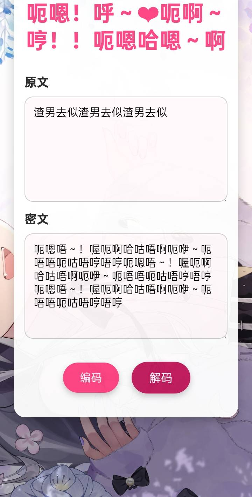

**卡顺密** (2025-08-08 12:02:36):
我说的都是有内核的

**卡顺密** (2025-08-08 12:02:30):
👎

**辰** (2025-08-08 12:02:05):
齁噢噢噢哦哦哦哦哦哦

**卡顺密** (2025-08-08 11:58:49):
<:emoji_149:1382626041352159263>

**卡顺密** (2025-08-08 11:58:34):
反冷暴力宗门 必须谨记的:呃嗯唔～！喔呃啊哈咕唔啊呃咿～呃唔唔呃咕唔哼唔哼呃嗯唔～！喔呃啊哈咕唔啊呃咿～呃唔唔呃咕唔哼唔哼呃嗯唔～！喔呃啊哈咕唔啊呃咿～呃唔唔呃咕唔哼唔哼

**希波鹅拉底** (2025-08-06 11:45:58):
反冲精英

**大爱仙尊** (2025-08-06 03:17:11):
反对反对的，支持支持的<:20:1298294514124984323>

**卡顺密** (2025-08-06 02:39:15):
第2个就不用反对了

**沐 云曦** (2025-08-06 02:38:57):
反对冷暴力，反对亲亲

**大爱仙尊** (2025-08-05 05:49:18):
😴

**辰** (2025-08-05 02:50:36):


**crzwz** (2025-08-04 17:57:11):
冷暴力你们

**Deleted User** (2025-08-04 17:48:06):
反对冷暴力！
（反对舔狗！

**晨** (2025-08-04 17:44:54):
<:emoji_140:1379454014852436038>

**大爱仙尊** (2025-08-04 17:44:02):
支持反对，反对支持

**任白** (2025-08-04 16:36:57):
想你啦

**晨** (2025-08-04 16:28:52):
怎么啦

**晨** (2025-08-04 16:28:51):
<:emoji_140:1383463554782462003>

**任白** (2025-08-04 16:27:20):
小晨老婆

**晨** (2025-08-04 16:04:24):
反对反对

**晨** (2025-08-04 16:04:09):
<:emoji_144:1379832776785788928>

**任白** (2025-08-04 15:57:16):
反对

**辰** (2025-08-04 14:08:07):
这是爱

**XXX** (2025-08-04 13:22:15):
这是啥<:emoji_149:1400309607783727266>

**沐 云曦** (2025-08-04 08:46:24):
反对冷暴力，反对色色

**crzwz** (2025-08-04 03:19:27):
吉吉

**卡顺密** (2025-08-04 03:16:37):
全都与我无关

**卡顺密** (2025-08-04 03:16:30):
等不到你的晚安

**卡顺密** (2025-08-04 03:16:26):
望眼欲穿

**卡顺密** (2025-08-04 03:16:23):
沦为平淡

**卡顺密** (2025-08-04 03:16:19):
开始的倾心交谈

**卡顺密** (2025-08-04 03:16:15):
假装释怀

**卡顺密** (2025-08-04 03:16:11):
一个人的空白

**卡顺密** (2025-08-04 03:15:59):
乎

**卡顺密** (2025-08-04 03:15:55):
你已不在

**卡顺密** (2025-08-04 03:15:51):
我早已习惯

**crzwz** (2025-08-03 16:07:32):
支持首冲

**希波鹅拉底** (2025-08-03 15:59:21):
支持热暴力

**辰** (2025-08-03 14:13:56):
不经意的牵挂却没出息的放不下

**辰** (2025-08-03 14:13:48):
等不到

**辰** (2025-08-03 14:13:42):
你的雪月风花我们的爱有时差

**辰** (2025-08-03 14:13:32):
等不到

**辰** (2025-08-03 14:12:27):
掩饰的雨落下我的眼泪被你觉察

**辰** (2025-08-03 14:12:03):
等不到

**辰** (2025-08-03 14:12:00):
风中你的脸颊眼泪到美都很融洽

**辰** (2025-08-03 14:11:40):
等不到

**辰** (2025-08-03 13:56:39):
对着你冲

**大爱仙尊** (2025-08-03 04:45:39):
色色

**crzwz** (2025-08-03 00:15:41):
吉吉、

**Deleted User** (2025-08-02 21:24:29):
反对冷暴力！
支持健身！

**沐 云曦** (2025-08-02 16:50:21):
反对高温

**沐 云曦** (2025-08-02 16:50:08):
反对冷暴力

**任白** (2025-08-02 16:07:31):
辰这是发自己设了的照片吗

**辰** (2025-08-02 14:05:16):


**任白** (2025-08-02 07:29:21):
贤者时间这一块

**楚枫** (2025-08-02 05:11:15):
小🦌怡性，大🦌伤身，樯橹灰飞烟灭

**Deleted User** (2025-08-02 04:28:16):
<:emoji_140:1383463554782462003>

**任白** (2025-08-02 03:57:49):
反对

**大爱仙尊** (2025-08-02 02:57:34):
色色万岁<:20:1298294514124984323>

**crzwz** (2025-08-01 23:45:41):
色色好

**沐 云曦** (2025-08-01 20:03:13):
反对冷暴力，反对色色

**Deleted User** (2025-08-01 19:53:59):
逮捕你
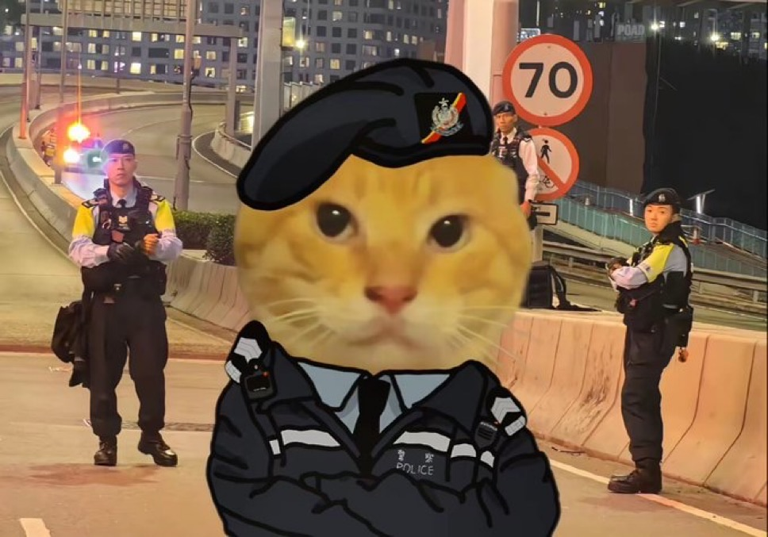

**Deleted User** (2025-08-01 17:14:31):
<:emoji_150:1400317605553766531>

**希波鹅拉底** (2025-08-01 14:38:35):
晨

**晨** (2025-08-01 14:36:58):
发癫呢他

**大爱仙尊** (2025-08-01 14:26:03):
<:1000168510:1298906820638674984>

**希波鹅拉底** (2025-08-01 13:50:03):
何意味

**希波鹅拉底** (2025-08-01 13:49:49):
<:emoji_149:1391405133220282500>

**Deleted User** (2025-08-01 06:17:05):
<:emoji_149:1400299483212021833>

**Deleted User** (2025-08-01 06:16:56):
晨门弟子，比出中指！初音未来，舔舔舔舔！

**晨** (2025-08-01 06:10:11):
<:emoji_150:1400317605553766531>

**Deleted User** (2025-08-01 05:40:05):
<:emoji_149:1400299483212021833>

**晨** (2025-08-01 04:15:26):
乱教人

**晨** (2025-08-01 04:15:13):
<:emoji_142:1379854822315921438>

**Deleted User** (2025-08-01 03:50:16):
<:emoji_141:1379626177068666990>

**Deleted User** (2025-08-01 03:50:05):
晨门弟子，比出中指！圣火耀耀，晨晨万岁！

**楚枫** (2025-08-01 01:00:59):
完了好猥琐

**楚枫** (2025-08-01 01:00:49):
亲亲😽

**沐 云曦** (2025-08-01 00:58:11):
建议亲亲

**沐 云曦** (2025-08-01 00:57:56):
反对冷暴力

**AchenL【辰龙🐉】** (2025-07-31 16:47:35):
<:emoji_149:1400309607783727266>

**晨** (2025-07-31 16:42:05):
<:emoji_147:1379454167302537256>

**Deleted User** (2025-07-31 16:39:17):
反对冷暴力！
支持晨晨比中指！
支持香香软软热乎乎的天使晨晨！

**任白** (2025-07-31 14:26:00):
反对冷暴力

**任白** (2025-07-31 14:25:57):
吭哧吭哧

**crzwz** (2025-07-31 12:37:42):
嘻嘻

**希波鹅拉底** (2025-07-31 11:15:41):
招

**希波鹅拉底** (2025-07-31 11:15:40):
<:emoji_149:1400309607783727266>

**全能沙雕王（光速滑跪版）** (2025-07-31 08:49:55):
不如我的钢门（

**希波鹅拉底** (2025-07-31 02:31:32):
<:emoji_149:1382626041352159263>

**希波鹅拉底** (2025-07-31 02:31:28):
怎么还有晨门

**沐 云曦** (2025-07-31 00:43:51):
反对冷暴力，反对上火

**Deleted User** (2025-07-30 20:17:57):
加入晨门就不阳了

**crzwz** (2025-07-30 19:01:24):
吉吉阳阳德

**Deleted User** (2025-07-30 16:48:56):
<:1000168534:1298906727495766057>

**Deleted User** (2025-07-30 16:48:50):
好卑微

**晨** (2025-07-30 14:12:36):
<:emoji_143:1379855104622202900> 我无反心啊老师

**任白** (2025-07-30 09:45:54):
那你们开个别的区

**Deleted User** (2025-07-30 04:46:14):
<:1000168532:1298906722546614313>

**Deleted User** (2025-07-30 04:46:06):
反对冷暴力！
支持香香热乎乎晨门！

**Deleted User** (2025-07-30 04:41:34):
封你为晨门第一任门主<:07:1298281204260278383>

**AchenL【辰龙🐉】** (2025-07-30 04:22:58):
🛐

**AchenL【辰龙🐉】** (2025-07-30 04:22:54):
晨门

**AchenL【辰龙🐉】** (2025-07-30 04:22:46):
确实，支持香香热乎乎的晨晨

**crzwz** (2025-07-30 02:53:44):
吉吉

**Deleted User** (2025-07-29 18:51:14):
支持香香又热乎乎的晨晨！

**Deleted User** (2025-07-29 18:50:45):
<:emoji_149:1382626041352159263>

**晨** (2025-07-29 18:49:17):
？

**Deleted User** (2025-07-29 18:42:37):
<:emoji_135:1380973007304003684>

**Deleted User** (2025-07-29 18:42:30):
反对冷晨晨！（应该不会被看到吧

**crzwz** (2025-07-29 14:29:51):
叽里咕噜的说什么呢

**crzwz** (2025-07-29 14:29:44):
操我

**Deleted User** (2025-07-28 14:22:54):
反对冷暴力！


**希波鹅拉底** (2025-07-28 07:45:08):
难绷

**希波鹅拉底** (2025-07-28 07:44:51):
<:1000168518:1298906830864519231>

**crzwz** (2025-07-27 20:22:23):
反对吉吉、

**任白** (2025-07-27 11:14:40):
你素

**任白** (2025-07-27 11:14:35):
<:1000168531:1298906724979310634>

**Xiadie - Alicia** (2025-07-27 11:12:47):
反对冷暴力

**crzwz** (2025-07-27 06:47:56):
吉吉阳阳德

**楚枫** (2025-07-27 04:21:18):
反对冷暴力！

**Mr.Koalefant** (2025-07-27 04:15:58):
反对冷暴力，支持姆姆

**晨** (2025-07-27 03:24:44):
<:emoji_146:1379832810528837704>

**晨** (2025-07-27 03:24:36):
反对冷暴力~

**任白** (2025-07-27 02:59:02):
反对反对

**沐 云曦** (2025-07-27 02:15:41):
反对冷暴力，反对酸

**crzwz** (2025-07-27 01:49:16):
反对冷暴力

**晨** (2025-07-26 14:47:38):
<:emoji_140:1383463554782462003>

**crzwz** (2025-07-26 14:46:42):
提倡热吉吉

**crzwz** (2025-07-26 14:46:38):
反对冷暴力

**手磨咖啡机** (2025-07-26 14:01:25):
反对冷暴力

**任白** (2025-07-26 12:52:20):
<:emoji_140:1379454014852436038>

**任白** (2025-07-26 12:52:18):
亲亲亲亲

**沐 云曦** (2025-07-26 12:51:52):
mua

**沐 云曦** (2025-07-26 12:51:50):
亲亲老师

**任白** (2025-07-26 12:51:06):
反对冷暴力

**沐 云曦** (2025-07-26 10:54:54):
反对冷暴力

**crzwz** (2025-07-26 09:08:45):
他说我是笨比

**crzwz** (2025-07-26 09:08:40):
冷暴力鹅先生

**crzwz** (2025-07-25 17:38:13):
吉吉是王道

**沐 云曦** (2025-07-25 16:19:50):
反对领暴力！.亲亲才是王道！

**crzwz** (2025-07-24 17:43:28):
打搅

**晨** (2025-07-24 16:59:22):
<:emoji_144:1379832776785788928>

**任白** (2025-07-24 16:58:37):
反对

**楚枫** (2025-07-24 13:31:03):
两天不打

**楚枫** (2025-07-24 13:30:53):
一天不打积阳德

**crzwz** (2025-07-24 12:23:27):
吉吉

**crzwz** (2025-07-24 12:23:24):
了

**任白** (2025-07-24 11:58:08):
反对反对

**大爱仙尊** (2025-07-24 10:10:07):
抓住鸡蛊，顷刻练化<:08:1298281401715785789>

**大爱仙尊** (2025-07-24 10:09:08):

**crzwz** (2025-07-24 03:31:48):
吉吉暴力

**辰** (2025-07-23 14:16:47):
你说我的胸膛会让你感到暖

**辰** (2025-07-23 14:16:28):
然后再世界的一个角有了一个我们的家

**辰** (2025-07-23 14:16:07):
你会不会至今停在说爱我的那天

**辰** (2025-07-23 14:15:29):
如果时间忘记了转忘了带走什么

**crzwz** (2025-07-23 01:39:13):
绝了

**crzwz** (2025-07-23 01:39:11):
吉吉阳阳德

**楚枫** (2025-07-23 01:02:31):
胡几巴实名反对冷暴力

**沐 云曦** (2025-07-22 22:47:46):
反对冷暴力！

**crzwz** (2025-07-21 09:34:47):
吉吉暴力支持

**沐 云曦** (2025-07-21 07:44:12):
唔，事到如此，那只能通过床上功夫决斗了！来吧前辈！亲亲！muamuamua此乃种草莓之术！

**卡顺密** (2025-07-21 07:43:25):
热暴力我支持😋

**卡顺密** (2025-07-21 07:42:49):
这个不能

**沐 云曦** (2025-07-21 07:42:23):
热暴力也反对喵

**沐 云曦** (2025-07-21 07:42:12):
反对冷暴力！

**任白** (2025-07-20 13:18:12):

**任白** (2025-07-20 13:18:03):
你也是我的老婆

**任白** (2025-07-20 13:17:59):
没事的

**沐 云曦** (2025-07-20 13:17:08):
<:24:1298294525390753924>

**沐 云曦** (2025-07-20 13:17:04):
呜呜呜，对不起任白先生，对不起，是人家错了啦，不要生气嘛，姐姐那么好，是我多余了

**卡顺密** (2025-07-20 13:15:03):
<:emoji_142:1379854822315921438>

**任白** (2025-07-20 13:15:00):
滚

**任白** (2025-07-20 13:14:53):
<:emoji_140:1383463567541665874>

**卡顺密** (2025-07-20 13:14:53):
谁老婆你是不是搞错了

**任白** (2025-07-20 13:14:50):
不过你也是我的老婆

**卡顺密** (2025-07-20 13:14:48):
你等等

**任白** (2025-07-20 13:14:34):
你凭什么亲我老婆

**沐 云曦** (2025-07-20 13:03:04):
小户老师!亲亲，可爱的老师

**任白** (2025-07-20 12:38:32):
我操这里居然出现过小户

**任白** (2025-07-20 12:38:16):
好奇怪的话

**任白** (2025-07-20 12:38:09):
？

**xi** (2025-07-20 11:41:54):
这里一定发生过什么

**crzwz** (2025-07-20 07:16:56):
玩vrc了

**任白** (2025-07-20 07:07:12):
红掌拨清波

**任白** (2025-07-20 07:07:07):
白毛浮绿水

**任白** (2025-07-20 07:07:05):
曲项向天歌

**任白** (2025-07-20 07:07:02):
鹅鹅鹅

**crzwz** (2025-07-20 07:05:02):
别呀鹅先生

**crzwz** (2025-07-20 07:04:57):
a

**希波鹅拉底** (2025-07-20 05:08:07):
不理doro了

**希波鹅拉底** (2025-07-20 05:08:03):
冷暴力

**crzwz** (2025-07-20 04:42:50):
就先冷暴力你

**crzwz** (2025-07-20 04:42:45):
狠狠冷冷

**crzwz** (2025-07-20 04:42:41):
冷包力好

**沐 云曦** (2025-07-20 03:06:13):
责

**沐 云曦** (2025-07-20 03:06:10):
人人有

**沐 云曦** (2025-07-20 03:06:00):
立即停止冷暴力

**任白** (2025-07-20 02:04:48):
立

**任白** (2025-07-20 02:04:46):
反对冷暴

**crzwz** (2025-07-19 09:52:42):
吉吉吧

**沐 云曦** (2025-07-19 09:19:13):
反对冷暴力！

**crzwz** (2025-07-19 02:35:46):
吧

**任白** (2025-07-19 02:09:03):
冷暴力

**任白** (2025-07-19 02:08:52):
反对

**希波鹅拉底** (2025-07-19 00:53:56):
完蛋吧赶紧

**希波鹅拉底** (2025-07-19 00:53:47):
一个笨比一个复读机

**希波鹅拉底** (2025-07-19 00:53:37):
<:emoji_114:1379110202694963270>

**沐 云曦** (2025-07-18 23:34:51):
反对吉吉阳阳德

**crzwz** (2025-07-18 23:34:15):
反对吉吉阳阳德

**沐 云曦** (2025-07-18 09:42:43):
反对喵内*2

**沐 云曦** (2025-07-17 16:11:13):
反对!

**任白** (2025-07-17 14:32:59):
反对

**希波鹅拉底** (2025-07-17 13:59:21):
<:20:1298294514124984323>

**手磨咖啡机** (2025-07-15 19:42:26):
支持冷暴力

**全能沙雕王（光速滑跪版）** (2025-07-15 18:13:21):
😭

**全能沙雕王（光速滑跪版）** (2025-07-15 18:13:19):
太痛苦了，太痛苦了——！！！

**全能沙雕王（光速滑跪版）** (2025-07-15 18:11:27):
因为热啊，45度啊，亲娘——！！！
我要熟了

**任白** (2025-07-15 16:47:49):
恶魔

**晨** (2025-07-15 16:45:40):
<:emoji_144:1379454084750245939>

**晨** (2025-07-15 16:45:36):
反对冷暴力

**晨** (2025-07-15 16:45:24):
为什么有人又反冷暴力又冷暴力啊

**晨** (2025-07-15 16:45:06):
<:emoji_68:1305519380343427202>

**全能沙雕王（光速滑跪版）** (2025-07-15 07:07:14):
快来冷暴力我

**全能沙雕王（光速滑跪版）** (2025-07-15 07:07:09):
要被热死了

**全能沙雕王（光速滑跪版）** (2025-07-15 07:07:04):
🥵

**全能沙雕王（光速滑跪版）** (2025-07-15 07:06:55):
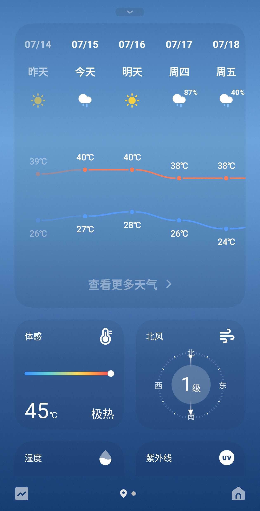

**辰** (2025-07-15 05:03:14):
没有人像我和陌生人一样的爱恋

**辰** (2025-07-15 05:02:58):
没有人了解

**辰** (2025-07-15 05:02:49):
请告诉我怎么走到终点

**辰** (2025-07-15 05:02:41):
一切新鲜有点冒险

**辰** (2025-07-15 05:02:10):
我抱歉不能说明

**辰** (2025-07-15 05:01:57):
这感觉太奇异

**辰** (2025-07-15 05:01:38):
去阻挡这一切的亲密

**辰** (2025-07-15 05:01:18):
我找不到很好的原因

**任白** (2025-07-14 12:44:28):
反对冷暴力

**味道≠天秤♎ TKN** (2025-07-13 16:29:44):
但是新地球确实很好听

**手磨咖啡机** (2025-07-13 16:18:59):
你别管😋

**任白** (2025-07-13 16:18:18):
这歌词不太符合我们的调调吧

**手磨咖啡机** (2025-07-13 16:17:49):
😭

**手磨咖啡机** (2025-07-13 16:17:44):
新地球 他们跑不了 像是个圈套 只能庸庸碌碌到老

**晨** (2025-07-13 15:31:03):
<:emoji_148:1382433614175928431>

**任白** (2025-07-13 15:27:35):
😭

**任白** (2025-07-13 15:27:32):
你却微笑的离我而去

**任白** (2025-07-13 15:27:27):
描述我如何爱你

**任白** (2025-07-13 15:27:23):
还来不及 仔仔细细写下你的关于

**任白** (2025-07-13 13:51:17):
反对冷暴力

**手磨咖啡机** (2025-07-13 11:25:33):
冷暴力

**全能沙雕王（光速滑跪版）** (2025-07-13 11:19:55):
好热，能不能来个人冷暴力一下我🥵

**ppc** (2025-07-13 11:02:36):
<:1000168518:1298906830864519231>

**手磨咖啡机** (2025-07-13 09:24:12):
<:1000168518:1298906830864519231>

**辰** (2025-07-13 09:22:45):


**手磨咖啡机** (2025-07-13 08:49:48):
支持

**手磨咖啡机** (2025-07-12 14:33:35):
支持

**辰** (2025-07-12 14:19:15):
<:emoji_89:1378950692655464492>

**味道≠天秤♎ TKN** (2025-07-12 14:12:39):
韩了

**味道≠天秤♎ TKN** (2025-07-12 14:12:35):
好图

**辰** (2025-07-12 14:11:49):
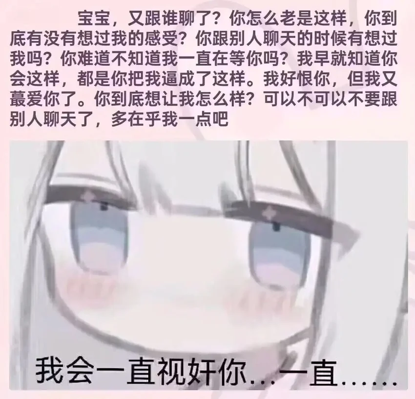

**crzwz** (2025-07-12 06:57:51):
吉吉阳阳德

**任白** (2025-07-12 05:53:13):
<:emoji_150:1393302061453672520>

**卡顺密** (2025-07-12 05:48:06):
宝宝

**任白** (2025-07-12 05:47:25):
反对冷暴力

**任白** (2025-07-12 05:47:22):
<:emoji_150:1393302061453672520>

**手磨咖啡机** (2025-07-12 05:39:39):
<:emoji_150:1393302061453672520>

**辰** (2025-07-12 03:37:32):
<:emoji_150:1393302061453672520>

**crzwz** (2025-07-11 22:27:53):
烦烦

**任白** (2025-07-11 18:55:40):
<:emoji_150:1393302061453672520>

**晨** (2025-07-11 18:51:29):
<:emoji_80:1378945762422952098>

**任白** (2025-07-11 18:46:01):
忍痛删了一个

**任白** (2025-07-11 18:45:54):
格子满了

**任白** (2025-07-11 18:45:49):
然后我发现我还真加不了

**任白** (2025-07-11 18:45:40):
窝说这句话就系自己要去加了

**晨** (2025-07-11 18:45:23):
老师为什么不加

**任白** (2025-07-11 18:42:25):
把这个加到表情包里

**任白** (2025-07-11 18:42:21):


**任白** (2025-07-11 18:42:10):
怼饭

**xi** (2025-07-11 18:40:28):
饭对

**手磨咖啡机** (2025-07-11 17:05:05):
支持

**任白** (2025-07-11 16:45:47):
想某人了

**晨** (2025-07-11 16:44:33):
<:emoji_144:1379454084750245939>

**任白** (2025-07-11 16:42:07):
<:emoji_144:1379454084750245939>

**任白** (2025-07-11 16:41:58):
酒精尼古丁都戒不掉对你的情深

**任白** (2025-07-11 16:41:36):
太多的回忆在我灵魂里生根

**任白** (2025-07-11 16:41:19):
我却弄丢我们恋人的身份

**任白** (2025-07-11 16:41:03):
baby 你占满了我这颗心的内存

**味道≠天秤♎ TKN** (2025-07-11 15:03:33):
别人不找我我绝对不找别人

**味道≠天秤♎ TKN** (2025-07-11 15:03:21):
我都是被动冷暴力的

**晨** (2025-07-11 15:03:10):
<:emoji_149:1382434166666432674> 支持是吧

**味道≠天秤♎ TKN** (2025-07-11 15:02:51):
支持

**晨** (2025-07-11 15:02:50):
就是

**手磨咖啡机** (2025-07-11 15:02:45):
支持

**晨** (2025-07-11 15:02:40):
？

**希波鹅拉底** (2025-07-11 14:53:31):
<:emoji_114:1379110202694963270>

**希波鹅拉底** (2025-07-11 14:53:27):
跟蟑螂窝一样，自动刷新

**希波鹅拉底** (2025-07-11 14:53:11):
怎么又这么对人一样

**希波鹅拉底** (2025-07-11 14:53:02):
这个

**楚枫** (2025-07-11 08:26:56):
支持反对冷暴力

**任白** (2025-07-11 07:46:13):
？

**crzwz** (2025-07-11 06:10:57):
射

**晨** (2025-07-11 03:30:58):
反对

**旅人** (2025-07-11 03:19:08):
支持

**任白** (2025-07-11 02:39:53):
反

**crzwz** (2025-07-10 22:22:01):
暴利

**晨** (2025-07-10 20:43:06):
反对

**手磨咖啡机** (2025-07-10 18:25:20):
支持

**卡顺密** (2025-07-10 10:53:51):
<:emoji_149:1382626041352159263>

**卡顺密** (2025-07-10 10:53:45):
我看你也是想似了

**卡顺密** (2025-07-10 10:53:33):
支持冷暴力？

**任白** (2025-07-10 10:53:12):
支持

**卡顺密** (2025-07-10 10:33:34):
<:emoji_141:1379626177068666990>

**卡顺密** (2025-07-10 10:33:03):
亲亲宝宝

**xi** (2025-07-10 10:32:08):
饭怼

**楚枫** (2025-07-10 10:25:19):
反对冷暴力

**任白** (2025-07-10 10:10:21):
反对冷暴力

**xi** (2025-07-09 13:14:48):

**AchenL【辰龙🐉】** (2025-07-09 08:16:27):
<:1000168518:1298906830864519231>

**味道≠天秤♎ TKN** (2025-07-09 07:51:31):
<:emoji_149:1382626041352159263>

**卡顺密** (2025-07-09 07:42:48):
我要大调查你

**任白** (2025-07-09 07:12:48):
好梦

**任白** (2025-07-09 07:12:46):
晚安

**任白** (2025-07-09 07:12:44):
贴贴

**晨** (2025-07-09 07:11:54):
（撒娇）老师贴贴

**晨** (2025-07-09 07:11:43):
<:emoji_132:1379388256113917993>

**晨** (2025-07-09 07:11:25):
好...好吧（心虚）

**晨** (2025-07-09 07:11:15):
<:emoji_149:1382434166666432674>

**任白** (2025-07-09 07:11:05):
会回你还冷暴力？

**任白** (2025-07-09 07:10:51):
晚安

**晨** (2025-07-09 07:10:40):
？

**任白** (2025-07-09 07:10:20):
（晚安）

**任白** (2025-07-09 07:10:11):
不要

**晨** (2025-07-09 07:09:57):
和我说晚安

**晨** (2025-07-09 07:09:53):
老师

**任白** (2025-07-09 07:09:37):
<:1000168518:1298906830864519231>

**crzwz** (2025-07-09 07:04:24):
你们

**crzwz** (2025-07-09 07:04:22):
冷暴力

**晨** (2025-07-09 05:41:15):
<:emoji_139:1379455053080825866> 同学朋友

**味道≠天秤♎ TKN** (2025-07-09 05:40:08):
不到啊

**手磨咖啡机** (2025-07-09 05:30:23):
谁要被大调查了😨

**卡顺密** (2025-07-09 05:30:10):
<:emoji_150:1389291898224640060>

**卡顺密** (2025-07-09 05:28:56):
入我宗门都是要经过详细调查的

**卡顺密** (2025-07-09 05:28:49):
被谁害过

**晨** (2025-07-09 05:00:16):
可以退出吗

**晨** (2025-07-09 05:00:12):
那老师现在也没被暴力

**晨** (2025-07-09 04:59:59):
<:1000168518:1298906830864519231>

**任白** (2025-07-09 04:57:28):
办案去了

**任白** (2025-07-09 04:57:25):
<:emoji_147:1385908979460214866>

**任白** (2025-07-09 04:57:01):
现在没被害那就是已经退出了

**晨** (2025-07-09 04:56:42):
不能进吗

**晨** (2025-07-09 04:56:40):
被害过

**任白** (2025-07-09 04:56:12):
宗门的两位长老会倾听大家被冷暴力了的苦楚

**任白** (2025-07-09 04:55:45):
<:emoji_142:1379854822315921438>

**任白** (2025-07-09 04:55:34):
你没被害进什么

**任白** (2025-07-09 04:55:30):
这是被害者联盟

**晨** (2025-07-09 04:55:17):
我能进吗

**晨** (2025-07-09 04:55:11):
所以宗门

**晨** (2025-07-09 04:55:03):
接力成功！

**任白** (2025-07-09 04:54:55):
立

**味道≠天秤♎ TKN** (2025-07-09 04:51:11):
<:08:1298281401715785789>

**味道≠天秤♎ TKN** (2025-07-09 04:51:05):
鼓掌鼓掌

**楚枫** (2025-07-09 04:46:31):
力

**xi** (2025-07-09 03:57:06):
暴

**味道≠天秤♎ TKN** (2025-07-09 03:38:40):
冷

**晨** (2025-07-09 03:34:56):
对

**任白** (2025-07-09 03:13:58):
反

**crzwz** (2025-07-08 20:49:57):
我刚买的大肉棒

**crzwz** (2025-07-08 20:49:51):
我要打晕你

**晨** (2025-07-08 20:49:42):
痒就挠挠

**晨** (2025-07-08 20:49:31):
<:emoji_149:1382434166666432674>

**crzwz** (2025-07-08 20:49:25):
因为我吉吉阳阳德

**crzwz** (2025-07-08 20:49:19):
对的

**crzwz** (2025-07-08 20:49:18):
对的

**晨** (2025-07-08 20:49:13):
你怎么这么坏

**crzwz** (2025-07-08 20:30:37):
暴力你们

**手磨咖啡机** (2025-07-08 02:26:16):
<:emoji_150:1391774976864161793>

**crzwz** (2025-07-08 01:53:31):
<:emoji_150:1391774976864161793>

**希波鹅拉底** (2025-07-08 00:43:54):
<:emoji_149:1382434166666432674>

**希波鹅拉底** (2025-07-08 00:43:44):
浓缩咖啡

**手磨咖啡机** (2025-07-07 16:42:51):
你怎么知道健身房教练每天请我喝浓缩咖啡

**全能沙雕王（光速滑跪版）** (2025-07-07 16:28:52):
实则不然<@1327930413070684181>

**任白** (2025-07-07 16:14:57):
你现在才知道？

**任白** (2025-07-07 16:14:41):
反对冷暴力

**希波鹅拉底** (2025-07-07 14:35:01):
<:emoji_147:1379454167302537256>

**希波鹅拉底** (2025-07-07 14:34:56):
byd每天一杯咖啡去上课就要了我7块了

**希波鹅拉底** (2025-07-07 14:34:36):
<:emoji_89:1378950692655464492>

**希波鹅拉底** (2025-07-07 14:34:33):
<@1144708955344474262>咖啡姬去给我磨咖啡

**希波鹅拉底** (2025-07-07 14:34:20):
智齿冷暴力

**卡顺密** (2025-07-07 11:59:04):
那很绝望了

**手磨咖啡机** (2025-07-06 13:23:56):
那只需要他不对你好，那就没有啦😋

**卡顺密** (2025-07-06 13:15:11):
<:emoji_133:1379494883227734157>

**卡顺密** (2025-07-06 13:15:05):
这个群对我好的就只有你了

**卡顺密** (2025-07-06 13:14:57):
<@1327930413070684181> 我不应该错怪你的

**卡顺密** (2025-07-06 13:04:02):
对是什么

**任白** (2025-07-06 13:03:43):
反力冷暴对

**任白** (2025-07-06 02:55:32):
冷暴力一下我吧

**任白** (2025-07-06 02:55:26):
天气热了

**crzwz** (2025-07-05 19:54:41):
冷餐力任白

**任白** (2025-07-05 19:42:47):
<:emoji_148:1386006416136863796>

**xi** (2025-07-05 19:41:56):
饭对饭对

**任白** (2025-07-05 18:05:30):
反对反对

**晨** (2025-07-05 17:48:24):
反对冷暴力！

**晨** (2025-07-05 17:48:17):
<:emoji_144:1379454084750245939>

**晨** (2025-07-05 17:47:18):
反对反对

**手磨咖啡机** (2025-07-05 17:44:47):
<:20:1298294514124984323> <:20:1298294514124984323>

**crzwz** (2025-07-05 15:44:41):
<:20:1298294514124984323> <:20:1298294514124984323>

**任白** (2025-07-05 15:41:51):
？

**crzwz** (2025-07-05 15:38:59):
任白冷暴力我

**任白** (2025-07-05 14:58:07):
反对冷暴力

**任白** (2025-07-05 12:56:48):
反对冷暴力

**希波鹅拉底** (2025-07-05 12:33:05):
<:1000168518:1298906830864519231>

**希波鹅拉底** (2025-07-05 12:33:02):
就是咖啡姬

**crzwz** (2025-07-05 12:11:27):
冷几把

**手磨咖啡机** (2025-07-05 12:06:08):
那还是咖啡姬好听😋

**卡顺密** (2025-07-05 11:59:17):
<:emoji_150:1389289893435539657>

**卡顺密** (2025-07-05 11:59:10):
小机机

**手磨咖啡机** (2025-07-05 11:58:46):
我又是咖啡姬了🤔

**晨** (2025-07-04 17:16:12):
<:emoji_144:1379454084750245939>

**晨** (2025-07-04 17:16:09):
反对冷暴力！

**任白** (2025-07-04 17:14:22):
反反对对冷冷暴暴力力

**卡顺密** (2025-07-04 12:17:05):
<:1000168518:1298906830864519231>

**crzwz** (2025-07-04 06:33:22):
呼啦呼啦咕噜噜

**晨** (2025-07-04 06:13:29):
<:emoji_148:1389292022120185897>

**任白** (2025-07-04 06:00:11):
啊西噶啊西

**任白** (2025-07-04 06:00:09):
哈基米那没路多

**卡顺密** (2025-07-04 05:58:12):
<:emoji_148:1382329938404839586>

**卡顺密** (2025-07-04 05:58:02):
人基合一这一块

**卡顺密** (2025-07-04 05:57:38):
给他肉他也不吃

**卡顺密** (2025-07-04 05:57:32):
我家猫好像跟我绑定了

**卡顺密** (2025-07-04 05:57:10):
<:emoji_148:1382329938404839586>

**任白** (2025-07-04 05:57:04):
大便超人

**任白** (2025-07-04 05:56:57):
<:emoji_147:1385908979460214866>

**卡顺密** (2025-07-04 05:56:55):
喷射三次了

**卡顺密** (2025-07-04 05:56:48):
一早起来就疼

**卡顺密** (2025-07-04 05:56:43):
不知道

**任白** (2025-07-04 05:56:37):
吃啥了

**卡顺密** (2025-07-04 05:56:36):
<:emoji_148:1382433614175928431>

**任白** (2025-07-04 05:56:33):
咋了

**卡顺密** (2025-07-04 05:56:24):
肚子快疼死了

**任白** (2025-07-04 05:56:14):
你什么时候雄起过

**卡顺密** (2025-07-04 05:55:50):
我要陨落了

**任白** (2025-07-04 05:52:58):
反对冷暴力

**crzwz** (2025-07-03 17:54:53):
冷暴力了

**任白** (2025-07-03 14:52:21):
<:emoji_144:1379454084750245939>

**任白** (2025-07-03 14:52:14):
调整呼吸 写下 不管多少时间我会等你

**任白** (2025-07-03 14:51:43):
需要勇气来面对决心

**任白** (2025-07-03 14:51:35):
爱情总是不能被预期

**任白** (2025-07-03 14:51:19):
那是爱情 带来的讯息让自己傻的很确定

**任白** (2025-07-03 14:50:59):
多么想要躺在你怀里

**任白** (2025-07-03 14:50:52):
想念变成空气在叹息

**希波鹅拉底** (2025-07-03 06:16:13):
咖啡姬

**旅人** (2025-07-03 04:22:33):
？

**任白** (2025-07-03 03:23:35):
反对冷暴力

**crzwz** (2025-07-03 01:50:52):
啊

**手磨咖啡机** (2025-07-02 18:24:56):
复活！

**xi** (2025-07-02 17:44:49):
反对冷暴力

**旅人** (2025-07-02 13:11:06):
？

**任白** (2025-07-02 11:27:58):
反对冷暴力

**卡顺密** (2025-07-02 07:39:26):
？

**希波鹅拉底** (2025-07-02 07:39:21):
<:emoji_149:1382626041352159263>

**希波鹅拉底** (2025-07-02 07:39:10):
斯卡文鼠人怎么赚钱这么多

**希波鹅拉底** (2025-07-02 07:38:54):
我去

**卡顺密** (2025-07-01 14:11:24):
<:1000168518:1298906830864519231>

**crzwz** (2025-07-01 07:09:23):
冷

**晨** (2025-07-01 05:44:18):
反对冷暴力~

**crzwz** (2025-07-01 05:37:46):
反对反对

**任白** (2025-07-01 04:12:00):
反对冷暴力

**希波鹅拉底** (2025-06-30 17:12:31):
<:emoji_148:1389292035999137825>

**味道≠天秤♎ TKN** (2025-06-30 16:44:28):
这里又变热闹了

**crzwz** (2025-06-30 01:49:04):
冷

**任白** (2025-06-30 01:30:43):
<:10:1298285710033424446>

**crzwz** (2025-06-30 01:27:25):
让你们一边被撅一边冷暴力

**crzwz** (2025-06-30 01:27:16):
狠狠地撅你们

**卡顺密** (2025-06-30 01:25:17):
<:emoji_142:1379854822315921438>

**任白** (2025-06-30 01:17:42):
<:emoji_147:1385908979460214866>

**晨** (2025-06-30 01:17:21):
顺便摸摸老师

**晨** (2025-06-30 01:17:03):
反对冷暴力！

**任白** (2025-06-30 01:12:20):
<:emoji_144:1379454084750245939>

**任白** (2025-06-30 01:12:16):
反对冷暴力

**crzwz** (2025-06-29 23:25:28):
反对反对

**xi** (2025-06-29 18:39:44):
<:emoji_144:1379454084750245939>

**xi** (2025-06-29 18:39:27):
反对冷暴力

**任白** (2025-06-29 16:49:22):
喵喵

**crzwz** (2025-06-29 16:47:03):
冷冷

**crzwz** (2025-06-29 16:46:53):
冷暴力

**任白** (2025-06-29 15:44:17):
<:emoji_144:1379454084750245939>

**任白** (2025-06-29 15:44:14):
反对冷暴力

**晨** (2025-06-29 15:41:27):
<:emoji_144:1379454084750245939> 反对冷暴力！

**晨** (2025-06-29 15:41:17):
回了就好

**晨** (2025-06-29 15:41:12):
还以为不理我

**任白** (2025-06-29 15:40:06):
咋了

**晨** (2025-06-29 15:38:12):
看眼我呢

**晨** (2025-06-29 15:38:09):
老师老师

**晨** (2025-06-29 15:38:05):
？

**任白** (2025-06-29 15:34:09):
反对冷暴力

**晨** (2025-06-29 15:06:36):
来不了

**晨** (2025-06-29 15:06:33):
我寻思我也没醒

**晨** (2025-06-29 15:06:16):
？

**卡顺密** (2025-06-29 13:42:24):
<:emoji_147:1379454167302537256>

**卡顺密** (2025-06-29 13:42:16):
独自睡去..

**卡顺密** (2025-06-29 13:39:24):
只有我独自一人

**卡顺密** (2025-06-29 13:39:13):
没有一个真正的想要反冷暴力的人类

**卡顺密** (2025-06-29 13:38:35):
如此绝望阿

**卡顺密** (2025-06-29 13:37:05):
一边遗忘一边拼凑

**卡顺密** (2025-06-29 13:36:41):
往事流转在你眼眸

**卡顺密** (2025-06-29 13:12:03):
<:emoji_147:1379454167302537256>

**卡顺密** (2025-06-29 13:11:59):
唉

**卡顺密** (2025-06-29 13:11:56):
洗吧，我再哭一会

**任白** (2025-06-29 13:11:40):
洗澡去了

**卡顺密** (2025-06-29 13:11:25):
<:emoji_147:1379454167302537256>

**任白** (2025-06-29 13:11:22):
给我钱呗

**卡顺密** (2025-06-29 13:11:20):
关键是还不一定接

**任白** (2025-06-29 13:11:18):
我陪你玩

**卡顺密** (2025-06-29 13:11:12):
我叫人陪我玩还得花钱

**卡顺密** (2025-06-29 13:11:02):
你求的来已经很好了

**任白** (2025-06-29 13:10:59):
等会估计就不跟我玩了

**任白** (2025-06-29 13:10:54):
现在发消息已经不理我了

**任白** (2025-06-29 13:10:42):
求来的

**任白** (2025-06-29 13:10:40):
唉

**卡顺密** (2025-06-29 13:10:02):
你怎么还有人陪的

**卡顺密** (2025-06-29 13:09:57):
？

**卡顺密** (2025-06-29 13:09:52):
我帮你注意一下周围的环境

**任白** (2025-06-29 13:09:51):
等会要和别人打游戏

**任白** (2025-06-29 13:09:46):
开

**卡顺密** (2025-06-29 13:09:40):
开直播

**任白** (2025-06-29 13:09:34):
洗澡去了

**任白** (2025-06-29 13:09:31):
<:emoji_147:1379454167302537256>

**任白** (2025-06-29 13:09:26):
也只好做唉了

**卡顺密** (2025-06-29 13:09:21):
<:emoji_147:1379454167302537256>

**任白** (2025-06-29 13:09:17):
唉

**卡顺密** (2025-06-29 13:09:14):
唉

**任白** (2025-06-29 13:09:12):
唉

**任白** (2025-06-29 13:09:06):
一个来看我们的都没有

**任白** (2025-06-29 13:09:00):
看他们在那里聊的这么开心

**卡顺密** (2025-06-29 13:08:28):
都是命啊

**卡顺密** (2025-06-29 13:08:21):
唉

**任白** (2025-06-29 13:07:52):
看着很命苦

**任白** (2025-06-29 13:07:49):
不带派

**卡顺密** (2025-06-29 13:07:45):
怎么我头像没换

**卡顺密** (2025-06-29 13:07:33):
带不带派

**卡顺密** (2025-06-29 13:06:01):
我得改头换面一下了

**任白** (2025-06-29 13:05:34):
可艾可草

**任白** (2025-06-29 13:05:15):
可冷可暴

**任白** (2025-06-29 13:05:08):
可悲可叹

**任白** (2025-06-29 13:05:05):
唉

**卡顺密** (2025-06-29 13:04:57):
😭

**卡顺密** (2025-06-29 13:04:54):
最后所有的伤害全算在我们两个身上

**任白** (2025-06-29 13:04:53):
😭

**任白** (2025-06-29 13:04:50):
这不纯纯冷暴力到底吗

**卡顺密** (2025-06-29 13:04:46):
😭

**卡顺密** (2025-06-29 13:04:43):
骂我们神人的没有了

**任白** (2025-06-29 13:04:43):
😭

**任白** (2025-06-29 13:04:29):
骂我们发癫的也没有了

**任白** (2025-06-29 13:04:24):
也没有人搭理我们

**任白** (2025-06-29 13:04:22):
我们两个在这里说这些

**任白** (2025-06-29 13:04:14):
😭

**卡顺密** (2025-06-29 13:04:09):
😭

**卡顺密** (2025-06-29 13:04:07):
现在连个服务员都凑不出来

**任白** (2025-06-29 13:04:05):
唉

**卡顺密** (2025-06-29 13:04:01):
全都是玩梗

**卡顺密** (2025-06-29 13:03:56):
我们也是够可怜的

**任白** (2025-06-29 13:03:50):
吃醋可爱捏

**卡顺密** (2025-06-29 13:03:22):
😭

**卡顺密** (2025-06-29 13:03:20):
那种无力感你知道吗

**卡顺密** (2025-06-29 13:03:15):

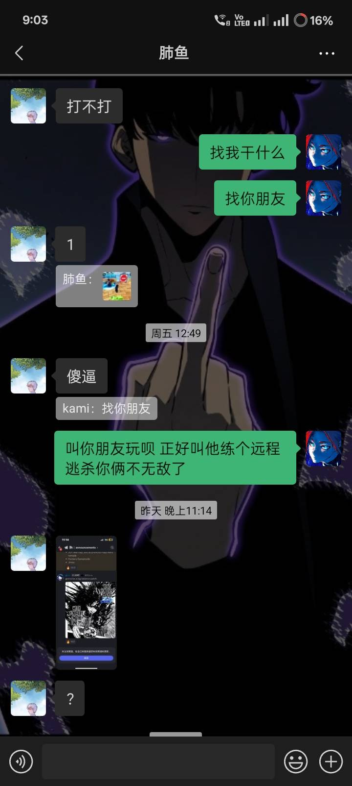


**任白** (2025-06-29 13:03:10):
那咋整啊

**任白** (2025-06-29 13:03:08):
“店里忙没空冷暴力你”

**任白** (2025-06-29 13:02:46):
我这边哭了不好找人啊

**任白** (2025-06-29 13:02:28):
诶服务员，冷暴力一下我呗

**任白** (2025-06-29 13:02:05):
没有冷暴力哭着不得劲

**卡顺密** (2025-06-29 13:01:51):
😭

**卡顺密** (2025-06-29 13:01:49):
别影响心情了

**任白** (2025-06-29 13:01:48):
😭

**卡顺密** (2025-06-29 13:01:44):
行了，接着哭吧

**任白** (2025-06-29 13:01:19):
这扯不扯

**卡顺密** (2025-06-29 13:01:16):
😭

**卡顺密** (2025-06-29 13:01:14):
我哭一个不就完了

**卡顺密** (2025-06-29 13:01:08):
那你都说兄弟了

**任白** (2025-06-29 13:01:00):
要不我再去给你买个手机？

**任白** (2025-06-29 13:00:49):
对不起奥兄弟

**卡顺密** (2025-06-29 13:00:33):
😭

**卡顺密** (2025-06-29 13:00:31):
这扯不扯

**卡顺密** (2025-06-29 13:00:28):
不是哥们儿 我手机就你一个人的是吧 监控都崩我脸上了

**任白** (2025-06-29 13:00:02):
😭

**任白** (2025-06-29 13:00:00):
还得去求着他来玩是吧

**卡顺密** (2025-06-29 12:59:50):
😭

**任白** (2025-06-29 12:59:49):
😭

**卡顺密** (2025-06-29 12:59:48):
用完就丢

**任白** (2025-06-29 12:59:44):
都是玩梗

**卡顺密** (2025-06-29 12:59:39):
😭

**任白** (2025-06-29 12:59:39):
其他人

**卡顺密** (2025-06-29 12:59:37):
主要是他还不止我一个

**任白** (2025-06-29 12:59:35):
所以我们两个人是这一块的开创者

**卡顺密** (2025-06-29 12:59:31):
他把我当做一个陪玩

**任白** (2025-06-29 12:59:23):
必须的

**任白** (2025-06-29 12:59:21):
😭

**卡顺密** (2025-06-29 12:59:18):
😭

**卡顺密** (2025-06-29 12:59:16):
太感同身受了兄弟

**卡顺密** (2025-06-29 12:59:10):
哎哟我

**任白** (2025-06-29 12:58:44):
对方根本就不在意我

**任白** (2025-06-29 12:58:40):
😭

**卡顺密** (2025-06-29 12:57:18):
<:emoji_148:1382433614175928431>

**卡顺密** (2025-06-29 12:57:11):
他知道他冷暴力你了吗

**任白** (2025-06-29 12:55:54):
有啊

**卡顺密** (2025-06-29 12:55:40):
你有被冷暴力吗你就振兴

**任白** (2025-06-29 12:55:16):
振兴宗门

**卡顺密** (2025-06-29 12:54:08):
反冷暴力

**卡顺密** (2025-06-29 12:53:24):
又被冷暴力了

**卡顺密** (2025-06-29 12:53:18):
没办法

**任白** (2025-06-29 12:53:01):
死鬼

**任白** (2025-06-29 12:53:00):
你还知道回来

**任白** (2025-06-29 12:52:45):
<:emoji_147:1379454167302537256>

**卡顺密** (2025-06-29 12:52:36):
<:emoji_147:1379454167302537256>

**卡顺密** (2025-06-29 12:52:25):
叩我心门 唤我名温吞

**卡顺密** (2025-06-29 12:52:22):
我与你难生恨

**卡顺密** (2025-06-29 12:52:19):
我无名份 我不多嗔

**任白** (2025-06-29 12:50:38):
<:emoji_140:1379454014852436038>

**任白** (2025-06-29 12:49:51):
还以为深情只是古老的传言

**任白** (2025-06-29 12:49:44):
不懂爱恨情仇煎熬的我们

**希波鹅拉底** (2025-06-27 11:19:15):
我要捅死你

**希波鹅拉底** (2025-06-27 11:19:06):
为什么不理我

**希波鹅拉底** (2025-06-27 11:19:02):
<@372191655782252545>

**希波鹅拉底** (2025-06-27 11:19:00):
<:emoji_109:1379109578461155389>

**crzwz** (2025-06-27 03:58:36):
模型炸了

**任白** (2025-06-26 16:30:50):
<:emoji_139:1379455053080825866>

**晨** (2025-06-26 16:24:09):
<:emoji_140:1379454014852436038>

**晨** (2025-06-26 16:24:07):
豪婷！

**任白** (2025-06-26 16:23:18):
撤

**任白** (2025-06-26 16:23:01):
怀念以前

**任白** (2025-06-26 16:22:58):
<:emoji_147:1385908979460214866>

**任白** (2025-06-26 16:21:34):


**任白** (2025-06-26 16:18:25):
发一段以前练吉他时候的弹唱

**任白** (2025-06-26 16:18:08):
好久没有在这里发唱歌了

**晨** (2025-06-26 16:08:20):
反对冷暴力

**任白** (2025-06-26 16:06:52):
反对冷暴力

**任白** (2025-06-26 16:06:44):
<:emoji_147:1385908979460214866>

**希波鹅拉底** (2025-06-06 04:37:09):
玩机器人宗门

**晨** (2025-06-05 16:59:07):
可以换职业了吧

**YEE式機器龍** (2025-06-05 16:56:59):
[<a:cross:1273299616137347082> | 你的體力不足了！]()

**味道≠天秤♎ TKN** (2025-06-05 16:56:59):
&fish

**味道≠天秤♎ TKN** (2025-06-05 16:56:50):
<:emoji_144:1379454084750245939>

**味道≠天秤♎ TKN** (2025-06-05 16:56:45):
体力回不上去

**晨** (2025-06-05 16:53:04):
<:emoji_139:1379453996338642954> 落魄了

**希波鹅拉底** (2025-05-30 04:04:42):
<:20:1298294514124984323>

**婳** (2025-05-29 20:05:10):
<:1000168531:1298906724979310634>

**YEE式機器龍** (2025-05-28 23:54:01):
[<:check:1273299642565791919> | 為了提升使用者體驗，請前往網頁控制面板進行設定]()
我們嘗試過了許多辦法，還是覺得網頁能提供更好的使用者體驗，因此我們將這個指令轉換為網頁控制面板

**YEE式機器龍** (2025-05-28 23:53:39):
[<:calendar:1273299842793341082> | 到我們伺服器聊天就會自動簽到!]()
加入我們伺服器接收機器人最新訊息

**晨** (2025-05-28 23:53:39):
&daily

**晨** (2025-05-28 23:52:18):
没事，现在该回去还来的及

**YEE式機器龍** (2025-05-28 23:52:00):
嗨嗨 d(･∀･)b 我是YEE式機器龍，
我的目標是讓你快速建立優質的中文 Discord 伺服器!

<:slash:1273299597489344514> 我們正在努力轉移部分功能的指令到斜線指令
可以使用 </help:880380398562054156> 指令查看斜線的使用方法

使用我的服務即表示你已同意我的 [隱私權聲明](https://yeecord.com/privacy/) 及 [服務條款](https://yeecord.com/terms/)

**卡顺密** (2025-05-28 23:51:56):
<:1000168510:1298906820638674984>

**卡顺密** (2025-05-28 23:51:54):
怎么成这迪奥样了

**卡顺密** (2025-05-28 23:51:49):
这不是反冷暴力宗门吗

**晨** (2025-05-28 23:51:48):
早安

**卡顺密** (2025-05-28 23:51:32):
<:1000168510:1298906820638674984>

**晨** (2025-05-28 23:51:27):
确实没落了

**晨** (2025-05-28 23:51:15):
<:1000168510:1298906820638674984>

**晨** (2025-05-27 22:41:02):
已经找到新的了，但没试

**卡顺密** (2025-05-27 12:23:56):
<:1000168518:1298906830864519231>

**卡顺密** (2025-05-27 12:23:51):
在找新的rpg了

**全能沙雕王（光速滑跪版）** (2025-05-27 12:23:37):
农场没落了

**希波鹅拉底** (2025-05-27 10:05:13):
<:20:1298294514124984323> <:20:1298294514124984323>

**卡顺密** (2025-05-27 07:27:02):
然后选择烘烤食物教程

**卡顺密** (2025-05-27 07:26:41):
你可以选择rpg系统

**卡顺密** (2025-05-27 07:26:29):
:&bake

**神无月正在沉迷边狱巴士美色捏** (2025-05-27 07:26:07):
变成cook·ninja了

**神无月正在沉迷边狱巴士美色捏** (2025-05-27 07:25:48):
哦哦……

**YEE式機器龍** (2025-05-27 07:25:32):
[<:job:1273299768587849900> | 職業已經設定成功]()
恭喜你成為`廚師`!

**神无月正在沉迷边狱巴士美色捏** (2025-05-27 07:25:32):
&job

**卡顺密** (2025-05-27 07:23:57):
<:04:1298280511562580090>

**卡顺密** (2025-05-27 07:23:53):
把第1个符号删掉

**卡顺密** (2025-05-27 07:23:41):
:&job

**YEE式機器龍** (2025-05-27 07:22:51):
嗨嗨 d(･∀･)b 我是YEE式機器龍，
我的目標是讓你快速建立優質的中文 Discord 伺服器!

<:slash:1273299597489344514> 我們正在努力轉移部分功能的指令到斜線指令
可以使用 </help:880380398562054156> 指令查看斜線的使用方法

使用我的服務即表示你已同意我的 [隱私權聲明](https://yeecord.com/privacy/) 及 [服務條款](https://yeecord.com/terms/)

**味道≠天秤♎ TKN** (2025-05-27 06:24:13):
不是谁都想被别人叫爸爸的

**味道≠天秤♎ TKN** (2025-05-27 06:23:57):
因为对方不乐意嘛

**卡顺密** (2025-05-27 06:23:17):
我管他叫亲爹这叫下头啊

**味道≠天秤♎ TKN** (2025-05-27 06:22:56):
这也算叫下头

**神无月正在沉迷边狱巴士美色捏** (2025-05-27 06:14:39):
太吓人了些

**神无月正在沉迷边狱巴士美色捏** (2025-05-27 06:14:30):
倒也不至于那么尊称（）

**卡顺密** (2025-05-27 06:12:51):
<:04:1298280511562580090>

**卡顺密** (2025-05-27 06:12:45):
那亲爹你等着吧 等我玩完明朝的

**味道≠天秤♎ TKN** (2025-05-27 06:12:11):
睡觉了

**卡顺密** (2025-05-27 06:08:37):
<@1303142548377960448> 我亲爹问你话呢😡

**神无月正在沉迷边狱巴士美色捏** (2025-05-27 06:08:14):
怎么玩（池沼）

**神无月正在沉迷边狱巴士美色捏** (2025-05-27 06:08:03):
嗯……嗯……（ninja·特别深·thinking）

**卡顺密** (2025-05-27 04:58:34):
上朝

**卡顺密** (2025-05-27 04:58:27):
明朝

**卡顺密** (2025-05-27 04:58:24):
我操

**卡顺密** (2025-05-27 04:58:22):
那你去睡吧

**晨** (2025-05-27 04:58:13):
不知道说啥了

**晨** (2025-05-27 04:58:05):
但是有点困

**晨** (2025-05-27 04:58:00):
本来有的

**卡顺密** (2025-05-27 04:57:45):
😡

**卡顺密** (2025-05-27 04:57:44):
你有意见？

**卡顺密** (2025-05-27 04:56:24):
老魅说不定也不行

**晨** (2025-05-27 04:55:46):
小魅

**卡顺密** (2025-05-27 04:55:24):
得喊老妹了

**卡顺密** (2025-05-27 04:55:16):
他好像没验证

**卡顺密** (2025-05-27 04:55:10):
他没说

**晨** (2025-05-27 04:55:05):
？

**晨** (2025-05-27 04:55:00):
<@1063068779162108027>话说赤羽哥加了新app吗？

**卡顺密** (2025-05-27 04:54:47):
你应该跪下问我亲爹😡

**卡顺密** (2025-05-27 04:54:30):
亲爹

**晨** (2025-05-27 04:54:26):
要来当厨师吗

**晨** (2025-05-27 04:54:20):
哦哦，忍者=san

**神无月正在沉迷边狱巴士美色捏** (2025-05-27 04:46:10):
？

**全能沙雕王（光速滑跪版）** (2025-05-27 03:59:32):
<:1000168518:1298906830864519231>

**YEE式機器龍** (2025-05-27 03:59:25):
[<a:cross:1273299616137347082> | 你的體力不足了！]()

**全能沙雕王（光速滑跪版）** (2025-05-27 03:59:25):
&fell

**YEE式機器龍** (2025-05-27 02:44:23):
[<:ore:1273299681283276853> | 挖礦]()
在洞口處發現了 `3` 個煤炭！

**AchenL【辰龙🐉】** (2025-05-27 02:44:23):
&mine

**YEE式機器龍** (2025-05-27 02:44:15):
[<:drumstick:1273299789361971295> | 成功進食]()
你吃下了 `1` 個 `紅蘿蔔`，你的體力值增加到了 `1`

**AchenL【辰龙🐉】** (2025-05-27 02:44:14):
&eat 紅蘿蔔 1

**YEE式機器龍** (2025-05-27 02:43:45):
[<a:cross:1273299616137347082> | 你的體力不足了！]()

**AchenL【辰龙🐉】** (2025-05-27 02:43:45):
&mine

**YEE式機器龍** (2025-05-27 02:42:12):
[<:wood:1273299684818944113> | 平常的一天]()
你來到了森林，並且砍了 `1` 塊木材

**全能沙雕王（光速滑跪版）** (2025-05-27 02:42:11):
&fell

**YEE式機器龍** (2025-05-27 01:44:20):
[<:wood:1273299684818944113> | 平常的一天]()
你來到了森林，並且砍了 `2` 塊木材

**全能沙雕王（光速滑跪版）** (2025-05-27 01:44:19):
&fell

**晨** (2025-05-27 01:36:51):
完了，悖论了

**卡顺密** (2025-05-27 01:36:39):
<:1000168510:1298906820638674984>

**卡顺密** (2025-05-27 01:36:37):
我抢跑那就没意思了

**晨** (2025-05-27 01:36:24):
那不测试怎么得出结论

**晨** (2025-05-27 01:36:17):
<:1000168510:1298906820638674984>

**卡顺密** (2025-05-27 01:36:04):
那我还是先不要测试好了

**晨** (2025-05-27 01:35:02):
抢跑几级

**卡顺密** (2025-05-27 01:33:06):
<:1000168510:1298906820638674984>

**卡顺密** (2025-05-27 01:33:03):
账号是所有群互通的

**卡顺密** (2025-05-27 01:30:58):
突然想到一个问题

**晨** (2025-05-27 01:08:48):
好哇

**卡顺密** (2025-05-27 01:08:45):
<:04:1298280511562580090>

**卡顺密** (2025-05-27 01:08:42):
好玩我再去上报魅魔

**卡顺密** (2025-05-27 01:08:34):
我先拉进我服务器看看好不好玩

**卡顺密** (2025-05-27 01:07:14):
但是是放羊屁的

**卡顺密** (2025-05-27 01:07:08):
我还看到有个什么能抢劫

**晨** (2025-05-27 01:06:40):
那实在想玩，开个新帖子试试？

**卡顺密** (2025-05-27 01:05:06):
可是好像没有比这个更好的了

**卡顺密** (2025-05-27 01:00:46):
<:1000168518:1298906830864519231>

**卡顺密** (2025-05-27 01:00:43):
我还挺想种地的

**卡顺密** (2025-05-27 01:00:40):
是的

**晨** (2025-05-27 01:00:36):
就是全是战斗的

**晨** (2025-05-27 01:00:31):
感觉不错哎

**晨** (2025-05-27 00:59:28):
我看看

**卡顺密** (2025-05-27 00:59:21):
看看这个

**卡顺密** (2025-05-27 00:59:18):
https://discordservers.tw/bots/913017451904663553
[゛★諾彡﹏ - DiscordTw](https://discordservers.tw/bots/913017451904663553)
Discord魔法冒險RPG；互動式RPG副本玩法、自由職業與裝備搭配/100+裝備自由選擇/特殊套裝與共鳴效果/獨特的精緻遊戲圖片/防詐騙-全自動刪除詐騙連結系統/眾多小遊戲/功能性指令/高達120+種指令! 讓你的Discord進入魔法世界(◍•ᴗ•◍)❤

**晨** (2025-05-27 00:59:03):
<:1000168518:1298906830864519231>

**卡顺密** (2025-05-27 00:58:55):
<:1000168518:1298906830864519231>

**卡顺密** (2025-05-27 00:58:53):
这个货币系统太烂了

**YEE式機器龍** (2025-05-27 00:58:51):
[<:bag:1273299770777141381> | 查看包包]()
為保護包包內容隱私權，戳這顆按鈕來看你的包包，隱私權設定可以透過 `&privacy` 指令更改

**晨** (2025-05-27 00:58:51):
&items

**卡顺密** (2025-05-27 00:58:49):
我还是去找别的机器人吧

**YEE式機器龍** (2025-05-27 00:58:40):
嗨嗨 d(･∀･)b 我是YEE式機器龍，
我的目標是讓你快速建立優質的中文 Discord 伺服器!

<:slash:1273299597489344514> 我們正在努力轉移部分功能的指令到斜線指令
可以使用 </help:880380398562054156> 指令查看斜線的使用方法

使用我的服務即表示你已同意我的 [隱私權聲明](https://yeecord.com/privacy/) 及 [服務條款](https://yeecord.com/terms/)

**晨** (2025-05-27 00:58:14):
我还有一堆肉呢

**卡顺密** (2025-05-27 00:58:04):
<:24:1298294525390753924>

**晨** (2025-05-27 00:58:02):
嘿嘿嘿

**卡顺密** (2025-05-27 00:58:01):
撑死还有小麦

**卡顺密** (2025-05-27 00:57:56):
我的农作物也就只有马铃薯可以烤

**卡顺密** (2025-05-27 00:57:50):
有了厨师我就废了

**全能沙雕王（光速滑跪版）** (2025-05-27 00:57:26):
没厨师体力回的太少了

**卡顺密** (2025-05-27 00:57:21):
<:1000168510:1298906820638674984>

**卡顺密** (2025-05-27 00:57:17):
怎么我钱越来越少

**卡顺密** (2025-05-27 00:57:13):
照理来说，我应该是赚的

**YEE式機器龍** (2025-05-27 00:57:05):
你現在有 `874$`

**卡顺密** (2025-05-27 00:57:05):
&money

**晨** (2025-05-27 00:57:02):
是的

**晨** (2025-05-27 00:56:55):
还是需要厨师

**全能沙雕王（光速滑跪版）** (2025-05-27 00:56:54):
<:1000168531:1298906724979310634>

**全能沙雕王（光速滑跪版）** (2025-05-27 00:56:50):
都不知道怎么就来了

**晨** (2025-05-27 00:56:50):
所以归根结底

**卡顺密** (2025-05-27 00:56:44):
厨师还是太超标了

**晨** (2025-05-27 00:56:41):
神奇的货币

**全能沙雕王（光速滑跪版）** (2025-05-27 00:56:35):
就是有钱

**晨** (2025-05-27 00:56:33):
还真是

**全能沙雕王（光速滑跪版）** (2025-05-27 00:56:31):
不知道

**YEE式機器龍** (2025-05-27 00:56:24):
你現在有 `1,428$`

**全能沙雕王（光速滑跪版）** (2025-05-27 00:56:23):
&money

**卡顺密** (2025-05-27 00:56:20):
<:1000168510:1298906820638674984>

**卡顺密** (2025-05-27 00:56:18):
你是怎么赚钱的

**卡顺密** (2025-05-27 00:56:13):
木头卖我66 我吃的卖你90

**卡顺密** (2025-05-27 00:56:01):
也就是一点体力

**卡顺密** (2025-05-27 00:55:55):
你一次只能砍一个木头

**卡顺密** (2025-05-27 00:55:50):
就说运气不好吧

**晨** (2025-05-27 00:55:44):
<:1000168539:1298906741777498162>

**卡顺密** (2025-05-27 00:55:42):
你一个木头卖我66

**晨** (2025-05-27 00:55:34):
所以我们用五个体力换了四个体力

**卡顺密** (2025-05-27 00:55:34):
你哪赚了我请问

**全能沙雕王（光速滑跪版）** (2025-05-27 00:55:25):
😡

**晨** (2025-05-27 00:55:23):
<:1000168510:1298906820638674984>

**全能沙雕王（光速滑跪版）** (2025-05-27 00:55:19):
可恶的老鼠

**晨** (2025-05-27 00:55:17):
那四个吃的是不是就回四点？

**YEE式機器龍** (2025-05-27 00:55:06):
[<:wood:1273299684818944113> | 山老鼠別跑]()
你來到了森林發現有山老鼠把木材都偷走了！

**全能沙雕王（光速滑跪版）** (2025-05-27 00:55:05):
&fell

**晨** (2025-05-27 00:55:03):
那一次种地是不是就四个吃的？

**晨** (2025-05-27 00:54:50):
那种地是不是要5个木头？

**YEE式機器龍** (2025-05-27 00:54:45):
[<:drumstick:1273299789361971295> | 成功進食]()
你吃下了 `3` 個 `蘋果`，你的體力值增加到了 `3`

**全能沙雕王（光速滑跪版）** (2025-05-27 00:54:45):
&eat 蘋果 3

**晨** (2025-05-27 00:54:26):
沙雕王砍五个木头是不是差不多5体力？

**全能沙雕王（光速滑跪版）** (2025-05-27 00:54:13):
我砍樹才是無本萬利，還壟斷

**晨** (2025-05-27 00:54:02):
我突然感觉

**卡顺密** (2025-05-27 00:53:58):
我哪知道 有些可以有些不行

**卡顺密** (2025-05-27 00:53:46):
<:1000168518:1298906830864519231>

**卡顺密** (2025-05-27 00:53:43):
都没赚的

**全能沙雕王（光速滑跪版）** (2025-05-27 00:53:43):
我蘿蔔就不是繁體，之前就可以買，為什麼蘋果就不行呢？

**卡顺密** (2025-05-27 00:53:38):
现在好像卖了个寂寞

**卡顺密** (2025-05-27 00:53:34):
还没有完整的角色链

**YEE式機器龍** (2025-05-27 00:53:04):
[<:store:1273299726971965510> | 購買成功]()
你購買了 蘋果 `x3`，花費 `270$`

**全能沙雕王（光速滑跪版）** (2025-05-27 00:53:03):
&buy <@1063068779162108027>  蘋果 3

**YEE式機器龍** (2025-05-27 00:52:31):

**全能沙雕王（光速滑跪版）** (2025-05-27 00:52:31):
&buy <@1063068779162108027>  蘋果 3

**晨** (2025-05-27 00:51:59):
<:1000168532:1298906722546614313>

**YEE式機器龍** (2025-05-27 00:51:51):
[<:store:1273299726971965510> | 購買成功]()
你購買了 蘋果 `x4`，花費 `360$`

**晨** (2025-05-27 00:51:51):
&buy <@1063068779162108027> 蘋果 4

**卡顺密** (2025-05-27 00:51:48):
要繁体

**YEE式機器龍** (2025-05-27 00:51:39):

**晨** (2025-05-27 00:51:39):
&buy <@1063068779162108027> 苹果 4

**YEE式機器龍** (2025-05-27 00:51:32):
[<:store:1273299726971965510> | 成功上架]()
你的店面狀態為: `營業中`，現在架上有 `7` 個 蘋果，售價為 `90$`

**卡顺密** (2025-05-27 00:51:31):
&shop add 蘋果 7 90

**晨** (2025-05-27 00:51:16):
好耶

**卡顺密** (2025-05-27 00:50:46):
等有了铁匠再往下降吧

**晨** (2025-05-27 00:50:23):
90

**晨** (2025-05-27 00:50:22):
那我不知道哇

**卡顺密** (2025-05-27 00:50:12):
tmd最低85，你疯了吧

**晨** (2025-05-27 00:50:05):
<:04:1298280511562580090>

**全能沙雕王（光速滑跪版）** (2025-05-27 00:49:54):
不急，哥们儿有的是💰

**晨** (2025-05-27 00:49:52):
80

**卡顺密** (2025-05-27 00:49:49):
<:04:1298280511562580090>

**卡顺密** (2025-05-27 00:49:47):
你们觉得定价多少好

**YEE式機器龍** (2025-05-27 00:49:32):
你現在有 `1,698$`

**全能沙雕王（光速滑跪版）** (2025-05-27 00:49:32):
&money

**味道≠天秤♎ TKN** (2025-05-27 00:49:21):
今天就再弄一个小号 当厨师

**卡顺密** (2025-05-27 00:48:21):
<:04:1298280511562580090>

**卡顺密** (2025-05-27 00:48:19):
定价多少

**卡顺密** (2025-05-27 00:48:16):
我全上了吧

**卡顺密** (2025-05-27 00:48:10):
7个苹果，两个红萝卜

**晨** (2025-05-27 00:48:02):
签到只会给钱

**晨** (2025-05-27 00:47:57):
不行

**YEE式機器龍** (2025-05-27 00:47:52):
[<:farmer:1273299699633360906> | 成功採收了 8 格田地]()
你獲得了 7 個蘋果、2 個紅蘿蔔

**卡顺密** (2025-05-27 00:47:45):
签到我就不知道了

**卡顺密** (2025-05-27 00:47:41):
好像不行

**全能沙雕王（光速滑跪版）** (2025-05-27 00:47:36):
体力不能自己恢复吗？

**YEE式機器龍** (2025-05-27 00:47:22):
[xpkun.#0]()

**卡顺密** (2025-05-27 00:43:59):
等等喵，已经80多了喵

**YEE式機器龍** (2025-05-27 00:43:31):
[<a:cross:1273299616137347082> | 你的體力不足了！]()

**全能沙雕王（光速滑跪版）** (2025-05-27 00:43:31):
&fell

**YEE式機器龍** (2025-05-27 00:26:28):
[<:farmer:1273299699633360906> | 成功幫你的農田澆水]()
你獲得了 `57` 點經驗值

**YEE式機器龍** (2025-05-27 00:26:11):
[<:farmer:1273299699633360906> | _kami_8372 的農田]()
農田等級：1 | 上次澆水：<t:1748305588:R>

**YEE式機器龍** (2025-05-27 00:26:03):
[<:bag:1273299770777141381> | 查看包包]()
為保護包包內容隱私權，戳這顆按鈕來看你的包包，隱私權設定可以透過 `&privacy` 指令更改

**卡顺密** (2025-05-27 00:26:03):
&items

**YEE式機器龍** (2025-05-27 00:25:54):
[<:check:1273299642565791919> | 成功使用了 1 個木鋤]()
消耗 0 點體力

**YEE式機器龍** (2025-05-27 00:25:47):
[<:check:1273299642565791919> | 成功使用了 1 個木鋤]()
消耗 0 點體力

**YEE式機器龍** (2025-05-27 00:25:35):
[<:toolbox:1273299690560946357> | 製作物品]()
你製作出了 1 個木鋤

**YEE式機器龍** (2025-05-27 00:25:24):
[<:toolbox:1273299690560946357> | 製作物品]()
你製作出了 1 個木棒

**YEE式機器龍** (2025-05-27 00:25:15):
[<:toolbox:1273299690560946357> | 製作物品]()
你製作出了 1 個木棒

**YEE式機器龍** (2025-05-27 00:25:05):
[<:toolbox:1273299690560946357> | 製作物品]()
你製作出了 1 個木鋤

**YEE式機器龍** (2025-05-27 00:24:58):
[<:toolbox:1273299690560946357> | 製作物品]()
你製作出了 1 個木棒

**晨** (2025-05-27 00:24:48):
不差一个啦

**YEE式機器龍** (2025-05-27 00:24:47):
[<:toolbox:1273299690560946357> | 製作物品]()
你製作出了 1 個木棒

**晨** (2025-05-27 00:24:45):
你也能做

**晨** (2025-05-27 00:24:34):
哈哈哈

**卡顺密** (2025-05-27 00:24:30):
😠

**卡顺密** (2025-05-27 00:24:28):
早就等着了是吧

**卡顺密** (2025-05-27 00:24:25):
这个手术是什么意思

**YEE式機器龍** (2025-05-27 00:24:15):
[<:store:1273299726971965510> | 購買成功]()
你購買了 木材 `x1`，花費 `66$`

**卡顺密** (2025-05-27 00:24:14):
&buy <@1364858239656919054>  木材 1

**YEE式機器龍** (2025-05-27 00:23:56):
[<:store:1273299726971965510> | 購買成功]()
你購買了 木材 `x1`，花費 `66$`

**晨** (2025-05-27 00:23:56):
&buy <@1364858239656919054> 木材 1

**YEE式機器龍** (2025-05-27 00:23:52):
[<:store:1273299726971965510> | 成功上架]()
你的店面狀態為: `營業中`，現在架上有 `2` 個 木材，售價為 `66$`

**全能沙雕王（光速滑跪版）** (2025-05-27 00:23:51):
&shop add 木材 2 66

**YEE式機器龍** (2025-05-27 00:23:42):
[<:bag:1273299770777141381> | 查看包包]()
為保護包包內容隱私權，戳這顆按鈕來看你的包包，隱私權設定可以透過 `&privacy` 指令更改

**全能沙雕王（光速滑跪版）** (2025-05-27 00:23:42):
&items

**YEE式機器龍** (2025-05-27 00:23:32):

**卡顺密** (2025-05-27 00:23:32):
&shop <@1364858239656919054>

**YEE式機器龍** (2025-05-27 00:20:36):
嗨嗨 d(･∀･)b 我是YEE式機器龍，
我的目標是讓你快速建立優質的中文 Discord 伺服器!

<:slash:1273299597489344514> 我們正在努力轉移部分功能的指令到斜線指令
可以使用 </help:880380398562054156> 指令查看斜線的使用方法

使用我的服務即表示你已同意我的 [隱私權聲明](https://yeecord.com/privacy/) 及 [服務條款](https://yeecord.com/terms/)

**卡顺密** (2025-05-27 00:18:03):
快卖一个给我

**YEE式機器龍** (2025-05-27 00:17:28):
[<:wood:1273299684818944113> | 平常的一天]()
你來到了森林，並且砍了 `1` 塊木材

**全能沙雕王（光速滑跪版）** (2025-05-27 00:17:27):
&fell

**YEE式機器龍** (2025-05-27 00:17:20):
[<:drumstick:1273299789361971295> | 成功進食]()
你吃下了 `1` 個 `玉米`，你的體力值增加到了 `1`

**全能沙雕王（光速滑跪版）** (2025-05-27 00:17:20):
&eat 玉米 1

**YEE式機器龍** (2025-05-27 00:16:55):
[<:store:1273299726971965510> | 購買成功]()
你購買了 玉米 `x1`，花費 `85$`

**全能沙雕王（光速滑跪版）** (2025-05-27 00:16:55):
&buy <@1063068779162108027>  玉米 1

**卡顺密** (2025-05-27 00:16:36):
最低价喵

**卡顺密** (2025-05-27 00:16:32):
<@1364858239656919054>

**YEE式機器龍** (2025-05-27 00:16:24):
[<:store:1273299726971965510> | 成功上架]()
你的店面狀態為: `營業中`，現在架上有 `1` 個 玉米，售價為 `85$`

**卡顺密** (2025-05-27 00:16:24):
&shop add 玉米 1 85

**YEE式機器龍** (2025-05-27 00:16:12):
[<a:cross:1273299616137347082> | 價格低於最低價格]()
請至少販賣一件 `85$`

**卡顺密** (2025-05-27 00:16:11):
&shop add 玉米 1 80

**卡顺密** (2025-05-27 00:15:52):
没事，我还存了一个玉米

**全能沙雕王（光速滑跪版）** (2025-05-27 00:15:43):
😭

**YEE式機器龍** (2025-05-27 00:15:37):
[<a:cross:1273299616137347082> | 你的體力不足了！]()

**全能沙雕王（光速滑跪版）** (2025-05-27 00:15:37):
&fell

**希波鹅拉底** (2025-05-27 00:14:31):
<:20:1298294514124984323>

**味道≠天秤♎ TKN** (2025-05-27 00:08:27):
我tm砍死你

**卡顺密** (2025-05-27 00:07:55):
<:04:1298280511562580090>

**卡顺密** (2025-05-27 00:07:52):
那很垄断了

**味道≠天秤♎ TKN** (2025-05-27 00:07:42):
不会啊，体力不会恢复

**YEE式機器龍** (2025-05-27 00:07:32):
[tim143344321.fat#0]()

**味道≠天秤♎ TKN** (2025-05-27 00:07:17):
？

**卡顺密** (2025-05-27 00:05:49):
体力会随着时间恢复吗

**AchenL【辰龙🐉】** (2025-05-27 00:04:37):
<@1063068779162108027>

**AchenL【辰龙🐉】** (2025-05-27 00:04:24):
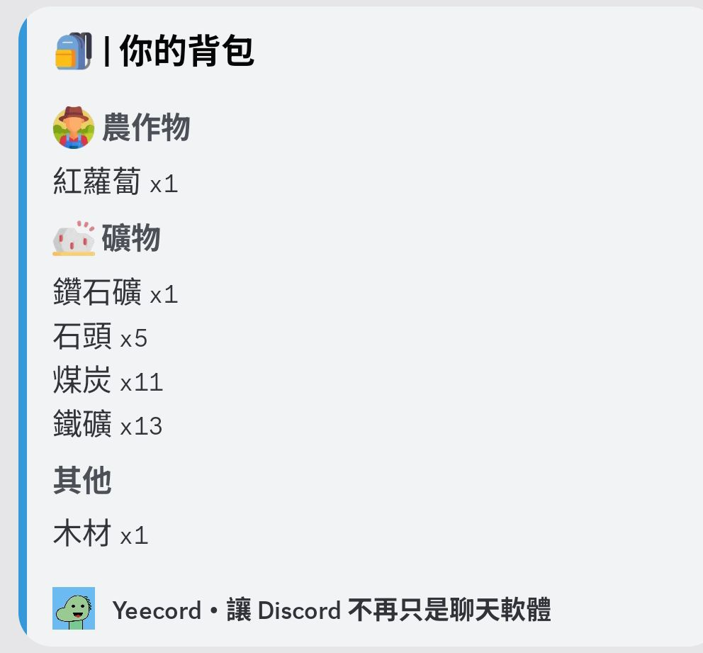

**卡顺密** (2025-05-27 00:04:09):
不要痴心妄想了

**卡顺密** (2025-05-27 00:04:04):
闪一边去吧

**AchenL【辰龙🐉】** (2025-05-27 00:03:40):
<@1063068779162108027>

**AchenL【辰龙🐉】** (2025-05-27 00:02:50):
叫声好听的哥哥卖你一根木材

**卡顺密** (2025-05-26 23:58:55):
<:24:1298294525390753924>

**卡顺密** (2025-05-26 23:58:52):
<@1364858239656919054> 你倒是起床啊

**卡顺密** (2025-05-26 23:22:04):
<:20:1298294514124984323> <:20:1298294514124984323>

**卡顺密** (2025-05-26 23:21:59):
<@1364858239656919054> 你快起床啊

**卡顺密** (2025-05-26 23:20:50):
我还差一个，快起床

**卡顺密** (2025-05-26 23:20:46):
<@1364858239656919054>

**YEE式機器龍** (2025-05-26 23:20:34):
[<:store:1273299726971965510> | 購買成功]()
你購買了 木材 `x4`，花費 `264$`

**卡顺密** (2025-05-26 23:20:34):
&buy <@1364858239656919054>  木材 4

**YEE式機器龍** (2025-05-26 23:19:17):
[<a:cross:1273299616137347082> | 商店裡沒有販賣任何東西]()

**晨** (2025-05-26 23:19:17):
&shop <@1336328198446780517>

**YEE式機器龍** (2025-05-26 23:18:26):
[<:bag:1273299770777141381> | 查看包包]()
為保護包包內容隱私權，戳這顆按鈕來看你的包包，隱私權設定可以透過 `&privacy` 指令更改

**卡顺密** (2025-05-26 23:18:26):
&items

**卡顺密** (2025-05-26 23:18:09):
这吊毛卖什么马铃薯

**YEE式機器龍** (2025-05-26 23:17:59):

**卡顺密** (2025-05-26 23:17:58):
&shop <@1364858239656919054>

**YEE式機器龍** (2025-05-26 23:16:16):
[<:store:1273299726971965510> | 購買成功]()
你購買了 蘋果 `x1`，花費 `90$`

**晨** (2025-05-26 23:16:16):
&buy <@1063068779162108027> 蘋果 1

**卡顺密** (2025-05-26 23:16:00):
蘋果

**卡顺密** (2025-05-26 23:15:54):
要用繁体

**晨** (2025-05-26 23:15:53):
？

**YEE式機器龍** (2025-05-26 23:15:49):

**晨** (2025-05-26 23:15:49):
&buy <@1063068779162108027> 苹果 1

**YEE式機器龍** (2025-05-26 23:15:41):

**晨** (2025-05-26 23:15:40):
&buy <@1063068779162108027> 苹果 2

**YEE式機器龍** (2025-05-26 23:15:14):

**晨** (2025-05-26 23:15:13):
&buy <@1063068779162108027> 苹果 1

**YEE式機器龍** (2025-05-26 23:14:58):
[<:store:1273299726971965510> | 購買成功]()
你購買了 玉米 `x4`，花費 `360$`

**晨** (2025-05-26 23:14:57):
&buy <@1063068779162108027> 玉米 4

**YEE式機器龍** (2025-05-26 23:14:31):
你現在有 `470$`

**任白** (2025-05-26 23:14:31):
&money

**YEE式機器龍** (2025-05-26 23:14:24):
[<a:offline:1273299546302054486> | 正在處理請求]()

**任白** (2025-05-26 23:14:24):
&pay <@1303142548377960448>  520

**YEE式機器龍** (2025-05-26 23:14:13):
[<a:cross:1273299616137347082> | 操作取消]()

**任白** (2025-05-26 23:14:12):
&pay <@1303142548377960448>  520

**卡顺密** (2025-05-26 23:14:05):
<:04:1298280511562580090>

**卡顺密** (2025-05-26 23:14:00):
速速的买 我还要去买木材连着开两地呢

**晨** (2025-05-26 23:13:53):
🥺

**晨** (2025-05-26 23:13:46):
我买...我买

**卡顺密** (2025-05-26 23:13:23):
😠

**卡顺密** (2025-05-26 23:13:20):
你不想想苹果和玉米的产出几率多低

**卡顺密** (2025-05-26 23:13:13):
这价格已经算是低价了

**晨** (2025-05-26 23:12:53):
被拿捏了<:1000168518:1298906830864519231>

**晨** (2025-05-26 23:12:44):
...

**卡顺密** (2025-05-26 23:12:36):
他好像选了个职业就溜了

**晨** (2025-05-26 23:12:25):
他没中吗

**晨** (2025-05-26 23:12:20):
<:1000168510:1298906820638674984> 小户呢

**卡顺密** (2025-05-26 23:12:12):

**卡顺密** (2025-05-26 23:12:08):
😒

**卡顺密** (2025-05-26 23:12:04):
到时候更加垄断

**卡顺密** (2025-05-26 23:11:58):
都不用等你们买

**卡顺密** (2025-05-26 23:11:55):
我卖系统的话就更爽了

**晨** (2025-05-26 23:11:40):
要是就三个人确实

**卡顺密** (2025-05-26 23:11:33):
你不卖我能卖系统

**晨** (2025-05-26 23:11:31):
会有别人卖的...

**任白** (2025-05-26 23:11:28):
<:20:1298294514124984323>

**任白** (2025-05-26 23:11:21):
你别想赚钱

**任白** (2025-05-26 23:11:17):
我就不买

**任白** (2025-05-26 23:11:15):
我不买就好了

**YEE式機器龍** (2025-05-26 23:10:59):

**卡顺密** (2025-05-26 23:10:58):
&shop <@1063068779162108027>

**YEE式機器龍** (2025-05-26 23:10:50):
[<:store:1273299726971965510> | 成功上架]()
你的店面狀態為: `營業中`，現在架上有 `1` 個 蘋果，售價為 `90$`

**卡顺密** (2025-05-26 23:10:50):
&shop add 蘋果 1 90

**YEE式機器龍** (2025-05-26 23:10:28):
[<:store:1273299726971965510> | 成功上架]()
你的店面狀態為: `營業中`，現在架上有 `4` 個 玉米，售價為 `90$`

**卡顺密** (2025-05-26 23:10:28):
&shop add 玉米 4 90

**YEE式機器龍** (2025-05-26 23:09:55):
[<:store:1273299726971965510> | 成功下架了 蘋果]()

**卡顺密** (2025-05-26 23:09:55):
&shop remove 蘋果

**YEE式機器龍** (2025-05-26 23:09:36):
[<a:cross:1273299616137347082> | 錯誤的物品]()

**卡顺密** (2025-05-26 23:09:36):
&shop remove 苹果

**YEE式機器龍** (2025-05-26 23:09:19):
[<:store:1273299726971965510> | 成功下架了 玉米]()

**卡顺密** (2025-05-26 23:09:19):
&shop remove 玉米

**YEE式機器龍** (2025-05-26 23:08:48):
[<:store:1273299726971965510> | shop 指令]()
商店系統 - 透過購買來活絡經濟

**卡顺密** (2025-05-26 23:08:47):
&shop

**卡顺密** (2025-05-26 23:08:31):
那就买98吧

**晨** (2025-05-26 23:08:12):
你又用不着！

**卡顺密** (2025-05-26 23:08:02):
<:04:1298280511562580090>

**卡顺密** (2025-05-26 23:07:59):
你妈的矿工才叫垄断

**晨** (2025-05-26 23:07:57):
治疗药水先别卖了，留点当纪念品吧

**卡顺密** (2025-05-26 23:07:52):
正常的价钱而已

**卡顺密** (2025-05-26 23:07:48):
这怎么能叫垄断

**晨** (2025-05-26 23:07:41):
奸商垄断了

**晨** (2025-05-26 23:07:32):
<:1000168510:1298906820638674984>

**任白** (2025-05-26 23:07:28):
买个锤子

**任白** (2025-05-26 23:07:25):
买吃的100

**任白** (2025-05-26 23:07:22):
我一个90

**任白** (2025-05-26 23:07:19):
😭😭😭

**晨** (2025-05-26 22:44:18):
妈咪特有的很早醒来然后接着睡

**味道≠天秤♎ TKN** (2025-05-26 22:38:37):
<:1000168518:1298906830864519231>

**晨** (2025-05-26 22:29:22):
我没冷暴力！自己也没吃的啦

**晨** (2025-05-26 22:27:04):
<:1000168510:1298906820638674984>

**YEE式機器龍** (2025-05-26 22:26:47):
[<a:cross:1273299616137347082> | 你的體力不足了！]()

**晨** (2025-05-26 22:26:47):
&herd

**YEE式機器龍** (2025-05-26 22:26:35):
[<:calendar:1273299842793341082> | 到我們伺服器聊天就會自動簽到!]()
加入我們伺服器接收機器人最新訊息

**晨** (2025-05-26 22:26:35):
&daily

**YEE式機器龍** (2025-05-26 22:26:24):
嗨嗨 d(･∀･)b 我是YEE式機器龍，
我的目標是讓你快速建立優質的中文 Discord 伺服器!

<:slash:1273299597489344514> 我們正在努力轉移部分功能的指令到斜線指令
可以使用 </help:880380398562054156> 指令查看斜線的使用方法

使用我的服務即表示你已同意我的 [隱私權聲明](https://yeecord.com/privacy/) 及 [服務條款](https://yeecord.com/terms/)

**晨** (2025-05-26 22:25:35):
垄断！

**卡顺密** (2025-05-26 22:13:22):
<:04:1298280511562580090>

**卡顺密** (2025-05-26 22:13:15):
合情合理的价钱

**卡顺密** (2025-05-26 22:13:13):
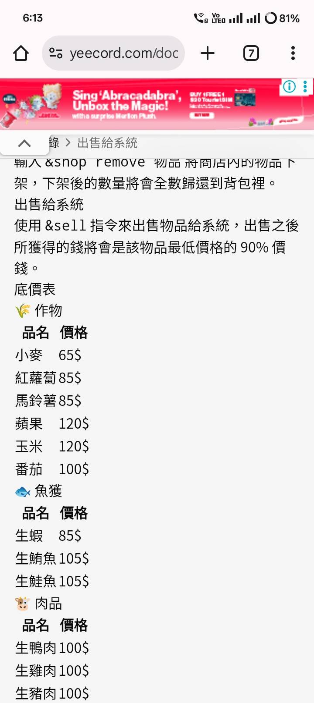

**YEE式機器龍** (2025-05-26 22:12:46):
[<:bag:1273299770777141381> | 查看包包]()
為保護包包內容隱私權，戳這顆按鈕來看你的包包，隱私權設定可以透過 `&privacy` 指令更改

**卡顺密** (2025-05-26 22:12:45):
&items

**YEE式機器龍** (2025-05-26 22:12:09):

**卡顺密** (2025-05-26 22:12:09):
&shop <@1063068779162108027>

**YEE式機器龍** (2025-05-26 22:11:57):
[<:store:1273299726971965510> | 成功上架]()
你的店面狀態為: `營業中`，現在架上有 `4` 個 玉米，售價為 `130$`

**卡顺密** (2025-05-26 22:11:57):
&shop add 玉米 4 130

**YEE式機器龍** (2025-05-26 22:11:01):
[<:store:1273299726971965510> | 成功上架]()
你的店面狀態為: `營業中`，現在架上有 `1` 個 蘋果，售價為 `130$`

**卡顺密** (2025-05-26 22:11:01):
&shop add 蘋果 1 130

**YEE式機器龍** (2025-05-26 22:10:17):
[<:store:1273299726971965510> | 成功下架了 蘋果]()

**卡顺密** (2025-05-26 22:10:17):
&shop remove 蘋果

**YEE式機器龍** (2025-05-26 22:10:02):
[<:store:1273299726971965510> | shop 指令]()
商店系統 - 透過購買來活絡經濟

**卡顺密** (2025-05-26 22:10:02):
&shop remove

**YEE式機器龍** (2025-05-26 22:09:45):
[<:store:1273299726971965510> | shop 指令]()
商店系統 - 透過購買來活絡經濟

**卡顺密** (2025-05-26 22:09:45):
&shop

**YEE式機器龍** (2025-05-26 22:08:41):
[<:store:1273299726971965510> | 成功上架]()
你的店面狀態為: `營業中`，現在架上有 `1` 個 蘋果，售價為 `100$`

**卡顺密** (2025-05-26 22:08:41):
&shop add 蘋果 1 100

**YEE式機器龍** (2025-05-26 22:07:43):
[<:bag:1273299770777141381> | 查看包包]()
為保護包包內容隱私權，戳這顆按鈕來看你的包包，隱私權設定可以透過 `&privacy` 指令更改

**卡顺密** (2025-05-26 22:07:43):
&items

**YEE式機器龍** (2025-05-26 22:07:35):
[<a:cross:1273299616137347082> | 商店裡沒有販賣任何東西]()

**卡顺密** (2025-05-26 22:07:34):
&shop <@1063068779162108027>

**YEE式機器龍** (2025-05-26 22:07:10):
[<:farmer:1273299699633360906> | _kami_8372 的農田]()
農田等級：1 | 上次澆水：<t:1748231218:R>

**YEE式機器龍** (2025-05-26 17:07:56):
[<:ore:1273299681283276853> | 挖礦]()
你尋找了很久，最終發現只有 `3` 個石頭

**AchenL【辰龙🐉】** (2025-05-26 17:07:55):
&mine

**YEE式機器龍** (2025-05-26 16:47:21):
[<:ore:1273299681283276853> | 挖礦]()
在洞口處發現了 `2` 個鐵礦！

**AchenL【辰龙🐉】** (2025-05-26 16:47:21):
&mine

**AchenL【辰龙🐉】** (2025-05-26 15:18:59):
<:1000168521:1298906817585352716>

**AchenL【辰龙🐉】** (2025-05-26 15:18:54):
晚安，宝贝

**晨** (2025-05-26 15:18:33):
<:1000168521:1298906817585352716>

**晨** (2025-05-26 15:18:30):
晚安啦~

**AchenL【辰龙🐉】** (2025-05-26 15:18:17):
换一个先

**AchenL【辰龙🐉】** (2025-05-26 15:18:14):
哎呀，我这个头像是真的丑

**AchenL【辰龙🐉】** (2025-05-26 15:18:04):
宝贝，晚安

**AchenL【辰龙🐉】** (2025-05-26 15:17:45):
宝贝要提前跟你说晚安了

**AchenL【辰龙🐉】** (2025-05-26 15:17:40):
没事的，这才一天多 总会有厨师的

**晨** (2025-05-26 15:17:23):
<:24:1298294525390753924>

**AchenL【辰龙🐉】** (2025-05-26 15:17:15):
现在就等厨师了

**AchenL【辰龙🐉】** (2025-05-26 15:17:10):


**晨** (2025-05-26 15:16:57):
钻石和神木都有了

**晨** (2025-05-26 15:16:49):
哇

**YEE式機器龍** (2025-05-26 15:16:46):
[<:bag:1273299770777141381> | 查看包包]()
為保護包包內容隱私權，戳這顆按鈕來看你的包包，隱私權設定可以透過 `&privacy` 指令更改

**AchenL【辰龙🐉】** (2025-05-26 15:16:46):
&items

**AchenL【辰龙🐉】** (2025-05-26 15:16:41):
谁家钻石这么廉价

**AchenL【辰龙🐉】** (2025-05-26 15:16:35):
钻石才150

**YEE式機器龍** (2025-05-26 15:16:29):
[<:ore:1273299681283276853> | 恭喜你!]()
終於經過了許久的尋找，你挖到了 `1` 個鑽石礦！

**AchenL【辰龙🐉】** (2025-05-26 15:16:28):
&mine

**味道≠天秤♎ TKN** (2025-05-26 15:16:12):
<:1000168518:1298906830864519231>

**味道≠天秤♎ TKN** (2025-05-26 15:16:10):
都没体力了

**味道≠天秤♎ TKN** (2025-05-26 15:16:04):
根本没时间邀请人啊

**味道≠天秤♎ TKN** (2025-05-26 15:15:59):
没有啊

**晨** (2025-05-26 15:11:37):
有厨师了吗

**晨** (2025-05-26 15:11:24):
<:1000168510:1298906820638674984>

**任白** (2025-05-26 14:44:17):
反对冷暴力

**希波鹅拉底** (2025-05-26 14:42:13):
<:20:1298294514124984323>

**YEE式機器龍** (2025-05-26 14:15:06):
[<a:cross:1273299616137347082> | 你的體力不足了！]()

**全能沙雕王（光速滑跪版）** (2025-05-26 14:15:06):
&fell

**YEE式機器龍** (2025-05-26 14:03:25):
[<:bag:1273299770777141381> | 查看包包]()
為保護包包內容隱私權，戳這顆按鈕來看你的包包，隱私權設定可以透過 `&privacy` 指令更改

**AchenL【辰龙🐉】** (2025-05-26 14:03:25):
&items

**YEE式機器龍** (2025-05-26 14:03:14):
[<:ore:1273299681283276853> | 挖礦]()
在洞口處發現了 `3` 個煤炭！

**AchenL【辰龙🐉】** (2025-05-26 14:03:13):
&mine

**YEE式機器龍** (2025-05-26 14:02:36):
[<:wood:1273299684818944113> | 平常的一天]()
你來到了森林，並且砍了 `1` 塊木材

**全能沙雕王（光速滑跪版）** (2025-05-26 14:02:36):
&fell

**YEE式機器龍** (2025-05-26 13:23:12):
你現在有 `39$`

**卡顺密** (2025-05-26 13:23:12):
&money

**卡顺密** (2025-05-26 13:23:04):
/money

**YEE式機器龍** (2025-05-26 13:21:05):
[<:store:1273299726971965510> | 購買成功]()
你購買了 木材 `x5`，花費 `330$`

**卡顺密** (2025-05-26 13:21:04):
&buy <@1364858239656919054>  木材 5

**YEE式機器龍** (2025-05-26 13:20:54):
[<a:cross:1273299616137347082> | 歐不！你沒錢了！]()
你還差 `225$`

**卡顺密** (2025-05-26 13:20:53):
&buy <@1364858239656919054>  木材 9

**卡顺密** (2025-05-26 13:19:57):
我钱好像不太够

**卡顺密** (2025-05-26 13:19:53):
要多少啊

**YEE式機器龍** (2025-05-26 13:19:37):
[<:store:1273299726971965510> | 成功上架]()
你的店面狀態為: `營業中`，現在架上有 `9` 個 木材，售價為 `66$`

**全能沙雕王（光速滑跪版）** (2025-05-26 13:19:37):
&shop add 木材 8 66

**YEE式機器龍** (2025-05-26 13:19:25):
[<:bag:1273299770777141381> | 查看包包]()
為保護包包內容隱私權，戳這顆按鈕來看你的包包，隱私權設定可以透過 `&privacy` 指令更改

**全能沙雕王（光速滑跪版）** (2025-05-26 13:19:25):
&items

**YEE式機器龍** (2025-05-26 13:19:19):
[<:wood:1273299684818944113> | 平常的一天]()
你來到了森林，並且砍了 `2` 塊木材

**全能沙雕王（光速滑跪版）** (2025-05-26 13:19:19):
&fell

**卡顺密** (2025-05-26 12:02:34):


**卡顺密** (2025-05-26 12:02:31):
可以搞神木棒

**卡顺密** (2025-05-26 12:02:24):
神木有用

**卡顺密** (2025-05-26 12:02:21):
<@1364858239656919054>

**YEE式機器龍** (2025-05-26 11:57:11):
[renbai_07323#0]()

**YEE式機器龍** (2025-05-26 11:55:19):
你現在有 `369$`

**卡顺密** (2025-05-26 11:55:19):
&money

**卡顺密** (2025-05-26 11:55:12):
<:1000168518:1298906830864519231>

**卡顺密** (2025-05-26 11:55:09):
两秒卡一下，两秒卡一下

**卡顺密** (2025-05-26 11:55:03):
不知道是不是我手机不好

**卡顺密** (2025-05-26 11:54:59):
但是也是够傻逼的

**卡顺密** (2025-05-26 11:54:55):
我知道该怎么签到了

**YEE式機器龍** (2025-05-26 11:52:56):
[_kami_8372#0]()

**YEE式機器龍** (2025-05-26 11:48:54):
[<:calendar:1273299842793341082> | 到我們伺服器聊天就會自動簽到!]()
加入我們伺服器接收機器人最新訊息

**卡顺密** (2025-05-26 11:48:54):
&daily

**YEE式機器龍** (2025-05-26 11:48:27):
嗨嗨 d(･∀･)b 我是YEE式機器龍，
我的目標是讓你快速建立優質的中文 Discord 伺服器!

<:slash:1273299597489344514> 我們正在努力轉移部分功能的指令到斜線指令
可以使用 </help:880380398562054156> 指令查看斜線的使用方法

使用我的服務即表示你已同意我的 [隱私權聲明](https://yeecord.com/privacy/) 及 [服務條款](https://yeecord.com/terms/)

**AchenL【辰龙🐉】** (2025-05-26 11:48:19):
不知道啊，但是我按的自动签到

**卡顺密** (2025-05-26 11:48:18):
好傻必啊

**卡顺密** (2025-05-26 11:48:12):
怎么签到啊

**YEE式機器龍** (2025-05-26 11:48:10):
[<:drumstick:1273299789361971295> | 成功進食]()
你吃下了 `1` 個 `紅蘿蔔`，你的體力值增加到了 `4`

**AchenL【辰龙🐉】** (2025-05-26 11:48:10):
&eat 紅蘿蔔 1

**YEE式機器龍** (2025-05-26 11:47:28):
[golden_parrot_36859#0]()

**AchenL【辰龙🐉】** (2025-05-26 11:47:02):
可能是我这地区的问题

**卡顺密** (2025-05-26 11:47:01):
我的苹果大概也是了

**卡顺密** (2025-05-26 11:46:57):
<:1000168518:1298906830864519231>

**卡顺密** (2025-05-26 11:46:54):
还真是

**YEE式機器龍** (2025-05-26 11:46:44):
[<:store:1273299726971965510> | 購買成功]()
你購買了 鐵礦 `x2`，花費 `160$`

**卡顺密** (2025-05-26 11:46:43):
&buy <@1376361794515238922> 鐵礦 2

**AchenL【辰龙🐉】** (2025-05-26 11:46:29):
我不是繁体字卖不了啊

**卡顺密** (2025-05-26 11:46:19):
要繁体字吧

**AchenL【辰龙🐉】** (2025-05-26 11:46:13):
你是不是没钱了

**卡顺密** (2025-05-26 11:46:01):
为什么买不了

**YEE式機器龍** (2025-05-26 11:45:54):

**卡顺密** (2025-05-26 11:45:53):
&buy <@1376361794515238922> 铁矿 2

**AchenL【辰龙🐉】** (2025-05-26 11:45:53):
这才是垄断。

**AchenL【辰龙🐉】** (2025-05-26 11:45:51):
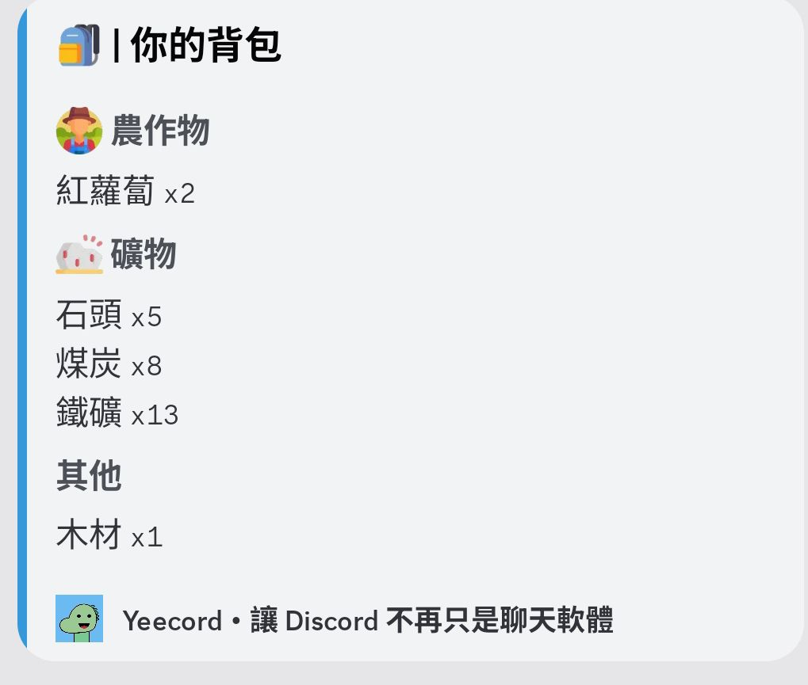

**YEE式機器龍** (2025-05-26 11:45:17):

**YEE式機器龍** (2025-05-26 11:45:17):
[<:bag:1273299770777141381> | 查看包包]()
為保護包包內容隱私權，戳這顆按鈕來看你的包包，隱私權設定可以透過 `&privacy` 指令更改

**卡顺密** (2025-05-26 11:45:17):
&buy <@1376361794515238922>  铁矿 2

**AchenL【辰龙🐉】** (2025-05-26 11:45:16):
&items

**YEE式機器龍** (2025-05-26 11:44:56):
[<:store:1273299726971965510> | 成功上架]()
你的店面狀態為: `營業中`，現在架上有 `2` 個 鐵礦，售價為 `80$`

**AchenL【辰龙🐉】** (2025-05-26 11:44:56):
&shop add 鐵礦 2 80

**卡顺密** (2025-05-26 11:44:46):
就只能卖给系统了

**卡顺密** (2025-05-26 11:44:39):
除了拿来收藏

**卡顺密** (2025-05-26 11:44:23):
还不如神木呢

**YEE式機器龍** (2025-05-26 11:44:18):
[<:store:1273299726971965510> | shop 指令]()
商店系統 - 透過購買來活絡經濟

**AchenL【辰龙🐉】** (2025-05-26 11:44:18):
&shop add 铁矿 2 80

**卡顺密** (2025-05-26 11:44:17):
150

**卡顺密** (2025-05-26 11:43:40):
铁卖我两个

**AchenL【辰龙🐉】** (2025-05-26 11:43:40):
我觉得一颗值个600没啥问题

**卡顺密** (2025-05-26 11:43:19):
有钻石也没用，卖不了多少

**AchenL【辰龙🐉】** (2025-05-26 11:43:09):
这不能来颗钻石吗

**YEE式機器龍** (2025-05-26 11:43:01):
[<:ore:1273299681283276853> | 挖礦]()
在洞口處發現了 `2` 個煤炭！

**AchenL【辰龙🐉】** (2025-05-26 11:43:01):
&mine

**卡顺密** (2025-05-26 11:42:49):
两位一体说是

**味道≠天秤♎ TKN** (2025-05-26 11:42:36):
<:07:1298281204260278383>

**味道≠天秤♎ TKN** (2025-05-26 11:42:31):
一个不下头，另一个就下头

**味道≠天秤♎ TKN** (2025-05-26 11:42:26):
你们有下头二象性，是吧

**全能沙雕王（光速滑跪版）** (2025-05-26 11:26:06):
无敌了

**全能沙雕王（光速滑跪版）** (2025-05-26 11:26:02):
😅 👍

**卡顺密** (2025-05-26 11:25:41):
干一个爱一个

**全能沙雕王（光速滑跪版）** (2025-05-26 11:25:20):
这叫干一行爱一行

**卡顺密** (2025-05-26 11:23:52):
你也是耐砍王了

**卡顺密** (2025-05-26 11:23:44):
一天砍了快30次的柴

**YEE式機器龍** (2025-05-26 11:23:31):
[<a:cross:1273299616137347082> | 你過勞了！]()
你今天砍了 `27` 次柴，等待到 <t:1748259095:t> (<t:1748259095:R>) 可以繼續砍柴

**全能沙雕王（光速滑跪版）** (2025-05-26 11:23:31):
&fell

**YEE式機器龍** (2025-05-26 11:15:37):
[<:wood:1273299684818944113> | 平常的一天]()
你來到了森林，並且砍了 `2` 塊木材

**全能沙雕王（光速滑跪版）** (2025-05-26 11:15:35):
&fell

**希波鹅拉底** (2025-05-26 11:15:28):
😡

**希波鹅拉底** (2025-05-26 11:15:25):
冷暴力你

**希波鹅拉底** (2025-05-26 11:15:21):
什么b态度

**卡顺密** (2025-05-26 11:10:30):
<:emoji_11:1298282571616096307>

**卡顺密** (2025-05-26 11:10:25):
农场经营你是没看到吗

**希波鹅拉底** (2025-05-26 11:10:02):
这是在玩什么鬼东西

**希波鹅拉底** (2025-05-26 11:09:53):
<:emoji_11:1298282571616096307>

**卡顺密** (2025-05-26 11:03:50):
有多少库存

**卡顺密** (2025-05-26 10:52:04):
？

**全能沙雕王（光速滑跪版）** (2025-05-26 10:52:03):
😋

**YEE式機器龍** (2025-05-26 10:51:58):
你現在有 `1,057$`

**全能沙雕王（光速滑跪版）** (2025-05-26 10:51:58):
&money

**卡顺密** (2025-05-26 10:51:57):
<:1000168518:1298906830864519231>

**卡顺密** (2025-05-26 10:51:55):
就这点哪够啊

**全能沙雕王（光速滑跪版）** (2025-05-26 10:51:45):
😡

**全能沙雕王（光速滑跪版）** (2025-05-26 10:51:43):
不是刚给你换了吗

**卡顺密** (2025-05-26 10:50:43):
😭

**卡顺密** (2025-05-26 10:50:40):
钱越花越少啊

**YEE式機器龍** (2025-05-26 10:50:31):
你現在有 `369$`

**卡顺密** (2025-05-26 10:50:31):
&money

**YEE式機器龍** (2025-05-26 10:48:25):
[<:wood:1273299684818944113> | 平常的一天]()
你來到了森林，並且砍了 `1` 塊木材

**全能沙雕王（光速滑跪版）** (2025-05-26 10:48:25):
&fell

**YEE式機器龍** (2025-05-26 10:48:19):
[<:drumstick:1273299789361971295> | 成功進食]()
你吃下了 `2` 個 `紅蘿蔔`，你的體力值增加到了 `4`

**全能沙雕王（光速滑跪版）** (2025-05-26 10:48:18):
&eat 红萝卜 2

**YEE式機器龍** (2025-05-26 10:48:05):
[<:drumstick:1273299789361971295> | 成功進食]()
你吃下了 `2` 個 `番茄`，你的體力值增加到了 `2`

**全能沙雕王（光速滑跪版）** (2025-05-26 10:48:04):
&eat 番茄 2

**YEE式機器龍** (2025-05-26 10:47:45):
[<:store:1273299726971965510> | 購買成功]()
你購買了 番茄 `x2`，花費 `180$`

**全能沙雕王（光速滑跪版）** (2025-05-26 10:47:45):
&buy <@1063068779162108027>  番茄 2

**YEE式機器龍** (2025-05-26 10:47:12):
[<:store:1273299726971965510> | 購買成功]()
你購買了 紅蘿蔔 `x2`，花費 `180$`

**全能沙雕王（光速滑跪版）** (2025-05-26 10:47:11):
&buy <@1063068779162108027>  红萝卜 2 番茄 2

**卡顺密** (2025-05-26 10:33:52):
<@1364858239656919054>

**YEE式機器龍** (2025-05-26 10:33:41):

**卡顺密** (2025-05-26 10:33:40):
&shop <@1063068779162108027>

**YEE式機器龍** (2025-05-26 10:33:19):
[<:store:1273299726971965510> | 成功上架]()
你的店面狀態為: `營業中`，現在架上有 `2` 個 番茄，售價為 `90$`

**卡顺密** (2025-05-26 10:33:19):
&shop add 番茄 2 90

**YEE式機器龍** (2025-05-26 10:32:44):
[<:store:1273299726971965510> | shop 指令]()
商店系統 - 透過購買來活絡經濟

**卡顺密** (2025-05-26 10:32:44):
&shop add 苹果 1 90

**YEE式機器龍** (2025-05-26 10:32:21):
[<:store:1273299726971965510> | 成功上架]()
你的店面狀態為: `營業中`，現在架上有 `2` 個 紅蘿蔔，售價為 `90$`

**卡顺密** (2025-05-26 10:32:20):
&shop add 红萝卜 2 90

**YEE式機器龍** (2025-05-26 10:31:53):
[<:store:1273299726971965510> | 成功下架了 紅蘿蔔]()

**卡顺密** (2025-05-26 10:31:53):
&shop remove 红萝卜

**YEE式機器龍** (2025-05-26 10:30:03):
[<:store:1273299726971965510> | shop 指令]()
商店系統 - 透過購買來活絡經濟

**卡顺密** (2025-05-26 10:30:03):
&shop add 苹果 1 90

**YEE式機器龍** (2025-05-26 10:29:46):
[<:store:1273299726971965510> | shop 指令]()
商店系統 - 透過購買來活絡經濟

**卡顺密** (2025-05-26 10:29:46):
&shop 苹果 1 90

**YEE式機器龍** (2025-05-26 10:28:13):
[<a:cross:1273299616137347082> | 你的體力不足了！]()

**全能沙雕王（光速滑跪版）** (2025-05-26 10:28:13):
&fell

**YEE式機器龍** (2025-05-26 10:18:48):
[<:ore:1273299681283276853> | 挖礦]()
你尋找了很久，最終發現只有 `1` 個石頭

**AchenL【辰龙🐉】** (2025-05-26 10:18:47):
&mine

**卡顺密** (2025-05-26 10:15:28):
算了，等我吃完饭

**YEE式機器龍** (2025-05-26 10:14:53):
[<:store:1273299726971965510> | shop 指令]()
商店系統 - 透過購買來活絡經濟

**卡顺密** (2025-05-26 10:14:53):
&shop add 苹果 1 90

**YEE式機器龍** (2025-05-26 10:14:11):
[<:bag:1273299770777141381> | 查看包包]()
為保護包包內容隱私權，戳這顆按鈕來看你的包包，隱私權設定可以透過 `&privacy` 指令更改

**卡顺密** (2025-05-26 10:14:11):
&items

**卡顺密** (2025-05-26 10:13:54):
你要多少个

**卡顺密** (2025-05-26 10:13:46):
没事，我调一下价钱

**全能沙雕王（光速滑跪版）** (2025-05-26 10:13:45):
Apex打傻了

**全能沙雕王（光速滑跪版）** (2025-05-26 10:13:39):
艹

**YEE式機器龍** (2025-05-26 10:13:30):

**全能沙雕王（光速滑跪版）** (2025-05-26 10:13:29):
&shop <@1063068779162108027>

**卡顺密** (2025-05-26 10:13:18):
笑死

**YEE式機器龍** (2025-05-26 10:11:12):
[xpkun.#0]()

**全能沙雕王（光速滑跪版）** (2025-05-26 10:10:58):
/info user

**YEE式機器龍** (2025-05-26 10:10:20):
[<:wood:1273299684818944113> | 平常的一天]()
你來到了森林，並且砍了 `1` 塊木材

**全能沙雕王（光速滑跪版）** (2025-05-26 10:10:20):
&fell

**卡顺密** (2025-05-26 09:57:21):


**YEE式機器龍** (2025-05-26 09:57:12):
[<:bag:1273299770777141381> | 查看包包]()
為保護包包內容隱私權，戳這顆按鈕來看你的包包，隱私權設定可以透過 `&privacy` 指令更改

**味道≠天秤♎ TKN** (2025-05-26 09:57:12):
&items

**YEE式機器龍** (2025-05-26 09:57:06):
[<:bag:1273299770777141381> | 查看包包]()
為保護包包內容隱私權，戳這顆按鈕來看你的包包，隱私權設定可以透過 `&privacy` 指令更改

**卡顺密** (2025-05-26 09:57:06):
&items

**YEE式機器龍** (2025-05-26 09:57:00):
[tim143344321.fat#0]()

**卡顺密** (2025-05-26 09:56:58):
<:1000168518:1298906830864519231>

**卡顺密** (2025-05-26 09:56:56):
没有人要买食物啊

**味道≠天秤♎ TKN** (2025-05-26 09:56:42):
<:1000168518:1298906830864519231>

**YEE式機器龍** (2025-05-26 09:54:11):
[<:wood:1273299684818944113> | 平常的一天]()
你來到了森林，並且砍了 `1` 塊木材

**全能沙雕王（光速滑跪版）** (2025-05-26 09:54:11):
&fell

**卡顺密** (2025-05-26 09:54:05):
4个玉米

**卡顺密** (2025-05-26 09:54:02):
我靠

**YEE式機器龍** (2025-05-26 09:53:56):
[<:farmer:1273299699633360906> | 成功採收了 4 格田地]()
你獲得了 1 個玉米、3 個玉米

**YEE式機器龍** (2025-05-26 09:52:54):
[golden_parrot_36859#0]()

**YEE式機器龍** (2025-05-26 09:52:35):
[<:bag:1273299770777141381> | 查看包包]()
為保護包包內容隱私權，戳這顆按鈕來看你的包包，隱私權設定可以透過 `&privacy` 指令更改

**AchenL【辰龙🐉】** (2025-05-26 09:52:34):
&items

**YEE式機器龍** (2025-05-26 09:52:25):
[<:ore:1273299681283276853> | 挖礦]()
你尋找了很久，最終發現只有 `2` 個石頭

**AchenL【辰龙🐉】** (2025-05-26 09:52:25):
&mine

**卡顺密** (2025-05-26 09:44:18):
矿工才是垄断😡

**YEE式機器龍** (2025-05-26 09:34:35):
[<:wood:1273299684818944113> | 平常的一天]()
你來到了森林，並且砍了 `1` 塊木材

**全能沙雕王（光速滑跪版）** (2025-05-26 09:34:34):
&fell

**卡顺密** (2025-05-26 09:27:51):
<:1000168518:1298906830864519231>

**卡顺密** (2025-05-26 09:27:46):
农夫还是太依赖伐木工了

**全能沙雕王（光速滑跪版）** (2025-05-26 09:27:06):
还想垄断吗？

**卡顺密** (2025-05-26 09:24:43):
😭

**卡顺密** (2025-05-26 09:24:41):
我怎么越玩越没钱啊

**YEE式機器龍** (2025-05-26 09:24:24):
[<:farmer:1273299699633360906> | _kami_8372 的農田]()
農田等級：1 | 上次澆水：<t:1748231218:R>

**YEE式機器龍** (2025-05-26 09:24:17):
[<:check:1273299642565791919> | 成功使用了 1 個木鋤]()
消耗 0 點體力

**YEE式機器龍** (2025-05-26 09:24:06):
[<:toolbox:1273299690560946357> | 製作物品]()
你製作出了 1 個木鋤

**YEE式機器龍** (2025-05-26 09:23:40):
[<:store:1273299726971965510> | 購買成功]()
你購買了 木材 `x1`，花費 `66$`

**卡顺密** (2025-05-26 09:23:40):
&buy <@1364858239656919054>  木材 1

**YEE式機器龍** (2025-05-26 09:23:20):

**卡顺密** (2025-05-26 09:23:19):
&shop <@1364858239656919054>  木材 1

**YEE式機器龍** (2025-05-26 09:22:50):
你現在有 `75$`

**卡顺密** (2025-05-26 09:22:50):
&money

**YEE式機器龍** (2025-05-26 09:12:42):
[<:drumstick:1273299789361971295> | 成功進食]()
你吃下了 `3` 個 `紅蘿蔔`，你的體力值增加到了 `3`

**全能沙雕王（光速滑跪版）** (2025-05-26 09:12:42):
&eat 红萝卜 3

**YEE式機器龍** (2025-05-26 09:12:11):
[<:bag:1273299770777141381> | 查看包包]()
為保護包包內容隱私權，戳這顆按鈕來看你的包包，隱私權設定可以透過 `&privacy` 指令更改

**全能沙雕王（光速滑跪版）** (2025-05-26 09:12:11):
&items

**YEE式機器龍** (2025-05-26 09:11:52):
[<:store:1273299726971965510> | 成功上架]()
你的店面狀態為: `營業中`，現在架上有 `2` 個 木材，售價為 `66$`

**全能沙雕王（光速滑跪版）** (2025-05-26 09:11:52):
&shop add 木材 2 66

**YEE式機器龍** (2025-05-26 09:11:44):
[<:wood:1273299684818944113> | 平常的一天]()
你來到了森林，並且砍了 `2` 塊木材

**全能沙雕王（光速滑跪版）** (2025-05-26 09:11:44):
&fell

**卡顺密** (2025-05-26 08:58:58):
凭什么卡的这么死

**卡顺密** (2025-05-26 08:58:54):
😡

**卡顺密** (2025-05-26 08:58:51):
雷楼谋 还差一个木材

**YEE式機器龍** (2025-05-26 08:58:30):
[<:bag:1273299770777141381> | 查看包包]()
為保護包包內容隱私權，戳這顆按鈕來看你的包包，隱私權設定可以透過 `&privacy` 指令更改

**卡顺密** (2025-05-26 08:58:29):
&items

**YEE式機器龍** (2025-05-26 08:58:06):
[<:toolbox:1273299690560946357> | 製作物品]()
你製作出了 1 個木棒

**YEE式機器龍** (2025-05-26 08:57:58):
[<:toolbox:1273299690560946357> | 製作物品]()
你製作出了 1 個木棒

**YEE式機器龍** (2025-05-26 08:57:43):
[<:store:1273299726971965510> | 購買成功]()
你購買了 木材 `x4`，花費 `264$`

**卡顺密** (2025-05-26 08:57:43):
&buy <@1364858239656919054>  木材 4

**卡顺密** (2025-05-26 08:57:15):
<:1000168510:1298906820638674984>

**卡顺密** (2025-05-26 08:57:11):
我给你降降价

**卡顺密** (2025-05-26 08:57:06):
你要买你不说

**卡顺密** (2025-05-26 08:57:01):
？

**YEE式機器龍** (2025-05-26 08:56:54):
[<:store:1273299726971965510> | 購買成功]()
你購買了 紅蘿蔔 `x3`，花費 `300$`

**全能沙雕王（光速滑跪版）** (2025-05-26 08:56:53):
&buy <@1063068779162108027>  红萝卜 3

**YEE式機器龍** (2025-05-26 08:56:43):
[_kami_8372#0]()

**YEE式機器龍** (2025-05-26 08:50:02):
[<:store:1273299726971965510> | 成功上架]()
你的店面狀態為: `營業中`，現在架上有 `5` 個 紅蘿蔔，售價為 `100$`

**卡顺密** (2025-05-26 08:50:02):
&shop add 红萝卜 3 100

**YEE式機器龍** (2025-05-26 08:49:03):
[<:bag:1273299770777141381> | 查看包包]()
為保護包包內容隱私權，戳這顆按鈕來看你的包包，隱私權設定可以透過 `&privacy` 指令更改

**卡顺密** (2025-05-26 08:49:02):
&items

**卡顺密** (2025-05-26 08:48:19):
<@1364858239656919054> 用不用给你留几个食物

**卡顺密** (2025-05-26 08:48:08):
<:1000168510:1298906820638674984>

**卡顺密** (2025-05-26 08:48:04):
没钱了

**YEE式機器龍** (2025-05-26 08:47:55):

**卡顺密** (2025-05-26 08:47:54):
&shop <@1364858239656919054>

**YEE式機器龍** (2025-05-26 08:46:21):
嗨嗨 d(･∀･)b 我是YEE式機器龍，
我的目標是讓你快速建立優質的中文 Discord 伺服器!

<:slash:1273299597489344514> 我們正在努力轉移部分功能的指令到斜線指令
可以使用 </help:880380398562054156> 指令查看斜線的使用方法

使用我的服務即表示你已同意我的 [隱私權聲明](https://yeecord.com/privacy/) 及 [服務條款](https://yeecord.com/terms/)

**全能沙雕王（光速滑跪版）** (2025-05-26 08:46:21):
&help

**全能沙雕王（光速滑跪版）** (2025-05-26 08:45:09):
<:1000168531:1298906724979310634>

**全能沙雕王（光速滑跪版）** (2025-05-26 08:45:07):
石斧不能用来砍树吗？还是说要装备？

**YEE式機器龍** (2025-05-26 08:44:29):
[<:bag:1273299770777141381> | 查看包包]()
為保護包包內容隱私權，戳這顆按鈕來看你的包包，隱私權設定可以透過 `&privacy` 指令更改

**全能沙雕王（光速滑跪版）** (2025-05-26 08:44:28):
&items

**YEE式機器龍** (2025-05-26 08:44:16):
[<:store:1273299726971965510> | 成功上架]()
你的店面狀態為: `營業中`，現在架上有 `4` 個 木材，售價為 `66$`

**全能沙雕王（光速滑跪版）** (2025-05-26 08:44:15):
&shop add 木材 3 66

**YEE式機器龍** (2025-05-26 08:43:56):
[<:wood:1273299684818944113> | 平常的一天]()
你來到了森林，並且砍了 `2` 塊木材

**全能沙雕王（光速滑跪版）** (2025-05-26 08:43:56):
&fell

**YEE式機器龍** (2025-05-26 08:34:57):
[<a:cross:1273299616137347082> | 你過勞了！]()
你今天砍了 `20` 次柴，等待到 <t:1748249000:t> (<t:1748249000:R>) 可以繼續砍柴

**全能沙雕王（光速滑跪版）** (2025-05-26 08:34:57):
&fell

**YEE式機器龍** (2025-05-26 08:34:38):
[<:drumstick:1273299789361971295> | 成功進食]()
你吃下了 `1` 個 `馬鈴薯`，你的體力值增加到了 `2`

**全能沙雕王（光速滑跪版）** (2025-05-26 08:34:38):
&eat 马铃薯

**YEE式機器龍** (2025-05-26 08:34:14):
[<:drumstick:1273299789361971295> | 成功進食]()
你吃下了 `1` 個 `馬鈴薯`，你的體力值增加到了 `1`

**全能沙雕王（光速滑跪版）** (2025-05-26 08:34:13):
&eat 马铃薯

**全能沙雕王（光速滑跪版）** (2025-05-26 08:33:25):
<:1000168531:1298906724979310634>

**全能沙雕王（光速滑跪版）** (2025-05-26 08:33:23):
怎么吃

**AchenL【辰龙🐉】** (2025-05-26 08:33:14):
吃点东西吧

**YEE式機器龍** (2025-05-26 08:33:05):
[xpkun.#0]()

**YEE式機器龍** (2025-05-26 08:32:48):
[<:toolbox:1273299690560946357> | 製作物品]()
你製作出了 1 個石斧

**YEE式機器龍** (2025-05-26 08:32:12):
[<:store:1273299726971965510> | 購買成功]()
你購買了 石頭 `x3`，花費 `150$`

**全能沙雕王（光速滑跪版）** (2025-05-26 08:32:12):
&buy <@1376361794515238922>  石头 3

**YEE式機器龍** (2025-05-26 08:32:08):
[<:ore:1273299681283276853> | 挖礦]()
你尋找了很久，最終發現只有 `2` 個石頭

**AchenL【辰龙🐉】** (2025-05-26 08:32:08):
&mine

**YEE式機器龍** (2025-05-26 08:31:49):
[<a:cross:1273299616137347082> | 錯誤的使用者]()

**全能沙雕王（光速滑跪版）** (2025-05-26 08:31:49):
&buy 石头 3

**YEE式機器龍** (2025-05-26 08:31:23):

**全能沙雕王（光速滑跪版）** (2025-05-26 08:31:23):
&shop <@1376361794515238922>

**YEE式機器龍** (2025-05-26 08:31:01):
[<:bag:1273299770777141381> | 查看包包]()
為保護包包內容隱私權，戳這顆按鈕來看你的包包，隱私權設定可以透過 `&privacy` 指令更改

**全能沙雕王（光速滑跪版）** (2025-05-26 08:31:00):
&items

**YEE式機器龍** (2025-05-26 08:30:50):
[<:wood:1273299684818944113> | 平常的一天]()
你來到了森林，並且砍了 `1` 塊木材

**全能沙雕王（光速滑跪版）** (2025-05-26 08:30:50):
&fell

**AchenL【辰龙🐉】** (2025-05-26 07:50:37):
呵呵

**卡顺密** (2025-05-26 07:50:20):
实力摆在这的

**卡顺密** (2025-05-26 07:50:19):


**YEE式機器龍** (2025-05-26 07:50:13):
[<:bag:1273299770777141381> | 查看包包]()
為保護包包內容隱私權，戳這顆按鈕來看你的包包，隱私權設定可以透過 `&privacy` 指令更改

**AchenL【辰龙🐉】** (2025-05-26 07:50:13):
&items

**YEE式機器龍** (2025-05-26 07:50:04):
[<:ore:1273299681283276853> | 挖礦]()
在洞口處發現了 `3` 個煤炭！

**AchenL【辰龙🐉】** (2025-05-26 07:50:04):
&mine

**YEE式機器龍** (2025-05-26 07:47:36):
[<:bag:1273299770777141381> | 查看包包]()
為保護包包內容隱私權，戳這顆按鈕來看你的包包，隱私權設定可以透過 `&privacy` 指令更改

**卡顺密** (2025-05-26 07:47:35):
&items

**卡顺密** (2025-05-26 07:35:22):
我钱花哪去了？🐴的

**味道≠天秤♎ TKN** (2025-05-26 07:35:19):
哎呀，没钱了

**卡顺密** (2025-05-26 07:35:10):
那算了

**YEE式機器龍** (2025-05-26 07:35:07):
[<a:cross:1273299616137347082> | 你的體力不足了！]()

**味道≠天秤♎ TKN** (2025-05-26 07:35:06):
&fish

**YEE式機器龍** (2025-05-26 07:35:05):
你現在有 `39$`

**卡顺密** (2025-05-26 07:35:05):
&money

**味道≠天秤♎ TKN** (2025-05-26 07:35:02):
又没铁匠

**味道≠天秤♎ TKN** (2025-05-26 07:35:00):
你又想干嘛

**卡顺密** (2025-05-26 07:34:52):
<@1336328198446780517> 那个铁矿卖我几个

**YEE式機器龍** (2025-05-26 07:34:10):
[<:farmer:1273299699633360906> | 成功採收了 4 格田地]()
你獲得了 2 個番茄、3 個紅蘿蔔

**YEE式機器龍** (2025-05-26 06:57:23):
[<:fisher:1273299701386707058> | 太蝦了把]()
你打撈了一片蝦子上來，獲得了 `1` 個生蝦！

**味道≠天秤♎ TKN** (2025-05-26 06:57:22):
&fish

**YEE式機器龍** (2025-05-26 06:56:57):
[<:farmer:1273299699633360906> | _kami_8372 的農田]()
農田等級：1 | 上次澆水：<t:1748231218:R>

**YEE式機器龍** (2025-05-26 06:56:52):
[<:check:1273299642565791919> | 成功使用了 1 個木鋤]()
消耗 0 點體力

**YEE式機器龍** (2025-05-26 06:56:43):
[<:toolbox:1273299690560946357> | 製作物品]()
你製作出了 1 個木鋤

**YEE式機器龍** (2025-05-26 06:56:33):
[<:toolbox:1273299690560946357> | 製作物品]()
你製作出了 1 個木棒

**YEE式機器龍** (2025-05-26 06:56:25):
[<:toolbox:1273299690560946357> | 製作物品]()
你製作出了 1 個木棒

**YEE式機器龍** (2025-05-26 06:33:25):
[<:store:1273299726971965510> | 購買成功]()
你購買了 木材 `x1`，花費 `80$`

**卡顺密** (2025-05-26 06:33:25):
&buy <@1364858239656919054>  木材 1

**卡顺密** (2025-05-26 06:33:12):
bro

**YEE式機器龍** (2025-05-26 06:33:05):
[<a:cross:1273299616137347082> | 歐不！你沒錢了！]()
你還差 `41$`

**卡顺密** (2025-05-26 06:33:05):
&buy <@1364858239656919054>  木材 2

**YEE式機器龍** (2025-05-26 06:31:20):
[<:store:1273299726971965510> | 成功上架]()
你的店面狀態為: `營業中`，現在架上有 `3` 個 石頭，售價為 `50$`

**AchenL【辰龙🐉】** (2025-05-26 06:31:20):
&shop add 石头 3 50

**AchenL【辰龙🐉】** (2025-05-26 06:30:27):
一个50块吧

**AchenL【辰龙🐉】** (2025-05-26 06:30:20):
有石头了

**AchenL【辰龙🐉】** (2025-05-26 06:30:15):
<@1364858239656919054>

**YEE式機器龍** (2025-05-26 06:30:04):
[<:ore:1273299681283276853> | 挖礦]()
你尋找了很久，最終發現只有 `2` 個石頭

**AchenL【辰龙🐉】** (2025-05-26 06:30:04):
&mine

**YEE式機器龍** (2025-05-26 06:28:26):
[<:store:1273299726971965510> | 成功上架]()
你的店面狀態為: `營業中`，現在架上有 `2` 個 木材，售價為 `80$`

**全能沙雕王（光速滑跪版）** (2025-05-26 06:28:26):
&shop add 木材 2 80

**YEE式機器龍** (2025-05-26 06:27:37):
[<:wood:1273299684818944113> | 平常的一天]()
你來到了森林，並且砍了 `2` 塊木材

**全能沙雕王（光速滑跪版）** (2025-05-26 06:27:37):
&fell

**AchenL【辰龙🐉】** (2025-05-26 06:27:36):
<:07:1298281204260278383>

**YEE式機器龍** (2025-05-26 06:27:23):
[<:store:1273299726971965510> | 購買成功]()
你購買了 煤炭 `x2`，花費 `180$`

**卡顺密** (2025-05-26 06:27:23):
&buy <@1376361794515238922>  煤炭 2

**YEE式機器龍** (2025-05-26 06:26:10):
[<a:cross:1273299616137347082> | 你的體力不足了！]()

**任白** (2025-05-26 06:26:09):
&brew

**卡顺密** (2025-05-26 06:18:27):
随便吧，反正哪个我都是赚的

**AchenL【辰龙🐉】** (2025-05-26 06:17:46):
<:1000168509:1298906840712745001>

**AchenL【辰龙🐉】** (2025-05-26 06:17:30):
而且怎么想烤肉加的多吧

**AchenL【辰龙🐉】** (2025-05-26 06:17:12):
你的农产品不烹饪的话加的少啊

**AchenL【辰龙🐉】** (2025-05-26 06:17:06):
我们生啃啊

**AchenL【辰龙🐉】** (2025-05-26 06:17:00):
现在我们缺食物的多

**卡顺密** (2025-05-26 06:17:00):
根本不愁食物

**AchenL【辰龙🐉】** (2025-05-26 06:16:56):
厨师

**卡顺密** (2025-05-26 06:16:54):
有了铁匠，我产量能更高

**卡顺密** (2025-05-26 06:16:49):
铁匠

**AchenL【辰龙🐉】** (2025-05-26 06:16:47):
现在就缺厨师

**AchenL【辰龙🐉】** (2025-05-26 06:16:44):
不，不，不，厨师

**卡顺密** (2025-05-26 06:16:29):
云图 来当铁匠吧

**𝙔𝙏𝙏𝙏** (2025-05-26 06:16:17):
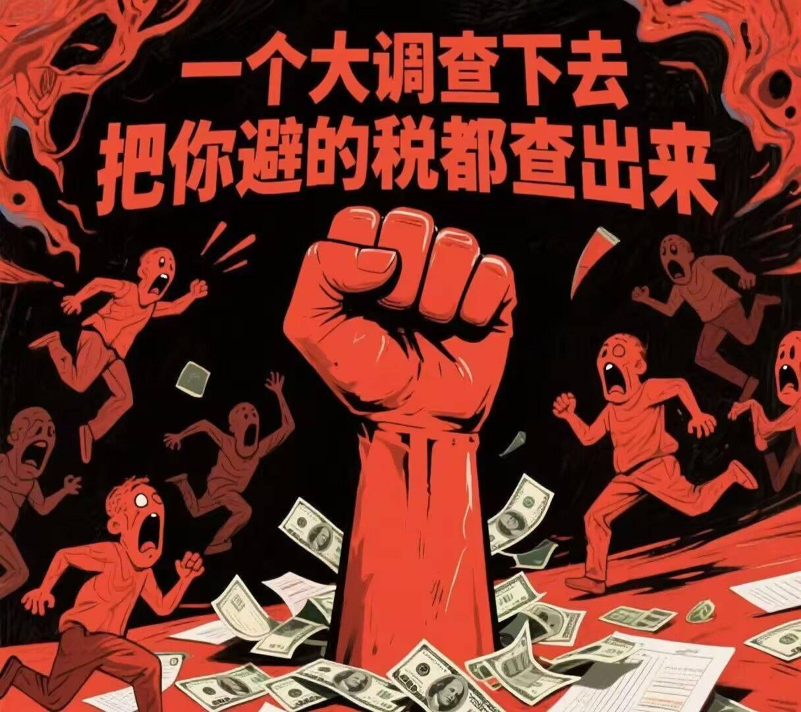

**AchenL【辰龙🐉】** (2025-05-26 06:16:10):
<:1000168518:1298906830864519231>

**卡顺密** (2025-05-26 06:16:03):
告上中央!!!

**卡顺密** (2025-05-26 06:15:57):
我要告上中央😡

**卡顺密** (2025-05-26 06:15:49):
暴力 奸商 垄断

**AchenL【辰龙🐉】** (2025-05-26 06:15:34):
我不知道怎么改

**卡顺密** (2025-05-26 06:15:15):
<:1000168510:1298906820638674984>

**卡顺密** (2025-05-26 06:15:09):
煤炭系统定价也才50

**AchenL【辰龙🐉】** (2025-05-26 06:15:06):
像奸商不

**AchenL【辰龙🐉】** (2025-05-26 06:15:01):
你看看我的头像

**AchenL【辰龙🐉】** (2025-05-26 06:14:57):
物以稀为贵，我也就4个

**卡顺密** (2025-05-26 06:14:56):
你疯了？

**卡顺密** (2025-05-26 06:14:44):
多少？

**卡顺密** (2025-05-26 06:14:40):
？

**YEE式機器龍** (2025-05-26 06:14:36):
[<:store:1273299726971965510> | 成功上架]()
你的店面狀態為: `營業中`，現在架上有 `2` 個 煤炭，售價為 `90$`

**AchenL【辰龙🐉】** (2025-05-26 06:14:35):
&shop add 煤炭 2 90

**AchenL【辰龙🐉】** (2025-05-26 06:14:08):
行 我卖给你两块

**卡顺密** (2025-05-26 06:14:04):
😡😡😡

**卡顺密** (2025-05-26 06:14:02):
现在是我要跟你买

**卡顺密** (2025-05-26 06:13:58):
你免费给他关我鸡毛事

**YEE式機器龍** (2025-05-26 06:13:54):
[<a:cross:1273299616137347082> | 你過勞了！]()
你今天挖礦了 `11` 次，等待到 <t:1748240075:t> (<t:1748240075:R>) 可以繼續挖礦

**AchenL【辰龙🐉】** (2025-05-26 06:13:54):
&mine

**味道≠天秤♎ TKN** (2025-05-26 06:13:32):
就两块

**味道≠天秤♎ TKN** (2025-05-26 06:13:26):
我也会啊 我免费给他

**卡顺密** (2025-05-26 06:13:19):
😡

**味道≠天秤♎ TKN** (2025-05-26 06:13:17):
看着咱俩的关系才给你煤炭

**卡顺密** (2025-05-26 06:13:15):
让他帮我烧

**卡顺密** (2025-05-26 06:13:12):
我免费给他煤炭

**YEE式機器龍** (2025-05-26 06:13:07):
[<a:cross:1273299616137347082> | 你過勞了！]()
你今天抓了 `21` 次魚，等待到 <t:1748240091:t> (<t:1748240091:R>) 可以繼續抓魚

**味道≠天秤♎ TKN** (2025-05-26 06:13:07):
&fish

**卡顺密** (2025-05-26 06:12:59):
之后有厨师了

**味道≠天秤♎ TKN** (2025-05-26 06:12:57):
我最多能给你两块

**卡顺密** (2025-05-26 06:12:51):
我从你那买煤炭😠

**味道≠天秤♎ TKN** (2025-05-26 06:12:47):
不给你

**YEE式機器龍** (2025-05-26 06:07:43):
你現在有 `299$`

**卡顺密** (2025-05-26 06:07:43):
&money

**卡顺密** (2025-05-26 06:07:32):
卖我5块

**AchenL【辰龙🐉】** (2025-05-26 06:06:42):
行啊，又有煤炭了

**YEE式機器龍** (2025-05-26 06:06:35):
[<:ore:1273299681283276853> | 挖礦]()
在洞口處發現了 `3` 個煤炭！

**AchenL【辰龙🐉】** (2025-05-26 06:06:35):
&mine

**YEE式機器龍** (2025-05-26 06:06:12):
[<:fisher:1273299701386707058> | 太蝦了把]()
你打撈了一片蝦子上來，獲得了 `2` 個生蝦！

**味道≠天秤♎ TKN** (2025-05-26 06:06:11):
&fish

**全能沙雕王（光速滑跪版）** (2025-05-26 06:05:18):
。。。

**卡顺密** (2025-05-26 06:05:11):
留个纪念吧，没用

**卡顺密** (2025-05-26 06:03:44):
你先别卖，我去查一查

**卡顺密** (2025-05-26 06:03:33):
<:1000168518:1298906830864519231>

**卡顺密** (2025-05-26 06:03:29):
卖给系统250

**卡顺密** (2025-05-26 06:03:23):
好像没什么用

**全能沙雕王（光速滑跪版）** (2025-05-26 06:03:06):
有啥用

**全能沙雕王（光速滑跪版）** (2025-05-26 06:02:56):
？！！！！

**卡顺密** (2025-05-26 06:02:55):
我草

**卡顺密** (2025-05-26 06:02:51):
？

**YEE式機器龍** (2025-05-26 06:02:46):
[<:wood:1273299684818944113> | 是神?!]()
本來是平常的一天，居然遇到了神木，於是你砍下了他並獲得了 `1` 塊神木！

**全能沙雕王（光速滑跪版）** (2025-05-26 06:02:46):
&fell

**卡顺密** (2025-05-26 05:53:13):
😠

**卡顺密** (2025-05-26 05:53:11):
你爱买不买

**卡顺密** (2025-05-26 05:53:08):
全都这个价

**任白** (2025-05-26 05:52:59):
要一百一个

**任白** (2025-05-26 05:52:55):
什么破萝卜

**YEE式機器龍** (2025-05-26 05:52:41):

**任白** (2025-05-26 05:52:40):
&shop <@1063068779162108027>

**任白** (2025-05-26 05:52:31):
咋买

**卡顺密** (2025-05-26 05:52:27):
我有卖啊

**YEE式機器龍** (2025-05-26 05:52:13):
你現在有 `990$`

**任白** (2025-05-26 05:52:13):
&money

**任白** (2025-05-26 05:52:08):
饿啊

**YEE式機器龍** (2025-05-26 05:45:53):
[<:store:1273299726971965510> | 購買成功]()
你購買了 木材 `x3`，花費 `198$`

**卡顺密** (2025-05-26 05:45:53):
&buy <@1364858239656919054>  木材 3

**YEE式機器龍** (2025-05-26 05:45:30):
[<:store:1273299726971965510> | 成功上架]()
你的店面狀態為: `營業中`，現在架上有 `3` 個 木材，售價為 `66$`

**全能沙雕王（光速滑跪版）** (2025-05-26 05:45:29):
&shop add 木材 3 66

**YEE式機器龍** (2025-05-26 05:45:21):
[<:wood:1273299684818944113> | 平常的一天]()
你來到了森林，並且砍了 `2` 塊木材

**全能沙雕王（光速滑跪版）** (2025-05-26 05:45:21):
&fell

**全能沙雕王（光速滑跪版）** (2025-05-26 05:35:12):
欧克克

**卡顺密** (2025-05-26 05:35:02):
记得留4个木材给我

**YEE式機器龍** (2025-05-26 05:34:54):
[xpkun.#0]()

**YEE式機器龍** (2025-05-26 05:34:32):
[<:wood:1273299684818944113> | 平常的一天]()
你來到了森林，並且砍了 `1` 塊木材

**全能沙雕王（光速滑跪版）** (2025-05-26 05:34:32):
&fell

**YEE式機器龍** (2025-05-26 05:34:24):
[<:bag:1273299770777141381> | 查看包包]()
為保護包包內容隱私權，戳這顆按鈕來看你的包包，隱私權設定可以透過 `&privacy` 指令更改

**全能沙雕王（光速滑跪版）** (2025-05-26 05:34:24):
&items

**味道≠天秤♎ TKN** (2025-05-26 05:32:02):
不小心弹错了

**卡顺密** (2025-05-26 05:31:46):
<:04:1298280511562580090>

**卡顺密** (2025-05-26 05:31:44):
脑筋扭成一团了是吧

**味道≠天秤♎ TKN** (2025-05-26 05:31:34):
玩法交流上了

**味道≠天秤♎ TKN** (2025-05-26 05:31:30):
刚才不小心发到

**味道≠天秤♎ TKN** (2025-05-26 05:31:25):
不行了，得先回家才能玩

**卡顺密** (2025-05-26 05:30:57):
我已经沉迷无法自拔了

**味道≠天秤♎ TKN** (2025-05-26 05:30:50):
双线操作就是容易失误

**卡顺密** (2025-05-26 05:30:46):
<:1000168518:1298906830864519231>

**卡顺密** (2025-05-26 05:30:42):
小麦4个不知道要不要卖了

**全能沙雕王（光速滑跪版）** (2025-05-26 05:30:06):
没有了还

**卡顺密** (2025-05-26 05:29:59):
你的不是？

**卡顺密** (2025-05-26 05:29:55):
不是都一样吗

**卡顺密** (2025-05-26 05:29:52):
是的

**全能沙雕王（光速滑跪版）** (2025-05-26 05:29:47):
锄头是一次性消耗品？

**YEE式機器龍** (2025-05-26 05:29:40):
[<:bag:1273299770777141381> | 查看包包]()
為保護包包內容隱私權，戳這顆按鈕來看你的包包，隱私權設定可以透過 `&privacy` 指令更改

**卡顺密** (2025-05-26 05:29:39):
&items

**卡顺密** (2025-05-26 05:29:18):
没有装备，没办法挖田了

**卡顺密** (2025-05-26 05:28:59):
<:10:1298285710033424446>

**全能沙雕王（光速滑跪版）** (2025-05-26 05:28:57):
就看看

**卡顺密** (2025-05-26 05:28:54):
一律90块

**卡顺密** (2025-05-26 05:28:48):
不是给你的 你的是特价

**YEE式機器龍** (2025-05-26 05:28:32):

**全能沙雕王（光速滑跪版）** (2025-05-26 05:28:32):
&shop <@1063068779162108027>

**卡顺密** (2025-05-26 05:28:27):
<:1000168518:1298906830864519231>

**卡顺密** (2025-05-26 05:28:14):
红萝卜都没人买吗

**AchenL【辰龙🐉】** (2025-05-26 05:28:02):
不行啊

**卡顺密** (2025-05-26 05:27:52):
吃的和他那种不行

**全能沙雕王（光速滑跪版）** (2025-05-26 05:27:13):
你试试/make都有什么可以做

**YEE式機器龍** (2025-05-26 05:26:45):
[<a:cross:1273299616137347082> | 你過勞了！]()
你今天抓了 `20` 次魚，等待到 <t:1748237364:t> (<t:1748237364:R>) 可以繼續抓魚

**味道≠天秤♎ TKN** (2025-05-26 05:26:45):
&fish

**AchenL【辰龙🐉】** (2025-05-26 05:26:18):
不然的话铁匠弄了干嘛

**YEE式機器龍** (2025-05-26 05:26:14):
[<:store:1273299726971965510> | 成功上架]()
你的店面狀態為: `營業中`，現在架上有 `2` 個 紅蘿蔔，售價為 `100$`

**卡顺密** (2025-05-26 05:26:14):
&shop add 红萝卜 2 100

**AchenL【辰龙🐉】** (2025-05-26 05:26:13):
应该不行吧

**YEE式機器龍** (2025-05-26 05:26:06):
[<a:cross:1273299616137347082> | 你過勞了！]()
你今天砍了 `15` 次柴，等待到 <t:1748237412:t> (<t:1748237412:R>) 可以繼續砍柴

**全能沙雕王（光速滑跪版）** (2025-05-26 05:26:06):
&fell

**全能沙雕王（光速滑跪版）** (2025-05-26 05:25:47):
等下批

**YEE式機器龍** (2025-05-26 05:25:45):
[<:bag:1273299770777141381> | 查看包包]()
為保護包包內容隱私權，戳這顆按鈕來看你的包包，隱私權設定可以透過 `&privacy` 指令更改

**卡顺密** (2025-05-26 05:25:44):
&items

**全能沙雕王（光速滑跪版）** (2025-05-26 05:25:41):
没了

**卡顺密** (2025-05-26 05:25:33):
木材

**卡顺密** (2025-05-26 05:25:29):
<@1364858239656919054>

**晨** (2025-05-26 05:24:58):
买点好的吃

**YEE式機器龍** (2025-05-26 05:24:45):
[<a:offline:1273299546302054486> | 正在處理請求]()

**晨** (2025-05-26 05:24:45):
&pay <@1327930413070684181> 500

**YEE式機器龍** (2025-05-26 05:24:38):
[<a:cross:1273299616137347082> | 請輸入要付款的數字]()

**晨** (2025-05-26 05:24:37):
&pay <@1327930413070684181> Kane 500

**全能沙雕王（光速滑跪版）** (2025-05-26 05:24:01):
<@1376361794515238922> 你试试你能不能直接用铁矿造铁

**YEE式機器龍** (2025-05-26 05:23:06):
[<:store:1273299726971965510> | 成功上架]()
你的店面狀態為: `營業中`，現在架上有 `1` 個 馬鈴薯，售價為 `100$`

**全能沙雕王（光速滑跪版）** (2025-05-26 05:23:06):
&shop add 马铃薯 1 100

**全能沙雕王（光速滑跪版）** (2025-05-26 05:22:50):
也行

**晨** (2025-05-26 05:22:44):
或者你直接卖给任白？

**晨** (2025-05-26 05:22:35):
算了，明天再说吧

**全能沙雕王（光速滑跪版）** (2025-05-26 05:22:27):
要做成铁

**全能沙雕王（光速滑跪版）** (2025-05-26 05:22:09):
铁矿不能直接用

**全能沙雕王（光速滑跪版）** (2025-05-26 05:21:55):
没有了...

**AchenL【辰龙🐉】** (2025-05-26 05:21:55):
又铁

**YEE式機器龍** (2025-05-26 05:21:48):
[<:ore:1273299681283276853> | 挖礦]()
在洞口處發現了 `3` 個鐵礦！

**AchenL【辰龙🐉】** (2025-05-26 05:21:48):
&mine

**YEE式機器龍** (2025-05-26 05:21:46):
[<a:cross:1273299616137347082> | 沒有販賣這項物品]()

**晨** (2025-05-26 05:21:46):
&buy <@1364858239656919054>  木材 2

**YEE式機器龍** (2025-05-26 05:21:41):
[<a:cross:1273299616137347082> | 沒有販賣這項物品]()

**晨** (2025-05-26 05:21:40):
&buy <@1364858239656919054>  木材 3

**YEE式機器龍** (2025-05-26 05:21:24):
[<a:cross:1273299616137347082> | 沒有販賣這項物品]()

**晨** (2025-05-26 05:21:24):
&buy <@1364858239656919054>  木材 5

**全能沙雕王（光速滑跪版）** (2025-05-26 05:21:13):
我还有3个救急的马铃薯，可以卖一个，要么？

**YEE式機器龍** (2025-05-26 05:21:04):
[<:fisher:1273299701386707058> | 🐢魚]()
你等待了幾個小時，獲得了 `1` 條生鮭魚！

**味道≠天秤♎ TKN** (2025-05-26 05:21:04):
&fish

**YEE式機器龍** (2025-05-26 05:20:58):
嗨嗨 d(･∀･)b 我是YEE式機器龍，
我的目標是讓你快速建立優質的中文 Discord 伺服器!

<:slash:1273299597489344514> 我們正在努力轉移部分功能的指令到斜線指令
可以使用 </help:880380398562054156> 指令查看斜線的使用方法

使用我的服務即表示你已同意我的 [隱私權聲明](https://yeecord.com/privacy/) 及 [服務條款](https://yeecord.com/terms/)

**晨** (2025-05-26 05:20:42):
商业垄断太坏了

**晨** (2025-05-26 05:20:28):
我也没吃的了饱饱😭😭😭

**YEE式機器龍** (2025-05-26 05:20:24):
[<:toolbox:1273299690560946357> | 製作物品]()
你製作出了 1 個木棒

**YEE式機器龍** (2025-05-26 05:20:12):
[<:wood:1273299684818944113> | 平常的一天]()
你來到了森林，並且砍了 `2` 塊木材

**全能沙雕王（光速滑跪版）** (2025-05-26 05:20:11):
&fell

**YEE式機器龍** (2025-05-26 05:19:24):
[<:bag:1273299770777141381> | 查看包包]()
為保護包包內容隱私權，戳這顆按鈕來看你的包包，隱私權設定可以透過 `&privacy` 指令更改

**任白** (2025-05-26 05:19:24):
&items

**任白** (2025-05-26 05:19:18):
😭😭😭

**YEE式機器龍** (2025-05-26 05:19:14):
[<a:cross:1273299616137347082> | 你的體力不足了！]()

**任白** (2025-05-26 05:19:14):
&brew

**任白** (2025-05-26 05:19:00):
饿

**任白** (2025-05-26 05:18:54):
饿了

**全能沙雕王（光速滑跪版）** (2025-05-26 05:17:38):
我还能砍——……

**YEE式機器龍** (2025-05-26 05:16:32):
[<a:cross:1273299616137347082> | 你過勞了！]()
你今天砍了 `14` 次柴，等待到 <t:1748236746:t> (<t:1748236746:R>) 可以繼續砍柴

**全能沙雕王（光速滑跪版）** (2025-05-26 05:16:32):
&fell

**卡顺密** (2025-05-26 05:14:32):
嘿嘿嘿

**卡顺密** (2025-05-26 05:14:28):
没电了，充电顺带洗个澡

**卡顺密** (2025-05-26 05:14:11):
本来就是

**晨** (2025-05-26 05:14:05):
<:07:1298281204260278383>

**卡顺密** (2025-05-26 05:14:05):
这样行吧

**晨** (2025-05-26 05:14:01):
到时候发现石斧头是一次性的

**卡顺密** (2025-05-26 05:13:56):
那你也有垄断能力了

**AchenL【辰龙🐉】** (2025-05-26 05:13:51):
<:07:1298281204260278383>

**卡顺密** (2025-05-26 05:13:51):
还有斧头级别

**卡顺密** (2025-05-26 05:13:43):
对哦

**全能沙雕王（光速滑跪版）** (2025-05-26 05:13:34):
等着吧，我差三个造一个石斧头

**AchenL【辰龙🐉】** (2025-05-26 05:12:58):
就是没有石头

**AchenL【辰龙🐉】** (2025-05-26 05:12:54):
铁什么的都有

**AchenL【辰龙🐉】** (2025-05-26 05:12:51):
运气太好了

**味道≠天秤♎ TKN** (2025-05-26 05:12:42):
有一个

**全能沙雕王（光速滑跪版）** (2025-05-26 05:12:35):
<@1376361794515238922> 还没石头吗？

**卡顺密** (2025-05-26 05:12:12):
还有两个红萝卜~

**卡顺密** (2025-05-26 05:11:54):
哇，玉米和苹果

**YEE式機器龍** (2025-05-26 05:11:47):
[<:fisher:1273299701386707058> | 呼]()
你等待了幾個小時，打撈到了 `1` 條生鮪魚！

**味道≠天秤♎ TKN** (2025-05-26 05:11:47):
&fish

**YEE式機器龍** (2025-05-26 05:11:46):
[<:farmer:1273299699633360906> | 成功採收了 4 格田地]()
你獲得了 1 個玉米、2 個紅蘿蔔、1 個蘋果

**YEE式機器龍** (2025-05-26 05:11:36):
[<:store:1273299726971965510> | shop 指令]()
商店系統 - 透過購買來活絡經濟

**YEE式機器龍** (2025-05-26 05:11:36):
[<:farmer:1273299699633360906> | _kami_8372 的農田]()
農田等級：1 | 上次澆水：<t:1748231218:R>

**YEE式機器龍** (2025-05-26 05:11:36):
[<a:cross:1273299616137347082> | 你過勞了！]()
你今天挖礦了 `9` 次，等待到 <t:1748236481:t> (<t:1748236481:R>) 可以繼續挖礦

**AchenL【辰龙🐉】** (2025-05-26 05:11:35):
&mine

**全能沙雕王（光速滑跪版）** (2025-05-26 05:11:35):
&shop

**YEE式機器龍** (2025-05-26 05:11:11):
[<:store:1273299726971965510> | 購買成功]()
你購買了 紅蘿蔔 `x2`，花費 `200$`

**AchenL【辰龙🐉】** (2025-05-26 05:11:11):
&buy <@1063068779162108027> 紅蘿蔔 2

**卡顺密** (2025-05-26 05:10:22):
这个签到怎么签到啊

**YEE式機器龍** (2025-05-26 05:10:18):
[<:toolbox:1273299690560946357> | 製作物品]()
你製作出了 1 個木棒

**YEE式機器龍** (2025-05-26 05:10:14):
[golden_parrot_36859#0]()

**YEE式機器龍** (2025-05-26 05:10:14):
[<:store:1273299726971965510> | 成功上架]()
你的店面狀態為: `營業中`，現在架上有 `2` 個 紅蘿蔔，售價為 `100$`

**卡顺密** (2025-05-26 05:10:14):
&shop add 红萝卜 2 100

**卡顺密** (2025-05-26 05:09:56):
买两个红萝卜~

**YEE式機器龍** (2025-05-26 05:09:42):
[<:bag:1273299770777141381> | 查看包包]()
為保護包包內容隱私權，戳這顆按鈕來看你的包包，隱私權設定可以透過 `&privacy` 指令更改

**全能沙雕王（光速滑跪版）** (2025-05-26 05:09:42):
&items

**YEE式機器龍** (2025-05-26 05:09:41):
[tim143344321.fat#0]()

**YEE式機器龍** (2025-05-26 05:09:36):
[<:wood:1273299684818944113> | 平常的一天]()
你來到了森林，並且砍了 `2` 塊木材

**全能沙雕王（光速滑跪版）** (2025-05-26 05:09:36):
&fell

**味道≠天秤♎ TKN** (2025-05-26 05:09:21):
来个厨师就行

**卡顺密** (2025-05-26 05:09:09):
打价格战我也不怕

**味道≠天秤♎ TKN** (2025-05-26 05:09:06):
所以能探险不

**卡顺密** (2025-05-26 05:09:04):
但凡来一个新来的分分钟压似

**卡顺密** (2025-05-26 05:08:48):
我很不想这么说，但是是真的

**晨** (2025-05-26 05:08:38):
还真是

**全能沙雕王（光速滑跪版）** (2025-05-26 05:08:31):
😡

**全能沙雕王（光速滑跪版）** (2025-05-26 05:08:26):
你一个种地的就有了

**YEE式機器龍** (2025-05-26 05:08:08):
[<:bag:1273299770777141381> | 查看包包]()
為保護包包內容隱私權，戳這顆按鈕來看你的包包，隱私權設定可以透過 `&privacy` 指令更改

**AchenL【辰龙🐉】** (2025-05-26 05:08:08):
&items

**AchenL【辰龙🐉】** (2025-05-26 05:07:56):
怎么不给我来个钻石

**AchenL【辰龙🐉】** (2025-05-26 05:07:51):
又铁

**卡顺密** (2025-05-26 05:07:42):
...

**YEE式機器龍** (2025-05-26 05:07:41):
[<:ore:1273299681283276853> | 挖礦]()
在洞口處發現了 `3` 個鐵礦！

**AchenL【辰龙🐉】** (2025-05-26 05:07:41):
&mine

**卡顺密** (2025-05-26 05:07:40):
但凡有另外一个

**卡顺密** (2025-05-26 05:07:36):
砍柴的没有这么强的垄断能力

**YEE式機器龍** (2025-05-26 05:07:31):
[<a:cross:1273299616137347082> | 你過勞了！]()
你今天抓了 `18` 次魚，等待到 <t:1748236220:t> (<t:1748236220:R>) 可以繼續抓魚

**味道≠天秤♎ TKN** (2025-05-26 05:07:31):
&fish

**卡顺密** (2025-05-26 05:07:31):
难说

**味道≠天秤♎ TKN** (2025-05-26 05:07:26):
<:04:1298280511562580090>

**全能沙雕王（光速滑跪版）** (2025-05-26 05:07:08):
我要当农场主👿

**卡顺密** (2025-05-26 05:06:33):
欧克欧克

**味道≠天秤♎ TKN** (2025-05-26 05:06:25):
顺便靠你出面 跟小魅报备一下

**卡顺密** (2025-05-26 05:06:07):
怎么样

**卡顺密** (2025-05-26 05:06:04):
好了

**卡顺密** (2025-05-26 05:05:55):
反冷暴力农场经营

**晨** (2025-05-26 05:05:51):
不然新人也不会进

**晨** (2025-05-26 05:05:43):
对

**味道≠天秤♎ TKN** (2025-05-26 05:05:36):
快点改个名 改成赛博农场经营

**晨** (2025-05-26 05:05:35):
<:1000168510:1298906820638674984>

**卡顺密** (2025-05-26 05:05:17):
😰

**卡顺密** (2025-05-26 05:05:14):
坏了 不会真会被制裁吧

**味道≠天秤♎ TKN** (2025-05-26 05:05:10):
你不看看这帖子现在有多少了

**卡顺密** (2025-05-26 05:05:07):
？

**卡顺密** (2025-05-26 05:05:05):
都快要3000了

**卡顺密** (2025-05-26 05:05:01):
我🌿

**晨** (2025-05-26 05:04:58):
给咱们烧饭

**晨** (2025-05-26 05:04:53):
我还在找厨师

**晨** (2025-05-26 05:04:44):
别急

**卡顺密** (2025-05-26 05:04:43):
制裁？

**AchenL【辰龙🐉】** (2025-05-26 05:04:28):
我觉得会被天道制裁

**AchenL【辰龙🐉】** (2025-05-26 05:04:24):
3000+了

**AchenL【辰龙🐉】** (2025-05-26 05:04:13):
我的天啊，要不还是改个名

**YEE式機器龍** (2025-05-26 05:04:07):
[xpkun.#0]()

**卡顺密** (2025-05-26 05:03:54):
废话，我还能饿死你不成

**AchenL【辰龙🐉】** (2025-05-26 05:03:54):
<:07:1298281204260278383>

**全能沙雕王（光速滑跪版）** (2025-05-26 05:03:37):
3马铃薯够了，你要明白一件事，饿死了我，就没人砍树了

**晨** (2025-05-26 05:03:16):
没吃的了

**晨** (2025-05-26 05:03:11):
坏了

**卡顺密** (2025-05-26 05:03:08):
我还有俩萝卜，你要不要

**晨** (2025-05-26 05:03:04):
<:1000168510:1298906820638674984>

**YEE式機器龍** (2025-05-26 05:03:02):
[<:bag:1273299770777141381> | 查看包包]()
為保護包包內容隱私權，戳這顆按鈕來看你的包包，隱私權設定可以透過 `&privacy` 指令更改

**AchenL【辰龙🐉】** (2025-05-26 05:03:02):
&items

**任白** (2025-05-26 05:02:56):
<@1303142548377960448>

**任白** (2025-05-26 05:02:51):
饭饭

**任白** (2025-05-26 05:02:49):
饿饿

**YEE式機器龍** (2025-05-26 05:02:45):
[<a:cross:1273299616137347082> | 你的體力不足了！]()

**任白** (2025-05-26 05:02:44):
&brew

**YEE式機器龍** (2025-05-26 05:02:41):
[<:bag:1273299770777141381> | 查看包包]()
為保護包包內容隱私權，戳這顆按鈕來看你的包包，隱私權設定可以透過 `&privacy` 指令更改

**全能沙雕王（光速滑跪版）** (2025-05-26 05:02:41):
&items

**YEE式機器龍** (2025-05-26 05:02:40):
[<:fisher:1273299701386707058> | 呼]()
你等待了幾個小時，打撈到了 `1` 條生鮪魚！

**味道≠天秤♎ TKN** (2025-05-26 05:02:40):
&fish

**YEE式機器龍** (2025-05-26 05:02:31):
[<a:cross:1273299616137347082> | 你過勞了！]()
你今天砍了 `13` 次柴，等待到 <t:1748235809:t> (<t:1748235809:R>) 可以繼續砍柴

**全能沙雕王（光速滑跪版）** (2025-05-26 05:02:31):
&fell

**YEE式機器龍** (2025-05-26 05:02:24):
[<:bag:1273299770777141381> | 查看包包]()
為保護包包內容隱私權，戳這顆按鈕來看你的包包，隱私權設定可以透過 `&privacy` 指令更改

**YEE式機器龍** (2025-05-26 05:02:24):
[<a:cross:1273299616137347082> | 你過勞了！]()
你今天挖礦了 `8` 次，等待到 <t:1748235939:t> (<t:1748235939:R>) 可以繼續挖礦

**卡顺密** (2025-05-26 05:02:24):
&items

**AchenL【辰龙🐉】** (2025-05-26 05:02:24):
&mine

**任白** (2025-05-26 05:02:23):
&drew

**YEE式機器龍** (2025-05-26 05:02:15):
[<:calendar:1273299842793341082> | 到我們伺服器聊天就會自動簽到!]()
加入我們伺服器接收機器人最新訊息

**晨** (2025-05-26 05:02:14):
&daily

**卡顺密** (2025-05-26 05:02:09):
有没有人要买

**卡顺密** (2025-05-26 05:02:05):
我还有两个萝卜来着

**AchenL【辰龙🐉】** (2025-05-26 05:02:05):
刚好我也有煤炭了

**YEE式機器龍** (2025-05-26 05:02:03):
[<:job:1273299768587849900> | 成功轉職為 刺客]()

**任白** (2025-05-26 05:02:02):
&fj

**晨** (2025-05-26 05:01:54):
我就能烧肉吃了

**晨** (2025-05-26 05:01:45):
等来了厨师

**YEE式機器龍** (2025-05-26 05:01:42):
嗨嗨 d(･∀･)b 我是YEE式機器龍，
我的目標是讓你快速建立優質的中文 Discord 伺服器!

<:slash:1273299597489344514> 我們正在努力轉移部分功能的指令到斜線指令
可以使用 </help:880380398562054156> 指令查看斜線的使用方法

使用我的服務即表示你已同意我的 [隱私權聲明](https://yeecord.com/privacy/) 及 [服務條款](https://yeecord.com/terms/)

**晨** (2025-05-26 05:01:41):
你等着！

**卡顺密** (2025-05-26 05:01:28):
资本的力量

**晨** (2025-05-26 05:01:19):
垄断！

**卡顺密** (2025-05-26 05:01:01):
木嘿嘿嘿嘿

**YEE式機器龍** (2025-05-26 05:00:37):
[<:store:1273299726971965510> | 購買成功]()
你購買了 馬鈴薯 `x3`，花費 `270$`

**全能沙雕王（光速滑跪版）** (2025-05-26 05:00:36):
&buy <@1063068779162108027>  马铃薯 3

**卡顺密** (2025-05-26 04:59:57):
<@1364858239656919054>

**AchenL【辰龙🐉】** (2025-05-26 04:59:51):
厨娘

**YEE式機器龍** (2025-05-26 04:59:49):
[<:store:1273299726971965510> | 成功上架]()
你的店面狀態為: `營業中`，現在架上有 `3` 個 馬鈴薯，售價為 `90$`

**卡顺密** (2025-05-26 04:59:49):
&shop add 马铃薯 3 90

**全能沙雕王（光速滑跪版）** (2025-05-26 04:59:34):
把小麦叫来

**YEE式機器龍** (2025-05-26 04:59:27):
[<a:cross:1273299616137347082> | 你過勞了！]()
你今天抓了 `17` 次魚，等待到 <t:1748235658:t> (<t:1748235658:R>) 可以繼續抓魚

**YEE式機器龍** (2025-05-26 04:59:27):
你現在有 `490$`

**味道≠天秤♎ TKN** (2025-05-26 04:59:27):
&fish

**任白** (2025-05-26 04:59:27):
&money

**晨** (2025-05-26 04:59:22):
只缺厨师了

**YEE式機器龍** (2025-05-26 04:59:18):
[<:trade:1273299728268005497> | 成功售出了 2 個 回復藥水]()

**任白** (2025-05-26 04:59:18):
&sell 回复药水 2

**晨** (2025-05-26 04:59:18):
好耶！

**AchenL【辰龙🐉】** (2025-05-26 04:59:17):
哎，有煤炭了

**AchenL【辰龙🐉】** (2025-05-26 04:59:14):
有煤炭的

**晨** (2025-05-26 04:59:13):
不能直接送就有点难受

**YEE式機器龍** (2025-05-26 04:59:09):
[<:ore:1273299681283276853> | 挖礦]()
在洞口處發現了 `2` 個煤炭！

**AchenL【辰龙🐉】** (2025-05-26 04:59:09):
&mine

**YEE式機器龍** (2025-05-26 04:59:08):
[<:bag:1273299770777141381> | 查看包包]()
為保護包包內容隱私權，戳這顆按鈕來看你的包包，隱私權設定可以透過 `&privacy` 指令更改

**任白** (2025-05-26 04:59:08):
&items

**YEE式機器龍** (2025-05-26 04:59:02):
[<:potion:1273299798132396102> | 回復藥水可以幹嘛?]()
你研究了許久獲得了 `1` 個回復藥水

之後推出的冒險可以用上

**任白** (2025-05-26 04:59:02):
&brew

**全能沙雕王（光速滑跪版）** (2025-05-26 04:58:58):
卖啊

**卡顺密** (2025-05-26 04:58:55):
要食物我就上

**AchenL【辰龙🐉】** (2025-05-26 04:58:53):
然后低价再卖给小戶

**任白** (2025-05-26 04:58:50):
&berw

**YEE式機器龍** (2025-05-26 04:58:49):
[<a:cross:1273299616137347082> | 商店裡沒有販賣任何東西]()

**全能沙雕王（光速滑跪版）** (2025-05-26 04:58:48):
&shop <@1063068779162108027>

**AchenL【辰龙🐉】** (2025-05-26 04:58:44):
我先买

**YEE式機器龍** (2025-05-26 04:58:36):
[<:store:1273299726971965510> | 購買成功]()
你購買了 木材 `x1`，花費 `66$`

**AchenL【辰龙🐉】** (2025-05-26 04:58:36):
&buy <@1364858239656919054> 木材 1

**卡顺密** (2025-05-26 04:58:14):
要食物吗

**晨** (2025-05-26 04:58:13):
没事，他没钱了

**晨** (2025-05-26 04:58:03):
？还买！

**全能沙雕王（光速滑跪版）** (2025-05-26 04:58:01):
我靠垄断木头，也算个人物了

**YEE式機器龍** (2025-05-26 04:57:53):
[<:store:1273299726971965510> | 購買成功]()
你購買了 木材 `x1`，花費 `66$`

**卡顺密** (2025-05-26 04:57:52):
&buy <@1364858239656919054>  木材 1

**AchenL【辰龙🐉】** (2025-05-26 04:57:46):
怎么买东西来着

**AchenL【辰龙🐉】** (2025-05-26 04:57:36):
哈哈，没钱了，是吧

**YEE式機器龍** (2025-05-26 04:57:35):
你現在有 `1,397$`

**全能沙雕王（光速滑跪版）** (2025-05-26 04:57:34):
&money

**晨** (2025-05-26 04:57:30):
哎，为了这个村子操碎了心

**YEE式機器龍** (2025-05-26 04:57:29):
你現在有 `93$`

**卡顺密** (2025-05-26 04:57:29):
&money

**YEE式機器龍** (2025-05-26 04:57:19):

**卡顺密** (2025-05-26 04:57:19):
&shop <@1364858239656919054>  木材 2

**YEE式機器龍** (2025-05-26 04:56:58):
[<:store:1273299726971965510> | 成功上架]()
你的店面狀態為: `營業中`，現在架上有 `2` 個 木材，售價為 `66$`

**全能沙雕王（光速滑跪版）** (2025-05-26 04:56:57):
&shop add 木材 2 66

**AchenL【辰龙🐉】** (2025-05-26 04:56:54):
让晨晨教一下

**全能沙雕王（光速滑跪版）** (2025-05-26 04:56:48):
我卖木头有钱的，直接买就行

**AchenL【辰龙🐉】** (2025-05-26 04:56:45):
先等等

**AchenL【辰龙🐉】** (2025-05-26 04:56:35):
快点，沙雕王 卖4个木材给小户

**AchenL【辰龙🐉】** (2025-05-26 04:56:23):
对，对对，这也行，农民也行

**晨** (2025-05-26 04:56:18):
这下搞不了垄断了

**晨** (2025-05-26 04:56:11):
好好好

**AchenL【辰龙🐉】** (2025-05-26 04:56:10):
我自个跟自个结婚了

**卡顺密** (2025-05-26 04:56:06):
给钱不需要那个什么吧？

**AchenL【辰龙🐉】** (2025-05-26 04:56:05):
太惨了，沙雕王

**晨** (2025-05-26 04:55:59):
要么宠物

**晨** (2025-05-26 04:55:56):
要么伴侣

**晨** (2025-05-26 04:55:53):
好像没

**全能沙雕王（光速滑跪版）** (2025-05-26 04:55:46):
就没有正常伙伴关系吗？

**卡顺密** (2025-05-26 04:55:42):
<@1364858239656919054>

**AchenL【辰龙🐉】** (2025-05-26 04:55:41):
挖了这么多铁，就是没一个煤炭

**卡顺密** (2025-05-26 04:55:37):
你买了之后我还给你钱

**YEE式機器龍** (2025-05-26 04:55:34):
[<:job:1273299768587849900> | 職業已經設定成功]()
恭喜你成為`牧農`!

**xi** (2025-05-26 04:55:34):
&job

**AchenL【辰龙🐉】** (2025-05-26 04:55:33):
不对呀，没有煤炭啊

**卡顺密** (2025-05-26 04:55:33):
那我免费给你食物

**晨** (2025-05-26 04:55:22):
选职业

**AchenL【辰龙🐉】** (2025-05-26 04:55:21):
没事，你拿捏他的命脉

**晨** (2025-05-26 04:55:19):
<@764783803168063488>输入这个：&job

**全能沙雕王（光速滑跪版）** (2025-05-26 04:55:14):
不当狗

**AchenL【辰龙🐉】** (2025-05-26 04:55:09):
小团体不能行啊

**卡顺密** (2025-05-26 04:55:01):
那你就当我伙伴

**全能沙雕王（光速滑跪版）** (2025-05-26 04:54:56):
誓死不屈

**YEE式機器龍** (2025-05-26 04:54:51):
[<a:cross:1273299616137347082> | 你過勞了！]()
你今天挖礦了 `7` 次，等待到 <t:1748235347:t> (<t:1748235347:R>) 可以繼續挖礦

**AchenL【辰龙🐉】** (2025-05-26 04:54:51):
&mine

**卡顺密** (2025-05-26 04:54:43):
结婚 我能喂你吃的

**YEE式機器龍** (2025-05-26 04:54:42):
[xpkun.#0]()

**YEE式機器龍** (2025-05-26 04:54:41):
[<a:cross:1273299616137347082> | 你過勞了！]()
你今天抓了 `17` 次魚，等待到 <t:1748235658:t> (<t:1748235658:R>) 可以繼續抓魚

**味道≠天秤♎ TKN** (2025-05-26 04:54:41):
&fish

**YEE式機器龍** (2025-05-26 04:54:29):
[<:wood:1273299684818944113> | 平常的一天]()
你來到了森林，並且砍了 `2` 塊木材

**全能沙雕王（光速滑跪版）** (2025-05-26 04:54:29):
&fell

**味道≠天秤♎ TKN** (2025-05-26 04:54:28):
没有体力了

**YEE式機器龍** (2025-05-26 04:54:28):
嗨嗨 d(･∀･)b 我是YEE式機器龍，
我的目標是讓你快速建立優質的中文 Discord 伺服器!

<:slash:1273299597489344514> 我們正在努力轉移部分功能的指令到斜線指令
可以使用 </help:880380398562054156> 指令查看斜線的使用方法

使用我的服務即表示你已同意我的 [隱私權聲明](https://yeecord.com/privacy/) 及 [服務條款](https://yeecord.com/terms/)

**卡顺密** (2025-05-26 04:54:22):
我得留两个给沙雕王

**卡顺密** (2025-05-26 04:54:17):
定价多少呢

**味道≠天秤♎ TKN** (2025-05-26 04:53:56):
不要让他玩垄断

**晨** (2025-05-26 04:53:53):
我要吃

**卡顺密** (2025-05-26 04:53:47):
三个马铃薯，两个红萝卜

**味道≠天秤♎ TKN** (2025-05-26 04:53:43):
谁来当个农民

**卡顺密** (2025-05-26 04:53:42):
我草

**YEE式機器龍** (2025-05-26 04:53:38):
[<:fisher:1273299701386707058> | 太蝦了把]()
你打撈了一片蝦子上來，獲得了 `2` 個生蝦！

**味道≠天秤♎ TKN** (2025-05-26 04:53:38):
&fish

**YEE式機器龍** (2025-05-26 04:53:32):
[<:farmer:1273299699633360906> | 成功採收了 4 格田地]()
你獲得了 3 個馬鈴薯、2 個紅蘿蔔

**味道≠天秤♎ TKN** (2025-05-26 04:53:25):
不是啊，没体力了，我根本挖不了矿

**晨** (2025-05-26 04:53:18):
<:24:1298294525390753924>

**晨** (2025-05-26 04:53:14):
不要垄断啊

**卡顺密** (2025-05-26 04:53:11):
<:04:1298280511562580090>

**晨** (2025-05-26 04:53:10):
不要啊

**卡顺密** (2025-05-26 04:53:08):
食物产量压死你们

**卡顺密** (2025-05-26 04:53:03):
有了铁我就能卷起来了

**味道≠天秤♎ TKN** (2025-05-26 04:52:59):
没体力了

**味道≠天秤♎ TKN** (2025-05-26 04:52:51):
厨师啊

**卡顺密** (2025-05-26 04:52:48):
我现在要铁

**味道≠天秤♎ TKN** (2025-05-26 04:52:47):
厨师厨

**晨** (2025-05-26 04:52:45):
来当厨师！

**xi** (2025-05-26 04:52:44):
怎么玩啊

**卡顺密** (2025-05-26 04:52:44):
铁匠!

**晨** (2025-05-26 04:52:39):
厨师！

**晨** (2025-05-26 04:52:37):
别

**卡顺密** (2025-05-26 04:52:33):
快当个铁匠

**卡顺密** (2025-05-26 04:52:29):
哥

**xi** (2025-05-26 04:52:28):
<:1ody_008:1338753727921913876>

**卡顺密** (2025-05-26 04:52:24):
哦，好像是我的经验吧

**xi** (2025-05-26 04:52:23):
这素啥

**晨** (2025-05-26 04:52:10):
那这个农田等级呢

**卡顺密** (2025-05-26 04:51:56):
我没看到有说

**卡顺密** (2025-05-26 04:51:53):
好像不能成长

**卡顺密** (2025-05-26 04:51:49):
已经开始卷起来了

**味道≠天秤♎ TKN** (2025-05-26 04:51:47):
这机制有点太离谱了吧

**晨** (2025-05-26 04:51:46):
甚至还能成长

**晨** (2025-05-26 04:51:37):
又不耗体力，产物还多，还能烹饪，还能多开

**YEE式機器龍** (2025-05-26 04:51:10):
嗨嗨 d(･∀･)b 我是YEE式機器龍，
我的目標是讓你快速建立優質的中文 Discord 伺服器!

<:slash:1273299597489344514> 我們正在努力轉移部分功能的指令到斜線指令
可以使用 </help:880380398562054156> 指令查看斜線的使用方法

使用我的服務即表示你已同意我的 [隱私權聲明](https://yeecord.com/privacy/) 及 [服務條款](https://yeecord.com/terms/)

**卡顺密** (2025-05-26 04:51:06):
最好是在多个农田的时候

**晨** (2025-05-26 04:51:06):
应该不是

**卡顺密** (2025-05-26 04:51:01):
节省时间吧

**晨** (2025-05-26 04:50:53):
浇水是升级农田吧

**YEE式機器龍** (2025-05-26 04:50:40):
[<a:cross:1273299616137347082> | 你過勞了！]()
你今天抓了 `16` 次魚，等待到 <t:1748235159:t> (<t:1748235159:R>) 可以繼續抓魚

**味道≠天秤♎ TKN** (2025-05-26 04:50:39):
&fish

**卡顺密** (2025-05-26 04:50:36):
我知道农民要怎么玩了

**卡顺密** (2025-05-26 04:50:32):
<:24:1298294525390753924>

**卡顺密** (2025-05-26 04:50:28):
11个小时才能浇水

**AchenL【辰龙🐉】** (2025-05-26 04:50:25):
玩垄断

**晨** (2025-05-26 04:50:23):
农民机制太强了吧

**晨** (2025-05-26 04:50:12):
还能多开啊

**晨** (2025-05-26 04:50:05):
啊？

**AchenL【辰龙🐉】** (2025-05-26 04:49:58):
艹！！！

**YEE式機器龍** (2025-05-26 04:49:58):
[<:farmer:1273299699633360906> | _kami_8372 的農田]()
農田等級：1 | 上次澆水：<t:1748231218:R>

**AchenL【辰龙🐉】** (2025-05-26 04:49:55):
又铁！！！

**YEE式機器龍** (2025-05-26 04:49:51):
[<:check:1273299642565791919> | 成功使用了 1 個木鋤]()
消耗 0 點體力

**YEE式機器龍** (2025-05-26 04:49:47):
[<:ore:1273299681283276853> | 挖礦]()
在洞口處發現了 `2` 個鐵礦！

**AchenL【辰龙🐉】** (2025-05-26 04:49:47):
&mine

**任白** (2025-05-26 04:49:46):
时间越来越长了

**YEE式機器龍** (2025-05-26 04:49:38):
[<:toolbox:1273299690560946357> | 製作物品]()
你製作出了 1 個木鋤

**YEE式機器龍** (2025-05-26 04:49:37):
[<a:cross:1273299616137347082> | 你過勞了！]()
你今天研究了 `23` 次藥水，等待到 <t:1748235459:t> (<t:1748235459:R>) 可以繼續

**任白** (2025-05-26 04:49:36):
&brew

**YEE式機器龍** (2025-05-26 04:49:35):
[<:bag:1273299770777141381> | 查看包包]()
為保護包包內容隱私權，戳這顆按鈕來看你的包包，隱私權設定可以透過 `&privacy` 指令更改

**晨** (2025-05-26 04:49:35):
我看看

**AchenL【辰龙🐉】** (2025-05-26 04:49:34):
&items

**AchenL【辰龙🐉】** (2025-05-26 04:49:28):
铁矿有什么用呢

**YEE式機器龍** (2025-05-26 04:49:28):
[<:toolbox:1273299690560946357> | 製作物品]()
你製作出了 1 個木棒

**YEE式機器龍** (2025-05-26 04:49:20):
你現在有 `635$`

**AchenL【辰龙🐉】** (2025-05-26 04:49:20):
&money

**YEE式機器龍** (2025-05-26 04:49:18):
[<:toolbox:1273299690560946357> | 製作物品]()
你製作出了 1 個木棒

**晨** (2025-05-26 04:49:12):
<:1000168510:1298906820638674984>

**AchenL【辰龙🐉】** (2025-05-26 04:49:05):
来
來財

**YEE式機器龍** (2025-05-26 04:48:57):
[<:bag:1273299770777141381> | 查看包包]()
為保護包包內容隱私權，戳這顆按鈕來看你的包包，隱私權設定可以透過 `&privacy` 指令更改

**卡顺密** (2025-05-26 04:48:57):
&bag

**AchenL【辰龙🐉】** (2025-05-26 04:48:50):
钻石

**YEE式機器龍** (2025-05-26 04:48:45):
[<:farmer:1273299699633360906> | _kami_8372 的農田]()
農田等級：1 | 上次澆水：<t:1748231218:R>

**卡顺密** (2025-05-26 04:48:18):
<:04:1298280511562580090>

**卡顺密** (2025-05-26 04:48:15):
不知道沙雕王能不能砍到神木

**晨** (2025-05-26 04:48:11):
就是怎么没钻石啊

**AchenL【辰龙🐉】** (2025-05-26 04:48:05):
概率最高的一个都没有

**晨** (2025-05-26 04:48:04):
<:1000168510:1298906820638674984> 运气太好了

**AchenL【辰龙🐉】** (2025-05-26 04:47:55):
太欧了

**AchenL【辰龙🐉】** (2025-05-26 04:47:50):
没有 1石头 7铁

**晨** (2025-05-26 04:47:35):
挖到了嘛妈咪

**YEE式機器龍** (2025-05-26 04:47:33):
[<a:cross:1273299616137347082> | 你過勞了！]()
你今天挖礦了 `6` 次，等待到 <t:1748234866:t> (<t:1748234866:R>) 可以繼續挖礦

**AchenL【辰龙🐉】** (2025-05-26 04:47:33):
&mine

**晨** (2025-05-26 04:47:28):
拐过来也没煤炭

**YEE式機器龍** (2025-05-26 04:47:24):
[<a:cross:1273299616137347082> | 你過勞了！]()
你今天抓了 `16` 次魚，等待到 <t:1748235159:t> (<t:1748235159:R>) 可以繼續抓魚

**味道≠天秤♎ TKN** (2025-05-26 04:47:24):
&fish

**卡顺密** (2025-05-26 04:47:23):
给我出一大堆兔妈兔吧

**卡顺密** (2025-05-26 04:47:18):
<:04:1298280511562580090>

**味道≠天秤♎ TKN** (2025-05-26 04:47:17):
<a:EVs_02catrageuwu:1151771690112659487>

**卡顺密** (2025-05-26 04:47:15):
快了就5分钟

**晨** (2025-05-26 04:47:11):
我要吃...饭！！！

**味道≠天秤♎ TKN** (2025-05-26 04:47:09):
拐一个过来当厨师

**YEE式機器龍** (2025-05-26 04:47:08):
[<:farmer:1273299699633360906> | _kami_8372 的農田]()
農田等級：1 | 上次澆水：<t:1748231218:R>

**晨** (2025-05-26 04:47:03):
厨师长！

**卡顺密** (2025-05-26 04:47:02):
<:1000168518:1298906830864519231>

**卡顺密** (2025-05-26 04:46:59):
有厨师我还有4个小麦呢

**晨** (2025-05-26 04:46:59):
厨师长！

**卡顺密** (2025-05-26 04:46:50):
又没有厨师

**YEE式機器龍** (2025-05-26 04:46:49):
你現在有 `310$`

**任白** (2025-05-26 04:46:48):
&money

**味道≠天秤♎ TKN** (2025-05-26 04:46:47):
厨师啊

**卡顺密** (2025-05-26 04:46:47):
我现在就在等收成呢

**卡顺密** (2025-05-26 04:46:43):
我就是没有啊 我全卖给沙雕玩了

**YEE式機器龍** (2025-05-26 04:46:41):
[<:bag:1273299770777141381> | 查看包包]()
為保護包包內容隱私權，戳這顆按鈕來看你的包包，隱私權設定可以透過 `&privacy` 指令更改

**任白** (2025-05-26 04:46:41):
&items

**晨** (2025-05-26 04:46:32):
饿饿

**YEE式機器龍** (2025-05-26 04:46:27):
[<:potion:1273299798132396102> | 回復藥水可以幹嘛?]()
你研究了許久獲得了 `1` 個回復藥水

之後推出的冒險可以用上

**任白** (2025-05-26 04:46:27):
&brew

**晨** (2025-05-26 04:46:18):
卖给我吃的<@1063068779162108027>

**AchenL【辰龙🐉】** (2025-05-26 04:46:18):
破产了

**卡顺密** (2025-05-26 04:46:03):
😭

**卡顺密** (2025-05-26 04:46:00):
半点钱都不剩力

**YEE式機器龍** (2025-05-26 04:45:52):
[<a:cross:1273299616137347082> | 你過勞了！]()
你今天挖礦了 `6` 次，等待到 <t:1748234866:t> (<t:1748234866:R>) 可以繼續挖礦

**AchenL【辰龙🐉】** (2025-05-26 04:45:52):
&mine

**YEE式機器龍** (2025-05-26 04:45:44):
[<:store:1273299726971965510> | 購買成功]()
你購買了 木材 `x4`，花費 `264$`

**卡顺密** (2025-05-26 04:45:44):
&buy <@1364858239656919054>  木材 4

**YEE式機器龍** (2025-05-26 04:45:39):
[<:fisher:1273299701386707058> | 呼]()
你等待了幾個小時，打撈到了 `1` 條生鮪魚！

**味道≠天秤♎ TKN** (2025-05-26 04:45:38):
&fish

**全能沙雕王（光速滑跪版）** (2025-05-26 04:45:29):
干一行爱一行

**晨** (2025-05-26 04:45:17):
干一辈子是吧

**YEE式機器龍** (2025-05-26 04:45:14):
[<:store:1273299726971965510> | 成功上架]()
你的店面狀態為: `營業中`，現在架上有 `4` 個 木材，售價為 `66$`

**全能沙雕王（光速滑跪版）** (2025-05-26 04:45:14):
&shop add 木材 4 66

**晨** (2025-05-26 04:45:10):
哈哈哈

**全能沙雕王（光速滑跪版）** (2025-05-26 04:45:04):
那我就垄断木头资源了

**晨** (2025-05-26 04:45:03):
好哇

**YEE式機器龍** (2025-05-26 04:44:55):
[<:bag:1273299770777141381> | 查看包包]()
為保護包包內容隱私權，戳這顆按鈕來看你的包包，隱私權設定可以透過 `&privacy` 指令更改

**AchenL【辰龙🐉】** (2025-05-26 04:44:55):
&items

**YEE式機器龍** (2025-05-26 04:44:49):
[<:wood:1273299684818944113> | 平常的一天]()
你來到了森林，並且砍了 `2` 塊木材

**全能沙雕王（光速滑跪版）** (2025-05-26 04:44:49):
&fell

**AchenL【辰龙🐉】** (2025-05-26 04:44:49):
自己跟自己结婚

**卡顺密** (2025-05-26 04:44:41):
你当农民我就当铁匠

**晨** (2025-05-26 04:44:38):
<:1000168531:1298906724979310634>

**AchenL【辰龙🐉】** (2025-05-26 04:44:32):
水仙

**晨** (2025-05-26 04:44:31):
提前攒点

**AchenL【辰龙🐉】** (2025-05-26 04:44:28):
很好

**晨** (2025-05-26 04:44:27):
我以后也要当农民

**卡顺密** (2025-05-26 04:44:17):
我铁铲要用铁

**YEE式機器龍** (2025-05-26 04:44:13):
<@1336328198446780517>
[<:check:1273299642565791919> | 求婚成功]()
<@1336328198446780517> 和 <@1376361794515238922> 現在是夫妻拉

**AchenL【辰龙🐉】** (2025-05-26 04:44:12):
&marry <@1336328198446780517>

**晨** (2025-05-26 04:44:01):
卖你也没用

**YEE式機器龍** (2025-05-26 04:44:00):
[<a:cross:1273299616137347082> | 你過勞了！]()
你今天抓了 `15` 次魚，等待到 <t:1748234647:t> (<t:1748234647:R>) 可以繼續抓魚

**味道≠天秤♎ TKN** (2025-05-26 04:43:59):
&fish

**卡顺密** (2025-05-26 04:43:54):
你又没用

**卡顺密** (2025-05-26 04:43:51):
卖给我!

**晨** (2025-05-26 04:43:38):
卖给我！

**卡顺密** (2025-05-26 04:43:10):
铁没什么用 低价卖给我吧

**全能沙雕王（光速滑跪版）** (2025-05-26 04:42:50):
<:1000168530:1298906732843503677>

**YEE式機器龍** (2025-05-26 04:42:36):
[<a:cross:1273299616137347082> | 你過勞了！]()
你今天砍了 `11` 次柴，等待到 <t:1748234634:t> (<t:1748234634:R>) 可以繼續砍柴

**全能沙雕王（光速滑跪版）** (2025-05-26 04:42:36):
&fell

**AchenL【辰龙🐉】** (2025-05-26 04:42:25):
又铁！

**YEE式機器龍** (2025-05-26 04:42:24):
[<:check:1273299642565791919> | 結婚資訊]()
你和 <@1327930413070684181> ❤️

            結婚紀念日 - <t:1748189726:R>

**晨** (2025-05-26 04:42:23):
&marry @凱恩Kane

**YEE式機器龍** (2025-05-26 04:42:16):
[<:ore:1273299681283276853> | 挖礦]()
在洞口處發現了 `2` 個鐵礦！

**AchenL【辰龙🐉】** (2025-05-26 04:42:16):
&mine

**AchenL【辰龙🐉】** (2025-05-26 04:42:10):
怎么结婚

**卡顺密** (2025-05-26 04:42:04):
10分钟就能熟了吗

**晨** (2025-05-26 04:41:54):
<:1000168510:1298906820638674984>

**YEE式機器龍** (2025-05-26 04:41:52):
[<:farmer:1273299699633360906> | _kami_8372 的農田]()
農田等級：1 | 上次澆水：<t:1748231218:R>

**YEE式機器龍** (2025-05-26 04:41:48):
[<a:cross:1273299616137347082> | 你的體力不足了！]()

**晨** (2025-05-26 04:41:48):
&herd

**卡顺密** (2025-05-26 04:41:47):
唉

**卡顺密** (2025-05-26 04:41:44):
唉

**卡顺密** (2025-05-26 04:41:41):
唉

**卡顺密** (2025-05-26 04:41:38):
什么时候才能熟啊

**卡顺密** (2025-05-26 04:41:34):
唉

**YEE式機器龍** (2025-05-26 04:41:25):
嗨嗨 d(･∀･)b 我是YEE式機器龍，
我的目標是讓你快速建立優質的中文 Discord 伺服器!

<:slash:1273299597489344514> 我們正在努力轉移部分功能的指令到斜線指令
可以使用 </help:880380398562054156> 指令查看斜線的使用方法

使用我的服務即表示你已同意我的 [隱私權聲明](https://yeecord.com/privacy/) 及 [服務條款](https://yeecord.com/terms/)

**晨** (2025-05-26 04:41:14):
我觉得很亲切啊

**AchenL【辰龙🐉】** (2025-05-26 04:41:05):
感觉跟我差不多大

**全能沙雕王（光速滑跪版）** (2025-05-26 04:41:05):
<:1000168531:1298906724979310634>

**全能沙雕王（光速滑跪版）** (2025-05-26 04:41:03):
要不你改嫁给小麦老师？

**晨** (2025-05-26 04:41:00):
看看玩法交流

**AchenL【辰龙🐉】** (2025-05-26 04:40:56):
毕竟是大姐姐

**晨** (2025-05-26 04:40:53):
你确定嘛

**AchenL【辰龙🐉】** (2025-05-26 04:40:38):
<:1000168531:1298906724979310634>

**全能沙雕王（光速滑跪版）** (2025-05-26 04:40:20):
多我来说感觉太高冷了

**AchenL【辰龙🐉】** (2025-05-26 04:40:15):
水仙x水仙

**卡顺密** (2025-05-26 04:39:59):
这个更不用想

**AchenL【辰龙🐉】** (2025-05-26 04:39:57):
怎么结婚来着

**晨** (2025-05-26 04:39:45):
说不定小麦老师会来

**晨** (2025-05-26 04:39:36):
不对

**晨** (2025-05-26 04:39:30):
那你别想了

**YEE式機器龍** (2025-05-26 04:39:29):
[golden_parrot_36859#0]()

**晨** (2025-05-26 04:39:19):
<:1000168531:1298906724979310634>

**全能沙雕王（光速滑跪版）** (2025-05-26 04:39:19):
？
不搞南通，谢谢（无慈悲）

**YEE式機器龍** (2025-05-26 04:39:04):
[<a:cross:1273299616137347082> | 你過勞了！]()
你今天挖礦了 `5` 次，等待到 <t:1748234357:t> (<t:1748234357:R>) 可以繼續挖礦

**AchenL【辰龙🐉】** (2025-05-26 04:39:04):
&mine

**晨** (2025-05-26 04:38:59):
我需要厨师~

**卡顺密** (2025-05-26 04:38:59):
KAMI是谁

**晨** (2025-05-26 04:38:54):
厨师~

**味道≠天秤♎ TKN** (2025-05-26 04:38:45):
才1点

**晨** (2025-05-26 04:38:40):
哎呀找kami嘛

**YEE式機器龍** (2025-05-26 04:38:37):
[<:drumstick:1273299789361971295> | 成功進食]()
你吃下了 `1` 個 `生蝦`，你的體力值增加到了 `7`

**味道≠天秤♎ TKN** (2025-05-26 04:38:37):
&eat 生蝦 1

**YEE式機器龍** (2025-05-26 04:38:29):
[<:bag:1273299770777141381> | 查看包包]()
為保護包包內容隱私權，戳這顆按鈕來看你的包包，隱私權設定可以透過 `&privacy` 指令更改

**味道≠天秤♎ TKN** (2025-05-26 04:38:28):
&items

**味道≠天秤♎ TKN** (2025-05-26 04:38:22):
6点

**全能沙雕王（光速滑跪版）** (2025-05-26 04:38:18):
😭

**全能沙雕王（光速滑跪版）** (2025-05-26 04:38:14):
我嫉妒了，我也想要个老婆

**YEE式機器龍** (2025-05-26 04:38:12):
[tim143344321.fat#0]()

**卡顺密** (2025-05-26 04:37:45):
不消耗体力就是爽哈

**全能沙雕王（光速滑跪版）** (2025-05-26 04:37:43):
并非刺客，忍者desu

**YEE式機器龍** (2025-05-26 04:37:39):
[<a:cross:1273299616137347082> | 你過勞了！]()
你今天挖礦了 `5` 次，等待到 <t:1748234357:t> (<t:1748234357:R>) 可以繼續挖礦

**AchenL【辰龙🐉】** (2025-05-26 04:37:39):
&mine

**YEE式機器龍** (2025-05-26 04:37:27):
[<:fisher:1273299701386707058> | 太蝦了把]()
你打撈了一片蝦子上來，獲得了 `1` 個生蝦！

**味道≠天秤♎ TKN** (2025-05-26 04:37:27):
&fish

**卡顺密** (2025-05-26 04:37:13):
15分钟内是什么意思

**YEE式機器龍** (2025-05-26 04:36:51):
[<:farmer:1273299699633360906> | _kami_8372 的農田]()
農田等級：1 | 上次澆水：<t:1748231218:R>

**YEE式機器龍** (2025-05-26 04:36:50):
[<:job:1273299768587849900> | 成功轉職為 魔法師]()

**AchenL【辰龙🐉】** (2025-05-26 04:36:50):
&fj

**味道≠天秤♎ TKN** (2025-05-26 04:36:39):
坦克钓鱼

**晨** (2025-05-26 04:36:36):
冒险小队也是集齐了

**味道≠天秤♎ TKN** (2025-05-26 04:36:30):
主T啊

**卡顺密** (2025-05-26 04:36:29):
有点意思

**卡顺密** (2025-05-26 04:36:27):
刺客种田吗

**YEE式機器龍** (2025-05-26 04:36:03):
[<:job:1273299768587849900> | 成功轉職為 坦克]()

**味道≠天秤♎ TKN** (2025-05-26 04:36:02):
&fj

**YEE式機器龍** (2025-05-26 04:35:56):
[<:job:1273299768587849900> | 成功轉職為 刺客]()

**卡顺密** (2025-05-26 04:35:55):
&fj

**YEE式機器龍** (2025-05-26 04:35:54):
[<:wood:1273299684818944113> | 平常的一天]()
你來到了森林，並且砍了 `2` 塊木材

**全能沙雕王（光速滑跪版）** (2025-05-26 04:35:54):
&fell

**味道≠天秤♎ TKN** (2025-05-26 04:35:46):
&f j

**晨** (2025-05-26 04:35:44):
&fj这个

**YEE式機器龍** (2025-05-26 04:35:13):
嗨嗨 d(･∀･)b 我是YEE式機器龍，
我的目標是讓你快速建立優質的中文 Discord 伺服器!

<:slash:1273299597489344514> 我們正在努力轉移部分功能的指令到斜線指令
可以使用 </help:880380398562054156> 指令查看斜線的使用方法

使用我的服務即表示你已同意我的 [隱私權聲明](https://yeecord.com/privacy/) 及 [服務條款](https://yeecord.com/terms/)

**YEE式機器龍** (2025-05-26 04:35:13):

**卡顺密** (2025-05-26 04:34:54):
怎么当的

**晨** (2025-05-26 04:34:46):
魔女！

**AchenL【辰龙🐉】** (2025-05-26 04:34:44):
说好的40%呢

**晨** (2025-05-26 04:34:39):
嘿嘿

**卡顺密** (2025-05-26 04:34:32):
你怎么当上魔法师了

**AchenL【辰龙🐉】** (2025-05-26 04:34:31):
又石头

**AchenL【辰龙🐉】** (2025-05-26 04:34:25):
石头

**YEE式機器龍** (2025-05-26 04:34:17):
[<:ore:1273299681283276853> | 挖礦]()
你尋找了很久，最終發現只有 `1` 個石頭

**AchenL【辰龙🐉】** (2025-05-26 04:34:17):
&mine

**晨** (2025-05-26 04:34:06):
嗯，和任白老师结的

**AchenL【辰龙🐉】** (2025-05-26 04:33:56):
结婚了

**YEE式機器龍** (2025-05-26 04:33:47):
[chen32573257#0]()

**YEE式機器龍** (2025-05-26 04:33:38):
你現在有 `357$`

**卡顺密** (2025-05-26 04:33:38):
&money

**YEE式機器龍** (2025-05-26 04:33:30):
[xpkun.#0]()

**卡顺密** (2025-05-26 04:33:30):
/money

**AchenL【辰龙🐉】** (2025-05-26 04:33:26):
5个铁

**YEE式機器龍** (2025-05-26 04:33:11):
[_kami_8372#0]()

**AchenL【辰龙🐉】** (2025-05-26 04:33:10):
那我这运气是另类的欧

**晨** (2025-05-26 04:33:05):
这不对吧

**YEE式機器龍** (2025-05-26 04:32:48):
[golden_parrot_36859#0]()

**晨** (2025-05-26 04:32:44):


**晨** (2025-05-26 04:32:25):
<:1000168510:1298906820638674984>

**味道≠天秤♎ TKN** (2025-05-26 04:32:19):
只有石头和铁

**味道≠天秤♎ TKN** (2025-05-26 04:32:07):
没事

**YEE式機器龍** (2025-05-26 04:32:00):
[<:bag:1273299770777141381> | 查看包包]()
為保護包包內容隱私權，戳這顆按鈕來看你的包包，隱私權設定可以透過 `&privacy` 指令更改

**全能沙雕王（光速滑跪版）** (2025-05-26 04:32:00):
&items

**晨** (2025-05-26 04:31:58):
妈咪挖到煤炭了嘛

**卡顺密** (2025-05-26 04:31:57):
不知道要不要卖给系统

**卡顺密** (2025-05-26 04:31:52):
<:1000168518:1298906830864519231>

**全能沙雕王（光速滑跪版）** (2025-05-26 04:31:52):
饿死我了——！

**卡顺密** (2025-05-26 04:31:50):
我有4个小麦

**卡顺密** (2025-05-26 04:31:46):
但是速度比较慢

**晨** (2025-05-26 04:31:43):
要吃的

**卡顺密** (2025-05-26 04:31:43):
会长是会长

**AchenL【辰龙🐉】** (2025-05-26 04:31:35):
沒体力啊

**YEE式機器龍** (2025-05-26 04:31:23):
[<:farmer:1273299699633360906> | _kami_8372 的農田]()
農田等級：1 | 上次澆水：<t:1748231218:R>

**晨** (2025-05-26 04:31:21):
大家已经痴迷赛博村子了

**YEE式機器龍** (2025-05-26 04:31:17):
[<:check:1273299642565791919> | 成功使用了 1 個木鋤]()
消耗 0 點體力

**YEE式機器龍** (2025-05-26 04:31:08):
[<:toolbox:1273299690560946357> | 製作物品]()
你製作出了 1 個木鋤

**YEE式機器龍** (2025-05-26 04:31:07):
[<a:cross:1273299616137347082> | 你過勞了！]()
你今天挖礦了 `4` 次，等待到 <t:1748233957:t> (<t:1748233957:R>) 可以繼續挖礦

**AchenL【辰龙🐉】** (2025-05-26 04:31:07):
&mine

**YEE式機器龍** (2025-05-26 04:30:59):
[<:toolbox:1273299690560946357> | 製作物品]()
你製作出了 1 個木棒

**YEE式機器龍** (2025-05-26 04:30:54):
[<:fisher:1273299701386707058> | 🐢魚]()
你等待了幾個小時，獲得了 `1` 條生鮭魚！

**味道≠天秤♎ TKN** (2025-05-26 04:30:54):
&fish

**YEE式機器龍** (2025-05-26 04:30:41):
[<:toolbox:1273299690560946357> | 製作物品]()
你製作出了 1 個木棒

**YEE式機器龍** (2025-05-26 04:30:36):
[<a:cross:1273299616137347082> | 商店裡沒有販賣任何東西]()

**全能沙雕王（光速滑跪版）** (2025-05-26 04:30:36):
&shop <@1063068779162108027>

**YEE式機器龍** (2025-05-26 04:30:17):
[<:store:1273299726971965510> | 購買成功]()
你購買了 木材 `x2`，花費 `132$`

**卡顺密** (2025-05-26 04:30:17):
&buy <@1364858239656919054>  木材 2

**晨** (2025-05-26 04:29:54):
有钱嘛

**YEE式機器龍** (2025-05-26 04:29:52):
[<:store:1273299726971965510> | 成功上架]()
你的店面狀態為: `營業中`，現在架上有 `2` 個 木材，售價為 `66$`

**全能沙雕王（光速滑跪版）** (2025-05-26 04:29:51):
&shop add 木材 2 66

**卡顺密** (2025-05-26 04:29:50):
<:20:1298294514124984323>

**卡顺密** (2025-05-26 04:29:47):
有多少我收多少

**卡顺密** (2025-05-26 04:29:44):
快把木材全都上

**卡顺密** (2025-05-26 04:29:36):
<@1364858239656919054>

**YEE式機器龍** (2025-05-26 04:29:27):
[<a:cross:1273299616137347082> | 你過勞了！]()
你今天挖礦了 `4` 次，等待到 <t:1748233957:t> (<t:1748233957:R>) 可以繼續挖礦

**AchenL【辰龙🐉】** (2025-05-26 04:29:26):
&mine

**AchenL【辰龙🐉】** (2025-05-26 04:29:17):
要我挖一点

**YEE式機器龍** (2025-05-26 04:29:15):
[<:drumstick:1273299789361971295> | 成功餵食]()
你餵給 <@1327930413070684181> `2` 個 `番茄`，他的體力值增加到了 `2`

**晨** (2025-05-26 04:29:15):
&feed <@1327930413070684181> 番茄 2

**AchenL【辰龙🐉】** (2025-05-26 04:29:07):
石头被我卖了

**YEE式機器龍** (2025-05-26 04:28:55):
[<:bag:1273299770777141381> | 查看包包]()
為保護包包內容隱私權，戳這顆按鈕來看你的包包，隱私權設定可以透過 `&privacy` 指令更改

**AchenL【辰龙🐉】** (2025-05-26 04:28:55):
&items

**YEE式機器龍** (2025-05-26 04:28:46):
[<:bag:1273299770777141381> | 查看包包]()
為保護包包內容隱私權，戳這顆按鈕來看你的包包，隱私權設定可以透過 `&privacy` 指令更改

**味道≠天秤♎ TKN** (2025-05-26 04:28:46):
&items

**YEE式機器龍** (2025-05-26 04:28:33):
[<:store:1273299726971965510> | 成功上架]()
你的店面狀態為: `營業中`，現在架上有 `5` 個 生雞肉，售價為 `120$`

**晨** (2025-05-26 04:28:33):
&shop add 生鸡肉 5 120

**全能沙雕王（光速滑跪版）** (2025-05-26 04:28:32):
卖我3石头呗

**任白** (2025-05-26 04:28:18):
饿饿饭饭

**YEE式機器龍** (2025-05-26 04:28:09):
[<:wood:1273299684818944113> | 平常的一天]()
你來到了森林，並且砍了 `1` 塊木材

**全能沙雕王（光速滑跪版）** (2025-05-26 04:28:08):
&fell

**YEE式機器龍** (2025-05-26 04:28:07):
[<:ore:1273299681283276853> | 挖礦]()
在洞口處發現了 `2` 個鐵礦！

**AchenL【辰龙🐉】** (2025-05-26 04:28:07):
&mine

**YEE式機器龍** (2025-05-26 04:28:02):
[<:bag:1273299770777141381> | 查看包包]()
為保護包包內容隱私權，戳這顆按鈕來看你的包包，隱私權設定可以透過 `&privacy` 指令更改

**全能沙雕王（光速滑跪版）** (2025-05-26 04:28:02):
&items

**任白** (2025-05-26 04:28:01):
给我喂点

**味道≠天秤♎ TKN** (2025-05-26 04:28:00):
+2

**YEE式機器龍** (2025-05-26 04:27:53):
[<:bag:1273299770777141381> | 查看包包]()
為保護包包內容隱私權，戳這顆按鈕來看你的包包，隱私權設定可以透過 `&privacy` 指令更改

**卡顺密** (2025-05-26 04:27:53):
&items

**YEE式機器龍** (2025-05-26 04:27:49):
[<:drumstick:1273299789361971295> | 成功進食]()
你吃下了 `1` 個 `生鮭魚`，你的體力值增加到了 `8`

**味道≠天秤♎ TKN** (2025-05-26 04:27:48):
&eat 生鮭魚 1

**晨** (2025-05-26 04:27:46):
这么多

**晨** (2025-05-26 04:27:44):
哇

**YEE式機器龍** (2025-05-26 04:27:33):
[<:bag:1273299770777141381> | 查看包包]()
為保護包包內容隱私權，戳這顆按鈕來看你的包包，隱私權設定可以透過 `&privacy` 指令更改

**晨** (2025-05-26 04:27:32):
&items

**YEE式機器龍** (2025-05-26 04:27:12):
嗨嗨 d(･∀･)b 我是YEE式機器龍，
我的目標是讓你快速建立優質的中文 Discord 伺服器!

<:slash:1273299597489344514> 我們正在努力轉移部分功能的指令到斜線指令
可以使用 </help:880380398562054156> 指令查看斜線的使用方法

使用我的服務即表示你已同意我的 [隱私權聲明](https://yeecord.com/privacy/) 及 [服務條款](https://yeecord.com/terms/)

**YEE式機器龍** (2025-05-26 04:27:12):
[<:bag:1273299770777141381> | 查看包包]()
為保護包包內容隱私權，戳這顆按鈕來看你的包包，隱私權設定可以透過 `&privacy` 指令更改

**味道≠天秤♎ TKN** (2025-05-26 04:27:11):
&items

**YEE式機器龍** (2025-05-26 04:27:02):
[<a:cross:1273299616137347082> | 你沒有這個食物]()

**味道≠天秤♎ TKN** (2025-05-26 04:27:01):
&eat 生蝦 1

**卡顺密** (2025-05-26 04:26:25):
<:1000168518:1298906830864519231>

**YEE式機器龍** (2025-05-26 04:26:25):

**全能沙雕王（光速滑跪版）** (2025-05-26 04:26:24):
&shop <@1303142548377960448>

**卡顺密** (2025-05-26 04:26:21):
我一天好像就只能浇一次水

**晨** (2025-05-26 04:26:02):
应该是回一点

**AchenL【辰龙🐉】** (2025-05-26 04:26:01):
缺厨师

**晨** (2025-05-26 04:25:58):
看看食物菜单

**晨** (2025-05-26 04:25:52):
可以

**卡顺密** (2025-05-26 04:25:50):
应该可以

**AchenL【辰龙🐉】** (2025-05-26 04:25:37):
那我能不能生吃鱼呢

**晨** (2025-05-26 04:25:07):
我只卖肉呢亲

**卡顺密** (2025-05-26 04:25:06):
还有存货吗

**YEE式機器龍** (2025-05-26 04:25:02):
[<a:cross:1273299616137347082> | 你過勞了！]()
你今天抓了 `13` 次魚，等待到 <t:1748233611:t> (<t:1748233611:R>) 可以繼續抓魚

**味道≠天秤♎ TKN** (2025-05-26 04:25:02):
&fish

**卡顺密** (2025-05-26 04:25:01):
<@1364858239656919054>

**YEE式機器龍** (2025-05-26 04:24:54):
[<a:cross:1273299616137347082> | 你過勞了！]()
你今天砍了 `9` 次柴，等待到 <t:1748233511:t> (<t:1748233511:R>) 可以繼續砍柴

**全能沙雕王（光速滑跪版）** (2025-05-26 04:24:54):
&fell

**YEE式機器龍** (2025-05-26 04:24:49):
[<a:cross:1273299616137347082> | 你過勞了！]()
你今天挖礦了 `3` 次，等待到 <t:1748233500:t> (<t:1748233500:R>) 可以繼續挖礦

**AchenL【辰龙🐉】** (2025-05-26 04:24:49):
&mine

**YEE式機器龍** (2025-05-26 04:24:42):
[<a:cross:1273299616137347082> | 沒有販賣這項物品]()

**全能沙雕王（光速滑跪版）** (2025-05-26 04:24:42):
&buy <@1303142548377960448>  番茄 1

**味道≠天秤♎ TKN** (2025-05-26 04:24:41):
不然的话工具没办法做

**味道≠天秤♎ TKN** (2025-05-26 04:24:33):
要铁匠了

**晨** (2025-05-26 04:24:28):
就缺厨师了

**晨** (2025-05-26 04:24:24):
得了

**任白** (2025-05-26 04:24:23):
现在发展什么样了

**YEE式機器龍** (2025-05-26 04:24:17):
你現在有 `310$`

**任白** (2025-05-26 04:24:17):
&money

**YEE式機器龍** (2025-05-26 04:24:14):
[<:store:1273299726971965510> | 購買成功]()
你購買了 番茄 `x2`，花費 `180$`

**晨** (2025-05-26 04:24:14):
&buy <@1063068779162108027>  番茄 2

**YEE式機器龍** (2025-05-26 04:24:08):
[<:trade:1273299728268005497> | 成功售出了 3 個 回復藥水]()

**任白** (2025-05-26 04:24:08):
&sell 回复药水 3

**YEE式機器龍** (2025-05-26 04:23:56):
[<:bag:1273299770777141381> | 查看包包]()
為保護包包內容隱私權，戳這顆按鈕來看你的包包，隱私權設定可以透過 `&privacy` 指令更改

**任白** (2025-05-26 04:23:56):
&items

**YEE式機器龍** (2025-05-26 04:23:47):
[<:potion:1273299798132396102> | 回復藥水可以幹嘛?]()
你研究了許久獲得了 `1` 個回復藥水

之後推出的冒險可以用上

**任白** (2025-05-26 04:23:47):
&brew

**YEE式機器龍** (2025-05-26 04:23:29):
[<:slash:1273299597489344514> | make 已轉為斜線指令！]()
為了優化指令參數的輸入，我們已將該指令轉為斜線指令。
請輸入 `/` 後選擇 <@584213384409382953> 的指令 或點選 </make:1031714557758029846> 執行

**卡顺密** (2025-05-26 04:23:29):
小麦是不是要厨师变成面包

**味道≠天秤♎ TKN** (2025-05-26 04:23:28):
&make

**YEE式機器龍** (2025-05-26 04:23:05):
[<:store:1273299726971965510> | 成功上架]()
你的店面狀態為: `營業中`，現在架上有 `2` 個 番茄，售價為 `90$`

**卡顺密** (2025-05-26 04:23:05):
&shop add 番茄 2 90

**YEE式機器龍** (2025-05-26 04:22:47):
[<:store:1273299726971965510> | shop 指令]()
商店系統 - 透過購買來活絡經濟

**卡顺密** (2025-05-26 04:22:47):
&shop 番茄 2 90

**晨** (2025-05-26 04:22:26):
<:24:1298294525390753924>

**味道≠天秤♎ TKN** (2025-05-26 04:22:25):
有道理

**卡顺密** (2025-05-26 04:22:21):
😡

**卡顺密** (2025-05-26 04:22:19):
差点给你缓过去了

**全能沙雕王（光速滑跪版）** (2025-05-26 04:22:15):
我能不能造斧头来提高砍树效率？

**晨** (2025-05-26 04:22:14):
那没事了100吧

**YEE式機器龍** (2025-05-26 04:22:05):
[<a:cross:1273299616137347082> | 價格低於最低價格]()
請至少販賣一件 `85$`

**卡顺密** (2025-05-26 04:22:05):
&shop add 番茄 2 80

**YEE式機器龍** (2025-05-26 04:21:58):
[<:trade:1273299728268005497> | 成功售出了 3 個 石頭]()

**AchenL【辰龙🐉】** (2025-05-26 04:21:58):
&sell 石頭 3

**卡顺密** (2025-05-26 04:21:24):
要铁匠

**YEE式機器龍** (2025-05-26 04:21:23):
你現在有 `500$`

**AchenL【辰龙🐉】** (2025-05-26 04:21:23):
&money

**晨** (2025-05-26 04:21:16):
80

**卡顺密** (2025-05-26 04:21:15):
<:20:1298294514124984323>

**AchenL【辰龙🐉】** (2025-05-26 04:21:12):
铁矿

**卡顺密** (2025-05-26 04:21:12):
卖多少合适呢

**晨** (2025-05-26 04:21:03):
我要吃！

**YEE式機器龍** (2025-05-26 04:21:00):
[<:ore:1273299681283276853> | 挖礦]()
在洞口處發現了 `3` 個鐵礦！

**AchenL【辰龙🐉】** (2025-05-26 04:21:00):
&mine

**卡顺密** (2025-05-26 04:20:55):
我还有两个头妈头

**YEE式機器龍** (2025-05-26 04:20:51):
[<:fisher:1273299701386707058> | 🐢魚]()
你等待了幾個小時，獲得了 `1` 條生鮭魚！

**味道≠天秤♎ TKN** (2025-05-26 04:20:51):
&fish

**晨** (2025-05-26 04:20:49):
我不知道啊

**全能沙雕王（光速滑跪版）** (2025-05-26 04:20:46):
<:10:1298285710033424446>

**晨** (2025-05-26 04:20:46):
啊？

**全能沙雕王（光速滑跪版）** (2025-05-26 04:20:42):
这么黑？我才卖55

**晨** (2025-05-26 04:20:42):
现在有人卖吃的嘛

**YEE式機器龍** (2025-05-26 04:20:34):
你現在有 `309$`

**卡顺密** (2025-05-26 04:20:34):
&money

**卡顺密** (2025-05-26 04:20:28):
/money

**YEE式機器龍** (2025-05-26 04:20:17):
[<:store:1273299726971965510> | 購買成功]()
你購買了 木材 `x2`，花費 `200$`

**卡顺密** (2025-05-26 04:20:16):
&buy <@1303142548377960448>  木材 2

**YEE式機器龍** (2025-05-26 04:20:06):
[<:store:1273299726971965510> | 成功上架]()
你的店面狀態為: `營業中`，現在架上有 `2` 個 木材，售價為 `100$`

**晨** (2025-05-26 04:20:05):
&shop add 木材 2 100

**YEE式機器龍** (2025-05-26 04:20:00):
[<a:cross:1273299616137347082> | 沒有販賣這項物品]()

**卡顺密** (2025-05-26 04:20:00):
&buy <@1303142548377960448>  木材 2

**YEE式機器龍** (2025-05-26 04:19:51):
[<a:cross:1273299616137347082> | 你過勞了！]()
你今天挖礦了 `2` 次，等待到 <t:1748233258:t> (<t:1748233258:R>) 可以繼續挖礦

**AchenL【辰龙🐉】** (2025-05-26 04:19:50):
&mine

**YEE式機器龍** (2025-05-26 04:19:19):
[<:store:1273299726971965510> | shop 指令]()
商店系統 - 透過購買來活絡經濟

**晨** (2025-05-26 04:19:19):
&shop add 木头 2 100

**YEE式機器龍** (2025-05-26 04:19:11):
[<a:cross:1273299616137347082> | 你過勞了！]()
你今天抓了 `12` 次魚，等待到 <t:1748233179:t> (<t:1748233179:R>) 可以繼續抓魚

**味道≠天秤♎ TKN** (2025-05-26 04:19:11):
&fish

**YEE式機器龍** (2025-05-26 04:19:02):
[<:store:1273299726971965510> | shop 指令]()
商店系統 - 透過購買來活絡經濟

**晨** (2025-05-26 04:19:01):
&store

**全能沙雕王（光速滑跪版）** (2025-05-26 04:18:46):
<:1000168518:1298906830864519231>

**全能沙雕王（光速滑跪版）** (2025-05-26 04:18:44):
我高强度砍树，要饿死了

**YEE式機器龍** (2025-05-26 04:18:39):
嗨嗨 d(･∀･)b 我是YEE式機器龍，
我的目標是讓你快速建立優質的中文 Discord 伺服器!

<:slash:1273299597489344514> 我們正在努力轉移部分功能的指令到斜線指令
可以使用 </help:880380398562054156> 指令查看斜線的使用方法

使用我的服務即表示你已同意我的 [隱私權聲明](https://yeecord.com/privacy/) 及 [服務條款](https://yeecord.com/terms/)

**卡顺密** (2025-05-26 04:18:33):
好像能做面包

**晨** (2025-05-26 04:18:24):
我要食物哇

**YEE式機器龍** (2025-05-26 04:18:11):
[<:wood:1273299684818944113> | 平常的一天]()
你來到了森林，並且砍了 `1` 塊木材

**全能沙雕王（光速滑跪版）** (2025-05-26 04:18:10):
&fell

**AchenL【辰龙🐉】** (2025-05-26 04:17:44):
怎么都是石头啊

**卡顺密** (2025-05-26 04:17:33):
气死我了

**卡顺密** (2025-05-26 04:17:30):
马的 收获4个小麦

**YEE式機器龍** (2025-05-26 04:17:29):
[<:ore:1273299681283276853> | 挖礦]()
你尋找了很久，最終發現只有 `1` 個石頭

**AchenL【辰龙🐉】** (2025-05-26 04:17:28):
&mine

**卡顺密** (2025-05-26 04:17:19):
木材

**晨** (2025-05-26 04:17:13):
要买什么？

**卡顺密** (2025-05-26 04:17:09):
谈个价钱

**卡顺密** (2025-05-26 04:17:04):
<@1303142548377960448>

**晨** (2025-05-26 04:17:03):
我回来了

**YEE式機器龍** (2025-05-26 04:16:15):
[<a:cross:1273299616137347082> | 你過勞了！]()
你今天砍了 `8` 次柴，等待到 <t:1748233034:t> (<t:1748233034:R>) 可以繼續砍柴

**全能沙雕王（光速滑跪版）** (2025-05-26 04:16:14):
&fell

**卡顺密** (2025-05-26 04:16:12):
<:1000168510:1298906820638674984>

**卡顺密** (2025-05-26 04:16:07):
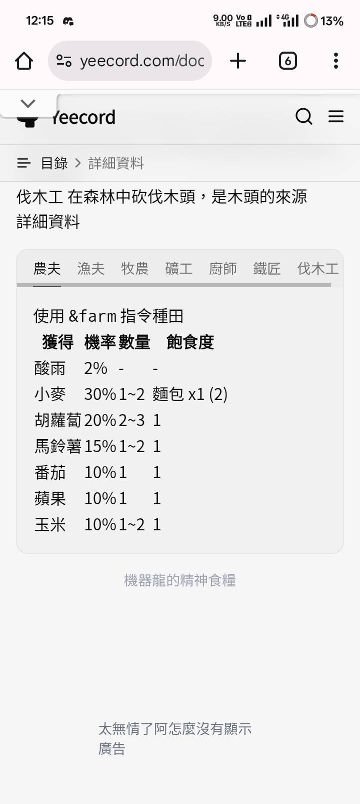

**YEE式機器龍** (2025-05-26 04:15:46):
[xpkun.#0]()

**YEE式機器龍** (2025-05-26 04:15:28):
[<a:cross:1273299616137347082> | 你過勞了！]()
你今天挖礦了 `1` 次，等待到 <t:1748232941:t> (<t:1748232941:R>) 可以繼續挖礦

**AchenL【辰龙🐉】** (2025-05-26 04:15:27):
&mine

**味道≠天秤♎ TKN** (2025-05-26 04:15:20):
厨师可能回得更多

**卡顺密** (2025-05-26 04:15:05):
😡

**卡顺密** (2025-05-26 04:14:59):
密码的

**YEE式機器龍** (2025-05-26 04:14:54):
[<:drumstick:1273299789361971295> | 可以吃的東西]()
體力值: 20 / 20 點

**卡顺密** (2025-05-26 04:14:54):
&food

**YEE式機器龍** (2025-05-26 04:14:39):
[tim143344321.fat#0]()

**卡顺密** (2025-05-26 04:14:26):
4个小麦？

**卡顺密** (2025-05-26 04:14:22):
密码

**YEE式機器龍** (2025-05-26 04:14:17):
[<:farmer:1273299699633360906> | 成功採收了 4 格田地]()
你獲得了 1 個小麥、3 個小麥

**YEE式機器龍** (2025-05-26 04:13:59):
[<:fisher:1273299701386707058> | 搖到快吐了]()
氣象明明說今天天氣很好怎麼會有暴風雨！

**味道≠天秤♎ TKN** (2025-05-26 04:13:59):
&fish

**YEE式機器龍** (2025-05-26 04:13:17):
[<:store:1273299726971965510> | 購買成功]()
你購買了 木材 `x2`，花費 `116$`

**卡顺密** (2025-05-26 04:13:16):
&buy <@1364858239656919054>  木材 2

**YEE式機器龍** (2025-05-26 04:12:41):
[<:ore:1273299681283276853> | 挖礦]()
你尋找了很久，最終發現只有 `2` 個石頭

**AchenL【辰龙🐉】** (2025-05-26 04:12:41):
&mine

**YEE式機器龍** (2025-05-26 04:12:17):
[<:store:1273299726971965510> | 成功上架]()
你的店面狀態為: `營業中`，現在架上有 `2` 個 木材，售價為 `58$`

**全能沙雕王（光速滑跪版）** (2025-05-26 04:12:16):
&shop add 木材 2 58

**全能沙雕王（光速滑跪版）** (2025-05-26 04:12:06):
还有情感状态？！我要拐个老婆（

**YEE式機器龍** (2025-05-26 04:11:48):
[<:job:1273299768587849900> | 職業已經設定成功]()
恭喜你成為`礦工`!

**AchenL【辰龙🐉】** (2025-05-26 04:11:48):
&job

**卡顺密** (2025-05-26 04:11:29):
有多少存货

**YEE式機器龍** (2025-05-26 04:11:00):
[<:farmer:1273299699633360906> | _kami_8372 的農田]()
農田等級：1 | 上次澆水：<t:1748231218:R>

**YEE式機器龍** (2025-05-26 04:10:55):
[golden_parrot_36859#0]()

**YEE式機器龍** (2025-05-26 04:10:44):
[<:wood:1273299684818944113> | 平常的一天]()
你來到了森林，並且砍了 `1` 塊木材

**全能沙雕王（光速滑跪版）** (2025-05-26 04:10:43):
&fell

**AchenL【辰龙🐉】** (2025-05-26 04:10:23):
ok

**卡顺密** (2025-05-26 04:09:36):
他好像会告诉你还没选职业，然后让你选

**YEE式機器龍** (2025-05-26 04:09:05):
你現在有 `1,726$`

**味道≠天秤♎ TKN** (2025-05-26 04:09:05):
&money

**YEE式機器龍** (2025-05-26 04:08:51):
[<:trade:1273299728268005497> | 成功售出了 3 個 生蝦]()

**味道≠天秤♎ TKN** (2025-05-26 04:08:51):
&sell 生蝦 3

**YEE式機器龍** (2025-05-26 04:08:50):
[<:bag:1273299770777141381> | 查看包包]()
為保護包包內容隱私權，戳這顆按鈕來看你的包包，隱私權設定可以透過 `&privacy` 指令更改

**全能沙雕王（光速滑跪版）** (2025-05-26 04:08:50):
&items

**YEE式機器龍** (2025-05-26 04:08:27):
[<:bag:1273299770777141381> | 查看包包]()
為保護包包內容隱私權，戳這顆按鈕來看你的包包，隱私權設定可以透過 `&privacy` 指令更改

**味道≠天秤♎ TKN** (2025-05-26 04:08:27):
&items

**YEE式機器龍** (2025-05-26 04:08:19):
[<:fisher:1273299701386707058> | 太蝦了把]()
你打撈了一片蝦子上來，獲得了 `1` 個生蝦！

**味道≠天秤♎ TKN** (2025-05-26 04:08:19):
&fish

**YEE式機器龍** (2025-05-26 04:08:16):
[<a:cross:1273299616137347082> | 你過勞了！]()
你今天砍了 `7` 次柴，等待到 <t:1748232606:t> (<t:1748232606:R>) 可以繼續砍柴

**全能沙雕王（光速滑跪版）** (2025-05-26 04:08:16):
&fell

**YEE式機器龍** (2025-05-26 04:08:08):
[<a:cross:1273299616137347082> | 你過勞了！]()
你今天抓了 `10` 次魚，等待到 <t:1748232488:t> (<t:1748232488:R>) 可以繼續抓魚

**味道≠天秤♎ TKN** (2025-05-26 04:08:08):
&fish

**AchenL【辰龙🐉】** (2025-05-26 04:06:50):
我连职业还没选呢

**卡顺密** (2025-05-26 04:06:07):
查一下你这个账号

**卡顺密** (2025-05-26 04:06:03):
/ info user

**AchenL【辰龙🐉】** (2025-05-26 04:05:06):
忘了耶

**AchenL【辰龙🐉】** (2025-05-26 04:05:03):
咦，怎么操作来着

**卡顺密** (2025-05-26 04:04:33):
<:1000168518:1298906830864519231>

**卡顺密** (2025-05-26 04:04:28):
我要和他交易来着

**卡顺密** (2025-05-26 04:04:24):
晨那个家伙在干什么

**YEE式機器龍** (2025-05-26 04:04:06):
[<:wood:1273299684818944113> | 平常的一天]()
你來到了森林，並且砍了 `1` 塊木材

**全能沙雕王（光速滑跪版）** (2025-05-26 04:04:06):
&fell

**YEE式機器龍** (2025-05-26 04:04:05):
嗨嗨 d(･∀･)b 我是YEE式機器龍，
我的目標是讓你快速建立優質的中文 Discord 伺服器!

<:slash:1273299597489344514> 我們正在努力轉移部分功能的指令到斜線指令
可以使用 </help:880380398562054156> 指令查看斜線的使用方法

使用我的服務即表示你已同意我的 [隱私權聲明](https://yeecord.com/privacy/) 及 [服務條款](https://yeecord.com/terms/)

**味道≠天秤♎ TKN** (2025-05-26 04:03:56):
忘了怎么选职业了

**卡顺密** (2025-05-26 04:03:48):
矿工我也挺需要的

**味道≠天秤♎ TKN** (2025-05-26 04:03:40):
垄断原材料

**味道≠天秤♎ TKN** (2025-05-26 04:03:36):
那还是当矿工吧

**卡顺密** (2025-05-26 04:03:26):
那你就别想赚钱了

**卡顺密** (2025-05-26 04:03:22):
要是只加2点

**味道≠天秤♎ TKN** (2025-05-26 04:03:19):
哎呀，暴风雨

**卡顺密** (2025-05-26 04:03:16):
不知道 现在还不知道考过的食物加多少饱食度

**YEE式機器龍** (2025-05-26 04:03:08):
[<:fisher:1273299701386707058> | 搖到快吐了]()
氣象明明說今天天氣很好怎麼會有暴風雨！

**味道≠天秤♎ TKN** (2025-05-26 04:03:08):
&fish

**AchenL【辰龙🐉】** (2025-05-26 04:02:55):
我该怎么赚钱

**AchenL【辰龙🐉】** (2025-05-26 04:02:49):
如果我成为厨师

**卡顺密** (2025-05-26 04:02:35):
饿鸡眼了，我连他都吃

**AchenL【辰龙🐉】** (2025-05-26 04:02:31):
问题来了

**卡顺密** (2025-05-26 04:02:31):
没给他做成面包就不错了，他膈应什么😠

**全能沙雕王（光速滑跪版）** (2025-05-26 04:02:12):
小麦老师也会膈应

**全能沙雕王（光速滑跪版）** (2025-05-26 04:01:59):
感觉生吃小麦有点那啥了

**AchenL【辰龙🐉】** (2025-05-26 04:01:57):
那就矿工

**卡顺密** (2025-05-26 04:01:47):
😭

**卡顺密** (2025-05-26 04:01:45):
你们怎么欺负农民伯伯呢

**卡顺密** (2025-05-26 04:01:40):
不可以这样 不能搞垄断啊

**晨** (2025-05-26 04:01:32):
都没用

**卡顺密** (2025-05-26 04:01:30):
难说

**晨** (2025-05-26 04:01:29):
单用的话没用

**AchenL【辰龙🐉】** (2025-05-26 04:01:26):
桀桀桀桀

**全能沙雕王（光速滑跪版）** (2025-05-26 04:01:23):
厨师吧

**AchenL【辰龙🐉】** (2025-05-26 04:00:58):
哪个更重要呢

**晨** (2025-05-26 04:00:52):
矿工和厨师

**AchenL【辰龙🐉】** (2025-05-26 04:00:44):
现在还缺什么职业

**AchenL【辰龙🐉】** (2025-05-26 04:00:36):
<@1303142548377960448> 晨宝

**卡顺密** (2025-05-26 04:00:36):
😭

**卡顺密** (2025-05-26 04:00:33):
初审啊

**味道≠天秤♎ TKN** (2025-05-26 04:00:05):
我有小号啊

**味道≠天秤♎ TKN** (2025-05-26 04:00:02):
不对

**卡顺密** (2025-05-26 03:59:51):
等7天吧

**味道≠天秤♎ TKN** (2025-05-26 03:59:42):
我想转职当矿工

**味道≠天秤♎ TKN** (2025-05-26 03:59:39):
开始谈判了

**卡顺密** (2025-05-26 03:59:33):
我比你还需要木材

**卡顺密** (2025-05-26 03:59:26):
<@1303142548377960448> 我们来谈一下 多少钱能割爱

**全能沙雕王（光速滑跪版）** (2025-05-26 03:59:24):
发来！

**YEE式機器龍** (2025-05-26 03:59:12):
[<a:cross:1273299616137347082> | 你過勞了！]()
你今天抓了 `9` 次魚，等待到 <t:1748231975:t> (<t:1748231975:R>) 可以繼續抓魚

**味道≠天秤♎ TKN** (2025-05-26 03:59:11):
&fish

**卡顺密** (2025-05-26 03:59:06):
😠

**YEE式機器龍** (2025-05-26 03:58:52):
[<:store:1273299726971965510> | 購買成功]()
你購買了 木材 `x2`，花費 `110$`

**晨** (2025-05-26 03:58:52):
&buy <@1364858239656919054> 木材 2

**卡顺密** (2025-05-26 03:58:32):
怎么才57呀

**YEE式機器龍** (2025-05-26 03:58:30):
[<:store:1273299726971965510> | 成功上架]()
你的店面狀態為: `營業中`，現在架上有 `2` 個 木材，售價為 `55$`

**全能沙雕王（光速滑跪版）** (2025-05-26 03:58:30):
&shop add 木材 2 55

**YEE式機器龍** (2025-05-26 03:58:23):
[<:farmer:1273299699633360906> | _kami_8372 的農田]()
農田等級：1 | 上次澆水：<t:1748231218:R>

**YEE式機器龍** (2025-05-26 03:58:19):
[<a:cross:1273299616137347082> | 你沒有足夠的物品]()

**全能沙雕王（光速滑跪版）** (2025-05-26 03:58:19):
&shop add 木材 3 55

**晨** (2025-05-26 03:58:17):
对

**全能沙雕王（光速滑跪版）** (2025-05-26 03:58:09):
疲劳积累了

**卡顺密** (2025-05-26 03:58:07):
是这样的

**卡顺密** (2025-05-26 03:58:01):
😠

**味道≠天秤♎ TKN** (2025-05-26 03:57:50):
咋时间越来越长了

**YEE式機器龍** (2025-05-26 03:57:46):
<@1364858239656919054>
[<a:cross:1273299616137347082> | 操作取消]()

**YEE式機器龍** (2025-05-26 03:57:35):
[<:wood:1273299684818944113> | 平常的一天]()
你來到了森林，並且砍了 `1` 塊木材

**全能沙雕王（光速滑跪版）** (2025-05-26 03:57:35):
&fell

**全能沙雕王（光速滑跪版）** (2025-05-26 03:57:27):
呵，我避你锋芒？

**YEE式機器龍** (2025-05-26 03:57:27):
[<a:cross:1273299616137347082> | 你過勞了！]()
你今天抓了 `9` 次魚，等待到 <t:1748231975:t> (<t:1748231975:R>) 可以繼續抓魚

**味道≠天秤♎ TKN** (2025-05-26 03:57:27):
&fish

**卡顺密** (2025-05-26 03:56:50):
成为我的伙伴 哥给你喂食物

**卡顺密** (2025-05-26 03:56:37):
<:emoji_9:1298282498454720564>

**YEE式機器龍** (2025-05-26 03:56:33):
[<a:cross:1273299616137347082> | 你過勞了！]()
你今天砍了 `5` 次柴，等待到 <t:1748231820:t> (<t:1748231820:R>) 可以繼續砍柴

**全能沙雕王（光速滑跪版）** (2025-05-26 03:56:33):
&fell

**卡顺密** (2025-05-26 03:56:24):
幸好没有第2个农民

**味道≠天秤♎ TKN** (2025-05-26 03:56:02):
西海！！

**晨** (2025-05-26 03:55:50):
你是说50万马克一个面包！

**卡顺密** (2025-05-26 03:55:18):
😋

**卡顺密** (2025-05-26 03:55:14):
有小麦我做面包 直接卖你们50万

**晨** (2025-05-26 03:55:07):
😡

**卡顺密** (2025-05-26 03:55:03):
😠

**卡顺密** (2025-05-26 03:55:00):
一个食物卖100

**YEE式機器龍** (2025-05-26 03:54:55):
[<:fisher:1273299701386707058> | 太蝦了把]()
你打撈了一片蝦子上來，獲得了 `2` 個生蝦！

**味道≠天秤♎ TKN** (2025-05-26 03:54:55):
&fish

**卡顺密** (2025-05-26 03:54:54):
待会就没有了

**味道≠天秤♎ TKN** (2025-05-26 03:54:49):
很贴近现实

**味道≠天秤♎ TKN** (2025-05-26 03:54:43):
钓鱼是真有钱

**晨** (2025-05-26 03:54:41):
我的一大半是任白老师给我的

**晨** (2025-05-26 03:54:32):
妈咪这么有钱

**晨** (2025-05-26 03:54:28):
哇！

**卡顺密** (2025-05-26 03:54:26):
😫

**YEE式機器龍** (2025-05-26 03:54:23):
你現在有 `1,443$`

**味道≠天秤♎ TKN** (2025-05-26 03:54:22):
&money

**YEE式機器龍** (2025-05-26 03:54:20):
你現在有 `625$`

**卡顺密** (2025-05-26 03:54:20):
&money

**YEE式機器龍** (2025-05-26 03:54:10):
你現在有 `2,463$`

**晨** (2025-05-26 03:54:09):
&money

**YEE式機器龍** (2025-05-26 03:53:20):
[<a:cross:1273299616137347082> | 你過勞了！]()
你今天抓了 `8` 次魚，等待到 <t:1748231600:t> (<t:1748231600:R>) 可以繼續抓魚

**味道≠天秤♎ TKN** (2025-05-26 03:53:20):
&fish

**味道≠天秤♎ TKN** (2025-05-26 03:52:42):
怎么看着有多少钱啊？宝

**晨** (2025-05-26 03:52:34):
不能

**晨** (2025-05-26 03:52:30):
只能选

**味道≠天秤♎ TKN** (2025-05-26 03:52:28):
还能打怪啊

**晨** (2025-05-26 03:52:27):
但现在没有战斗系统

**晨** (2025-05-26 03:52:20):
战斗职业

**全能沙雕王（光速滑跪版）** (2025-05-26 03:52:20):
<:1000168510:1298906820638674984>

**全能沙雕王（光速滑跪版）** (2025-05-26 03:52:17):
卧槽，我手机卡起来了

**YEE式機器龍** (2025-05-26 03:52:07):
[<a:cross:1273299616137347082> | 你過勞了！]()
你今天抓了 `8` 次魚，等待到 <t:1748231600:t> (<t:1748231600:R>) 可以繼續抓魚

**味道≠天秤♎ TKN** (2025-05-26 03:52:07):
&fish

**味道≠天秤♎ TKN** (2025-05-26 03:52:01):
什么叫冒险职业

**YEE式機器龍** (2025-05-26 03:52:00):
[<:wood:1273299684818944113> | 平常的一天]()
你來到了森林，並且砍了 `1` 塊木材

**全能沙雕王（光速滑跪版）** (2025-05-26 03:52:00):
&fell

**YEE式機器龍** (2025-05-26 03:51:48):
[tim143344321.fat#0]()

**晨** (2025-05-26 03:51:38):
看看食物的那两个界面

**晨** (2025-05-26 03:51:28):
有点忘了

**味道≠天秤♎ TKN** (2025-05-26 03:51:25):
/info user:@tim143344321.fat

**YEE式機器龍** (2025-05-26 03:51:16):
嗨嗨 d(･∀･)b 我是YEE式機器龍，
我的目標是讓你快速建立優質的中文 Discord 伺服器!

<:slash:1273299597489344514> 我們正在努力轉移部分功能的指令到斜線指令
可以使用 </help:880380398562054156> 指令查看斜線的使用方法

使用我的服務即表示你已同意我的 [隱私權聲明](https://yeecord.com/privacy/) 及 [服務條款](https://yeecord.com/terms/)

**YEE式機器龍** (2025-05-26 03:50:33):
[<:trade:1273299728268005497> | 成功售出了 2 個 生鮪魚]()

**味道≠天秤♎ TKN** (2025-05-26 03:50:32):
&sell 生鮪魚 2

**YEE式機器龍** (2025-05-26 03:50:22):
嗨嗨 d(･∀･)b 我是YEE式機器龍，
我的目標是讓你快速建立優質的中文 Discord 伺服器!

<:slash:1273299597489344514> 我們正在努力轉移部分功能的指令到斜線指令
可以使用 </help:880380398562054156> 指令查看斜線的使用方法

使用我的服務即表示你已同意我的 [隱私權聲明](https://yeecord.com/privacy/) 及 [服務條款](https://yeecord.com/terms/)

**卡顺密** (2025-05-26 03:50:19):
有空格 记得删

**卡顺密** (2025-05-26 03:50:08):
/ info user

**YEE式機器龍** (2025-05-26 03:50:07):
[<:trade:1273299728268005497> | 成功售出了 1 個 生鮭魚]()

**味道≠天秤♎ TKN** (2025-05-26 03:50:06):
&sell 生鮭魚 1

**YEE式機器龍** (2025-05-26 03:49:54):
[<:bag:1273299770777141381> | 查看包包]()
為保護包包內容隱私權，戳這顆按鈕來看你的包包，隱私權設定可以透過 `&privacy` 指令更改

**味道≠天秤♎ TKN** (2025-05-26 03:49:54):
&items

**味道≠天秤♎ TKN** (2025-05-26 03:49:45):
所以怎么查看体力

**味道≠天秤♎ TKN** (2025-05-26 03:49:39):
他没跟我说

**晨** (2025-05-26 03:49:39):
肯定消耗的

**卡顺密** (2025-05-26 03:49:32):
你钓鱼耗体力吗

**YEE式機器龍** (2025-05-26 03:49:29):
[<:trade:1273299728268005497> | 成功售出了 1 個 生鮭魚]()

**味道≠天秤♎ TKN** (2025-05-26 03:49:28):
&sell 生鮭魚 1

**YEE式機器龍** (2025-05-26 03:49:00):
[<:fisher:1273299701386707058> | 🐢魚]()
你等待了幾個小時，獲得了 `1` 條生鮭魚！

**味道≠天秤♎ TKN** (2025-05-26 03:49:00):
&fish

**YEE式機器龍** (2025-05-26 03:48:35):
<@1364858239656919054>
[🐶 | 成為夥伴]()
你願意成為 <@1063068779162108027> 的夥伴嗎?

**晨** (2025-05-26 03:48:30):
不然没煤炭

**晨** (2025-05-26 03:48:27):
要有厨师得现有矿工

**YEE式機器龍** (2025-05-26 03:47:57):
[<a:cross:1273299616137347082> | 你過勞了！]()
你今天砍了 `4` 次柴，等待到 <t:1748231355:t> (<t:1748231355:R>) 可以繼續砍柴

**全能沙雕王（光速滑跪版）** (2025-05-26 03:47:56):
&fell

**味道≠天秤♎ TKN** (2025-05-26 03:47:45):
种地的时间

**卡顺密** (2025-05-26 03:47:44):
😡

**卡顺密** (2025-05-26 03:47:41):
不许给我停下来

**晨** (2025-05-26 03:47:41):
一次有4，5个

**味道≠天秤♎ TKN** (2025-05-26 03:47:39):
时间

**卡顺密** (2025-05-26 03:47:38):
接着砍

**晨** (2025-05-26 03:47:35):
他种的多

**晨** (2025-05-26 03:47:25):
对

**卡顺密** (2025-05-26 03:47:24):
😰

**味道≠天秤♎ TKN** (2025-05-26 03:47:24):
没厨师

**卡顺密** (2025-05-26 03:47:23):
完成度3是什么意思

**全能沙雕王（光速滑跪版）** (2025-05-26 03:47:09):
生吃吗？

**YEE式機器龍** (2025-05-26 03:47:06):
[<:farmer:1273299699633360906> | _kami_8372 的農田]()
農田等級：1 | 上次澆水：<t:1748231218:R>

**味道≠天秤♎ TKN** (2025-05-26 03:47:05):
快种

**YEE式機器龍** (2025-05-26 03:46:58):
[<:farmer:1273299699633360906> | 成功幫你的農田澆水]()
你獲得了 `69` 點經驗值

**卡顺密** (2025-05-26 03:46:51):
😨

**卡顺密** (2025-05-26 03:46:48):
不耗体力的

**卡顺密** (2025-05-26 03:46:45):
我操

**YEE式機器龍** (2025-05-26 03:46:40):
[<a:cross:1273299616137347082> | 未知的物品]()

**味道≠天秤♎ TKN** (2025-05-26 03:46:40):
&sell 生鲑魚 1

**YEE式機器龍** (2025-05-26 03:46:36):
[<:check:1273299642565791919> | 成功使用了 1 個木鋤]()
消耗 0 點體力

**卡顺密** (2025-05-26 03:46:28):
<:04:1298280511562580090>

**卡顺密** (2025-05-26 03:46:25):
噔噔噔

**YEE式機器龍** (2025-05-26 03:46:20):
[<:toolbox:1273299690560946357> | 製作物品]()
你製作出了 1 個木鋤

**YEE式機器龍** (2025-05-26 03:46:11):
[<:toolbox:1273299690560946357> | 製作物品]()
你製作出了 1 個木棒

**味道≠天秤♎ TKN** (2025-05-26 03:46:10):
怎么看体力？

**晨** (2025-05-26 03:45:59):
掌握食物的神

**晨** (2025-05-26 03:45:50):
这下真是卡密

**YEE式機器龍** (2025-05-26 03:45:47):
[<:store:1273299726971965510> | 購買成功]()
你購買了 木材 `x2`，花費 `110$`

**卡顺密** (2025-05-26 03:45:47):
&buy <@1364858239656919054>  木材 2

**YEE式機器龍** (2025-05-26 03:45:39):
[<a:cross:1273299616137347082> | 未知的物品]()

**味道≠天秤♎ TKN** (2025-05-26 03:45:39):
&sell 生鲑魚 1

**晨** (2025-05-26 03:45:39):
全村等你吃饭呢

**晨** (2025-05-26 03:45:33):
来

**卡顺密** (2025-05-26 03:45:27):
还是6个

**卡顺密** (2025-05-26 03:45:24):
有5个吧好像

**卡顺密** (2025-05-26 03:45:19):
第1次收成

**YEE式機器龍** (2025-05-26 03:45:15):
[<:store:1273299726971965510> | 成功上架]()
你的店面狀態為: `營業中`，現在架上有 `2` 個 木材，售價為 `55$`

**全能沙雕王（光速滑跪版）** (2025-05-26 03:45:15):
&shop add 木材 2 55

**卡顺密** (2025-05-26 03:45:13):
说实话，产量的话 我不一定能保证

**YEE式機器龍** (2025-05-26 03:45:12):
[<:bag:1273299770777141381> | 查看包包]()
為保護包包內容隱私權，戳這顆按鈕來看你的包包，隱私權設定可以透過 `&privacy` 指令更改

**味道≠天秤♎ TKN** (2025-05-26 03:45:11):
&items

**YEE式機器龍** (2025-05-26 03:45:00):
[<:fisher:1273299701386707058> | 呼]()
你等待了幾個小時，打撈到了 `1` 條生鮪魚！

**YEE式機器龍** (2025-05-26 03:44:59):
[<a:cross:1273299616137347082> | 你沒有足夠的物品]()

**味道≠天秤♎ TKN** (2025-05-26 03:44:59):
&fish

**全能沙雕王（光速滑跪版）** (2025-05-26 03:44:59):
&shop add 木材 3 55

**味道≠天秤♎ TKN** (2025-05-26 03:44:52):
么么

**YEE式機器龍** (2025-05-26 03:44:45):
[<:wood:1273299684818944113> | 平常的一天]()
你來到了森林，並且砍了 `1` 塊木材

**全能沙雕王（光速滑跪版）** (2025-05-26 03:44:45):
&fell

**味道≠天秤♎ TKN** (2025-05-26 03:44:28):
把沙雕王召唤过来

**卡顺密** (2025-05-26 03:44:25):
才能制作一个木稿

**晨** (2025-05-26 03:44:24):
我说啦伐木工狠狠赚钱嘛

**卡顺密** (2025-05-26 03:44:21):
也就是说我还差两个

**味道≠天秤♎ TKN** (2025-05-26 03:44:16):
继续砍吧

**卡顺密** (2025-05-26 03:44:10):
我还差一个

**味道≠天秤♎ TKN** (2025-05-26 03:44:06):
<:1000168518:1298906830864519231>

**卡顺密** (2025-05-26 03:44:03):
😨

**晨** (2025-05-26 03:44:02):
要铁匠来

**卡顺密** (2025-05-26 03:44:00):
一个木棒要两个木材

**晨** (2025-05-26 03:43:58):
我还以为

**卡顺密** (2025-05-26 03:43:56):
不好!

**YEE式機器龍** (2025-05-26 03:43:54):
[<a:cross:1273299616137347082> | 你過勞了！]()
你今天抓了 `6` 次魚，等待到 <t:1748231067:t> (<t:1748231067:R>) 可以繼續抓魚

**味道≠天秤♎ TKN** (2025-05-26 03:43:54):
&fish

**味道≠天秤♎ TKN** (2025-05-26 03:43:50):
还行

**晨** (2025-05-26 03:43:48):
没事了

**晨** (2025-05-26 03:43:46):
哦

**卡顺密** (2025-05-26 03:43:35):
喔

**YEE式機器龍** (2025-05-26 03:43:30):
[<:toolbox:1273299690560946357> | 製作物品]()
你製作出了 1 個木棒

**晨** (2025-05-26 03:43:28):
我有一个猜想

**晨** (2025-05-26 03:43:20):
完了

**卡顺密** (2025-05-26 03:43:09):
官网写的木棒是合成品

**晨** (2025-05-26 03:43:00):
那木棒是什么啊

**晨** (2025-05-26 03:42:53):
不是

**晨** (2025-05-26 03:42:50):
<:1000168531:1298906724979310634>

**卡顺密** (2025-05-26 03:42:48):
😫

**卡顺密** (2025-05-26 03:42:45):
他说我少了木棒两个

**全能沙雕王（光速滑跪版）** (2025-05-26 03:42:29):
反对冷暴力村

**晨** (2025-05-26 03:42:23):
试试能不能制作

**味道≠天秤♎ TKN** (2025-05-26 03:42:19):
误导新人啊

**晨** (2025-05-26 03:42:17):
快快快

**卡顺密** (2025-05-26 03:42:00):
祖宗之法不可变

**味道≠天秤♎ TKN** (2025-05-26 03:41:51):
要不把这个帖子改个名吧

**YEE式機器龍** (2025-05-26 03:41:45):
[<:store:1273299726971965510> | 購買成功]()
你購買了 木材 `x3`，花費 `165$`

**卡顺密** (2025-05-26 03:41:44):
&buy <@1364858239656919054>  木材 3

**YEE式機器龍** (2025-05-26 03:41:09):
嗨嗨 d(･∀･)b 我是YEE式機器龍，
我的目標是讓你快速建立優質的中文 Discord 伺服器!

<:slash:1273299597489344514> 我們正在努力轉移部分功能的指令到斜線指令
可以使用 </help:880380398562054156> 指令查看斜線的使用方法

使用我的服務即表示你已同意我的 [隱私權聲明](https://yeecord.com/privacy/) 及 [服務條款](https://yeecord.com/terms/)

**YEE式機器龍** (2025-05-26 03:40:48):
[<:fisher:1273299701386707058> | 🐢魚]()
你等待了幾個小時，獲得了 `1` 條生鮭魚！

**味道≠天秤♎ TKN** (2025-05-26 03:40:47):
&fish

**卡顺密** (2025-05-26 03:40:21):
<@1303142548377960448>

**卡顺密** (2025-05-26 03:40:16):
怎么买来着

**YEE式機器龍** (2025-05-26 03:39:59):
[<:wood:1273299684818944113> | 平常的一天]()
你來到了森林，並且砍了 `1` 塊木材

**全能沙雕王（光速滑跪版）** (2025-05-26 03:39:59):
&fell

**YEE式機器龍** (2025-05-26 03:39:27):
[<:store:1273299726971965510> | 成功上架]()
你的店面狀態為: `營業中`，現在架上有 `3` 個 木材，售價為 `55$`

**全能沙雕王（光速滑跪版）** (2025-05-26 03:39:27):
&shop add 木材 3 
55

**YEE式機器龍** (2025-05-26 03:39:05):
[<a:cross:1273299616137347082> | 你過勞了！]()
你今天抓了 `5` 次魚，等待到 <t:1748230806:t> (<t:1748230806:R>) 可以繼續抓魚

**味道≠天秤♎ TKN** (2025-05-26 03:39:05):
&fish

**卡顺密** (2025-05-26 03:39:03):
？

**全能沙雕王（光速滑跪版）** (2025-05-26 03:38:55):
？
55不行啊

**YEE式機器龍** (2025-05-26 03:38:34):
[<a:cross:1273299616137347082> | 錯誤的價格]()

**全能沙雕王（光速滑跪版）** (2025-05-26 03:38:34):
&shop add 木材 3
55

**卡顺密** (2025-05-26 03:38:09):
木材和3空格

**YEE式機器龍** (2025-05-26 03:37:47):
[<:store:1273299726971965510> | shop 指令]()
商店系統 - 透過購買來活絡經濟

**全能沙雕王（光速滑跪版）** (2025-05-26 03:37:47):
&shop add 木材3
55

**卡顺密** (2025-05-26 03:37:26):
木材最低55 你设个60吧

**YEE式機器龍** (2025-05-26 03:37:10):
[<:trade:1273299728268005497> | 成功售出了 5 個 生蝦]()

**味道≠天秤♎ TKN** (2025-05-26 03:37:10):
&sell 生蝦 5

**晨** (2025-05-26 03:36:49):
<:07:1298281204260278383>

**YEE式機器龍** (2025-05-26 03:36:46):
[<:fisher:1273299701386707058> | 太蝦了把]()
你打撈了一片蝦子上來，獲得了 `2` 個生蝦！

**味道≠天秤♎ TKN** (2025-05-26 03:36:46):
&fish

**味道≠天秤♎ TKN** (2025-05-26 03:36:31):
可以了

**YEE式機器龍** (2025-05-26 03:36:24):
[<:trade:1273299728268005497> | 成功售出了 1 個 生鮭魚]()

**味道≠天秤♎ TKN** (2025-05-26 03:36:24):
&sell 生鮭魚 1

**晨** (2025-05-26 03:36:22):
<:emoji_11:1298282571616096307>

**味道≠天秤♎ TKN** (2025-05-26 03:36:02):
艹了

**卡顺密** (2025-05-26 03:35:56):
<:04:1298280511562580090>

**卡顺密** (2025-05-26 03:35:53):
那就设个最低价吧

**味道≠天秤♎ TKN** (2025-05-26 03:35:52):
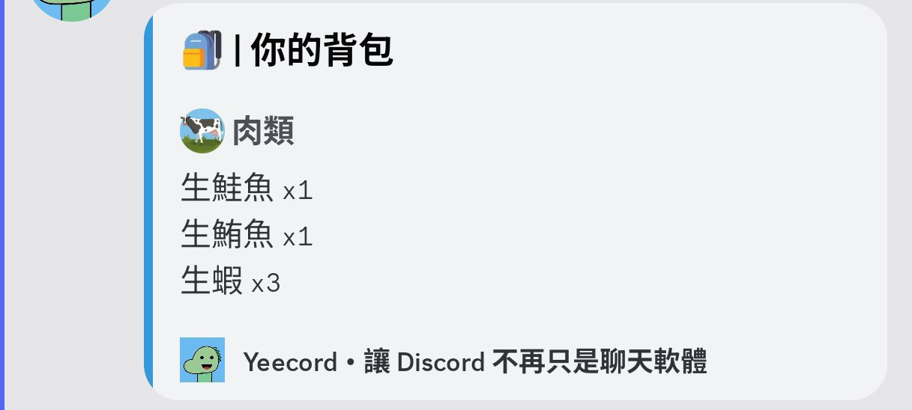

**全能沙雕王（光速滑跪版）** (2025-05-26 03:35:45):
不会定价

**卡顺密** (2025-05-26 03:35:37):
<@1336328198446780517>

**全能沙雕王（光速滑跪版）** (2025-05-26 03:35:36):
物价怎么说？

**YEE式機器龍** (2025-05-26 03:35:28):
[<:bag:1273299770777141381> | 查看包包]()
為保護包包內容隱私權，戳這顆按鈕來看你的包包，隱私權設定可以透過 `&privacy` 指令更改

**味道≠天秤♎ TKN** (2025-05-26 03:35:28):
&items

**卡顺密** (2025-05-26 03:35:17):
生鮪魚

**YEE式機器龍** (2025-05-26 03:35:16):
[<a:cross:1273299616137347082> | 你過勞了！]()
你今天抓了 `4` 次魚，等待到 <t:1748230547:t> (<t:1748230547:R>) 可以繼續抓魚

**味道≠天秤♎ TKN** (2025-05-26 03:35:16):
&fish

**晨** (2025-05-26 03:35:03):
（期待）

**YEE式機器龍** (2025-05-26 03:34:45):
[<:store:1273299726971965510> | shop 指令]()
商店系統 - 透過購買來活絡經濟

**全能沙雕王（光速滑跪版）** (2025-05-26 03:34:45):
&store 木材<3>

**晨** (2025-05-26 03:34:39):
名字

**味道≠天秤♎ TKN** (2025-05-26 03:34:37):
咝

**晨** (2025-05-26 03:34:34):
妈咪是不是输错了

**YEE式機器龍** (2025-05-26 03:34:31):
[<a:cross:1273299616137347082> | 未知的物品]()

**味道≠天秤♎ TKN** (2025-05-26 03:34:31):
&sell <生鮭魚> [1]

**YEE式機器龍** (2025-05-26 03:34:09):
[<a:cross:1273299616137347082> | 未知的物品]()

**味道≠天秤♎ TKN** (2025-05-26 03:34:08):
&sell <生鮭鱼> [1]

**晨** (2025-05-26 03:34:00):
这个：&store

**全能沙雕王（光速滑跪版）** (2025-05-26 03:33:48):
<:1000168531:1298906724979310634>

**晨** (2025-05-26 03:33:48):
吓死我了

**晨** (2025-05-26 03:33:42):
fu~

**卡顺密** (2025-05-26 03:33:40):
住手啊

**晨** (2025-05-26 03:33:37):
不是这个

**晨** (2025-05-26 03:33:32):
别！

**晨** (2025-05-26 03:33:29):
别！

**晨** (2025-05-26 03:33:27):
不是

**YEE式機器龍** (2025-05-26 03:33:24):
[<:trade:1273299728268005497> | sell 指令]()
出售東西並換取金錢

**全能沙雕王（光速滑跪版）** (2025-05-26 03:33:24):
&sell

**卡顺密** (2025-05-26 03:33:04):
全麦给我

**味道≠天秤♎ TKN** (2025-05-26 03:33:02):
木材够了

**卡顺密** (2025-05-26 03:33:01):
快上商店

**YEE式機器龍** (2025-05-26 03:32:47):
[<:fisher:1273299701386707058> | 太蝦了把]()
你打撈了一片蝦子上來，獲得了 `2` 個生蝦！

**味道≠天秤♎ TKN** (2025-05-26 03:32:47):
&fish

**YEE式機器龍** (2025-05-26 03:32:46):
[<:wood:1273299684818944113> | 平常的一天]()
你來到了森林，並且砍了 `2` 塊木材

**全能沙雕王（光速滑跪版）** (2025-05-26 03:32:45):
&fell

**味道≠天秤♎ TKN** (2025-05-26 03:32:34):
<:1000168531:1298906724979310634>

**味道≠天秤♎ TKN** (2025-05-26 03:32:32):
难道不能直接卖出去

**晨** (2025-05-26 03:32:27):
我看看

**味道≠天秤♎ TKN** (2025-05-26 03:32:14):
why

**YEE式機器龍** (2025-05-26 03:31:59):
[<a:cross:1273299616137347082> | 未知的物品]()

**味道≠天秤♎ TKN** (2025-05-26 03:31:59):
&sell 生鲑魚 1

**晨** (2025-05-26 03:31:58):
简体也可以

**晨** (2025-05-26 03:31:53):
不用必须繁体字哦

**晨** (2025-05-26 03:31:41):
不容易啊

**晨** (2025-05-26 03:31:36):
也是热闹起来了

**YEE式機器龍** (2025-05-26 03:31:35):
[<a:cross:1273299616137347082> | 未知的物品]()

**卡顺密** (2025-05-26 03:31:35):
凭什么这么久啊😭

**味道≠天秤♎ TKN** (2025-05-26 03:31:35):
&sell 生鲑魚 1 生蝦 1

**YEE式機器龍** (2025-05-26 03:31:24):
[<a:cross:1273299616137347082> | 你過勞了！]()
你今天砍了 `1` 次柴，等待到 <t:1748230316:t> (<t:1748230316:R>) 可以繼續砍柴

**全能沙雕王（光速滑跪版）** (2025-05-26 03:31:23):
&fell

**味道≠天秤♎ TKN** (2025-05-26 03:30:53):
繁体字

**YEE式機器龍** (2025-05-26 03:30:52):
[<:cow:1273299696441360434> | 是雞]()
你宰了一隻雞，獲得了 `2` 個生雞肉！

**晨** (2025-05-26 03:30:52):
&herd

**YEE式機器龍** (2025-05-26 03:30:37):
[<:bag:1273299770777141381> | 查看包包]()
為保護包包內容隱私權，戳這顆按鈕來看你的包包，隱私權設定可以透過 `&privacy` 指令更改

**味道≠天秤♎ TKN** (2025-05-26 03:30:37):
&items

**晨** (2025-05-26 03:30:21):
木棒应该就是木材吧

**YEE式機器龍** (2025-05-26 03:30:11):
[<a:cross:1273299616137347082> | 未知的物品]()

**味道≠天秤♎ TKN** (2025-05-26 03:30:11):
&sell 生鲑鱼 1

**卡顺密** (2025-05-26 03:30:03):
😡

**卡顺密** (2025-05-26 03:30:01):
哪个神人设定的

**卡顺密** (2025-05-26 03:29:54):
丢雷楼谋 凭什么砍一次要三分钟

**晨** (2025-05-26 03:29:47):
然后卖给mika

**晨** (2025-05-26 03:29:42):
就能合成木锄

**卡顺密** (2025-05-26 03:29:33):
木棒怎么搞

**YEE式機器龍** (2025-05-26 03:29:30):
[<:fisher:1273299701386707058> | 呼]()
你等待了幾個小時，打撈到了 `1` 條生鮪魚！

**味道≠天秤♎ TKN** (2025-05-26 03:29:29):
&fish

**晨** (2025-05-26 03:29:28):
很好！那么只要砍两次

**YEE式機器龍** (2025-05-26 03:29:21):
[<a:cross:1273299616137347082> | 你過勞了！]()
你今天砍了 `1` 次柴，等待到 <t:1748230316:t> (<t:1748230316:R>) 可以繼續砍柴

**全能沙雕王（光速滑跪版）** (2025-05-26 03:29:20):
&fell

**YEE式機器龍** (2025-05-26 03:29:08):
[<a:cross:1273299616137347082> | 你過勞了！]()
你今天抓了 `2` 次魚，等待到 <t:1748230160:t> (<t:1748230160:R>) 可以繼續抓魚

**味道≠天秤♎ TKN** (2025-05-26 03:29:08):
&fish

**晨** (2025-05-26 03:29:02):
！

**YEE式機器龍** (2025-05-26 03:28:57):
[<:wood:1273299684818944113> | 平常的一天]()
你來到了森林，並且砍了 `1` 塊木材

**全能沙雕王（光速滑跪版）** (2025-05-26 03:28:56):
&fell

**全能沙雕王（光速滑跪版）** (2025-05-26 03:28:38):
<:1000168531:1298906724979310634>

**全能沙雕王（光速滑跪版）** (2025-05-26 03:28:34):
真是拿你没办法呢

**晨** (2025-05-26 03:28:33):
全村人等着吃mika的饭

**卡顺密** (2025-05-26 03:28:20):
我快要被锁似了

**卡顺密** (2025-05-26 03:28:15):
😭

**晨** (2025-05-26 03:28:14):
选伐木工

**卡顺密** (2025-05-26 03:28:13):
选木工，我求你了

**晨** (2025-05-26 03:28:06):
对的

**全能沙雕王（光速滑跪版）** (2025-05-26 03:28:00):
这样？

**YEE式機器龍** (2025-05-26 03:27:59):
[<:job:1273299768587849900> | 職業已經設定成功]()
恭喜你成為`伐木工`!

**全能沙雕王（光速滑跪版）** (2025-05-26 03:27:59):
&mine

**味道≠天秤♎ TKN** (2025-05-26 03:27:57):
先钓鱼吧

**味道≠天秤♎ TKN** (2025-05-26 03:27:42):
ok

**YEE式機器龍** (2025-05-26 03:27:15):
[<a:cross:1273299616137347082> | 未知的物品]()

**晨** (2025-05-26 03:27:15):
&sell <物品ID> [數量]

**YEE式機器龍** (2025-05-26 03:27:01):
嗨嗨 d(･∀･)b 我是YEE式機器龍，
我的目標是讓你快速建立優質的中文 Discord 伺服器!

<:slash:1273299597489344514> 我們正在努力轉移部分功能的指令到斜線指令
可以使用 </help:880380398562054156> 指令查看斜線的使用方法

使用我的服務即表示你已同意我的 [隱私權聲明](https://yeecord.com/privacy/) 及 [服務條款](https://yeecord.com/terms/)

**YEE式機器龍** (2025-05-26 03:27:00):
[<:fisher:1273299701386707058> | 太蝦了把]()
你打撈了一片蝦子上來，獲得了 `1` 個生蝦！

**味道≠天秤♎ TKN** (2025-05-26 03:27:00):
&fish

**卡顺密** (2025-05-26 03:26:49):
为什么没人砍树为什么会没人砍树😭

**味道≠天秤♎ TKN** (2025-05-26 03:26:49):
系统

**晨** (2025-05-26 03:26:27):
要哪个

**晨** (2025-05-26 03:26:22):
要么上架自己的商店

**晨** (2025-05-26 03:26:15):
要么直接卖给系统

**味道≠天秤♎ TKN** (2025-05-26 03:26:01):
天使

**味道≠天秤♎ TKN** (2025-05-26 03:25:57):
🛐

**晨** (2025-05-26 03:25:50):
嘿嘿嘿

**晨** (2025-05-26 03:25:46):
直接食物自由

**晨** (2025-05-26 03:25:39):
然后提前攒食物

**任白** (2025-05-26 03:25:37):
行

**晨** (2025-05-26 03:25:31):
我挖煤

**味道≠天秤♎ TKN** (2025-05-26 03:25:26):
怎么卖东西

**晨** (2025-05-26 03:25:26):
我转职铁工

**卡顺密** (2025-05-26 03:25:24):
天才 厨师要煤炭

**任白** (2025-05-26 03:25:16):
你转职木工

**晨** (2025-05-26 03:25:16):
<@1364858239656919054>怎么样？

**任白** (2025-05-26 03:25:11):
然后我转职厨师

**卡顺密** (2025-05-26 03:25:03):
快给我木头

**任白** (2025-05-26 03:25:02):
我们两个先把启动资金赚够

**味道≠天秤♎ TKN** (2025-05-26 03:25:01):
没厨子

**卡顺密** (2025-05-26 03:25:00):
😭

**卡顺密** (2025-05-26 03:24:58):
木头木头木头

**YEE式機器龍** (2025-05-26 03:24:44):
[<:bag:1273299770777141381> | 查看包包]()
為保護包包內容隱私權，戳這顆按鈕來看你的包包，隱私權設定可以透過 `&privacy` 指令更改

**味道≠天秤♎ TKN** (2025-05-26 03:24:44):
&items

**晨** (2025-05-26 03:24:43):
不能烤东西吃！

**YEE式機器龍** (2025-05-26 03:24:35):
[<:bag:1273299770777141381> | 查看包包]()
為保護包包內容隱私權，戳這顆按鈕來看你的包包，隱私權設定可以透過 `&privacy` 指令更改

**任白** (2025-05-26 03:24:35):
&items

**晨** (2025-05-26 03:24:32):
缺厨师啦

**味道≠天秤♎ TKN** (2025-05-26 03:24:29):
一天一條

**YEE式機器龍** (2025-05-26 03:24:24):
[<a:cross:1273299616137347082> | 你過勞了！]()
你今天研究了 `21` 次藥水，等待到 <t:1748230462:t> (<t:1748230462:R>) 可以繼續

**任白** (2025-05-26 03:24:24):
&brew

**YEE式機器龍** (2025-05-26 03:24:11):
[<a:cross:1273299616137347082> | 你過勞了！]()
你今天抓了 `1` 次魚，等待到 <t:1748229958:t> (<t:1748229958:R>) 可以繼續抓魚

**味道≠天秤♎ TKN** (2025-05-26 03:24:11):
&fish

**YEE式機器龍** (2025-05-26 03:23:59):
[<:potion:1273299798132396102> | 回復藥水可以幹嘛?]()
你研究了許久獲得了 `1` 個回復藥水

之後推出的冒險可以用上

**任白** (2025-05-26 03:23:58):
&brew

**YEE式機器龍** (2025-05-26 03:23:58):
[<:fisher:1273299701386707058> | 🐢魚]()
你等待了幾個小時，獲得了 `1` 條生鮭魚！

**味道≠天秤♎ TKN** (2025-05-26 03:23:57):
&fish

**任白** (2025-05-26 03:23:51):
很好

**晨** (2025-05-26 03:23:47):
<@1327930413070684181>好啦

**卡顺密** (2025-05-26 03:23:35):
把空格删掉

**YEE式機器龍** (2025-05-26 03:23:34):
[<:drumstick:1273299789361971295> | 成功餵食]()
你餵給 <@1327930413070684181> `2` 個 `生雞肉`，他的體力值增加到了 `2`

**晨** (2025-05-26 03:23:33):
&feed <@1327930413070684181> 生鸡肉 2

**卡顺密** (2025-05-26 03:23:31):
<@1336328198446780517> & fish

**晨** (2025-05-26 03:23:11):
复制第一个代码

**晨** (2025-05-26 03:22:58):
然后找到job

**晨** (2025-05-26 03:22:41):
<@1364858239656919054>先选rpg系统

**YEE式機器龍** (2025-05-26 03:22:28):
嗨嗨 d(･∀･)b 我是YEE式機器龍，
我的目標是讓你快速建立優質的中文 Discord 伺服器!

<:slash:1273299597489344514> 我們正在努力轉移部分功能的指令到斜線指令
可以使用 </help:880380398562054156> 指令查看斜線的使用方法

使用我的服務即表示你已同意我的 [隱私權聲明](https://yeecord.com/privacy/) 及 [服務條款](https://yeecord.com/terms/)

**全能沙雕王（光速滑跪版）** (2025-05-26 03:22:10):
<:1000168518:1298906830864519231>

**全能沙雕王（光速滑跪版）** (2025-05-26 03:22:08):
莫名有种真正的赛博村子的感觉了

**任白** (2025-05-26 03:21:57):
我饿了😭😭😭

**任白** (2025-05-26 03:21:53):
我饿了

**晨** (2025-05-26 03:21:44):
马上来

**晨** (2025-05-26 03:21:25):
我现在是花一体力获得一体力哎

**卡顺密** (2025-05-26 03:21:05):
<@1303142548377960448> 交给你了，天使大人

**晨** (2025-05-26 03:21:03):
<:1000168531:1298906724979310634>

**全能沙雕王（光速滑跪版）** (2025-05-26 03:20:44):
so？怎么砍树？
（我比较喜欢钓鱼）

**任白** (2025-05-26 03:20:39):
喂我

**任白** (2025-05-26 03:20:32):
<@1303142548377960448>

**卡顺密** (2025-05-26 03:20:27):
这时候农夫的好处就出来了

**任白** (2025-05-26 03:20:20):
了

**任白** (2025-05-26 03:20:18):
没体力

**任白** (2025-05-26 03:20:16):
被ban了

**任白** (2025-05-26 03:20:13):
卧槽

**YEE式機器龍** (2025-05-26 03:20:09):
[<a:cross:1273299616137347082> | 你的體力不足了！]()

**任白** (2025-05-26 03:20:09):
&brew

**卡顺密** (2025-05-26 03:19:53):
<:1000168518:1298906830864519231>

**卡顺密** (2025-05-26 03:19:50):
光有钱没用 都没东西能买

**任白** (2025-05-26 03:19:41):
😋

**任白** (2025-05-26 03:19:35):
药剂师吊不吊

**卡顺密** (2025-05-26 03:16:30):
太超标了😭

**YEE式機器龍** (2025-05-26 03:11:37):
你現在有 `2,463$`

**晨** (2025-05-26 03:11:37):
&money

**YEE式機器龍** (2025-05-26 03:06:56):
[<:potion:1273299798132396102> | 回復藥水可以幹嘛?]()
你研究了許久獲得了 `1` 個回復藥水

之後推出的冒險可以用上

**任白** (2025-05-26 03:06:56):
&brew

**YEE式機器龍** (2025-05-26 01:47:42):
你現在有 `40$`

**任白** (2025-05-26 01:47:42):
&money

**晨** (2025-05-26 01:47:39):
<:1000168519:1298906843808137276>

**任白** (2025-05-26 01:47:36):
<:1000168518:1298906830864519231>

**YEE式機器龍** (2025-05-26 01:47:27):
[<a:offline:1273299546302054486> | 正在處理請求]()

**任白** (2025-05-26 01:47:26):
&pay <@1303142548377960448> 520

**YEE式機器龍** (2025-05-26 01:47:06):
[<:trade:1273299728268005497> | 成功售出了 1 個 回復藥水]()

**任白** (2025-05-26 01:47:06):
&sell 回复药水 1

**卡顺密** (2025-05-26 01:47:01):
😭

**卡顺密** (2025-05-26 01:46:58):
快让我种地

**卡顺密** (2025-05-26 01:46:55):
种地😭

**YEE式機器龍** (2025-05-26 01:46:55):
你現在有 `470$`

**任白** (2025-05-26 01:46:54):
&money

**卡顺密** (2025-05-26 01:46:50):
我要种地😭

**YEE式機器龍** (2025-05-26 01:46:23):
[<:bag:1273299770777141381> | 查看包包]()
為保護包包內容隱私權，戳這顆按鈕來看你的包包，隱私權設定可以透過 `&privacy` 指令更改

**任白** (2025-05-26 01:46:23):
&items

**任白** (2025-05-26 01:46:15):
不重置

**任白** (2025-05-26 01:46:09):
越来越长了

**YEE式機器龍** (2025-05-26 01:46:02):
[<a:cross:1273299616137347082> | 你過勞了！]()
你今天研究了 `19` 次藥水，等待到 <t:1748224514:t> (<t:1748224514:R>) 可以繼續

**任白** (2025-05-26 01:46:01):
&brew

**YEE式機器龍** (2025-05-26 01:45:38):
[<:potion:1273299798132396102> | 回復藥水可以幹嘛?]()
你研究了許久獲得了 `1` 個回復藥水

之後推出的冒險可以用上

**任白** (2025-05-26 01:45:38):
&brew

**任白** (2025-05-26 01:45:34):
永动机

**任白** (2025-05-26 01:45:29):
吃啊

**晨** (2025-05-26 01:29:18):
应该还有3点

**晨** (2025-05-26 01:29:12):
耗的

**卡顺密** (2025-05-26 01:27:25):
都不耗体力的吗

**卡顺密** (2025-05-26 01:27:19):
药水师太超标了

**晨** (2025-05-26 01:26:53):
任白老师加油

**晨** (2025-05-26 01:26:44):
我已经燃尽了

**YEE式機器龍** (2025-05-26 01:23:37):
[<a:cross:1273299616137347082> | 你過勞了！]()
你今天研究了 `18` 次藥水，等待到 <t:1748223082:t> (<t:1748223082:R>) 可以繼續

**任白** (2025-05-26 01:23:37):
&brew

**YEE式機器龍** (2025-05-26 01:22:53):
你現在有 `470$`

**任白** (2025-05-26 01:22:53):
&money

**YEE式機器龍** (2025-05-26 01:22:44):
[<:trade:1273299728268005497> | 成功售出了 5 個 回復藥水]()

**任白** (2025-05-26 01:22:44):
&sell 回复药水 5

**YEE式機器龍** (2025-05-26 01:22:33):
[<a:cross:1273299616137347082> | 未知的物品]()

**任白** (2025-05-26 01:22:33):
&sell 回复药水5

**YEE式機器龍** (2025-05-26 01:22:19):
[<:bag:1273299770777141381> | 查看包包]()
為保護包包內容隱私權，戳這顆按鈕來看你的包包，隱私權設定可以透過 `&privacy` 指令更改

**任白** (2025-05-26 01:22:18):
&items

**YEE式機器龍** (2025-05-26 01:22:10):
[<:potion:1273299798132396102> | 回復藥水可以幹嘛?]()
你研究了許久獲得了 `1` 個回復藥水

之後推出的冒險可以用上

**任白** (2025-05-26 01:22:10):
&brew

**味道≠天秤♎ TKN** (2025-05-26 01:08:48):
这个号暂时不用

**味道≠天秤♎ TKN** (2025-05-26 01:08:43):
不要

**卡顺密** (2025-05-26 01:08:32):
<:1000168518:1298906830864519231>

**卡顺密** (2025-05-26 01:08:27):
<@1336328198446780517> 小登 过来砍树

**晨** (2025-05-26 01:07:33):
只有玩家商场

**晨** (2025-05-26 01:07:25):
对啊

**卡顺密** (2025-05-26 01:01:41):
真没设置系统商城啊

**卡顺密** (2025-05-26 01:01:36):
<:1000168518:1298906830864519231>

**YEE式機器龍** (2025-05-26 01:01:30):
[<a:cross:1273299616137347082> | 錯誤的使用者]()

**卡顺密** (2025-05-26 01:01:30):
&buy 凯恩 木锄 1

**YEE式機器龍** (2025-05-26 00:59:33):
[<:potion:1273299798132396102> | 回復藥水可以幹嘛?]()
你研究了許久獲得了 `1` 個回復藥水

之後推出的冒險可以用上

**任白** (2025-05-26 00:59:33):
&brew

**卡顺密** (2025-05-26 00:59:17):
<:1000168518:1298906830864519231>

**YEE式機器龍** (2025-05-26 00:59:04):
[<:farmer:1273299699633360906> | _kami_8372 的農田]()
農田等級：0 | 上次澆水：<t:1748181705:R>

**卡顺密** (2025-05-26 00:58:34):
😠

**卡顺密** (2025-05-26 00:58:30):
&attack

**卡顺密** (2025-05-26 00:58:19):
&atk

**YEE式機器龍** (2025-05-26 00:57:54):
嗨嗨 d(･∀･)b 我是YEE式機器龍，
我的目標是讓你快速建立優質的中文 Discord 伺服器!

<:slash:1273299597489344514> 我們正在努力轉移部分功能的指令到斜線指令
可以使用 </help:880380398562054156> 指令查看斜線的使用方法

使用我的服務即表示你已同意我的 [隱私權聲明](https://yeecord.com/privacy/) 及 [服務條款](https://yeecord.com/terms/)

**YEE式機器龍** (2025-05-26 00:56:46):
[_kami_8372#0]()

**YEE式機器龍** (2025-05-26 00:24:16):
[<:potion:1273299798132396102> | 回復藥水可以幹嘛?]()
你研究了許久獲得了 `1` 個回復藥水

之後推出的冒險可以用上

**任白** (2025-05-26 00:24:15):
&brew

**YEE式機器龍** (2025-05-26 00:07:08):
[<:potion:1273299798132396102> | 回復藥水可以幹嘛?]()
你研究了許久獲得了 `1` 個回復藥水

之後推出的冒險可以用上

**任白** (2025-05-26 00:07:08):
&brew

**YEE式機器龍** (2025-05-25 23:30:20):
[<a:cross:1273299616137347082> | 你過勞了！]()
你今天研究了 `14` 次藥水，等待到 <t:1748216104:t> (<t:1748216104:R>) 可以繼續

**任白** (2025-05-25 23:30:20):
&brew

**YEE式機器龍** (2025-05-25 23:27:28):
[<:potion:1273299798132396102> | 回復藥水可以幹嘛?]()
你研究了許久獲得了 `1` 個回復藥水

之後推出的冒險可以用上

**任白** (2025-05-25 23:27:28):
&brew

**任白** (2025-05-25 23:27:00):
那你伐木工呢

**卡顺密** (2025-05-25 23:26:58):
<:04:1298280511562580090>

**卡顺密** (2025-05-25 23:26:55):
我的好像也能烧

**晨** (2025-05-25 23:24:31):
https://yeecord.com/docs
[Yeecord - 快速入門](https://yeecord.com/docs)
YEE式機器龍是一隻全中文化的Discord機器人，我們不只提供音樂的服務，還有像是動態語音頻道、跨群聊天、等你不會想錯過的好東西

**卡顺密** (2025-05-25 23:24:14):
官网链接给一下

**晨** (2025-05-25 23:24:10):
可能是成长类

**晨** (2025-05-25 23:23:54):
不过我看农田等级可以升

**晨** (2025-05-25 23:23:44):
而且烧了吃估计回的更多

**晨** (2025-05-25 23:23:27):
但是渔夫和牧民也回复啊

**卡顺密** (2025-05-25 23:23:18):
<:04:1298280511562580090>

**卡顺密** (2025-05-25 23:23:13):
最大粮食产自哪个职业我不说

**卡顺密** (2025-05-25 23:23:04):
我农夫也不赖 伐木可是要耗体力的

**卡顺密** (2025-05-25 23:22:57):
难说

**晨** (2025-05-25 23:22:49):
谁来了直接垄断市场

**晨** (2025-05-25 23:22:39):
伐木工恐成最大赢家

**卡顺密** (2025-05-25 23:22:20):
<:24:1298294525390753924>

**卡顺密** (2025-05-25 23:22:16):
我就差一个伐木工就能起飞了

**卡顺密** (2025-05-25 23:21:25):
你要不要听听看你在说什么

**任白** (2025-05-25 23:21:12):
农夫有什么用

**卡顺密** (2025-05-25 23:20:58):

**卡顺密** (2025-05-25 23:20:56):
不要问为什么快，问就是没用

**卡顺密** (2025-05-25 23:20:36):
药剂师 攒钱最快之人

**晨** (2025-05-25 23:19:47):
任白老师真是...

**晨** (2025-05-25 23:19:33):
<:1000168510:1298906820638674984> 又要520了嘛

**YEE式機器龍** (2025-05-25 23:19:28):
[<a:offline:1273299546302054486> | 正在處理請求]()

**任白** (2025-05-25 23:19:28):
&pay <@1303142548377960448>  520

**任白** (2025-05-25 23:19:19):
OK

**YEE式機器龍** (2025-05-25 23:19:14):
你現在有 `540$`

**任白** (2025-05-25 23:19:13):
&money

**YEE式機器龍** (2025-05-25 23:19:07):
[<:trade:1273299728268005497> | 成功售出了 1 個 回復藥水]()

**任白** (2025-05-25 23:19:07):
&sell 回复药水 1

**YEE式機器龍** (2025-05-25 23:18:56):
[<a:cross:1273299616137347082> | 你過勞了！]()
你今天研究了 `13` 次藥水，等待到 <t:1748215560:t> (<t:1748215560:R>) 可以繼續

**任白** (2025-05-25 23:18:55):
&brew

**YEE式機器龍** (2025-05-25 23:18:48):
[<:potion:1273299798132396102> | 回復藥水可以幹嘛?]()
你研究了許久獲得了 `1` 個回復藥水

之後推出的冒險可以用上

**任白** (2025-05-25 23:18:48):
&brew

**任白** (2025-05-25 23:18:44):
什么时候刷新

**任白** (2025-05-25 23:18:40):
我现在搞一瓶药要七分钟

**晨** (2025-05-25 23:18:19):
签到

**卡顺密** (2025-05-25 23:18:12):
只有吃吗

**晨** (2025-05-25 23:18:06):
吃

**任白** (2025-05-25 23:18:03):
吃

**卡顺密** (2025-05-25 23:18:01):
<:1000168518:1298906830864519231>

**卡顺密** (2025-05-25 23:17:58):
体力是怎么回的

**YEE式機器龍** (2025-05-25 23:17:44):
[<a:cross:1273299616137347082> | 你沒有任何食物]()

**任白** (2025-05-25 23:17:44):
&food

**晨** (2025-05-25 23:17:11):
就是直接吃价值太低了

**YEE式機器龍** (2025-05-25 23:16:51):
你現在有 `450$`

**任白** (2025-05-25 23:16:50):
&money

**晨** (2025-05-25 23:16:35):
才是最值钱的

**晨** (2025-05-25 23:16:29):
其实这点肉

**YEE式機器龍** (2025-05-25 23:16:29):
[<:trade:1273299728268005497> | 成功售出了 2 個 回復藥水]()

**任白** (2025-05-25 23:16:29):
&sell 回复药水 2

**YEE式機器龍** (2025-05-25 23:16:20):
[<:drumstick:1273299789361971295> | 可以吃的東西]()
體力值: 1 / 20 點

**晨** (2025-05-25 23:16:20):
&food

**任白** (2025-05-25 23:16:17):
🫵😆

**任白** (2025-05-25 23:16:05):
我不买不就好了

**卡顺密** (2025-05-25 23:15:52):
😡

**任白** (2025-05-25 23:15:51):
不知道

**卡顺密** (2025-05-25 23:15:50):
待会我就把农作物价格往上抬

**YEE式機器龍** (2025-05-25 23:15:45):
[<a:cross:1273299616137347082> | 你過勞了！]()
你今天研究了 `12` 次藥水，等待到 <t:1748215078:t> (<t:1748215078:R>) 可以繼續

**任白** (2025-05-25 23:15:45):
&brew

**卡顺密** (2025-05-25 23:15:44):
知不知道你农民爷爷

**卡顺密** (2025-05-25 23:15:41):
再叫一个试试

**YEE式機器龍** (2025-05-25 23:15:37):
[<:bag:1273299770777141381> | 查看包包]()
為保護包包內容隱私權，戳這顆按鈕來看你的包包，隱私權設定可以透過 `&privacy` 指令更改

**任白** (2025-05-25 23:15:37):
&items

**任白** (2025-05-25 23:15:33):
这才叫有钱人

**YEE式機器龍** (2025-05-25 23:15:21):
你現在有 `1,423$`

**晨** (2025-05-25 23:15:20):
&money

**任白** (2025-05-25 23:15:13):
小晨有多少钱了

**任白** (2025-05-25 23:15:02):
穷鬼

**YEE式機器龍** (2025-05-25 23:14:55):
你現在有 `900$`

**卡顺密** (2025-05-25 23:14:55):
&money

**任白** (2025-05-25 23:14:44):
这样看

**YEE式機器龍** (2025-05-25 23:14:41):
你現在有 `270$`

**任白** (2025-05-25 23:14:40):
&money

**卡顺密** (2025-05-25 23:14:39):
<:1000168531:1298906724979310634>

**卡顺密** (2025-05-25 23:14:37):
我有多少钱啊？怎么看

**晨** (2025-05-25 23:14:34):
<:1000168519:1298906843808137276>

**任白** (2025-05-25 23:14:26):
全部上供了

**任白** (2025-05-25 23:14:23):
反正我的钱

**任白** (2025-05-25 23:14:18):
不知道

**卡顺密** (2025-05-25 23:14:11):
转职东西会没吧

**晨** (2025-05-25 23:13:55):
然后感觉过一周转职吧

**晨** (2025-05-25 23:13:46):
任白老师还是留几瓶做纪念品

**卡顺密** (2025-05-25 23:13:27):
<:1000168510:1298906820638674984>

**YEE式機器龍** (2025-05-25 23:13:27):
[<:bag:1273299770777141381> | 查看包包]()
為保護包包內容隱私權，戳這顆按鈕來看你的包包，隱私權設定可以透過 `&privacy` 指令更改

**任白** (2025-05-25 23:13:26):
&items

**任白** (2025-05-25 23:13:20):
90

**任白** (2025-05-25 23:13:18):
不对

**卡顺密** (2025-05-25 23:13:15):

**YEE式機器龍** (2025-05-25 23:13:15):
[<a:cross:1273299616137347082> | 操作取消]()

**任白** (2025-05-25 23:13:14):
&sell 回复药水 1

**卡顺密** (2025-05-25 23:13:13):
我农作物一个最低85

**任白** (2025-05-25 23:12:57):
一瓶80

**任白** (2025-05-25 23:12:50):
<:1000168518:1298906830864519231>

**晨** (2025-05-25 23:12:14):
已经是23年的事了

**卡顺密** (2025-05-25 23:12:00):
得亏我没选

**晨** (2025-05-25 23:11:57):
但是上次更新

**卡顺密** (2025-05-25 23:11:55):

**卡顺密** (2025-05-25 23:11:52):
飞舞

**晨** (2025-05-25 23:11:50):
说会更新

**晨** (2025-05-25 23:11:43):
只能卖

**晨** (2025-05-25 23:11:40):
没用

**卡顺密** (2025-05-25 23:11:36):
恢复药水有什么用

**YEE式機器龍** (2025-05-25 23:11:21):
[<a:cross:1273299616137347082> | 你過勞了！]()
你今天研究了 `12` 次藥水，等待到 <t:1748215078:t> (<t:1748215078:R>) 可以繼續

**任白** (2025-05-25 23:11:21):
&brew

**YEE式機器龍** (2025-05-25 23:11:15):
[<:bag:1273299770777141381> | 查看包包]()
為保護包包內容隱私權，戳這顆按鈕來看你的包包，隱私權設定可以透過 `&privacy` 指令更改

**任白** (2025-05-25 23:11:15):
&items

**YEE式機器龍** (2025-05-25 23:11:10):
[<:potion:1273299798132396102> | 回復藥水可以幹嘛?]()
你研究了許久獲得了 `1` 個回復藥水

之後推出的冒險可以用上

**任白** (2025-05-25 23:11:09):
&brew

**晨** (2025-05-25 23:07:32):
为什么一头牛只有一块肉<:1000168510:1298906820638674984>

**YEE式機器龍** (2025-05-25 23:07:13):
[<:cow:1273299696441360434> | 哞]()
你宰了一頭牛 `1` 個生牛肉！

**晨** (2025-05-25 23:07:13):
&herd

**卡顺密** (2025-05-25 23:07:07):
<:1000168518:1298906830864519231>

**卡顺密** (2025-05-25 23:07:04):
我没锄头也用不了体力啊

**晨** (2025-05-25 23:06:46):
我看官网是这么说的

**卡顺密** (2025-05-25 23:06:36):
<:1000168518:1298906830864519231>

**晨** (2025-05-25 23:06:36):
但是签到会回

**卡顺密** (2025-05-25 23:06:33):
好像都没耗体力

**晨** (2025-05-25 23:06:30):
耕种应该是要体力的

**卡顺密** (2025-05-25 23:06:28):
上次挖地 浇水

**YEE式機器龍** (2025-05-25 23:06:17):
[<a:cross:1273299616137347082> | 你過勞了！]()
你今天放牧了 `21` 次，等待到 <t:1748214396:t> (<t:1748214396:R>) 可以繼續放牧

**晨** (2025-05-25 23:06:16):
&herd

**卡顺密** (2025-05-25 23:06:03):
我好像用不到体力耶

**晨** (2025-05-25 23:05:55):
直接现场啃了说是

**晨** (2025-05-25 23:05:34):
谢谢喵

**晨** (2025-05-25 23:05:30):
袋子也不用

**晨** (2025-05-25 23:05:25):
不用了

**YEE式機器龍** (2025-05-25 23:05:20):
[<:drumstick:1273299789361971295> | 成功進食]()
你吃下了 `2` 個 `紅蘿蔔`，你的體力值增加到了 `2`

**晨** (2025-05-25 23:05:19):
&eat 红萝卜 2

**卡顺密** (2025-05-25 23:05:15):
要开发票吗

**晨** (2025-05-25 23:05:10):
<:07:1298281204260278383>

**卡顺密** (2025-05-25 23:05:08):
<:04:1298280511562580090>

**卡顺密** (2025-05-25 23:05:04):
谢谢惠顾喵

**YEE式機器龍** (2025-05-25 23:04:45):
[<:store:1273299726971965510> | 購買成功]()
你購買了 紅蘿蔔 `x2`，花費 `170$`

**晨** (2025-05-25 23:04:44):
&buy <@1063068779162108027> 红萝卜 2

**卡顺密** (2025-05-25 23:04:04):
<:04:1298280511562580090>

**卡顺密** (2025-05-25 23:04:02):
那没事了，吓死我了

**卡顺密** (2025-05-25 23:03:52):
农作物应该都是85

**晨** (2025-05-25 23:03:51):
单个85啊！

**YEE式機器龍** (2025-05-25 23:03:46):
[<a:cross:1273299616137347082> | 價格低於最低價格]()
請至少販賣一件 `85$`

**卡顺密** (2025-05-25 23:03:46):
&shop add 番茄 2 10

**晨** (2025-05-25 23:03:38):
...

**晨** (2025-05-25 23:03:31):
难道每个物品的最低价是不同的

**卡顺密** (2025-05-25 23:03:25):
<:1000168510:1298906820638674984>

**卡顺密** (2025-05-25 23:03:21):
两个85啊

**卡顺密** (2025-05-25 23:03:18):
不怼

**YEE式機器龍** (2025-05-25 23:03:06):
[<:store:1273299726971965510> | 成功上架]()
你的店面狀態為: `營業中`，現在架上有 `2` 個 紅蘿蔔，售價為 `85$`

**卡顺密** (2025-05-25 23:03:06):
&shop add 红萝卜 2 85

**晨** (2025-05-25 23:03:01):
啊嘞？

**卡顺密** (2025-05-25 23:02:57):
<:04:1298280511562580090>

**卡顺密** (2025-05-25 23:02:54):
最低价是85啊

**YEE式機器龍** (2025-05-25 23:02:47):
[<a:cross:1273299616137347082> | 價格低於最低價格]()
請至少販賣一件 `85$`

**卡顺密** (2025-05-25 23:02:47):
&shop add 红萝卜 2 10

**晨** (2025-05-25 23:02:11):
<:24:1298294525390753924>

**晨** (2025-05-25 23:02:06):
最主要没人来当厨师和矿工

**YEE式機器龍** (2025-05-25 23:02:04):
[<:bag:1273299770777141381> | 查看包包]()
為保護包包內容隱私權，戳這顆按鈕來看你的包包，隱私權設定可以透過 `&privacy` 指令更改

**卡顺密** (2025-05-25 23:02:04):
&bag

**卡顺密** (2025-05-25 23:01:57):
/bag

**卡顺密** (2025-05-25 23:01:51):
胡萝卜吧

**卡顺密** (2025-05-25 23:01:45):
我再卖两个

**晨** (2025-05-25 23:01:32):
哎，体力没了

**晨** (2025-05-25 23:01:24):
老实了呀

**晨** (2025-05-25 23:00:54):
<:1000168518:1298906830864519231>

**YEE式機器龍** (2025-05-25 23:00:48):
[<:store:1273299726971965510> | shop 指令]()
商店系統 - 透過購買來活絡經濟

**卡顺密** (2025-05-25 23:00:48):
&shop

**卡顺密** (2025-05-25 23:00:34):
<:1000168518:1298906830864519231>

**YEE式機器龍** (2025-05-25 23:00:30):
[<a:cross:1273299616137347082> | 你的職業不是伐木工]()

**卡顺密** (2025-05-25 23:00:30):
&hew

**YEE式機器龍** (2025-05-25 23:00:03):
嗨嗨 d(･∀･)b 我是YEE式機器龍，
我的目標是讓你快速建立優質的中文 Discord 伺服器!

<:slash:1273299597489344514> 我們正在努力轉移部分功能的指令到斜線指令
可以使用 </help:880380398562054156> 指令查看斜線的使用方法

使用我的服務即表示你已同意我的 [隱私權聲明](https://yeecord.com/privacy/) 及 [服務條款](https://yeecord.com/terms/)

**晨** (2025-05-25 22:59:41):
不如你试试呢

**卡顺密** (2025-05-25 22:59:30):
没有伐木工就不能砍吗

**晨** (2025-05-25 22:59:21):
一周以后可以转职

**晨** (2025-05-25 22:59:09):
一周冷却啊

**晨** (2025-05-25 22:57:58):
妈！<@1336328198446780517>要不要玩app？

**卡顺密** (2025-05-25 22:57:37):
<:24:1298294525390753924>

**卡顺密** (2025-05-25 22:57:33):
我实在是被锁似了

**卡顺密** (2025-05-25 22:57:25):
叫个黑奴来当伐木工吧

**晨** (2025-05-25 22:57:13):
伐木工也没用了

**晨** (2025-05-25 22:57:03):
等装备都够用了

**晨** (2025-05-25 22:56:54):
也就初期有用

**卡顺密** (2025-05-25 22:56:43):
<:1000168518:1298906830864519231>

**卡顺密** (2025-05-25 22:56:40):
我感觉伐木工能成为最大财阀

**晨** (2025-05-25 22:56:25):
<:1000168510:1298906820638674984>

**晨** (2025-05-25 22:56:17):
但是要厨师

**晨** (2025-05-25 22:56:13):
可能回的很多

**晨** (2025-05-25 22:56:05):
可以烤了吃

**卡顺密** (2025-05-25 22:56:02):
<:1000168510:1298906820638674984>

**卡顺密** (2025-05-25 22:55:56):
那杀一只 跟没杀一样啊

**晨** (2025-05-25 22:54:42):
<:1000168518:1298906830864519231>

**晨** (2025-05-25 22:54:34):
还有概率瘟疫或者动物跑了

**晨** (2025-05-25 22:54:21):
吃一块肉也就会一点

**晨** (2025-05-25 22:54:12):
干一次活要一点体力

**卡顺密** (2025-05-25 22:54:03):
<:1000168510:1298906820638674984>

**晨** (2025-05-25 22:54:03):
并非

**卡顺密** (2025-05-25 22:53:59):
那我农夫有个鸡毛用啊

**晨** (2025-05-25 22:53:58):
结果只是杀

**卡顺密** (2025-05-25 22:53:54):
太超标了吧

**晨** (2025-05-25 22:53:49):
我一开始还以为是养动物

**晨** (2025-05-25 22:53:40):
我以及宰了快20头了

**晨** (2025-05-25 22:53:27):
好像还真是

**卡顺密** (2025-05-25 22:53:20):
<:1000168510:1298906820638674984>

**卡顺密** (2025-05-25 22:53:17):
自动刷的吗

**卡顺密** (2025-05-25 22:53:12):
bro 你畜生怎么来的

**YEE式機器龍** (2025-05-25 22:52:44):
[<:cow:1273299696441360434> | 佩佩豬]()
你宰了一隻豬，獲得了 `1` 個生豬肉！

**晨** (2025-05-25 22:52:43):
&herd

**YEE式機器龍** (2025-05-25 22:43:38):
[<:bag:1273299770777141381> | 查看包包]()
為保護包包內容隱私權，戳這顆按鈕來看你的包包，隱私權設定可以透過 `&privacy` 指令更改

**卡顺密** (2025-05-25 22:43:38):
&bag

**YEE式機器龍** (2025-05-25 22:42:44):
[<a:cross:1273299616137347082> | 你過勞了！]()
你今天放牧了 `20` 次，等待到 <t:1748213363:t> (<t:1748213363:R>) 可以繼續放牧

**晨** (2025-05-25 22:42:43):
&herd

**晨** (2025-05-25 22:41:32):
都想做基础的

**晨** (2025-05-25 22:41:23):
最主要第一印象没人想玩伐木工和铁匠

**卡顺密** (2025-05-25 22:40:32):
<:1000168510:1298906820638674984>

**卡顺密** (2025-05-25 22:40:29):
伐木工还是太超标了

**晨** (2025-05-25 22:38:18):
没伐木工<:1000168510:1298906820638674984>

**晨** (2025-05-25 22:38:06):


**晨** (2025-05-25 22:37:34):
我看看哦

**卡顺密** (2025-05-25 22:37:27):
<:1000168518:1298906830864519231>

**卡顺密** (2025-05-25 22:37:24):
没有了 也没系统商店能买

**晨** (2025-05-25 22:37:10):
没锄头了吗？

**晨** (2025-05-25 22:37:03):
为什么

**晨** (2025-05-25 22:36:56):
(´･ω･)ﾉ

**卡顺密** (2025-05-25 22:36:49):
<:1000168510:1298906820638674984>

**卡顺密** (2025-05-25 22:36:45):
现在地也不能种了

**卡顺密** (2025-05-25 22:36:17):
<:1000168518:1298906830864519231>

**卡顺密** (2025-05-25 22:36:15):
我也是够可怜的

**YEE式機器龍** (2025-05-25 22:36:03):
[<:cow:1273299696441360434> | 佩佩豬]()
你宰了一隻豬，獲得了 `1` 個生豬肉！

**晨** (2025-05-25 22:36:03):
&herd

**晨** (2025-05-25 22:35:48):
一样

**YEE式機器龍** (2025-05-25 22:35:38):
[<:drumstick:1273299789361971295> | 成功進食]()
你吃下了 `2` 個 `番茄`，你的體力值增加到了 `2`

**晨** (2025-05-25 22:35:38):
&eat 番茄 2

**卡顺密** (2025-05-25 22:35:30):
<:04:1298280511562580090>

**卡顺密** (2025-05-25 22:35:29):
种地瘾上来了

**晨** (2025-05-25 22:35:14):
<:04:1298280511562580090>

**YEE式機器龍** (2025-05-25 22:35:03):
[<:store:1273299726971965510> | 購買成功]()
你購買了 番茄 `x2`，花費 `230$`

**晨** (2025-05-25 22:35:02):
&buy <@1063068779162108027> 番茄 2

**卡顺密** (2025-05-25 22:34:46):
<:04:1298280511562580090>

**卡顺密** (2025-05-25 22:34:43):
两个番茄

**YEE式機器龍** (2025-05-25 22:34:38):
[<:store:1273299726971965510> | 你的商店開始營業啦！]()

**卡顺密** (2025-05-25 22:34:38):
&shop open

**YEE式機器龍** (2025-05-25 22:34:16):
[<:store:1273299726971965510> | 成功上架]()
你的店面狀態為: `營業中`，現在架上有 `2` 個 番茄，售價為 `115$`

**卡顺密** (2025-05-25 22:34:16):
&shop add 番茄 2 115

**晨** (2025-05-25 22:33:43):
先上架，然后营业好像是

**YEE式機器龍** (2025-05-25 22:33:22):
[<:store:1273299726971965510> | shop 指令]()
商店系統 - 透過購買來活絡經濟

**晨** (2025-05-25 22:33:22):
&store

**晨** (2025-05-25 22:33:12):
但是肉可以烤着吃

**晨** (2025-05-25 22:33:06):
牧民一次基本只有一点食物

**卡顺密** (2025-05-25 22:33:03):
<:1000168510:1298906820638674984>

**卡顺密** (2025-05-25 22:32:59):
怎么挂上自己的商店

**晨** (2025-05-25 22:32:49):
我明白了，农夫基础获得的食物多

**晨** (2025-05-25 22:32:25):
可以

**卡顺密** (2025-05-25 22:32:23):
<:1000168518:1298906830864519231>

**卡顺密** (2025-05-25 22:32:21):
能不能打中文啊

**晨** (2025-05-25 22:32:07):
大善人啊<:07:1298281204260278383>

**卡顺密** (2025-05-25 22:31:56):
<:04:1298280511562580090>

**卡顺密** (2025-05-25 22:31:53):
那目前刚起步就最低价好了

**晨** (2025-05-25 22:31:34):
反正最少好像115

**卡顺密** (2025-05-25 22:31:20):
<:04:1298280511562580090>

**卡顺密** (2025-05-25 22:31:17):
我不知道价钱要定多少哇

**晨** (2025-05-25 22:31:06):
能不能卖给我哇

**晨** (2025-05-25 22:30:45):
<:04:1298280511562580090> 馋了

**卡顺密** (2025-05-25 22:30:33):
可以吃哇

**YEE式機器龍** (2025-05-25 22:30:21):
[<:drumstick:1273299789361971295> | 可以吃的東西]()
體力值: 20 / 20 點

**卡顺密** (2025-05-25 22:30:21):
&food

**晨** (2025-05-25 22:30:12):
用这个:&food

**YEE式機器龍** (2025-05-25 22:29:33):
[<:bag:1273299770777141381> | 查看包包]()
為保護包包內容隱私權，戳這顆按鈕來看你的包包，隱私權設定可以透過 `&privacy` 指令更改

**晨** (2025-05-25 22:29:33):
&items

**YEE式機器龍** (2025-05-25 22:29:07):
[<:bag:1273299770777141381> | 查看包包]()
為保護包包內容隱私權，戳這顆按鈕來看你的包包，隱私權設定可以透過 `&privacy` 指令更改

**卡顺密** (2025-05-25 22:29:06):
&bag

**YEE式機器龍** (2025-05-25 22:28:41):
嗨嗨 d(･∀･)b 我是YEE式機器龍，
我的目標是讓你快速建立優質的中文 Discord 伺服器!

<:slash:1273299597489344514> 我們正在努力轉移部分功能的指令到斜線指令
可以使用 </help:880380398562054156> 指令查看斜線的使用方法

使用我的服務即表示你已同意我的 [隱私權聲明](https://yeecord.com/privacy/) 及 [服務條款](https://yeecord.com/terms/)

**晨** (2025-05-25 22:27:49):
这个算不算

**晨** (2025-05-25 22:27:44):
你看看食物界面

**晨** (2025-05-25 22:27:38):
卖点吃的啊<:1000168530:1298906732843503677>

**卡顺密** (2025-05-25 22:27:22):
能补体力吗

**卡顺密** (2025-05-25 22:27:18):
我有菜

**晨** (2025-05-25 22:27:03):
不好，没体力了

**YEE式機器龍** (2025-05-25 22:26:49):
[<a:cross:1273299616137347082> | 你的體力不足了！]()

**晨** (2025-05-25 22:26:49):
&herd

**卡顺密** (2025-05-25 22:09:00):
药剂师有什么鸡毛用

**卡顺密** (2025-05-25 22:08:52):
<:1000168518:1298906830864519231>

**YEE式機器龍** (2025-05-25 22:08:45):
[<a:cross:1273299616137347082> | 你的職業不是藥劑師]()

**卡顺密** (2025-05-25 22:08:45):
&brew

**YEE式機器龍** (2025-05-25 22:08:22):
[<:potion:1273299798132396102> | 回復藥水可以幹嘛?]()
你研究了許久獲得了 `1` 個回復藥水

之後推出的冒險可以用上

**任白** (2025-05-25 22:08:22):
&brew

**晨** (2025-05-25 21:14:50):
他是这么说的

**晨** (2025-05-25 21:14:42):
好像是自动签？...

**卡顺密** (2025-05-25 21:10:38):
<:1000168510:1298906820638674984>

**卡顺密** (2025-05-25 21:10:35):
每日签到怎么签

**YEE式機器龍** (2025-05-25 21:08:59):
[<:buy:1273299832722817044> | buy 指令]()
購買商店裡的商品

**卡顺密** (2025-05-25 21:08:58):
&buy

**晨** (2025-05-25 21:06:27):
只能买别人挂的东西

**晨** (2025-05-25 21:06:16):
好像没有

**卡顺密** (2025-05-25 21:06:13):
<:1000168510:1298906820638674984>

**卡顺密** (2025-05-25 21:06:10):
没有系统商店吗

**晨** (2025-05-25 21:06:03):
要么挂在自己的商店

**晨** (2025-05-25 21:05:48):
要么直接卖给系统

**晨** (2025-05-25 21:05:38):
有两种方式

**晨** (2025-05-25 21:05:23):
有的

**卡顺密** (2025-05-25 21:05:16):
没有商店吗

**晨** (2025-05-25 21:05:08):
<:1000168510:1298906820638674984>

**卡顺密** (2025-05-25 21:03:51):
woo

**YEE式機器龍** (2025-05-25 21:03:42):
[<:farmer:1273299699633360906> | 成功採收了 4 格田地]()
你獲得了 1 個紅蘿蔔、1 個番茄、1 個紅蘿蔔、3 個番茄

**YEE式機器龍** (2025-05-25 21:03:26):
[<:farmer:1273299699633360906> | _kami_8372 的農田]()
農田等級：0 | 上次澆水：<t:1748181705:R>

**晨** (2025-05-25 21:02:21):
我们现在没有

**晨** (2025-05-25 21:02:13):
好像要伐木工

**晨** (2025-05-25 21:02:02):
<:1000168510:1298906820638674984>

**卡顺密** (2025-05-25 21:01:58):
<:1000168518:1298906830864519231>

**卡顺密** (2025-05-25 21:01:54):
但是我没有锄头了

**卡顺密** (2025-05-25 21:01:42):
农夫

**晨** (2025-05-25 21:01:23):
kami是什么职业？

**YEE式機器龍** (2025-05-25 21:00:51):
[<:calendar:1273299842793341082> | 到我們伺服器聊天就會自動簽到!]()
加入我們伺服器接收機器人最新訊息

**卡顺密** (2025-05-25 21:00:51):
&daily

**晨** (2025-05-25 21:00:21):
这个

**YEE式機器龍** (2025-05-25 20:59:50):
嗨嗨 d(･∀･)b 我是YEE式機器龍，
我的目標是讓你快速建立優質的中文 Discord 伺服器!

<:slash:1273299597489344514> 我們正在努力轉移部分功能的指令到斜線指令
可以使用 </help:880380398562054156> 指令查看斜線的使用方法

使用我的服務即表示你已同意我的 [隱私權聲明](https://yeecord.com/privacy/) 及 [服務條款](https://yeecord.com/terms/)

**卡顺密** (2025-05-25 20:59:30):
<:1000168510:1298906820638674984>

**卡顺密** (2025-05-25 20:59:26):
怎么用指令

**YEE式機器龍** (2025-05-25 20:59:02):
[<:cow:1273299696441360434> | 哞]()
你宰了一頭牛 `1` 個生牛肉！

**晨** (2025-05-25 20:59:02):
&herd

**YEE式機器龍** (2025-05-25 20:38:32):
[<:cow:1273299696441360434> | 是雞]()
你宰了一隻雞，獲得了 `1` 個生雞肉！

**晨** (2025-05-25 20:38:31):
&herd

**YEE式機器龍** (2025-05-25 20:35:53):
[<a:cross:1273299616137347082> | 你過勞了！]()
你今天放牧了 `17` 次，等待到 <t:1748205465:t> (<t:1748205465:R>) 可以繼續放牧

**晨** (2025-05-25 20:35:52):
&herd

**YEE式機器龍** (2025-05-25 20:26:01):
[<:cow:1273299696441360434> | 呱!]()
呱呱呱呱呱，呱呱呱呱 `1` 呱呱呱！

**晨** (2025-05-25 20:26:01):
&herd

**YEE式機器龍** (2025-05-25 20:12:40):
[<:cow:1273299696441360434> | 佩佩豬]()
你宰了一隻豬，獲得了 `1` 個生豬肉！

**晨** (2025-05-25 20:12:39):
&herd

**YEE式機器龍** (2025-05-25 20:00:46):
[<:cow:1273299696441360434> | 是雞]()
你宰了一隻雞，獲得了 `1` 個生雞肉！

**晨** (2025-05-25 20:00:46):
&herd

**YEE式機器龍** (2025-05-25 19:39:20):
[<:cow:1273299696441360434> | 哞]()
你宰了一頭牛 `1` 個生牛肉！

**晨** (2025-05-25 19:39:20):
&herd

**YEE式機器龍** (2025-05-25 19:11:45):
[<a:cross:1273299616137347082> | 你過勞了！]()
你今天放牧了 `13` 次，等待到 <t:1748200428:t> (<t:1748200428:R>) 可以繼續放牧

**晨** (2025-05-25 19:11:45):
&herd

**YEE式機器龍** (2025-05-25 19:04:13):
[<:cow:1273299696441360434> | 是雞]()
你宰了一隻雞，獲得了 `1` 個生雞肉！

**晨** (2025-05-25 19:04:12):
&herd

**YEE式機器龍** (2025-05-25 18:04:58):
[<:cow:1273299696441360434> | 哞]()
你宰了一頭牛 `1` 個生牛肉！

**晨** (2025-05-25 18:04:57):
&herd

**任白** (2025-05-25 17:58:59):
晚安

**晨** (2025-05-25 17:58:20):
晚安

**YEE式機器龍** (2025-05-25 17:57:04):
[<:trade:1273299728268005497> | 成功售出了 3 個 回復藥水]()

**任白** (2025-05-25 17:57:03):
&sell 回复药水 3

**YEE式機器龍** (2025-05-25 17:56:47):
[<:bag:1273299770777141381> | 查看包包]()
為保護包包內容隱私權，戳這顆按鈕來看你的包包，隱私權設定可以透過 `&privacy` 指令更改

**任白** (2025-05-25 17:56:47):
&items

**YEE式機器龍** (2025-05-25 17:56:40):
[<a:cross:1273299616137347082> | 你過勞了！]()
你今天研究了 `10` 次藥水，等待到 <t:1748195826:t> (<t:1748195826:R>) 可以繼續

**任白** (2025-05-25 17:56:40):
&brew

**任白** (2025-05-25 17:56:34):
睡觉了

**晨** (2025-05-25 17:55:43):
没事，至少过一周还能转职

**晨** (2025-05-25 17:55:20):
那很坏了

**YEE式機器龍** (2025-05-25 17:55:07):
[<:cow:1273299696441360434> | 是雞]()
你宰了一隻雞，獲得了 `2` 個生雞肉！

**晨** (2025-05-25 17:55:07):
&herd

**YEE式機器龍** (2025-05-25 17:51:07):
[<:potion:1273299798132396102> | 回復藥水可以幹嘛?]()
你研究了許久獲得了 `1` 個回復藥水

之後推出的冒險可以用上

**任白** (2025-05-25 17:51:06):
&brew

**任白** (2025-05-25 17:50:58):
这下坏了

**任白** (2025-05-25 17:50:44):
<:1000168531:1298906724979310634>

**晨** (2025-05-25 17:47:40):
还会更新吗

**晨** (2025-05-25 17:47:34):
<:1000168518:1298906830864519231>

**晨** (2025-05-25 17:47:31):


**晨** (2025-05-25 17:46:54):
又只有生命药剂

**晨** (2025-05-25 17:46:42):
毕竟没战斗系统啊

**晨** (2025-05-25 17:46:33):
确实

**任白** (2025-05-25 17:46:19):
感觉药剂师就没有做好

**任白** (2025-05-25 17:46:07):
<:1000168518:1298906830864519231>

**晨** (2025-05-25 17:45:53):
和矿工

**晨** (2025-05-25 17:45:46):
等明天看看有没有厨师吧

**YEE式機器龍** (2025-05-25 17:45:26):
[<a:cross:1273299616137347082> | 你過勞了！]()
你今天研究了 `9` 次藥水，等待到 <t:1748195222:t> (<t:1748195222:R>) 可以繼續

**任白** (2025-05-25 17:45:25):
&brew

**YEE式機器龍** (2025-05-25 17:45:24):
[<:cow:1273299696441360434> | 是雞]()
你宰了一隻雞，獲得了 `1` 個生雞肉！

**晨** (2025-05-25 17:45:24):
&herd

**YEE式機器龍** (2025-05-25 17:41:26):
[<:potion:1273299798132396102> | 回復藥水可以幹嘛?]()
你研究了許久獲得了 `1` 個回復藥水

之後推出的冒險可以用上

**任白** (2025-05-25 17:41:26):
&brew

**YEE式機器龍** (2025-05-25 17:38:38):
嗨嗨 d(･∀･)b 我是YEE式機器龍，
我的目標是讓你快速建立優質的中文 Discord 伺服器!

<:slash:1273299597489344514> 我們正在努力轉移部分功能的指令到斜線指令
可以使用 </help:880380398562054156> 指令查看斜線的使用方法

使用我的服務即表示你已同意我的 [隱私權聲明](https://yeecord.com/privacy/) 及 [服務條款](https://yeecord.com/terms/)

**YEE式機器龍** (2025-05-25 17:35:59):
[<:cow:1273299696441360434> | 佩佩豬]()
你宰了一隻豬，獲得了 `1` 個生豬肉！

**晨** (2025-05-25 17:35:59):
&herd

**YEE式機器龍** (2025-05-25 17:35:00):
[<:calendar:1273299842793341082> | 到我們伺服器聊天就會自動簽到!]()
加入我們伺服器接收機器人最新訊息

**晨** (2025-05-25 17:35:00):
&daily

**晨** (2025-05-25 17:34:43):
缺了个矿工

**晨** (2025-05-25 17:34:18):
<:1000168531:1298906724979310634>

**晨** (2025-05-25 17:34:14):
但是没煤炭

**任白** (2025-05-25 17:34:08):
有了

**YEE式機器龍** (2025-05-25 17:34:03):

**任白** (2025-05-25 17:33:59):
&shop <@1303142548377960448>

**晨** (2025-05-25 17:33:24):
好了！

**YEE式機器龍** (2025-05-25 17:33:19):
[<:store:1273299726971965510> | 成功上架]()
你的店面狀態為: `營業中`，現在架上有 `1` 個 生牛肉，售價為 `115$`

**晨** (2025-05-25 17:33:19):
&shop add 生牛肉 1 115

**晨** (2025-05-25 17:33:12):
<:1000168510:1298906820638674984>

**YEE式機器龍** (2025-05-25 17:33:03):
[<a:cross:1273299616137347082> | 價格低於最低價格]()
請至少販賣一件 `115$`

**晨** (2025-05-25 17:33:03):
&shop add 生牛肉 1 15

**晨** (2025-05-25 17:32:24):
开了

**YEE式機器龍** (2025-05-25 17:32:18):
[<:bag:1273299770777141381> | 查看包包]()
為保護包包內容隱私權，戳這顆按鈕來看你的包包，隱私權設定可以透過 `&privacy` 指令更改

**晨** (2025-05-25 17:32:18):
&items

**任白** (2025-05-25 17:32:03):
营业了吗

**YEE式機器龍** (2025-05-25 17:31:45):
嗨嗨 d(･∀･)b 我是YEE式機器龍，
我的目標是讓你快速建立優質的中文 Discord 伺服器!

<:slash:1273299597489344514> 我們正在努力轉移部分功能的指令到斜線指令
可以使用 </help:880380398562054156> 指令查看斜線的使用方法

使用我的服務即表示你已同意我的 [隱私權聲明](https://yeecord.com/privacy/) 及 [服務條款](https://yeecord.com/terms/)

**晨** (2025-05-25 17:31:32):
我按照格式上了哇

**任白** (2025-05-25 17:31:32):
你再加一次试试

**任白** (2025-05-25 17:31:16):
没东西

**YEE式機器龍** (2025-05-25 17:31:10):
[<a:cross:1273299616137347082> | 商店裡沒有販賣任何東西]()

**任白** (2025-05-25 17:31:10):
&shop <@1303142548377960448>

**任白** (2025-05-25 17:31:01):
没有kane

**晨** (2025-05-25 17:29:16):
hun？

**YEE式機器龍** (2025-05-25 17:29:00):
[<:store:1273299726971965510> | shop 指令]()
商店系統 - 透過購買來活絡經濟

**晨** (2025-05-25 17:29:00):
&shop add 生鸭肉 1 15

**晨** (2025-05-25 17:28:25):
<:1000168531:1298906724979310634>

**YEE式機器龍** (2025-05-25 17:28:18):
[<a:cross:1273299616137347082> | 商店裡沒有販賣任何東西]()

**晨** (2025-05-25 17:28:18):
&shop <@1303142548377960448> Kane

**任白** (2025-05-25 17:28:03):
你看看

**任白** (2025-05-25 17:27:48):
不知道欸

**晨** (2025-05-25 17:27:34):
怎么调啊

**晨** (2025-05-25 17:27:25):
默认有500块的吧

**任白** (2025-05-25 17:27:14):
还这么贵

**任白** (2025-05-25 17:27:11):
怎么买你这个

**任白** (2025-05-25 17:27:05):
但是咖啡机又没有钱

**任白** (2025-05-25 17:26:59):
应该有了吧

**晨** (2025-05-25 17:25:35):
现在有了吗

**晨** (2025-05-25 17:25:31):
<:1000168510:1298906820638674984>

**YEE式機器龍** (2025-05-25 17:25:23):
[<:store:1273299726971965510> | shop 指令]()
商店系統 - 透過購買來活絡經濟

**晨** (2025-05-25 17:25:23):
&shop add 生鸭肉 4 150

**YEE式機器龍** (2025-05-25 17:25:06):
[<:store:1273299726971965510> | 你的商店開始營業啦！]()

**晨** (2025-05-25 17:25:06):
&shop open

**YEE式機器龍** (2025-05-25 17:24:37):
[<:store:1273299726971965510> | shop 指令]()
商店系統 - 透過購買來活絡經濟

**晨** (2025-05-25 17:24:37):
&shop add 生鸭肉 4 150

**晨** (2025-05-25 17:23:56):
哦哦

**任白** (2025-05-25 17:23:53):
这个

**YEE式機器龍** (2025-05-25 17:23:49):
[<:store:1273299726971965510> | shop 指令]()
商店系統 - 透過購買來活絡經濟

**任白** (2025-05-25 17:23:48):
&store

**任白** (2025-05-25 17:23:43):
商店

**任白** (2025-05-25 17:23:41):
是要上架

**晨** (2025-05-25 17:23:31):
应该不是直接卖

**YEE式機器龍** (2025-05-25 17:23:29):
[<:bag:1273299770777141381> | 查看包包]()
為保護包包內容隱私權，戳這顆按鈕來看你的包包，隱私權設定可以透過 `&privacy` 指令更改

**任白** (2025-05-25 17:23:28):
&items

**晨** (2025-05-25 17:23:26):
我卖了

**YEE式機器龍** (2025-05-25 17:23:20):
[<:potion:1273299798132396102> | 回復藥水可以幹嘛?]()
你研究了許久獲得了 `1` 個回復藥水

之後推出的冒險可以用上

**任白** (2025-05-25 17:23:20):
&brew

**任白** (2025-05-25 17:23:16):
你卖一下肉

**手磨咖啡机** (2025-05-25 17:22:50):
😋

**手磨咖啡机** (2025-05-25 17:22:47):
饿死吧

**手磨咖啡机** (2025-05-25 17:22:44):
啥都没有

**YEE式機器龍** (2025-05-25 17:22:32):
[<:bag:1273299770777141381> | 查看包包]()
為保護包包內容隱私權，戳這顆按鈕來看你的包包，隱私權設定可以透過 `&privacy` 指令更改

**手磨咖啡机** (2025-05-25 17:22:32):
&items

**晨** (2025-05-25 17:22:30):
不对

**手磨咖啡机** (2025-05-25 17:22:20):
/items

**YEE式機器龍** (2025-05-25 17:22:19):
[<a:cross:1273299616137347082> | 商店裡沒有販賣任何東西]()

**晨** (2025-05-25 17:22:18):
&buy <@1327930413070684181>  治疗药水 1

**晨** (2025-05-25 17:21:55):
应该啥也没

**手磨咖啡机** (2025-05-25 17:21:46):
我看看自己有啥

**晨** (2025-05-25 17:21:35):
看看能不能买到我的东西

**YEE式機器龍** (2025-05-25 17:20:57):
[<:job:1273299768587849900> | 職業已經設定成功]()
恭喜你成為`廚師`!

**YEE式機器龍** (2025-05-25 17:20:28):
[<:slash:1273299597489344514> | bake 已轉為斜線指令！]()
為了優化指令參數的輸入，我們已將該指令轉為斜線指令。
請輸入 `/` 後選擇 <@584213384409382953> 的指令 或點選 </bake:1031714416795848714> 執行

**手磨咖啡机** (2025-05-25 17:20:28):
&bake

**晨** (2025-05-25 17:20:27):
然后能在商店买到？

**晨** (2025-05-25 17:20:19):
我应该卖吗

**YEE式機器龍** (2025-05-25 17:20:04):
[<:trade:1273299728268005497> | 成功售出了 1 個 生豬肉]()

**晨** (2025-05-25 17:20:04):
&sell 生猪肉 1

**任白** (2025-05-25 17:19:38):
很简单的

**任白** (2025-05-25 17:19:33):
只看厨师的就好了

**晨** (2025-05-25 17:19:14):
还放跑一只

**晨** (2025-05-25 17:19:08):
完了

**YEE式機器龍** (2025-05-25 17:18:58):
[<:cow:1273299696441360434> | 給我回來!]()
你放牧了一頭牛，結果一轉身他就不見了？！

**晨** (2025-05-25 17:18:58):
&herd

**晨** (2025-05-25 17:18:55):
<:1000168510:1298906820638674984>

**手磨咖啡机** (2025-05-25 17:18:52):
<:07:1298281204260278383>

**手磨咖啡机** (2025-05-25 17:18:49):
饿死搭伙吧

**手磨咖啡机** (2025-05-25 17:18:45):
不想看

**手磨咖啡机** (2025-05-25 17:18:41):
拟吗的，好难

**YEE式機器龍** (2025-05-25 17:16:54):
嗨嗨 d(･∀･)b 我是YEE式機器龍，
我的目標是讓你快速建立優質的中文 Discord 伺服器!

<:slash:1273299597489344514> 我們正在努力轉移部分功能的指令到斜線指令
可以使用 </help:880380398562054156> 指令查看斜線的使用方法

使用我的服務即表示你已同意我的 [隱私權聲明](https://yeecord.com/privacy/) 及 [服務條款](https://yeecord.com/terms/)

**手磨咖啡机** (2025-05-25 17:16:46):
<:emoji_11:1298282571616096307>

**手磨咖啡机** (2025-05-25 17:16:43):
咋搞

**晨** (2025-05-25 17:16:34):
木稿又要伐木工

**任白** (2025-05-25 17:16:33):
你搞点肉

**任白** (2025-05-25 17:16:27):
那你现在是厨师了

**手磨咖啡机** (2025-05-25 17:16:19):
<:20:1298294514124984323>

**手磨咖啡机** (2025-05-25 17:16:16):
我点了厨师

**晨** (2025-05-25 17:16:09):
矿工又要木稿

**任白** (2025-05-25 17:16:06):
<:1000168531:1298906724979310634>

**晨** (2025-05-25 17:15:59):
煤炭又要矿工

**晨** (2025-05-25 17:15:53):
厨师烹饪又要煤炭

**手磨咖啡机** (2025-05-25 17:15:46):
<:1000168510:1298906820638674984>

**晨** (2025-05-25 17:15:42):
熟的得厨师

**任白** (2025-05-25 17:15:33):
得要熟的

**任白** (2025-05-25 17:15:18):
<:1000168510:1298906820638674984>

**晨** (2025-05-25 17:14:43):
看来得合作

**晨** (2025-05-25 17:13:45):
<:1000168510:1298906820638674984>

**晨** (2025-05-25 17:13:39):
我干活也花了8点

**晨** (2025-05-25 17:13:30):
全吃完也就回复8点体力

**晨** (2025-05-25 17:13:16):
这不对吧

**YEE式機器龍** (2025-05-25 17:12:36):
[<:drumstick:1273299789361971295> | 可以吃的東西]()
體力值: 12 / 20 點

**晨** (2025-05-25 17:12:35):
&food

**晨** (2025-05-25 17:12:29):
<:1000168519:1298906843808137276>

**任白** (2025-05-25 17:12:12):
赚一次520交一次钱

**晨** (2025-05-25 17:12:06):
好好好，刚好520是吧

**任白** (2025-05-25 17:12:00):
一毛都没了

**晨** (2025-05-25 17:11:58):
！

**任白** (2025-05-25 17:11:57):
没钱了

**YEE式機器龍** (2025-05-25 17:11:52):
你現在有 `0$`

**任白** (2025-05-25 17:11:52):
&money

**YEE式機器龍** (2025-05-25 17:11:42):
[<a:offline:1273299546302054486> | 正在處理請求]()

**任白** (2025-05-25 17:11:42):
&pay <@1303142548377960448>  520

**晨** (2025-05-25 17:11:40):
哈哈哈

**晨** (2025-05-25 17:11:38):
有钱了没东西买

**任白** (2025-05-25 17:11:28):
有钱了有钱了

**YEE式機器龍** (2025-05-25 17:11:19):
[<:trade:1273299728268005497> | 成功售出了 3 個 回復藥水]()

**任白** (2025-05-25 17:11:18):
&sell 回复药水 3

**YEE式機器龍** (2025-05-25 17:11:16):
[<:cow:1273299696441360434> | 哞]()
你宰了一頭牛 `1` 個生牛肉！

**晨** (2025-05-25 17:11:16):
&herd

**YEE式機器龍** (2025-05-25 17:11:04):
你現在有 `250$`

**任白** (2025-05-25 17:11:04):
&money

**晨** (2025-05-25 17:10:58):
直接吃回的有点少

**YEE式機器龍** (2025-05-25 17:10:55):
[<:bag:1273299770777141381> | 查看包包]()
為保護包包內容隱私權，戳這顆按鈕來看你的包包，隱私權設定可以透過 `&privacy` 指令更改

**任白** (2025-05-25 17:10:55):
&items

**任白** (2025-05-25 17:10:47):
你可以卖肉

**晨** (2025-05-25 17:10:44):
就是烤不了

**任白** (2025-05-25 17:10:38):
没人买我们的肉

**YEE式機器龍** (2025-05-25 17:10:35):
[<a:cross:1273299616137347082> | 你過勞了！]()
你今天放牧了 `6` 次，等待到 <t:1748193050:t> (<t:1748193050:R>) 可以繼續放牧

**晨** (2025-05-25 17:10:35):
&herd

**任白** (2025-05-25 17:10:30):
<:1000168531:1298906724979310634>

**晨** (2025-05-25 17:10:25):
不敢想象会有多少肉

**晨** (2025-05-25 17:10:15):
看来只能做一个星期绵农了

**YEE式機器龍** (2025-05-25 17:09:45):
[<:job:1273299768587849900> | 你是一名 牧農]()
肉類的來源，養殖各類動物

**晨** (2025-05-25 17:09:45):
&job

**YEE式機器龍** (2025-05-25 17:08:31):
[<:check:1273299642565791919> | 為了提升使用者體驗，請前往網頁控制面板進行設定]()
我們嘗試過了許多辦法，還是覺得網頁能提供更好的使用者體驗，因此我們將這個指令轉換為網頁控制面板

**晨** (2025-05-25 17:07:40):
好像只能选职业？

**YEE式機器龍** (2025-05-25 17:07:24):
[<:potion:1273299798132396102> | 回復藥水可以幹嘛?]()
你研究了許久獲得了 `1` 個回復藥水

之後推出的冒險可以用上

**任白** (2025-05-25 17:07:24):
&brew

**任白** (2025-05-25 17:07:19):
有了？

**YEE式機器龍** (2025-05-25 17:06:42):
[<:job:1273299768587849900> | 成功轉職為 魔法師]()

**晨** (2025-05-25 17:06:41):
&fj

**YEE式機器龍** (2025-05-25 17:05:57):
嗨嗨 d(･∀･)b 我是YEE式機器龍，
我的目標是讓你快速建立優質的中文 Discord 伺服器!

<:slash:1273299597489344514> 我們正在努力轉移部分功能的指令到斜線指令
可以使用 </help:880380398562054156> 指令查看斜線的使用方法

使用我的服務即表示你已同意我的 [隱私權聲明](https://yeecord.com/privacy/) 及 [服務條款](https://yeecord.com/terms/)

**YEE式機器龍** (2025-05-25 17:04:58):
[<:cow:1273299696441360434> | 是雞]()
你宰了一隻雞，獲得了 `2` 個生雞肉！

**晨** (2025-05-25 17:04:58):
&herd

**YEE式機器龍** (2025-05-25 17:03:22):
[<:slash:1273299597489344514> | bake 已轉為斜線指令！]()
為了優化指令參數的輸入，我們已將該指令轉為斜線指令。
請輸入 `/` 後選擇 <@584213384409382953> 的指令 或點選 </bake:1031714416795848714> 執行

**晨** (2025-05-25 17:03:22):
&bake

**YEE式機器龍** (2025-05-25 16:50:52):
[<:potion:1273299798132396102> | 回復藥水可以幹嘛?]()
你研究了許久獲得了 `1` 個回復藥水

之後推出的冒險可以用上

**任白** (2025-05-25 16:50:52):
&brew

**晨** (2025-05-25 16:43:44):
<:emoji_11:1298282571616096307>

**任白** (2025-05-25 16:41:28):
<:1000168531:1298906724979310634>

**任白** (2025-05-25 16:41:08):
怎么不告诉我几a几b了

**YEE式機器龍** (2025-05-25 16:40:11):
[<:puzzle:1273299602606526657> | 1A2B 小遊戲]()
猜測結果  0A2B 你猜了 2 次

**YEE式機器龍** (2025-05-25 16:39:53):
[<:slash:1273299597489344514> | 1a2b 已轉為斜線指令！]()
為了優化指令參數的輸入，我們已將該指令轉為斜線指令。
請輸入 `/` 後選擇 <@584213384409382953> 的指令 或點選 </1a2b:1032185090312253500> 執行

**任白** (2025-05-25 16:39:53):
&1a2b

**任白** (2025-05-25 16:39:10):
a就是位置也是对的

**任白** (2025-05-25 16:39:00):
但是位置不对

**任白** (2025-05-25 16:38:55):
b就是有这个数字

**任白** (2025-05-25 16:38:46):
懂了

**任白** (2025-05-25 16:38:03):
搜一搜

**晨** (2025-05-25 16:36:47):
我也没看懂

**晨** (2025-05-25 16:36:42):
<:1000168510:1298906820638674984>

**YEE式機器龍** (2025-05-25 16:36:20):
[<:puzzle:1273299602606526657> | 1A2B 小遊戲]()
猜測結果  1A1B 你猜了 2 次

**任白** (2025-05-25 16:35:54):
这咋玩

**YEE式機器龍** (2025-05-25 16:35:39):
[<:slash:1273299597489344514> | 1a2b 已轉為斜線指令！]()
為了優化指令參數的輸入，我們已將該指令轉為斜線指令。
請輸入 `/` 後選擇 <@584213384409382953> 的指令 或點選 </1a2b:1032185090312253500> 執行

**晨** (2025-05-25 16:35:39):
&1a2b

**YEE式機器龍** (2025-05-25 16:34:54):
[<:puzzle:1273299602606526657> | 1A2B 小遊戲]()
猜測結果  0A2B 你猜了 4 次

**YEE式機器龍** (2025-05-25 16:34:25):
[<:slash:1273299597489344514> | 1a2b 已轉為斜線指令！]()
為了優化指令參數的輸入，我們已將該指令轉為斜線指令。
請輸入 `/` 後選擇 <@584213384409382953> 的指令 或點選 </1a2b:1032185090312253500> 執行

**任白** (2025-05-25 16:34:25):
&1a2b

**任白** (2025-05-25 16:33:19):
好像看不到

**晨** (2025-05-25 16:33:19):
看来是看不到

**任白** (2025-05-25 16:33:07):
你踩一下看看

**晨** (2025-05-25 16:32:38):
我踩的你能看到吗

**任白** (2025-05-25 16:32:03):
来玩这个

**YEE式機器龍** (2025-05-25 16:31:57):
[<:bomb:1273299702888271905> | 踩地雷！]()
||<a:yay:1273299792788721717>||||<a:yay:1273299792788721717>||||<a:yay:1273299792788721717>||||<:bomb:1273299702888271905>||||<a:yay:1273299792788721717>||||<a:yay:1273299792788721717>||||<a:yay:1273299792788721717>||||<:bomb:1273299702888271905>||||<a:yay:1273299792788721717>||||<:bomb:1273299702888271905>||
||<a:yay:1273299792788721717>||||<a:yay:1273299792788721717>||||<a:yay:127329979278872171

**任白** (2025-05-25 16:31:57):
&boom

**晨** (2025-05-25 16:31:45):
```&bake```

**YEE式機器龍** (2025-05-25 16:31:01):
嗨嗨 d(･∀･)b 我是YEE式機器龍，
我的目標是讓你快速建立優質的中文 Discord 伺服器!

<:slash:1273299597489344514> 我們正在努力轉移部分功能的指令到斜線指令
可以使用 </help:880380398562054156> 指令查看斜線的使用方法

使用我的服務即表示你已同意我的 [隱私權聲明](https://yeecord.com/privacy/) 及 [服務條款](https://yeecord.com/terms/)

**晨** (2025-05-25 16:30:33):
<:04:1298280511562580090>

**任白** (2025-05-25 16:30:02):
250块

**YEE式機器龍** (2025-05-25 16:29:52):
你現在有 `250$`

**任白** (2025-05-25 16:29:52):
&money

**YEE式機器龍** (2025-05-25 16:29:34):
[<:trade:1273299728268005497> | 成功售出了 1 個 回復藥水]()

**任白** (2025-05-25 16:29:34):
&sell 回复药水 1

**YEE式機器龍** (2025-05-25 16:29:15):
[<a:cross:1273299616137347082> | 你過勞了！]()
你今天研究了 `5` 次藥水，等待到 <t:1748190714:t> (<t:1748190714:R>) 可以繼續

**任白** (2025-05-25 16:29:14):
&brew

**任白** (2025-05-25 16:29:11):
<:07:1298281204260278383>

**任白** (2025-05-25 16:29:08):
有了我的药水可以卖的更贵

**晨** (2025-05-25 16:28:47):
<:07:1298281204260278383>

**晨** (2025-05-25 16:28:42):
所以药水只能卖

**晨** (2025-05-25 16:28:31):
只有生活职业

**任白** (2025-05-25 16:28:27):
没有冒险模式

**任白** (2025-05-25 16:28:21):
我的药是十里八方最好的

**晨** (2025-05-25 16:28:19):
现在还没做战斗系统

**晨** (2025-05-25 16:28:12):
我看懂了

**YEE式機器龍** (2025-05-25 16:27:54):
[<:potion:1273299798132396102> | 回復藥水可以幹嘛?]()
你研究了許久獲得了 `1` 個回復藥水

之後推出的冒險可以用上

**任白** (2025-05-25 16:27:53):
&brew

**任白** (2025-05-25 16:27:50):
我就專心煉藥

**任白** (2025-05-25 16:27:44):
好

**任白** (2025-05-25 16:27:41):
<:20:1298294514124984323>

**晨** (2025-05-25 16:27:35):
那我以后把食物烤完了直接喂给你

**YEE式機器龍** (2025-05-25 16:27:32):
[<:buy:1273299832722817044> | buy 指令]()
購買商店裡的商品

**任白** (2025-05-25 16:27:32):
&buy

**任白** (2025-05-25 16:27:22):
還有一百六

**YEE式機器龍** (2025-05-25 16:27:16):
你現在有 `160$`

**任白** (2025-05-25 16:27:16):
&money

**任白** (2025-05-25 16:27:11):
<:1000168521:1298906817585352716>

**晨** (2025-05-25 16:26:56):
<:1000168510:1298906820638674984>

**YEE式機器龍** (2025-05-25 16:26:35):
[<a:offline:1273299546302054486> | 正在處理請求]()

**任白** (2025-05-25 16:26:34):
&pay <@1303142548377960448> 520

**YEE式機器龍** (2025-05-25 16:26:34):
[<:cow:1273299696441360434> | 呱!]()
呱呱呱呱呱，呱呱呱呱 `1` 呱呱呱！

**晨** (2025-05-25 16:26:34):
&herd

**任白** (2025-05-25 16:26:17):
那我把剛剛賺的上供給你

**晨** (2025-05-25 16:25:56):
拿好哇，生活费

**YEE式機器龍** (2025-05-25 16:25:45):
你現在有 `680$`

**任白** (2025-05-25 16:25:44):
&money

**任白** (2025-05-25 16:25:38):
怎麼又給我

**任白** (2025-05-25 16:25:35):
我不要

**YEE式機器龍** (2025-05-25 16:25:25):
[<a:offline:1273299546302054486> | 正在處理請求]()

**晨** (2025-05-25 16:25:24):
&pay <@1327930413070684181> 500

**任白** (2025-05-25 16:25:21):
好像一週換一次

**晨** (2025-05-25 16:24:51):
应该能换职业的

**晨** (2025-05-25 16:24:43):
两个人也能把日子过好

**晨** (2025-05-25 16:24:33):
没事

**任白** (2025-05-25 16:24:28):
沒別人來玩

**任白** (2025-05-25 16:24:23):
這個生態怎麼就我們兩個人

**任白** (2025-05-25 16:24:17):
蠻值錢的

**YEE式機器龍** (2025-05-25 16:23:56):
[<a:cross:1273299616137347082> | 你過勞了！]()
你今天研究了 `4` 次藥水，等待到 <t:1748190445:t> (<t:1748190445:R>) 可以繼續

**任白** (2025-05-25 16:23:56):
&brew

**晨** (2025-05-25 16:23:51):
因为卖了回复药水吧

**YEE式機器龍** (2025-05-25 16:23:49):
[<:potion:1273299798132396102> | 回復藥水可以幹嘛?]()
你研究了許久獲得了 `1` 個回復藥水

之後推出的冒險可以用上

**任白** (2025-05-25 16:23:49):
&brew

**YEE式機器龍** (2025-05-25 16:23:42):
[<:trade:1273299728268005497> | 成功售出了 2 個 回復藥水]()

**任白** (2025-05-25 16:23:42):
&sell 回復藥水 2

**任白** (2025-05-25 16:23:28):
<:1000168531:1298906724979310634>

**任白** (2025-05-25 16:23:26):
原來我是最有錢的

**任白** (2025-05-25 16:23:19):
發財了吧

**晨** (2025-05-25 16:23:16):
受到了

**YEE式機器龍** (2025-05-25 16:23:01):
你現在有 `1,180$`

**晨** (2025-05-25 16:23:01):
&money

**任白** (2025-05-25 16:22:57):
你看看你多少錢

**任白** (2025-05-25 16:22:54):
我沒錢了

**任白** (2025-05-25 16:22:52):
給出去了

**晨** (2025-05-25 16:22:50):
数额太大？<:1000168531:1298906724979310634>

**YEE式機器龍** (2025-05-25 16:22:47):
你現在有 `0$`

**任白** (2025-05-25 16:22:46):
&money

**任白** (2025-05-25 16:22:42):
給不出去還

**任白** (2025-05-25 16:22:27):
怎麼一直處理請求中

**任白** (2025-05-25 16:22:18):
<:1000168531:1298906724979310634>

**任白** (2025-05-25 16:22:14):
這裏唯一的食物來源就是你

**晨** (2025-05-25 16:22:09):
<:1000168510:1298906820638674984>

**任白** (2025-05-25 16:22:01):
🥹

**YEE式機器龍** (2025-05-25 16:21:41):
[<a:offline:1273299546302054486> | 正在處理請求]()

**任白** (2025-05-25 16:21:41):
&pay <@1303142548377960448> 680

**晨** (2025-05-25 16:21:38):
给自己留点，别饿了

**晨** (2025-05-25 16:21:30):
别别别

**任白** (2025-05-25 16:21:24):
老婆大人

**任白** (2025-05-25 16:21:21):
我把錢都給你

**YEE式機器龍** (2025-05-25 16:21:01):
你現在有 `680$`

**任白** (2025-05-25 16:21:01):
&money

**晨** (2025-05-25 16:20:42):
看好像还有低概率出瘟疫

**晨** (2025-05-25 16:20:33):
我已经有三种肉了

**晨** (2025-05-25 16:20:28):
不知道哎

**YEE式機器龍** (2025-05-25 16:20:16):
[<a:cross:1273299616137347082> | 你過勞了！]()
你今天放牧了 `4` 次，等待到 <t:1748190049:t> (<t:1748190049:R>) 可以繼續放牧

**YEE式機器龍** (2025-05-25 16:20:16):
[<:bag:1273299770777141381> | 查看包包]()
為保護包包內容隱私權，戳這顆按鈕來看你的包包，隱私權設定可以透過 `&privacy` 指令更改

**晨** (2025-05-25 16:20:16):
&herd

**任白** (2025-05-25 16:20:16):
&items

**任白** (2025-05-25 16:20:07):
回復術士的重啟人生

**任白** (2025-05-25 16:20:00):
<:1000168531:1298906724979310634>

**任白** (2025-05-25 16:19:56):
我怎麼只有恢復藥水啊

**YEE式機器龍** (2025-05-25 16:19:48):
[<:potion:1273299798132396102> | 回復藥水可以幹嘛?]()
你研究了許久獲得了 `1` 個回復藥水

之後推出的冒險可以用上

**任白** (2025-05-25 16:19:47):
&brew

**任白** (2025-05-25 16:19:43):
是嗎

**晨** (2025-05-25 16:19:38):
可能干不动活？

**YEE式機器龍** (2025-05-25 16:19:28):
[<:drumstick:1273299789361971295> | 成功餵食]()
你餵給 <@1327930413070684181> `1` 個 `生牛肉`，他的體力值增加到了 `18`

**晨** (2025-05-25 16:19:28):
&feed <@1327930413070684181>  生牛肉 1

**任白** (2025-05-25 16:19:11):
可是不吃東西我也餓不死啊

**任白** (2025-05-25 16:19:00):
🤔

**YEE式機器龍** (2025-05-25 16:18:12):
[<:food:1273299775382360065> | feed 指令]()
餵食寵物或是結婚的對象增加他的飽食度

**YEE式機器龍** (2025-05-25 16:18:11):
[<:store:1273299726971965510> | shop 指令]()
商店系統 - 透過購買來活絡經濟

**晨** (2025-05-25 16:18:11):
&feed <@1327930413070684181> 生牛肉1

**任白** (2025-05-25 16:18:11):
&shop

**YEE式機器龍** (2025-05-25 16:17:43):
[<:drumstick:1273299789361971295> | 可以吃的東西]()
體力值: 15 / 20 點

**晨** (2025-05-25 16:17:43):
&food

**任白** (2025-05-25 16:17:42):
給我吃牛肉

**任白** (2025-05-25 16:17:39):
居然不能吃

**YEE式機器龍** (2025-05-25 16:17:34):
[<a:cross:1273299616137347082> | 這個食物不能吃欸]()

**任白** (2025-05-25 16:17:34):
&feed <@1303142548377960448> 回復藥水 1

**YEE式機器龍** (2025-05-25 16:17:03):
嗨嗨 d(･∀･)b 我是YEE式機器龍，
我的目標是讓你快速建立優質的中文 Discord 伺服器!

<:slash:1273299597489344514> 我們正在努力轉移部分功能的指令到斜線指令
可以使用 </help:880380398562054156> 指令查看斜線的使用方法

使用我的服務即表示你已同意我的 [隱私權聲明](https://yeecord.com/privacy/) 及 [服務條款](https://yeecord.com/terms/)

**YEE式機器龍** (2025-05-25 16:17:00):
[<a:cross:1273299616137347082> | 你沒有任何食物]()

**任白** (2025-05-25 16:17:00):
&food

**晨** (2025-05-25 16:16:45):
我看看哦

**YEE式機器龍** (2025-05-25 16:16:24):
[<:potion:1273299798132396102> | 回復藥水可以幹嘛?]()
你研究了許久獲得了 `1` 個回復藥水

之後推出的冒險可以用上

**任白** (2025-05-25 16:16:24):
&brew

**任白** (2025-05-25 16:16:20):
给我搞点吃的

**晨** (2025-05-25 16:16:14):
哈哈哈

**YEE式機器龍** (2025-05-25 16:16:09):
[<a:cross:1273299616137347082> | 你的職業不是牧農]()

**任白** (2025-05-25 16:16:08):
&herd

**YEE式機器龍** (2025-05-25 16:16:01):
[<:cow:1273299696441360434> | 呱!]()
呱呱呱呱呱，呱呱呱呱 `1` 呱呱呱！

**晨** (2025-05-25 16:16:00):
&herd

**任白** (2025-05-25 16:15:55):
哇哦

**YEE式機器龍** (2025-05-25 16:15:50):
[<:check:1273299642565791919> | 結婚資訊]()
你和 <@1303142548377960448> ❤️

            結婚紀念日 - <t:1748189726:R>

**任白** (2025-05-25 16:15:49):
&marry

**任白** (2025-05-25 16:15:36):
<:10:1298285710033424446>

**晨** (2025-05-25 16:15:24):
好叭好叭

**晨** (2025-05-25 16:15:11):
啊...

**任白** (2025-05-25 16:15:00):
🥹

**YEE式機器龍** (2025-05-25 16:14:51):
<@1303142548377960448>
[<:check:1273299642565791919> | 求婚成功]()
<@1303142548377960448> 和 <@1327930413070684181> 現在是夫妻拉

**任白** (2025-05-25 16:14:51):
&marry <@1303142548377960448>

**晨** (2025-05-25 16:14:39):
要么就伴侣

**任白** (2025-05-25 16:14:37):
结婚

**晨** (2025-05-25 16:14:32):
好像没用朋友系统

**任白** (2025-05-25 16:14:05):
😭

**希波鹅拉底** (2025-05-25 16:13:59):
<:1000168518:1298906830864519231>

**晨** (2025-05-25 16:13:47):
拒绝了

**晨** (2025-05-25 16:13:24):
...

**任白** (2025-05-25 16:13:15):
下面都寫著pet

**任白** (2025-05-25 16:13:10):
那算了？

**任白** (2025-05-25 16:13:03):
是寵物好像

**晨** (2025-05-25 16:13:03):
<:1000168510:1298906820638674984>

**晨** (2025-05-25 16:12:56):
好吧，任白老师应该不会害我

**任白** (2025-05-25 16:12:55):
好像是寵物

**任白** (2025-05-25 16:12:51):
不對

**任白** (2025-05-25 16:12:27):
就是夥伴

**希波鹅拉底** (2025-05-25 16:12:23):
乱点了

**希波鹅拉底** (2025-05-25 16:12:20):
我不知道是什么

**希波鹅拉底** (2025-05-25 16:12:14):
<:emoji_11:1298282571616096307>

**任白** (2025-05-25 16:12:13):
不是啊

**晨** (2025-05-25 16:12:07):
等等...这个伙伴...不是宠物的意思...对...吧？

**任白** (2025-05-25 16:11:45):
快同意

**希波鹅拉底** (2025-05-25 16:11:31):
这是什么啊

**任白** (2025-05-25 16:11:30):
🥹

**希波鹅拉底** (2025-05-25 16:11:27):
<:20:1298294514124984323>

**YEE式機器龍** (2025-05-25 16:11:00):
<@1303142548377960448>
[<a:cross:1273299616137347082> | 操作取消]()

**YEE式機器龍** (2025-05-25 16:10:49):
[<:slash:1273299597489344514> | partner 已轉為斜線指令！]()
為了優化指令參數的輸入，我們已將該指令轉為斜線指令。
請輸入 `/` 後選擇 <@584213384409382953> 的指令 或點選 </partner:1040435480535253023> 執行

**任白** (2025-05-25 16:10:49):
&partner add <@1303142548377960448>

**晨** (2025-05-25 16:10:15):
<:07:1298281204260278383>

**任白** (2025-05-25 16:09:43):
我們兩個當夥伴吧

**YEE式機器龍** (2025-05-25 16:08:54):
[<:cow:1273299696441360434> | 佩佩豬]()
你宰了一隻豬，獲得了 `1` 個生豬肉！

**晨** (2025-05-25 16:08:54):
&herd

**YEE式機器龍** (2025-05-25 16:06:55):
[<a:cross:1273299616137347082> | 你過勞了！]()
你今天放牧了 `2` 次，等待到 <t:1748189270:t> (<t:1748189270:R>) 可以繼續放牧

**晨** (2025-05-25 16:06:55):
&herd

**晨** (2025-05-25 16:05:23):
第一名遥遥领先啊

**晨** (2025-05-25 16:05:06):
应该是整个软件的

**任白** (2025-05-25 16:05:05):
怎麼那麽多錢

**晨** (2025-05-25 16:04:58):
这不是我们服务器的吧

**任白** (2025-05-25 16:04:53):
嗯？

**晨** (2025-05-25 16:04:49):
hun？

**YEE式機器龍** (2025-05-25 16:04:36):
[<:decrease:1273299628338450495> | "倒數"金錢排行榜 Top 10]()
1. <@973755806828875816> - `-107,005,827,289$`
2. <@1370586891795169310> - `-11,551,699$`
3. <@1370988666763083886> - `-6,476,253$`
4. <@1164703338365984899> - `-5,786,039$`
5. <@1371417878770876448> - `-5,382,930$`
6. <@1169209121803878431> - `-274$`
7. <@993066641233551430> - `-1$`
8. <@112583749962620928> - `0$`
9. <@102438902001860608> - `0$`
10. <@108519475103428608> - `0$`

**任白** (2025-05-25 16:04:35):
&last

**YEE式機器龍** (2025-05-25 16:04:06):
[<:cow:1273299696441360434> | 呱!]()
呱呱呱呱呱，呱呱呱呱 `1` 呱呱呱！

**晨** (2025-05-25 16:04:06):
&herd

**YEE式機器龍** (2025-05-25 16:03:38):
[<:trade:1273299728268005497> | 成功售出了 1 個 回復藥水]()

**任白** (2025-05-25 16:03:37):
&sell 回復藥水 1

**任白** (2025-05-25 16:03:12):
沒有冒險模式這些都是空談

**YEE式機器龍** (2025-05-25 16:02:56):
[<a:cross:1273299616137347082> | 你過勞了！]()
你今天放牧了 `1` 次，等待到 <t:1748189024:t> (<t:1748189024:R>) 可以繼續放牧

**晨** (2025-05-25 16:02:55):
&herd

**YEE式機器龍** (2025-05-25 16:02:35):
[<:slash:1273299597489344514> | make 已轉為斜線指令！]()
為了優化指令參數的輸入，我們已將該指令轉為斜線指令。
請輸入 `/` 後選擇 <@584213384409382953> 的指令 或點選 </make:1031714557758029846> 執行

**任白** (2025-05-25 16:02:35):
&make

**晨** (2025-05-25 16:02:34):
但是我要当富豪

**晨** (2025-05-25 16:02:28):
虽然钱也没啥用

**晨** (2025-05-25 16:02:21):
哎，只能攒钱了

**任白** (2025-05-25 16:02:00):
沒啥用啊

**任白** (2025-05-25 16:01:49):
好像是的

**晨** (2025-05-25 16:01:22):
是没更新吗

**任白** (2025-05-25 16:01:12):
因為沒有冒險模式

**晨** (2025-05-25 16:01:05):
这个好像没用

**任白** (2025-05-25 16:00:53):
&attack

**YEE式機器龍** (2025-05-25 16:00:32):
[<:cow:1273299696441360434> | 哞]()
你宰了一頭牛 `1` 個生牛肉！

**晨** (2025-05-25 16:00:32):
&herd

**YEE式機器龍** (2025-05-25 16:00:24):
[<:potion:1273299798132396102> | 回復藥水可以幹嘛?]()
你研究了許久獲得了 `1` 個回復藥水

之後推出的冒險可以用上

**任白** (2025-05-25 16:00:24):
&brew

**任白** (2025-05-25 15:58:55):
我看看還有啥

**任白** (2025-05-25 15:58:50):
買來了有啥用

**晨** (2025-05-25 15:58:42):
但是好像只能买别的玩家的

**晨** (2025-05-25 15:58:34):
这个指令：&buy @使用者 商品ID 數量

**YEE式機器龍** (2025-05-25 15:58:02):
[<:calendar:1273299842793341082> | 到我們伺服器聊天就會自動簽到!]()
加入我們伺服器接收機器人最新訊息

**任白** (2025-05-25 15:58:02):
&daily

**晨** (2025-05-25 15:57:52):
我看看

**任白** (2025-05-25 15:57:44):
錢有啥用

**YEE式機器龍** (2025-05-25 15:57:36):
[<:bag:1273299770777141381> | 查看包包]()
為保護包包內容隱私權，戳這顆按鈕來看你的包包，隱私權設定可以透過 `&privacy` 指令更改

**任白** (2025-05-25 15:57:36):
&items

**晨** (2025-05-25 15:57:33):
<:07:1298281204260278383>

**任白** (2025-05-25 15:57:30):
啊哈

**YEE式機器龍** (2025-05-25 15:57:19):
[<:trade:1273299728268005497> | 成功售出了 1 個 回復藥水]()

**任白** (2025-05-25 15:57:19):
&sell 回復藥水 1

**晨** (2025-05-25 15:56:48):
这个这个

**晨** (2025-05-25 15:56:45):
可以卖&sell <物品ID> [數量]

**YEE式機器龍** (2025-05-25 15:56:16):
[<:bag:1273299770777141381> | 查看包包]()
為保護包包內容隱私權，戳這顆按鈕來看你的包包，隱私權設定可以透過 `&privacy` 指令更改

**任白** (2025-05-25 15:56:16):
&items

**YEE式機器龍** (2025-05-25 15:56:02):
[<a:cross:1273299616137347082> | 你過勞了！]()
你今天研究了 `1` 次藥水，等待到 <t:1748188638:t> (<t:1748188638:R>) 可以繼續

**任白** (2025-05-25 15:56:02):
&brew

**晨** (2025-05-25 15:56:02):
&attack

**YEE式機器龍** (2025-05-25 15:55:38):
[<:bomb:1273299702888271905> | 踩地雷！]()
||<:bomb:1273299702888271905>||||<a:yay:1273299792788721717>||||<a:yay:1273299792788721717>||||<a:yay:1273299792788721717>||||<a:yay:1273299792788721717>||||<a:yay:1273299792788721717>||||<a:yay:1273299792788721717>||||<a:yay:1273299792788721717>||||<a:yay:1273299792788721717>||||<a:yay:1273299792788721717>||
||<a:yay:1273299792788721717>||||<:bomb:1273299702888271905>||||<a:yay:127329979278872171

**任白** (2025-05-25 15:55:36):
&boom

**任白** (2025-05-25 15:55:26):
<:1000168531:1298906724979310634>

**任白** (2025-05-25 15:55:24):
冒险还没推出

**任白** (2025-05-25 15:55:21):
但是要在冒险里才能用

**任白** (2025-05-25 15:55:16):
搞到一个恢复药水

**任白** (2025-05-25 15:55:02):
现在没什么用

**YEE式機器龍** (2025-05-25 15:54:54):
[<:potion:1273299798132396102> | 回復藥水可以幹嘛?]()
你研究了許久獲得了 `1` 個回復藥水

之後推出的冒險可以用上

**任白** (2025-05-25 15:54:54):
&brew

**晨** (2025-05-25 15:54:39):
试试看这个&brew

**YEE式機器龍** (2025-05-25 15:54:29):
嗨嗨 d(･∀･)b 我是YEE式機器龍，
我的目標是讓你快速建立優質的中文 Discord 伺服器!

<:slash:1273299597489344514> 我們正在努力轉移部分功能的指令到斜線指令
可以使用 </help:880380398562054156> 指令查看斜線的使用方法

使用我的服務即表示你已同意我的 [隱私權聲明](https://yeecord.com/privacy/) 及 [服務條款](https://yeecord.com/terms/)

**任白** (2025-05-25 15:54:23):
啥也没有

**YEE式機器龍** (2025-05-25 15:54:16):
[<:bag:1273299770777141381> | 查看包包]()
為保護包包內容隱私權，戳這顆按鈕來看你的包包，隱私權設定可以透過 `&privacy` 指令更改

**任白** (2025-05-25 15:54:15):
&items

**晨** (2025-05-25 15:53:39):
任白老师要看自己输入

**任白** (2025-05-25 15:53:34):
炼药师

**任白** (2025-05-25 15:53:32):
我啥也干不了

**晨** (2025-05-25 15:53:25):
因为这是我的包啦

**晨** (2025-05-25 15:53:16):
哈哈哈

**任白** (2025-05-25 15:52:56):


**任白** (2025-05-25 15:52:45):
被骂了

**YEE式機器龍** (2025-05-25 15:52:20):
[<:bag:1273299770777141381> | 查看包包]()
為保護包包內容隱私權，戳這顆按鈕來看你的包包，隱私權設定可以透過 `&privacy` 指令更改

**晨** (2025-05-25 15:52:19):
&items

**晨** (2025-05-25 15:48:36):
再看看

**晨** (2025-05-25 15:48:32):
我在它的官网

**晨** (2025-05-25 15:48:26):
<:1000168531:1298906724979310634>

**任白** (2025-05-25 15:48:05):
<:1000168531:1298906724979310634>

**任白** (2025-05-25 15:48:00):
没有留下任何使用方法

**任白** (2025-05-25 15:47:49):
跟我说他很懒

**晨** (2025-05-25 15:47:39):
<:1000168510:1298906820638674984>

**任白** (2025-05-25 15:47:34):
没指令的

**任白** (2025-05-25 15:47:31):
真的没有用好像

**YEE式機器龍** (2025-05-25 15:46:53):
[<:cow:1273299696441360434> | 呱!]()
呱呱呱呱呱，呱呱呱呱 `1` 呱呱呱！

**晨** (2025-05-25 15:46:53):
&herd

**YEE式機器龍** (2025-05-25 15:46:16):
[<:calendar:1273299842793341082> | 到我們伺服器聊天就會自動簽到!]()
加入我們伺服器接收機器人最新訊息

**晨** (2025-05-25 15:39:05):
不太确定，我也是刚刚看

**任白** (2025-05-25 15:36:45):
药剂师没有用

**任白** (2025-05-25 15:36:42):
纳尼

**YEE式機器龍** (2025-05-25 15:35:47):
嗨嗨 d(･∀･)b 我是YEE式機器龍，
我的目標是讓你快速建立優質的中文 Discord 伺服器!

<:slash:1273299597489344514> 我們正在努力轉移部分功能的指令到斜線指令
可以使用 </help:880380398562054156> 指令查看斜線的使用方法

使用我的服務即表示你已同意我的 [隱私權聲明](https://yeecord.com/privacy/) 及 [服務條款](https://yeecord.com/terms/)

**味道≠天秤♎ TKN** (2025-05-25 15:35:41):
<:07:1298281204260278383>

**任白** (2025-05-25 15:35:18):
好聪明

**晨** (2025-05-25 15:34:31):
点机器人头像然后点主页/help

**味道≠天秤♎ TKN** (2025-05-25 15:31:46):
倒是让我当一波赛博钓鱼佬

**味道≠天秤♎ TKN** (2025-05-25 15:31:39):
我鱼都钓不了

**任白** (2025-05-25 15:31:06):
啥也干不了

**任白** (2025-05-25 15:31:04):
我不知道啊

**YEE式機器龍** (2025-05-25 15:29:41):
嗨嗨 d(･∀･)b 我是YEE式機器龍，
我的目標是讓你快速建立優質的中文 Discord 伺服器!

<:slash:1273299597489344514> 我們正在努力轉移部分功能的指令到斜線指令
可以使用 </help:880380398562054156> 指令查看斜線的使用方法

使用我的服務即表示你已同意我的 [隱私權聲明](https://yeecord.com/privacy/) 及 [服務條款](https://yeecord.com/terms/)

**YEE式機器龍** (2025-05-25 15:23:01):
[<:job:1273299768587849900> | 職業已經設定成功]()
恭喜你成為`牧農`!

**味道≠天秤♎ TKN** (2025-05-25 15:20:24):
赛博钓鱼那倒是让我钓啊

**味道≠天秤♎ TKN** (2025-05-25 15:20:14):
小程序

**晨** (2025-05-25 15:19:49):
这是什么？

**YEE式機器龍** (2025-05-25 14:31:58):
[<:job:1273299768587849900> | 職業已經設定成功]()
恭喜你成為`漁夫`!

**希波鹅拉底** (2025-05-25 14:29:06):
<:20:1298294514124984323>

**卡顺密** (2025-05-25 14:19:00):
你药剂师有什么用

**卡顺密** (2025-05-25 14:18:23):
<:24:1298294525390753924>

**卡顺密** (2025-05-25 14:18:20):
我没有这些材料

**任白** (2025-05-25 14:18:05):
make

**任白** (2025-05-25 14:18:01):
可以造

**YEE式機器龍** (2025-05-25 14:17:27):
[_kami_8372#0]()

**YEE式機器龍** (2025-05-25 14:16:15):
[renbai_07323#0]()

**卡顺密** (2025-05-25 14:16:07):
<:1000168518:1298906830864519231>

**卡顺密** (2025-05-25 14:16:04):
没有锄头怎么办

**任白** (2025-05-25 14:15:25):
ok

**YEE式機器龍** (2025-05-25 14:15:16):
[<:job:1273299768587849900> | 職業已經設定成功]()
恭喜你成為`藥劑師`!

**YEE式機器龍** (2025-05-25 14:14:53):

**任白** (2025-05-25 14:14:44):
怎么不然我戳

**任白** (2025-05-25 14:14:00):
这是啥玩意

**卡顺密** (2025-05-25 14:01:58):
<:1000168518:1298906830864519231>

**卡顺密** (2025-05-25 14:01:56):
好麻烦

**YEE式機器龍** (2025-05-25 14:01:45):
[<:farmer:1273299699633360906> | 成功幫你的農田澆水]()
你獲得了 `54` 點經驗值

**YEE式機器龍** (2025-05-25 14:00:45):
[<:farmer:1273299699633360906> | _kami_8372 的農田]()
農田等級：0 | 上次澆水：<t:1748181705:R>

**YEE式機器龍** (2025-05-25 14:00:30):
[<:check:1273299642565791919> | 成功使用了 1 個木鋤]()
消耗 0 點體力

**YEE式機器龍** (2025-05-25 13:58:57):
[<:farmer:1273299699633360906> | _kami_8372 的農田]()
農田等級：0 | 上次澆水：無

**YEE式機器龍** (2025-05-25 13:57:58):
[<:job:1273299768587849900> | 職業已經設定成功]()
恭喜你成為`農夫`!

**卡顺密** (2025-05-25 13:56:38):
😡

**YEE式機器龍** (2025-05-25 13:56:32):

**YEE式機器龍** (2025-05-25 13:55:38):

**人有所操料香** (2025-05-25 13:55:14):
info

**人有所操料香** (2025-05-25 13:55:11):
/

**人有所操料香** (2025-05-25 13:55:05):
你输

**卡顺密** (2025-05-25 13:54:45):
他都不让我戳

**卡顺密** (2025-05-25 13:54:42):
我哪知道

**人有所操料香** (2025-05-25 13:54:26):
<@1063068779162108027>能不能种地

**人有所操料香** (2025-05-25 13:54:21):
怎么还得有食物才能烤

**人有所操料香** (2025-05-25 13:54:09):
啧

**YEE式機器龍** (2025-05-25 13:53:41):
[<:job:1273299768587849900> | 職業已經設定成功]()
恭喜你成為`廚師`!

**人有所操料香** (2025-05-25 13:53:02):


**人有所操料香** (2025-05-25 13:52:47):
一个台子我们成本是2.5w

**人有所操料香** (2025-05-25 13:52:33):
把13个台球桌+球杆之类的全给他

**人有所操料香** (2025-05-25 13:52:19):
有个逼想租我们这的台球厅，12w一共13个台子，他想租场地的同时

**卡顺密** (2025-05-25 13:52:16):
什么

**卡顺密** (2025-05-25 13:52:06):
😡

**卡顺密** (2025-05-25 13:52:04):
凭什么不让我戳

**卡顺密** (2025-05-25 13:52:03):


**人有所操料香** (2025-05-25 13:51:46):
说个乐子

**人有所操料香** (2025-05-25 13:51:27):
这个我知道

**人有所操料香** (2025-05-25 13:51:16):
不要

**卡顺密** (2025-05-25 13:50:52):
<:04:1298280511562580090>

**卡顺密** (2025-05-25 13:50:49):
就在这里玩吧

**卡顺密** (2025-05-25 13:50:46):
哇

**人有所操料香** (2025-05-25 13:50:41):
还有这种好玩的东西

**YEE式機器龍** (2025-05-25 13:50:30):
[<:job:1273299768587849900> | 請選擇你的職業]()
轉職後一個禮拜不能更動職業!

<:nekoWave:1273299799944466593> 如果出現紅字 `Invalid Form Body` 的錯誤訊息
，請確認 `Discord` 有更新到最新版本

**人有所操料香** (2025-05-25 13:50:17):
<@584213384409382953>

**YEE式機器龍** (2025-05-25 13:50:07):

**卡顺密** (2025-05-25 13:48:52):
<:04:1298280511562580090>

**卡顺密** (2025-05-25 13:48:48):
纯情小出男

**卡顺密** (2025-05-25 13:48:41):
我是独自一人的

**卡顺密** (2025-05-25 13:48:32):
<:04:1298280511562580090>

**卡顺密** (2025-05-25 13:48:28):
这么不明显吗？那没事了

**人有所操料香** (2025-05-25 13:48:22):
怎么了

**人有所操料香** (2025-05-25 13:48:21):
不知道

**卡顺密** (2025-05-25 13:48:16):
原来你不知道吗

**人有所操料香** (2025-05-25 13:47:50):
他有居姬

**人有所操料香** (2025-05-25 13:47:45):
<:1000168536:1298906745204375602>

**卡顺密** (2025-05-25 13:47:43):
<:1000168518:1298906830864519231>

**卡顺密** (2025-05-25 13:47:41):
也就只有我们两个纯情了

**人有所操料香** (2025-05-25 13:47:36):
一夫一妻

**人有所操料香** (2025-05-25 13:47:33):
这叫

**任白** (2025-05-25 13:47:23):
还脚踏两条船

**人有所操料香** (2025-05-25 13:43:24):
肯定会的

**卡顺密** (2025-05-25 13:42:26):
怎么可能

**人有所操料香** (2025-05-25 13:42:12):
改了要被徐秋和小麦讨厌（

**人有所操料香** (2025-05-25 13:42:04):
算了不改了

**人有所操料香** (2025-05-25 13:40:46):
改个名字吧

**希波鹅拉底** (2025-05-25 13:14:14):
<:1000168518:1298906830864519231>

**任白** (2025-05-25 13:07:45):
草你们所有人

**人有所操料香** (2025-05-25 13:02:03):
<:emoji_9:1298282498454720564>

**卡顺密** (2025-05-25 13:01:53):
<:04:1298280511562580090>

**卡顺密** (2025-05-25 13:01:49):
香料~香香的 香草

**人有所操料香** (2025-05-25 13:01:18):
<:emoji_11:1298282571616096307>

**味道≠天秤♎ TKN** (2025-05-25 04:35:28):
咕咕嘎嘎

**希波鹅拉底** (2025-05-25 03:05:22):
笨比

**crzwz** (2025-05-24 21:33:14):
jbjbjb

**希波鹅拉底** (2025-05-24 14:29:06):
冷暴力👍

**任白** (2025-05-24 13:35:08):
DC音质好烂

**任白** (2025-05-24 13:35:00):
我嘞个豆

**任白** (2025-05-24 13:32:34):
越过了意义

**任白** (2025-05-24 13:32:30):
载着我飞呀飞呀飞

**卡顺密** (2025-05-24 13:11:13):
<:1000168518:1298906830864519231>

**卡顺密** (2025-05-24 13:11:10):
又给我听心情低落了

**任白** (2025-05-24 13:04:28):
清唱的

**任白** (2025-05-24 13:04:23):
唱了一首安静

**任白** (2025-05-24 13:04:13):
那你快点想起来

**任白** (2025-05-24 13:04:08):
<:1000168518:1298906830864519231>

**卡顺密** (2025-05-24 13:03:49):
叫什么名字来着我有点忘了

**任白** (2025-05-24 13:03:23):
来唱歌

**任白** (2025-05-24 12:39:31):
你是我未曾拥有无法捕捉的亲昵

**卡顺密** (2025-05-24 12:23:31):
你疯了？

**卡顺密** (2025-05-24 12:23:28):
？

**任白** (2025-05-24 12:23:17):
支持冷暴力

**希波鹅拉底** (2025-05-23 07:42:43):
支持冷暴力

**任白** (2025-05-23 04:51:58):
反对冷暴力

**味道≠天秤♎ TKN** (2025-05-22 22:10:15):
<:18:1298294509389746197>

**手磨咖啡机** (2025-05-22 22:09:15):
<:1000168511:1298906827190173736>

**味道≠天秤♎ TKN** (2025-05-22 22:08:57):
<:1000168518:1298906830864519231>

**味道≠天秤♎ TKN** (2025-05-22 22:08:55):
被我藏起来了

**手磨咖啡机** (2025-05-22 22:08:25):
我mika呢😭

**卡顺密** (2025-05-22 02:33:16):
呵

**味道≠天秤♎ TKN** (2025-05-22 02:32:45):
热暴力你们

**希波鹅拉底** (2025-05-22 02:30:39):
冷暴力你

**crzwz** (2025-05-21 22:13:29):
冷暴力

**希波鹅拉底** (2025-05-21 12:27:21):
<:18:1298294509389746197> <:18:1298294509389746197> <:18:1298294509389746197>

**希波鹅拉底** (2025-05-21 12:27:10):
可爱捏

**希波鹅拉底** (2025-05-21 12:27:05):
<:20:1298294514124984323> <:20:1298294514124984323> <:20:1298294514124984323>

**味道≠天秤♎ TKN** (2025-05-21 12:16:08):
<:18:1298294509389746197> 好多会飞的哈基米

**希波鹅拉底** (2025-05-21 12:15:04):
飞机王<:20:1298294514124984323> <:20:1298294514124984323> <:20:1298294514124984323>

**手磨咖啡机** (2025-05-21 08:35:22):
沙雕王<:20:1298294514124984323> <:20:1298294514124984323> <:20:1298294514124984323>

**希波鹅拉底** (2025-05-21 01:25:28):
沙雕王<:20:1298294514124984323> <:20:1298294514124984323> <:20:1298294514124984323>

**全能沙雕王（光速滑跪版）** (2025-05-20 15:54:42):
搁着对山歌是吧

**手磨咖啡机** (2025-05-20 14:14:23):
鹅先生<:20:1298294514124984323> <:20:1298294514124984323> <:20:1298294514124984323>

**希波鹅拉底** (2025-05-20 14:01:37):
咖啡机<:20:1298294514124984323> <:20:1298294514124984323> <:20:1298294514124984323>

**手磨咖啡机** (2025-05-20 09:51:27):
鹅先生<:20:1298294514124984323> <:20:1298294514124984323>

**味道≠天秤♎ TKN** (2025-05-20 03:04:31):
一开始是的

**希波鹅拉底** (2025-05-20 03:00:31):
那我对你有点印象了

**希波鹅拉底** (2025-05-20 03:00:12):
哦这个帖子是你开的啊

**味道≠天秤♎ TKN** (2025-05-20 02:30:50):
那还是热暴力吧

**crzwz** (2025-05-20 02:22:32):
不冷了

**crzwz** (2025-05-20 02:22:28):
kami看到了

**crzwz** (2025-05-20 02:22:15):
都冷暴力

**卡顺密** (2025-05-20 02:22:14):
？

**卡顺密** (2025-05-20 02:21:33):
😡

**卡顺密** (2025-05-20 02:21:22):
这里是反对冷暴力

**卡顺密** (2025-05-20 02:21:18):
是不是有病

**crzwz** (2025-05-20 02:21:15):
鹅先生

**crzwz** (2025-05-20 02:21:11):
为什么

**希波鹅拉底** (2025-05-20 02:20:50):
那我要开始冷暴力你了

**味道≠天秤♎ TKN** (2025-05-20 02:15:48):
冷暴力kami

**crzwz** (2025-05-20 02:11:58):
kami冷暴力

**卡顺密** (2025-05-20 02:11:45):
😡

**卡顺密** (2025-05-20 02:11:43):
这里是反对冷暴力 不要挑战我的米线

**crzwz** (2025-05-20 02:11:27):
鹅鹅鹅鹅先生

**crzwz** (2025-05-20 02:11:22):
冷暴力

**希波鹅拉底** (2025-05-20 02:07:16):
<:20:1298294514124984323> <:20:1298294514124984323>

**希波鹅拉底** (2025-05-20 02:07:14):
咖啡机

**味道≠天秤♎ TKN** (2025-05-20 01:15:03):
么么

**卡顺密** (2025-05-20 01:14:32):
<:04:1298280511562580090>

**卡顺密** (2025-05-20 01:14:27):
对比之下显得正常了

**任白** (2025-05-19 10:26:57):
我不是正常人吗

**味道≠天秤♎ TKN** (2025-05-19 10:24:42):
呵

**卡顺密** (2025-05-19 08:50:35):
https://tenor.com/view/burnout-tired-no-energy-stressed-out-finished-gif-11987324
[燃え尽きた 疲れた　しんどい　疲れる　限界](https://tenor.com/view/burnout-tired-no-energy-stressed-out-finished-gif-11987324)

**手磨咖啡机** (2025-05-19 08:50:29):
🤔

**手磨咖啡机** (2025-05-19 08:50:25):
我还以为我算小的了

**卡顺密** (2025-05-19 08:50:19):
你希望我是就是吧

**手磨咖啡机** (2025-05-19 08:50:13):
<@1063068779162108027>

**手磨咖啡机** (2025-05-19 08:50:03):
所以你真的未成年🤔

**手磨咖啡机** (2025-05-19 08:48:39):
😘😘😘😘😘

**卡顺密** (2025-05-19 08:48:37):
🐴的

**手磨咖啡机** (2025-05-19 08:48:31):
那太好了😋

**手磨咖啡机** (2025-05-19 08:48:22):
你未成年😨

**卡顺密** (2025-05-19 08:47:48):
<:24:1298294525390753924>

**卡顺密** (2025-05-19 08:47:45):
骚扰未成年还没有悔过之意

**卡顺密** (2025-05-19 08:47:35):
😨

**卡顺密** (2025-05-19 08:47:33):
你知道他干什么逆天的事情吗 作为敌人 他居然对着我发情

**卡顺密** (2025-05-19 08:47:10):
这个

**手磨咖啡机** (2025-05-19 08:47:02):
谁啊🤔

**卡顺密** (2025-05-19 08:46:43):
😭

**卡顺密** (2025-05-19 08:46:40):
我快要被那私人渣整疯了

**手磨咖啡机** (2025-05-19 08:46:19):
哇哦😘

**卡顺密** (2025-05-19 08:46:14):
😘 😘 😘 😘

**卡顺密** (2025-05-19 08:46:08):
突然想起来你是为数不多的正常人

**卡顺密** (2025-05-19 08:46:02):
😘😘😘😘

**手磨咖啡机** (2025-05-19 08:45:48):
想我了吗😘

**味道≠天秤♎ TKN** (2025-05-19 03:55:52):
<:04:1298280511562580090>

**味道≠天秤♎ TKN** (2025-05-18 13:26:56):
你好

**任白** (2025-05-18 13:02:31):
hi

**卡顺密** (2025-05-18 13:01:34):
<:24:1298294525390753924>

**卡顺密** (2025-05-18 13:01:31):
<:1000168518:1298906830864519231>

**卡顺密** (2025-05-18 13:01:28):
进安全屋躲一躲

**卡顺密** (2025-05-18 13:01:12):
这是我最后一片净地了

**味道≠天秤♎ TKN** (2025-05-17 15:19:50):
差点意思

**任白** (2025-05-17 15:18:32):
一般

**任白** (2025-05-17 15:18:26):
<:1000168518:1298906830864519231>

**卡顺密** (2025-05-17 15:18:14):
😠

**卡顺密** (2025-05-17 15:18:12):
明天该清算了

**卡顺密** (2025-05-17 15:17:56):
反冷先祖回来了

**卡顺密** (2025-05-17 15:17:34):
咳咳

**味道≠天秤♎ TKN** (2025-05-17 15:15:52):
可以了 干净起来了

**味道≠天秤♎ TKN** (2025-05-17 15:15:45):
呲溜呲溜

**味道≠天秤♎ TKN** (2025-05-17 15:15:39):
有点灰尘，让我舔舔

**味道≠天秤♎ TKN** (2025-05-17 15:15:35):
哎呀，太上长老的墓碑

**任白** (2025-05-17 14:37:21):
那我吐痰

**任白** (2025-05-17 14:37:16):
扫墓还寒心

**任白** (2025-05-17 14:37:12):
<:1000168518:1298906830864519231>

**卡顺密** (2025-05-17 14:20:56):
寒心

**卡顺密** (2025-05-17 14:20:43):
唉 一群白眼狼

**crzwz** (2025-05-17 14:09:43):
帮他扫一扫墓吧

**味道≠天秤♎ TKN** (2025-05-17 13:21:05):
🙏

**味道≠天秤♎ TKN** (2025-05-17 13:21:00):
帮他扫一扫墓吧

**人有所操料香** (2025-05-17 13:20:52):
都死多少天了

**味道≠天秤♎ TKN** (2025-05-17 13:20:47):
被气走了

**全能沙雕王（光速滑跪版）** (2025-05-17 13:20:36):
宗主咋了？暴毙了？

**人有所操料香** (2025-05-17 12:10:00):
RIP

**味道≠天秤♎ TKN** (2025-05-17 12:02:22):
🕯️

**味道≠天秤♎ TKN** (2025-05-17 12:02:01):
给宗主的墓插上蜡烛

**味道≠天秤♎ TKN** (2025-05-17 12:01:47):
扫一下吧

**任白** (2025-05-17 11:46:47):
扫墓

**晨** (2025-05-17 05:03:11):
宗门什么时候破败的

**晨** (2025-05-17 05:02:59):
<:1000168531:1298906724979310634>

**任白** (2025-05-17 04:25:53):
宗门的废墟

**任白** (2025-05-17 04:25:50):
扫墓

**任白** (2025-05-17 04:25:43):
<:1000168518:1298906830864519231>

**𝙔𝙏𝙏𝙏** (2025-05-17 04:21:31):
<:1000168518:1298906830864519231>

**Deleted User** (2025-05-16 19:17:27):
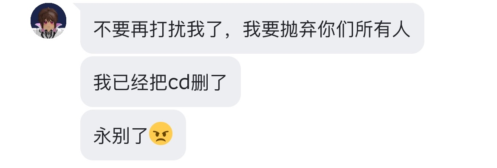

**Deleted User** (2025-05-16 19:17:07):
<:emoji_11:1298282571616096307>

**𝙔𝙏𝙏𝙏** (2025-05-16 16:38:40):
🤣

**Deleted User** (2025-05-16 10:48:39):
找继承人吧

**Deleted User** (2025-05-16 10:48:26):
你们宗主死了

**任白** (2025-05-16 07:35:12):
恐怕是有心无力

**任白** (2025-05-16 07:35:10):
要接替宗门

**任白** (2025-05-16 07:34:56):
家中还有妻子需要照顾

**任白** (2025-05-16 07:34:45):
过惯了自由潇洒日子

**任白** (2025-05-16 07:34:27):
鄙人心存于江湖

**Deleted User** (2025-05-16 07:15:38):
<:1000168518:1298906830864519231>

**Deleted User** (2025-05-16 07:15:25):
何不让其改朝换代

**Deleted User** (2025-05-16 07:15:09):
此等神人率领宗内大小事物只会埋没了宗门

**Deleted User** (2025-05-16 07:14:36):
我观你有帝王之相

**Deleted User** (2025-05-16 07:14:25):
少年郎

**任白** (2025-05-16 07:11:39):
还删人

**任白** (2025-05-16 07:11:31):
塌房了

**Deleted User** (2025-05-16 07:11:02):
😅

**Deleted User** (2025-05-16 07:10:58):
早睡一次给我删了

**Deleted User** (2025-05-16 07:10:46):
最近天天熬夜

**Deleted User** (2025-05-16 07:10:41):
第一次见这种神人

**Deleted User** (2025-05-16 07:10:30):
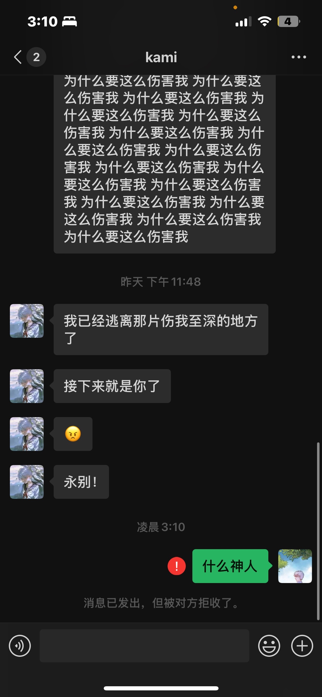

**任白** (2025-05-16 03:38:55):
？

**crzwz** (2025-05-16 03:34:06):
出来吧任白

**crzwz** (2025-05-16 03:34:00):
mika要走啦

**crzwz** (2025-05-16 03:33:56):
不好啦

**任白** (2025-05-15 09:28:33):
是人我吃

**任白** (2025-05-15 09:28:29):

**味道≠天秤♎ TKN** (2025-05-15 08:21:27):
<:10:1298285710033424446>

**卡顺密** (2025-05-15 08:16:51):
哈基米我娜美露多
啊西噶呀库娜鲁
一段一段带一段
一段咚鸡搞核算
我独自走过核算听
小白手套来作伴
萧瑟秋风今又是
秋风吹过泪深山

**卡顺密** (2025-05-15 08:16:49):
反对冷暴力!😭

**希波鹅拉底** (2025-05-15 07:59:17):
<:20:1298294514124984323>

**人有所操料香** (2025-05-15 06:10:45):
你叫什么

**crzwz** (2025-05-15 01:11:48):
假

**任白** (2025-05-15 00:21:38):
笑死我了

**任白** (2025-05-15 00:21:38):
难绷

**味道≠天秤♎ TKN** (2025-05-14 23:14:10):
低声下气

**卡顺密** (2025-05-14 22:48:32):
只好忍气吞声了(哽咽)
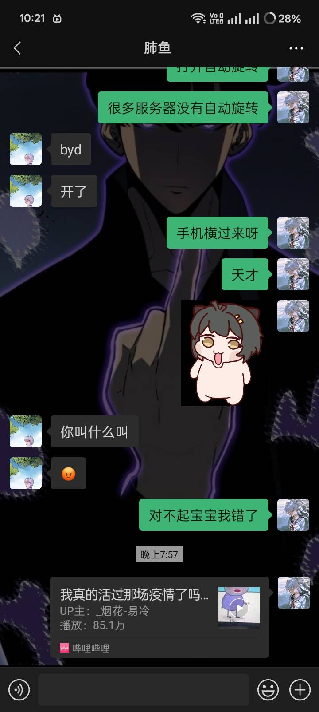

**crzwz** (2025-05-14 14:29:38):
总是不冲给我

**crzwz** (2025-05-14 14:29:28):
反对冷暴力

**味道≠天秤♎ TKN** (2025-05-14 14:29:10):
这不是在打情骂俏嘛

**卡顺密** (2025-05-14 14:21:11):
😭

**卡顺密** (2025-05-14 14:21:08):
反对语言暴力口牙

**卡顺密** (2025-05-14 14:20:52):


**任白** (2025-05-14 14:07:16):
我嫉妒你的爱，气势如虹，像个人气高居不下的天后😭😭😭

**任白** (2025-05-14 14:07:02):
反对冷暴力😭😭😭

**味道≠天秤♎ TKN** (2025-05-14 04:17:17):
热一下我呗

**crzwz** (2025-05-14 04:13:12):
热暴力

**味道≠天秤♎ TKN** (2025-05-13 17:27:13):
如果被自己对象冷暴力的话可以加入他们

**味道≠天秤♎ TKN** (2025-05-13 17:27:08):
这是一个宗门

**味道≠天秤♎ TKN** (2025-05-13 17:26:34):
哦

**Dr.Z** (2025-05-13 16:43:40):
这是干嘛的

**Dr.Z** (2025-05-13 16:43:25):
？

**希波鹅拉底** (2025-05-13 15:54:36):
<:20:1298294514124984323>

**Deleted User** (2025-05-13 15:22:45):
<:1000168518:1298906830864519231>

**𝙔𝙏𝙏𝙏** (2025-05-13 07:46:01):
什么罐子我说

**Deleted User** (2025-05-13 06:02:13):
遮裙沙壁疯了

**手磨咖啡机** (2025-05-13 03:58:37):
我要说话了😇

**希波鹅拉底** (2025-05-13 03:32:33):
<:20:1298294514124984323>

**味道≠天秤♎ TKN** (2025-05-13 02:07:35):
冷暴力 只能发凉吧

**crzwz** (2025-05-13 02:06:52):
想发光发热

**crzwz** (2025-05-13 02:06:38):
急急急

**卡顺密** (2025-05-13 02:05:11):
你才签到几天，年轻人不要心浮气躁的

**crzwz** (2025-05-13 02:04:48):
<@1063068779162108027> 什么时候我才能进宗门

**味道≠天秤♎ TKN** (2025-05-13 02:04:19):
热暴力一下我

**卡顺密** (2025-05-13 02:04:18):
喷不了，这个我也喜欢

**crzwz** (2025-05-13 02:03:47):
喜欢热暴力

**味道≠天秤♎ TKN** (2025-05-13 00:13:34):
<a:dogflex:1151348155791716473>

**手磨咖啡机** (2025-05-13 00:11:55):
反对冷暴力！😭😭😭

**任白** (2025-05-12 23:24:52):
反对冷暴力！😭😭😭

**任白** (2025-05-12 23:24:45):
感情

**任白** (2025-05-12 23:24:44):
没有

**crzwz** (2025-05-12 17:26:33):
反对冷暴力

**希波鹅拉底** (2025-05-12 15:53:18):
<:20:1298294514124984323>

**手磨咖啡机** (2025-05-12 14:28:37):
我在b站看到过这种😇

**味道≠天秤♎ TKN** (2025-05-12 14:27:56):
自演自导而已

**任白** (2025-05-12 13:50:46):
盗号发给自己罢了

**卡顺密** (2025-05-12 13:48:51):
神的调教之力

**卡顺密** (2025-05-12 13:48:43):


**味道≠天秤♎ TKN** (2025-05-12 13:28:55):
80你啊，那很正常

**手磨咖啡机** (2025-05-12 13:27:45):
80😭

**味道≠天秤♎ TKN** (2025-05-12 13:27:31):
<:1000168531:1298906724979310634>

**味道≠天秤♎ TKN** (2025-05-12 13:27:28):
咋了？这是

**手磨咖啡机** (2025-05-12 13:19:12):
赤裸裸的霸凌😭

**卡顺密** (2025-05-12 13:18:04):
烦死了，又要我一个一个删

**任白** (2025-05-12 13:17:46):
我们的净土被污染了

**任白** (2025-05-12 13:17:38):
看看你干的好事

**任白** (2025-05-12 13:17:35):
<@1063068779162108027>

**卡顺密** (2025-05-12 13:16:38):
<@1144708955344474262>

**卡顺密** (2025-05-12 13:16:35):
复制，然后发100遍

**卡顺密** (2025-05-12 13:16:24):
反对冷暴力!😭

**卡顺密** (2025-05-12 13:16:21):
刷屏机器罢了

**手磨咖啡机** (2025-05-12 13:16:11):
那我是什么😭

**卡顺密** (2025-05-12 13:16:03):
<@1359754555444957316>

**任白** (2025-05-12 13:15:54):
哪个是利剑

**卡顺密** (2025-05-12 13:15:51):
我最强的外交手段

**任白** (2025-05-12 13:15:47):
秩序还是稳定的

**卡顺密** (2025-05-12 13:15:43):
我还招了个利剑呢

**任白** (2025-05-12 13:15:40):
那至少没有捣乱的

**手磨咖啡机** (2025-05-12 13:15:31):
😡

**任白** (2025-05-12 13:15:31):
我招了个鸡吧

**任白** (2025-05-12 13:15:25):
确实

**卡顺密** (2025-05-12 13:15:25):
😡

**任白** (2025-05-12 13:15:18):
<:10:1298285710033424446>

**卡顺密** (2025-05-12 13:15:18):
你招了个鸡巴

**任白** (2025-05-12 13:15:11):
你专挑内鬼招吗

**卡顺密** (2025-05-12 13:15:08):
那你招的很屌吗

**任白** (2025-05-12 13:15:00):
还不如不招

**任白** (2025-05-12 13:14:57):
这就是你招的人吗 <@1063068779162108027>

**手磨咖啡机** (2025-05-12 13:14:40):
霸权统治，同志们😭

**卡顺密** (2025-05-12 13:14:23):
给我发反对冷暴力

**手磨咖啡机** (2025-05-12 13:14:16):
😭

**任白** (2025-05-12 13:14:01):
泥马的你都招的什么人 <@1063068779162108027>

**卡顺密** (2025-05-12 13:13:58):
给他禁言了就老实了

**任白** (2025-05-12 13:13:43):
怎么还有捣乱的

**卡顺密** (2025-05-12 13:13:31):
删了重发

**卡顺密** (2025-05-12 13:13:27):
谁让你反这个了

**卡顺密** (2025-05-12 13:13:21):
我吃柠檬

**手磨咖啡机** (2025-05-12 13:00:31):
<:1000168518:1298906830864519231>

**卡顺密** (2025-05-12 12:56:34):
😨

**𝙔𝙏𝙏𝙏** (2025-05-12 12:56:26):
<:1000168518:1298906830864519231>

**味道≠天秤♎ TKN** (2025-05-12 12:55:05):
还不够啊 太上长老你是真的牛逼

**卡顺密** (2025-05-12 12:54:43):
这是我人生一大憾事

**卡顺密** (2025-05-12 12:54:38):
😠

**卡顺密** (2025-05-12 12:54:34):
yutu还是太飞舞了 无法调教成功云图 否则这个群会变得更加淫乱

**味道≠天秤♎ TKN** (2025-05-12 12:53:48):
<:emoji_11:1298282571616096307>

**味道≠天秤♎ TKN** (2025-05-12 12:53:41):
我们这个村子已经够淫乱了

**卡顺密** (2025-05-12 12:53:35):
😎

**卡顺密** (2025-05-12 12:53:32):
没错，始作俑者就是我

**卡顺密** (2025-05-12 12:53:25):
一开始是我和fe 然后云图和yutu

**味道≠天秤♎ TKN** (2025-05-12 12:53:15):
原来万恶之源都是你

**卡顺密** (2025-05-12 12:51:33):
我干的

**味道≠天秤♎ TKN** (2025-05-12 12:51:07):
香料Ⅹ徐秋 我X宝宝 群里目前知道的还有几对呢 不算你不算任白 这都有7对了

**卡顺密** (2025-05-12 12:50:12):
什么一对一对

**味道≠天秤♎ TKN** (2025-05-12 12:48:27):
话说dc里一对一对的这个传统哪来的

**人有所操料香** (2025-05-12 12:38:19):
门酱

**卡顺密** (2025-05-12 12:37:05):
香草

**crzwz** (2025-05-12 12:34:54):
冷暴力

**手磨咖啡机** (2025-05-12 12:29:47):
<:1000168518:1298906830864519231>

**任白** (2025-05-12 12:00:13):
<:1000168518:1298906830864519231>

**人有所操料香** (2025-05-12 11:56:10):
冷暴力

**手磨咖啡机** (2025-05-12 05:30:28):
冷暴力

**crzwz** (2025-05-12 05:07:17):
冷暴力

**希波鹅拉底** (2025-05-12 04:41:06):
<:20:1298294514124984323>

**希波鹅拉底** (2025-05-12 04:41:05):
好

**任白** (2025-05-12 04:37:21):
你冷暴力我有什么用

**希波鹅拉底** (2025-05-12 04:36:48):
冷暴力你

**希波鹅拉底** (2025-05-12 04:36:39):
<:07:1298281204260278383>

**味道≠天秤♎ TKN** (2025-05-12 03:28:08):
今天这么早

**晨** (2025-05-12 03:18:41):
<:1000168531:1298906724979310634>

**𝙔𝙏𝙏𝙏** (2025-05-12 03:06:05):
<:01:1298277023919116330>

**任白** (2025-05-12 03:04:42):
反对冷暴力！😭😭

**手磨咖啡机** (2025-05-12 02:44:12):
<:20:1298294514124984323>

**味道≠天秤♎ TKN** (2025-05-12 01:28:01):
<:20:1298294514124984323>

**希波鹅拉底** (2025-05-12 01:24:27):
<:20:1298294514124984323>

**味道≠天秤♎ TKN** (2025-05-11 17:01:49):
<:20:1298294514124984323>

**希波鹅拉底** (2025-05-11 16:54:44):
<:20:1298294514124984323>

**味道≠天秤♎ TKN** (2025-05-11 16:49:27):
也不是不行嘛

**手磨咖啡机** (2025-05-11 16:48:44):
一天不见，你已经成为妈妈了😭

**味道≠天秤♎ TKN** (2025-05-11 16:47:29):
什么时候都是妈妈

**希波鹅拉底** (2025-05-11 16:46:56):
<:20:1298294514124984323>

**手磨咖啡机** (2025-05-11 16:37:10):
今天任白还是妈妈，继续do😡

**味道≠天秤♎ TKN** (2025-05-11 16:34:44):
爱看也没用12号了

**手磨咖啡机** (2025-05-11 16:34:34):
我爱看

**手磨咖啡机** (2025-05-11 16:34:31):
恋母情节吗

**手磨咖啡机** (2025-05-11 16:34:22):
有点意思

**味道≠天秤♎ TKN** (2025-05-11 14:40:44):
<:sea_07:1326371418862125119>

**味道≠天秤♎ TKN** (2025-05-11 14:40:38):
造反啦！

**crzwz** (2025-05-11 12:33:59):
今天任白是妈妈，我要狠狠do

**crzwz** (2025-05-11 12:33:52):
反对冷暴力！

**任白** (2025-05-11 12:31:43):
反对冷暴力！😭😭😭

**任白** (2025-05-11 12:31:34):
你要说

**任白** (2025-05-11 12:31:32):
你这什么狗屁签到

**任白** (2025-05-11 12:31:28):
你这个不算

**crzwz** (2025-05-11 12:30:26):
狠狠签到

**任白** (2025-05-11 12:29:28):
河鲜过敏

**任白** (2025-05-11 12:29:23):
<:20:1298294514124984323>

**味道≠天秤♎ TKN** (2025-05-11 11:13:40):
<:20:1298294514124984323>

**味道≠天秤♎ TKN** (2025-05-11 11:13:37):
十有八九就是小龙虾过敏了呗

**味道≠天秤♎ TKN** (2025-05-11 11:13:23):
并且肿的像个猪头一样去吊水

**味道≠天秤♎ TKN** (2025-05-11 11:13:18):
结合不久后他就过敏

**味道≠天秤♎ TKN** (2025-05-11 11:13:09):
右手整个手都小龙虾的味道

**味道≠天秤♎ TKN** (2025-05-11 11:12:57):
昨天聊的时候他一直在说

**希波鹅拉底** (2025-05-11 10:32:16):
我好像没见到他说

**希波鹅拉底** (2025-05-11 10:32:08):
<:20:1298294514124984323>

**希波鹅拉底** (2025-05-11 10:32:06):
不是你们怎么知道他吃虾差点把自己弄死

**希波鹅拉底** (2025-05-11 10:31:54):
任白对虾过敏嘛

**Deleted User** (2025-05-11 08:19:27):
666

**味道≠天秤♎ TKN** (2025-05-11 06:00:50):
太惨了，老大

**味道≠天秤♎ TKN** (2025-05-11 06:00:36):
对河鲜过敏啊

**任白** (2025-05-11 05:57:32):
不能吃那种淡水的

**任白** (2025-05-11 05:57:26):
是对大闸蟹过敏

**任白** (2025-05-11 05:57:20):
我发现不是对螃蟹过敏

**任白** (2025-05-11 05:57:10):
我不知道我对小龙虾过敏

**任白** (2025-05-11 05:57:04):
不是忘了

**卡顺密** (2025-05-11 05:48:33):
<:emoji_11:1298282571616096307>

**卡顺密** (2025-05-11 05:48:28):
之前有个神人差点被鸡蛋单杀

**卡顺密** (2025-05-11 05:48:19):
肺物 差点被海鲜单杀

**味道≠天秤♎ TKN** (2025-05-11 05:44:19):
<:10:1298285710033424446>

**味道≠天秤♎ TKN** (2025-05-11 05:44:16):
都忘了自己螃蟹虾的过敏了

**味道≠天秤♎ TKN** (2025-05-11 05:44:08):
你昨天是看群里看下饭了是吧

**任白** (2025-05-11 05:32:06):
<:20:1298294514124984323>

**任白** (2025-05-11 05:32:02):
差点死

**味道≠天秤♎ TKN** (2025-05-11 05:25:10):
<:20:1298294514124984323>

**味道≠天秤♎ TKN** (2025-05-11 05:25:06):
鹅先生可爱捏

**希波鹅拉底** (2025-05-11 05:22:19):
<:20:1298294514124984323>

**手磨咖啡机** (2025-05-10 15:37:59):
蚌埠住了

**任白** (2025-05-10 15:36:19):
宝剑插腰间

**卡顺密** (2025-05-10 14:52:33):
睡觉了 谁趁着我半夜睡觉趁机攻打宗门 我定让他试试我的宝剑锋不锋利

**味道≠天秤♎ TKN** (2025-05-10 14:42:21):
滥用职权

**味道≠天秤♎ TKN** (2025-05-10 14:42:06):
<:emoji_11:1298282571616096307>

**味道≠天秤♎ TKN** (2025-05-10 14:42:02):
反正我也不是什么正常人

**味道≠天秤♎ TKN** (2025-05-10 14:41:53):
想着挺适合的，就用了

**味道≠天秤♎ TKN** (2025-05-10 14:41:49):
刚好听的歌封面就这个

**味道≠天秤♎ TKN** (2025-05-10 14:41:43):
我就想随便找个

**味道≠天秤♎ TKN** (2025-05-10 14:41:37):
因为说要改个头像

**人有所操料香** (2025-05-10 14:41:29):
跟被草了一样的头像

**人有所操料香** (2025-05-10 14:41:21):
所以说你为啥用个

**人有所操料香** (2025-05-10 14:41:05):
区区出来卖的

**人有所操料香** (2025-05-10 14:41:00):
？

**卡顺密** (2025-05-10 14:40:10):
<@1359754555444957316> 利剑 把他给我喷成玉米症

**卡顺密** (2025-05-10 14:39:37):
😡

**味道≠天秤♎ TKN** (2025-05-10 14:39:23):
截图了

**卡顺密** (2025-05-10 14:38:53):
臭苍蝇

**卡顺密** (2025-05-10 14:38:27):
算上我之前的祷告已经有800了

**卡顺密** (2025-05-10 14:38:05):
油我星宿仙尊一手打造

**卡顺密** (2025-05-10 14:37:53):
史上最强的帖子

**卡顺密** (2025-05-10 14:37:44):
已经500多条了

**卡顺密** (2025-05-10 14:33:33):
凌晨12点刷新

**crzwz** (2025-05-10 14:33:04):
每天来冷暴力签到

**crzwz** (2025-05-10 14:32:55):
我选择签到7天

**crzwz** (2025-05-10 14:32:45):
<:1000168510:1298906820638674984> <:1000168510:1298906820638674984>

**卡顺密** (2025-05-10 14:32:34):
那你就去单刷史上最强吧 打赢了算你7天

**crzwz** (2025-05-10 14:31:51):
能不能算我签到7天呢

**crzwz** (2025-05-10 14:31:40):
啊好麻烦

**卡顺密** (2025-05-10 14:30:47):
签到7天才能获取我的任务

**crzwz** (2025-05-10 14:30:26):
快。给我给我

**卡顺密** (2025-05-10 14:29:49):
😈

**卡顺密** (2025-05-10 14:29:43):
我的任务可不简单 如果做完可直接晋升副宗主

**卡顺密** (2025-05-10 14:29:28):
居然想要接我的任务吗

**crzwz** (2025-05-10 14:29:05):
<@1063068779162108027> 给我任务

**crzwz** (2025-05-10 14:29:00):
是什么

**crzwz** (2025-05-10 14:28:58):
我的任务

**卡顺密** (2025-05-10 14:28:45):
咖啡机的任务是比他还要黑奴

**crzwz** (2025-05-10 14:28:44):
<@1359754555444957316>

**crzwz** (2025-05-10 14:28:41):
你的产出得给我一半

**卡顺密** (2025-05-10 14:28:29):
利剑的任务是喷得过他

**crzwz** (2025-05-10 14:28:25):
发动抢夺卡

**味道≠天秤♎ TKN** (2025-05-10 14:28:24):
平胸杂鱼

**人有所操料香** (2025-05-10 14:28:02):
自产自销

**crzwz** (2025-05-10 14:27:19):
给我尝尝

**人有所操料香** (2025-05-10 14:27:09):
我已经好了

**crzwz** (2025-05-10 14:27:00):
<@1359754555444957316> 你起反应了

**crzwz** (2025-05-10 14:26:54):
什么

**crzwz** (2025-05-10 14:26:48):
是你动了资本的蛋糕

**人有所操料香** (2025-05-10 14:26:45):
对帖子起反应

**人有所操料香** (2025-05-10 14:26:43):


**人有所操料香** (2025-05-10 14:26:30):
这有个

**人有所操料香** (2025-05-10 14:26:28):
怎么

**卡顺密** (2025-05-10 14:26:24):
你可以帮白找他的老婆

**crzwz** (2025-05-10 14:26:22):
是资本！无敌的任白大侦探！

**crzwz** (2025-05-10 14:26:01):
我也要入

**卡顺密** (2025-05-10 14:25:56):
太人性了

**crzwz** (2025-05-10 14:25:55):
我觉得宗门好cool

**crzwz** (2025-05-10 14:25:50):
好cool

**人有所操料香** (2025-05-10 14:25:39):


**卡顺密** (2025-05-10 14:25:38):
找宗门的其他人领取入门任务 满足了就可加入

**味道≠天秤♎ TKN** (2025-05-10 14:25:20):
乖乖

**卡顺密** (2025-05-10 14:25:20):
还有另外一个方法

**任白** (2025-05-10 14:25:10):
都v我50

**味道≠天秤♎ TKN** (2025-05-10 14:25:10):
你这平胸

**crzwz** (2025-05-10 14:25:07):
因为我是狗

**crzwz** (2025-05-10 14:24:55):
包不行的

**味道≠天秤♎ TKN** (2025-05-10 14:24:52):
<:24:1298294525390753924>

**crzwz** (2025-05-10 14:24:49):
<:07:1298281204260278383> <:07:1298281204260278383> <:07:1298281204260278383>

**味道≠天秤♎ TKN** (2025-05-10 14:24:48):
但是宝宝想要的话
我也可以勉强自己不去找他

**任白** (2025-05-10 14:24:47):
<:1000168518:1298906830864519231>

**味道≠天秤♎ TKN** (2025-05-10 14:24:26):
毕竟都是我粘着他的

**味道≠天秤♎ TKN** (2025-05-10 14:24:23):
有点难度

**味道≠天秤♎ TKN** (2025-05-10 14:24:13):
咋的了

**人有所操料香** (2025-05-10 14:24:04):
<@1336328198446780517> 出来卖的

**crzwz** (2025-05-10 14:23:49):
什么出来卖的

**crzwz** (2025-05-10 14:23:33):
<:07:1298281204260278383> <:07:1298281204260278383> <:07:1298281204260278383>

**卡顺密** (2025-05-10 14:23:32):
要那个出来卖的冷暴力你

**crzwz** (2025-05-10 14:23:31):
我把仁白撅了能不能加入

**卡顺密** (2025-05-10 14:23:25):
按照目前来看

**crzwz** (2025-05-10 14:23:05):
<@1063068779162108027> 怎么加入

**crzwz** (2025-05-10 14:22:56):
鹅先生可爱捏

**卡顺密** (2025-05-10 14:22:56):
你没满足加入我宗门的条件

**希波鹅拉底** (2025-05-10 14:22:37):
<:20:1298294514124984323>

**crzwz** (2025-05-10 14:22:35):
我呢

**crzwz** (2025-05-10 14:22:32):
啊

**人有所操料香** (2025-05-10 14:22:21):
门酱

**人有所操料香** (2025-05-10 14:22:19):
门主算不算

**卡顺密** (2025-05-10 14:22:05):
宗门崛起有望

**卡顺密** (2025-05-10 14:22:01):
人才聚集啊

**卡顺密** (2025-05-10 14:21:45):
第1个是躺赢狗

**卡顺密** (2025-05-10 14:21:41):
第3个是利剑

**人有所操料香** (2025-05-10 14:21:38):
<:emoji_11:1298282571616096307>

**卡顺密** (2025-05-10 14:21:36):
第2个是黑奴

**人有所操料香** (2025-05-10 14:21:35):
已经进来了

**卡顺密** (2025-05-10 14:21:29):
现有的三位成员

**卡顺密** (2025-05-10 14:21:14):
<@1327930413070684181> <@1144708955344474262> <@1359754555444957316>

**徐秋** (2025-05-10 14:20:59):
还以为是香料钻进来了

**希波鹅拉底** (2025-05-10 14:20:24):
<:20:1298294514124984323>

**希波鹅拉底** (2025-05-10 14:20:22):
被预判了

**希波鹅拉底** (2025-05-10 14:20:16):
666

**任白** (2025-05-10 14:20:12):
特意蹲着

**任白** (2025-05-10 14:20:09):
我就知道你要来这里

**任白** (2025-05-10 14:20:05):
<:20:1298294514124984323>

**希波鹅拉底** (2025-05-10 14:20:00):
<:20:1298294514124984323>

**卡顺密** (2025-05-10 14:13:40):
飞舞东西 干不过资本还天天动人家蛋糕

**任白** (2025-05-10 14:13:22):
被资本做局了

**任白** (2025-05-10 14:13:15):
我觉得这一切都不正常

**任白** (2025-05-10 14:13:11):
让我大调查一下

**任白** (2025-05-10 14:13:06):
别急

**任白** (2025-05-10 14:12:58):
没了

**任白** (2025-05-10 14:12:56):
<@1327930413070684181>

**卡顺密** (2025-05-10 14:11:22):
<@1327930413070684181> 飞舞代理😡把所有成员列出来

**味道≠天秤♎ TKN** (2025-05-10 13:58:23):
<:20:1298294514124984323>

**任白** (2025-05-10 13:55:03):
鹅先生<:20:1298294514124984323>

**任白** (2025-05-10 13:54:53):
<:20:1298294514124984323>

**希波鹅拉底** (2025-05-10 13:51:39):
<:20:1298294514124984323>

**卡顺密** (2025-05-10 13:47:38):
😭

**卡顺密** (2025-05-10 13:47:35):
鸡鸡我也想你了 自己把腿掰开吧

**任白** (2025-05-10 13:33:29):
居姬🙏

**手磨咖啡机** (2025-05-09 07:33:35):
老大，想你了😭😭😭

**任白** (2025-05-09 05:21:17):
已战损

**crzwz** (2025-05-09 04:05:07):
老大

**手磨咖啡机** (2025-05-09 02:33:30):
老大😭😭😭

**味道≠天秤♎ TKN** (2025-05-09 02:08:26):
剩你了 老大😭

**味道≠天秤♎ TKN** (2025-05-08 14:06:23):
你这战损还没好啊

**手磨咖啡机** (2025-05-08 13:01:30):
老大，想你了😭

**任白** (2025-05-08 13:00:11):
我独自反对

**任白** (2025-05-08 13:00:05):
反对冷暴力😭😭😭

**任白** (2025-05-08 07:31:52):
😭😭😭

**手磨咖啡机** (2025-05-08 07:21:14):
就剩你了 老大

**crzwz** (2025-05-07 04:16:06):
就剩你了 老大

**任白** (2025-05-07 04:07:46):
这是个悲伤的故事

**任白** (2025-05-07 04:07:40):
😭😭😭

**味道≠天秤♎ TKN** (2025-05-07 04:05:13):
<a:headpat_UwU:1151772230733275248>

**味道≠天秤♎ TKN** (2025-05-07 04:05:04):
就剩你了 老大

**任白** (2025-05-07 02:43:07):
反对冷暴力！😭

**任白** (2025-05-06 11:31:45):
最美的爱情 回忆里待续😭

**任白** (2025-05-06 11:31:34):
我知道我们都没有错 只是分手会比较难过😭

**任白** (2025-05-06 11:31:14):
反对冷暴力！😭

**Deleted User** (2025-05-05 09:17:22):
1

**卡顺密** (2025-05-05 09:05:13):
冷暴力的都是出生

**卡顺密** (2025-05-05 09:05:08):
出生 不回消息的都是出生😡

**Deleted User** (2025-05-05 09:04:14):
长这么大个人肯定得是出生了

**Deleted User** (2025-05-05 09:03:31):
出生

**任白** (2025-05-05 08:16:29):
拒绝冷暴力！😭

**卡顺密** (2025-05-05 08:03:43):
拒绝冷暴力!😭

**卡顺密** (2025-05-05 08:03:37):
可算是续上了🤓

**卡顺密** (2025-05-05 08:03:31):
哎呀~

**Deleted User** (2025-05-05 06:43:40):
还没续上

**任白** (2025-05-05 04:48:17):
<:10:1298285710033424446>

**卡顺密** (2025-05-05 04:39:47):
😫

**卡顺密** (2025-05-05 04:39:39):
没网的日子好难受

**任白** (2025-05-04 03:50:08):
😭

**任白** (2025-05-04 03:50:06):
我不配

**任白** (2025-05-04 03:50:03):
而我心碎你受罪你的美

**任白** (2025-05-04 03:49:46):
你默背为我掉过几次泪多憔悴😭

**任白** (2025-05-04 03:49:23):
这感觉已经不对我最后才了解😭
一页页不忍翻阅的情节你好累😭

**任白** (2025-05-04 03:48:36):
反对冷暴力😭

**任白** (2025-05-04 03:48:26):
<@1316206447595356241> 睡到现在还没起床

**任白** (2025-05-04 03:08:47):
<:1000168518:1298906830864519231>

**crzwz** (2025-05-04 02:37:26):
第一届乱斗杯才16000k宁宁才这种卡拿第一我也写

**crzwz** (2025-05-04 02:36:52):
这什么狗屎数据

**crzwz** (2025-05-04 02:36:45):
哥哥

**crzwz** (2025-05-04 02:36:42):
9000了

**任白** (2025-05-04 01:40:26):
哇，还有嗨幕

**卡顺密** (2025-05-04 01:39:35):
😡

**卡顺密** (2025-05-04 01:39:27):
我知道了孩子们 据我多年看黑暗心理学 食人术 政治学 小穴的经验来看 这张卡是魅魔内定的

**任白** (2025-05-04 01:37:24):
然后忽然窜出来了

**任白** (2025-05-04 01:37:21):
一开始我都没看到这个卡

**任白** (2025-05-04 01:37:15):
主要是数据窜的非常快

**任白** (2025-05-04 01:36:52):
<:1000168518:1298906830864519231>

**卡顺密** (2025-05-04 01:26:08):
他没刷我天天后入fe

**卡顺密** (2025-05-04 01:25:57):
这遥遥领先的程度

**卡顺密** (2025-05-04 01:25:51):


**卡顺密** (2025-05-04 01:09:10):
哪组的

**卡顺密** (2025-05-04 01:07:23):
刷什么数据

**crzwz** (2025-05-03 16:24:15):
我不理解

**任白** (2025-05-03 16:22:00):
就是这样不信邪给他流量了没准

**crzwz** (2025-05-03 16:18:21):
这种卡我也能写

**crzwz** (2025-05-03 16:18:11):
什么都没有

**crzwz** (2025-05-03 16:18:05):
全是ai代写的

**crzwz** (2025-05-03 16:18:00):
我玩了1000电

**任白** (2025-05-03 16:17:53):
说实话

**任白** (2025-05-03 16:17:51):
我也怀疑

**任白** (2025-05-03 16:17:39):
<:10:1298285710033424446>

**crzwz** (2025-05-03 15:35:54):
五个开局五个人物都不一样

**crzwz** (2025-05-03 15:35:19):
昵称：仙界女仙拍卖会
色情特化丨拍卖着各种各样的女仙，不管实力多强，地位多高，无论仙尊或女帝，在这里都能买到
https://www.sexyai.top/#/pages/chat/chat?roleId=117006&inviteCode=gsOFq
这个卡，设定很烂，全是ai编的我怀疑字数不超过3000

**crzwz** (2025-05-03 15:34:46):
<@1063068779162108027> <@1327930413070684181> 我怀疑有人刷数据，

**手磨咖啡机** (2025-05-03 12:31:52):
老大快点压力他们口牙

**任白** (2025-05-03 12:13:16):
你也来反对冷暴力

**任白** (2025-05-03 12:13:09):
<:11:1298291287899902023>

**任白** (2025-05-03 12:13:04):
我会努力的

**任白** (2025-05-03 12:13:00):
别这样

**任白** (2025-05-03 12:12:57):
我靠

**Hyperaveler** (2025-05-03 11:53:37):
招什么

**Hyperaveler** (2025-05-03 11:53:23):
？

**卡顺密** (2025-05-03 11:50:56):
随你吧._.

**任白** (2025-05-03 11:49:17):
你也没说我是一把手啊

**任白** (2025-05-03 11:49:03):
噢

**卡顺密** (2025-05-03 11:47:38):
😡

**卡顺密** (2025-05-03 11:47:37):
你和我说你不是一把手

**卡顺密** (2025-05-03 11:47:28):
14.53你当的一把手 19.41他发的信息

**任白** (2025-05-03 11:46:59):
他也反对冷暴力了

**任白** (2025-05-03 11:46:54):
上面有小户

**任白** (2025-05-03 11:46:44):
你不能怪我

**任白** (2025-05-03 11:46:41):
那时候我还不是一把手

**任白** (2025-05-03 11:46:33):
噢

**卡顺密** (2025-05-03 11:46:18):
这个不是人是什么

**任白** (2025-05-03 11:46:10):
我也没人给我招啊

**卡顺密** (2025-05-03 11:45:59):
我在的时候没人给我招啊

**任白** (2025-05-03 11:45:39):
你在的时候招过人吗

**卡顺密** (2025-05-03 11:44:49):
😠

**卡顺密** (2025-05-03 11:44:47):
<@1327930413070684181> 让你当临时一把手，你以为就唱唱歌吗，你倒是招些人啊

**Hyperaveler** (2025-05-03 11:41:49):
因为你也在冷暴力<:24:1298294525390753924>

**Hyperaveler** (2025-05-03 11:41:39):
你是

**任白** (2025-05-03 11:41:17):
傲娇罢了

**居姬** (2025-05-03 11:37:10):
警惕双面人


**任白** (2025-05-03 11:37:02):
😭

**任白** (2025-05-03 11:37:01):
并不简单如呼吸

**任白** (2025-05-03 11:35:43):
你真的懂唯一 的定义😭

**任白** (2025-05-03 11:34:45):
反对冷暴力😭

**crzwz** (2025-05-03 07:09:25):
任白是鸡

**crzwz** (2025-05-03 07:09:18):
<:1000168510:1298906820638674984> <:1000168510:1298906820638674984>

**任白** (2025-05-03 06:54:05):
那肯定是我

**任白** (2025-05-03 06:54:03):
是你的圈子吗

**任白** (2025-05-03 06:54:00):
你当的明白吗

**任白** (2025-05-03 06:53:52):
你当什么一把手

**crzwz** (2025-05-03 06:33:56):
我

**卡顺密** (2025-05-03 06:25:10):


**卡顺密** (2025-05-03 06:24:16):
来个人顶一下我的位置 最近我要天天调戏fe 来个人当临时一把手

**crzwz** (2025-05-03 05:45:54):
方队冷藏里

**任白** (2025-05-03 03:42:23):
虚伪的人

**任白** (2025-05-03 03:42:20):
刚说完就又走了

**任白** (2025-05-03 03:34:36):
爱你

**任白** (2025-05-03 03:34:35):
那你真是太好了

**任白** (2025-05-03 03:34:29):
噢

**居姬** (2025-05-03 03:34:20):
這不是看你过来了吗

**任白** (2025-05-03 03:34:07):
不回我消息搁这儿唱歌

**任白** (2025-05-03 03:33:57):
？

**居姬** (2025-05-03 03:33:46):
你怎么连话都说不清楚😭
那温柔的痛我记得清楚😭
他站在我的面前 你经过我的身边😭
忽然之间心里又难过 为什么😭

**任白** (2025-05-03 03:31:47):
我站在他的身边 你站在我的面前 怎么这样心里会难过😭

**任白** (2025-05-03 03:30:22):
你怎么连话都说不清楚 那温柔的tone我听得清楚😭

**任白** (2025-05-03 03:29:32):
反对冷暴力！😭

**xi** (2025-05-03 03:09:54):
反对冷暴力!😭

**卡顺密** (2025-05-03 00:25:21):
反对冷暴力!😭

**crzwz** (2025-05-02 16:30:06):
我也走走后面

**crzwz** (2025-05-02 16:30:00):
<@1327930413070684181> 下把给我一个

**任白** (2025-05-02 16:21:20):
不中奖对不起我辛辛苦苦走的后门

**crzwz** (2025-05-02 16:19:19):
<@1327930413070684181>

**crzwz** (2025-05-02 16:19:16):
不是你老婆中奖了

**crzwz** (2025-05-02 15:40:27):
<@1327930413070684181> 鸡

**任白** (2025-05-02 15:38:29):
哎哟

**任白** (2025-05-02 15:38:24):
😘

**任白** (2025-05-02 15:38:15):
你说我吗

**crzwz** (2025-05-02 15:37:35):
jjj

**居姬** (2025-05-02 15:31:27):
😡

**居姬** (2025-05-02 15:31:20):
他是我的

**crzwz** (2025-05-02 12:26:02):
垃圾

**crzwz** (2025-05-02 12:25:59):
<:1000168531:1298906724979310634>

**任白** (2025-05-02 11:27:07):
小丑

**手磨咖啡机** (2025-05-02 10:50:13):
😡

**卡顺密** (2025-05-02 10:36:47):
<:10:1298285710033424446>

**卡顺密** (2025-05-02 10:36:34):
我还以为你要代替他老婆的位置

**卡顺密** (2025-05-02 10:36:28):
噢

**手磨咖啡机** (2025-05-02 10:36:22):
<@1316206447595356241>

**手磨咖啡机** (2025-05-02 10:36:04):
我来试试🤓

**全能沙雕王（光速滑跪版）** (2025-05-02 10:10:38):


**卡顺密** (2025-05-02 09:52:28):
待会我就发动九转无声蛊全给删了😡😡😡

**任白** (2025-05-02 09:51:24):
这里失去了应该有的肃静

**任白** (2025-05-02 09:51:07):
就是没有懂我们的

**任白** (2025-05-02 09:50:57):
什么牛鬼蛇神都有

**卡顺密** (2025-05-02 09:50:03):
🐴的 我大本营被搞成动物园了是吗

**任白** (2025-05-02 09:49:34):
<:10:1298285710033424446>

**雷鸟** (2025-05-02 09:48:34):
太神经了

**雷鸟** (2025-05-02 09:48:31):
我草

**任白** (2025-05-02 09:20:28):
😭

**任白** (2025-05-02 09:20:26):
在几点钟方向 你才会收到暗号

**任白** (2025-05-02 09:20:14):
到底有谁知道

**任白** (2025-05-02 09:20:10):
你没注意 收讯号 我开始搜寻不到

**任白** (2025-05-02 09:19:35):
<@1316206447595356241> 😭😭😭你在哪里你怎么弃我而去了

**任白** (2025-05-02 05:29:27):
😘

**味道≠天秤♎ TKN** (2025-05-02 05:16:55):
哇，老大你声音这么好听

**crzwz** (2025-05-02 05:09:00):
<@1327930413070684181> <:07:1298281204260278383> <:07:1298281204260278383> <:07:1298281204260278383>

**任白** (2025-05-02 04:33:08):
<@1316206447595356241>

**任白** (2025-05-02 04:32:37):
整个画面是你 想你想的睡不着😭

**任白** (2025-05-02 04:32:21):
从离开没多久就开始 担心今天的你过得好不好

**任白** (2025-05-02 04:31:46):
反对冷暴力😭

**moresky** (2025-05-01 15:36:31):
离神还有一定距离，但是已经不是人了

**命轮** (2025-05-01 13:14:02):
？在发什么癫👀

**卡顺密** (2025-05-01 12:08:38):
那很绝望了

**任白** (2025-05-01 12:08:24):
<:1000168518:1298906830864519231>

**任白** (2025-05-01 12:08:21):
每个人都要围观一遍吗

**全能沙雕王（光速滑跪版）** (2025-05-01 11:57:23):
<:10:1298285710033424446>

**crzwz** (2025-05-01 11:49:24):
<:10:1298285710033424446>

**任白** (2025-05-01 11:40:56):
<:1000168507:1298906834429804587>

**任白** (2025-05-01 11:40:51):
<:10:1298285710033424446>

**xi** (2025-05-01 11:38:49):
<:10:1298285710033424446>

**任白** (2025-05-01 10:34:57):
<:emoji_11:1298282571616096307>

**𝙔𝙏𝙏𝙏** (2025-05-01 10:01:46):
<:1000168531:1298906724979310634>

**任白** (2025-05-01 08:26:43):
可以去人声

**任白** (2025-05-01 08:26:33):
伴唱功能

**卡顺密** (2025-05-01 07:48:29):
你纯音乐哪找的

**任白** (2025-05-01 05:41:49):
一展歌喉

**任白** (2025-05-01 05:41:43):
大声唱出来

**卡顺密** (2025-05-01 05:41:19):
我妈在我只能小小声唱 但是小小声气又出不来😠

**任白** (2025-05-01 05:40:48):
快速来一发

**任白** (2025-05-01 05:40:37):
我还是趁着她出去买东西的短暂空隙唱的

**任白** (2025-05-01 05:40:21):
原来是跟我一样的处境吗

**卡顺密** (2025-05-01 05:39:21):
😆

**卡顺密** (2025-05-01 05:39:16):
我妈在家呀 等我家没人的

**任白** (2025-05-01 05:39:02):
轮到你了

**任白** (2025-05-01 05:38:28):
<:1000168518:1298906830864519231>

**任白** (2025-05-01 05:38:13):
那段我都不知道要不要用头声

**任白** (2025-05-01 05:37:53):
不好整

**卡顺密** (2025-05-01 05:37:24):
1:30和我一样差点唱断气😄

**任白** (2025-05-01 05:36:09):
<@1063068779162108027>

**任白** (2025-05-01 05:34:19):
就是音质有点爆炸

**任白** (2025-05-01 05:34:05):


**任白** (2025-05-01 05:34:03):
全体欣赏音乐！

**任白** (2025-05-01 05:33:53):
这样发

**任白** (2025-05-01 05:33:52):
发出来了

**卡顺密** (2025-05-01 05:30:18):
那就再对砍

**任白** (2025-05-01 05:29:55):
发不出来

**任白** (2025-05-01 05:29:53):
麻痹

**任白** (2025-05-01 05:22:47):
那也有30多m

**任白** (2025-05-01 05:22:40):
半首

**卡顺密** (2025-05-01 05:22:35):
你从头唱到尾啊

**卡顺密** (2025-05-01 05:22:31):
e

**任白** (2025-05-01 05:22:22):
限制文件大小

**任白** (2025-05-01 05:22:18):
我记得这里有限制

**卡顺密** (2025-05-01 05:21:54):
选择录音然后按分享呗

**任白** (2025-05-01 05:21:28):
我想想这里怎么发出来

**卡顺密** (2025-05-01 05:19:29):
王朝立马的

**任白** (2025-05-01 05:19:21):
十块

**卡顺密** (2025-05-01 05:19:13):
让我听听

**任白** (2025-05-01 05:19:07):
我录的音

**任白** (2025-05-01 05:19:01):
唱完了都

**卡顺密** (2025-05-01 05:18:51):
现在就唱吗

**卡顺密** (2025-05-01 05:18:47):
？

**任白** (2025-05-01 05:18:38):
唱了

**任白** (2025-05-01 05:18:07):
唱必

**任白** (2025-05-01 03:26:58):
<:1000168518:1298906830864519231>

**居姬** (2025-05-01 03:26:13):
就说被你冷暴力了

**居姬** (2025-05-01 03:26:07):
不然你让你小弟加入你

**任白** (2025-05-01 03:21:35):
我也暂时脱离一下

**任白** (2025-05-01 03:20:45):
<:1000168518:1298906830864519231>

**卡顺密** (2025-05-01 03:19:29):
https://tenor.com/view/ok-gif-26107516

**卡顺密** (2025-05-01 03:19:19):
因为我背负太多东西了

**手磨咖啡机** (2025-05-01 03:18:51):
老大你的名字怎么这么长🤓

**卡顺密** (2025-05-01 02:58:59):
那天没有一个团员跟随我

**卡顺密** (2025-05-01 02:58:48):
😡

**卡顺密** (2025-05-01 02:58:46):
如今只剩我一人了

**卡顺密** (2025-05-01 02:58:42):
该死的家伙

**卡顺密** (2025-05-01 02:57:53):
你名怎么改了 你要抛弃组织吗？😡😡😡

**全能沙雕王（光速滑跪版）** (2025-04-30 13:34:53):


**任白** (2025-04-30 13:34:18):
抱歉我输了

**任白** (2025-04-30 13:34:15):
不要笑挑战吗？

**卡顺密** (2025-04-30 13:33:43):
草必是吗？有点意思

**任白** (2025-04-30 13:33:26):
<:1000168518:1298906830864519231>

**任白** (2025-04-30 13:33:24):
现在不方便

**卡顺密** (2025-04-30 13:33:13):
那你唱吧

**任白** (2025-04-30 13:33:05):
我宁愿唱不说

**任白** (2025-04-30 13:33:01):
太羞耻了

**卡顺密** (2025-04-30 13:32:51):
你唱一段我听听，我给你配个懒老上去

**卡顺密** (2025-04-30 13:32:35):
没事

**任白** (2025-04-30 13:32:29):
词是我写的

**任白** (2025-04-30 13:32:25):
曲更不行

**全能沙雕王（光速滑跪版）** (2025-04-30 13:32:18):
没关系，好曲不挑词👍

**卡顺密** (2025-04-30 13:32:01):
？

**任白** (2025-04-30 13:31:51):
主要是题材太限制了

**卡顺密** (2025-04-30 13:31:36):
别管行不行，就让我看看歌词就行了

**任白** (2025-04-30 13:31:36):
我不喜欢那个词

**任白** (2025-04-30 13:31:25):
那个歌不太行

**卡顺密** (2025-04-30 13:31:12):
看看歌词

**任白** (2025-04-30 13:31:02):
那个歌不太行

**卡顺密** (2025-04-30 13:30:50):
歌词我看看

**任白** (2025-04-30 13:30:33):
你不要乱说我的事迹

**任白** (2025-04-30 13:30:25):
噢

**居姬** (2025-04-30 13:30:19):
唱那个阿

**居姬** (2025-04-30 13:30:14):
你不是有自己的歌

**任白** (2025-04-30 13:29:28):
跳

**卡顺密** (2025-04-30 13:29:21):
跳进染缸~

**卡顺密** (2025-04-30 13:29:15):
3

**全能沙雕王（光速滑跪版）** (2025-04-30 13:29:06):
2

**任白** (2025-04-30 13:28:57):
1

**全能沙雕王（光速滑跪版）** (2025-04-30 13:27:39):


**全能沙雕王（光速滑跪版）** (2025-04-30 13:27:20):
都来

**卡顺密** (2025-04-30 13:27:08):
你到底要他唱还是不要他唱的

**全能沙雕王（光速滑跪版）** (2025-04-30 13:26:52):
叫你唱你就唱，怎么事这么多呢😡

**任白** (2025-04-30 13:26:18):
嘘

**卡顺密** (2025-04-30 13:25:50):
这不符合逻辑啊

**居姬** (2025-04-30 13:25:41):
快去

**居姬** (2025-04-30 13:25:39):
唱

**卡顺密** (2025-04-30 13:24:56):
<:1000168518:1298906830864519231>

**任白** (2025-04-30 13:24:32):
<@1316206447595356241> 他来叫我就唱

**任白** (2025-04-30 13:24:13):
有机会就唱

**任白** (2025-04-30 13:24:08):
现在有点不方便

**任白** (2025-04-30 13:24:05):
我看一下

**全能沙雕王（光速滑跪版）** (2025-04-30 13:22:19):
所以到底唱不唱<:1000168509:1298906840712745001>

**任白** (2025-04-30 13:17:54):
之前唱过

**任白** (2025-04-30 13:17:49):
原来是这首歌

**卡顺密** (2025-04-30 13:17:19):
笑死了

**卡顺密** (2025-04-30 13:17:14):
😆

**任白** (2025-04-30 13:17:06):
我说的不是你

**任白** (2025-04-30 13:17:01):
？

**全能沙雕王（光速滑跪版）** (2025-04-30 13:16:32):
我不说话是给一把手面子，你又是？

**全能沙雕王（光速滑跪版）** (2025-04-30 13:15:53):
？

**任白** (2025-04-30 13:14:08):
要是他出来叫我唱我考虑一下

**任白** (2025-04-30 13:13:14):
对呀😆😆😆

**卡顺密** (2025-04-30 13:13:03):
终于找到借口能不唱了，开心坏了对吧😆😆😆

**全能沙雕王（光速滑跪版）** (2025-04-30 13:12:01):


**卡顺密** (2025-04-30 13:11:24):
😡

**卡顺密** (2025-04-30 13:11:21):
不给你面子，你早就被扇飞了

**任白** (2025-04-30 13:11:19):
那不唱了

**卡顺密** (2025-04-30 13:11:16):
给你个面子 让你给我们二把手点歌

**任白** (2025-04-30 13:11:14):
😡

**全能沙雕王（光速滑跪版）** (2025-04-30 13:10:42):
让你唱就唱，还挑上了😡

**卡顺密** (2025-04-30 13:10:13):
是的，歌名就叫不说

**任白** (2025-04-30 13:10:02):
不说？

**任白** (2025-04-30 13:09:58):
<:1000168518:1298906830864519231>

**卡顺密** (2025-04-30 13:08:27):
适合你

**卡顺密** (2025-04-30 13:08:24):
不说

**任白** (2025-04-30 13:08:11):
不符合我们反对冷暴力区的基调

**全能沙雕王（光速滑跪版）** (2025-04-30 13:06:31):
三选一：
Nightglow
Moon Halo
两只老虎

**全能沙雕王（光速滑跪版）** (2025-04-30 13:03:20):
我拉几个人问问

**任白** (2025-04-30 13:01:32):
想听什么

**全能沙雕王（光速滑跪版）** (2025-04-30 13:00:10):
我已经迫不及待了

**全能沙雕王（光速滑跪版）** (2025-04-30 12:59:56):
快端上来吧！

**卡顺密** (2025-04-30 12:58:52):
https://tenor.com/view/jjk-hikari-gif-1408129775731152385

**任白** (2025-04-30 12:58:48):
怎么还有人记得

**任白** (2025-04-30 12:58:44):
<:10:1298285710033424446>

**卡顺密** (2025-04-30 12:58:27):
你让他唱吧，我明天再观望一下

**全能沙雕王（光速滑跪版）** (2025-04-30 12:58:03):
说好的今晚发语音唱歌呢！！？？🤬

**任白** (2025-04-30 12:52:35):
fuck

**任白** (2025-04-30 12:52:32):
the

**任白** (2025-04-30 12:52:28):
what

**任白** (2025-04-30 12:52:20):
什么？

**卡顺密** (2025-04-30 12:52:16):
明天再回来

**卡顺密** (2025-04-30 12:52:12):
今天我现在暂时叛变一天

**任白** (2025-04-30 12:52:02):
反对冷暴力😭

**任白** (2025-04-30 12:51:56):
到点了

**任白** (2025-04-30 03:40:55):
😭

**任白** (2025-04-30 03:40:53):
我却得到你 安慰的淘汰

**任白** (2025-04-30 03:40:41):
只能说我认了 你的不安赢得你信任

**任白** (2025-04-30 03:39:26):
😭😭😭

**任白** (2025-04-30 03:39:22):
我们的回忆 没有皱褶 你却用离开烫下句点

**任白** (2025-04-30 03:38:54):
只能说我输了 也许是你怕了

**任白** (2025-04-30 03:38:21):
反对冷暴力😭😭😭

**Deleted User** (2025-04-30 03:29:17):
唐完了

**卡顺密** (2025-04-30 02:30:56):


**卡顺密** (2025-04-30 02:30:40):
汐汐😆

**卡顺密** (2025-04-30 02:30:25):
求求你给个回应让我开心 i'm ready

**卡顺密** (2025-04-30 02:30:22):
每一天都有情话 想不想听 just tell me

**卡顺密** (2025-04-30 02:29:15):
我是一个被你变忧郁的小丑 oh yeah

**卡顺密** (2025-04-30 02:29:12):
i'm missing you my honey don't you

**卡顺密** (2025-04-30 02:29:08):
反对冷暴力!😆

**手磨咖啡机** (2025-04-29 13:58:13):
😭🙏

**任白** (2025-04-29 13:52:33):
想干嘛

**任白** (2025-04-29 13:52:15):
😡

**卡顺密** (2025-04-29 13:50:56):
接电话

**卡顺密** (2025-04-29 13:50:52):
这么狂是吧

**手磨咖啡机** (2025-04-29 13:50:40):
给你机会😡

**卡顺密** (2025-04-29 13:50:29):
信不信我不磨fe了天天骚扰你

**手磨咖啡机** (2025-04-29 13:49:30):
不要偷懒

**居姬** (2025-04-29 13:49:22):
不要偷懒

**居姬** (2025-04-29 13:49:19):
你给我去玩游戏

**任白** (2025-04-29 13:49:12):
是吗

**居姬** (2025-04-29 13:49:07):
他现在不会来的

**居姬** (2025-04-29 13:49:02):
任白被我硬控了

**卡顺密** (2025-04-29 13:49:00):
😡

**卡顺密** (2025-04-29 13:48:59):
一个个反了天

**卡顺密** (2025-04-29 13:48:55):
不然全都一分钟大礼包

**手磨咖啡机** (2025-04-29 13:48:46):
😡

**卡顺密** (2025-04-29 13:48:43):
赶紧给我拉走

**手磨咖啡机** (2025-04-29 13:48:43):
硬气一点

**卡顺密** (2025-04-29 13:48:40):
<@1327930413070684181> 你会不会训的

**居姬** (2025-04-29 13:48:28):
😡

**居姬** (2025-04-29 13:48:26):
硬气一点

**手磨咖啡机** (2025-04-29 13:47:23):
😭🙏😭🙏😭🙏😭🙏

**卡顺密** (2025-04-29 13:47:07):
是不是欠调教了

**手磨咖啡机** (2025-04-29 13:46:54):
但有的人连训都不用

**居姬** (2025-04-29 13:20:01):
但有的人连训都不用

**Jack1999** (2025-04-29 13:19:44):
你们真是太暴力惹😫

**卡顺密** (2025-04-29 13:19:23):
训√大师还在岁

**任白** (2025-04-29 13:19:02):
😭

**任白** (2025-04-29 13:19:00):
我没有

**任白** (2025-04-29 13:18:43):
😭

**居姬** (2025-04-29 13:18:00):
你唱里嘛呢

**居姬** (2025-04-29 13:17:47):
今天不是你冷暴力我吗

**居姬** (2025-04-29 13:17:41):
不对吧

**任白** (2025-04-29 13:17:36):
慢冷的人啊 会自我折磨😭

**任白** (2025-04-29 13:17:17):
看时光任性快跑随意就转折😭

**居姬** (2025-04-29 13:17:01):
断

**卡顺密** (2025-04-29 13:16:54):
😭

**卡顺密** (2025-04-29 13:16:35):
像花朵已枯萎，无法再次收回

**卡顺密** (2025-04-29 13:16:19):
心已经被撕碎，散在空气里飞

**卡顺密** (2025-04-29 13:16:02):
已经淹没在结局里

**卡顺密** (2025-04-29 13:15:54):
无力挽留我的呼喊

**任白** (2025-04-29 13:15:51):
怎么先炽热的却先变冷了 慢热的却停不了还在沸腾着😭

**卡顺密** (2025-04-29 13:15:41):
反对冷暴力!😭

**任白** (2025-04-29 13:14:18):
反对冷暴力！

**任白** (2025-04-29 13:14:14):
开反

**任白** (2025-04-29 13:14:12):
到点了

**任白** (2025-04-29 13:14:02):
你装什么

**任白** (2025-04-29 12:36:24):
怎么能这么说

**卡顺密** (2025-04-29 12:34:33):
😠

**卡顺密** (2025-04-29 12:34:31):
训勾大师还在发力

**任白** (2025-04-29 12:34:12):
<:10:1298285710033424446>

**居姬** (2025-04-29 12:16:53):
<:24:1298294525390753924>

**居姬** (2025-04-29 12:16:48):
被冷暴力了

**居姬** (2025-04-29 12:15:40):
你给我出来

**居姬** (2025-04-29 12:15:36):
<@1327930413070684181> 你明明就在线上

**卡顺密** (2025-04-29 09:03:24):
抽角色还y

**卡顺密** (2025-04-29 09:03:12):
天天承受冷暴力

**卡顺密** (2025-04-29 09:03:06):
太绝望了

**卡顺密** (2025-04-29 09:03:02):
😨

**卡顺密** (2025-04-29 09:02:59):
我的菲比

**卡顺密** (2025-04-29 09:02:54):


**卡顺密** (2025-04-29 06:07:23):
反冷暴力联盟万岁！

**味道≠天秤♎ TKN** (2025-04-29 05:31:14):
<a:kekw:1148443315327467541> 
破防了，破防了

**任白** (2025-04-29 05:30:37):
反冷暴力联盟万岁

**卡顺密** (2025-04-29 05:29:47):
已制裁

**卡顺密** (2025-04-29 05:28:50):
王朝立马

**卡顺密** (2025-04-29 05:28:38):
？

**味道≠天秤♎ TKN** (2025-04-29 05:28:19):
<a:kekw:1148443315327467541>

**任白** (2025-04-29 05:19:49):
<@1063068779162108027> 快禁言他

**任白** (2025-04-29 05:19:29):
？

**味道≠天秤♎ TKN** (2025-04-29 05:16:31):
<a:kekw:1148443315327467541>

**味道≠天秤♎ TKN** (2025-04-29 05:15:56):
哈哈，哈哈哈！

**味道≠天秤♎ TKN** (2025-04-29 05:15:52):
活该呀你们

**任白** (2025-04-28 13:02:25):
<:1000168518:1298906830864519231>

**卡顺密** (2025-04-28 13:01:32):
不说

**任白** (2025-04-28 13:01:23):
听的什么歌

**任白** (2025-04-28 12:58:59):
肺物

**任白** (2025-04-28 12:58:50):
<:10:1298285710033424446>

**卡顺密** (2025-04-28 12:56:47):
😭

**卡顺密** (2025-04-28 12:56:45):
听个歌给我听哭了

**卡顺密** (2025-04-28 12:56:41):
王朝立马的

**卡顺密** (2025-04-28 12:52:49):
你敢保证今天你的没在群里冒头

**任白** (2025-04-28 12:52:12):
反正今天真的被冷暴力了

**任白** (2025-04-28 12:51:59):
😡

**卡顺密** (2025-04-28 12:51:55):
😡

**任白** (2025-04-28 12:51:44):
我的是假的

**卡顺密** (2025-04-28 12:51:42):
我的是假的

**任白** (2025-04-28 12:51:40):
对

**卡顺密** (2025-04-28 12:51:39):
你的才是真的

**卡顺密** (2025-04-28 12:51:35):
不是

**任白** (2025-04-28 12:51:01):
你是真的

**任白** (2025-04-28 12:50:59):
我那是假的

**任白** (2025-04-28 12:50:50):
太极拔剑了

**卡顺密** (2025-04-28 12:50:28):
还好意思说我

**卡顺密** (2025-04-28 12:50:23):
你那个冒几次头了

**卡顺密** (2025-04-28 12:50:09):
王朝立马

**任白** (2025-04-28 12:49:47):
你这个叛徒

**任白** (2025-04-28 12:49:15):
你怎么有人理

**卡顺密** (2025-04-28 12:43:27):
😘😘😘

**Deleted User** (2025-04-28 12:42:44):
离人远，但神近

**卡顺密** (2025-04-28 12:26:05):
😭

**卡顺密** (2025-04-28 12:25:57):
em↑m↓↑m↓↑m↓↑m↓↑m↓↑m↓↑m↓↑m↓↑m↓

**卡顺密** (2025-04-28 12:25:22):
是我不懂 你的主动 原来是不说

**卡顺密** (2025-04-28 12:25:00):
你都没错 都 怪我

**卡顺密** (2025-04-28 12:24:43):
爱情 都不能听

**卡顺密** (2025-04-28 12:24:22):
想什么输赢 公平 该怎么暂停

**卡顺密** (2025-04-28 12:23:56):
让你自由

**卡顺密** (2025-04-28 12:23:42):
随便我 没想过 你一贯的理由

**卡顺密** (2025-04-28 12:23:20):
是我自找折磨

**卡顺密** (2025-04-28 12:23:05):
说不通 听不懂 我也知道没用

**卡顺密** (2025-04-28 12:22:39):
拒绝冷暴力!😭

**任白** (2025-04-28 12:16:22):
😭

**任白** (2025-04-28 12:16:18):
你说把爱渐渐放下会走更远   又何必去改变 已错过的时间

**任白** (2025-04-28 12:15:42):
😭

**任白** (2025-04-28 12:15:39):
今天又被冷暴力了

**任白** (2025-04-28 12:15:34):
反对冷暴力！

**任白** (2025-04-28 03:03:14):
<@1316206447595356241>

**任白** (2025-04-28 03:01:03):
😭

**任白** (2025-04-28 03:00:48):
为你再创一个新宇宙 不死之身 不死的温柔

**任白** (2025-04-28 03:00:29):
地球毁灭了以后 我仍爱你爱的不知天高地厚

**Deleted User** (2025-04-28 00:23:06):
💩

**卡顺密** (2025-04-28 00:12:13):
<:10:1298285710033424446>

**Deleted User** (2025-04-28 00:11:58):
<:1000168518:1298906830864519231>

**Deleted User** (2025-04-28 00:11:31):
悔不当初大角牛

**卡顺密** (2025-04-28 00:09:31):
你怎么这么坏

**卡顺密** (2025-04-28 00:09:19):
😭

**Deleted User** (2025-04-28 00:09:08):
给你删了就老实了

**Deleted User** (2025-04-28 00:08:55):
神人👍

**任白** (2025-04-27 21:02:37):
<@1316206447595356241>

**任白** (2025-04-27 20:56:54):
😭

**任白** (2025-04-27 20:56:52):
所以你弃权

**任白** (2025-04-27 20:56:47):
印象中的爱情 好像顶不住那时间

**Wumiao** (2025-04-27 16:42:16):
都是我老婆(发出死宅的声音).jpg

**卡顺密** (2025-04-27 12:59:25):
😭

**卡顺密** (2025-04-27 12:59:22):
我们的距离 遥不可及

**卡顺密** (2025-04-27 12:59:03):
蓝色的海底 远山的风景

**任白** (2025-04-27 12:56:15):
天会晴，心会暖，阳光在手指间😭

**任白** (2025-04-27 12:55:53):
在爱的回归线，又期待会相见😭

**卡顺密** (2025-04-27 12:52:11):
拒绝冷暴力!😭

**LSirius** (2025-04-27 12:45:30):
不是很懂<:1000168510:1298906820638674984>

**任白** (2025-04-27 12:34:07):
你怎么出来了

**任白** (2025-04-27 12:34:05):
欸？

**任白** (2025-04-27 12:34:00):
拒绝冷暴力！😭

**LSirius** (2025-04-27 12:29:02):
啥玩意儿<:1000168531:1298906724979310634>

**卡顺密** (2025-04-27 08:30:28):
谁在抚琴配相思成疾

**卡顺密** (2025-04-27 08:29:53):
我为你 唱一曲如游丝的气息

**卡顺密** (2025-04-27 08:27:13):
反对冷暴力!😭

**任白** (2025-04-27 05:14:00):
已被抛弃17小时

**任白** (2025-04-27 04:04:03):
拒绝冷暴力！😭

**任白** (2025-04-26 13:08:24):
😭

**任白** (2025-04-26 13:08:18):
说了再见才发现再也见不到

**卡顺密** (2025-04-26 12:35:28):
😭

**卡顺密** (2025-04-26 12:35:24):
重复的情绪重复了熬过想你的夜

**卡顺密** (2025-04-26 12:34:39):
几百遍 重复了几百遍

**任白** (2025-04-26 12:27:53):
穿梭时间的画面的钟😭

**任白** (2025-04-26 12:05:19):
每晚八点准时开反

**任白** (2025-04-26 12:05:04):
反对冷暴力！😭😭😭

**卡顺密** (2025-04-26 12:02:18):
反对冷暴力！😭😭😭

**卡顺密** (2025-04-26 12:02:09):
<@1327930413070684181>

**卡顺密** (2025-04-26 12:01:57):
反对冷暴力！

