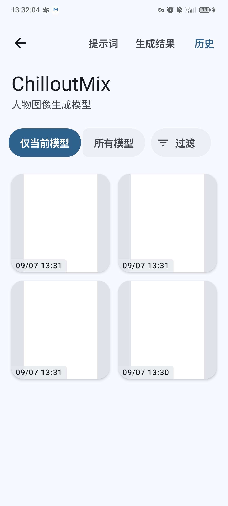
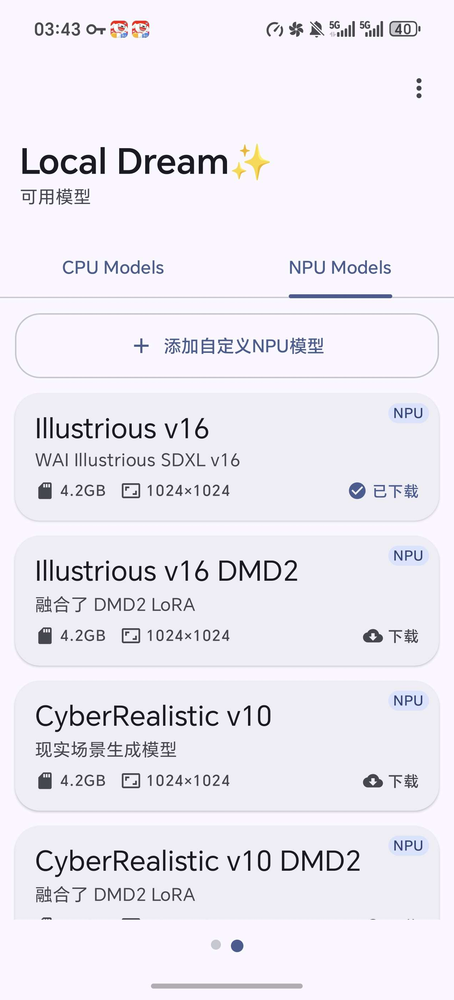
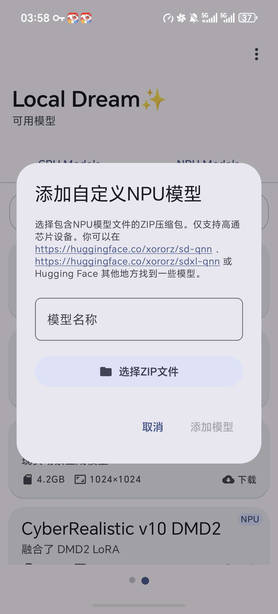
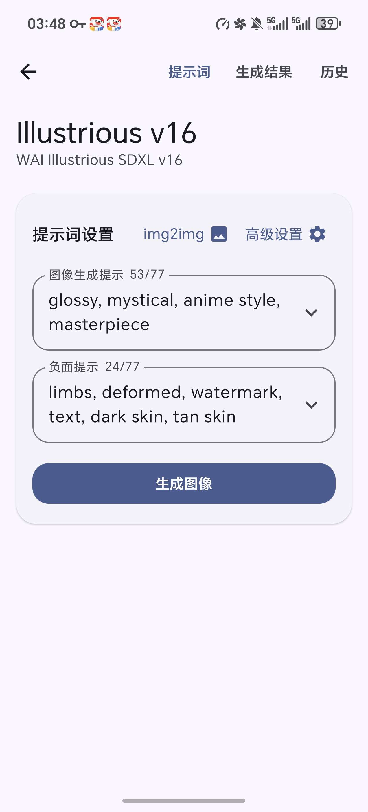
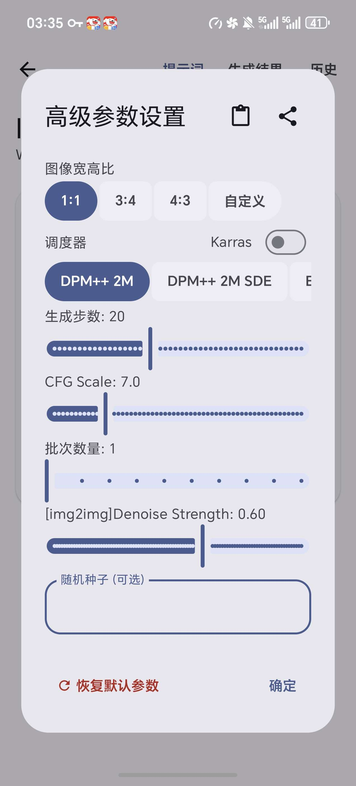
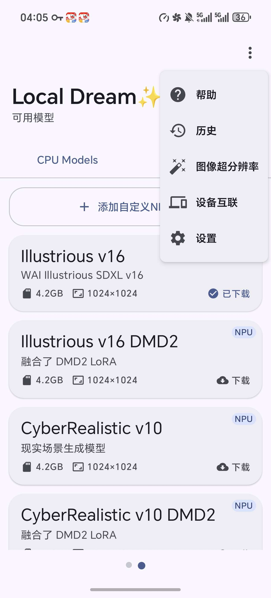

# 发现的一个非常简单的生图工具，只需要一部手机

来源: Discord 魅魔藏经阁 thread 1538279171246006404

创建: 2026-08-15T20:12:14.270000+00:00
消息数: 35

---

**林枫** (2026-09-20 00:03:27):
<@1484150569227653160> 大佬推荐哪个模型？

**SIMing** (2026-09-15 00:50:25):
有大佬能发一下效果图啥样嘛🤓

**（猫娘萝莉妈妈)抱玖酒(捡小猫)** (2026-09-09 17:05:53):
我没遇到过这种情况，你换个模型试试看

**KING OF NAIWA👑** (2026-09-07 05:32:51):
大佬  为什么我按照你的设置生成的图都是白的  8gen3<:1000168510:1298906820638674984>

**（猫娘萝莉妈妈)抱玖酒(捡小猫)** (2026-09-06 16:00:00):
一个个慢慢试呗，我总不可能全部试一遍，把总结发给你们吧

**（猫娘萝莉妈妈)抱玖酒(捡小猫)** (2026-09-06 15:59:07):
这不是常识吗

**omimen** (2026-09-04 04:39:53):
下载到了，但我也不知道这些模型该用哪些比较好

**omimen** (2026-09-04 02:30:19):
要翻VPN，搞半天一个都下不了

**星痕** (2026-08-27 09:01:43):
好吧

**（猫娘萝莉妈妈)抱玖酒(捡小猫)** (2026-08-27 07:19:18):
如果没有上限，手机要爆炸了

**（猫娘萝莉妈妈)抱玖酒(捡小猫)** (2026-08-27 07:17:24):
不可以77提示词上限

**星痕** (2026-08-25 08:58:26):
这个只有77的提示词空间吗，可以手动调吗<:emoji_140:1379454014852436038>

**（猫娘萝莉妈妈)抱玖酒(捡小猫)** (2026-08-24 07:45:41):
<:emoji_140:1379454014852436038>

**艾斯卡诺ദ്ദി˶•̀֊•́)✧** (2026-08-24 06:31:34):
哦哦，我试试

**（猫娘萝莉妈妈)抱玖酒(捡小猫)** (2026-08-24 06:29:15):
https://huggingface.co/xororz/sdxl-qnn/tree/main，如果对里面的模型都不满意的话，可以来这里找找其他模型

**（猫娘萝莉妈妈)抱玖酒(捡小猫)** (2026-08-24 06:28:00):
如果是骁龙芯片，就用npu模型（精度会更高一点）
如果是天机芯片的话就用cpu模型（功能会更全一点）
因为作者只对骁龙芯片进行了适配与优化，所以用npu模型会好一点

**艾斯卡诺ദ്ദി˶•̀֊•́)✧** (2026-08-23 20:00:40):
这个cpu和npu模型有啥区别呢？

**（猫娘萝莉妈妈)抱玖酒(捡小猫)** (2026-08-23 08:11:12):
<:emoji_140:1379454014852436038> <:emoji_140:1379454014852436038>

**（猫娘萝莉妈妈)抱玖酒(捡小猫)** (2026-08-23 08:11:10):
嘻嘻`(*∩_∩*)′所以说是好东西，就赶快拿来和大家分享一下

**星痕** (2026-08-23 06:21:55):
<:emoji_299:1538892045945671680>

**tansen(努力成为写卡大手子😡)** (2026-08-22 17:48:48):
插眼插眼<:emoji_249:1416980114511761448>

**查内姆** (2026-08-21 16:15:30):
强大

**查内姆** (2026-08-21 16:15:26):
<:emoji_140:1379454014852436038>

**鹿初** (2026-08-20 12:17:19):
我嘞个豆，现在有直接能部署在手机上的光辉了吗

**鹿初** (2026-08-20 12:16:52):
<:emoji_146:1379454137158209736>

**（猫娘萝莉妈妈)抱玖酒(捡小猫)** (2026-08-16 15:06:51):
<:emoji_140:1379454014852436038> <:emoji_140:1379454014852436038>

**谢特** (2026-08-16 11:11:08):
谢谢佬指点<:emoji_140:1379454014852436038>

**（猫娘萝莉妈妈)抱玖酒(捡小猫)** (2026-08-16 10:30:54):
是这样的喵～提示词可以去看一下之前有大佬发的魅魔岛生图攻略
或者你也可以让一些AI给你生成正反提示词，如果一生成就缩回去 ，可以试着断网

**谢特** (2026-08-16 10:09:55):
佬不分享只能苦哈哈去p站找图

**谢特** (2026-08-16 10:09:44):
也有像我这样硬件不行跑不了被迫用手机的

**（猫娘萝莉妈妈)抱玖酒(捡小猫)** (2026-08-16 09:10:03):
只是觉得这个工具有用就分享一样，毕竟有些人只有手机

**谢特** (2026-08-16 04:15:32):
<:emoji_140:1379454014852436038>

**谢特** (2026-08-16 04:15:28):
大佬好强！

**（猫娘萝莉妈妈)抱玖酒(捡小猫)** (2026-08-15 20:16:45):
下完以后，进来选择一个适合自己的模型

然后点击模型进入生图界面，就是很简单的正反向提示词生图，其他大佬的帖子有教过不过多赘述

在高级生图设置，是图片的详细参数（嫌麻烦就默认）

图像宽高比：决定出图是方、竖长还是横长。选“自定义”可手动输入像素值（如 512x768）。
调度器 (Sampler)：AI 降噪的采样算法。DPM++ 2M 速度较快且质量不错；DPM++ 2M SDE 细节更丰富但稍慢；Karras 侧重画面干净度。新手建议保持 DPM++ 2M。
生成步数 (20)：AI 迭代优化的次数。步数越多细节越精细，但超过 30 步收益递减。20 步是效率与质量平衡的常用值。
CFG Scale (7.0)：提示词相关性。数值越高，画面越贴合你的文字描述，但过高（>10）会导致色彩过饱和、画面僵硬。7.0 是黄金基准值。
批次数量 (1)：一次生成几张图。设为 2 或 4 能让你“抽卡”选最优，但显存占用和耗时成倍增加。
Denoise Strength (0.60)：图生图专属。只有上传了参考图时才有用。值越大，最终结果离原图越远（改变越大）；0.6 属于“保留构图但大改风格”的中等强度。纯文生图时此项无效。
随机种子：出图的随机数钥匙。留空则每次随机；填入固定数字（如 12345），配合其他参数可复现出完全一样的图

如果觉得图片不够精细，可以回到第一个界面，使用三个小点，那里的图片超分辨率

**（猫娘萝莉妈妈)抱玖酒(捡小猫)** (2026-08-15 20:12:14):
是不是有很多朋友写卡的时候会出现这样的一个问题，找不到合适的图片，或者找图片要找半天
想要自己跑，
要不就是没电脑，
要不是电脑性能不够
要不就是电脑工作流程比较麻烦，看不懂
mmd虽然有生图ai，
但是生图这种东西是不可能一下就生成满意的，多次试错下，肯定要浪费不少电量，并且有些新人作者的电量可能囊中羞涩

这个工具也是属于本地部署的，不用联网，想跑什么自己搞，随便色色，并且还可以慢慢试，跑到满意为止

这个工具是b站博主
爱吃蛋黄派的三只松鼠的一个开源项目
https://github.com/xororz/local-dream
要求
在8gen3及之后的芯片上运行SDXL
在888及之后的芯片上运行SD1.5

[GitHub - xororz/local-dream: Run Stable Diffusion on Android Device...](https://github.com/xororz/local-dream)
Run Stable Diffusion on Android Devices with Snapdragon NPU acceleration. Also supports CPU/GPU inference. - xororz/local-dream

