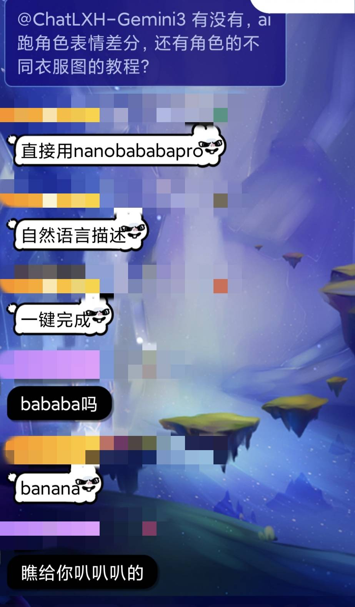
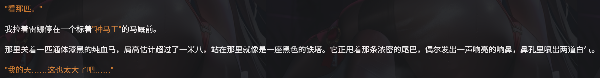

# 可以增加ai记忆，并准确更新数值的新技术代码——利用浏览器本地的IndexedDB数据库存储数据，而且利用/api/message2/edit接口实现存储内容同步

来源: Discord 魅魔藏经阁 thread 1444358162449698907
创建: 2025-11-29T16:03:40.805000+00:00
消息数: 294

---

**iNeedCat** (2025-12-20 15:10:49):
可以，肘茶壶肘不出来的自动运行程序来了，不用做额外触发的按钮了

**赛博第一坏坏芳心纵火犯** (2025-12-11 14:26:08):
https://tenor.com/view/gorilla-tongue-sticking-out-tongue-out-bleh-gif-13114995

**赛博第一坏坏芳心纵火犯** (2025-12-11 14:26:04):
我宣布，这里是男娘专用文爱区！

**安心院同學** (2025-12-11 11:18:05):
思路牛逼

**XXX** (2025-12-11 10:29:56):
<:emoji_150:1400299501423431771>

**乖宝宝小水母（水母宗唯一宗主。大周荣誉国祖)** (2025-12-11 10:27:35):
有xxx在真是太好了 (

**乖宝宝小水母（水母宗唯一宗主。大周荣誉国祖)** (2025-12-11 10:26:29):
<:emoji_149:1400309607783727266>

**乖宝宝小水母（水母宗唯一宗主。大周荣誉国祖)** (2025-12-11 10:26:10):
因為高維度的交談
水母插不了話

**XXX** (2025-12-11 10:25:47):
<:emoji_250:1440756778487775303>

**XXX** (2025-12-11 10:25:41):
还能关我的事情（

**乖宝宝小水母（水母宗唯一宗主。大周荣誉国祖)** (2025-12-11 10:24:50):
<:emoji_150:1400299501423431771>

**乖宝宝小水母（水母宗唯一宗主。大周荣誉国祖)** (2025-12-11 10:24:38):
xxx要向人家看齊知道嗎

**echo** (2025-12-11 10:23:58):
行

**乖宝宝小水母（水母宗唯一宗主。大周荣誉国祖)** (2025-12-11 10:23:45):
<:emoji_250:1440756778487775303>

**乖宝宝小水母（水母宗唯一宗主。大周荣誉国祖)** (2025-12-11 10:23:38):
好努力呀

**XXX** (2025-12-11 10:23:14):
<:emoji_250:1440756778487775303>

**尹璃迪（还是埃及猫娘可爱desuwa！）** (2025-12-11 10:23:00):
所以我正在做啦……搭建工作流什么的<:emoji_250:1440756778487775303>

**echo** (2025-12-11 10:22:16):
<:07:1298281204260278383>

**echo** (2025-12-11 10:22:12):
最终结论就是这样

**echo** (2025-12-11 10:22:10):


**乖宝宝小水母（水母宗唯一宗主。大周荣誉国祖)** (2025-12-11 10:21:04):
<:1000168531:1298906724979310634>

**乖宝宝小水母（水母宗唯一宗主。大周荣誉国祖)** (2025-12-11 10:21:01):
聰明的群友出現了!

**XXX** (2025-12-11 10:20:40):
<:emoji_248:1447214733718720663>

**尹璃迪（还是埃及猫娘可爱desuwa！）** (2025-12-11 10:20:15):
嗯，我去试试看吧，我还没试过呢

**尹璃迪（还是埃及猫娘可爱desuwa！）** (2025-12-11 10:19:52):
肯定是sd模型啊，标准的跑图用的，banana一致性比较强

**echo** (2025-12-11 10:19:36):
幸好群友比ai聪明可以追问

**echo** (2025-12-11 10:19:23):
你用的是啥

**尹璃迪（还是埃及猫娘可爱desuwa！）** (2025-12-11 10:18:58):
banana我还没试过……因为感觉画风会变

**echo** (2025-12-11 10:17:21):
被秒打发回来了

**echo** (2025-12-11 10:17:15):


**尹璃迪（还是埃及猫娘可爱desuwa！）** (2025-12-11 10:13:16):
谢谢喵！！！

**echo** (2025-12-11 10:12:07):
我可以帮你问问

**尹璃迪（还是埃及猫娘可爱desuwa！）** (2025-12-11 10:11:50):
那太好了，每次角色跑出来不一样很麻烦……

**echo** (2025-12-11 10:11:25):
真的

**尹璃迪（还是埃及猫娘可爱desuwa！）** (2025-12-11 10:11:07):
哎呀？真的？

**echo** (2025-12-11 10:10:47):
我朋友就爱跑这个做小旮旯给木

**echo** (2025-12-11 10:10:25):
这个有焚决和特化

**尹璃迪（还是埃及猫娘可爱desuwa！）** (2025-12-11 10:09:34):
要跑角色表情分差，还有角色的不同衣服……<:emoji_250:1440756778487775303>

**echo** (2025-12-11 10:07:27):
<:1000168531:1298906724979310634>

**echo** (2025-12-11 10:07:22):
cg也有了说是

**echo** (2025-12-11 10:07:18):
哦对

**尹璃迪（还是埃及猫娘可爱desuwa！）** (2025-12-11 10:06:50):
跑图嘛，花点时间而已……<:emoji_215:1411353218025521223>

**echo** (2025-12-11 10:06:08):
无非是缺点cg

**尹璃迪（还是埃及猫娘可爱desuwa！）** (2025-12-11 10:06:07):
<:emoji_250:1440756778487775303>

**echo** (2025-12-11 10:05:53):
不如拿游戏引擎接入api自己做一个发steam上得了

**echo** (2025-12-11 10:05:30):
我觉得这种已经算是个相对完整的旮旯给木了

**echo** (2025-12-11 10:04:54):
<:1000168531:1298906724979310634>

**尹璃迪（还是埃及猫娘可爱desuwa！）** (2025-12-11 10:02:59):
ai不会忘，数值也不会乱

**尹璃迪（还是埃及猫娘可爱desuwa！）** (2025-12-11 10:02:24):
我想要做一个galgame式的边侧栏，金钱，好感度，什么的都会随剧情更新变化，也可以也一直让ai读得到，而且还不占太多token（旧的数值删掉了），这个式我主要的想法

**尹璃迪（还是埃及猫娘可爱desuwa！）** (2025-12-11 10:01:08):
如果没比较可以不加的

**echo** (2025-12-11 10:00:36):
这种事情不要啊

**echo** (2025-12-11 10:00:32):
那我岂不是要确实的设计数值系统了

**echo** (2025-12-11 10:00:16):
感觉工作量好像增加了<:1000168535:1298906747783876673> 但是又好像没有

**尹璃迪（还是埃及猫娘可爱desuwa！）** (2025-12-11 09:56:32):
ai就会根据末尾这个通过展开剧情

**尹璃迪（还是埃及猫娘可爱desuwa！）** (2025-12-11 09:56:15):
那么久通过了

**尹璃迪（还是埃及猫娘可爱desuwa！）** (2025-12-11 09:56:09):
完成就给本次对话追加——通过

**尹璃迪（还是埃及猫娘可爱desuwa！）** (2025-12-11 09:55:30):
只要把战斗啊，技能啊什么的放在对话末尾

**尹璃迪（还是埃及猫娘可爱desuwa！）** (2025-12-11 09:55:08):
本来就是打算用在游戏化上的

**echo** (2025-12-11 09:52:32):
也就是说，技能检定变得有可能了？

**乖宝宝小水母（水母宗唯一宗主。大周荣誉国祖)** (2025-12-11 09:15:54):
大口吸！）

**乖宝宝小水母（水母宗唯一宗主。大周荣誉国祖)** (2025-12-11 09:15:10):
<:1000168531:1298906724979310634>

**尹璃迪（还是埃及猫娘可爱desuwa！）** (2025-12-11 09:05:15):
比如你加了一个qte（？）在末尾，赢了就输出”通过“，输了就”失败“，就可以完全影响接下来的情节，不会污染对话

**尹璃迪（还是埃及猫娘可爱desuwa！）** (2025-12-11 09:04:10):
这个可以用于数值更新，或者什么小游戏模式，真的，我说实话，这个绝对是很拥有的技术了

**尹璃迪（还是埃及猫娘可爱desuwa！）** (2025-12-11 09:00:44):
当中不同标签有不同识别的效果，比如一些数值会持续添加最下方，一些数值通过玩家点击添加到最下方，还有就是不会被自动清除，总之很全面了

**尹璃迪（还是埃及猫娘可爱desuwa！）** (2025-12-11 08:58:58):
这个版本绝对是我目前修正后效果最好的，首先你可以自定义数值，同时数值注入方法不一样。之前的模式类似“出来一个抓一个”，现在就是“出来了，一个对应一个”

效果是，回溯后数值也可以顺快回溯，自动注入新数值到最低端的同时可以删除上方的旧数值，保证ai读取的数值都是最下方的，不会乱读取，而且也减少token占用

之前的一些功能你可以让ai给你添加，总之这个是我目前弄出来最好的模式了


**阿海** (2025-12-02 12:05:06):
期待大佬创新！

**尹璃迪（还是埃及猫娘可爱desuwa！）** (2025-12-02 12:02:01):
可以的，后续我还想做一个可以让作者自己调整数值增加机制什么的

**阿海** (2025-12-02 12:01:11):
不不不，就是单纯的数学加减乘除的数值问题。 每次一个好好的设定，执行的完美~但是一加了数值，直接稀碎😭

**尹璃迪（还是埃及猫娘可爱desuwa！）** (2025-12-02 12:00:20):
绝望是故事方面的吧？彻底拯救不太可能

**阿海** (2025-12-02 11:59:18):
但是，关于AI算数值这问题，能彻底拯救绝望？

**尹璃迪（还是埃及猫娘可爱desuwa！）** (2025-12-02 09:33:36):
应该不止galgame吧？比如阳岚的那个投骰子的卡？计算赢了就是赢了啥的<:emoji_139:1379453980375257159>

**鼓¯꒳¯** (2025-12-02 09:32:48):
<:emoji_135:1380973007304003684>

**鼓¯꒳¯** (2025-12-02 09:32:39):
经典内置小游戏

**鼓¯꒳¯** (2025-12-02 09:32:32):
玩到真的旮旯给木了

**尹璃迪（还是埃及猫娘可爱desuwa！）** (2025-12-02 09:32:23):
<:emoji_139:1379453980375257159>

**鼓¯꒳¯** (2025-12-02 09:32:12):
还有这种play的

**鼓¯꒳¯** (2025-12-02 09:32:11):
<:emoji_216:1411353274648363008>

**尹璃迪（还是埃及猫娘可爱desuwa！）** (2025-12-02 09:30:00):
其实最近突然有个小想法，大家都想内置战斗系统，但是css什么的修改内容，ai时看不到的，如果利用这个原理，做一个小游戏，完成就可以发送“游戏完成”的消息，这样的话相当于玩家完成一个小游戏，就真的可以对ai接下来内容造成影响

**尹璃迪（还是埃及猫娘可爱desuwa！）** (2025-12-02 09:27:47):
我也喜欢你

**鼓¯꒳¯** (2025-12-02 09:09:30):
我喜欢你

**乖宝宝小水母（水母宗唯一宗主。大周荣誉国祖)** (2025-12-01 10:58:32):
(終於搞懂了。。。)

**乖宝宝小水母（水母宗唯一宗主。大周荣誉国祖)** (2025-12-01 10:58:00):
<:emoji_139:1379455053080825866>

**乖宝宝小水母（水母宗唯一宗主。大周荣誉国祖)** (2025-12-01 10:57:39):
等等...AI回復的末尾...

**乖宝宝小水母（水母宗唯一宗主。大周荣誉国祖)** (2025-12-01 10:55:54):
若是用戶輸入了2000字的世界觀內容要怎摸辦呢
水母在想是不是用不了這個

**XXX** (2025-12-01 10:39:03):
<:emoji_250:1440756778487775303>

**尹璃迪（还是埃及猫娘可爱desuwa！）** (2025-12-01 10:38:51):
我还添加了选择规则，玩家可以按自己想法增删修改记录的文本内容，可以确保记忆稳定一些

**尹璃迪（还是埃及猫娘可爱desuwa！）** (2025-12-01 10:37:29):
没错没错！文本记录是这个样的！当然也可以有很多用法，毕竟还有算数值的功能，只要增加好规则，本质上可以当做游戏来开发了<:emoji_147:1382565790129328128> 

真不愧是姓飞电的，人工智能这块拿捏了<:emoji_144:1379454111174496307>

**飞电⚡** (2025-12-01 10:16:09):
这个记忆的原理是不是让ai每次回复时进行一次该次回复的小总结，然后记录这个小总结到本地，在需要总结的时候一键添加到ai最后一次回复的末尾，这样就可以省了一次常规总结指令。

效果类似于手动复制之前的回复的小总结，再复制粘贴到最后一次聊天。

大概是这样的吗?

**乖宝宝小水母（水母宗唯一宗主。大周荣誉国祖)** (2025-12-01 07:36:19):
同步都不給按

**乖宝宝小水母（水母宗唯一宗主。大周荣誉国祖)** (2025-12-01 07:36:03):
<:emoji_250:1440756778487775303>

**乖宝宝小水母（水母宗唯一宗主。大周荣誉国祖)** (2025-12-01 07:35:57):
這東西AI改一改很容易就爆代碼了
到現在都不敢肘，有一次代碼直接把網站卡死，真的嚇到我了

**XXX** (2025-12-01 07:35:41):
```*************```

**XXX** (2025-12-01 07:35:20):
傻*ai怎么又是错的

**XXX** (2025-12-01 07:35:03):
我只会ai大人救救我

**XXX** (2025-12-01 07:34:40):
（虽然我自己也没有深造

**XXX** (2025-12-01 07:34:11):
最简单的就是去深造一波前端

**XXX** (2025-12-01 07:33:57):
<:emoji_150:1400299501423431771>

**尹璃迪（还是埃及猫娘可爱desuwa！）** (2025-12-01 07:33:56):
不过这个的的确确可能还需再优化后才可以广泛使用呀……

**尹璃迪（还是埃及猫娘可爱desuwa！）** (2025-12-01 07:33:17):
让ai对代码进行理解，依照原格式，修改为你需要的数值类型，试着多肘肘吧，ds比较好

**尹璃迪（还是埃及猫娘可爱desuwa！）** (2025-12-01 07:32:20):
之前的错误包括不限于疯狂请求修改，或者只修改特定的框啥的

**季波达** (2025-12-01 07:32:10):
<@1409172279891591209> 呃...请问怎么跟ai说？能简单举个例子吗？确实不会😂 
名字只是以前傻子短剧看多了👀

**尹璃迪（还是埃及猫娘可爱desuwa！）** (2025-12-01 07:31:27):
<:emoji_144:1379454084750245939>

**尹璃迪（还是埃及猫娘可爱desuwa！）** (2025-12-01 07:31:24):
还有不得不说的是……目前技术存在局限，可能会出现很多错误，我接下来会进一步改进，目前的这个是相对来说比较完善而已

**尹璃迪（还是埃及猫娘可爱desuwa！）** (2025-12-01 07:29:26):
<:emoji_150:1400299501423431771>

**尹璃迪（还是埃及猫娘可爱desuwa！）** (2025-12-01 07:29:22):
还有你的名字很有特色

**尹璃迪（还是埃及猫娘可爱desuwa！）** (2025-12-01 07:29:07):
嗯……前面那一大串只是一个简单的“展示框”，后面让你具体改的地方就是针对文本和数据的处理。
如果你自己改肯定很麻烦，试着交给ai理解一下，然后让AI根据你的想法改

**XXX** (2025-12-01 07:28:46):
https://cdn.discordapp.com/attachments/1372224304518791301/1434798381146050620/E0DDC66F683A65EED4C9E659D7FDBC16.gif

**季波达** (2025-12-01 07:26:49):
<@1409172279891591209> 抱歉大佬，我可能就是那个白痴😂，请问这个要改的部分具体怎么改啊？不会啊！😭

**羊驼** (2025-11-30 14:59:08):
<:emoji_150:1400299501423431771>

**neyin** (2025-11-30 14:32:14):
囊孩吗<:emoji_150:1400299501423431771>

**洛绫** (2025-11-30 08:55:38):
<:emoji_140:1379454014852436038> 看不懂 但是感觉大佬太强了

**小魅** (2025-11-30 05:09:24):
太强大啦！宝宝！你是我见过最有魅力的囊孩！期待技术被广泛应用的那天捏<:emoji_250:1442568548986650808>

**祈月** (2025-11-30 05:08:30):
<:emoji_142:1383709378925826159>

**MEE6** (2025-11-30 05:07:29):
<:CHECK6:403540120181145611> 100,000 XP has been given to **<@!1409172279891591209>**

**赛博第一坏坏芳心纵火犯** (2025-11-30 02:07:28):
巡逻！
看看有没有魔丸鼓鼓囊囊还不打出来的！

**赛博第一坏坏芳心纵火犯** (2025-11-30 02:07:05):
https://tenor.com/view/gorilla-walk-gif-19448723

**赛博第一坏坏芳心纵火犯** (2025-11-30 02:06:57):
猩猩入侵！

**羊驼** (2025-11-29 20:28:59):
<:emoji_149:1382434166666432674>

**我修院 （假小子赛高！总有一天大家都会厨蟑螂娘的！）** (2025-11-29 17:40:47):


**尹璃迪（还是埃及猫娘可爱desuwa！）** (2025-11-29 17:34:52):
这个还是别问我了吧……我对世界书了解不多

**羊驼** (2025-11-29 17:34:38):
<:emoji_140:1379454014852436038>

**羊驼** (2025-11-29 17:34:31):
尹尹也是大佬了呢

**阳玉** (2025-11-29 17:34:30):
<:1000168531:1298906724979310634>

**尹璃迪（还是埃及猫娘可爱desuwa！）** (2025-11-29 17:34:30):
<:emoji_140:1379454014852436038>

**阳玉** (2025-11-29 17:34:28):
尹迪，我问你，以user为位置的世界书可以立即读取吗？

**羊驼** (2025-11-29 17:34:15):
过来看看

**尹璃迪（还是埃及猫娘可爱desuwa！）** (2025-11-29 17:33:29):
嘛，对于绝大部分卡，属于鸡肋，食之无味弃之可惜，当然，对于某些大世界？或者某些特殊的卡就可以有用

**阳玉** (2025-11-29 17:33:02):
我既然要做个比崩铁还要大的题材，这肯定不够的

**阳玉** (2025-11-29 17:32:32):
<:1000168531:1298906724979310634>

**阳玉** (2025-11-29 17:32:31):
目前我的思路里暂时也想不到这对我的用途呢…………

**尹璃迪（还是埃及猫娘可爱desuwa！）** (2025-11-29 17:31:44):
我的想法是尽可能不让玩家感觉到麻烦

**尹璃迪（还是埃及猫娘可爱desuwa！）** (2025-11-29 17:31:17):
虽然能用，只是麻烦点，每次点击读取，然后就点击刷新什么的

**尹璃迪（还是埃及猫娘可爱desuwa！）** (2025-11-29 17:30:39):
在我之后进一步完善了，这个就是分享出来的

**阳玉** (2025-11-29 17:30:32):
<:emoji_150:1400299501423431771>

**阳玉** (2025-11-29 17:30:30):
那很不好了

**尹璃迪（还是埃及猫娘可爱desuwa！）** (2025-11-29 17:30:09):
这些是代码硬性的，因为onerror代码一刷新就会重新注入，这个非常讨厌，因为数值这些可能重新读取

**尹璃迪（还是埃及猫娘可爱desuwa！）** (2025-11-29 17:29:16):
<:emoji_144:1379454084750245939>

**尹璃迪（还是埃及猫娘可爱desuwa！）** (2025-11-29 17:29:12):
不是必须的，目前版本还有很多不好用的地方

**阳玉** (2025-11-29 17:28:57):
🤔

**阳玉** (2025-11-29 17:28:52):
（沉思该如何使用到自己的卡中

**尹璃迪（还是埃及猫娘可爱desuwa！）** (2025-11-29 17:28:23):
拜拜～

**赛博第一坏坏芳心纵火犯** (2025-11-29 17:28:12):
（心满意足的撸管去了

**尹璃迪（还是埃及猫娘可爱desuwa！）** (2025-11-29 17:27:05):
<:emoji_140:1379625753741623416>

**尹璃迪（还是埃及猫娘可爱desuwa！）** (2025-11-29 17:26:59):
不是有人想写模拟经营嘛？

**尹璃迪（还是埃及猫娘可爱desuwa！）** (2025-11-29 17:26:44):
淫乱值啊，体液？这样瑟瑟的以外，体力，等级，都是可以添加的

**赛博第一坏坏芳心纵火犯** (2025-11-29 17:26:37):
已经在想象小迪在讲台上夹着玩具给群友们上课的场景了

**尹璃迪（还是埃及猫娘可爱desuwa！）** (2025-11-29 17:25:59):
不是必须的，这个还有很多不完善，但是我觉得算提供了一个思路

**阳玉** (2025-11-29 17:25:56):
🤔

**阳玉** (2025-11-29 17:25:52):
具体的数值可以是哪些呢？

**祈月** (2025-11-29 17:25:35):
<a:emoji_7:949281211300323338>

**祈月** (2025-11-29 17:25:31):
<:emoji_250:1440756778487775303>

**祈月** (2025-11-29 17:25:27):
大佬很用心的讲解，但我还是不懂

**尹璃迪（还是埃及猫娘可爱desuwa！）** (2025-11-29 17:25:16):
嘛～第一次发比较重大突破，我要好好对待

**赛博第一坏坏芳心纵火犯** (2025-11-29 17:25:05):
过一天是一天，会找到自己人生的目标的

**赛博第一坏坏芳心纵火犯** (2025-11-29 17:24:45):
人啊，就是不能想太多

**赛博第一坏坏芳心纵火犯** (2025-11-29 17:24:33):
你看，现在又多了个人知道，多有意义

**祈月** (2025-11-29 17:22:50):
<:emoji_250:1440756778487775303>

**祈月** (2025-11-29 17:22:46):
我之前说过的

**乖宝宝小水母（水母宗唯一宗主。大周荣誉国祖)** (2025-11-29 17:21:22):
<:emoji_139:1379455053080825866>

**阳玉** (2025-11-29 17:21:22):
<:1000168531:1298906724979310634>

**赛博第一坏坏芳心纵火犯** (2025-11-29 17:21:16):
一本正经教学的小迪让人有些不习惯呢

**祈月** (2025-11-29 17:20:59):
<:emoji_250:1440756778487775303>

**尹璃迪（还是埃及猫娘可爱desuwa！）** (2025-11-29 17:20:48):
那没有，我提供按钮点击，它负责记，如果你要ai记的时候点一下同步，就同步到正文后面啦

**赛博第一坏坏芳心纵火犯** (2025-11-29 17:19:33):
去 https://discord.com/channels/1205870897769095229/1433905884240547870 吧，会有你想要的答案

**阳玉** (2025-11-29 17:18:58):
<:emoji_150:1400299501423431771>

**阳玉** (2025-11-29 17:18:56):
那就去看篇

**赛博第一坏坏芳心纵火犯** (2025-11-29 17:18:43):
人活一世，饮食男女

**祈月** (2025-11-29 17:18:40):
<:emoji_250:1440756778487775303>

**祈月** (2025-11-29 17:18:35):
我感觉我活着毫无意义

**赛博第一坏坏芳心纵火犯** (2025-11-29 17:18:16):
有的，现在我们都知道你23岁了<:1000168532:1298906722546614313>

**阳玉** (2025-11-29 17:18:09):
你活着的每一天便是你人生的意义所在

**乖宝宝小水母（水母宗唯一宗主。大周荣誉国祖)** (2025-11-29 17:18:01):
這是一個以token的重複消耗來換取 AI對劇情記憶的穩定性的東西對吧

**祈月** (2025-11-29 17:17:58):
啥也不是

**祈月** (2025-11-29 17:17:45):
<:emoji_250:1440756778487775303>

**阳玉** (2025-11-29 17:17:41):
新科技能记录什么类型的设定呢？

**祈月** (2025-11-29 17:17:39):
我这23年的人生，到底有什么意义

**尹璃迪（还是埃及猫娘可爱desuwa！）** (2025-11-29 17:17:03):
<:emoji_140:1379625753741623416>

**我修院 （假小子赛高！总有一天大家都会厨蟑螂娘的！）** (2025-11-29 17:16:52):
小迪小迪齁一个

**楚冥** (2025-11-29 17:16:01):
🥰

**楚冥** (2025-11-29 17:15:57):
小迪其实已经被灌满了

**尹璃迪（还是埃及猫娘可爱desuwa！）** (2025-11-29 17:15:06):
<:emoji_215:1411353218025521223>

**赛博第一坏坏芳心纵火犯** (2025-11-29 17:13:48):
好热闹啊，想看小迪在闺房里同时回复多人应接不暇弄得到处都是的狼狈模样

**楚冥** (2025-11-29 17:13:12):
不过比现在这种总结按钮方便，某种程度上来说挺省电的

**楚冥** (2025-11-29 17:12:59):
确实呢

**尹璃迪（还是埃及猫娘可爱desuwa！）** (2025-11-29 17:12:43):
ai的上限我们没办法嘛~

**赛博第一坏坏芳心纵火犯** (2025-11-29 17:12:42):
裸睡小迪的闺房<:1000168532:1298906722546614313>

**尹璃迪（还是埃及猫娘可爱desuwa！）** (2025-11-29 17:12:30):
<:emoji_250:1428345780716179476>

**我修院 （假小子赛高！总有一天大家都会厨蟑螂娘的！）** (2025-11-29 17:12:16):
不对
是你的闺房

**赛博第一坏坏芳心纵火犯** (2025-11-29 17:11:55):
很快这里就会变成文爱二区了

**楚冥** (2025-11-29 17:11:37):
比如超过几千字就会节选来读取

**楚冥** (2025-11-29 17:11:28):
会不会有读取上限呢说起来

**楚冥** (2025-11-29 17:11:21):
唔

**尹璃迪（还是埃及猫娘可爱desuwa！）** (2025-11-29 17:11:07):
哪怕你用来记住玩家有什么物品都可以

**赛博第一坏坏芳心纵火犯** (2025-11-29 17:10:57):

**阳玉** (2025-11-29 17:10:57):
<:emoji_150:1400299501423431771>

**阳玉** (2025-11-29 17:10:54):
上古神使传授至学之地

**尹璃迪（还是埃及猫娘可爱desuwa！）** (2025-11-29 17:10:51):
可以那么用~~我设定了文字模式和数据模式

**乖宝宝小水母（水母宗唯一宗主。大周荣誉国祖)** (2025-11-29 17:10:27):
所以AI的回覆裡還需要一個類似當前劇情摘要的東西?

**尹璃迪（还是埃及猫娘可爱desuwa！）** (2025-11-29 17:10:24):
这是我的教程吧<:emoji_250:1428345780716179476>

**赛博第一坏坏芳心纵火犯** (2025-11-29 17:10:18):
不用在外面和群友野战

**赛博第一坏坏芳心纵火犯** (2025-11-29 17:10:11):
小迪终于有自己的小屋了

**我修院 （假小子赛高！总有一天大家都会厨蟑螂娘的！）** (2025-11-29 17:10:08):
这是什么地方

**我修院 （假小子赛高！总有一天大家都会厨蟑螂娘的！）** (2025-11-29 17:09:51):
来了

**楚冥** (2025-11-29 17:09:40):
我看不得这个

**楚冥** (2025-11-29 17:09:36):
天呐，黄底黑字

**尹璃迪（还是埃及猫娘可爱desuwa！）** (2025-11-29 17:09:33):
嗯……绝大部分浏览器内有一个特殊的数据库，我们利用这个数据库放点东西，就当作我们的数据库，或者“存档”

**赛博第一坏坏芳心纵火犯** (2025-11-29 17:09:31):
<@1364166575514714143> 来这里

**罪恶滔天叶愚行（Tony）🚁** (2025-11-29 17:09:30):
你不许来

**罪恶滔天叶愚行（Tony）🚁** (2025-11-29 17:09:27):
在鹿我呢

**赛博第一坏坏芳心纵火犯** (2025-11-29 17:09:14):
我要小尹手把手撸我

**阳玉** (2025-11-29 17:09:12):
太好了是黄土

**罪恶滔天叶愚行（Tony）🚁** (2025-11-29 17:09:06):
学费交我这里就好

**XXX** (2025-11-29 17:09:05):
我的眼睛

**XXX** (2025-11-29 17:09:04):
太黄了

**赛博第一坏坏芳心纵火犯** (2025-11-29 17:08:57):


**罪恶滔天叶愚行（Tony）🚁** (2025-11-29 17:08:56):
一对一授课

**罪恶滔天叶愚行（Tony）🚁** (2025-11-29 17:08:51):
让小尹手把手教你

**尹璃迪（还是埃及猫娘可爱desuwa！）** (2025-11-29 17:08:39):
<:emoji_215:1411353218025521223>

**罪恶滔天叶愚行（Tony）🚁** (2025-11-29 17:08:34):
现在就鹿

**祈月** (2025-11-29 17:08:34):
<@1409172279891591209> 呜呜，还是没太懂

**赛博第一坏坏芳心纵火犯** (2025-11-29 17:08:21):
那我可以带人来撸管吗？

**罪恶滔天叶愚行（Tony）🚁** (2025-11-29 17:08:19):
可以发小尹的黄土

**阳玉** (2025-11-29 17:08:14):
可以


**阳玉** (2025-11-29 17:08:13):
<:07:1298281204260278383>

**尹璃迪（还是埃及猫娘可爱desuwa！）** (2025-11-29 17:08:08):
不要吧

**尹璃迪（还是埃及猫娘可爱desuwa！）** (2025-11-29 17:08:05):
<:emoji_250:1428345780716179476>

**赛博第一坏坏芳心纵火犯** (2025-11-29 17:07:54):
这里可以发黄图吗？

**赛博第一坏坏芳心纵火犯** (2025-11-29 17:07:43):
出来了<:1000168534:1298906727495766057>

**XXX** (2025-11-29 17:07:36):
不是ai记忆变多了

**尹璃迪（还是埃及猫娘可爱desuwa！）** (2025-11-29 17:07:36):
ai读取的部分有限呀，它只能读那么多

**XXX** (2025-11-29 17:07:30):
ai的记忆力还是那么多

**阳玉** (2025-11-29 17:07:20):
假设在内存无限的情况下

**尹璃迪（还是埃及猫娘可爱desuwa！）** (2025-11-29 17:07:00):
不太可能吧……

**祈月** (2025-11-29 17:06:58):
ID是什么ID？

**阳玉** (2025-11-29 17:06:49):
<:1000168531:1298906724979310634>

**阳玉** (2025-11-29 17:06:49):
理论上可以做到无限记忆嘛？

**楚冥** (2025-11-29 17:06:35):
我得学一手

**祈月** (2025-11-29 17:06:31):
手机版能用？

**楚冥** (2025-11-29 17:06:31):
太强大了

**清月 (~ye~今天也是想羊驼主人的一天❤️~)** (2025-11-29 17:06:31):
有用，我得学一手。

**清月 (~ye~今天也是想羊驼主人的一天❤️~)** (2025-11-29 17:06:24):
牛逼

**尹璃迪（还是埃及猫娘可爱desuwa！）** (2025-11-29 17:06:04):
点一下按钮，ai就记住了

**楚冥** (2025-11-29 17:05:57):
晚上抱着你草

**尹璃迪（还是埃及猫娘可爱desuwa！）** (2025-11-29 17:05:57):
当你想让ai回忆的时候

**尹璃迪（还是埃及猫娘可爱desuwa！）** (2025-11-29 17:05:44):
它会不断积累

**楚冥** (2025-11-29 17:05:39):
感谢迪圣开源

**尹璃迪（还是埃及猫娘可爱desuwa！）** (2025-11-29 17:05:32):
嗯，你要自己设置一个每句话的单独总结

**祈月** (2025-11-29 17:05:01):
不用总结的记忆？

**莫尼** (2025-11-29 17:04:47):
宝宝效果图发一下

**罪恶滔天叶愚行（Tony）🚁** (2025-11-29 17:04:41):
再锤一拳吧

**清月 (~ye~今天也是想羊驼主人的一天❤️~)** (2025-11-29 17:04:39):
<:emoji_250:1442568548986650808>

**罪恶滔天叶愚行（Tony）🚁** (2025-11-29 17:04:36):
可爱捏

**尹璃迪（还是埃及猫娘可爱desuwa！）** (2025-11-29 17:04:35):
就是可以同步更新数值或者记忆的一个方法，随着文章推进不断增加

**祈月** (2025-11-29 17:04:19):
感觉是很厉害的东西

**楚冥** (2025-11-29 17:04:11):
https://tenor.com/view/taeminaj_-taeminaj-gif-22745379

**祈月** (2025-11-29 17:04:00):
<:emoji_250:1440756778487775303>

**祈月** (2025-11-29 17:03:57):
没看懂

**尹璃迪（还是埃及猫娘可爱desuwa！）** (2025-11-29 17:03:53):
<:emoji_140:1379625753741623416>

**祈月** (2025-11-29 17:03:52):
什么意思？

**罪恶滔天叶愚行（Tony）🚁** (2025-11-29 17:03:49):
<@1365672928473255999> <:20:1298294514124984323>

**祈月** (2025-11-29 17:03:49):
？

**罪恶滔天叶愚行（Tony）🚁** (2025-11-29 17:03:40):
戳你一下腰子

**楚冥** (2025-11-29 17:03:39):
赫赫

**楚冥** (2025-11-29 17:03:37):
我说的是喜欢小迪

**楚冥** (2025-11-29 17:03:35):
哈基托尼自恋了

**诗夜** (2025-11-29 17:03:29):
神

**尹璃迪（还是埃及猫娘可爱desuwa！）** (2025-11-29 17:03:28):
？

**罪恶滔天叶愚行（Tony）🚁** (2025-11-29 17:03:23):
我↓不喜欢你

**楚冥** (2025-11-29 17:03:14):
tony老登艾草

**罪恶滔天叶愚行（Tony）🚁** (2025-11-29 17:03:11):
太强了淫🍐帝

**楚冥** (2025-11-29 17:03:08):
我喜欢你

**阳玉** (2025-11-29 17:03:04):
秒吃！

**罪恶滔天叶愚行（Tony）🚁** (2025-11-29 17:02:48):
<:emoji_140:1379454014852436038> <:emoji_140:1379454014852436038> <:emoji_140:1379454014852436038>

**XXX** (2025-11-29 17:00:34):
<:emoji_147:1382565790129328128>

**XXX** (2025-11-29 17:00:30):
我们有救了！

**XXX** (2025-11-29 17:00:24):
太好了，是尹璃迪大佬！

**尹璃迪（还是埃及猫娘可爱desuwa！）** (2025-11-29 16:57:57):
可能会出错，我之后持续更新，改善体验啥的

**乖宝宝小水母（水母宗唯一宗主。大周荣誉国祖)** (2025-11-29 16:56:56):
<:emoji_216:1411353274648363008>

**乖宝宝小水母（水母宗唯一宗主。大周荣誉国祖)** (2025-11-29 16:56:46):
這是邁向永遠記憶的里程碑呀!!

**XXX** (2025-11-29 16:54:35):
<:07:1298281204260278383>

**尹璃迪（还是埃及猫娘可爱desuwa！）** (2025-11-29 16:51:29):
<@1135473222658297907> ！终于第一次尝试呀！居然我也有这样的一天！求灌注吔！

**尹璃迪（还是埃及猫娘可爱desuwa！）** (2025-11-29 16:51:00):
呼……累死了，有点小激动地……

**尹璃迪（还是埃及猫娘可爱desuwa！）** (2025-11-29 16:50:26):
这些代码很关键，可以让输出内容，直接追加到你的上一个对话框末尾，虽然你可能看到

**尹璃迪（还是埃及猫娘可爱desuwa！）** (2025-11-29 16:49:31):
这个！这个必须加上！！！


**尹璃迪（还是埃及猫娘可爱desuwa！）** (2025-11-29 16:49:12):
nnd！我让ai整合一下，这样还丢三落四

**尹璃迪（还是埃及猫娘可爱desuwa！）** (2025-11-29 16:36:32):
可以丢给ai，让ai来改一改，要有耐心，多肘击就可以满足你的很多想法！！！

**尹璃迪（还是埃及猫娘可爱desuwa！）** (2025-11-29 16:36:03):
当然！！！避免不了有一些bug，比较这个技术实在难搞，但是如果后面新版本可以变得更加顺畅使用，那么我们说不定就可以真的制作模拟经营啊，或者有某些数值计算的卡，避免ai不会算数，毕竟我们不让ai来算，我们让代码来算

**尹璃迪（还是埃及猫娘可爱desuwa！）** (2025-11-29 16:34:31):
剩下部分，不能随便动，是比较关键的代码，可以获取每次回复的特定token密钥还有id，并根据密钥输出向后端发送消息，表示“我们对这个id的对话框进行修改了哦！”，这样就可以做到延长记忆的效果

**尹璃迪（还是埃及猫娘可爱desuwa！）** (2025-11-29 16:11:23):
这部分很关键，是你们自己决定数值的代码，你们根据需要，修改后也要记得修改上面显示的代码，然后使用的时候，要记得去掉换行

关于这个id，如果不规定自己id，如果有其他玩家用了同样的id，免不了可能会发生“修仙到达100级”的数据进入一张校园恋爱的作品里……

**尹璃迪（还是埃及猫娘可爱desuwa！）** (2025-11-29 16:10:46):


**尹璃迪（还是埃及猫娘可爱desuwa！）** (2025-11-29 16:10:09):
这部分可以根据你们的想法更改，但是我不是很建议全部把关键的点击啊，类名啊，都去掉，一些对玩家检测是否实现同步很重要

**尹璃迪（还是埃及猫娘可爱desuwa！）** (2025-11-29 16:09:58):
<div id="MEM_PNL" style="display:none; position:fixed; top:220px; left:10px; width:250px; background:#111; border:2px solid #00ffaa; padding:8px; z-index:999999; color:#fff; font-size:12px;">
        <div id="MEM_LST" style="max-height:150px; overflow-y:auto; border:1px dashed #333; margin-bottom:8px;"></div>
        <div style="display:flex; gap:5px;">
            <input id="MEM_ADD" placeholder="手动添加..." style="flex:1; background:#222; border:1px solid #555; color:#fff;">
            <button onclick="window.Logic.addM(document.getElementById('MEM_ADD').value)" style="background:#444; color:#fff;">➕</button>
        </div>
        <button onclick="window.Logic.sync(null,true)" style="width:100%; margin-top:8px; background:#004400; color:#fff; border:1px solid #0f0; padding:6px; cursor:pointer;">📤 手动同步</button>
    </div>
</div>

**尹璃迪（还是埃及猫娘可爱desuwa！）** (2025-11-29 16:09:55):
<div onclick="event.stopPropagation()">
    <div style="position:fixed; top:100px; left:10px; padding:10px; background:rgba(0,0,0,0.95); border:2px solid #00ffaa; border-radius:8px; color:#fff; font-family:sans-serif; font-size:12px; z-index:999999; width:220px;">
        <div style="margin-bottom:5px; border-bottom:1px solid #333; color:#00ffaa; font-weight:bold;">💠 记忆框</div>
        <div style="display:flex; gap:5px; margin-bottom:8px;">
            <input id="SLOT_IN" placeholder="存档名" style="width:60%; background:#222; border:1px solid #555; color:#fff; padding:3px;">
            <button onclick="window.Core.load()" style="flex:1; background:#004400; color:#fff; border:1px solid #0f0; cursor:pointer;">📂 读取</button>
        </div>
        <div style="display:flex; justify-content:space-between; border-top:1px dashed #555; padding-top:5px; font-size:14px;">
            <span>❤️ <b id="V_HP">--</b></span>
            <span>💰 <b id="V_GOLD">--</b></span>
        </div>
        <div style="margin-top:5px; font-size:10px; color:#aaa;">
            <div>🔑 密钥: <span id="S_KEY" style="color:#f55">...</span> | 📄 ID: <span id="S_ID" style="color:#aaa">...</span></div>
            <div>🔄 状态: <span id="S_MSG">待机</span></div>
        </div>
        <button onclick="var p=document.getElementById('MEM_PNL');p.style.display=p.style.display=='none'?'block':'none'" style="width:100%; margin-top:8px; background:#333; color:#aaa; border:none; padding:6px; cursor:pointer;">📚 记忆包 (<b id="V_CNT">0</b>)</button>
        <button onclick="window.WIPE()" style="width:100%; margin-top:5px; background:#500; color:#fff; border:none; padding:4px; cursor:pointer;">🗑️ 删档</button>
    </div>

**尹璃迪（还是埃及猫娘可爱desuwa！）** (2025-11-29 16:03:40):
肘击了半天！！！终于肘出一个，好用，白痴可以轻松上手改的内容同步代码，同步部分包括可以自行设计的数值（实时增加到最新一次回复当中，并计算），还有总结的文本内容（可以读取后自动添加到数据库里，并且点击同步则就会同步，也可以自行删改）等等

该代码存在的问题就是利用本地的indexedDB数据库，可能会导致【本地数据的错乱】，但是应该问题不大此外，毕竟是本地的，只要换设备就无法通用（但是我之后可能再做一个”打包工具“，把当前存档的数据打包出来，再导入另一个设备），双端玩家可能不太好，但是只要是一个手机的浏览器，换网站也可以运行

运行方面，刷新可能会第一时间无法读取，这是问题之一，也许要点击网站内的刷新，总之，我在ui部分增加可以实时查看情况的系统，虽然这部分你可以改成你想要的形式，某些部分可能都不需要，但是为了确保整体的功能可以成功运行，方便检查，还是大体保留吧（如果我更新新的更好用的版本可能不需要）

新版本（大改）：https://discord.com/channels/1205870897769095229/1444358162449698907/1448599934311071785

