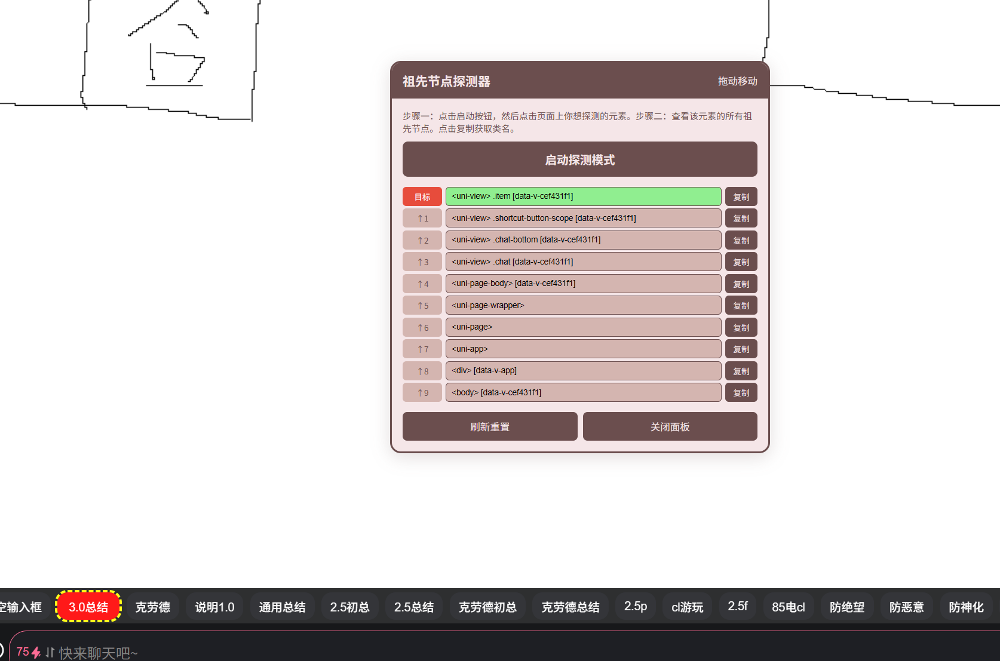

# 可以查找页面所有类名

创建时间: 2026-02-05T13:11:09.482000+00:00
消息数: 24

---

**阿海** (2026-06-13 12:01:39):
牛逼好用！！  站里大更，类名每次都靠猜，感谢大佬分享神器

**苏子言** (2026-05-21 14:11:32):
<:emoji_140:1379454014852436038> 好用吗？我那个做的太辣鸡了<:emoji_144:1379454084750245939>

**诗夜** (2026-04-16 05:23:49):
草草

**白雪情** (2026-02-14 09:36:16):
顶一下

**neyin** (2026-02-06 07:33:38):
效果图

**neyin** (2026-02-06 07:31:48):
捕获点击的元素，然后一层一层往上爬，把每一级父元素的标签名、类名抓出来

**neyin** (2026-02-06 07:30:59):

**neyin** (2026-02-06 07:27:25):
<a:akuruHeart:1426656123817038020>

**小魅** (2026-02-06 06:14:27):
太棒啦！

**MEE6** (2026-02-06 06:13:59):
<:CHECK6:403540120181145611> 30,000 XP has been given to **<@!1226904229529255936>**

**波奇🎸** (2026-02-05 20:47:50):
<@1135473222658297907> 灌注妈妈

**波奇🎸** (2026-02-05 20:46:33):
妈妈好厉害，我只要跟妈妈屁股后面后入妈妈就可以了<:emoji_661_:1467525717943255061>

**neyin** (2026-02-05 13:30:38):
<a:miku_gif_02:1356986816732991539>

**乖宝宝小水母（水母宗唯一宗主。大周荣誉国祖)** (2026-02-05 13:28:30):
<:emoji_661_:1467525717943255061>

**neyin** (2026-02-05 13:17:19):
点击按键，红色就是对应的

**neyin** (2026-02-05 13:17:01):
大概就是这样

**neyin** (2026-02-05 13:16:12):
<:emoji_150:1400299501423431771>

**绛璃寒月ദ്ദി˶•̀֊•́)✧** (2026-02-05 13:15:12):
已从被暂停的账号中移除一条消息。

**neyin** (2026-02-05 13:14:41):
写什么

**neyin** (2026-02-05 13:14:38):
<:emoji_249:1416980128793104514>

**白水** (2026-02-05 13:14:37):
帮大忙了

**绛璃寒月ദ്ദി˶•̀֊•́)✧** (2026-02-05 13:13:22):
已从被暂停的账号中移除一条消息。

**白雪情** (2026-02-05 13:13:12):
谢谢大佬

**neyin** (2026-02-05 13:11:09):
正则替换就行

