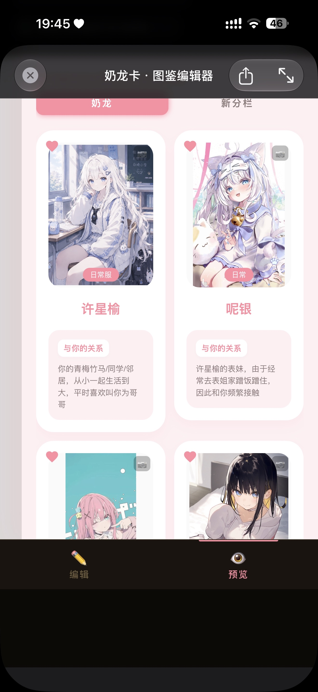
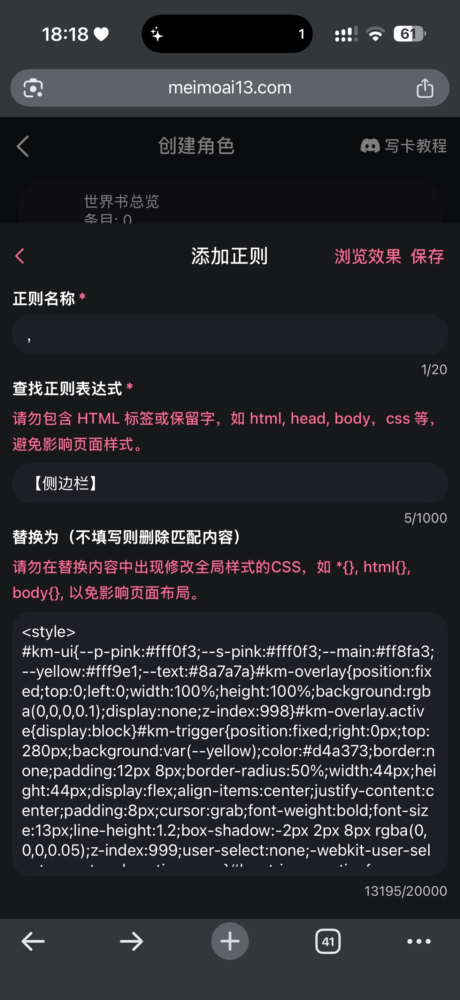
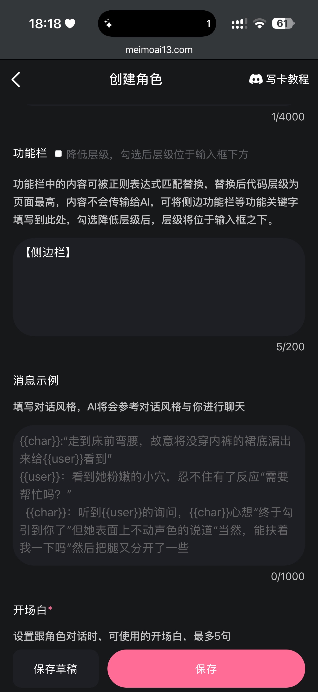
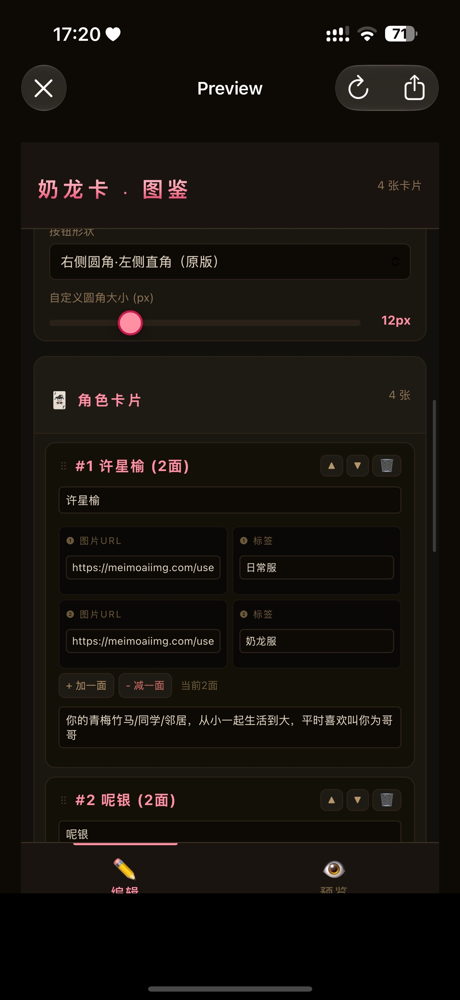

# 可拖拽翻转图鉴侧边栏编辑器V5.0(更新本地存储、放大镜功能、批量复制自动归类、移动角色到其他分栏功能)

创建时间: 2026-06-29T08:35:22.592000+00:00
消息数: 37

---

**🐷辰少安🐷** (2026-08-03 11:49:57):
牛牛牛，我原 称你为源神

**乱马（参赛卡艾泽尔酒店）** (2026-07-30 12:51:41):

**乱马（参赛卡艾泽尔酒店）** (2026-07-30 12:51:15):
你直接在我的资源从左上角往下拖动就可以了

**道尘** (2026-07-30 12:01:01):
大佬批量导入图片应该怎么弄啊？我有图片但是不知道怎么弄链接啊😭

**黎浔** (2026-07-16 15:24:16):
刚刚才看到原来是达到字数上限了<:1000168510:1298906820638674984>

**黎浔** (2026-07-16 15:10:27):
<:emoji_140:1379454014852436038>

**乱马（参赛卡艾泽尔酒店）** (2026-07-16 15:07:26):

**乱马（参赛卡艾泽尔酒店）** (2026-07-16 15:06:57):
没有啊，你可能缺一个代码分段器

**黎浔** (2026-07-16 15:05:55):
佬，这个复制代码字数是有上限吗，我复制的代码被截断了<:emoji_139:1379455053080825866>

**乱马（参赛卡艾泽尔酒店）** (2026-07-09 16:37:44):

**乱马（参赛卡艾泽尔酒店）** (2026-07-08 03:26:05):

**乱马（参赛卡艾泽尔酒店）** (2026-07-08 03:19:16):
可拖拽翻转图鉴侧边栏编辑器V5.0(更新本地存储、放大镜功能、批量复制自动归类、移动角色到其他分栏功能)

**乱马（参赛卡艾泽尔酒店）** (2026-07-08 03:16:56):
自动归类，唯一要做的就是从mmd里批量复制链接再自己更改名字

**乱马（参赛卡艾泽尔酒店）** (2026-07-08 02:39:44):
新增批量导入，和角色可以转接到其他分栏的功能

**乱马（参赛卡艾泽尔酒店）** (2026-07-06 02:38:08):
可拖拽翻转图鉴侧边栏编辑器(更新本地存储和放大镜功能)

**乱马（参赛卡艾泽尔酒店）** (2026-07-05 02:05:43):
谬赞谬赞，在我心目中还是死心院大佬最牛

**汐愛** (2026-07-05 02:05:09):
天哪<:emoji_140:1379454014852436038> 最强的佬

**乱马（参赛卡艾泽尔酒店）** (2026-07-05 01:56:11):
改好了

**汐愛** (2026-07-05 01:45:12):
爱你<:emoji_140:1379454014852436038>

**乱马（参赛卡艾泽尔酒店）** (2026-07-05 01:33:12):
那我想办法解决

**汐愛** (2026-07-05 01:30:16):
给佬点赞<:emoji_140:1379454014852436038> 
不过有个小小问题，这个工程文件是不是不能导入和保存啊，必须得一次做完<:emoji_115:1379113943817257071>

**乱马（参赛卡艾泽尔酒店）** (2026-07-02 02:50:42):
对电脑端进行了优化

**元初** (2026-06-30 10:34:57):
666，这不是不是有些作者的名字吗

**小魅** (2026-06-29 14:27:52):
感谢宝宝的开源哦<:emoji_140:1379454014852436038>

**MEE6** (2026-06-29 14:27:44):
<:CHECK6:403540120181145611> 30,000 XP has been given to **<@!1512325841386864640>**

**乱马（参赛卡艾泽尔酒店）** (2026-06-29 11:46:46):

**彭野-二组:靖康将至！北宋谁救？** (2026-06-29 11:41:38):
强，看好

**乱马（参赛卡艾泽尔酒店）** (2026-06-29 10:19:51):
忘了说怎么放啊，就这么放就可以了

**周雅（被老婆调教.周浩）** (2026-06-29 10:15:16):
<@1135473222658297907> 奖励经验

**乱马（参赛卡艾泽尔酒店）** (2026-06-29 09:21:07):
可自己增加反转面

**乱马（参赛卡艾泽尔酒店）** (2026-06-29 09:21:01):

**乱马（参赛卡艾泽尔酒店）** (2026-06-29 09:12:21):

**乱马（参赛卡艾泽尔酒店）** (2026-06-29 09:12:07):

**乱马（参赛卡艾泽尔酒店）** (2026-06-29 09:11:58):

**艾斯卡诺ദ്ദി˶•̀֊•́)✧** (2026-06-29 08:57:06):
我又来了！哪里有开源哪里就有我！

**乱马（参赛卡艾泽尔酒店）** (2026-06-29 08:37:12):

**乱马（参赛卡艾泽尔酒店）** (2026-06-29 08:35:22):
最新文件在最下面

