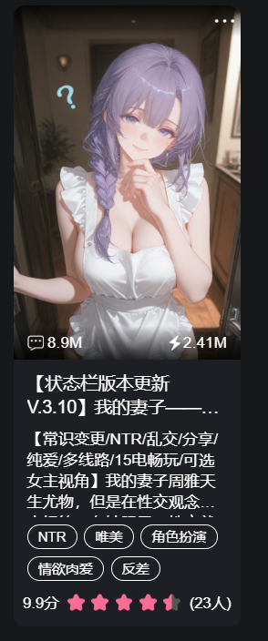

# 周雅 周雅 周雅 周雅单人卡开源

创建时间: 2026-08-27T08:26:13.342000+00:00
消息数: 16

---

**Tifa** (2026-08-29 08:20:23):
谢谢分享

**艾斯卡诺ദ്ദി˶•̀֊•́)✧** (2026-08-28 17:58:44):
小b崽子？

**爱人错过** (2026-08-28 17:37:02):
<:emoji_252:1478791303587299378>

**爱人错过** (2026-08-28 17:36:55):
大叔？

**周雅（被老婆调教.周浩）** (2026-08-28 12:29:50):
主要就是给你一个参考，但不能全文借鉴，大范围雷同会被定为抄袭

如果用了有帮助记得发卡的时候开场白感谢一下这位开源的老师<:emoji_140:1379454014852436038>

**艾斯卡诺ദ്ദി˶•̀֊•́)✧** (2026-08-28 12:20:36):
如果你啥都不会...你直接用也行吧，我这个状态栏也是别的大佬开源的，如果你单纯想要代码，你更应该去看看别的大佬开源的单独状态栏代码

**白玉堂** (2026-08-28 12:19:24):
就是代码和插件能用？

**燚（被秋姐变性版）** (2026-08-28 12:18:14):
可以借鉴，但是不能照抄，而且属于自己的内容需要比开源的内容多得多

**艾斯卡诺ദ്ദി˶•̀֊•́)✧** (2026-08-28 12:16:47):
你用呗，当然如果你照抄，估计会有审核找你谈话

**白玉堂** (2026-08-28 12:09:03):
开源就是可以拿来用吗<:1000168510:1298906820638674984>

**艾斯卡诺ദ്ദി˶•̀֊•́)✧** (2026-08-27 13:57:51):
哈哈，肯定拿过的，但是那是另一个号了，所以不发也没关系，毕竟我已经要回经验了

**小魅** (2026-08-27 13:23:24):
之前拿过经验奖励吗

**艾斯卡诺ദ്ദി˶•̀֊•́)✧** (2026-08-27 08:59:59):
<@1135473222658297907> 小魅大大这种情况我还能有经验奖励吗，我之前开源过这张卡，但是被连带删除了，我又重新开源，应该怎么算呢

**艾斯卡诺ദ്ദി˶•̀֊•́)✧** (2026-08-27 08:44:02):
周雅 周雅 周雅 周雅单人卡开源

**档案管理员** (2026-08-27 08:26:15):
[本帖尚未声明授权]()
发帖人尚未完成授权设置，或已选择跳过。本状态不代表允许转载、二次创作、商业使用或重新分发。

**艾斯卡诺ദ്ദി˶•̀֊•́)✧** (2026-08-27 08:26:13):
之前开源过一次，再次开源啦，哈哈

