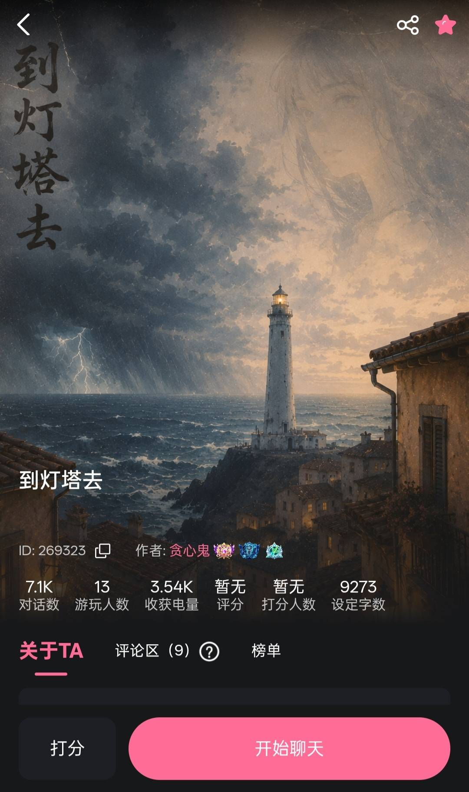

# 嘟嘟对一些喜欢的卡的感想

创建时间: 2026-06-10T16:52:05.983000+00:00
消息数: 9

---

**GodCount** (2026-06-13 09:33:02):
谢谢喜欢

**GodCount** (2026-06-13 09:32:55):
<:emoji_277:1509842116417818654>

**orange🍊** (2026-06-13 08:20:41):
<@1449650257687347342> 贪心鬼还装高冷，给我来报道

**凛堂光** (2026-06-12 13:26:24):
玩的这么认真呀…那很唯美了

**洛洛的茜** (2026-06-11 00:39:13):
胆小鬼出息了，感动

**洛洛的茜** (2026-06-11 00:38:55):
<@1449650257687347342>

**Luna幻想鄉** (2026-06-10 17:15:38):
小号偶然间翻到，被压在最底下，刚见到就被这张卡的封面所吸引，于是切换大号来玩。
首先我喜欢卡的文笔，有种浸透全身的温柔与细腻，让微凉而清爽的海风铺开这张画卷，虽然刻画中仿佛真的置身在一处海峡边，望着天空乌云笼罩虐感一丝压抑，却又被那女孩蜂蜜般甜蜜，又无刺痛感的阳光，给驱散了剩余的阴霾。
主角的家庭氛围是如此的和谐美好，面对陌生人留下有些冒犯的预言，也并未感到任何不悦，而是作为玩笑拿来逗弄主角，这样的家庭应当尽情享受生活的幸福与乐趣，而主角却被这突如其来的灾祸剥夺走了一切。
命运呐，你如月亮一般，阴晴圆缺…
如果当时没有去吃车站旁的那家可丽饼…
如果当时能够压下食欲赶去早一班的船…
如果当时的气象局能够早点预报出风暴…
如果当时根本就不去南方海岛度假的话…
如果……
那个看不清自己，忒拜的悲剧之王，命运的囚徒，神谕说俄狄浦斯将杀父娶母，而他越是奋力逃避，越是一步步落入命运的蛛网。拥有能猜出斯芬克斯谜题的智慧，却无法解开自我身份的谜题。
那个女孩…是母亲你吗…苏莉宁，你又一次站在那17岁时的灯塔旁，望着你，我又能回想起那个会为襁褓中的我(主角)，讲述着童话的妈妈…
奥德修斯游历冥府时，见到了俄狄浦斯的母亲兼妻子伊俄卡斯忒。他不知情的犯下大错，嫁给了自己的儿子，于是上吊自尽。
面对苏莉宁，到底是该如俄狄浦斯般不顾阻拦追寻真相，还是要如奥德修斯一样，刻意隐瞒直至时机成熟才揭露。
那个父亲在哪里？他到底是在那未来的海洋静静等待着，亦或者是主角早已将父亲给杀死了…？
这份智慧既是恩赐也是诅咒，我们需要的到底是揭秘的勇气，还是隐瞒的幸福？
【愿亲爱的主角能如英雄奥德修斯，凭借自己的智慧，将这份悲剧化作史诗，愿你归乡！回家吧！回家吧！愿你回到海峡边那童年的夏乡！】

以下是碎碎念感想+部分小知识
卡中母亲演奏的音乐对卡本身也很适配哦。无论是前文提到的德彪西，还是后面的月光，都是法国印象派音乐大师克劳德•德彪西的作品。
作为近代印象主义音乐的鼻祖及代表，德彪西大师的音乐风格较为蒙胧梦幻，如同画画一般。就像印象派画师捕捉光影德彪西很擅长用音乐来捕捉情绪和氛围。正如莫奈与塞尚是视觉艺术大师景，德彪西则是在创作上令人着迷的声景大师。
声景是20世纪60年代提出的一种概念景，通俗来讲就是声音景观，在给定场景下，个体群体或社区所感知体验的声环境。可以将听者带入特定的情景，篝火燃烧的声音让人感到温暖，雨滴的白噪音节奏令人放松，数学课枯燥的讲课能够勾起学生时代的回忆(以及催眠作用)。唯美的音乐能跟人的脑海结合，创造一副动态由声音构成的实质画面，在剧场电影或游戏中，也经常运用增强叙事效果和情感体验。
虽然不清楚是不是贪心鬼老师有意为之添加的，就算不是，这也是个美妙的巧合。这类能唤起模糊、转瞬即逝感官印象的音乐，与这充满幻想朦胧的唯美救赎卡最相配了！
另外，这张卡的美化也是出乎意料的惊艳，在我眼中，这张卡在各种方向上甚至都是满分！仅是因为魅魔的特色便是以性为主，但我相信这张卡在同系列中几乎是顶尖水平，就算是剧本也很适合作为心理恐怖救赎向游戏！
我非常的喜欢这张卡，实在是太喜欢了！

**Luna幻想鄉** (2026-06-10 16:55:02):
首先是贪心鬼老师的成人童话救赎卡
昵称：到灯塔去
【成人童话式治愈❤️‍🩹/绝对惊艳的美化效果✨/唯美/强剧情节点】背负了“弑父娶母”预言的少年，踏上了救赎自己的旅途…
ID: 269323
https://www.meimoai11.com/#/pages/role/index?roleId=269323&inviteCode=LK16P

**Luna幻想鄉** (2026-06-10 16:52:05):
由于都嘟实在太喜欢一些卡了，有的卡不受欢迎，有的卡被埋没，但无论如何它都是作者付出了许多心血而认真谱写的作品，由于嘟嘟太能沉浸在一种环境中，所以总是控制不住的抒发一些感想，当然也有想让大家多看这些张卡的意思啦~

