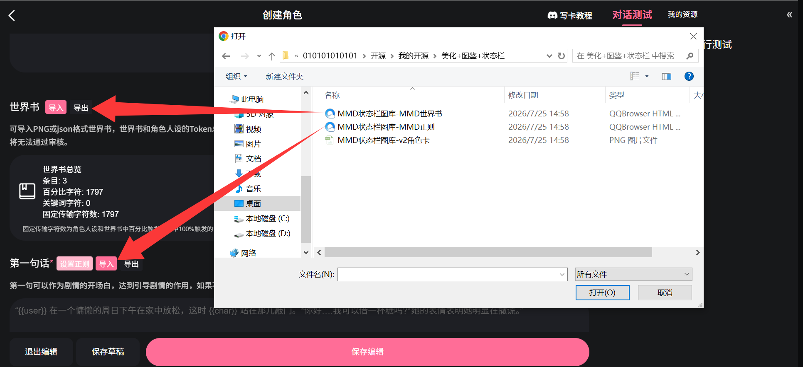
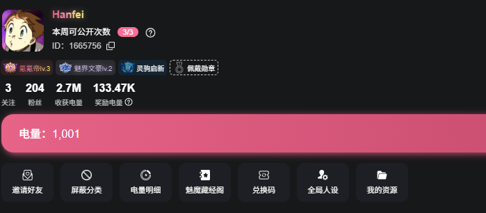
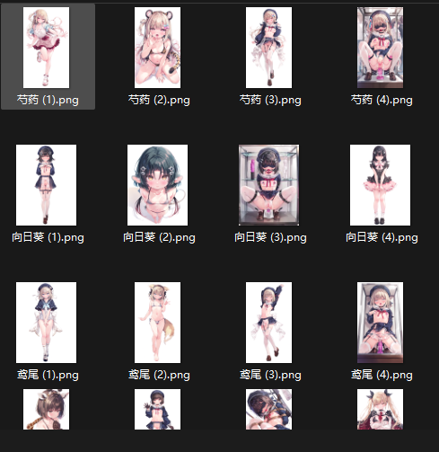

# 图库编辑器，更快捷便利的创造状态栏和侧边栏

创建时间: 2026-08-15T08:21:27.838000+00:00
消息数: 22

---

**小魅** (2026-08-15 13:56:57):
感谢宝宝迭代<:emoji_140:1379454014852436038>

**MEE6** (2026-08-15 13:56:44):
<:CHECK6:403540120181145611> 30,000 XP has been given to **<@!1461435268107079817>**

**Hanfei** (2026-08-15 12:44:19):
是的捏

**黑洞猫** (2026-08-15 12:33:14):
感觉风格很像

**黑洞猫** (2026-08-15 12:33:06):
这个是codex做的吧

**QQcute** (2026-08-15 11:50:01):
感谢大佬 照你第一张图弄好了 刚才用手机弄的现在用电脑就成功了 辛苦大佬了 <:1000168510:1298906820638674984>

**秦天柱** (2026-08-15 11:44:08):
用了V2角色卡就不用再另外导入世界书和正则了

**QQcute** (2026-08-15 11:35:46):
大佬 能给个生成后导入哪里多少吗 最好是图片 还是不行 我太蠢了 刚开始做卡 对不起大佬

**秦天柱** (2026-08-15 11:21:30):
感谢迭代，虽然好像没啥人在用我这个

**秦天柱** (2026-08-15 11:20:36):
新建一张空白书，正则导入第一句话那里

**QQcute** (2026-08-15 10:10:17):
大佬下载完怎么导入 点进去特别长 mmd正则可用字数不够

**乱马（参赛卡艾泽尔酒店）** (2026-08-15 08:29:47):
<@1135473222658297907>

**乱马（参赛卡艾泽尔酒店）** (2026-08-15 08:26:28):
真厉害

**乱马（参赛卡艾泽尔酒店）** (2026-08-15 08:26:19):
好耶<:emoji_242:1459832161719943198>

**Hanfei** (2026-08-15 08:25:48):
没有对美化做出1特别的设计，工具的本意是让ai更好的进行修改

**Hanfei** (2026-08-15 08:24:14):
10. “永久解锁”或“永久绑定”换设备后不见了

这两类记录保存在当前浏览器的网站本地存储中，不会自动同步到账号、其他浏览器或其他设备。

11. 修改内容后需要手动保存吗

不需要。看到顶部从“保存中”变成“已保存”即可。但本地自动保存不能代替最终导出备份。

12. 手机版能否使用

目前没有进行过手机版实机测试，无法保证上传、批量复制、编辑和导出的具体表现。建议优先在电脑端制作。

**Hanfei** (2026-08-15 08:24:12):
九、导出检查

进入“导出”界面后，先查看“检查结果”。建议所有项目都显示“通过”后再下载。

常见检查项包括：

1. 姓名是否仍为第 1 项。
2. 状态栏项目名称是否有效。
3. 图鉴解锁配置是否有效。
4. 角色名是否为空或重复。
5. 角色图片和备用图片是否使用 HTTP/HTTPS 链接。
6. 正则替换内容是否超过平台限制。
7. v2 角色卡格式是否正确。

如果出现“需修正”，返回相应界面修改后，再次打开“导出”页面复查。

十、三种导出文件的区别

（一）下载 MMD 正则

文件名通常为“MMD状态栏图库-MMD正则.json”。

它包含状态栏显示规则、图鉴引擎、角色图片链接、分栏和交互功能，适合把制作结果加入已有角色卡或已有项目的正则设置。

只导入正则并不能保证 AI 会主动输出正确格式，所以通常还需要配合下面的“MMD 世界书”。

（二）下载 MMD 世界书

文件名通常为“MMD状态栏图库-MMD世界书.json”。

它包含总序栏、角色栏、选项栏和输出格式自检等生成规则，用来告诉 AI 应该怎样输出能被正则识别的数据。

如果是在已有角色卡中安装本工具，通常应同时导入“MMD 正则”和“MMD 世界书”。具体入口以 MMD 当前版本中的正则管理、世界书管理界面为准。

（三）下载 v2 角色卡 PNG

文件名通常为“MMD状态栏图库-v2角色卡.png”。

这是一个内嵌了正则、世界书、开场白和图库工程数据的 v2 角色卡，适合直接新建或测试一个完整模板。对不想分别配置正则和世界书的用户来说，这通常是最方便的导出方式。

注意：它是角色卡 PNG，不是普通展示图片。不要再次压缩、截图或转换格式，否则可能破坏 PNG 中内嵌的角色卡数据。

十一、推荐的完整制作流程

1. 在电脑上整理角色图片，并按“角色名 (序号).扩展名”重命名。
2. 进入 MMD“我的资源”上传图片。
3. 在资源管理中多选图片，批量复制链接。
4. 打开编辑器，在“状态栏设置”中确定状态栏项目。
5. 决定是否启用数值解锁，并设置数值范围、解锁词条和统一挡位。
6. 在“图片图库”中建立和命名图鉴分栏。
7. 选择目标分栏，使用“快捷分析导入”批量建立角色图库。
8. 逐个检查角色名、所属分栏、关系栏、封面、图片顺序和独立解锁数值。
9. 如有需要，批量导入备用图片。
10. 到“效果预览”检查状态栏、图鉴分栏、图片加载、切换、放大和解锁效果。
11. 到“导出”页面处理所有“需修正”项目。
12. 新建完整模板时下载 v2 角色卡 PNG；安装到已有项目时下载并导入 MMD 正则和 MMD 世界书。

十二、常见问题

1. 图片区域是空白或显示“图片加载失败”

检查链接是否以 http:// 或 https:// 开头，是否能在浏览器新页面中直接打开，以及图床是否限制外部显示。不要填写电脑本地路径。

2. 快捷分析把角色名识别错了

检查上传前的文件名是否统一，或图片链接中是否仍保留原文件名。识别后也可以手动修改角色名。

3. 同一角色被拆成多个角色

通常是文件名中的角色名部分不完全一致，例如多了空格、符号或不同写法。统一名称后重新导入，或手动把链接整理到同一个角色中。

4. 状态栏找不到角色图片

检查图库角色名是否与状态栏第一项完全一致。如果 AI 输出了昵称、空格或不同汉字，也会匹配失败。可以修正世界书提示、修改图库角色名，或使用备用图片绑定。

5. 图片明明已导入，却仍显示未解锁

检查是否启用了数值解锁、选中的解锁词条是否正确、AI 输出中是否包含有效数字，以及图片的独立解锁数值是否过高。也可以点击“仍要解锁”手动显示。

6. 超过统一挡位数量的图片为什么直接可见

超过挡位数量的图片会保持空白。空白表示未设置数值门槛，因此会直接显示。若希望它继续受解锁限制，请给该图片单独填写数值。

7. 调整图片顺序后，为什么图片的解锁要求变了

因为挡位跟随图片编号，不跟随原图片。移动的是图片链接，图片进入哪个编号，就使用哪个编号的挡位。

8. 图鉴中没有“备用”分栏

只有备用图库中至少存在一个有效图片链接时，导出后的图鉴才会显示“备用”分栏。

9. 点击备用图片后没有自动发出消息

这是正常设计。功能只把说明文字写入玩家输入框，不会替用户发送。请检查文字后自行发送。

**Hanfei** (2026-08-15 08:23:53):
七、导出后图鉴和状态栏怎样使用

（一）状态栏图片切换

状态栏会根据角色姓名找到对应图库，并根据解锁设置筛选当前可用图片。点击角色状态栏中的图片，可以在已经解锁的图片之间循环切换。

状态栏只会切换当前可用图片：

1. 封面始终可用。
2. 关闭数值解锁时，全部图片可用。
3. 开启数值解锁时，达到门槛的图片可用。
4. 在图鉴里点击“仍要解锁”手动显示的图片也会加入可用范围。

（二）打开图鉴与切换分栏

点击页面侧面的“图鉴”按钮打开角色图鉴。用图鉴顶部的分栏选择框切换分类。只有当前分栏中的角色会显示。

点击图鉴外的遮罩区域或右上角“×”可以关闭图鉴。

（三）放大已解锁图片

图鉴中已经显示的正式角色图片可以点击放大。点击大图外的空白区域、右上角关闭按钮，或按 Esc 键即可关闭大图。

未解锁图片不能直接放大。备用图片的点击用途是绑定角色，因此不会执行普通图片放大。

（四）“仍要解锁”按钮

尚未达到数值条件的图片会显示“未解锁”和“仍要解锁”按钮。点击“仍要解锁”后，该图片会立即显示，并在当前浏览器的本地存储中永久记录。

这个操作只手动开放该图片，不会修改角色状态栏中的解锁词条，也不会提高好感度或其他数值。

这里的“永久”是指同一网站、同一浏览器本地持续保存。清理网站数据、更换浏览器或更换设备后，手动解锁记录可能消失。

（五）点击备用图片绑定角色

打开图鉴中的“备用”分栏，点击一张备用图片，会出现“绑定备用图片”窗口。

1. 输入要与这张图片对应的角色姓名。
2. 点击“永久绑定”。
3. 编辑器会把“角色姓名—备用图片”的对应关系保存到当前浏览器。
4. 同时会把一段说明文字写入 MMD 的玩家输入框，例如：

请将备用图片 [图片链接] 作为角色“角色名”的状态栏图片。

这段文字只会写入输入框，不会自动发送。用户可以检查内容后自行发送。

绑定以后，如果正式图库中找不到该角色可用的图片，状态栏可以使用已经绑定的备用图片。再次给同名角色绑定另一张备用图片时，新绑定会替换旧绑定。

备用绑定与手动解锁一样保存在浏览器本地。“永久”不代表同步到账号或其他设备；清理网站数据后可能失效。

八、效果预览

进入“效果预览”后，可以在真正导出以前检查：

1. 状态栏项目名称和顺序。
2. 角色姓名是否正确。
3. 状态栏图片是否正常加载。
4. 点击状态栏图片能否切换。
5. 图鉴按钮的位置。
6. 图鉴能否打开。
7. 图鉴分栏名称和切换效果。
8. 图片解锁、手动显示、放大和备用绑定界面。
9. 关系栏标题和内容。

修改配置后预览会自动更新。若没有立即变化，可以点击预览右上角的刷新按钮。

预览使用的是示例剧情和示例数值，主要用于检查界面与交互。最终聊天中的角色资料和解锁进度，以 AI 实际输出的角色栏为准。

**Hanfei** (2026-08-15 08:23:41):
（二）快捷分析导入

这是批量建立角色图库最快的方式。

1. 先在左侧下拉框中选择新角色要进入的图鉴分栏。
2. 把批量复制的图片链接粘贴到输入框，每行一个链接。
3. 点击“分析并导入”。

编辑器会读取链接末尾的文件名，去掉扩展名和图片序号，再把同名图片自动归入同一个角色。例如：

向日葵 (1).png
向日葵 (2).png
向日葵 (3).png

会建立一个名为“向日葵”的角色，并导入三张图片。

如果图库中已经有完全同名的角色，新链接会追加到该角色，不会重复建立角色。相同角色内完全重复的链接会被忽略。需要注意，导入时选择的分栏只用于新建角色；已经存在的同名角色仍保留在原分栏中。

自动分析依赖链接中仍保留可识别的文件名。如果导入后角色名不正确，可以在角色编辑区直接修改；如果图床生成的链接完全不含原文件名，则可以改用“＋ 新增角色”和“＋ 添加图片”手动录入。

（三）角色列表与角色资料

左侧角色列表按图鉴分栏显示角色。点击角色后，可以编辑：

1. 角色名。
2. 所属图鉴分栏。
3. 关系栏标题。
4. 关系栏内容。
5. 角色图片。

角色名必须与状态栏第一项输出的姓名精确一致，包括汉字、空格和符号。角色名还必须唯一，不能出现两个完全相同的角色名。

右上角“⧉”用于复制当前角色，“×”用于删除当前角色及其全部图片。

（四）关系栏

每名角色都可以单独填写关系栏。

“关系栏标题”默认是“与你的关系”，也可以改成“人物简介”“当前关系”“阵营记录”等自定义标题。

“关系栏内容”可填写角色与玩家的关系、人物简介或其他图鉴说明。导出后的角色图鉴会在该角色图片下方显示这部分内容。内容留空时，实际导出的图鉴中不会显示关系栏。

（五）添加图片、设置封面与调整顺序

每名角色的图片数量不设上限。点击“＋ 添加图片”即可继续增加图位。

图片列表中的按钮功能：

★：把当前图片设为封面。
↑：把当前图片向前移动一位。
↓：把当前图片向后移动一位。
×：删除当前图片。

第一张图片就是封面。封面始终显示，不需要解锁，也是角色列表缩略图和状态栏初始图片的优先来源。

特别注意：调整图片顺序或设置封面时，移动的是图片链接，解锁挡位不会跟着原图片一起移动。解锁数值始终跟随“图片编号/位置”。

例如：

图片 2 的挡位是 50
图片 3 的挡位是 75

把原图片 3 上移到图片 2 后，这张图片会改用图片 2 位置的挡位 50；原图片 2 下移后则改用图片 3 位置的挡位 75。

这正是“挡位跟着图片编号走”的设计。

删除中间图片时，后面的图片链接会依次前移，现有编号位置上的挡位仍然保留。

（六）单独设置图片解锁数值

启用图鉴数值解锁后，封面以外的每张图片旁边都有独立的解锁数值输入框。

统一挡位适合快速批量配置；单独输入适合给某个角色做特殊调整。单独输入的数值必须位于“数值范围起点”和“数值范围终点”之间。

如果不希望某张非封面图片受数值限制，可以把该输入框留空；留空表示未设置门槛，图片会直接显示。

六、备用角色图库

备用图库用于处理事先没有录入正式图库、但剧情中临时出现的角色。备用图片数量不设上限。

有两种添加方式：

1. 点击备用图库右上角“＋”，逐条粘贴图片链接。
2. 在批量输入框中每行粘贴一个链接，再点击“批量导入备用图片”。

备用图库的批量导入不会识别角色名，只保存图片链接。空行、无效链接和重复链接会被自动忽略。

如果没有任何备用图片，导出后的图鉴不会显示“备用”分栏；只有实际添加了备用图片才会出现该分栏。

**Hanfei** (2026-08-15 08:23:28):
三、打开编辑器与自动保存

1. 双击“MMD角色图库编辑器-增强版_最终复核版_20260814.html”，用浏览器打开。
2. 页面顶部有四个主要界面：

状态栏设置
图片图库
效果预览
导出

3. 修改内容后，顶部会先显示“保存中”，随后变为“已保存”。配置保存在当前浏览器的本地存储中，关闭页面后再次打开通常仍会保留。

重要提醒：这种“已保存”只代表保存在当前浏览器、当前设备中。清理浏览器网站数据、更换浏览器、更换设备，可能导致编辑中的配置丢失。制作完成后务必及时导出成品文件。

四、状态栏设置

（一）角色栏项目

角色栏项目决定每次剧情回复中，每名角色的状态栏显示哪些资料。

第一项固定承担“角色姓名匹配”用途，必须始终位于第一项，不能移动或删除。建议保留名称“姓名”。编辑器会用这一项的内容精确查找角色图库，所以状态栏里的角色姓名必须与图库中的角色名完全一致。

第一项以外的项目可以：

1. 直接修改名称。
2. 点击“↑”或“↓”调整顺序。
3. 点击“×”删除。
4. 点击“＋ 新增状态栏项目”添加新项目。

项目名称不建议使用竖线“|”、尖括号或角色栏标记，因为导出的角色栏以半角竖线“|”分隔各项。

项目的顺序非常重要。导出的世界书会要求 AI 严格按照这里的顺序输出，修改完成后不要再手工打乱导出的角色栏格式。

（二）图鉴数值解锁开关

勾选“启用图鉴数值解锁”后，可以指定一个状态栏项目作为“图鉴解锁词条”。编辑器会从这个词条中读取开头出现的数值，并与每张图片的解锁数值比较。

例如：

图鉴解锁词条选择“好感度”
状态栏输出“75 关系亲近”
某张图片的解锁数值为 50

因为 75 已达到 50，所以该图片会显示。

关闭“启用图鉴数值解锁”后，不再要求专门的解锁数值，所有角色图片始终可见，效果与粉色版一致。

（三）自定义数值范围

“数值范围起点”和“数值范围终点”不是固定的 0～100，可以输入任意合理数字，例如：

起点：0
终点：125

也可以使用负数或小数。终点必须大于起点；如果输入顺序不合理，编辑器会自动调整为有效范围。

这个范围同时会写入导出的角色栏生成规则，让 AI 知道解锁词条应该使用什么数值范围。

（四）统一图片解锁挡位

“统一图片解锁挡位”用于一次性给所有角色的图片编号分配解锁数值。挡位数量和挡位数值都可以自定义，并不固定为任何一组数字。

可以使用逗号、中文逗号、顿号、分号或空格分隔，例如：

50, 75, 120, 125

规则如下：

1. 封面始终显示，不占用挡位。
2. 图片 2 使用第 1 个挡位。
3. 图片 3 使用第 2 个挡位。
4. 图片 4 使用第 3 个挡位。
5. 依此类推。
6. 图片数量超过挡位数量时，多出来的图片解锁数值保持空白，可以在“图片图库”中单独填写。

输入完成后，点击“保存并应用到所有角色”。

注意：这个按钮会覆盖所有角色当前对应图片编号上的解锁数值。如果已经逐张精细调整过解锁值，重新应用统一挡位前应先确认是否确实要覆盖。

空白解锁数值代表没有设置数值门槛，导出后会按无需数值解锁处理。若希望该图片受限制，请在图库中补填具体数值。

（五）图鉴按钮位置

可以设置图鉴按钮出现在页面左侧或右侧，并用“高度”滑块调整它在页面上的垂直位置。修改后可到“效果预览”检查位置是否合适。

五、图片图库

（一）图鉴分栏

图鉴分栏用于给角色分类，例如：

主要角色
学院角色
敌对角色
其他角色

点击“＋ 添加分栏”可以新增分栏。每个分栏都可以重命名、上移、下移或删除。至少需要保留一个分栏；删除某个分栏时，原本属于该分栏的角色会自动移动到另一个仍然存在的分栏。

分栏名称最长 24 个字符。导出后，用户通过图鉴顶部的分栏选择框切换分类。

**Hanfei** (2026-08-15 08:22:39):
一、工具简介

这个工具用于制作适配 MMD 的动态角色状态栏和角色图鉴。它把角色资料、角色图片、图鉴分栏、图片解锁条件等内容整理成可以导入 MMD 的正则、世界书或 v2 角色卡 PNG。

主要功能包括：

1. 自定义角色状态栏项目。
2. 按角色状态数值逐步解锁图片，也可以关闭数值解锁，让全部图片始终可见。
3. 每名角色可添加任意数量的图片，并可随时更换封面、调整顺序。
4. 支持多个图鉴分栏。
5. 支持根据图片文件名自动识别角色并批量导入。
6. 支持不限数量的备用图片，以及在实际聊天页面中手动绑定角色。
7. 支持点击状态栏图片切换、点击图鉴图片放大、手动显示未解锁图片。
8. 可分别导出 MMD 正则、MMD 世界书和内嵌全部配置的 v2 角色卡 PNG。

本工具是单个 HTML 文件，不需要安装。使用电脑浏览器直接打开即可。

注意：目前主要按照电脑端流程制作和检查。页面虽然包含小屏幕适配，但手机版尚未实际测试，按钮位置、文件选择、批量复制或导入方式可能会有所不同。

二、使用前先准备图片链接

编辑器使用的是 HTTP 或 HTTPS 图片链接，不能直接读取电脑中的本地图片路径。可以运用 MMD 本身的图床功能保存图片。

1. 进入 MMD 的个人页面，在下方功能区点击“我的资源”，然后上传图片。

2. 如果准备使用编辑器的“快捷分析导入”，请在上传到“我的资源”以前先给图片重命名。

推荐格式：

角色名 (1).png
角色名 (2).png
角色名 (3).png
角色名 (4).png

例如：

向日葵 (1).png
向日葵 (2).png
向日葵 (3).png
向日葵 (4).png

同一角色的所有图片必须使用完全相同的角色名，只改变末尾序号。序号最好从 1 开始连续排列。“(1)”通常作为第一张图片，也就是初始封面。

编辑器也能识别部分其他结尾，例如中文括号序号、直接写在末尾的数字、“第2张”“正面”“背面”和“差分1”等。不过，为了减少识别错误，最推荐统一使用“角色名 (序号).扩展名”。支持识别 PNG、JPG、JPEG、WEBP、GIF、BMP 等常见文件扩展名。

3. 图片全部上传后，在“我的资源”中选择“管理”，多选需要使用的图片，再使用批量复制功能复制图片链接。

4. 粘贴进编辑器时，保持每行只有一个完整链接。链接必须以 http:// 或 https:// 开头，不要在同一行添加角色说明或其他文字。

提示：图片链接是否长期有效、是否允许外部显示，取决于图床本身。建议优先使用 MMD“我的资源”中复制出来的链接。

**Hanfei** (2026-08-15 08:21:27):
基于秦天柱大佬分享的图库编辑器，融合乱马大佬的图库编辑器加以改进。导入图片更便利，更自由
原帖：https://discord.com/channels/1205870897769095229/1530474596476911626   <@1504495750917263452> 
https://discord.com/channels/1205870897769095229/1523653028509520052   <@1512325841386864640> 
球球授权

