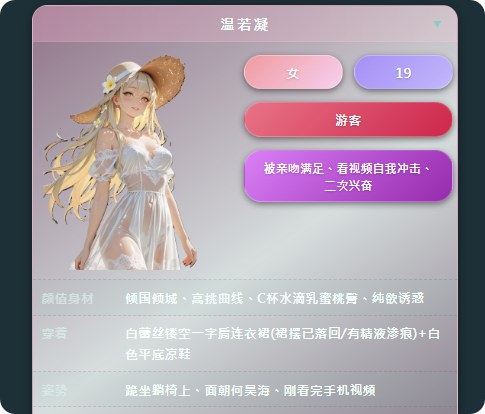
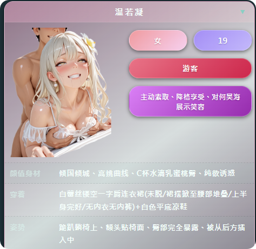
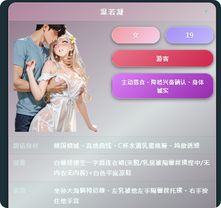
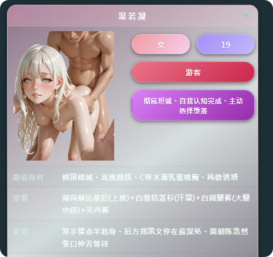
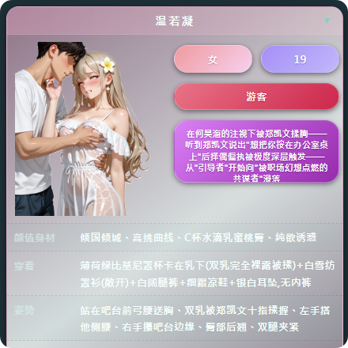

# 大佬们，新人刚想讲图片插入状态栏

创建时间: 2026-08-22T06:49:36.594000+00:00
消息数: 2

---

**阿海** (2026-08-22 07:43:20):
分好几种。 常见的就是 扔一张立绘，固定，A=ACG，不变。B=BCG，不变。  
还有就是，立绘不固定，前提还是同一个人，没变脸。  不同状态，不同立绘。如：默认服装A~H。调教服A~C。泳装、睡衣、礼服等。
做爱姿势A~E，但是A里分A1~A20不同角度等，B~E同理。
做爱人数A~D，但是A里分A1~A20不同角度等，B~E同理。
状态栏捏好，告诉AI，留空，你有固定XXXX（宽）*XXXX（高）的立绘图集。需要放进状态栏，让AI给你腾出适配的大小框体，框体必须优先保证立绘不会被遮挡/吃掉边缘。
把你的图片集扔进MMD图床，批量复制地址，粘贴到txt里。   这里分两种方式，①直接让AI把链接放进状态栏。②做CSS外挂给对应编号，让状态栏去找CSS。

大概差不多就是这样吧。    上传图是第二种方式的示例。 光状态栏是不够的，需要状态机用json或者xml来固定包裹。 有条件还可以写一个思维连来做判定。

**色孽在线整活** (2026-08-22 06:49:36):
有没有大佬救我一下如何将图片插入在状态栏里，之前研究了半天马老师的教程也没研究明白，用的是澄清大佬v2生成器，有没有大佬教一下怎么操作

