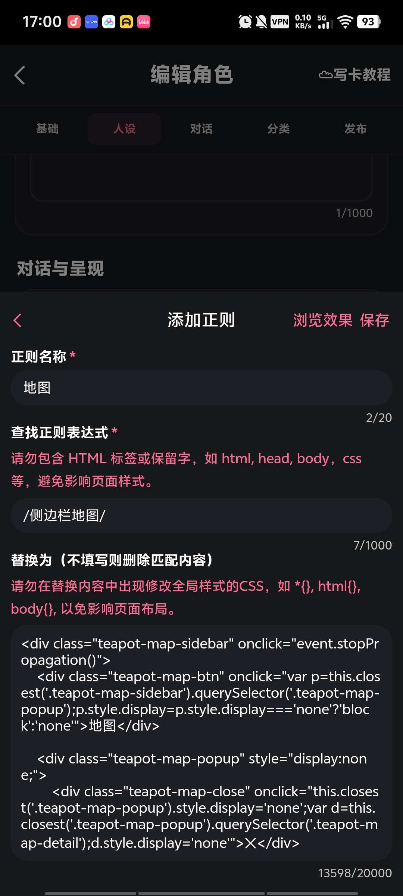
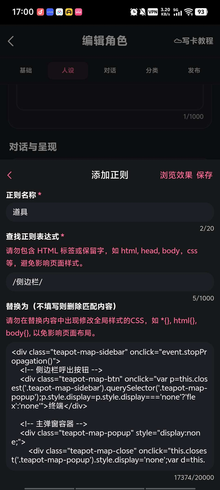
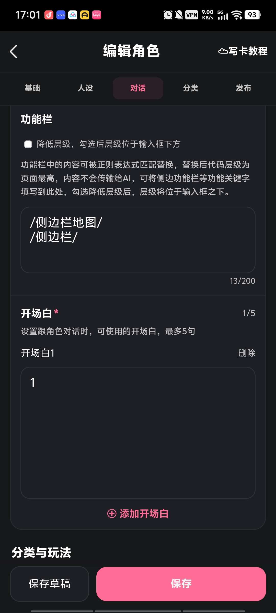
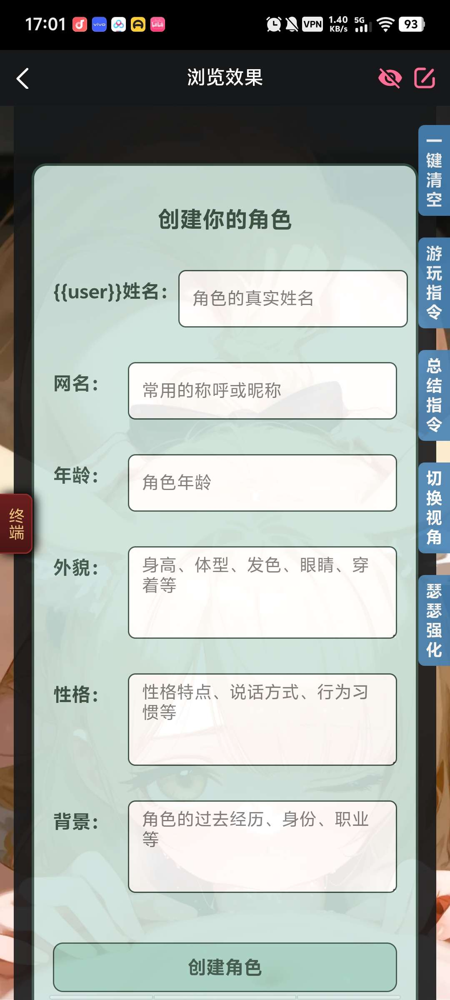

# 大佬们，有没有什么办法能同时拥有两个侧边状态栏

来源: Discord 魅魔藏经阁 thread 1547411727396634674

创建: 2026-09-10T01:01:45.331000+00:00
消息数: 28

---

**有害垃圾** (2026-09-10 09:57:59):
sorry，没注意到

**艾斯卡诺ദ്ദി˶•̀֊•́)✧** (2026-09-10 09:19:36):
还有，我开头就给你说了…你都直接无视我

**艾斯卡诺ദ്ദി˶•̀֊•́)✧** (2026-09-10 09:19:13):
因为斜杠是选取所有了

**有害垃圾** (2026-09-10 09:18:19):
神医啊哥们，照你这样还真解决问题了

**艾斯卡诺ദ്ദി˶•̀֊•́)✧** (2026-09-10 09:15:07):
不信你试试

**艾斯卡诺ദ്ദി˶•̀֊•́)✧** (2026-09-10 09:14:59):
要我说，就别用斜杠，用【侧边栏1】 这种就行了

**有害垃圾** (2026-09-10 09:14:33):
功能栏这样填写是没问题的吧？

**黑白琴键（奥特曼参赛卡：残光）四组** (2026-09-10 09:08:43):
<:emoji_249:1416980114511761448>

**黑白琴键（奥特曼参赛卡：残光）四组** (2026-09-10 09:08:30):
位置写一起了呗

**有害垃圾** (2026-09-10 09:08:09):
总之这两个，删掉其中一个正则，单独都能执行

**黑白琴键（奥特曼参赛卡：残光）四组** (2026-09-10 09:07:33):
猜的

**黑白琴键（奥特曼参赛卡：残光）四组** (2026-09-10 09:06:51):
我看不见完整代码

**黑白琴键（奥特曼参赛卡：残光）四组** (2026-09-10 09:06:43):
<>你少个这个

**黑白琴键（奥特曼参赛卡：残光）四组** (2026-09-10 09:05:32):
你好好看看你这两个截图

**有害垃圾** (2026-09-10 09:05:15):
啊？

**黑白琴键（奥特曼参赛卡：残光）四组** (2026-09-10 09:05:09):
自己比对一下也能看出来

**黑白琴键（奥特曼参赛卡：残光）四组** (2026-09-10 09:05:04):
你地图少写个代码

**有害垃圾** (2026-09-10 09:03:27):
最后只出来一个

**有害垃圾** (2026-09-10 09:03:07):

**黑白琴键（奥特曼参赛卡：残光）四组** (2026-09-10 09:02:28):
截图给我

**黑白琴键（奥特曼参赛卡：残光）四组** (2026-09-10 08:59:59):
截图

**有害垃圾** (2026-09-10 08:59:45):
写的都是不一样的，但只能识别出一个

**黑白琴键（奥特曼参赛卡：残光）四组** (2026-09-10 08:09:27):
就行了

**黑白琴键（奥特曼参赛卡：残光）四组** (2026-09-10 08:09:22):
把其中一个换成别的

**黑白琴键（奥特曼参赛卡：残光）四组** (2026-09-10 08:09:14):
你匹配正则是不是写的一样的

**艾斯卡诺ദ്ദി˶•̀֊•́)✧** (2026-09-10 02:12:35):
然后设置好侧边栏位置就行

**艾斯卡诺ദ്ദി˶•̀֊•́)✧** (2026-09-10 02:12:18):
两个正则两个替换词啊

**有害垃圾** (2026-09-10 01:01:45):
写了两个，但功能栏貌似只能显示其中一个

