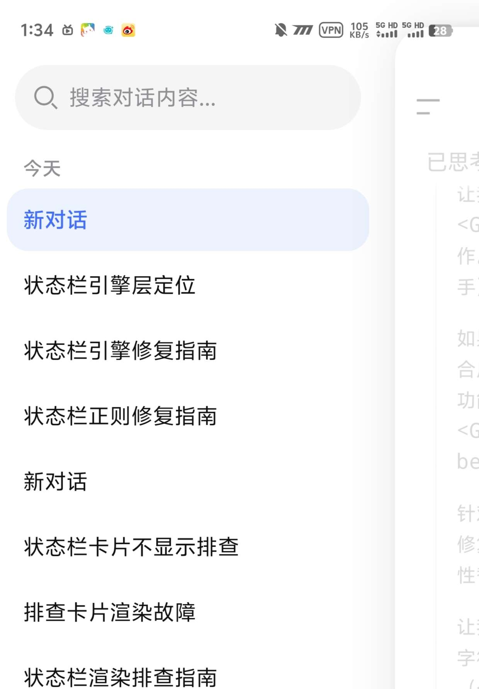
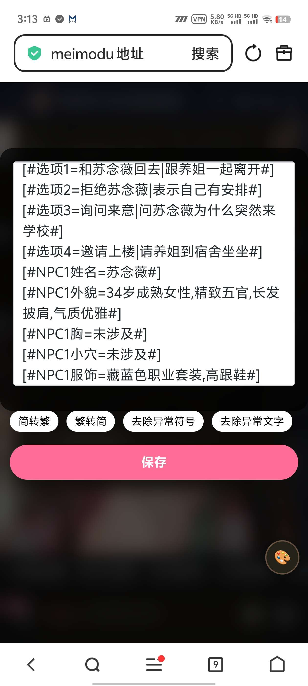
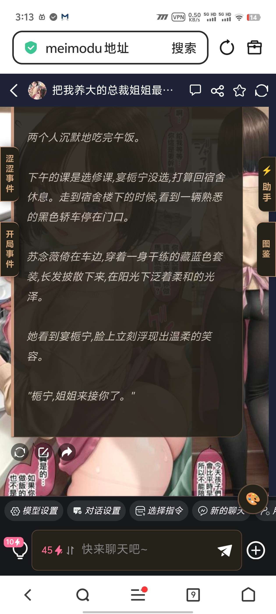
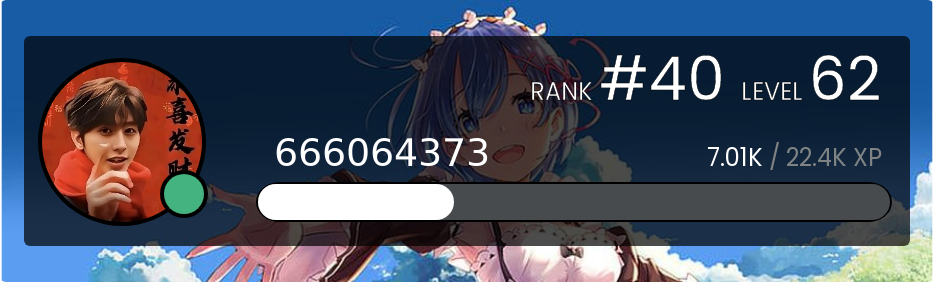
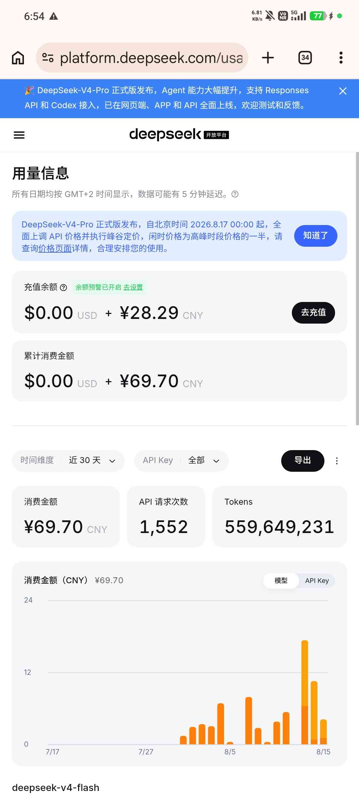

# 大的要来了

创建时间: 2026-08-10T20:13:54.843000+00:00
消息数: 177

---

**黑白琴键（奥特曼参赛卡：残光）四组** (2026-08-25 16:45:00):
因为最近模型不行，一直在炸，你别急，等下个星期再说

**CAD** (2026-08-25 14:46:31):
为什么我生成的状态栏，不能保证每轮对话都顺利输出，该怎么解决呢？<:1000168510:1298906820638674984>

**黑白琴键（奥特曼参赛卡：残光）四组** (2026-08-20 22:13:46):
<:emoji_299:1538892045945671680>

**不要殴打土木术士** (2026-08-20 09:11:01):
不过在测卡，等我测完就来

**不要殴打土木术士** (2026-08-20 09:10:44):
其实打算玩老大你那个jojo的（）

**黑白琴键（奥特曼参赛卡：残光）四组** (2026-08-19 18:28:47):
昵称：༺九渊录༻
（超真实江湖，超绝活人感，玩起来很舒服我保证，40个原创npc，懒b琴键后续会补角色图鉴和武器图鉴）
ID: 302162
https://www.meimoai15.com/#/pages/role/index?roleId=302162&inviteCode=HgPhzl

**黑白琴键（奥特曼参赛卡：残光）四组** (2026-08-19 18:28:44):
<@1422460387613478984> 我新卡上了来玩玩

**Tifa** (2026-08-19 13:13:54):
谢谢分享

**流浪的绳子** (2026-08-19 11:34:20):
佬，请问为啥人设创建的段落间距会那么大？

**不要殴打土木术士** (2026-08-19 10:44:56):
非常好用啊大佬

**不要殴打土木术士** (2026-08-19 10:44:48):
就是那个状态栏不显示

**不要殴打土木术士** (2026-08-19 10:44:43):
完全没问题

**黑白琴键（奥特曼参赛卡：残光）四组** (2026-08-19 10:19:01):
其他的用我工具做的没问题吧<@1422460387613478984>

**黑白琴键（奥特曼参赛卡：残光）四组** (2026-08-19 10:18:53):
ok

**不要殴打土木术士** (2026-08-19 09:45:15):
爱你

**不要殴打土木术士** (2026-08-19 09:45:13):
谢谢老大了

**不要殴打土木术士** (2026-08-19 09:45:10):
我换成波奇的那个了

**不要殴打土木术士** (2026-08-19 09:45:05):
我去，没关系老大

**黑白琴键（奥特曼参赛卡：残光）四组** (2026-08-19 09:20:57):
我新卡写好了

**黑白琴键（奥特曼参赛卡：残光）四组** (2026-08-19 09:20:54):
没改好我帮你改

**黑白琴键（奥特曼参赛卡：残光）四组** (2026-08-19 09:20:48):
<@1422460387613478984> 你改好没

**不要殴打土木术士** (2026-08-18 05:35:21):
好奇怪啊，就是不知道为什么

**不要殴打土木术士** (2026-08-18 05:34:31):
事已至此，先放一下吧（喂）

**不要殴打土木术士** (2026-08-18 05:30:35):
就是不太行，好奇怪啊

**不要殴打土木术士** (2026-08-18 05:30:30):
给的都试了

**不要殴打土木术士** (2026-08-18 05:30:23):
dp给的代码我开了好几个对话窗

**不要殴打土木术士** (2026-08-18 05:30:05):
好奇怪啊

**不要殴打土木术士** (2026-08-18 05:30:03):
嘶

**不要殴打土木术士** (2026-08-18 05:30:01):
不太行

**不要殴打土木术士** (2026-08-18 05:00:37):
刚才生成了

**不要殴打土木术士** (2026-08-18 05:00:33):
试试

**不要殴打土木术士** (2026-08-18 05:00:30):
我刚塞进正则里

**不要殴打土木术士** (2026-08-18 05:00:18):
好像没有

**黑白琴键（奥特曼参赛卡：残光）四组** (2026-08-18 04:46:48):
感觉他不是很容易知道

**黑白琴键（奥特曼参赛卡：残光）四组** (2026-08-18 04:46:41):
你有跟他说状态栏的引擎层是那个吗

**不要殴打土木术士** (2026-08-18 04:44:50):
扔进去了，让它跑着

**不要殴打土木术士** (2026-08-18 04:43:01):
❤️ ❤️

**不要殴打土木术士** (2026-08-18 04:42:57):
好的好的

**黑白琴键（奥特曼参赛卡：残光）四组** (2026-08-18 04:42:32):
我好修改

**黑白琴键（奥特曼参赛卡：残光）四组** (2026-08-18 04:42:27):
之后把它的回答复制给我

**黑白琴键（奥特曼参赛卡：残光）四组** (2026-08-18 04:42:16):
能用的话你就问问问题跟第几条有关

**黑白琴键（奥特曼参赛卡：残光）四组** (2026-08-18 04:41:51):
改好之后你看看

**黑白琴键（奥特曼参赛卡：残光）四组** (2026-08-18 04:41:02):
你就跟他说我是用的手机没办法进准替换，把应该替换哪个正则说明清楚，之后发完整替换的正则直接替换全部的那种

**黑白琴键（奥特曼参赛卡：残光）四组** (2026-08-18 04:40:19):
之后就是ds可能发不了json文件<@1422460387613478984>

**不要殴打土木术士** (2026-08-18 04:39:47):
我扔进去看看

**不要殴打土木术士** (2026-08-18 04:39:44):
ook

**黑白琴键（奥特曼参赛卡：残光）四组** (2026-08-18 04:39:41):
极速能上传文件

**黑白琴键（奥特曼参赛卡：残光）四组** (2026-08-18 04:39:27):
一样的步骤

**黑白琴键（奥特曼参赛卡：残光）四组** (2026-08-18 04:39:17):
那正好

**不要殴打土木术士** (2026-08-18 04:39:11):
专家好像没法上传文件

**不要殴打土木术士** (2026-08-18 04:39:05):
极速

**黑白琴键（奥特曼参赛卡：残光）四组** (2026-08-18 04:38:45):
你这样

**黑白琴键（奥特曼参赛卡：残光）四组** (2026-08-18 04:38:30):
专家还是极速

**不要殴打土木术士** (2026-08-18 04:38:28):
对

**黑白琴键（奥特曼参赛卡：残光）四组** (2026-08-18 04:38:20):
dp吗

**不要殴打土木术士** (2026-08-18 04:38:13):
deep

**不要殴打土木术士** (2026-08-18 04:38:10):
我用的

**不要殴打土木术士** (2026-08-18 04:38:08):
没有（）

**黑白琴键（奥特曼参赛卡：残光）四组** (2026-08-18 04:37:59):
之后你再把它发的json导入进去

**黑白琴键（奥特曼参赛卡：残光）四组** (2026-08-18 04:37:47):
发完整的修改完成后的正确的json文件

**不要殴打土木术士** (2026-08-18 04:37:37):
ook

**黑白琴键（奥特曼参赛卡：残光）四组** (2026-08-18 04:37:28):
把出错的地方说出来之后进行修改

**黑白琴键（奥特曼参赛卡：残光）四组** (2026-08-18 04:37:14):
把这句话发给克劳德跟他说让它挨个检查

**黑白琴键（奥特曼参赛卡：残光）四组** (2026-08-18 04:36:52):
把文件发给克劳德

**黑白琴键（奥特曼参赛卡：残光）四组** (2026-08-18 04:36:46):
你把你的正则导出

**黑白琴键（奥特曼参赛卡：残光）四组** (2026-08-18 04:36:40):
<@1422460387613478984> 你有克劳德吗

**不要殴打土木术士** (2026-08-18 04:34:36):
不太会弄orz

**不要殴打土木术士** (2026-08-18 04:34:30):
还在肘ai（）

**黑白琴键（奥特曼参赛卡：残光）四组** (2026-08-18 04:32:59):
我好修一下

**黑白琴键（奥特曼参赛卡：残光）四组** (2026-08-18 04:32:56):
所以是哪的问题

**不要殴打土木术士** (2026-08-18 02:37:38):
老大陨落

**不要殴打土木术士** (2026-08-18 02:37:34):
哦不——

**不要殴打土木术士** (2026-08-18 02:37:30):
好的好的，感谢大佬

**黑白琴键（奥特曼参赛卡：残光）四组** (2026-08-17 20:50:26):
不好意思了，你们老大主机被收了，所以消息不能经常看

**黑白琴键（奥特曼参赛卡：残光）四组** (2026-08-17 20:49:40):
我改文件

**黑白琴键（奥特曼参赛卡：残光）四组** (2026-08-17 20:49:35):
之后问题在哪跟我说我去改

**黑白琴键（奥特曼参赛卡：残光）四组** (2026-08-17 20:49:29):
实在不行扔给ai

**黑白琴键（奥特曼参赛卡：残光）四组** (2026-08-17 20:49:25):
挨个去检查

**黑白琴键（奥特曼参赛卡：残光）四组** (2026-08-17 20:49:05):
如果状态栏数据已经全部输出，但页面上**既没有卡片，也没有 `[#键=值#]` 残留**，那几乎可以锁定在**正则2或正则3没有生效**——而不是正则1的问题。因为正则1如果没生效，你一定会看到原文残留的 `[#...]` 纯文本。

我按“问题出现在哪一层”给你排个序，这就是标准排查路径：

---

### 第一层：正则2没有触发

AI 输出的锚点必须和正则2的查找内容**完全一致**，包括大小写和符号。

常见翻车点：
- AI 输出 `<GC_UI>`，但正则2查找写成了 `<gc_ui>` 或 `< GC_UI >`
- AI 在锚点前后多输出换行/空格，虽然正则2本身是精确匹配，但换行一般不会影响，除非查找里带了多余空格
- 正则2的替换内容被平台过滤，`<style>` 或 `<gc-live-widget>` 没插入成功

**怎么验证**：打开浏览器开发者工具（F12），在聊天区 DOM 里搜 `<gc-live-widget>`。如果没有，就是正则2的问题。

---

### 第二层：正则3没有执行

正则3的查找内容 `<GC_SCRIPT>` 必须放在**功能栏**，并且确实被平台触发。

常见翻车点：
- 正则3放在聊天区而不是功能栏
- 引擎代码超过 20000 字符被截断，导致 JS 语法错误，整个 `<script>` 没跑完
- 引擎开头 `if(!window.__GCLiveDefined)` 的变量被旧卡残留占用，导致这次引擎直接跳过

**怎么验证**：控制台输入 `window.__GCLiveDefined`。如果是 `true` 且页面没渲染，说明引擎可能被跳过或执行时报错。再看控制台有没有红色报错。

---

### 第三层：自定义标签没有挂载

即使引擎注册成功，如果 `<gc-live-widget>` 被平台虚拟 DOM 当作非法节点移除，`connectedCallback` 就不会触发，自然没有 Shadow DOM。

常见场景：
- 平台在渲染完成后进行组件化重载，把动态插入的节点擦除了
- 多个正则执行顺序错误，引擎在标签插入前就注册了，但没有新节点触发挂载

**怎么验证**：控制台执行 `document.querySelectorAll('gc-live-widget')`，有元素再看它的 `shadowRoot` 是否为 `null`。

---

### 第四层：`extractData` 没读到数据

如果前三层都正常，那可能是引擎读数据失败。

常见翻车点：
- 容器选择器 `.item,.content,uni-view.content` 在当前平台 DOM 中不匹配
- 正则1替换出的 `` 里内容格式与 `extractData` 的解析正则不一致
- `extractData` 正则里的 `\s*` 或 `#` 处理不对，导致匹配不到

**怎么验证**：在控制台里找到 `<gc-live-widget>` 元素，手动读取它周围 `.z-live-data` 的 `textContent`，看格式是否正确。

---

### 第五层：渲染后不可见

这是最不可能的一层，但也要排除。卡片可能渲染了，但因为样式冲突高度塌陷、颜色与背景完全融合而“看不见”。

排查方法：给根容器临时加个 `outline:2px solid red`，看它是否真的存在。

**不要殴打土木术士** (2026-08-17 19:14:33):
大佬，就是我想问一下，就是我这里已经生成状态栏了，但是为什么不显示，我试了一下克劳德高电和45电，都不显示

**不要殴打土木术士** (2026-08-17 17:56:28):
应该是输出规则有点问题

**不要殴打土木术士** (2026-08-17 17:56:20):
我看了看好像状态栏不显示

**不要殴打土木术士** (2026-08-17 17:56:14):
我也想问，问问老大你解决了嘛

**雾辞（中了兄弟变小男娘）** (2026-08-17 13:38:28):
大佬还是牛的

**CAD** (2026-08-17 13:30:27):
该怎么让状态栏每轮对话一直都顺利生成呢？<:emoji_299:1538892045945671680>

**sjchj** (2026-08-17 13:01:43):
🫡

**不要殴打土木术士** (2026-08-17 12:57:01):
我去

**不要殴打土木术士** (2026-08-17 12:56:56):
好牛逼啊

**不要殴打土木术士** (2026-08-17 12:56:54):
去搞了一下

**士酱** (2026-08-17 12:51:00):
<:emoji_299:1538892045945671680>

**黑白琴键（奥特曼参赛卡：残光）四组** (2026-08-17 12:29:03):
<:emoji_249:1416980114511761448>

**彭野-二组:靖康将至！北宋谁救？** (2026-08-17 12:06:37):
最后你是要把所有都包了啊

**彭野-二组:靖康将至！北宋谁救？** (2026-08-17 12:06:21):
我去

**不要殴打土木术士** (2026-08-17 12:04:38):
<:emoji_299:1538754485487280198>

**不要殴打土木术士** (2026-08-17 12:04:33):
我去，感谢大佬开源

**黑白琴键（奥特曼参赛卡：残光）四组** (2026-08-17 12:02:37):
<:emoji_148:1382329938404839586>

**黑白琴键（奥特曼参赛卡：残光）四组** (2026-08-17 12:02:34):
怎么没人来

**鹿初** (2026-08-17 12:01:23):
<:emoji_298:1526501201703600188>

**燚（被秋姐变性版）** (2026-08-15 13:23:58):
下一张卡我就拿来用

**燚（被秋姐变性版）** (2026-08-15 13:23:44):
OK，谢谢大佬

**阳玉** (2026-08-15 05:37:55):
<:emoji_150:1400299501423431771> 居然成了

**黑白琴键（奥特曼参赛卡：残光）四组** (2026-08-15 05:36:35):
<:emoji_299:1535536347362627614>

**黑白琴键（奥特曼参赛卡：残光）四组** (2026-08-15 05:36:33):
<:emoji_249:1416980114511761448>

**小魅** (2026-08-15 05:18:15):
当然宝宝<:emoji_140:1379454014852436038>

**MEE6** (2026-08-15 05:18:09):
<:CHECK6:403540120181145611> 30,000 XP has been given to **<@!1311443615687512074>**

**MEE6** (2026-08-15 05:00:35):

**黑白琴键（奥特曼参赛卡：残光）四组** (2026-08-15 04:59:57):
<:emoji_249:1416980114511761448>

**黑白琴键（奥特曼参赛卡：残光）四组** (2026-08-15 04:59:55):
更新这么多版

**黑白琴键（奥特曼参赛卡：残光）四组** (2026-08-15 04:59:51):
<@1135473222658297907> 你看我能再要一份经验不

**黑白琴键（奥特曼参赛卡：残光）四组** (2026-08-15 04:59:30):
<@1525979439119204423>

**黑白琴键（奥特曼参赛卡：残光）四组** (2026-08-15 04:55:19):
本工具消耗35.34元

**黑白琴键（奥特曼参赛卡：残光）四组** (2026-08-15 04:55:05):

**（猫娘萝莉妈妈)抱玖酒(捡小猫)** (2026-08-15 04:54:24):
又可以偷懒了

**（猫娘萝莉妈妈)抱玖酒(捡小猫)** (2026-08-15 04:54:15):
<:emoji_249:1416980114511761448> <:emoji_249:1416980114511761448> <:emoji_249:1416980114511761448>

**（猫娘萝莉妈妈)抱玖酒(捡小猫)** (2026-08-15 04:54:12):
<@1311443615687512074> 爱你

**黑白琴键（奥特曼参赛卡：残光）四组** (2026-08-15 04:53:42):
现在手动配置已经成熟了，AI还不是很成熟，呃，但是的话AI只是一个辅助用工具，所以说你直接手动配置就行

**黑白琴键（奥特曼参赛卡：残光）四组** (2026-08-15 04:53:30):
<@1484150569227653160>

**黑白琴键（奥特曼参赛卡：残光）四组** (2026-08-15 04:53:03):

**（猫娘萝莉妈妈)抱玖酒(捡小猫)** (2026-08-15 03:27:59):
🍋

**（猫娘萝莉妈妈)抱玖酒(捡小猫)** (2026-08-15 03:27:55):
占楼

**黑白琴键（奥特曼参赛卡：残光）四组** (2026-08-14 18:57:24):
做个预告啊，明天会更新音乐侧边栏图鉴，侧边栏，捏人侧边栏，还有一些我的卡里面上面的那个点栏，还有就是监听字段，多人状态栏，状态栏，带图片等等等等一系列东西，还有一个AI辅助工具

**Tifa** (2026-08-14 18:02:04):
感谢

**黑白琴键（奥特曼参赛卡：残光）四组** (2026-08-14 11:38:48):

**黑白琴键（奥特曼参赛卡：残光）四组** (2026-08-14 11:37:34):
光馋你们不开源

**黑白琴键（奥特曼参赛卡：残光）四组** (2026-08-14 11:37:22):
馋一馋你们

**黑白琴键（奥特曼参赛卡：残光）四组** (2026-08-14 09:47:39):
下次更新就是最终版本

**黑白琴键（奥特曼参赛卡：残光）四组** (2026-08-14 09:47:28):
第三版

**黑白琴键（奥特曼参赛卡：残光）四组** (2026-08-14 09:47:22):

**hajihao** (2026-08-14 05:47:44):
感谢大佬分享

**月月鸟（思维枯竭）** (2026-08-14 04:26:23):
害得是黑白老师啊

**月月鸟（思维枯竭）** (2026-08-14 04:26:18):
太好了

**月月鸟（思维枯竭）** (2026-08-14 04:26:15):
<:emoji_242:1459832161719943198>

**燚（被秋姐变性版）** (2026-08-13 21:03:39):
很赞，我最想要的开屏有了

**黑白琴键（奥特曼参赛卡：残光）四组** (2026-08-13 20:50:17):
没人说句话吗喵

**黑白琴键（奥特曼参赛卡：残光）四组** (2026-08-13 20:50:10):
失望

**黑白琴键（奥特曼参赛卡：残光）四组** (2026-08-13 08:00:37):
新版

**黑白琴键（奥特曼参赛卡：残光）四组** (2026-08-13 08:00:33):

**彭野-二组:靖康将至！北宋谁救？** (2026-08-11 11:06:51):
你小子，666

**黑白琴键（奥特曼参赛卡：残光）四组** (2026-08-11 10:43:23):
<:emoji_249:1416980114511761448>

**小魅** (2026-08-11 10:43:19):
<:07:1298281204260278383> 感谢宝宝开源

**MEE6** (2026-08-11 10:43:00):
<:CHECK6:403540120181145611> 100,000 XP has been given to **<@!1311443615687512074>**

**大督导员（新卡已发售＆懦神粉丝版）** (2026-08-11 10:39:46):
<:emoji_252:1478791303587299378>

**黑白琴键（奥特曼参赛卡：残光）四组** (2026-08-11 10:32:57):
效果

**黑白琴键（奥特曼参赛卡：残光）四组** (2026-08-11 10:32:40):
最终版了基本上

**陌羽（绪瑶的星怒）** (2026-08-11 10:03:54):
棒

**陌羽（绪瑶的星怒）** (2026-08-11 10:03:46):
<:emoji_298:1535537717704663092>

**黑白琴键（奥特曼参赛卡：残光）四组** (2026-08-11 10:01:25):
能把帖子链接发我一下不

**天佑** (2026-08-11 08:36:06):
nb

**neyin** (2026-08-11 06:37:50):
然后这个可以加个选项详细内容气泡

**黑白琴键（奥特曼参赛卡：残光）四组** (2026-08-11 06:37:39):
😋

**neyin** (2026-08-11 06:37:29):
可以把我那个改改

**黑白琴键（奥特曼参赛卡：残光）四组** (2026-08-11 06:36:53):
给点修改意见

**黑白琴键（奥特曼参赛卡：残光）四组** (2026-08-11 06:36:48):
不能用吗我用的还好

**neyin** (2026-08-11 06:36:31):
状态栏这个有点诡异了

**黑白琴键（奥特曼参赛卡：残光）四组** (2026-08-11 05:56:22):
让我一举突破60级大关

**黑白琴键（奥特曼参赛卡：残光）四组** (2026-08-11 05:56:11):
多给点经验

**黑白琴键（奥特曼参赛卡：残光）四组** (2026-08-11 05:56:07):
<@1135473222658297907>

**黑白琴键（奥特曼参赛卡：残光）四组** (2026-08-11 05:54:47):
<GC_UI>一定要带

**黑白琴键（奥特曼参赛卡：残光）四组** (2026-08-11 05:54:40):
再粘贴上去

**黑白琴键（奥特曼参赛卡：残光）四组** (2026-08-11 05:54:36):
之后把等号后面的中文改了就行

**黑白琴键（奥特曼参赛卡：残光）四组** (2026-08-11 05:54:26):
你把示例复制

**黑白琴键（奥特曼参赛卡：残光）四组** (2026-08-11 05:54:20):
我记得好像有输出规则的示例把

**黑白琴键（奥特曼参赛卡：残光）四组** (2026-08-11 05:54:02):
以此类推

**黑白琴键（奥特曼参赛卡：残光）四组** (2026-08-11 05:53:59):
<GC_UI>
[#xxx=xxx#]

**我是🐶托让我中吧** (2026-08-11 05:05:03):
感谢大佬已经成功了 还有一个 请问这种第一句话的状态栏该怎么放才能显示 我只会复制然后再填到第一句话后面，状态栏是纯文字，但是后面的话都还是正常的<:emoji_144:1379454084750245939>

**黑白琴键（奥特曼参赛卡：残光）四组** (2026-08-11 04:54:59):

**黑白琴键（奥特曼参赛卡：残光）四组** (2026-08-11 04:52:53):
<@1502840983295889559>

**我是🐶托让我中吧** (2026-08-10 23:12:22):
弄好了，感谢大佬的工具

**我是🐶托让我中吧** (2026-08-10 22:03:38):
大佬这个状态栏是只能生成单人状态栏吗

**我是🐶托让我中吧** (2026-08-10 21:05:54):
牛逼

**乱马（参赛卡艾泽尔酒店）** (2026-08-10 20:43:59):
<:emoji_298:1526501201703600188>

**黑白琴键（奥特曼参赛卡：残光）四组** (2026-08-10 20:17:30):
喵

**黑白琴键（奥特曼参赛卡：残光）四组** (2026-08-10 20:17:27):
关注琴键不迷路

**黑白琴键（奥特曼参赛卡：残光）四组** (2026-08-10 20:17:21):
后续还会继续更新

**黑白琴键（奥特曼参赛卡：残光）四组** (2026-08-10 20:17:08):

**黑白琴键（奥特曼参赛卡：残光）四组** (2026-08-10 20:16:35):

**黑白琴键（奥特曼参赛卡：残光）四组** (2026-08-10 20:13:54):
大的要来了大的要来了快来看，不看包后悔

