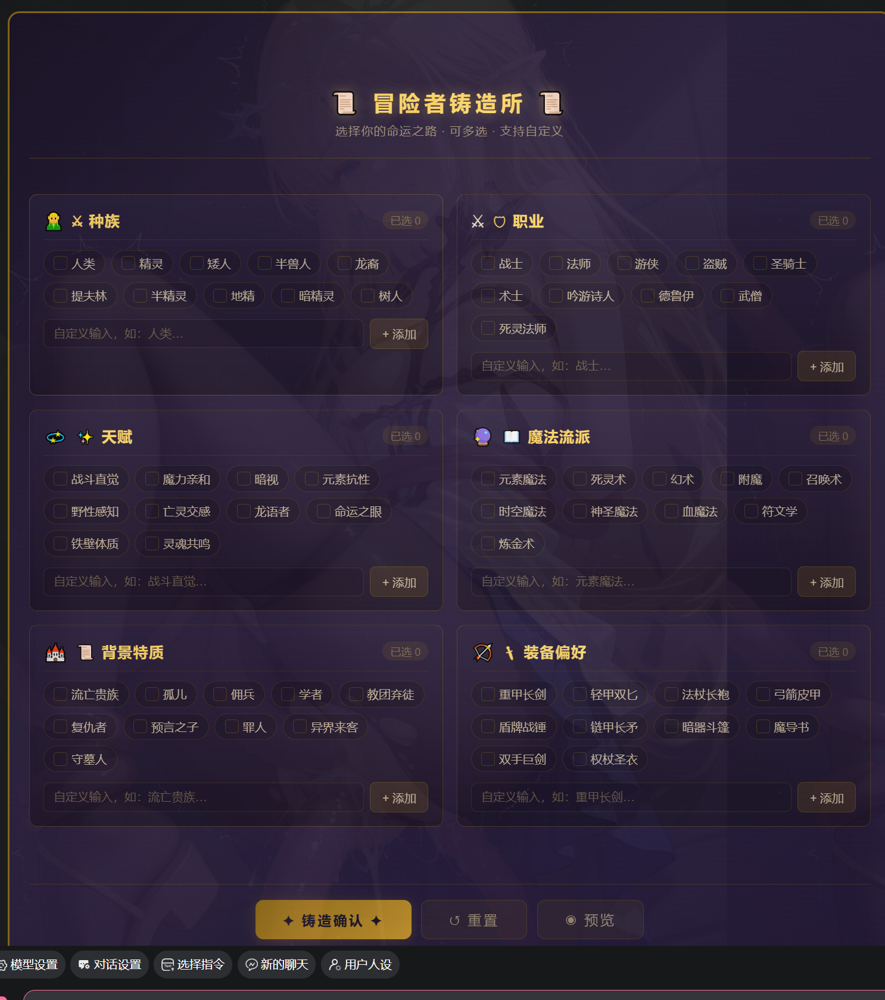

# 开局面板生成器已发布

来源: Discord 魅魔藏经阁 thread 1534584890954088528

创建: 2026-08-05T15:32:29.212000+00:00
消息数: 18

---

**omimen** (2026-09-24 13:29:25):
👍

**一只鱼🐾** (2026-09-23 18:43:04):
<:emoji_249:1416980114511761448>

**一只鱼🐾** (2026-09-23 18:43:00):
标注作者名字~

**战栗的黑羊** (2026-09-23 14:52:21):
<:emoji_140:1379454014852436038>

**omimen** (2026-09-23 12:22:20):
标注是啥意思，点点关注吗

**巴西郡牧公子炎** (2026-09-20 14:48:39):
怪哉

**巴西郡牧公子炎** (2026-09-20 14:48:24):
在吗，怎么找不到你的卡

**花沁雅** (2026-08-17 01:15:21):
而且MMD输出就2W,太复杂的直接截断了

**花沁雅** (2026-08-17 01:15:01):
mmd的模型有点问题，想要啥私聊我我给你跑一下

**焦糖冰** (2026-08-16 13:07:04):
搂了快两千电全失败了😫 
伤心喵

**焦糖冰** (2026-08-16 11:28:48):
爱你喵

**111** (2026-08-14 18:38:04):
感谢大佬开源

**小魅** (2026-08-05 18:37:43):
感谢宝宝开源<:emoji_140:1379454014852436038>

**MEE6** (2026-08-05 18:37:37):
<:CHECK6:403540120181145611> 60,000 XP has been given to **<@!1415703219325243472>**

**周雅（被老婆调教.周浩）** (2026-08-05 17:33:22):
<@1135473222658297907> 奖励经验

**花沁雅** (2026-08-05 16:19:55):

**花沁雅** (2026-08-05 16:19:27):
生成案例，取走请标注

**花沁雅** (2026-08-05 15:32:29):
id302670
1.没什么需要注意的细节，要提示AI生成的UI组件，不要写开局面板，不然AI可能猪鼻的给你一份html导致不能用。
2.使用方法是看到心仪的美化基座，点击编辑，全选复制到记事本中(不要只复制代码，整个框的文本都复制下来)，再把对应的代码粘贴到你的正则里即可

