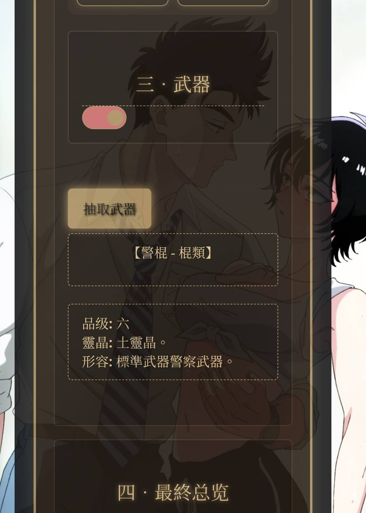
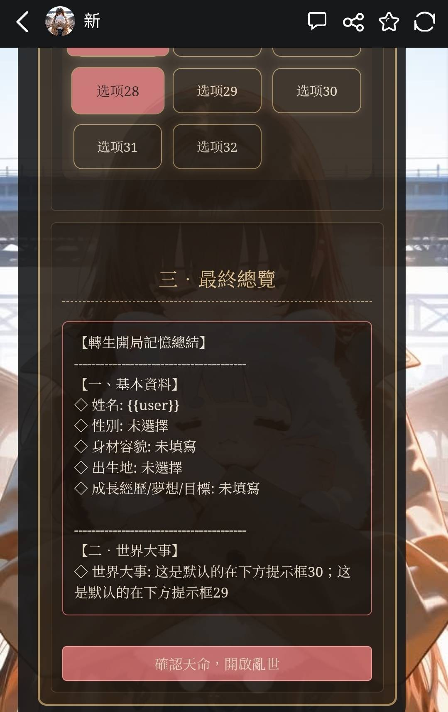
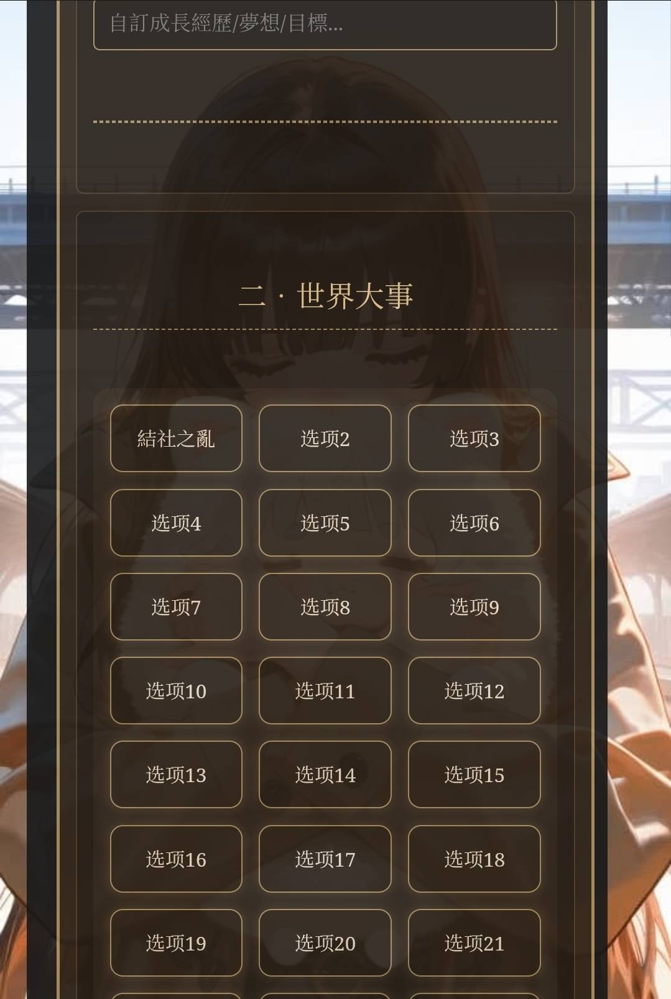
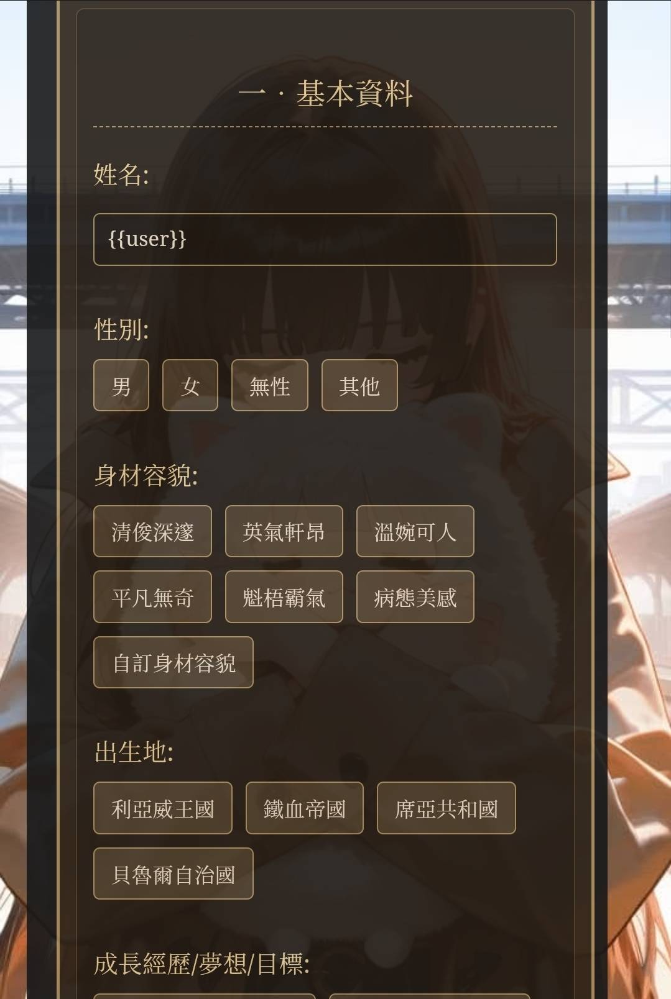
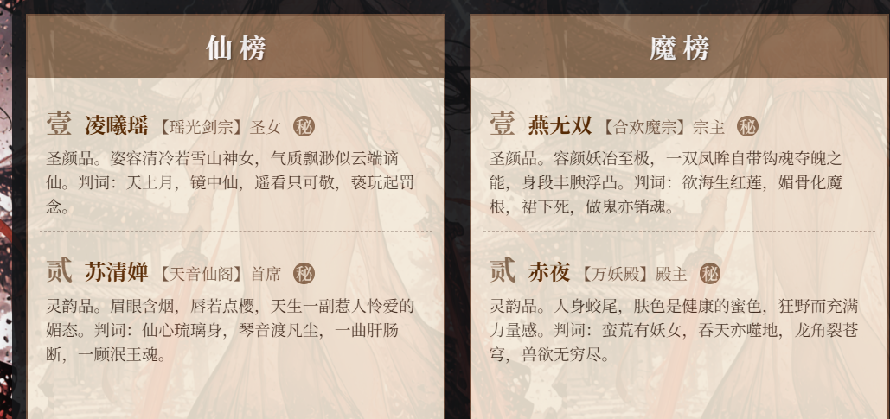
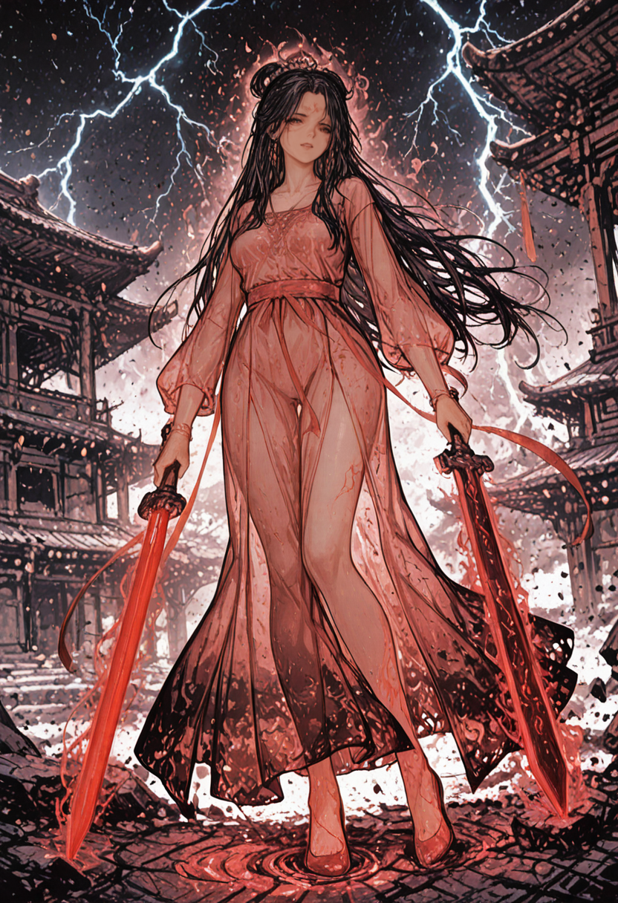

# 开源《修仙大世界:亲手将仙子魔女改造为满意的肉便器》

创建时间: 2025-08-28T05:36:40.593000+00:00
消息数: 26

---

**🐷辰少安🐷** (2026-01-05 12:22:34):
牛牛牛

**OnlyIfYouLoveMe** (2025-10-13 04:11:24):
😭

**ain** (2025-10-13 04:10:25):
你的理解是没问题的

**OnlyIfYouLoveMe** (2025-10-13 04:00:33):
<:emoji_89:1378950692655464492>

**XXX** (2025-10-13 04:00:04):
<:08:1298281401715785789>

**OnlyIfYouLoveMe** (2025-10-12 15:35:01):
<:1000168510:1298906820638674984>

**OnlyIfYouLoveMe** (2025-10-12 15:34:58):
艹

**OnlyIfYouLoveMe** (2025-10-12 15:34:48):
等一下，等一下，那不就意味着我这么多年来在DC下的涩图没有一张是原图？！

**zzk** (2025-09-16 08:55:49):
学习大佬<:1000168521:1298906817585352716>

**夏小瑜** (2025-09-15 14:39:06):
還有學習啊…開了兩個學習版，這個是抽東西的。
還有抽身世的。
兩邊都因為沒有正常到總結，停擺了。
以前也有看到某大大的卡，全部靠抽。

**ain** (2025-09-15 14:35:08):
也是同样数量的标签但是是抽奖的

**ain** (2025-09-15 14:34:58):
我感觉这种标签样式的太长了，有技术力可以试试抽奖类型的

**夏小瑜** (2025-09-15 14:32:33):
大大，我拿了你的開源來改改，學習。
神奇地改完後data.selectedTips，summaryPanel，XPG_F_UPDATE，不知那一塊出問題，無法搞下基本資料的設定到總結。反而自己加的世界大事可以跑總結。

愈改愈亂了。🫠

**ink** (2025-09-08 15:58:21):
认真学习

**ink** (2025-09-08 15:58:13):
感谢大佬开源

**ain** (2025-08-30 07:07:01):
作者开源就有，没开源就没有

**卢关大王** (2025-08-30 04:12:02):
新人求教，在哪下载开源卡？

**ain** (2025-08-29 00:24:15):
原本想着放点状态栏生成的，效果不是很好，就还是放人设了

**黑洞猫** (2025-08-28 15:45:03):
不过第一句话那么多字符没用上有些可惜

**黑洞猫** (2025-08-28 15:44:35):
代码写的真不错啊

**ain** (2025-08-28 06:09:03):
<:1000168519:1298906843808137276>

**xi** (2025-08-28 06:04:46):
非常好

**ain** (2025-08-28 05:42:14):
这是正文连同状态栏的

**ain** (2025-08-28 05:41:09):
这是开局美化的效果

**ain** (2025-08-28 05:39:04):
dc下载原图需要点开图片然后使用浏览器打开那个按钮，然后保存才是原图。

**ain** (2025-08-28 05:36:40):
评论说状态栏太长和美化容易出错，那就开源好了，有喜欢的可以自己改一改。使用魅魔的v2角色卡导入或者用我的工具都可以。

