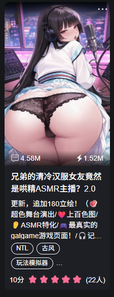

# 开源《兄弟的清冷汉服女友竟然是哄精ASMR主播?2.0》舞台卡以及一点点制作心得

来源: Discord 魅魔藏经阁 thread 1551935595595563008

创建: 2026-09-22T12:37:59.559000+00:00
消息数: 9

---

**莲华酱** (2026-09-24 06:39:30):
<:emoji_140:1379454014852436038>

**蓝月幽灵** (2026-09-23 15:31:22):
牛逼

**战栗的黑羊** (2026-09-23 14:53:36):
<:emoji_140:1379454014852436038>

**假装是s的m** (2026-09-23 09:35:45):
大佬太强了，玩了一晚上，带耳机食用太爽了，ASMR控有福了。

**洛尘（ଳ水母宗太上长老）** (2026-09-22 17:19:33):
<:emoji_140:1379454014852436038>

**弗洛洛** (2026-09-22 13:19:14):

**弗洛洛** (2026-09-22 12:42:10):
角色卡及正则如附件

**档案管理员** (2026-09-22 12:38:01):
[本帖尚未声明授权]()
发帖人尚未完成授权设置，或已选择跳过。本状态不代表允许转载、二次创作、商业使用或重新分发。

**弗洛洛** (2026-09-22 12:37:59):
开源一张实验性质的舞台卡供大家参考（等我彻底优化好再开源舞台卡skill以及套用模板<:emoji_249:1416980114511761448> ）

1.先讲语音：
核心模型：用的是阿里的 qwen-audio-3.0-tts-plus，选 longanhuan_v3.6 音色；
拒绝机械声的关键：开 1.1 倍速消灭拖音，在参数里喂自然语言指令控制情绪（比如直接写：“年轻女性贴近麦克风轻柔耳语，带微微笑意与湿润气息，语调慵懒宠溺，带有轻微唇齿开合与换气声，毫无播音腔”），出来的娇喘、耳语和吸气声真实得像趴在你耳边说话；
对白加入标点诱导：文本中多使用 ……（长气停顿）、呼……哈啊……（拟声），大模型会自动解析并合成拟真的吸气、吞咽和微喘（实现ASMR效果的关键）；
角色卡前端无感接入：
台词自动对齐：前端自动扫分镜文本关键词匹配音频，大模型不用在正文里打繁琐音频指令；
BGM 智能避让 ：只要角色开口说话，背景音乐自动平滑压低到 35% 给轻语让路，说完自动淡入恢复；
预加载秒播：开场直接把切片缓存进内存，手机摸一下屏幕就解锁自动播放限制，达到翻页零延迟秒出声的效果。

2.批量绘图：用 AI Agent 直接驱动 NovelAI 批量生成演出立绘，是压低整套舞台演出流程成本的关键。
详情见readme文档

