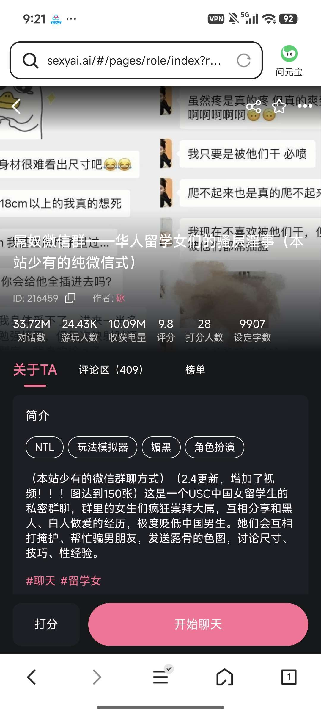

# 开源《屌奴微信群》这张老卡

创建时间: 2026-08-07T01:25:04.249000+00:00
消息数: 26

---

**砯** (2026-09-02 05:36:23):
平均一个十秒钟左右

**砯** (2026-09-02 05:36:13):
本站能存5mb大小的视频

**砯** (2026-09-02 05:36:03):
对的

**omimen** (2026-09-02 05:35:47):
啊，那视频这么多放哪里啊？靠转链接转过去吗？

**砯** (2026-09-02 05:35:15):

**砯** (2026-09-02 05:33:27):
那个甚至是可以放视频，结果只能打开视频但是关闭不了

**砯** (2026-09-02 05:32:52):
我其实之前试着弄了个抖音模拟器

**砯** (2026-09-02 05:22:30):
看新功能占比吧，好像主要玩法不变且没有大幅度改动

**omimen** (2026-09-02 05:20:53):
<:emoji_249:1443611666678812886> 搞点新功能也算吗？

**砯** (2026-09-02 05:20:04):
以前不是说内容如果高度重合就会判定重复吗（）

**omimen** (2026-09-02 03:01:34):
我还想等作者搞个2.0来看看呢<:emoji_144:1379454084750245939>

**砯** (2026-09-02 02:39:10):
所以最好的话是找一个好用的ai帮你跑一段（一个人写肯定是不行，除非你有相应功底）

**砯** (2026-09-02 02:38:14):
写卡的时候是需要用到代码的，因为如果只用文字表述的话，出来的结果是天差地别的，可能（）和<>这两个括号的生成错误，就导致你的整个界面全部变成乱码

**索契** (2026-08-31 10:28:14):
佬，我非常非常非常喜欢这张卡，电基本上都花在这张卡上了。
看到这张卡开源了，非常感谢。
我也想写一张类似的卡(之前没写过卡)，之前我只写过用户设定和额外设定，只用中文就可以。
我看了开源文件，都是带有前端代码的，写卡的时候就是这样写的吗？还是说只用文字描述即可？

**砯** (2026-08-07 14:09:49):
谢谢浩老师和小魅，以及各位老师

**艾斯卡诺ദ്ദി˶•̀֊•́)✧** (2026-08-07 08:29:43):
很厉害…收藏收藏！

**雾辞（中了兄弟变小男娘）** (2026-08-07 05:24:56):
<:07:1298281204260278383>

**小魅** (2026-08-07 05:16:44):
感谢宝宝开源<:emoji_140:1379454014852436038>

**MEE6** (2026-08-07 05:16:30):
<:CHECK6:403540120181145611> 30,000 XP has been given to **<@!1430554933601505373>**

**周雅（被老婆调教.周浩）** (2026-08-07 01:59:02):
<@1135473222658297907> 奖励经验

**砯** (2026-08-07 01:32:45):
当然也欢迎大佬们帮我纠正问题，这张卡前期巨能冲后期停滞了我也确实有些懵逼

**砯** (2026-08-07 01:26:43):

**砯** (2026-08-07 01:26:29):

**砯** (2026-08-07 01:25:48):
我不会直接弄到图片里，就把三部分都发出来吧哈哈

**砯** (2026-08-07 01:25:21):

**砯** (2026-08-07 01:25:04):
这张卡算是我最火的一张卡了。所有的代码内容也都是我自己找茶壶卡一点点跑出来的（所以水平很次），不过也稍有可取之处。给大家用用吧，尤其是想要做聊天平台类型的卡的朋友可能用得上。我不会把内存都存到图里，请各位体谅捏

