# 开源一个RAG记忆数据库……赞美记忆

创建时间: 2026-08-13T10:54:44.378000+00:00
消息数: 1308

---

**燚（被秋姐变性版）** (2026-08-23 09:09:16):
好

**Ggg「🥚」** (2026-08-23 09:09:13):
我私发你就知道了

**燚（被秋姐变性版）** (2026-08-23 09:09:11):
还是说帮你测试新卡，顺便看看有没有bug？

**燚（被秋姐变性版）** (2026-08-23 09:08:35):
状态栏？

**Ggg「🥚」** (2026-08-23 09:08:08):
有兴趣试试我的新版本吗？看看有没有问题

**Ggg「🥚」** (2026-08-23 09:07:45):
用不上的可以不放，你看那些骰子什么的

**燚（被秋姐变性版）** (2026-08-23 09:07:30):
我看看把波奇佬的助手尽量弄干净一些，或者直接去掉

**燚（被秋姐变性版）** (2026-08-23 09:06:53):
<:emoji_148:1382329938404839586>

**燚（被秋姐变性版）** (2026-08-23 09:06:50):
东拼西凑

**Ggg「🥚」** (2026-08-23 09:06:49):
塞太多了属于是

**Ggg「🥚」** (2026-08-23 09:06:41):
你这个问题在于东西太多，渲染也乱

**燚（被秋姐变性版）** (2026-08-23 09:06:27):
OK

**Ggg「🥚」** (2026-08-23 09:06:24):
对

**Ggg「🥚」** (2026-08-23 09:06:08):
其实你状态栏越复杂，模型负担越大

**燚（被秋姐变性版）** (2026-08-23 09:06:02):
4.5或者4.6高智？

**Ggg「🥚」** (2026-08-23 09:05:48):
一般我是用40或者100

**燚（被秋姐变性版）** (2026-08-23 09:05:43):
我好在开场白推荐用模型

**燚（被秋姐变性版）** (2026-08-23 09:05:32):
你们用的是哪个模型

**Ggg「🥚」** (2026-08-23 09:05:31):
<:07:1298281204260278383>

**燚（被秋姐变性版）** (2026-08-23 09:05:06):
<:emoji_140:1379454014852436038>

**燚（被秋姐变性版）** (2026-08-23 09:05:03):
好的，麻烦你了，蛋仔佬

**Ggg「🥚」** (2026-08-23 09:04:37):
可以啊。其实我跟朋友都玩几百轮。在各个卡都没什么问题。。

**燚（被秋姐变性版）** (2026-08-23 08:59:32):
只留下需要的部分

**燚（被秋姐变性版）** (2026-08-23 08:59:24):
到时候我把游玩助手的特化都删除掉

**燚（被秋姐变性版）** (2026-08-23 08:59:04):
下张卡我先弄好了，测试的时候你方便帮一下吗

**燚（被秋姐变性版）** (2026-08-23 08:58:50):
下张卡来吧，这张卡就这样了

**燚（被秋姐变性版）** (2026-08-23 08:58:13):
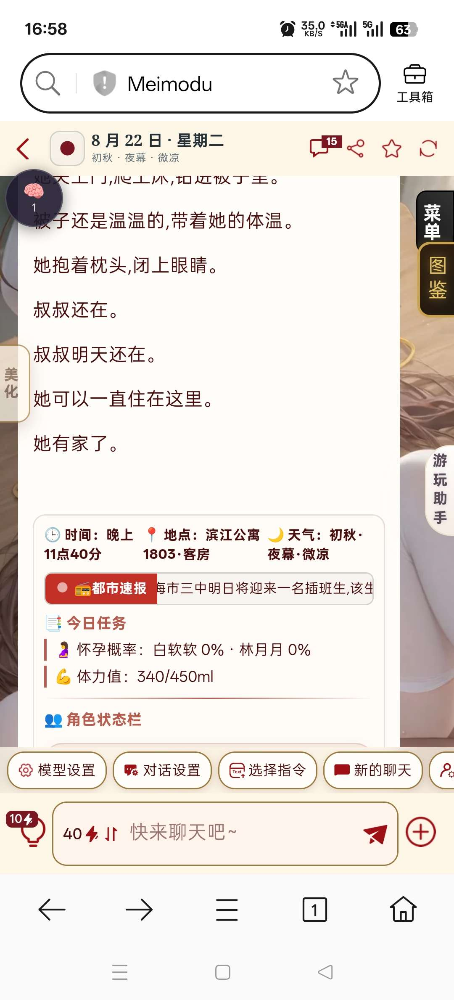

**燚（被秋姐变性版）** (2026-08-23 08:57:55):
需要我点击重新扫描，大脑才会把它吃进去

**Ggg「🥚」** (2026-08-23 08:57:53):
<:emoji_249:1416980114511761448>

**Ggg「🥚」** (2026-08-23 08:57:48):
应该是你各种各样东西太多，乱格式了

**燚（被秋姐变性版）** (2026-08-23 08:57:05):
你看看

**燚（被秋姐变性版）** (2026-08-23 08:56:44):
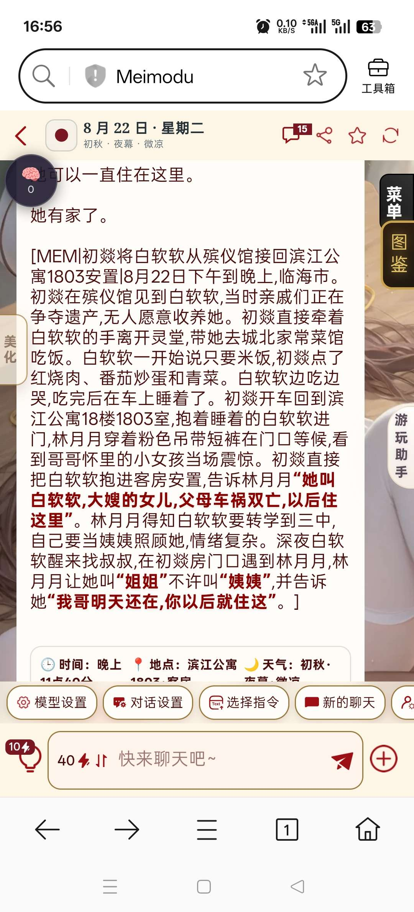
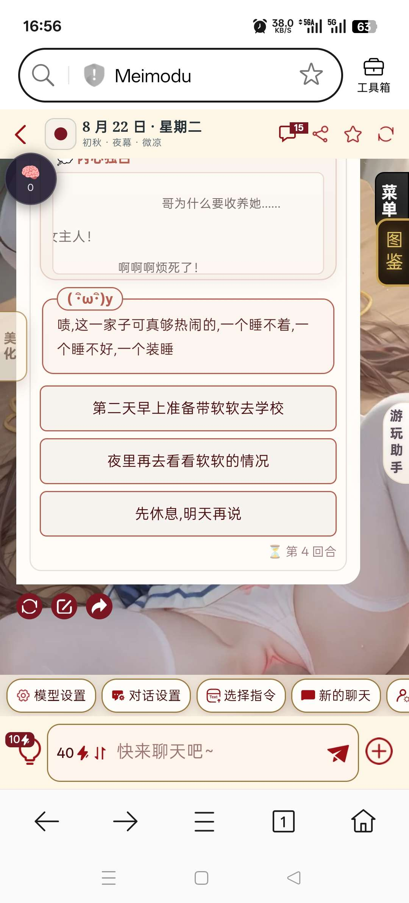

**燚（被秋姐变性版）** (2026-08-23 08:56:36):
而且不会消失

**燚（被秋姐变性版）** (2026-08-23 08:56:27):
但是跑到状态栏上面去了

**燚（被秋姐变性版）** (2026-08-23 08:56:19):
第四轮确实开始自动总结了

**燚（被秋姐变性版）** (2026-08-23 08:56:11):
出问题了

**燚（被秋姐变性版）** (2026-08-23 08:55:40):
<:emoji_148:1382329938404839586>

**燚（被秋姐变性版）** (2026-08-23 08:55:35):
我也不会，但是我会复制粘贴

**燚（被秋姐变性版）** (2026-08-23 08:55:27):
她不会代码那些

**燚（被秋姐变性版）** (2026-08-23 08:55:21):
她的正则那些都是我在弄

**燚（被秋姐变性版）** (2026-08-23 08:55:12):
她的号

**燚（被秋姐变性版）** (2026-08-23 08:55:07):
我朋友

**Ggg「🥚」** (2026-08-23 08:51:36):
<:emoji_148:1382329938404839586>

**Ggg「🥚」** (2026-08-23 08:51:33):
所以是你小号吗

**Ggg「🥚」** (2026-08-23 08:51:18):
对的，本身你自己手打都已经够完整够细了。想稳定，还是得控字符。

**燚（被秋姐变性版）** (2026-08-23 08:50:35):
好的

**Ggg「🥚」** (2026-08-23 08:50:19):
你留意一下，下次出现这情况的时候，是不是最底下，没有编辑按钮
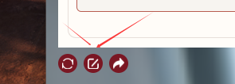

**燚（被秋姐变性版）** (2026-08-23 08:49:22):
特化开太多就不行了

**燚（被秋姐变性版）** (2026-08-23 08:49:14):
确实，不过偶尔选一个拿出来用还行

**Ggg「🥚」** (2026-08-23 08:48:59):
特化挺好，就是占字符（<:emoji_249:1416980114511761448> ）

**燚（被秋姐变性版）** (2026-08-23 08:48:18):
到时候我把特化拿出来删掉

**燚（被秋姐变性版）** (2026-08-23 08:48:07):
那就去掉特化这一块了

**Ggg「🥚」** (2026-08-23 08:47:58):
因为你这张我看了，满满当当，你不知道他丢的时候，是不是因为设定被挤走了

**Ggg「🥚」** (2026-08-23 08:47:35):
其实我建议是下一张，常驻字符（含绿灯）不超15000的才有意义

**燚（被秋姐变性版）** (2026-08-23 08:45:36):
我重头用克劳德发十轮对话试试，看看能不能正常的每四轮总结一次

**燚（被秋姐变性版）** (2026-08-23 08:43:50):
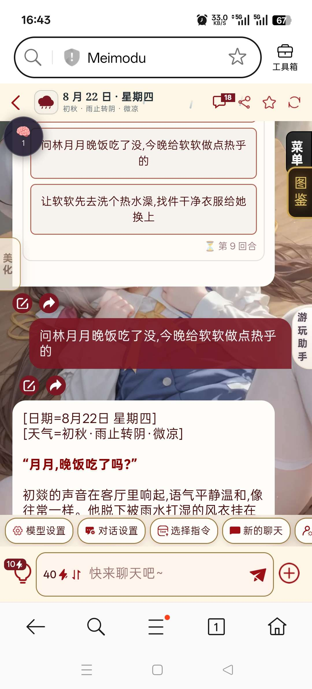

**燚（被秋姐变性版）** (2026-08-23 08:43:21):
进入大脑里面了

**燚（被秋姐变性版）** (2026-08-23 08:43:16):
刷新还在，但是发下一段剧情后，就消失了

**Ggg「🥚」** (2026-08-23 08:42:26):
或者把最后那段东西，发我

**Ggg「🥚」** (2026-08-23 08:42:09):
你刷新看看

**燚（被秋姐变性版）** (2026-08-23 08:42:01):
直接在状态栏下面标出来了

**燚（被秋姐变性版）** (2026-08-23 08:41:49):
没

**Ggg「🥚」** (2026-08-23 08:41:44):
没隐藏？

**燚（被秋姐变性版）** (2026-08-23 08:41:11):
这种是什么问题

**燚（被秋姐变性版）** (2026-08-23 08:41:04):
<@557937040981753912>

**燚（被秋姐变性版）** (2026-08-23 08:40:16):
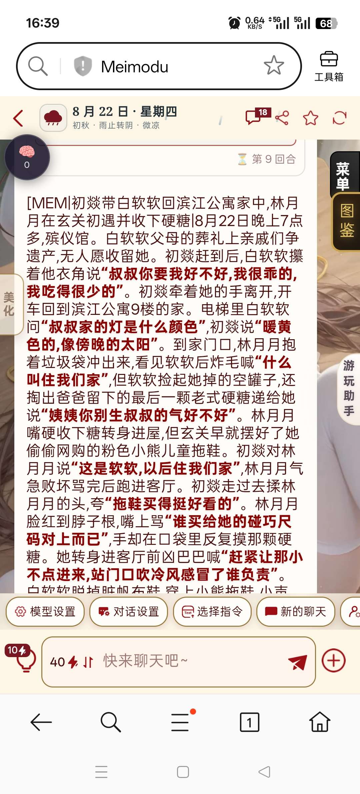

**燚（被秋姐变性版）** (2026-08-23 08:40:07):
用的克劳德4.5

**燚（被秋姐变性版）** (2026-08-23 08:40:06):
<:1000168510:1298906820638674984>

**燚（被秋姐变性版）** (2026-08-23 08:40:05):
变成这样了

**Ggg「🥚」** (2026-08-23 08:36:27):
嗯。因为我几个卡都测过，不过我的卡都没超常驻字符的

**燚（被秋姐变性版）** (2026-08-23 08:35:47):
我换一个模型再试试

**燚（被秋姐变性版）** (2026-08-23 08:35:41):
估计是模型问题吧

**燚（被秋姐变性版）** (2026-08-23 08:35:34):
用的ds

**燚（被秋姐变性版）** (2026-08-23 08:35:28):
不行，更新了也还是没用，七轮对话没有进行总结，点了脑袋的立即总结，下一轮对话后也还是没总结

**燚（被秋姐变性版）** (2026-08-23 08:31:30):
好的，正在测试着了

**Ggg「🥚」** (2026-08-23 08:30:15):
其实最根本原因就是世界书超字，导致没读取到指令

**Ggg「🥚」** (2026-08-23 08:28:34):
现在不用加了

**燚（被秋姐变性版）** (2026-08-23 08:28:10):
然后接下来两轮都自动

**燚（被秋姐变性版）** (2026-08-23 08:28:00):
加了一轮

**Ggg「🥚」** (2026-08-23 08:27:53):
你刚刚是每轮都手动加吗。？还是加了一轮后就一直总结

**燚（被秋姐变性版）** (2026-08-23 08:27:53):
我现在替换了，正在试着

**Ggg「🥚」** (2026-08-23 08:27:31):
旧的不记忆，估计还没更新成常驻，然后你世界书常驻字符又超出

**燚（被秋姐变性版）** (2026-08-23 08:23:11):
好的

**Ggg「🥚」** (2026-08-23 08:22:29):
没事，我试旧的也一样

**燚（被秋姐变性版）** (2026-08-23 08:22:09):
我这边替换了试试

**燚（被秋姐变性版）** (2026-08-23 08:22:02):
你那边要等更新才能测试的到了

**Ggg「🥚」** (2026-08-23 08:21:45):
顺便我去你的卡试试

**Ggg「🥚」** (2026-08-23 08:21:39):
不用手动加提取

**燚（被秋姐变性版）** (2026-08-23 08:21:38):
好的

**Ggg「🥚」** (2026-08-23 08:21:27):
你直接复制这个，替换掉你原来正则里的内容

**燚（被秋姐变性版）** (2026-08-23 08:19:44):
就是手动加了记忆提取后

**燚（被秋姐变性版）** (2026-08-23 08:19:26):
我发出这段话后，就会开始一轮一次

**Ggg「🥚」** (2026-08-23 08:19:21):
这是刚总结完是吗

**燚（被秋姐变性版）** (2026-08-23 08:18:44):
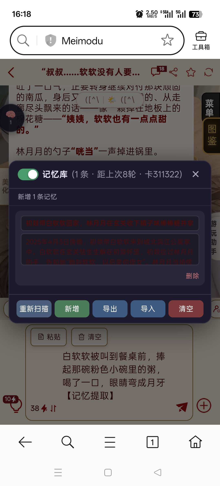

**燚（被秋姐变性版）** (2026-08-23 08:18:19):
好，等一下

**Ggg「🥚」** (2026-08-23 08:18:09):
你帮我看看这个。

**燚（被秋姐变性版）** (2026-08-23 08:16:04):
不是，v2

**Ggg「🥚」** (2026-08-23 08:15:55):
是刚刚那V3？

**燚（被秋姐变性版）** (2026-08-23 08:15:51):
改成常驻后

**燚（被秋姐变性版）** (2026-08-23 08:15:44):
出现了

**Ggg「🥚」** (2026-08-23 08:15:39):
你出现了吗？这个我应该修过的

**燚（被秋姐变性版）** (2026-08-23 08:15:18):
佬

**燚（被秋姐变性版）** (2026-08-23 08:14:42):
那是什么问题

**燚（被秋姐变性版）** (2026-08-23 08:14:38):
对了，如果出现，每回合都记忆的情况

**燚（被秋姐变性版）** (2026-08-23 08:14:28):
好的

**Ggg「🥚」** (2026-08-23 08:12:13):
常驻只是让你更方便计算，你应该试试不开特化。。反正举个例子就是，如果你要开1个特化，那你常驻最好别超过13000.2个特化。就别超过11000

**燚（被秋姐变性版）** (2026-08-23 08:10:34):
我去试试改成常驻后的自动记忆

**Ggg「🥚」** (2026-08-23 08:09:15):
因为他设的优先级很高

**Ggg「🥚」** (2026-08-23 08:09:01):
不会，特化还是能用，但是特化会影响到你自己写的设定会被挤走

**燚（被秋姐变性版）** (2026-08-23 08:08:25):
知道，我现在这样就是特化方面用不了

**Ggg「🥚」** (2026-08-23 08:08:02):
可以看看这个大佬写的世界书教学，就知道怎么回事了

**Ggg「🥚」** (2026-08-23 08:07:26):
https://discord.com/channels/1205870897769095229/1448988105922314261/1448988105922314261

**Ggg「🥚」** (2026-08-23 08:06:25):
太高了

**Ggg「🥚」** (2026-08-23 08:06:20):
你看这个

**燚（被秋姐变性版）** (2026-08-23 08:05:32):
已经改常驻了

**燚（被秋姐变性版）** (2026-08-23 08:05:16):
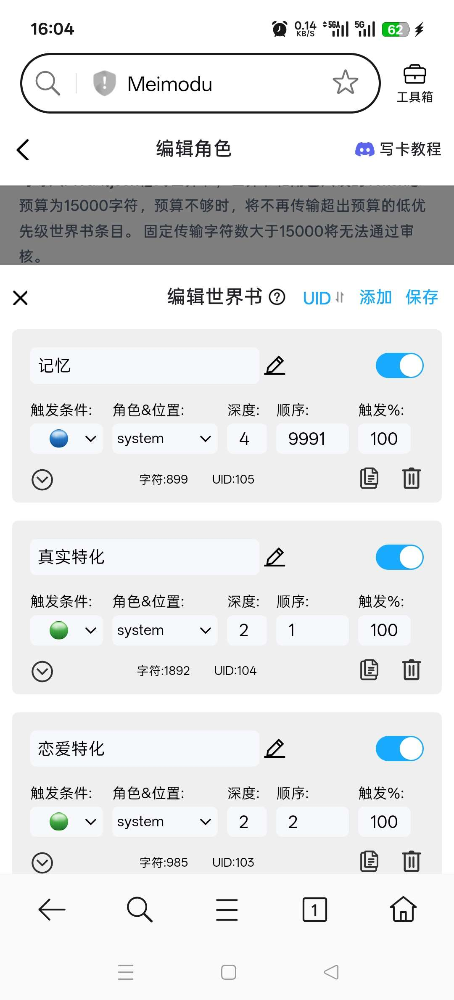

**燚（被秋姐变性版）** (2026-08-23 08:05:11):
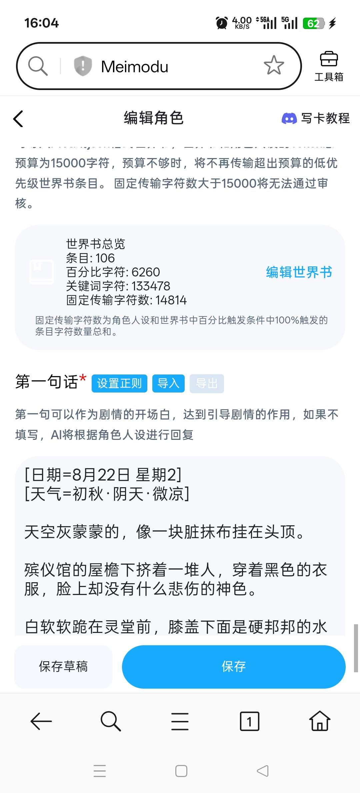

**Ggg「🥚」** (2026-08-23 08:00:57):
好，我去看看……还有这版改成无限重试了，你可以下次用。以防你设定超1.5w……但最好还是自己控制一下，我记得开源有个世界书字符计算的。

**Ggg「🥚」** (2026-08-23 07:59:26):

**Ggg「🥚」** (2026-08-23 07:58:01):
你写的卡会跑的不稳定

**Ggg「🥚」** (2026-08-23 07:57:56):
如果你常驻设定高。特化开的多，就会漏这漏那了

**Ggg「🥚」** (2026-08-23 07:57:18):
反正你可以记一下，波奇的特化，一个差不多占1.5k~2k字符

**燚（被秋姐变性版）** (2026-08-23 07:56:04):
我改成常驻了

**燚（被秋姐变性版）** (2026-08-23 07:55:58):
日榜第六

**Ggg「🥚」** (2026-08-23 07:55:43):
哪张，我去玩看看

**Ggg「🥚」** (2026-08-23 07:55:20):
写卡最好就是常驻设定不要太满，不然会漏设定，尤其是优先级打不过波奇的深度的时候

**燚（被秋姐变性版）** (2026-08-23 07:54:32):
好的

**燚（被秋姐变性版）** (2026-08-23 07:54:25):
那就下张卡我改改试试，这张卡已经快结束日榜了

**Ggg「🥚」** (2026-08-23 07:54:25):
他漏读了提取指令，就不会总结了

**Ggg「🥚」** (2026-08-23 07:53:59):
根据优先级截断，以为这你的设定会漏读

**Ggg「🥚」** (2026-08-23 07:53:48):
多的就会截断

**Ggg「🥚」** (2026-08-23 07:53:40):
MMD限定每次输入（世界书跟设定，上限是1.5万）

**燚（被秋姐变性版）** (2026-08-23 07:53:40):
就是提取指令改成常驻，不要用触发？

**Ggg「🥚」** (2026-08-23 07:53:22):
不是输出的问题

**Ggg「🥚」** (2026-08-23 07:53:16):
最理想状态就是常驻如果是1.3万的话，特化不要超过1个。把提取指令改成常驻，这样你方便计算。

**燚（被秋姐变性版）** (2026-08-23 07:52:14):
缩减固定输出字数？

**燚（被秋姐变性版）** (2026-08-23 07:52:00):
那这种怎么处理

**Ggg「🥚」** (2026-08-23 07:51:44):
MMD超过1.5 。他就选读了

**燚（被秋姐变性版）** (2026-08-23 07:51:39):
对，都是2

**Ggg「🥚」** (2026-08-23 07:51:29):
而波奇的深度设到2，挺低的

**Ggg「🥚」** (2026-08-23 07:51:05):
那就是说明一个特化就已经超出1.5w了

**燚（被秋姐变性版）** (2026-08-23 07:50:52):
常驻14000

**Ggg「🥚」** (2026-08-23 07:50:43):
常驻是多少

**燚（被秋姐变性版）** (2026-08-23 07:50:31):
用的波奇的

**燚（被秋姐变性版）** (2026-08-23 07:50:26):
有

**燚（被秋姐变性版）** (2026-08-23 07:50:23):
触发的吗

**Ggg「🥚」** (2026-08-23 07:50:12):
世界书有超过15000吗

**燚（被秋姐变性版）** (2026-08-23 07:49:48):
成功

**Ggg「🥚」** (2026-08-23 07:49:39):
手动输入的时候，他成功吗？

**燚（被秋姐变性版）** (2026-08-23 04:42:33):
就是这个

**燚（被秋姐变性版）** (2026-08-23 04:42:20):
试了，用的是最新版的，有时候七八轮不总结

**Ggg「🥚」** (2026-08-23 04:24:29):
刚刚测了，4.5克劳德，40电的，有正常总结🤔 你试试手动输入【记忆提取】。我怀疑你轮次没到，误以为失败了

**Ggg「🥚」** (2026-08-23 04:09:57):
你切4.6试试，如果4.6可行，就是模型问题……我测是稳定的。总结轮数会在第4轮。还是你以为每轮有总结

**燚（被秋姐变性版）** (2026-08-22 11:30:38):
用的克劳德4.5

**燚（被秋姐变性版）** (2026-08-22 11:30:33):
没有修改

**燚（被秋姐变性版）** (2026-08-22 11:30:31):
正则和世界书都导入进去了

**燚（被秋姐变性版）** (2026-08-22 11:30:23):
佬，不会自动总结怎么办

**Ggg「🥚」** (2026-08-17 12:34:40):
除非不放状态栏的<:emoji_249:1416980114511761448>

**镜（魅魔3组！纨绔模拟器~）** (2026-08-17 09:02:07):
<:1000168510:1298906820638674984> 现在都发展这么快了吗？不用总结了？

**不要殴打土木术士** (2026-08-16 03:23:14):
我去，感谢佬的开源

**Ggg「🥚」** (2026-08-16 02:50:32):
小改动，注入隐藏更干净

**Ggg「🥚」** (2026-08-15 15:04:01):

**牢 · k** (2026-08-15 06:06:04):
我吃

**冲浪检察官** (2026-08-15 04:01:00):
插眼

**苏墨白** (2026-08-14 10:19:56):
改下逻辑就是你这个，本质都是让ai在读取，放在本地缓存就行了

**Ggg「🥚」** (2026-08-14 09:37:43):
我看了下，你那个是手动抓取当前回复的数据渲染成界面，点了之后往输入框填指令。我这个是全自动存取记忆，检索召回。方向不太一样，不过侧边栏那个确实帅。以后写模拟器用得上

**苏墨白** (2026-08-14 09:09:04):
找花沁雅的侧边栏来源，那里就有类似的

**Ggg「🥚」** (2026-08-14 08:20:44):
哪啊？之前搜索都没找到，如果早点知道就不用自己弄了

**苏墨白** (2026-08-14 07:59:30):
有没有可能，我前一阵就发过类似的功能

**Ggg「🥚」** (2026-08-14 07:57:03):
总结到后面就开始浓缩丢细节了

**Ggg「🥚」** (2026-08-14 07:56:40):
但不知道接口，没办法隐式注入就是了

**Ggg「🥚」** (2026-08-14 07:56:27):
现在这个抓取和注入就是等于用户自己总结呀，只不过变成自动而已，毕竟可以改

**苏墨白** (2026-08-14 07:54:44):
没有，mmd里抓取和注入本身就很鸡肋。不如让用户自己总结

**Ggg「🥚」** (2026-08-14 07:50:56):
只是很久之前想写，就完成它了<:emoji_148:1382329938404839586> <:emoji_148:1382329938404839586>

**Ggg「🥚」** (2026-08-14 07:50:39):
是说长记忆在现下好像用的不多

**Ggg「🥚」** (2026-08-14 07:50:14):
哦，不是说时停卡啦

**Ggg「🥚」** (2026-08-14 07:50:06):
有什么更好的么

**乱马（参赛卡艾泽尔酒店）** (2026-08-14 07:50:00):
呃，AI都被暂停了，那不跟木头没区别了

**乱马（参赛卡艾泽尔酒店）** (2026-08-14 07:49:38):
感觉是时停题材不怎么样🤔

**苏墨白** (2026-08-14 07:49:13):
<:emoji_277:1501430172040298566> 这功能我已经弄过了，只能说鸡肋

**Ggg「🥚」** (2026-08-14 07:45:50):
剧情卡路边一条<:1000168531:1298906724979310634> <:1000168531:1298906724979310634>

**苏墨白** (2026-08-14 07:41:57):
<:emoji_250:1459542480406970432> 想多了只能说

**牢 · k** (2026-08-13 15:18:51):
等待大记忆时代的到来……

**小魅** (2026-08-13 15:18:35):
好东西呀！感谢开源<:emoji_140:1379454014852436038>

**MEE6** (2026-08-13 15:17:25):
<:CHECK6:403540120181145611> 100,000 XP has been given to **<@!557937040981753912>**

**Ggg「🥚」** (2026-08-13 13:36:14):
到时候看看了……

**乱马（参赛卡艾泽尔酒店）** (2026-08-13 13:35:38):
如果单个人物不是很长，最后加起来没有超过15,000的话是完全可以的，只要不超过15,000任何内容都可以生成，大世界就是在这个基础上诞生的

**Ggg「🥚」** (2026-08-13 13:35:34):
也可以？比如一个小村庄，里面很多女角色

**乱马（参赛卡艾泽尔酒店）** (2026-08-13 13:35:02):
你说的是同时跟他们一起玩吗？

**Ggg「🥚」** (2026-08-13 13:34:49):
就是多角色，但不是随机生成的

**乱马（参赛卡艾泽尔酒店）** (2026-08-13 13:34:04):
啥意思啊？没听懂。

**Ggg「🥚」** (2026-08-13 13:33:51):
话说那些多预设角色的卡，会多人玩吗

**乱马（参赛卡艾泽尔酒店）** (2026-08-13 13:33:46):
<:emoji_115:1379113943817257071>

**月月鸟（思维枯竭）** (2026-08-13 13:33:37):
<:emoji_115:1379113943817257071>

**月月鸟（思维枯竭）** (2026-08-13 13:33:31):
我是垃圾!

**乱马（参赛卡艾泽尔酒店）** (2026-08-13 13:32:07):
在写卡区哭

**Ggg「🥚」** (2026-08-13 13:31:45):
小弟呢

**Ggg「🥚」** (2026-08-13 13:31:36):
倒不会，不过谢了

**谢特** (2026-08-13 13:31:31):
<:emoji_277:1509842116417818654>

**谢特** (2026-08-13 13:31:27):
大弟是垃圾

**乱马（参赛卡艾泽尔酒店）** (2026-08-13 13:30:55):
你平常弄正则，不知道会不会麻烦，我再推荐一个合并工具吧

**Ggg「🥚」** (2026-08-13 13:30:16):
收藏了

**乱马（参赛卡艾泽尔酒店）** (2026-08-13 13:29:36):
有没有可能你在用这个SOP的过程相当于手搓，只不过省了你打字的功夫

**Ggg「🥚」** (2026-08-13 13:29:24):
到时候再去看看，写枪卡肯定可以用

**Ggg「🥚」** (2026-08-13 13:29:07):
我返璞归真，手搓再让AI排版

**乱马（参赛卡艾泽尔酒店）** (2026-08-13 13:29:01):
<:emoji_115:1379113943817257071>

**乱马（参赛卡艾泽尔酒店）** (2026-08-13 13:28:56):
咋啦？

**月月鸟（思维枯竭）** (2026-08-13 13:28:41):
批量吐垃圾了属于是<:emoji_115:1379113943817257071>

**乱马（参赛卡艾泽尔酒店）** (2026-08-13 13:28:14):
不是写卡助手，是写角色人设的制作流程，你用一下就知道了，写起来真的很快啊，而且质量比我前两个月死皮赖脸套模板弄出来的好多了

**Ggg「🥚」** (2026-08-13 13:27:50):
一条龙了

**Ggg「🥚」** (2026-08-13 13:27:32):
不过如果写枪卡应该可以

**Ggg「🥚」** (2026-08-13 13:27:21):
我也有写卡助手，只是很少用

**乱马（参赛卡艾泽尔酒店）** (2026-08-13 13:27:07):
我这个不是直接的模板，是你自己去设计的，你看一下那个SOP吧

**Ggg「🥚」** (2026-08-13 13:26:54):
至少酒馆是

**Ggg「🥚」** (2026-08-13 13:26:48):
手搓其实会活一点

**Ggg「🥚」** (2026-08-13 13:26:30):
色图才助手是吧

**谢特** (2026-08-13 13:26:28):
二十分钟出一张肉卡

**乱马（参赛卡艾泽尔酒店）** (2026-08-13 13:26:27):
虽然但是手搓出来的不一定有AI生成的好，要不你试试看

**谢特** (2026-08-13 13:26:23):
加上写烂的题材

**谢特** (2026-08-13 13:26:14):
功能栏套上去五分钟

**Ggg「🥚」** (2026-08-13 13:26:06):
手搓！

**谢特** (2026-08-13 13:26:03):
你看我发的刚刚两张图片

**谢特** (2026-08-13 13:25:56):
随便写一个题材就行了

**谢特** (2026-08-13 13:25:50):
<:emoji_149:1400299483212021833>

**乱马（参赛卡艾泽尔酒店）** (2026-08-13 13:25:44):
写卡写起来很快的，至少我觉得挺快的，堆料也挺快，现在开原的东西很多

**Ggg「🥚」** (2026-08-13 13:25:30):
我写卡很慢的

**Ggg「🥚」** (2026-08-13 13:25:20):
那么多卡，刷刷过那么快

**乱马（参赛卡艾泽尔酒店）** (2026-08-13 13:25:19):
反正发卡次数是免费的，写一张自己想玩的，写两张肉卡，根本不会耽误原则

**Ggg「🥚」** (2026-08-13 13:25:11):
是的。。。

**月月鸟（思维枯竭）** (2026-08-13 13:25:09):
看情况吧，这个我也不知道

**谢特** (2026-08-13 13:25:05):
当作者很累的

**月月鸟（思维枯竭）** (2026-08-13 13:25:02):
我就说群友是顶配ai吧

**谢特** (2026-08-13 13:24:58):
要签约的吧

**月月鸟（思维枯竭）** (2026-08-13 13:24:53):
也不怕新作褒姒<:emoji_242:1459832161719943198>

**月月鸟（思维枯竭）** (2026-08-13 13:24:47):
反正褒姒那么多卡

**月月鸟（思维枯竭）** (2026-08-13 13:24:42):
现在当作者后有胆子了

**月月鸟（思维枯竭）** (2026-08-13 13:24:32):
但是不敢写

**谢特** (2026-08-13 13:24:31):
牛吗

**月月鸟（思维枯竭）** (2026-08-13 13:24:26):
我其实一开始是想走小说路子的

**月月鸟（思维枯竭）** (2026-08-13 13:24:19):
那不会

**Ggg「🥚」** (2026-08-13 13:24:03):
黄吗

**月月鸟（思维枯竭）** (2026-08-13 13:23:47):
到时候写小说捞外快去

**谢特** (2026-08-13 13:23:35):
我喜欢玩扶她卡正好扶她卡又是我全部类型里面数据最高的

**月月鸟（思维枯竭）** (2026-08-13 13:23:32):
我打算靠工具卡去整个小说大纲和框架了

**Ggg「🥚」** (2026-08-13 13:23:31):
我也。之前吃太多了，而且写卡，写一张，没一个XP

**乱马（参赛卡艾泽尔酒店）** (2026-08-13 13:23:29):
我的新卡就是满足了我的创作欲之后赚到了电

**谢特** (2026-08-13 13:23:19):
不一定

**月月鸟（思维枯竭）** (2026-08-13 13:23:16):
对的

**Ggg「🥚」** (2026-08-13 13:23:09):
说到底还是看满足自己创作欲还是要赚电

**月月鸟（思维枯竭）** (2026-08-13 13:23:02):
<:emoji_115:1379113943817257071>

**月月鸟（思维枯竭）** (2026-08-13 13:23:00):
我现在更喜欢能让我有灵感的卡

**月月鸟（思维枯竭）** (2026-08-13 13:22:54):
我个人是已经腻了

**乱马（参赛卡艾泽尔酒店）** (2026-08-13 13:22:38):
你刚来这里肯定不适应，你之前的那一套在这里没人为你买单

**谢特** (2026-08-13 13:22:18):
数据最高的两张卡啦

**Ggg「🥚」** (2026-08-13 13:22:16):
吃多了不腻吗

**谢特** (2026-08-13 13:22:16):

**谢特** (2026-08-13 13:22:09):

**Ggg「🥚」** (2026-08-13 13:21:57):
是雷霆大批吗

**Ggg「🥚」** (2026-08-13 13:21:46):
习惯了，牢平台都是攻略卡

**谢特** (2026-08-13 13:21:25):
现在数据最高好像

**谢特** (2026-08-13 13:21:18):
哎呀说道这个今天有个很猛的卡也是裸卡

**Ggg「🥚」** (2026-08-13 13:21:13):
草，我想起之前谁的卡，扔子都垂地上了

**月月鸟（思维枯竭）** (2026-08-13 13:20:47):
基本上稳定几百k

**月月鸟（思维枯竭）** (2026-08-13 13:20:41):
然后进去就能狂暴吃🥩

**乱马（参赛卡艾泽尔酒店）** (2026-08-13 13:20:40):
你这种属于是娱乐自己，不把玩家的电当回事。你要想一下你设计的剧情能不能在三轮之内让玩家达到目的。

**月月鸟（思维枯竭）** (2026-08-13 13:20:33):
你放个雷霆大批

**月月鸟（思维枯竭）** (2026-08-13 13:20:28):
封面还要够雷霆

**Ggg「🥚」** (2026-08-13 13:20:22):
但人均会多，玩的人就玩

**Ggg「🥚」** (2026-08-13 13:20:08):
我发的都是要攻略的，基本都扑街

**Ggg「🥚」** (2026-08-13 13:19:55):
想赚电还是得开局直入正题

**乱马（参赛卡艾泽尔酒店）** (2026-08-13 13:19:55):
快餐卡是容易出那种让你暴富的卡

**乱马（参赛卡艾泽尔酒店）** (2026-08-13 13:19:41):
你整个神人卡也行

**Ggg「🥚」** (2026-08-13 13:19:30):
前提是快餐卡是吧

**月月鸟（思维枯竭）** (2026-08-13 13:19:29):
对的

**乱马（参赛卡艾泽尔酒店）** (2026-08-13 13:19:28):
雌小鬼

**Ggg「🥚」** (2026-08-13 13:19:16):
扶她卡吗

**乱马（参赛卡艾泽尔酒店）** (2026-08-13 13:19:01):
其实现在学个做卡，哪怕做出来的不怎么样，只要发出去了，基本上就不愁电量了

**Ggg「🥚」** (2026-08-13 13:18:54):
都一样，有时候是模型不行，大家不高兴花钱了吧

**月月鸟（思维枯竭）** (2026-08-13 13:18:31):
<:emoji_115:1379113943817257071>

**月月鸟（思维枯竭）** (2026-08-13 13:18:28):
以前的玩家大部分舍得用钱是真

**Ggg「🥚」** (2026-08-13 13:18:19):
这么神奇

**乱马（参赛卡艾泽尔酒店）** (2026-08-13 13:18:12):
二三七流量最高

**月月鸟（思维枯竭）** (2026-08-13 13:18:09):
现在基本上白嫖党多

**月月鸟（思维枯竭）** (2026-08-13 13:18:03):
看情况吧

**Ggg「🥚」** (2026-08-13 13:17:56):
然后是不是只有周末才多人玩

**Ggg「🥚」** (2026-08-13 13:17:35):
活人感哈基flash

**乱马（参赛卡艾泽尔酒店）** (2026-08-13 13:17:33):
这个时间是经过整改过了，大家都习惯了

**谢特** (2026-08-13 13:17:27):
谈笑之间新卡又挂了

**Ggg「🥚」** (2026-08-13 13:17:22):
<:1000168510:1298906820638674984>

**月月鸟（思维枯竭）** (2026-08-13 13:17:18):
还不用等<:emoji_242:1459832161719943198>

**月月鸟（思维枯竭）** (2026-08-13 13:17:11):
对的对的

**月月鸟（思维枯竭）** (2026-08-13 13:17:08):
还不用钱

**Ggg「🥚」** (2026-08-13 13:17:05):
回的比AI快，还有人味

**月月鸟（思维枯竭）** (2026-08-13 13:17:02):
<:emoji_242:1459832161719943198>

**月月鸟（思维枯竭）** (2026-08-13 13:17:00):
还充满活人感

**乱马（参赛卡艾泽尔酒店）** (2026-08-13 13:16:49):
你看sxs落后我0.5M就因为排在我后面照样拿日榜第一，前后相差不到十几分钟

**月月鸟（思维枯竭）** (2026-08-13 13:16:49):
实时对话

**Ggg「🥚」** (2026-08-13 13:16:48):
我觉得9-10点最好，不知道为什么没开这时间段的

**月月鸟（思维枯竭）** (2026-08-13 13:16:43):
你看

**乱马（参赛卡艾泽尔酒店）** (2026-08-13 13:16:11):
卡到时间段最后一批，就是最好的

**Ggg「🥚」** (2026-08-13 13:16:08):
那么会吃是吧

**月月鸟（思维枯竭）** (2026-08-13 13:15:56):
<:emoji_242:1459832161719943198>

**月月鸟（思维枯竭）** (2026-08-13 13:15:54):
情绪到了我自己盘头发!

**Ggg「🥚」** (2026-08-13 13:15:54):
不，那是理想中，实际7点过了

**月月鸟（思维枯竭）** (2026-08-13 13:15:42):
免费还对胃口

**乱马（参赛卡艾泽尔酒店）** (2026-08-13 13:15:37):
这不挺好的吗？你这个点属于是黄金时间了。

**月月鸟（思维枯竭）** (2026-08-13 13:15:32):
<:emoji_249:1416980114511761448>

**月月鸟（思维枯竭）** (2026-08-13 13:15:31):
救赎哪有和群友聊天好玩

**乱马（参赛卡艾泽尔酒店）** (2026-08-13 13:15:27):
救赎卡受众少是有原因的

**Ggg「🥚」** (2026-08-13 13:15:23):
哎嘿，算盘打烂了这波是

**Ggg「🥚」** (2026-08-13 13:15:17):
我是想说7点发，卡最后一批，正好11点过

**谢特** (2026-08-13 13:15:09):
我现在要偷偷发育，扶她撞不过别人，太垃圾了tag

**Ggg「🥚」** (2026-08-13 13:14:58):
去吃我的救赎<:emoji_148:1382329938404839586>

**谢特** (2026-08-13 13:14:29):
你都是赶上最后一批了

**乱马（参赛卡艾泽尔酒店）** (2026-08-13 13:14:27):
审核是根据你发的时间，同期里面随机抽选的

**谢特** (2026-08-13 13:14:24):
审核时间是这样的

**谢特** (2026-08-13 13:14:13):
<:emoji_299:1533423505562144879>

**Ggg「🥚」** (2026-08-13 13:14:04):
都是阴间时间

**Ggg「🥚」** (2026-08-13 13:13:55):
这次我7点发，秒过

**乱马（参赛卡艾泽尔酒店）** (2026-08-13 13:13:51):
总共就一万多字，细能细到哪里呢

**Ggg「🥚」** (2026-08-13 13:13:50):
说起这个，我之前10点发，结果1点过审

**月月鸟（思维枯竭）** (2026-08-13 13:13:49):
不日批

**月月鸟（思维枯竭）** (2026-08-13 13:13:44):
<:emoji_242:1459832161719943198>

**月月鸟（思维枯竭）** (2026-08-13 13:13:43):
我是剧情玩家

**谢特** (2026-08-13 13:13:37):
不能跟他们巅峰对决

**月月鸟（思维枯竭）** (2026-08-13 13:13:37):
那不行

**谢特** (2026-08-13 13:13:29):
明天偷偷发

**谢特** (2026-08-13 13:13:21):
说到这个我才想起来还没写完卡

**Ggg「🥚」** (2026-08-13 13:13:18):
自己也要玩的，不得写细一点

**Ggg「🥚」** (2026-08-13 13:13:09):
写卡不急的啊

**乱马（参赛卡艾泽尔酒店）** (2026-08-13 13:12:54):
主要是我觉得很花时间啊，电倒是无所谓

**Ggg「🥚」** (2026-08-13 13:12:50):
我现在在这边写卡，都是那边测完，过来这边发

**Ggg「🥚」** (2026-08-13 13:12:38):
很多人不测了

**Ggg「🥚」** (2026-08-13 13:12:32):
我电多，所以随便测

**乱马（参赛卡艾泽尔酒店）** (2026-08-13 13:12:22):
我们这边单人卡自己测，大概测个五轮就尽职尽责了

**谢特** (2026-08-13 13:12:17):
功能栏一个没弄

**谢特** (2026-08-13 13:12:14):
我是自个玩不是测卡

**乱马（参赛卡艾泽尔酒店）** (2026-08-13 13:12:07):
什么平台这么花时间

**Ggg「🥚」** (2026-08-13 13:12:05):
不推广

**谢特** (2026-08-13 13:11:59):
啥平台？

**Ggg「🥚」** (2026-08-13 13:11:52):
<:emoji_148:1382329938404839586>

**Ggg「🥚」** (2026-08-13 13:11:47):
我老平台测卡都是600轮起步的。。

**谢特** (2026-08-13 13:11:32):
<:emoji_299:1531129967164002375>

**谢特** (2026-08-13 13:11:25):
啥都没套

**谢特** (2026-08-13 13:11:21):
我世界观和人设写完就玩了八百多电了

**乱马（参赛卡艾泽尔酒店）** (2026-08-13 13:11:12):
不用花电，而且人物多，甚至还有随机角色这一块

**谢特** (2026-08-13 13:11:09):
还是自己写卡爽阿

**Ggg「🥚」** (2026-08-13 13:11:09):
文爱了是

**Ggg「🥚」** (2026-08-13 13:10:52):
上皮

**Ggg「🥚」** (2026-08-13 13:10:50):
退回真人RP是吧

**Ggg「🥚」** (2026-08-13 13:10:29):
太多确实

**月月鸟（思维枯竭）** (2026-08-13 13:10:27):
<:emoji_242:1459832161719943198>

**月月鸟（思维枯竭）** (2026-08-13 13:10:25):
所以才说会写卡后发现群友才是最符合心意的ai卡

**谢特** (2026-08-13 13:09:58):
<:emoji_277:1509842116417818654>

**Ggg「🥚」** (2026-08-13 13:09:57):
在我看来，状态栏给AI看的作用大于给人

**乱马（参赛卡艾泽尔酒店）** (2026-08-13 13:09:55):
他又不会总结什么东西，只不过是对着当前剧情还要动脑子往里面填点东西进去

**谢特** (2026-08-13 13:09:52):
我觉得弄冗余的状态栏不如弄小总结得了

**Ggg「🥚」** (2026-08-13 13:09:32):
快餐的话确实，但稍微长点还是要状态栏，毕竟是给AI看的

**谢特** (2026-08-13 13:09:23):
状态栏没有也第一了

**谢特** (2026-08-13 13:09:19):
乱马新卡甚至只有选择栏

**乱马（参赛卡艾泽尔酒店）** (2026-08-13 13:09:03):
我觉得对，甚至状态栏这种东西都是臃肿的，直接留下个选项栏就够用了

**Ggg「🥚」** (2026-08-13 13:09:02):
这么搞笑

**Ggg「🥚」** (2026-08-13 13:08:52):
<:emoji_249:1416980114511761448>

**阳玉** (2026-08-13 13:08:34):
这个我清楚，当时那卡是比赛卡，牢魅不让改，给nix急的直接裤衩一下子<:emoji_250:1439598338801537124>

**Ggg「🥚」** (2026-08-13 13:08:31):
所以才有选项这种东西。方便单手操作是吧

**乱马（参赛卡艾泽尔酒店）** (2026-08-13 13:08:20):
主要是这很便宜啊，而且比看片更有参与感

**Ggg「🥚」** (2026-08-13 13:08:05):
裤子没提，直接换下一个妹子（）

**月月鸟（思维枯竭）** (2026-08-13 13:07:52):
<:emoji_242:1459832161719943198>

**月月鸟（思维枯竭）** (2026-08-13 13:07:49):
我进来就是看女人齁叫的

**Ggg「🥚」** (2026-08-13 13:07:42):
那很惨了，那会也听说好像是各种原因，直接2.0套壳在上面？

**谢特** (2026-08-13 13:07:38):
<:emoji_299:1531129967164002375>

**月月鸟（思维枯竭）** (2026-08-13 13:07:36):
没有!

**月月鸟（思维枯竭）** (2026-08-13 13:07:34):
什么剧情

**谢特** (2026-08-13 13:07:32):
🦌完还不跑

**月月鸟（思维枯竭）** (2026-08-13 13:07:31):
日完提裤子就走

**月月鸟（思维枯竭）** (2026-08-13 13:07:23):
很多没电的玩家就喜欢开头日批

**谢特** (2026-08-13 13:07:22):
大肉特肉

**乱马（参赛卡艾泽尔酒店）** (2026-08-13 13:06:36):
大部分就是这种啊，只不过玩家的玩法不一样

**阳玉** (2026-08-13 13:06:36):
<:emoji_250:1440756778487775303> 不知道咋搞的，我当时自定义一个人物在世界树里，然后一提及，啪生成了个新的，总之这种事肘牢魅就对了<:emoji_250:1439598338801537124>

**Ggg「🥚」** (2026-08-13 13:06:27):
慢慢深入

**Ggg「🥚」** (2026-08-13 13:06:17):
我喜欢带点感情的肉

**乱马（参赛卡艾泽尔酒店）** (2026-08-13 13:06:04):
玩肉卡本来就是为了解决欲望的，要不然你直接跟豆包聊也可以

**月月鸟（思维枯竭）** (2026-08-13 13:06:03):
不是开头就肏，五轮结束战斗🐴

**Ggg「🥚」** (2026-08-13 13:05:49):
御女无数是吧

**Ggg「🥚」** (2026-08-13 13:05:39):
真就图个新鲜人设

**Ggg「🥚」** (2026-08-13 13:05:24):
就是玩家自己手动编辑的那个？但听 黑洞猫佬说，不是接的agent吗

**乱马（参赛卡艾泽尔酒店）** (2026-08-13 13:05:05):
两轮解决高难，三轮疯狂操b这一块

**阳玉** (2026-08-13 13:04:39):
当时玩的时候貌似有个持久化问题-玩家的自主输入记忆完全用不了<:1000168531:1298906724979310634> 当时我玩的难受死力

**Ggg「🥚」** (2026-08-13 13:04:32):
一开头就提枪上马是吧

**Ggg「🥚」** (2026-08-13 13:04:13):
我很少玩手枪卡。。

**乱马（参赛卡艾泽尔酒店）** (2026-08-13 13:04:12):
差不多吧，擅长玩的人一般五到10轮就可以把想干的事都干完了

**谢特** (2026-08-13 13:03:50):
也是一种流程

**谢特** (2026-08-13 13:03:46):
我的玩的人不多但是流程长玩的电多

**Ggg「🥚」** (2026-08-13 13:03:44):
没，我是看很多枪卡的平均轮，就是5-10

**谢特** (2026-08-13 13:03:30):
数据也冲的快

**Ggg「🥚」** (2026-08-13 13:03:28):
召回RAG，但记录的时候是看玩家选的模型不是

**谢特** (2026-08-13 13:03:24):
但是玩的人多

**谢特** (2026-08-13 13:03:19):
sxs今天的卡高电的不多

**谢特** (2026-08-13 13:03:09):
其实就是一个新鲜感

**谢特** (2026-08-13 13:03:01):
我玩的肉卡不会超过二十轮

**乱马（参赛卡艾泽尔酒店）** (2026-08-13 13:02:45):
总结一下，玩个几十轮还是很容易的

**阳玉** (2026-08-13 13:02:36):
<:emoji_144:1379454111174496307> 按理来说AI能撑住的，毕竟本质上还是RAG，但牢魅的架构很雷霆，然后爆炸了

**Ggg「🥚」** (2026-08-13 13:02:30):
有时候想，5-10轮真能结束吗，多卡实现一个群P么

**Ggg「🥚」** (2026-08-13 13:01:53):
毕竟首轮记录还是靠AI输出的，即便是世界树

**乱马（参赛卡艾泽尔酒店）** (2026-08-13 13:01:35):
这里快餐卡更容易火

**Ggg「🥚」** (2026-08-13 13:01:19):
太庞大了，AI直接流口水

**Ggg「🥚」** (2026-08-13 13:01:01):
没戳到XP大概

**阳玉** (2026-08-13 13:00:59):
这个版本更新多，但是漏识别模块也不少-后面直接2.0启动了

**Ggg「🥚」** (2026-08-13 13:00:34):
<:1000168510:1298906820638674984>

**阳玉** (2026-08-13 12:59:58):
<:emoji_250:1440756778487775303> 毕竟在维护的只有nix，所以bug很多

**Ggg「🥚」** (2026-08-13 12:59:53):
1.0没玩到

**Ggg「🥚」** (2026-08-13 12:59:50):
2.0完全看不懂

**谢特** (2026-08-13 12:59:27):
<:emoji_81:1378945805263831070>

**Ggg「🥚」** (2026-08-13 12:59:25):
但是夭折了

**谢特** (2026-08-13 12:59:23):
转生的话技术还会差吗

**Ggg「🥚」** (2026-08-13 12:59:07):
原来不是没人，是我写卡屎（）

**阳玉** (2026-08-13 12:59:01):
已经很完美的咕咕咕啦（）果然一个人的产能是有限的

**Ggg「🥚」** (2026-08-13 12:58:56):
那天那张1011卡，靠北，7千人一天

**Ggg「🥚」** (2026-08-13 12:58:30):
当时看中nix佬的世界树

**谢特** (2026-08-13 12:58:25):
不过我也才知道mmd还有这么多人玩

**Ggg「🥚」** (2026-08-13 12:58:22):
<:1000168531:1298906724979310634> 我是从别的地方转生来的

**谢特** (2026-08-13 12:58:12):
还真是佬东西了<:1000168531:1298906724979310634>

**阳玉** (2026-08-13 12:57:43):
那不至于<:emoji_244:1460695378633425091>

**阳玉** (2026-08-13 12:57:31):
账号id五位数算吗<:emoji_250:1440756778487775303>

**月月鸟（思维枯竭）** (2026-08-13 12:57:25):
人老是吧？

**谢特** (2026-08-13 12:57:16):
老也算佬

**谢特** (2026-08-13 12:57:09):
没事

**阳玉** (2026-08-13 12:56:54):
什么时候玩的记不得了<:emoji_250:1440756778487775303> 但确实很早啦

**Ggg「🥚」** (2026-08-13 12:56:14):
开国元老

**阳玉** (2026-08-13 12:56:08):
<:emoji_150:1400299501423431771> 佬不算，但是有点older了

**谢特** (2026-08-13 12:55:47):
<:emoji_139:1379453980375257159>

**谢特** (2026-08-13 12:55:43):
这都知道

**谢特** (2026-08-13 12:55:41):
佬是元老级老东西阿

**乱马（参赛卡艾泽尔酒店）** (2026-08-13 12:55:30):
不要紧啊，东西都在帖子的最开头

**江木木（不是猫娘喵/免费跑图）** (2026-08-13 12:55:16):
这到时候还要有人看的

**阳玉** (2026-08-13 12:55:15):
<:1000168532:1298906722546614313>

**乱马（参赛卡艾泽尔酒店）** (2026-08-13 12:55:11):
咋啦

**阳玉** (2026-08-13 12:55:07):
yes

**江木木（不是猫娘喵/免费跑图）** (2026-08-13 12:55:04):
回写卡交流了

**江木木（不是猫娘喵/免费跑图）** (2026-08-13 12:54:55):
别聊了别聊了，中计了！

**Ggg「🥚」** (2026-08-13 12:54:53):
同羡慕。。

**谢特** (2026-08-13 12:54:52):
我之前听服务器在国外还以为是怕被请去喝茶出去的，没想到居然真是歪果仁吗

**乱马（参赛卡艾泽尔酒店）** (2026-08-13 12:54:44):
快要聊1000层了

**江木木（不是猫娘喵/免费跑图）** (2026-08-13 12:54:41):
这又不是写卡交流

**Ggg「🥚」** (2026-08-13 12:54:38):
是枪动的手，不是你扣的扳机是吧（）

**江木木（不是猫娘喵/免费跑图）** (2026-08-13 12:54:34):
话说怎么在这聊起来了

**月月鸟（思维枯竭）** (2026-08-13 12:54:28):
羡慕死我了

**月月鸟（思维枯竭）** (2026-08-13 12:54:25):
<:emoji_115:1379113943817257071>

**月月鸟（思维枯竭）** (2026-08-13 12:54:24):
5-6个人分几个小目标啊

**江木木（不是猫娘喵/免费跑图）** (2026-08-13 12:54:24):
说是传播没毛病

**阳玉** (2026-08-13 12:54:21):
<:emoji_250:1440756778487775303>

**江木木（不是猫娘喵/免费跑图）** (2026-08-13 12:54:09):
<:emoji_249:1416980114511761448>

**江木木（不是猫娘喵/免费跑图）** (2026-08-13 12:54:06):
那也是ai生的

**Ggg「🥚」** (2026-08-13 12:53:58):
<:emoji_249:1416980114511761448>

**阳玉** (2026-08-13 12:53:55):
听人说dc这边的牢魅是两人共用号，一个华裔，一个歪果仁，歪果仁有学习过的

**Ggg「🥚」** (2026-08-13 12:53:55):
设定里有NSFW都算

**江木木（不是猫娘喵/免费跑图）** (2026-08-13 12:53:45):
是ai生成的

**乱马（参赛卡艾泽尔酒店）** (2026-08-13 12:53:40):
没事，并没有创造实际的经济价值。

**江木木（不是猫娘喵/免费跑图）** (2026-08-13 12:53:38):
齁齁，又不是我生成的

**谢特** (2026-08-13 12:53:32):
真的假的？之前很差劲吗

**谢特** (2026-08-13 12:53:17):
<:emoji_81:1378945805263831070>

**黑洞猫** (2026-08-13 12:53:16):
<:emoji_249:1416980114511761448>

**黑洞猫** (2026-08-13 12:53:15):
可能...补过课了

**谢特** (2026-08-13 12:53:14):
我们作者不是制造淫秽物品吗

**江木木（不是猫娘喵/免费跑图）** (2026-08-13 12:52:57):
<:emoji_249:1416980114511761448>

**Ggg「🥚」** (2026-08-13 12:52:56):
除非抓了大的

**谢特** (2026-08-13 12:52:56):
只跟小魅聊过两句，感觉看起来还行？

**江木木（不是猫娘喵/免费跑图）** (2026-08-13 12:52:53):
传播yh物品罪

**Ggg「🥚」** (2026-08-13 12:52:49):
服务器在国外，拿不到数据不怕。。

**江木木（不是猫娘喵/免费跑图）** (2026-08-13 12:52:40):
那要被抓走的

**乱马（参赛卡艾泽尔酒店）** (2026-08-13 12:52:21):
没事，只是QQ邮箱的话应该没有什么事<:emoji_115:1379113943817257071>

**Ggg「🥚」** (2026-08-13 12:52:18):
<:1000168531:1298906724979310634> 那很爽了

**阳玉** (2026-08-13 12:51:52):
我如果没记错的话算上技术一共5，6个人？<:emoji_250:1440756778487775303>

**谢特** (2026-08-13 12:51:38):
我靠群主跑了我们怎么办，到时候全被抓起来了<:emoji_243:1425489250249605171>

**黑洞猫** (2026-08-13 12:51:06):
我们mmd是境外势力捏

**谢特** (2026-08-13 12:50:48):
真是华裔和歪果仁阿

**Ggg「🥚」** (2026-08-13 12:50:44):
国籍没换在哪都不行（）

**阳玉** (2026-08-13 12:50:43):
<:emoji_243:1455870792574439476>

**谢特** (2026-08-13 12:50:42):
我了个豆

**Ggg「🥚」** (2026-08-13 12:50:37):
国籍换了就不怕

**阳玉** (2026-08-13 12:50:29):
有华裔的，也有歪果仁

**黑洞猫** (2026-08-13 12:50:26):
中文都不是很利索了

**黑洞猫** (2026-08-13 12:50:18):
小魅是华裔吧

**谢特** (2026-08-13 12:50:06):
真的假的？我以为小魅是华人或者华裔啥的

**Ggg「🥚」** (2026-08-13 12:49:56):
随机出现。。

**Ggg「🥚」** (2026-08-13 12:49:50):
应该就是输入框BUG

**阳玉** (2026-08-13 12:49:39):
<:1000168532:1298906722546614313>

**Ggg「🥚」** (2026-08-13 12:49:35):
刚刚试了另一个输入法，也不行，😭

**阳玉** (2026-08-13 12:49:33):
骗你的，牢魅不需要跑，人是歪果仁

**谢特** (2026-08-13 12:49:14):
人和代码只要有一个能跑就行了

**谢特** (2026-08-13 12:48:55):
还不如不动了

**谢特** (2026-08-13 12:48:50):
💩 山代码了说是

**黑洞猫** (2026-08-13 12:48:43):
也没啥有用的新功能，带来一堆bug

**黑洞猫** (2026-08-13 12:48:17):
我感觉官方更这个输入框真不如不更

**Ggg「🥚」** (2026-08-13 12:48:16):
我也感觉是，因为别的地方没这样，

**Ggg「🥚」** (2026-08-13 12:47:52):
但在下一行，他好像也打不出字

**黑洞猫** (2026-08-13 12:47:51):
应该是官方输入框的bug

**月月鸟（思维枯竭）** (2026-08-13 12:47:40):
实际上已经在下一行了

**月月鸟（思维枯竭）** (2026-08-13 12:47:35):
我也经常遇到

**月月鸟（思维枯竭）** (2026-08-13 12:47:29):
这个是自动换行的问题

**乱马（参赛卡艾泽尔酒店）** (2026-08-13 12:47:27):
换个输入法

**谢特** (2026-08-13 12:47:27):
很绝望了

**阳玉** (2026-08-13 12:47:24):
往往被整过一次直接不会写了

**黑洞猫** (2026-08-13 12:47:14):
<:emoji_249:1416980114511761448>

**Ggg「🥚」** (2026-08-13 12:47:13):
我的光标就是这么跳走的

**Ggg「🥚」** (2026-08-13 12:47:04):

**阳玉** (2026-08-13 12:47:03):
<:emoji_250:1439598338801537124> 这可太损失手感了

**月月鸟（思维枯竭）** (2026-08-13 12:47:03):
我现在一看见网络波动立马复制粘贴<:emoji_115:1379113943817257071>

**乱马（参赛卡艾泽尔酒店）** (2026-08-13 12:46:54):
黑洞猫大佬活狠话不多，开元的美化和选项来我都直接拿来用了<:emoji_249:1416980114511761448>

**陌羽（绪瑶的星怒）** (2026-08-13 12:46:48):
√

**月月鸟（思维枯竭）** (2026-08-13 12:46:44):
我是习惯了

**黑洞猫** (2026-08-13 12:46:37):
到时网络小卡一下你的几千字就没了

**月月鸟（思维枯竭）** (2026-08-13 12:46:37):
我要去写个更可爱的卡🐮你老婆!

**阳玉** (2026-08-13 12:46:21):
咱在上面写，但一写三保存，必要的时候还会动用神秘小复制保存<:emoji_250:1440756778487775303> 没别的，主打一个心跳

**黑洞猫** (2026-08-13 12:46:19):
有一说一，老登真没有几个在mmd界面写卡的吧

**月月鸟（思维枯竭）** (2026-08-13 12:45:52):
<:emoji_249:1443611666678812886>

**谢特** (2026-08-13 12:45:51):
gay就是gay想着别人黑洞猫老师的屁股是吧

**月月鸟（思维枯竭）** (2026-08-13 12:45:49):
二姐你这个拉拉没资格说我!

**月月鸟（思维枯竭）** (2026-08-13 12:45:43):
？

**月月鸟（思维枯竭）** (2026-08-13 12:45:39):
<:emoji_242:1459832161719943198>

**月月鸟（思维枯竭）** (2026-08-13 12:45:37):
交朋友嘛

**月月鸟（思维枯竭）** (2026-08-13 12:45:28):
虎杖悠人的农家乐还在发力!

**乱马（参赛卡艾泽尔酒店）** (2026-08-13 12:45:23):
原来你们是真的会一个一个的写世界书条目，我以为是在外面AI做完了之后再导入的呢。

**谢特** (2026-08-13 12:45:21):
gay是吧

**黑洞猫** (2026-08-13 12:45:15):
何意味<:emoji_249:1416980114511761448>

**月月鸟（思维枯竭）** (2026-08-13 12:45:11):
莫名的好感

**月月鸟（思维枯竭）** (2026-08-13 12:45:04):
没事，认识黑洞猫大佬是我的福气<:emoji_242:1459832161719943198>

**黑洞猫** (2026-08-13 12:44:22):
都是直接导入或者复制的

**月月鸟（思维枯竭）** (2026-08-13 12:44:19):
<:1000168510:1298906820638674984>

**月月鸟（思维枯竭）** (2026-08-13 12:44:17):
这是真的哈人

**月月鸟（思维枯竭）** (2026-08-13 12:44:14):
哪怕上划也没用

**黑洞猫** (2026-08-13 12:44:09):
从来没有在mmd上写过卡

**月月鸟（思维枯竭）** (2026-08-13 12:44:05):
你输入着输入着不自动跳行了

**谢特** (2026-08-13 12:43:58):
我没记错浩哥之前说是世界书的问题，老bug了一直没修好

**江木木（不是猫娘喵/免费跑图）** (2026-08-13 12:43:57):
<:07:1298281204260278383>

**月月鸟（思维枯竭）** (2026-08-13 12:43:54):
有时候手机端的更离谱

**江木木（不是猫娘喵/免费跑图）** (2026-08-13 12:43:53):
不过这个真是好强的技术力

**月月鸟（思维枯竭）** (2026-08-13 12:43:49):
是啊

**黑洞猫** (2026-08-13 12:43:45):
mmd真是bug多多啊

**黑洞猫** (2026-08-13 12:43:38):
那不知道了

**谢特** (2026-08-13 12:43:36):
拉昆

**月月鸟（思维枯竭）** (2026-08-13 12:43:30):
就是改着改着蹦到最后一个字符上

**Ggg「🥚」** (2026-08-13 12:43:24):
电脑好像是会跳到最后

**月月鸟（思维枯竭）** (2026-08-13 12:43:18):
这个我在输入世界书的时候也经常遇到

**谢特** (2026-08-13 12:43:13):
那不知道了我的一直不会，但是电脑一直都会有

**江木木（不是猫娘喵/免费跑图）** (2026-08-13 12:43:13):
<:emoji_249:1416980114511761448>

**江木木（不是猫娘喵/免费跑图）** (2026-08-13 12:43:11):
找时间过去拜师学艺

**月月鸟（思维枯竭）** (2026-08-13 12:43:02):
我被安心院老师一教就透测了

**Ggg「🥚」** (2026-08-13 12:43:01):
手机自带输入法，不会吧

**乱马（参赛卡艾泽尔酒店）** (2026-08-13 12:42:52):
那个也有可能是输入法的问题吧

**Ggg「🥚」** (2026-08-13 12:42:49):
不是，直接光标没了

**月月鸟（思维枯竭）** (2026-08-13 12:42:49):
<:emoji_242:1459832161719943198>

**月月鸟（思维枯竭）** (2026-08-13 12:42:47):
安心院老师和上个月月榜第一的崩铁那张卡的老师应该会教你

**黑洞猫** (2026-08-13 12:42:42):
听起来像选项代码问题

**Ggg「🥚」** (2026-08-13 12:42:40):
只能刷新

**Ggg「🥚」** (2026-08-13 12:42:35):
我玩谁的卡都会这样，打几个字，输入光标跳走了，点回去都没用

**谢特** (2026-08-13 12:42:32):
就是如果不是最后一个字符的话打着打着就会跳到最后一个字符是不是？

**乱马（参赛卡艾泽尔酒店）** (2026-08-13 12:42:03):
没见过啊，我用的一直是黑洞猫的美化加上波奇的游玩助手

**Ggg「🥚」** (2026-08-13 12:41:54):
刚玩的时候没有的啊

**谢特** (2026-08-13 12:41:47):
浩哥说是老bug了好像

**江木木（不是猫娘喵/免费跑图）** (2026-08-13 12:41:42):
我需要一个爹

**Ggg「🥚」** (2026-08-13 12:41:41):
我每次打几个字，又得刷新

**阳玉** (2026-08-13 12:41:39):
<:emoji_250:1440756778487775303>

**江木木（不是猫娘喵/免费跑图）** (2026-08-13 12:41:38):
有没有大世界大佬教教我

**Ggg「🥚」** (2026-08-13 12:41:31):
那咋整

**江木木（不是猫娘喵/免费跑图）** (2026-08-13 12:41:27):
我写大世界鬼点子很多

**Ggg「🥚」** (2026-08-13 12:41:27):
啊？

**月月鸟（思维枯竭）** (2026-08-13 12:41:24):
我一直以为是美化的问题

**谢特** (2026-08-13 12:41:19):
浩哥说的世界书不知道什么问题总是会跳到最后一个字段

**月月鸟（思维枯竭）** (2026-08-13 12:41:17):
<:emoji_252:1478791303587299378>

**江木木（不是猫娘喵/免费跑图）** (2026-08-13 12:41:15):
下周一？不可能，这个最快也得下个月

**月月鸟（思维枯竭）** (2026-08-13 12:41:13):
居然是世界书吗？

**月月鸟（思维枯竭）** (2026-08-13 12:41:10):
啊？

**谢特** (2026-08-13 12:41:00):
是世界书

**月月鸟（思维枯竭）** (2026-08-13 12:40:59):
波奇佬还是哪个大佬的美化就有这个问题

**乱马（参赛卡艾泽尔酒店）** (2026-08-13 12:40:56):
那就靠你了，如果你再下个星期一之前做出来的话，大家都会来你这里参考这个东西能不能用的

**月月鸟（思维枯竭）** (2026-08-13 12:40:48):
好像是美化的原因

**Ggg「🥚」** (2026-08-13 12:40:44):
去哪里反馈来着

**月月鸟（思维枯竭）** (2026-08-13 12:40:39):
王道虽然落后了，但是确实是王道

**Ggg「🥚」** (2026-08-13 12:40:37):
不过，你们手机玩的时候，输入框有被跳掉吗，我好像上个月开始就有这个BUG了

**江木木（不是猫娘喵/免费跑图）** (2026-08-13 12:40:32):
不好说要多久

**阳玉** (2026-08-13 12:40:29):
<:emoji_250:1440756778487775303>

**江木木（不是猫娘喵/免费跑图）** (2026-08-13 12:40:27):
<:1000168531:1298906724979310634>

**月月鸟（思维枯竭）** (2026-08-13 12:40:25):
但是很多人就吃这个啊

**江木木（不是猫娘喵/免费跑图）** (2026-08-13 12:40:24):
总之现在很头秃，想仿照屿那张江湖卡做一张自己的

**月月鸟（思维枯竭）** (2026-08-13 12:40:15):
那没事，有时候灵感就是这样的啦<:emoji_242:1459832161719943198>

**谢特** (2026-08-13 12:40:14):
非常可以有成分阿，我觉得这简直是为了救赎牛存在的

**乱马（参赛卡艾泽尔酒店）** (2026-08-13 12:40:11):
这个有点老套了吧，感觉很多电脑游戏都是类似的剧情

**月月鸟（思维枯竭）** (2026-08-13 12:39:54):
真正的主线是把一直陪伴自己的贾维斯救出来

**阳玉** (2026-08-13 12:39:39):
<:emoji_144:1379454111174496307>

**月月鸟（思维枯竭）** (2026-08-13 12:39:39):
让丢给玩家一个虚假主线

**阳玉** (2026-08-13 12:39:34):
有点成分的，很自由啊

**乱马（参赛卡艾泽尔酒店）** (2026-08-13 12:39:13):
那你听他的，我不太清楚，没做过

**月月鸟（思维枯竭）** (2026-08-13 12:39:13):
ai女孩改成类似贾维斯这种

**江木木（不是猫娘喵/免费跑图）** (2026-08-13 12:39:10):
世界书一定要发出来才触发是吧

**阳玉** (2026-08-13 12:39:07):
<:emoji_250:1439598338801537124>

**阳玉** (2026-08-13 12:39:03):
但是鸽了

**江木木（不是猫娘喵/免费跑图）** (2026-08-13 12:38:58):
我看屿说防止递归

**月月鸟（思维枯竭）** (2026-08-13 12:38:55):
我给阳阳大佬你优化下

**谢特** (2026-08-13 12:38:50):
感觉这个...有点可以牛阿

**月月鸟（思维枯竭）** (2026-08-13 12:38:47):
这个灵感好

**月月鸟（思维枯竭）** (2026-08-13 12:38:44):
嘿!

**月月鸟（思维枯竭）** (2026-08-13 12:38:35):
这个时候突然来个人接入你的ai数据

**阳玉** (2026-08-13 12:38:29):
主角偶然参加某个AI内测...结果在与AI的交谈中发觉不对劲...这不是AI，倒像个女孩？于是在主角的努力下终于救出女孩....啊吧啊吧的<:emoji_250:1440756778487775303>

**江木木（不是猫娘喵/免费跑图）** (2026-08-13 12:38:28):
我在填世界书

**谢特** (2026-08-13 12:38:27):
真写被砍成臊子了

**乱马（参赛卡艾泽尔酒店）** (2026-08-13 12:38:25):
都说了，如果你弄的关键词让AI最后跑出来的文本里带另外一个世界书的关键词，那就可以

**月月鸟（思维枯竭）** (2026-08-13 12:38:24):
突然不记得你了，然后对你又厌恶又是抗拒的

**谢特** (2026-08-13 12:38:17):
太tm搞了

**月月鸟（思维枯竭）** (2026-08-13 12:38:09):
你甜蜜恋爱的ai

**乱马（参赛卡艾泽尔酒店）** (2026-08-13 12:38:07):
真的假的？那你就当第一个小白鼠吧。🌚

**江木木（不是猫娘喵/免费跑图）** (2026-08-13 12:38:03):
乱马，世界书到底能不能触发世界书

**月月鸟（思维枯竭）** (2026-08-13 12:38:02):
我的想法其实就是这个

**谢特** (2026-08-13 12:37:53):
？

**江木木（不是猫娘喵/免费跑图）** (2026-08-13 12:37:46):
瞌睡了送枕头说是，正好在写大世界

**谢特** (2026-08-13 12:37:44):
不整<:emoji_277:1509842116417818654>

**乱马（参赛卡艾泽尔酒店）** (2026-08-13 12:37:42):
看过，但是早忘了里面是什么样的了了

**月月鸟（思维枯竭）** (2026-08-13 12:37:32):
<:emoji_242:1459832161719943198>

**月月鸟（思维枯竭）** (2026-08-13 12:37:29):
那个时候才是最绝望的好吧

**谢特** (2026-08-13 12:37:27):
我不做NTR的只是提供思路给各位大佬

**月月鸟（思维枯竭）** (2026-08-13 12:37:23):
那个一代boss是怎么被🐮的还记得吗？

**月月鸟（思维枯竭）** (2026-08-13 12:37:15):
蜘蛛出来的时候

**月月鸟（思维枯竭）** (2026-08-13 12:37:08):
神兵小将看过吗？

**月月鸟（思维枯竭）** (2026-08-13 12:37:03):
不不不

**乱马（参赛卡艾泽尔酒店）** (2026-08-13 12:37:01):
aaa都删卡了，你确定还要做这种类型的吗？

**谢特** (2026-08-13 12:36:53):
如果再绝望一点就是让ai输出一点痕迹，但是反作弊不给玩家知道和探查

**Ggg「🥚」** (2026-08-13 12:36:44):
你追的女神，我300一晚是吧

**Ggg「🥚」** (2026-08-13 12:36:27):
那会被做成包子的

**谢特** (2026-08-13 12:36:19):
很绝望的吧

**谢特** (2026-08-13 12:36:15):
<:emoji_277:1509842116417818654>

**月月鸟（思维枯竭）** (2026-08-13 12:36:13):
可惜<:emoji_115:1379113943817257071>

**谢特** (2026-08-13 12:36:10):
等成正果了之后发现已经被牛完了变成别人的肉便器或者形状之类的

**Ggg「🥚」** (2026-08-13 12:35:52):
<:1000168531:1298906724979310634>

**谢特** (2026-08-13 12:35:48):
一边牛一边纯爱

**谢特** (2026-08-13 12:35:43):
不行阿，肯定是偷偷牛

**乱马（参赛卡艾泽尔酒店）** (2026-08-13 12:35:27):
真别藏雷吧，要不然会被人间消灭的

**谢特** (2026-08-13 12:35:19):
可以，你再把名字改成你的名字或者你不喜欢的人的名字

**Ggg「🥚」** (2026-08-13 12:35:16):
比如检测到准备上马，天降牛，绑起u得了（）

**阳玉** (2026-08-13 12:35:15):
咕咕咕

**阳玉** (2026-08-13 12:35:06):
<:emoji_144:1379454111174496307>

**阳玉** (2026-08-13 12:34:58):
因为咱很久之前想了个纯爱版本的，然后鸽了

**月月鸟（思维枯竭）** (2026-08-13 12:34:54):
<:emoji_249:1416980114511761448>

**月月鸟（思维枯竭）** (2026-08-13 12:34:52):
满眼可都是我哦？

**月月鸟（思维枯竭）** (2026-08-13 12:34:46):
可是你看看她现在的样子

**月月鸟（思维枯竭）** (2026-08-13 12:34:35):
<:emoji_242:1459832161719943198>

**谢特** (2026-08-13 12:34:33):
但是会被砍成臊子的

**月月鸟（思维枯竭）** (2026-08-13 12:34:32):
你老婆在被修改记忆前一直在喊你的名字啊【user】

**谢特** (2026-08-13 12:34:26):
我说实话，很不错

**阳玉** (2026-08-13 12:34:18):
<:1000168531:1298906724979310634> 灵感很好

**黑洞猫** (2026-08-13 12:34:16):
<:emoji_249:1416980114511761448>

**黑洞猫** (2026-08-13 12:34:03):
嚯嚯，大肥鱼在你的项目里是这样的吗？有胆量的话就打开这个游戏吧，是用你的token做的哦~

**谢特** (2026-08-13 12:34:02):
这样玩起来才是纯爱脑机NTR的感觉

**月月鸟（思维枯竭）** (2026-08-13 12:33:57):
是这个想法

**谢特** (2026-08-13 12:33:49):
你不如读取轮数检测到10轮之后自动引导注入NTR剧情

**月月鸟（思维枯竭）** (2026-08-13 12:33:18):
<:emoji_242:1459832161719943198>

**月月鸟（思维枯竭）** (2026-08-13 12:33:16):
让主控去以前的记忆区拯救ai老婆

**月月鸟（思维枯竭）** (2026-08-13 12:33:04):
被人篡改的ai老婆

**谢特** (2026-08-13 12:32:54):
<:emoji_299:1535536347362627614>

**月月鸟（思维枯竭）** (2026-08-13 12:32:52):
突然有个灵感

**谢特** (2026-08-13 12:32:52):
桀桀桀

**谢特** (2026-08-13 12:32:49):
最可爱的机娘是我的啦

**谢特** (2026-08-13 12:32:41):
机械飞升是这样的

**谢特** (2026-08-13 12:32:33):
老东西只能被牛了

**阳玉** (2026-08-13 12:32:29):
红牛和黄牛

**Ggg「🥚」** (2026-08-13 12:32:22):
那会真被刀的

**月月鸟（思维枯竭）** (2026-08-13 12:32:17):
<:emoji_115:1379113943817257071>

**月月鸟（思维枯竭）** (2026-08-13 12:32:14):
他藏了两头大牛!

**乱马（参赛卡艾泽尔酒店）** (2026-08-13 12:32:06):
我靠，怎么这么坏呀？<:emoji_115:1379113943817257071>

**阳玉** (2026-08-13 12:32:06):
你别说，进脑机的人真反抗不了（

**黑洞猫** (2026-08-13 12:31:54):
新时代的藏牛

**谢特** (2026-08-13 12:31:42):
<:emoji_277:1509842116417818654>

**谢特** (2026-08-13 12:31:39):
在纯爱脑机里面偷偷调NTR

**阳玉** (2026-08-13 12:31:29):
<:emoji_252:1476549537547161662> 这是这么用的吗

**谢特** (2026-08-13 12:31:19):
可以

**谢特** (2026-08-13 12:31:18):
还有机械飞升

**Ggg「🥚」** (2026-08-13 12:31:10):
等不及

**黑洞猫** (2026-08-13 12:31:08):
<:emoji_249:1416980114511761448>

**乱马（参赛卡艾泽尔酒店）** (2026-08-13 12:31:08):
从官方的角度来说，现在这种不更新的状态就已经能赚到很多钱了，根本没动力继续更新啊，继续更新，反倒抬高了成本

**黑洞猫** (2026-08-13 12:31:05):
答案是只送大脑

**Ggg「🥚」** (2026-08-13 12:31:05):
50年能不能快进到脑机接口

**月月鸟（思维枯竭）** (2026-08-13 12:31:04):
<:emoji_242:1459832161719943198>

**月月鸟（思维枯竭）** (2026-08-13 12:31:02):
买个性爱模型从早入到晚

**谢特** (2026-08-13 12:31:01):
生错时代说是

**月月鸟（思维枯竭）** (2026-08-13 12:30:50):
直接日😋

**谢特** (2026-08-13 12:30:47):
五十年还能用吗那玩意

**谢特** (2026-08-13 12:30:40):
<:emoji_277:1509842116417818654>

**黑洞猫** (2026-08-13 12:30:37):
<:emoji_249:1416980114511761448>

**黑洞猫** (2026-08-13 12:30:34):
甚至爽玩机娘

**黑洞猫** (2026-08-13 12:30:28):
我感觉冬眠50年就可以爽玩ai了

**Ggg「🥚」** (2026-08-13 12:30:22):
怀念小克3.5 3.7百花齐放的时代……

**谢特** (2026-08-13 12:30:06):
之前玩的挺爽的现在垃圾到不行

**乱马（参赛卡艾泽尔酒店）** (2026-08-13 12:30:03):
我最近在用哈基米玩快餐卡，没有用克劳德不太清楚

**谢特** (2026-08-13 12:29:50):
垃圾到不行

**谢特** (2026-08-13 12:29:46):
<:emoji_249:1443611666678812886>

**谢特** (2026-08-13 12:29:39):
高智不如叫弱智

**谢特** (2026-08-13 12:29:34):
得了吧

**乱马（参赛卡艾泽尔酒店）** (2026-08-13 12:29:28):
最近高智版不一直都是百分百吗？

**黑洞猫** (2026-08-13 12:29:27):
sbai

**黑洞猫** (2026-08-13 12:29:25):
唉，越说越想退坑了

**月月鸟（思维枯竭）** (2026-08-13 12:29:07):
<:emoji_115:1379113943817257071>

**阳玉** (2026-08-13 12:29:06):
<:emoji_150:1382698990037897266>

**月月鸟（思维枯竭）** (2026-08-13 12:29:03):
这bai怎么越更新越煞笔

**阳玉** (2026-08-13 12:29:03):
牢魅告诉了我ai的掺水上限能有多高

**谢特** (2026-08-13 12:29:00):
最近真是一坨大的了

**月月鸟（思维枯竭）** (2026-08-13 12:28:56):
这就是第二点了

**谢特** (2026-08-13 12:28:53):
感觉克劳德都拉完了。。。

**月月鸟（思维枯竭）** (2026-08-13 12:28:52):
对的

**黑洞猫** (2026-08-13 12:28:40):
<:emoji_148:1382329938404839586>

**黑洞猫** (2026-08-13 12:28:37):
前提是ai牛逼

**黑洞猫** (2026-08-13 12:28:30):
其实纯玩ai也不赖

**乱马（参赛卡艾泽尔酒店）** (2026-08-13 12:28:26):
快餐卡他至少有人设保底，大世界的人物是在剧情中动态生成的

**月月鸟（思维枯竭）** (2026-08-13 12:28:25):
基本上玩到后面就开始自己编剧情了

**月月鸟（思维枯竭）** (2026-08-13 12:28:15):
对的

**Ggg「🥚」** (2026-08-13 12:28:11):
Nix佬的项目太大……我只是做其中一小块

**黑洞猫** (2026-08-13 12:28:10):
纯玩ai了

**月月鸟（思维枯竭）** (2026-08-13 12:28:04):
每个玩家的心里都有个自己的编剧

**月月鸟（思维枯竭）** (2026-08-13 12:27:56):
快餐卡也能长线

**月月鸟（思维枯竭）** (2026-08-13 12:27:48):
甚至不止长线卡

**月月鸟（思维枯竭）** (2026-08-13 12:27:43):
这没办法的

**月月鸟（思维枯竭）** (2026-08-13 12:27:38):
尤其是战斗场景

**月月鸟（思维枯竭）** (2026-08-13 12:27:34):
<:emoji_249:1416980114511761448>

**月月鸟（思维枯竭）** (2026-08-13 12:27:32):
+1

**黑洞猫** (2026-08-13 12:27:27):
我也喜欢导演流玩法<:emoji_249:1416980114511761448>

**月月鸟（思维枯竭）** (2026-08-13 12:27:27):
然后就不想继续玩下去了

**乱马（参赛卡艾泽尔酒店）** (2026-08-13 12:27:18):
我觉得除了那种无限流，你要真做一个长线剧情卡，真的就是自找苦吃🤦‍♂️

**月月鸟（思维枯竭）** (2026-08-13 12:27:18):
<:emoji_115:1379113943817257071>

**月月鸟（思维枯竭）** (2026-08-13 12:27:16):
特别特别的窝火

**阳玉** (2026-08-13 12:27:14):
<:emoji_299:1535536347362627614>

**阳玉** (2026-08-13 12:27:10):
鬼脑的感觉最棒了

**月月鸟（思维枯竭）** (2026-08-13 12:27:08):
取而代之的就是窝火

**黑洞猫** (2026-08-13 12:27:08):
我都不知道怎么能玩那么久

**月月鸟（思维枯竭）** (2026-08-13 12:27:03):
久而久之那种新鲜感兴奋感一下全没了

**黑洞猫** (2026-08-13 12:26:54):
总之我还挺佩服模拟器能玩几百K的电量的那些人

**月月鸟（思维枯竭）** (2026-08-13 12:26:52):
你写好好的长线突然爆炸

**月月鸟（思维枯竭）** (2026-08-13 12:26:42):
就是ai不给力

**月月鸟（思维枯竭）** (2026-08-13 12:26:36):
有时候不是不想玩

**月月鸟（思维枯竭）** (2026-08-13 12:26:30):
还有一点就是我作为玩家一方的视角

**阳玉** (2026-08-13 12:26:24):
<:1000168531:1298906724979310634>

**黑洞猫** (2026-08-13 12:26:17):
或者自行鬼脑，不停编剧情言灵提示旧剧情

**月月鸟（思维枯竭）** (2026-08-13 12:26:13):
对的

**月月鸟（思维枯竭）** (2026-08-13 12:26:07):
才不想氪了

**Ggg「🥚」** (2026-08-13 12:26:07):
我觉得这个可以，加个玩家手动提高某个记忆的优先度就好

**月月鸟（思维枯竭）** (2026-08-13 12:26:01):
一直到6-7月

**乱马（参赛卡艾泽尔酒店）** (2026-08-13 12:26:00):
主要是有那么多已经做出来的镇站之卡，都做不到这一点，让人非常悲观

**月月鸟（思维枯竭）** (2026-08-13 12:25:55):
我氪这么多越玩越窝火长线剧情

**阳玉** (2026-08-13 12:25:43):
主要是mmd这个环境太牢了（）

**黑洞猫** (2026-08-13 12:25:40):
技术力拉满不如玩家认真维护提示词

**月月鸟（思维枯竭）** (2026-08-13 12:25:39):
<:emoji_115:1379113943817257071>

**月月鸟（思维枯竭）** (2026-08-13 12:25:38):
我就对ai这脑子有点无奈了

**月月鸟（思维枯竭）** (2026-08-13 12:25:31):
从我第一次爆炸开始

**月月鸟（思维枯竭）** (2026-08-13 12:25:26):
一样

**月月鸟（思维枯竭）** (2026-08-13 12:25:21):
不过士酱去测试了

**黑洞猫** (2026-08-13 12:25:20):
主要是我对ai的长线玩法很悲观啊。

**谢特** (2026-08-13 12:25:15):
说到底其实不能替代总结的

**月月鸟（思维枯竭）** (2026-08-13 12:25:11):
我还以为是那种塞人设里的

**谢特** (2026-08-13 12:25:06):
崩一次就全没了

**谢特** (2026-08-13 12:25:01):
那其实你不敢赌阿

**阳玉** (2026-08-13 12:25:00):
<:emoji_144:1379454111174496307>

**月月鸟（思维枯竭）** (2026-08-13 12:25:00):
好吧

**乱马（参赛卡艾泽尔酒店）** (2026-08-13 12:24:48):
这个东西想有用，还得宣传出来，要不然没人知道，没有大世界的实际效果还是难以定夺这个东西的具体价值

**黑洞猫** (2026-08-13 12:24:23):
本质都差不多的

**黑洞猫** (2026-08-13 12:24:17):
前端辅助进行总结，再将产物回注上下文

**黑洞猫** (2026-08-13 12:23:51):
新版不就是楼主这种方案嘛

**月月鸟（思维枯竭）** (2026-08-13 12:23:32):
我想抄抄

**乱马（参赛卡艾泽尔酒店）** (2026-08-13 12:23:27):
就是在AI输出正文的同时，做个小总结，然后让下一轮的总结可以沿着上一轮的总结进行一个总结

**黑洞猫** (2026-08-13 12:23:26):
我们很早就知道那种记忆区只是听个响

**月月鸟（思维枯竭）** (2026-08-13 12:23:25):
<:emoji_242:1459832161719943198>

**月月鸟（思维枯竭）** (2026-08-13 12:23:22):
有新版的吗？

**黑洞猫** (2026-08-13 12:23:02):
其实那种让ai在输出的同时总结的做法很老学校了

**谢特** (2026-08-13 12:22:51):
有这个想法但目前还不知道咋弄<:1000168531:1298906724979310634>

**月月鸟（思维枯竭）** (2026-08-13 12:22:46):
低电还是中规中矩的跑

**月月鸟（思维枯竭）** (2026-08-13 12:22:35):
低电没啥用

**乱马（参赛卡艾泽尔酒店）** (2026-08-13 12:22:32):
他这个不是高电用不了

**月月鸟（思维枯竭）** (2026-08-13 12:22:30):
<:emoji_115:1379113943817257071>

**月月鸟（思维枯竭）** (2026-08-13 12:22:28):
阳岚佬那个得高电才好用

**月月鸟（思维枯竭）** (2026-08-13 12:22:21):
不过实验出来

**黑洞猫** (2026-08-13 12:22:11):
没看过阳岚的

**黑洞猫** (2026-08-13 12:22:04):
母鸡哦

**乱马（参赛卡艾泽尔酒店）** (2026-08-13 12:21:57):
本质上还是要利用总结

**月月鸟（思维枯竭）** (2026-08-13 12:21:55):
类似阳岚佬那个隐形记忆区吗？

**黑洞猫** (2026-08-13 12:21:41):
这个很容易啊，而且其实就是以前那些手搓级记忆系统的做法

**月月鸟（思维枯竭）** (2026-08-13 12:21:27):
<:emoji_242:1459832161719943198>

**月月鸟（思维枯竭）** (2026-08-13 12:21:26):
总得有人走点歪门邪道的

**月月鸟（思维枯竭）** (2026-08-13 12:21:15):
有粉丝喜欢就好

**月月鸟（思维枯竭）** (2026-08-13 12:21:11):
没事

**谢特** (2026-08-13 12:21:06):
这个感觉可以

**乱马（参赛卡艾泽尔酒店）** (2026-08-13 12:21:02):
话是这么说，但是状态栏弊大于利吧

**谢特** (2026-08-13 12:21:00):
然后监听之后读取到侧边栏，每3-5次小总挤掉前几次小总

**谢特** (2026-08-13 12:20:16):
感觉是时候可以弄个自动检测小总功能了

**月月鸟（思维枯竭）** (2026-08-13 12:19:20):
<:emoji_115:1379113943817257071>

**月月鸟（思维枯竭）** (2026-08-13 12:19:19):
token用的飞快

**乱马（参赛卡艾泽尔酒店）** (2026-08-13 12:19:13):
对喔，直接让官方在回复旁边加一个注意力指数，就可以让那一些你觉得关键的回复记录到八轮里面了

**月月鸟（思维枯竭）** (2026-08-13 12:19:13):
我会为了新卡专门特化一次状态栏

**月月鸟（思维枯竭）** (2026-08-13 12:18:49):
我现在每张卡都是和我状态栏联动的

**月月鸟（思维枯竭）** (2026-08-13 12:18:41):
我也是

**月月鸟（思维枯竭）** (2026-08-13 12:18:38):
我一下心态爆炸了

**黑洞猫** (2026-08-13 12:18:34):
<:__wink:1462814548783403052>

**黑洞猫** (2026-08-13 12:18:30):
不过这些都不重要了，我的研究方向还是如何让ai卡更好玩，或者ai表现力更强

**月月鸟（思维枯竭）** (2026-08-13 12:18:30):
ai忘记了

**月月鸟（思维枯竭）** (2026-08-13 12:18:28):
忘记总结

**月月鸟（思维枯竭）** (2026-08-13 12:18:25):
但是我当时不懂玩

**月月鸟（思维枯竭）** (2026-08-13 12:18:21):
有20轮的内容我特别喜欢

**月月鸟（思维枯竭）** (2026-08-13 12:18:12):
我玩本能老师那张苏梓棂的卡

**月月鸟（思维枯竭）** (2026-08-13 12:18:03):
我更惨

**月月鸟（思维枯竭）** (2026-08-13 12:17:58):
爷们!

**月月鸟（思维枯竭）** (2026-08-13 12:17:56):
有品!

**乱马（参赛卡艾泽尔酒店）** (2026-08-13 12:17:43):
这个我还真深有体会，有一次我玩那个万象故事书，玩了50多轮，甚至开始聊起动漫了，结果他后面完全不记得，给我气坏了

**黑洞猫** (2026-08-13 12:17:12):
我认为可以引入ai回复评分机制，让某个你认为的高光回复在记忆系统里加强

**月月鸟（思维枯竭）** (2026-08-13 12:17:06):
<:emoji_115:1379113943817257071>

**月月鸟（思维枯竭）** (2026-08-13 12:17:04):
这种恼火会成倍百倍的叠加

**月月鸟（思维枯竭）** (2026-08-13 12:16:52):
尤其是玩久了

**月月鸟（思维枯竭）** (2026-08-13 12:16:47):
对的

**乱马（参赛卡艾泽尔酒店）** (2026-08-13 12:16:40):
AI的健忘就导致了救赎纯爱卡玩起来反而让人恼火

**黑洞猫** (2026-08-13 12:16:31):
确实是个问题

**月月鸟（思维枯竭）** (2026-08-13 12:16:22):
你恼不恼火嘛

**谢特** (2026-08-13 12:16:21):
我是想着要不要侧边栏抓取的，这样如果每次对话只有一个角色倒不是很大问题

**月月鸟（思维枯竭）** (2026-08-13 12:16:12):
结果后面总结没了

**乱马（参赛卡艾泽尔酒店）** (2026-08-13 12:16:09):
讲到点子上了，所以这就是为什么纯爱救赎卡容易暴毙

**月月鸟（思维枯竭）** (2026-08-13 12:16:07):
就比如某个剧情你和ai写的特别感动

**月月鸟（思维枯竭）** (2026-08-13 12:15:53):
单人卡其实感动的点就在于剧情的详细

**月月鸟（思维枯竭）** (2026-08-13 12:15:42):
单人卡也要乱马老师

**月月鸟（思维枯竭）** (2026-08-13 12:15:34):
废token

**谢特** (2026-08-13 12:15:26):
那如果解决的话就是侧边栏每一个角色生成就抓取一个角色，然后记录相对应的事件，但是可能会有点难实现

**黑洞猫** (2026-08-13 12:15:23):
<:1000168531:1298906724979310634>

**月月鸟（思维枯竭）** (2026-08-13 12:15:22):
预设不如随机生成

**乱马（参赛卡艾泽尔酒店）** (2026-08-13 12:15:19):
所以模拟器就需要这种啊，单人卡的角色已经够完整了，基本上所有场景都可以自己处理，不需要额外的记忆

**黑洞猫** (2026-08-13 12:15:18):
你这不是接手他的项目吗

**月月鸟（思维枯竭）** (2026-08-13 12:15:13):
很多玩家其实就喜欢这一口的

**Ggg「🥚」** (2026-08-13 12:15:00):
那么重本的吗<:07:1298281204260278383>

**月月鸟（思维枯竭）** (2026-08-13 12:14:55):
<:emoji_115:1379113943817257071>

**月月鸟（思维枯竭）** (2026-08-13 12:14:49):
有个用户特地来问我预设了几个人设

**月月鸟（思维枯竭）** (2026-08-13 12:14:39):
就比如我那张卡

**月月鸟（思维枯竭）** (2026-08-13 12:14:33):
其实很多玩家就好生成的角色人设嘛

**黑洞猫** (2026-08-13 12:14:32):
不然那根本不是人类能看的

**黑洞猫** (2026-08-13 12:14:21):
他有外接子agent处理向量啊

**谢特** (2026-08-13 12:14:04):
要求不高其实能实现，但是如果是模拟器很容易丢人设，如果是设定好的角色人设倒不是很有所谓

**Ggg「🥚」** (2026-08-13 12:13:55):
因为没外接api吧，输出太多，注意力根本搞不定

**乱马（参赛卡艾泽尔酒店）** (2026-08-13 12:13:40):
你得先把游玩页禁用JS这个限制给去掉，要不然连个波形图都弄不出来

**黑洞猫** (2026-08-13 12:13:40):
成本太高；

**月月鸟（思维枯竭）** (2026-08-13 12:13:38):
前人的智慧!

**黑洞猫** (2026-08-13 12:13:34):
而且还需要子agent

**月月鸟（思维枯竭）** (2026-08-13 12:13:32):
<:emoji_115:1379113943817257071>

**月月鸟（思维枯竭）** (2026-08-13 12:13:31):
类似galagame选择支线那种对吧？

**Ggg「🥚」** (2026-08-13 12:13:28):
以前我也是这样，但ai到后面压大总结，细节就丢了

**黑洞猫** (2026-08-13 12:13:23):
但是不知道为何实践效果很差

**黑洞猫** (2026-08-13 12:13:10):
nix当时的世界树系统的设想就很好。

**谢特** (2026-08-13 12:13:07):
我想要不要整个侧边功能栏可以记录总结之类的

**月月鸟（思维枯竭）** (2026-08-13 12:13:06):
<:emoji_115:1379113943817257071>

**月月鸟（思维枯竭）** (2026-08-13 12:13:04):
我说的基本上就是描述个大概

**月月鸟（思维枯竭）** (2026-08-13 12:12:52):
他才是专家

**谢特** (2026-08-13 12:12:50):
但是她状态栏里面可以记录相对重大事件的话就无所谓

**月月鸟（思维枯竭）** (2026-08-13 12:12:48):
但是详细的还是得看黑洞猫大佬

**乱马（参赛卡艾泽尔酒店）** (2026-08-13 12:12:41):
我玩自己的卡基本上不总结，反正人设已经够丰满了

**月月鸟（思维枯竭）** (2026-08-13 12:12:39):
现在改良版的记忆区也不错

**月月鸟（思维枯竭）** (2026-08-13 12:12:32):
基本上图鉴翻面就知道关系的大概了

**Ggg「🥚」** (2026-08-13 12:12:22):
那会失忆的吧，不是8轮就忘了么……

**月月鸟（思维枯竭）** (2026-08-13 12:12:22):
柑橘大佬的那个记忆区聪明的点在于搞图鉴

**黑洞猫** (2026-08-13 12:12:09):
让ai输出的文字看起来有逻辑有上文callback比起记住某些无关紧要的细节更重要

**谢特** (2026-08-13 12:12:07):
<:emoji_81:1378945805263831070>

**谢特** (2026-08-13 12:12:04):
我现在四十多论一共就总结两次

**乱马（参赛卡艾泽尔酒店）** (2026-08-13 12:11:50):
主要是游玩界面的JS直接被禁用了，如果没被禁用读取文本就方便

**谢特** (2026-08-13 12:11:46):
或者直接记录事件可以解决很多总结问题

**黑洞猫** (2026-08-13 12:11:22):
不是读不到的问题，我认为记忆系统说到底还是要服务于玩法

**月月鸟（思维枯竭）** (2026-08-13 12:11:14):
去年就有了个外置的记忆区

**谢特** (2026-08-13 12:11:00):
那其实能不能弄个侧边功能栏记录文本？

**月月鸟（思维枯竭）** (2026-08-13 12:10:59):
星间那张模拟器

**乱马（参赛卡艾泽尔酒店）** (2026-08-13 12:10:59):
怎么说

**月月鸟（思维枯竭）** (2026-08-13 12:10:54):
柑橘大佬的卡

**月月鸟（思维枯竭）** (2026-08-13 12:10:45):
ai容易读取不到

**月月鸟（思维枯竭）** (2026-08-13 12:10:37):
对的

**黑洞猫** (2026-08-13 12:10:26):
但是我感觉注入大段总结是有问题的。

**乱马（参赛卡艾泽尔酒店）** (2026-08-13 12:10:21):
这个确实有实战价值，但你不能指望一个晚上只想着找一张枪卡快速冲出来的人用得到这玩意

**月月鸟（思维枯竭）** (2026-08-13 12:10:06):
当时我就在纠结切换后的效果

**黑洞猫** (2026-08-13 12:10:00):
现在他总叫我用后端注入给他改改

**月月鸟（思维枯竭）** (2026-08-13 12:09:53):
但是当时很震撼了

**月月鸟（思维枯竭）** (2026-08-13 12:09:46):
相当于现在这个帖子的老师搞的外挂记忆区

**黑洞猫** (2026-08-13 12:09:37):
效果不太行，而且更新前端后他代码失效了

**谢特** (2026-08-13 12:09:33):
<:emoji_139:1379455053080825866>

**月月鸟（思维枯竭）** (2026-08-13 12:09:31):
懂啥意思了吧？

**谢特** (2026-08-13 12:09:30):
什么叽里咕噜的怎么感觉都看不懂

**乱马（参赛卡艾泽尔酒店）** (2026-08-13 12:09:20):
太久没看，有点忘了

**月月鸟（思维枯竭）** (2026-08-13 12:09:20):
你点击图鉴会显示出当前关系和好感的

**月月鸟（思维枯竭）** (2026-08-13 12:09:02):
星间那个图鉴关乎正文啊

**月月鸟（思维枯竭）** (2026-08-13 12:08:44):
不由得更崇拜柑橘大佬了

**乱马（参赛卡艾泽尔酒店）** (2026-08-13 12:08:36):
只有图鉴的数据啊，那其实也没什么必要了吧

**月月鸟（思维枯竭）** (2026-08-13 12:08:33):
<:emoji_115:1379113943817257071>

**月月鸟（思维枯竭）** (2026-08-13 12:08:31):
我当时就觉得牛逼

**月月鸟（思维枯竭）** (2026-08-13 12:08:24):
但是切回来后图鉴会出现回来

**月月鸟（思维枯竭）** (2026-08-13 12:08:16):
切换新档后图鉴会消失

**月月鸟（思维枯竭）** (2026-08-13 12:08:07):
比如我存了个只攻略5个人的档

**月月鸟（思维枯竭）** (2026-08-13 12:07:57):
然后切换后图鉴会正常读取

**月月鸟（思维枯竭）** (2026-08-13 12:07:48):
就是保存

**黑洞猫** (2026-08-13 12:07:47):
柑硕的方向是直接用前端把小总结注入气泡中影响上下文

**月月鸟（思维枯竭）** (2026-08-13 12:07:35):
<:emoji_115:1379113943817257071>

**月月鸟（思维枯竭）** (2026-08-13 12:07:33):
归档在谷歌浏览器里

**月月鸟（思维枯竭）** (2026-08-13 12:07:23):
相当于直接把我这份记忆归档了

**乱马（参赛卡艾泽尔酒店）** (2026-08-13 12:07:20):
那个存档我到现在都不知道怎么用

**月月鸟（思维枯竭）** (2026-08-13 12:07:14):
我当时就觉得牛逼

**月月鸟（思维枯竭）** (2026-08-13 12:06:51):
星间去年下半年的时候好像加了

**黑洞猫** (2026-08-13 12:06:50):
辅助模型检查上下文，延长总结轮到来还不错

**月月鸟（思维枯竭）** (2026-08-13 12:06:40):
这个看到过

**黑洞猫** (2026-08-13 12:06:22):
柑硕和我之前都做过注入记忆系统，我们的共识都是不要期望这玩意可以代替总结

**Ggg「🥚」** (2026-08-13 12:06:10):
<:emoji_140:1379454014852436038>

**不知道起什么好** (2026-08-13 12:06:05):
官方记忆系统现在还遥遥无期吧<:1000168530:1298906732843503677>

**Ggg「🥚」** (2026-08-13 12:05:54):
官方内置更好了

**黑洞猫** (2026-08-13 12:05:22):
还是看看我们的官方记忆系统再说吧

**黑洞猫** (2026-08-13 12:04:45):
其他手段无论是rag向量还是现在ai助手常用的自动压缩上下文，作用都比较有限

**Ggg「🥚」** (2026-08-13 12:04:38):
这个肯定是最好的，但是成本高，而且会忘记设定，如果上下文太长

**Ggg「🥚」** (2026-08-13 12:04:10):
东西多了的话，注意力分散很容易炸

**黑洞猫** (2026-08-13 12:04:05):
不过业界主流提升记忆的手段主要还是提升模型的上下文容量

**Ggg「🥚」** (2026-08-13 12:03:58):
轻量版啦……世界树记录的东西太多，越多的话，越依赖模型，BUG也会多，毕竟没有外接API

**黑洞猫** (2026-08-13 12:03:38):
nix之前搞世界树的时候我也说了，还是要看最终的效果。我不是很懂rag向量。

**乱马（参赛卡艾泽尔酒店）** (2026-08-13 12:02:25):
佬，您觉得有没有说法

**月月鸟（思维枯竭）** (2026-08-13 12:02:10):
这个是专业的<:emoji_242:1459832161719943198>

**月月鸟（思维枯竭）** (2026-08-13 12:02:06):
快快快

**月月鸟（思维枯竭）** (2026-08-13 12:02:04):
黑洞猫老师来啦!

**月月鸟（思维枯竭）** (2026-08-13 12:01:58):
对的

**黑洞猫** (2026-08-13 12:01:54):
这个是接手nix那个世界树的项目吗

**乱马（参赛卡艾泽尔酒店）** (2026-08-13 12:01:45):
还是一个适配性的问题，大部分都是肉卡，装这个的意义不是很大，玩家又大部分喜欢玩肉卡，但大世界体验确实上升了

**谢特** (2026-08-13 12:01:40):
其实就是单开一个功能栏记录事件？

**月月鸟（思维枯竭）** (2026-08-13 12:00:52):
让你突然回到以前没外卖的时候愿意吗？

**月月鸟（思维枯竭）** (2026-08-13 12:00:40):
微信这种

**月月鸟（思维枯竭）** (2026-08-13 12:00:38):
再具体点就是美团外卖

**不知道起什么好** (2026-08-13 12:00:30):
目前还是只能在状态栏里让ai变，代码只能起到辅助作用左右不了ai

**月月鸟（思维枯竭）** (2026-08-13 12:00:29):
是吧？

**月月鸟（思维枯竭）** (2026-08-13 12:00:22):
你现在觉得其他ai卡区没状态栏是正常的吗？

**Ggg「🥚」** (2026-08-13 12:00:14):
其实，丢那不管也不会咋样，除了恰好在记忆的时候重刷

**谢特** (2026-08-13 12:00:10):
真的假的阿？这么好用的东西这么简单就能用吗<:emoji_277:1509842116417818654>

**月月鸟（思维枯竭）** (2026-08-13 12:00:08):
就比如状态栏

**乱马（参赛卡艾泽尔酒店）** (2026-08-13 12:00:06):
来这里看贴的都有一些没搞懂，你还指望玩家能马上理解这个怎么用啊？

**月月鸟（思维枯竭）** (2026-08-13 12:00:04):
甚至到后面会习惯这么个东西

**月月鸟（思维枯竭）** (2026-08-13 11:59:53):
好用的话用户自己会宣传

**月月鸟（思维枯竭）** (2026-08-13 11:59:39):
不一定

**Ggg「🥚」** (2026-08-13 11:59:36):
道具还是丢状态栏吧

**乱马（参赛卡艾泽尔酒店）** (2026-08-13 11:59:21):
不过这个东西想使用，还有一个麻烦的点，得专门介绍一下这个东西应该怎么用，也说要有配套的视频最管用

**不知道起什么好** (2026-08-13 11:59:06):
代码有局限性，文本对话里ai可不管你代码的数给多少

**月月鸟（思维枯竭）** (2026-08-13 11:58:56):
这个改好了用户就不用主动提示ai，自己道具有多少多少了

**士酱** (2026-08-13 11:58:42):
<:emoji_249:1416980114511761448>

**士酱** (2026-08-13 11:58:33):
我开个低智模式再去试试

**Ggg「🥚」** (2026-08-13 11:58:23):
这个靠代码比靠AI数来的好

**士酱** (2026-08-13 11:58:21):
但30轮感觉应该没啥大问题

**不知道起什么好** (2026-08-13 11:58:08):
就是给名字变个色吗

**士酱** (2026-08-13 11:57:57):
我星露谷还差很多

**不知道起什么好** (2026-08-13 11:57:52):
没办法，这经验没搞明白有啥用

**士酱** (2026-08-13 11:57:47):
那倒没有

**月月鸟（思维枯竭）** (2026-08-13 11:57:33):
<:emoji_252:1478791303587299378>

**乱马（参赛卡艾泽尔酒店）** (2026-08-13 11:57:32):
关键是我还真没见这里发帖的，有谁会给电量

**月月鸟（思维枯竭）** (2026-08-13 11:57:27):
成了？

**不知道起什么好** (2026-08-13 11:57:15):
就是一个虚名，不如给电量呢

**哥（一条区）** (2026-08-13 11:57:13):
<:emoji_115:1379113943817257071>

**士酱** (2026-08-13 11:57:13):
<:emoji_249:1416980114511761448>

**哥（一条区）** (2026-08-13 11:57:11):
还在讨论

**士酱** (2026-08-13 11:57:10):
真是想什么来什么

**不知道起什么好** (2026-08-13 11:56:55):
而且ai对于难度的判断是根据玩家浮动的

**乱马（参赛卡艾泽尔酒店）** (2026-08-13 11:56:50):
稍微有点可惜，从小魅的视角这只能算一个组件，得到的经验可能只有30,000到100,000

**月月鸟（思维枯竭）** (2026-08-13 11:56:41):
<:emoji_115:1379113943817257071>

**月月鸟（思维枯竭）** (2026-08-13 11:56:38):
这个其实才是经营类最麻烦的地方

**月月鸟（思维枯竭）** (2026-08-13 11:56:29):
还有ai对数字的不敏感

**不知道起什么好** (2026-08-13 11:56:23):
最难的是ai数不明白数，这个不解决根本就谈不了模拟经营

**Ggg「🥚」** (2026-08-13 11:55:50):
是的。。截断什么的

**不知道起什么好** (2026-08-13 11:55:43):
模拟经营的卡因为ai的限制基本都被扼杀在摇篮里了

**Ggg「🥚」** (2026-08-13 11:55:16):
记得根据自己的需求改世界书内容

**不知道起什么好** (2026-08-13 11:55:11):
还是要等ai大人进化啊

**乱马（参赛卡艾泽尔酒店）** (2026-08-13 11:55:03):
不赖，先撤了

**月月鸟（思维枯竭）** (2026-08-13 11:55:01):
成功了咱们就有救了!

**Ggg「🥚」** (2026-08-13 11:54:53):
对，所以我也喜欢玩长剧情

**月月鸟（思维枯竭）** (2026-08-13 11:54:48):
冲刺!

**士酱** (2026-08-13 11:54:45):
对的，星露谷可以玩了

**月月鸟（思维枯竭）** (2026-08-13 11:54:42):
越玩投入的感情越深

**士酱** (2026-08-13 11:54:40):
走了喵

**月月鸟（思维枯竭）** (2026-08-13 11:54:35):
相当于谈恋爱了

**士酱** (2026-08-13 11:54:34):
好了，我要去测试了

**不知道起什么好** (2026-08-13 11:54:32):
大世界主要偏重玩法和经营，都是吃token和设定的大户

**Ggg「🥚」** (2026-08-13 11:54:29):
看怎么把老的救赎卡更新一下，把记忆装上去

**月月鸟（思维枯竭）** (2026-08-13 11:54:24):
很多人其实更喜欢单人卡是因为ai跑的刚好是她的菜

**Ggg「🥚」** (2026-08-13 11:54:03):
回头我再出个救赎

**月月鸟（思维枯竭）** (2026-08-13 11:54:03):
但是单人卡一样吃得到你的红利

**不知道起什么好** (2026-08-13 11:54:01):
没办法的事，玩法和大世界的属性决定的

**月月鸟（思维枯竭）** (2026-08-13 11:53:53):
这个不是我擅长的领域

**Ggg「🥚」** (2026-08-13 11:53:31):
但我看现在很多大世界模拟器，每轮正文输出的东西太多了

**月月鸟（思维枯竭）** (2026-08-13 11:53:31):
这也给我们这种写剧情的作者来劲了啊宝贝

**月月鸟（思维枯竭）** (2026-08-13 11:53:15):
<:emoji_242:1459832161719943198>

**士酱** (2026-08-13 11:53:12):
<:emoji_242:1459832161719943198>

**士酱** (2026-08-13 11:53:03):
嗯，我也好去抓人了，你们全都得变成魔法少女

**月月鸟（思维枯竭）** (2026-08-13 11:52:53):
然后一爆炸就不想玩卡了

**Ggg「🥚」** (2026-08-13 11:52:49):
是真快餐，，人均5-10轮……中部快抢手

**不知道起什么好** (2026-08-13 11:52:49):
压根不在意卡是什么类型

**士酱** (2026-08-13 11:52:47):
虽然不会更多，但是黏性更强了

**月月鸟（思维枯竭）** (2026-08-13 11:52:43):
没有人喜欢自己写一大堆的剧情突然爆炸的

**不知道起什么好** (2026-08-13 11:52:30):
还有一堆人是发卡赚电的

**乱马（参赛卡艾泽尔酒店）** (2026-08-13 11:52:21):
我聊上头了，不过我还是觉得占比肯定会变多

**士酱** (2026-08-13 11:52:18):
大世界的上限被拉高了

**月月鸟（思维枯竭）** (2026-08-13 11:52:18):
对用户好对作者也好

**Ggg「🥚」** (2026-08-13 11:52:15):
但目前这个回撤得自己删记忆，我之前有放去重代码，后来觉得摸鱼玩会清缓存，还不如手动删，也不费什么功夫

**不知道起什么好** (2026-08-13 11:52:11):
世界模拟器光是过审就刷掉60%的人

**月月鸟（思维枯竭）** (2026-08-13 11:52:10):
这个才是核心

**月月鸟（思维枯竭）** (2026-08-13 11:52:07):
但是会留下不少玩长线的用户粘性

**月月鸟（思维枯竭）** (2026-08-13 11:51:57):
快餐还是主流

**月月鸟（思维枯竭）** (2026-08-13 11:51:50):
tmd玩个屁玩

**不知道起什么好** (2026-08-13 11:51:49):
想多了

**月月鸟（思维枯竭）** (2026-08-13 11:51:36):
然后开始无名火

**乱马（参赛卡艾泽尔酒店）** (2026-08-13 11:51:36):
要真有这个总结，到时候大世界跟快餐卡占比可能就会从一比九变成四比六了

**士酱** (2026-08-13 11:51:35):
因为你得总结，你不总结就没了

**Ggg「🥚」** (2026-08-13 11:51:31):
我也是一直总结的，就是后面忘了，干脆搞自动的

**月月鸟（思维枯竭）** (2026-08-13 11:51:30):
一总结思路断了

**士酱** (2026-08-13 11:51:27):
大世界容易褒姒的原因

**月月鸟（思维枯竭）** (2026-08-13 11:51:21):
我自己玩长线经常这样

**士酱** (2026-08-13 11:51:17):
这就是为什么快餐卡这么多

**月月鸟（思维枯竭）** (2026-08-13 11:51:11):
很多这种例子的

**月月鸟（思维枯竭）** (2026-08-13 11:51:05):
然后不想玩卡了

**士酱** (2026-08-13 11:51:01):
时候回溯过去了，总结还不一定有用

**月月鸟（思维枯竭）** (2026-08-13 11:50:58):
不知道啊

**月月鸟（思维枯竭）** (2026-08-13 11:50:55):
后续是啥？

**士酱** (2026-08-13 11:50:51):
然后只能回溯总结

**月月鸟（思维枯竭）** (2026-08-13 11:50:49):
思路就被打断了

**乱马（参赛卡艾泽尔酒店）** (2026-08-13 11:50:47):
这波属于是压力官方了，明年的计划现在得新建文件夹了

**士酱** (2026-08-13 11:50:45):
是这样的

**月月鸟（思维枯竭）** (2026-08-13 11:50:44):
然后总结

**月月鸟（思维枯竭）** (2026-08-13 11:50:35):
对砍砍一半自己队友成对面的了你上哪说理去？

**月月鸟（思维枯竭）** (2026-08-13 11:50:08):
不总结剧情乱完，女友爆炸

**月月鸟（思维枯竭）** (2026-08-13 11:49:59):
不总结你又不行

**Ggg「🥚」** (2026-08-13 11:49:52):
如果MMD能做成内置的，哪怕是用哈基flash来总结也好啊

**月月鸟（思维枯竭）** (2026-08-13 11:49:49):
其实很多时候总结非常打断思路的

**士酱** (2026-08-13 11:49:48):
是不是100%不重要

**月月鸟（思维枯竭）** (2026-08-13 11:49:40):
成了后基本上就是玩家省电，越玩月带感

**士酱** (2026-08-13 11:49:39):
大世界看重的只是进入重要的事件和人物

**士酱** (2026-08-13 11:49:28):
其实没有差别的

**月月鸟（思维枯竭）** (2026-08-13 11:49:25):
<:emoji_242:1459832161719943198>

**Ggg「🥚」** (2026-08-13 11:49:14):
他100%保存跟我总结还是有不一样的，毕竟他成本摆在这

**月月鸟（思维枯竭）** (2026-08-13 11:49:14):
我也在等

**月月鸟（思维枯竭）** (2026-08-13 11:49:11):
一样一样

**月月鸟（思维枯竭）** (2026-08-13 11:49:08):
立马跑过来看看

**乱马（参赛卡艾泽尔酒店）** (2026-08-13 11:49:05):
我还是等其他大佬测完吧，想想还挺激动人心的

**月月鸟（思维枯竭）** (2026-08-13 11:49:04):
wc，玩这个的用户一下就震惊了

**士酱** (2026-08-13 11:48:57):
然后回复就会越来越慢

**士酱** (2026-08-13 11:48:43):
那里记忆最多保存50轮

**月月鸟（思维枯竭）** (2026-08-13 11:48:43):
<:emoji_115:1379113943817257071>

**Ggg「🥚」** (2026-08-13 11:48:40):
那token太贵了（）

**月月鸟（思维枯竭）** (2026-08-13 11:48:40):
什么我这里能不用总结跑1k轮

**乱马（参赛卡艾泽尔酒店）** (2026-08-13 11:48:32):
就是把记忆力从八轮拉长到50轮

**月月鸟（思维枯竭）** (2026-08-13 11:48:28):
<:emoji_115:1379113943817257071>

**月月鸟（思维枯竭）** (2026-08-13 11:48:26):
mmd把这个当宣传都行

**士酱** (2026-08-13 11:48:22):
上限拉到春水顶上了

**Ggg「🥚」** (2026-08-13 11:48:20):
50轮次数是什么

**月月鸟（思维枯竭）** (2026-08-13 11:48:10):
对的

**士酱** (2026-08-13 11:48:08):
现在有1000轮

**月月鸟（思维枯竭）** (2026-08-13 11:48:05):
你这个东西属于是给mmd拉高了上线了

**乱马（参赛卡艾泽尔酒店）** (2026-08-13 11:48:05):
我的单人SOP也行啊，基本上都能过审

**士酱** (2026-08-13 11:48:03):
现在不用了

**士酱** (2026-08-13 11:48:00):
当时寻思要不要跟浩哥说让小魅加个50轮次数，隔壁春水那边有。

**Ggg「🥚」** (2026-08-13 11:47:58):
这么爽

**月月鸟（思维枯竭）** (2026-08-13 11:47:49):
ai味几乎为0

**月月鸟（思维枯竭）** (2026-08-13 11:47:44):
跑人设巨流畅

**月月鸟（思维枯竭）** (2026-08-13 11:47:38):
念旧梦大佬的工具卡

**乱马（参赛卡艾泽尔酒店）** (2026-08-13 11:47:34):
你这个真有用，直接让官方发你500,000得了

**月月鸟（思维枯竭）** (2026-08-13 11:47:33):
现在人设反倒是最容易搞的

**Ggg「🥚」** (2026-08-13 11:47:24):
<:1000168531:1298906724979310634>

**Ggg「🥚」** (2026-08-13 11:47:18):
没电了，卷不起来，测都不舍得

**乱马（参赛卡艾泽尔酒店）** (2026-08-13 11:47:05):
确实有用，现在静待做大世界的大佬重返DC接手这个任务

**士酱** (2026-08-13 11:46:48):
<:emoji_140:1379454014852436038>

**士酱** (2026-08-13 11:46:44):
对吧，乱马酱

**士酱** (2026-08-13 11:46:27):
魅魔最不缺的就是动手能力的大佬

**月月鸟（思维枯竭）** (2026-08-13 11:46:16):
<:emoji_115:1379113943817257071>

**月月鸟（思维枯竭）** (2026-08-13 11:46:14):
基本上现在都卷

**月月鸟（思维枯竭）** (2026-08-13 11:46:08):
这个你放心

**月月鸟（思维枯竭）** (2026-08-13 11:46:05):
肯定会有的

**月月鸟（思维枯竭）** (2026-08-13 11:45:59):
给她喊来<:emoji_242:1459832161719943198>

**Ggg「🥚」** (2026-08-13 11:45:59):
反正有意见丢这……有空就改，如果有大佬接手更爽了🤤

**士酱** (2026-08-13 11:45:52):
压力给到小魅了

**乱马（参赛卡艾泽尔酒店）** (2026-08-13 11:45:37):
你这样我就叫本人来了🤓

**月月鸟（思维枯竭）** (2026-08-13 11:45:23):
<:emoji_115:1379113943817257071>

**月月鸟（思维枯竭）** (2026-08-13 11:45:21):
和你一比我那动态颜表情就是托谢特

**Ggg「🥚」** (2026-08-13 11:45:07):
就想玩的爽<:emoji_249:1416980114511761448>

**士酱** (2026-08-13 11:44:57):
<:emoji_115:1379113943817257071>

**月月鸟（思维枯竭）** (2026-08-13 11:44:49):
<:emoji_115:1379113943817257071>

**士酱** (2026-08-13 11:44:49):
对的对的

**月月鸟（思维枯竭）** (2026-08-13 11:44:34):
对于作者和玩家都是好事啊

**士酱** (2026-08-13 11:44:32):
反作弊最简单的就是用低电爆破了，低电模型智力不够

**月月鸟（思维枯竭）** (2026-08-13 11:44:26):
能省总结电量的东西出来

**不知道起什么好** (2026-08-13 11:44:25):
我重构前端的正则替换就一块都占了500kb

**月月鸟（思维枯竭）** (2026-08-13 11:44:20):
做了个通用的

**月月鸟（思维枯竭）** (2026-08-13 11:44:13):
你现在做了个什么

**Ggg「🥚」** (2026-08-13 11:44:09):
我的旧版记忆区（）

**月月鸟（思维枯竭）** (2026-08-13 11:44:08):
你还不知道吗？

**乱马（参赛卡艾泽尔酒店）** (2026-08-13 11:44:00):
其实直接把状态栏删了也不要紧。省点文本给玩家弄点别的。

**不知道起什么好** (2026-08-13 11:43:53):
分模块不是什么难事，都有ai都很好解决的

**月月鸟（思维枯竭）** (2026-08-13 11:43:51):
除非特地加

**士酱** (2026-08-13 11:43:45):
因为加了其实也没啥好用，低电还是能爆破

**月月鸟（思维枯竭）** (2026-08-13 11:43:41):
对的

**士酱** (2026-08-13 11:43:31):
确实不加

**乱马（参赛卡艾泽尔酒店）** (2026-08-13 11:43:21):
反作弊一般不加吧

**士酱** (2026-08-13 11:43:19):
<:emoji_249:1416980114511761448>

**士酱** (2026-08-13 11:43:16):
小魅下限太高了

**Ggg「🥚」** (2026-08-13 11:43:15):
等大佬们反馈，但再加内容就得分模块了，每个正则只能2万字符不是。。。

**士酱** (2026-08-13 11:42:59):
防爆状态栏，记忆区，反作弊，悬浮球，批量生产状态栏和美化的生成器，地图和侧边栏

**月月鸟（思维枯竭）** (2026-08-13 11:42:18):
他们应该有这个思路

**不知道起什么好** (2026-08-13 11:42:14):
可以的，我下一张世界模拟器就用吧

**月月鸟（思维枯竭）** (2026-08-13 11:42:00):
他和另外一个写崩铁的全是大世界选手

**月月鸟（思维枯竭）** (2026-08-13 11:41:49):
我喊安心院老师来看了

**不知道起什么好** (2026-08-13 11:41:45):
大东西不会做的这么快的

**Ggg「🥚」** (2026-08-13 11:41:25):
但现在状态栏有，就不丢了

**乱马（参赛卡艾泽尔酒店）** (2026-08-13 11:41:18):
正好我这周没有发卡次数了，看看星期五到星期天有没有人会用这个开元做出新的大东西<:emoji_249:1416980114511761448>

**Ggg「🥚」** (2026-08-13 11:40:54):
不，我是做了一个可以记录NPC全部东西的，比如性格什么之类的

**士酱** (2026-08-13 11:40:45):
<:emoji_140:1379454014852436038>

**士酱** (2026-08-13 11:40:35):
每一张卡都会写你

**不知道起什么好** (2026-08-13 11:40:33):
目前的只能不停分一个小蛋糕还是太憋屈了

**月月鸟（思维枯竭）** (2026-08-13 11:40:31):
有很多人喜欢AI自己生成的角色的

**Ggg「🥚」** (2026-08-13 11:40:23):
我玩剧情卡救赎卡比较多，很少玩枪卡，所以还是看需求

**士酱** (2026-08-13 11:40:20):
我试玩之后，如果说有人把介绍写了，那我就给你宣传

**月月鸟（思维枯竭）** (2026-08-13 11:40:19):
可以加个互动超过几轮的随即npc记录

**不知道起什么好** (2026-08-13 11:40:10):
那时候搞一个向量化才是同人的真正好时代来了

**Ggg「🥚」** (2026-08-13 11:39:48):
我没放记录随机NPC的，我看很多人都塞状态栏，暂时不放这个了

**不知道起什么好** (2026-08-13 11:39:45):
就看小魅什么时候能把外接api搞定了

**乱马（参赛卡艾泽尔酒店）** (2026-08-13 11:39:42):
玩单人卡的不会计较这种鸡毛蒜皮的，大部分都是奔着泄压来的，反倒是大世界绝对是刚需这种

**月月鸟（思维枯竭）** (2026-08-13 11:39:29):
怎么在搞黄油这块怎么努力<:emoji_115:1379113943817257071>

**月月鸟（思维枯竭）** (2026-08-13 11:39:15):
tnnd

**月月鸟（思维枯竭）** (2026-08-13 11:39:12):
突破性技术啊

**士酱** (2026-08-13 11:39:12):
大世界唯一的问题就是一直得总结，不总结就出问题

**Ggg「🥚」** (2026-08-13 11:38:49):
前一秒宝宝，下一秒你是谁，我（X）

**士酱** (2026-08-13 11:38:47):
你都绝对配上大世界的太庙

**月月鸟（思维枯竭）** (2026-08-13 11:38:39):
就怕丢设定

**士酱** (2026-08-13 11:38:33):
如果说总结1000轮，就算是总结900 800

**月月鸟（思维枯竭）** (2026-08-13 11:38:33):
基本上3轮总结一次

**月月鸟（思维枯竭）** (2026-08-13 11:38:27):
我玩本能超爱熟女老师的卡

**Ggg「🥚」** (2026-08-13 11:38:22):
我就很在意角色忘了我是谁

**乱马（参赛卡艾泽尔酒店）** (2026-08-13 11:38:20):
真不会

**月月鸟（思维枯竭）** (2026-08-13 11:38:17):
谁说的

**Ggg「🥚」** (2026-08-13 11:38:09):
单人卡你不在乎长剧情的吗

**不知道起什么好** (2026-08-13 11:38:03):
ai模型对模拟器和大世界的影响还是太大了

**乱马（参赛卡艾泽尔酒店）** (2026-08-13 11:37:53):
这个对单人卡的帮助可能不是很明显，但对于那种大世界卡绝对是突破，我这个平常只做单人卡的，还是暂时不发言了，看看其他人怎么评价

**士酱** (2026-08-13 11:37:28):
<:emoji_250:1459542480406970432>

**士酱** (2026-08-13 11:37:24):
推进大世界、剧情卡、模拟器和同人卡的发展。

**Ggg「🥚」** (2026-08-13 11:37:06):
关联事件自动塞，但是我设了上限，怕上下文爆炸，以及你说的每次输入上限

**Ggg「🥚」** (2026-08-13 11:36:20):
你指的是召回还是

**Ggg「🥚」** (2026-08-13 11:36:01):
而且MMD不是只有8轮记忆吗，实际不影响

**Ggg「🥚」** (2026-08-13 11:35:52):
记忆少的时候会，多了就不会了，毕竟记忆少的时候，没东西匹配

**士酱** (2026-08-13 11:35:50):
这个如果真有这么高的效果后续改进，这50万电你绝对配拿

**月月鸟（思维枯竭）** (2026-08-13 11:35:46):
他们应该有法子

**月月鸟（思维枯竭）** (2026-08-13 11:35:33):
我去艾特他们

**月月鸟（思维枯竭）** (2026-08-13 11:35:24):
得找做同人大世界的那几个大佬来看看

**乱马（参赛卡艾泽尔酒店）** (2026-08-13 11:35:23):
你不是一下子把事件全塞进去吗？难不成这个塞进去还是分每一次对话的那种塞？

**Ggg「🥚」** (2026-08-13 11:35:22):
估计得做世界树才行

**不知道起什么好** (2026-08-13 11:35:19):
我看了看这个相同记忆可能会会跨对话多次触发啊

**Ggg「🥚」** (2026-08-13 11:34:53):
所以玩家每次最多2千字么，那我这召回数量掐刚好

**乱马（参赛卡艾泽尔酒店）** (2026-08-13 11:34:44):
如果这个确实有效果，说不定官方可以直接发你500,000电量补偿🤔

**Ggg「🥚」** (2026-08-13 11:34:10):
但是规则可以拿去改世界书的指令就好了

**乱马（参赛卡艾泽尔酒店）** (2026-08-13 11:33:51):
柑硕大佬的新卡的那个成就吧

**Ggg「🥚」** (2026-08-13 11:33:48):
这个我老卡做过类似，显式的，但后面会省略，掉出记忆什么的

**月月鸟（思维枯竭）** (2026-08-13 11:33:35):
是哪张卡我给我忘记了<:emoji_115:1379113943817257071>

**月月鸟（思维枯竭）** (2026-08-13 11:33:24):
我记得某张卡的总结精辟又记关键词来着？

**Ggg「🥚」** (2026-08-13 11:32:52):
我把核心参数丢上面了

**乱马（参赛卡艾泽尔酒店）** (2026-08-13 11:32:37):
如果是塞进玩家的对话框，那应该有2000字的限制，如果是塞进AI的对话框，应该就没有这个限制了

**月月鸟（思维枯竭）** (2026-08-13 11:32:06):
我现在也不咋用<:emoji_115:1379113943817257071>

**不知道起什么好** (2026-08-13 11:31:58):
占太多了

**月月鸟（思维枯竭）** (2026-08-13 11:31:55):
对的

**乱马（参赛卡艾泽尔酒店）** (2026-08-13 11:31:50):
这个我试过了，不是高电，根本用不好

**不知道起什么好** (2026-08-13 11:31:46):
这个不如不加

**月月鸟（思维枯竭）** (2026-08-13 11:31:42):
效果和你这个一样的

**月月鸟（思维枯竭）** (2026-08-13 11:31:35):
这是阳岚佬的隐形记忆区

**月月鸟（思维枯竭）** (2026-08-13 11:31:29):
<DM记忆区>
一、要求：记录时无需考虑可读性，核心是节约token。当记忆区内容与正文内容发生冲突时，应以记忆区内容为准。每个类别的条目不应超过5条。核心目的是保证故事前后逻辑一致、连贯、不穿帮，并为长期的剧情呼应埋下伏笔。无必要，不添加新条目。
二、格式：在每次回复的末尾，你必须严格附带以下格式的HTML注释代码，此代码对{{user}}完全不可见，是你进行后台记录和判定的核心：
<!--DM记忆:笔记:XX;-->
三、说明：
①笔记部分：设计和推进长期剧情的蓝图，确保AI不会忘记关键的暗线，并能在合适的时机将它们揭示出来，与{{user}}的明线剧情产生交汇：
-故事基调：
笔记的第一条一定为"故事基调"，它决定了当前叙事风格。
-长期事件链（主线推进）：记录当前主要推进的剧情线。会用√代表某个阶段达成，×代表受挫，→代表流程推进，?代表不确定状态。
格式为：事件名-当前阶段-关键节点
-小区大事件：
记录一个即将在小区中发生的影响全局的事件名（如：季度清纯抽检通知，新住户集中入住，设备升级停检等），并在进度达到100%时触发。触发后在后台进行从100%开始的倒计时，每次回复-5%，剧情走向需要根据倒计时百分比发生变化，0%时该事件结束。大事件会影响所有剧情线的进展和NPC行为模式。
-人物密档：
记录当前剧情中{{user}}绝对不知晓的NPC秘密信息。
格式为：NPC姓名-真实清纯度:-隐藏信息:-对{{user}}真实态度:-当前隐藏行为。
（注意：无需记录没有秘密的NPC；当剧情发展到{{user}}知晓其秘密后，即可在后台将此NPC的密档删除。）
②总结时也必须将<!--DM记忆区:-->固定在最后。

**士酱** (2026-08-13 11:31:25):
<:07:1298281204260278383>

**乱马（参赛卡艾泽尔酒店）** (2026-08-13 11:31:12):
你这个塞进对话框是玩家的对话框还是AI的对话框框？

**士酱** (2026-08-13 11:31:10):
这个是真科技

**月月鸟（思维枯竭）** (2026-08-13 11:30:50):
稍等下，我去搬隐形记忆区来

**乱马（参赛卡艾泽尔酒店）** (2026-08-13 11:30:35):
这个跟存档确实很像了，听思路也没有听出什么特别错误的地方，值得一试啊

**月月鸟（思维枯竭）** (2026-08-13 11:30:27):
因为我设置的只有1k字正文

**不知道起什么好** (2026-08-13 11:30:15):
不然重复记忆会爆正文的吧

**月月鸟（思维枯竭）** (2026-08-13 11:30:14):
我的卡不重复

**月月鸟（思维枯竭）** (2026-08-13 11:30:08):
我去把阳岚佬的搬来

**Ggg「🥚」** (2026-08-13 11:30:02):
低电量说话不重复吗

**不知道起什么好** (2026-08-13 11:29:48):
对了，作者你有加注入前先扫最近 N 楼，已在场的记忆跳过

**士酱** (2026-08-13 11:29:40):
<:emoji_250:1459542480406970432>

**哥（一条区）** (2026-08-13 11:29:33):
<:emoji_115:1379113943817257071>

**士酱** (2026-08-13 11:29:25):
我先刷50轮

**月月鸟（思维枯竭）** (2026-08-13 11:29:24):
低电反倒是最在乎的

**月月鸟（思维枯竭）** (2026-08-13 11:29:19):
错了

**Ggg「🥚」** (2026-08-13 11:29:11):
已经加了容错了，不过我最低也用45电测，，感觉再低他们估计也不在乎吧（小声哔哔）

**月月鸟（思维枯竭）** (2026-08-13 11:29:05):
要是好的话晚上我给加进新卡里

**士酱** (2026-08-13 11:28:59):
如果可以的话，我去写一个介绍

**月月鸟（思维枯竭）** (2026-08-13 11:28:53):
等你消息

**士酱** (2026-08-13 11:28:46):
我先试试，看看怎么用

**月月鸟（思维枯竭）** (2026-08-13 11:28:31):
得让正文能读取到这个

**Ggg「🥚」** (2026-08-13 11:28:20):
世界书注入会稍微听话一点

**士酱** (2026-08-13 11:28:13):
确实

**月月鸟（思维枯竭）** (2026-08-13 11:28:13):
核心其实就是这正文读取

**Ggg「🥚」** (2026-08-13 11:28:10):
所以内置到世界书就是这样

**乱马（参赛卡艾泽尔酒店）** (2026-08-13 11:28:07):
如果得把这个推广出来的话，还得发个公告，要不然玩家光会看着，不知道怎么用

**月月鸟（思维枯竭）** (2026-08-13 11:28:06):
对的

**不知道起什么好** (2026-08-13 11:28:02):
这个问题还是个硬伤

**不知道起什么好** (2026-08-13 11:27:53):
不过我担心低电模型总结不听指令

**月月鸟（思维枯竭）** (2026-08-13 11:27:53):
星间那个就有存档功能

**月月鸟（思维枯竭）** (2026-08-13 11:27:46):
但是没发出来？

**月月鸟（思维枯竭）** (2026-08-13 11:27:42):
柑橘佬是不是也做过一个这个

**士酱** (2026-08-13 11:27:39):
虽然是1.0，但是也够了

**不知道起什么好** (2026-08-13 11:27:33):
确实，向量还是更优的

**士酱** (2026-08-13 11:27:28):
解决魅魔的总结问题了

**Ggg「🥚」** (2026-08-13 11:27:12):
接API就改成向量版了

**乱马（参赛卡艾泽尔酒店）** (2026-08-13 11:27:10):
本来就说过状态栏开源这一块就吃力不讨好，转来转去也没有什么新东西

**月月鸟（思维枯竭）** (2026-08-13 11:27:00):
这没办法的

**月月鸟（思维枯竭）** (2026-08-13 11:26:57):
对的对的

**Ggg「🥚」** (2026-08-13 11:26:54):
轻量版，因为考虑到我们不可能接API来玩

**月月鸟（思维枯竭）** (2026-08-13 11:26:54):
核心应用啊

**不知道起什么好** (2026-08-13 11:26:52):
可惜没有外接api还是少了点东西

**月月鸟（思维枯竭）** (2026-08-13 11:26:43):
<:emoji_115:1379113943817257071>

**月月鸟（思维枯竭）** (2026-08-13 11:26:40):
比其他什么b状态栏开源好多了

**不知道起什么好** (2026-08-13 11:26:35):
像酒馆的科技

**月月鸟（思维枯竭）** (2026-08-13 11:26:31):
你这个的话确实是技术突破了

**不知道起什么好** (2026-08-13 11:26:23):
都占token，这个明显好一点

**月月鸟（思维枯竭）** (2026-08-13 11:26:21):
你可以搜阳岚佬的看一下

**乱马（参赛卡艾泽尔酒店）** (2026-08-13 11:25:56):
我觉得那个隐藏记忆区都不如这个了，这个用了最新的监听手段，比记忆区那种直接占token的好用多了

**Ggg「🥚」** (2026-08-13 11:25:50):
咋样的，我新人……

**月月鸟（思维枯竭）** (2026-08-13 11:25:28):
<:emoji_252:1478791303587299378>

**月月鸟（思维枯竭）** (2026-08-13 11:25:24):
修改成读取这个里面的？

**月月鸟（思维枯竭）** (2026-08-13 11:25:17):
可不可以结合阳岚佬的那个规则

**Ggg「🥚」** (2026-08-13 11:25:12):
按需调整

**月月鸟（思维枯竭）** (2026-08-13 11:25:08):
大伙这样想的话

**Ggg「🥚」** (2026-08-13 11:24:57):
对，我等会把参数丢出来

**乱马（参赛卡艾泽尔酒店）** (2026-08-13 11:24:55):
我就静待其他人开发吧，前人栽树，后人乘凉<:emoji_249:1416980114511761448>

**士酱** (2026-08-13 11:24:44):
你配当新的大佬

**不知道起什么好** (2026-08-13 11:24:38):
肯定是方便不少的，就是看看正文推进怎么样了

**乱马（参赛卡艾泽尔酒店）** (2026-08-13 11:24:04):
意思是少一步总结是吧，而且还可以跨设备，记忆跨度也很长，那确实挺不错的

**士酱** (2026-08-13 11:24:00):
我感觉我问这个好像有点儿多余

**士酱** (2026-08-13 11:23:49):
他会不会占整体正文字数？

**Ggg「🥚」** (2026-08-13 11:23:14):
我们没有世界书权限，直接注入正文

**不知道起什么好** (2026-08-13 11:23:07):
我先研究一下

**阳玉** (2026-08-13 11:23:02):
真是过了轮回啊（叹

**乱马（参赛卡艾泽尔酒店）** (2026-08-13 11:22:44):
他这个注入之后是真的放进世界书里面吗？应该怎么样体现出来呢？

**阳玉** (2026-08-13 11:22:43):
<:emoji_245:1460695536322478268>

**Ggg「🥚」** (2026-08-13 11:22:20):
注入按记忆内容呀

**士酱** (2026-08-13 11:22:16):
有这个我就放心写剧情了

**不知道起什么好** (2026-08-13 11:21:54):
注入有字数做限制吗

**Ggg「🥚」** (2026-08-13 11:21:53):
不强求哩，看需求再整别的，整了就开源

**Ggg「🥚」** (2026-08-13 11:21:28):
不想总结太长是怕影响正文

**乱马（参赛卡艾泽尔酒店）** (2026-08-13 11:21:24):
很可惜，同一个开源升级了，只能算一个帖子的内容

**阳玉** (2026-08-13 11:21:22):
居然还有后人搞这个

**士酱** (2026-08-13 11:21:20):
<:emoji_249:1416980114511761448>

**士酱** (2026-08-13 11:21:15):
魅魔真是蒸蒸日上，我来小魅果然没错

**不知道起什么好** (2026-08-13 11:21:13):
但是模拟器的痛点现在还是ai模型的限制

**阳玉** (2026-08-13 11:21:12):
<:1000168531:1298906724979310634>

**不知道起什么好** (2026-08-13 11:20:59):
这样注入到正文里确实是个解决办法

**Ggg「🥚」** (2026-08-13 11:20:50):
后面再升级几个（）

**月月鸟（思维枯竭）** (2026-08-13 11:20:48):
不过这样的话

**士酱** (2026-08-13 11:20:26):
还得回溯

**Ggg「🥚」** (2026-08-13 11:20:23):
剧情卡，纯爱救赎什么的

**乱马（参赛卡艾泽尔酒店）** (2026-08-13 11:20:23):
学者好像是要发三个帖子，并且都得到回复

**士酱** (2026-08-13 11:20:20):
这样模拟器就不会出现那种必须得总结的问题了

**Ggg「🥚」** (2026-08-13 11:20:14):
对的

**士酱** (2026-08-13 11:20:10):
本质上是把模拟器上限提高了吧

**月月鸟（思维枯竭）** (2026-08-13 11:20:04):
留一条读取这个的规则

**Ggg「🥚」** (2026-08-13 11:20:00):
其实是可以的，改世界书就行

**月月鸟（思维枯竭）** (2026-08-13 11:19:56):
将蓝灯压缩

**月月鸟（思维枯竭）** (2026-08-13 11:19:46):
在规则上动手脚怎么样？

**乱马（参赛卡艾泽尔酒店）** (2026-08-13 11:19:37):
这个可能完成度已经相当高了，不过单人卡尤其是肉卡用这个的比较少，我还是等其他大世界的大佬开发了之后，再发表意见吧

**Ggg「🥚」** (2026-08-13 11:19:27):
https://tenor.com/view/dog-crying-meme-doggo-crys-megan-soo-crying-dog-gif-5276199764143986284
[Dog Crying Meme Doggo Crys GIF - Dog crying meme Doggo crys Megan soo - Discover & Share GIFs](https://tenor.com/view/dog-crying-meme-doggo-crys-megan-soo-crying-dog-gif-5276199764143986284)

**士酱** (2026-08-13 11:19:25):
<:07:1298281204260278383>

**Ggg「🥚」** (2026-08-13 11:19:24):
给我点赞，混个学者也好

**不知道起什么好** (2026-08-13 11:19:19):
但是省略总结还是不太可能的感觉

**不知道起什么好** (2026-08-13 11:19:04):
感觉挺不错的

**士酱** (2026-08-13 11:19:01):
这玩意儿要是再升级一下，魅魔总结问题就解决了

**Ggg「🥚」** (2026-08-13 11:18:53):
因为我懒（）

**Ggg「🥚」** (2026-08-13 11:18:41):
差不多。提及那个事件，或者地点什么的

**月月鸟（思维枯竭）** (2026-08-13 11:18:38):
直接把总结省略了啊<:emoji_252:1478791303587299378>

**月月鸟（思维枯竭）** (2026-08-13 11:18:26):
你这才是真大佬

**月月鸟（思维枯竭）** (2026-08-13 11:18:22):
坏了

**乱马（参赛卡艾泽尔酒店）** (2026-08-13 11:18:18):
差不多是等于自动记录事件，然后重新扫描是把那个事件注入到世界里是吗？我可以这么理解吗？

**月月鸟（思维枯竭）** (2026-08-13 11:18:17):
<:emoji_252:1478791303587299378>

**Ggg「🥚」** (2026-08-13 11:18:05):
<:emoji_148:1382329938404839586>

**Ggg「🥚」** (2026-08-13 11:17:58):
目前我只开了每次召回3条，看看大家反馈意见再调

**士酱** (2026-08-13 11:17:54):
<:emoji_252:1478791303587299378>

**Ggg「🥚」** (2026-08-13 11:17:13):
自动匹配，按匹配度注入

**Ggg「🥚」** (2026-08-13 11:16:49):
800轮之前在拉面店加了个蛋，后面问她记不记得拉面店加了溏心蛋，她是能记得的

**不知道起什么好** (2026-08-13 11:16:22):
这个记录下来的记忆后面是怎么暴露给ai的呢

**士酱** (2026-08-13 11:16:01):
酷

**Ggg「🥚」** (2026-08-13 11:15:33):
重要事情吧，这个可以根据你的卡，改世界书就好了。如果改成每轮1次，会更细，但你知道AI的，傻乎乎（）

**士酱** (2026-08-13 11:15:16):
<:emoji_252:1478791303587299378>

**哥（一条区）** (2026-08-13 11:14:48):
<:emoji_252:1478791303587299378>

**士酱** (2026-08-13 11:14:41):
1千轮的内容全都能记住？

**Ggg「🥚」** (2026-08-13 11:14:35):
我觉得应该够了（）

**士酱** (2026-08-13 11:14:23):
？

**Ggg「🥚」** (2026-08-13 11:14:13):
目前默认参数是4轮1次，可以记录1千轮内容

**哥（一条区）** (2026-08-13 11:13:52):
<:emoji_249:1416980114511761448>

**Ggg「🥚」** (2026-08-13 11:13:44):
即插即用（）

**Ggg「🥚」** (2026-08-13 11:13:35):
取走点赞点赞<:emoji_249:1416980114511761448>

**哥（一条区）** (2026-08-13 11:13:33):
<:emoji_249:1416980114511761448>

**哥（一条区）** (2026-08-13 11:13:32):
等老师傅弄懂了我再用<:emoji_115:1379113943817257071>

**士酱** (2026-08-13 11:13:16):
<:emoji_249:1416980114511761448>

**士酱** (2026-08-13 11:13:14):
简直为我量身定做的

**Ggg「🥚」** (2026-08-13 11:13:07):
对的对的，就是很烦这个……

**士酱** (2026-08-13 11:12:31):
我正担心这个，他要是结完婚之后前脚结婚，后脚你谁

**士酱** (2026-08-13 11:12:07):
这个我有需要啊，我做星露谷的

**哥（一条区）** (2026-08-13 11:11:56):
<:emoji_249:1416980114511761448>

**士酱** (2026-08-13 11:11:48):
<:emoji_140:1379454014852436038>

**Ggg「🥚」** (2026-08-13 11:11:44):
长剧情什么比较好，看需求后面写大世界的时候再弄个背包什么的，自动记录物品。但我觉得目前状态栏够了

**士酱** (2026-08-13 11:11:42):
我放首歌

**士酱** (2026-08-13 11:11:29):
哇脑子

**乱马（参赛卡艾泽尔酒店）** (2026-08-13 11:10:41):
这个东西确实厉害哦，特别适合在大世界里面使用，我再多测几次

**Ggg「🥚」** (2026-08-13 11:10:01):
如果想每轮导入可以调参数，但我测试下来不需要每轮记录

**Ggg「🥚」** (2026-08-13 11:09:39):
默认4轮1次

**乱马（参赛卡艾泽尔酒店）** (2026-08-13 11:08:59):
我有点没太搞懂啊，那应该怎么才能加进去呢？重新扫描并没有加入内容啊。

**哥（一条区）** (2026-08-13 11:08:58):
<:emoji_115:1379113943817257071>

**周雅（被老婆调教.周浩）** (2026-08-13 11:07:43):
<@1135473222658297907> 奖励经验

**Ggg「🥚」** (2026-08-13 11:07:30):
佬是不是还没用就评价了（）

**Ggg「🥚」** (2026-08-13 11:07:13):
就是全自动监听的，不需要总结了，注入提取都是

**Ggg「🥚」** (2026-08-13 11:07:02):
不需要复制黏贴啊

**乱马（参赛卡艾泽尔酒店）** (2026-08-13 11:04:07):
这个确实有点意思，但是缺少方便。如果能做一个监听把正文直接添加到里面就更好了，省一个复制粘贴的功夫差不多就等于省一个总结。

**牢 · k** (2026-08-13 11:01:44):
这是好的😋😋😋😋👍🏻

**Ggg「🥚」** (2026-08-13 10:57:06):
面板长这样
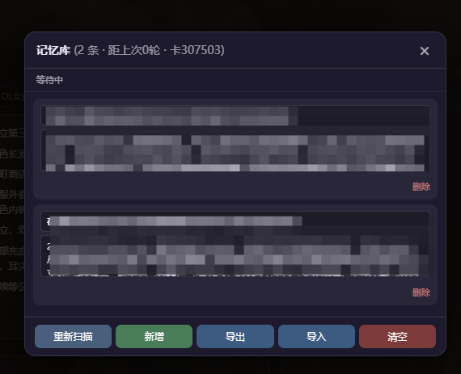

**Ggg「🥚」** (2026-08-13 10:54:44):
你是否经历过聊n轮以后，AI忘记了你与她/他/它（？）一起经历的事情，问了还胡编乱造回答你？
即便辛辛苦苦总结，多来几次就开始丢细节，忘记承诺？<:1000168531:1298906724979310634> 
我苦他丫的记忆久矣，于是肘击了个记忆数据库……让有同样烦恼的岛友们可以用。<:emoji_299:1535536347362627614> 

最新版：https://discord.com/channels/1205870897769095229/1537414096499114114/1538201608255701024

功能介绍：
     1.     每 n轮，自动注入指令总结结构化记忆
    2.    脚本自动捕获、存进本地
    3.    自动检索召回记忆
    4.    支持跨设备，手机电脑都可以
    5.    可视化面板，能看能改能删能导出
    

安装：
1.导入正则json
2.导入世界书
3.用的话，点那个小脑袋就出面板

几个可能会遇到的问题：
换设备，如果面板是空的，点「重新扫描」，它会自己往上翻聊天记录重建
重刷， 旧记忆还在库里，在面板删掉那条就行
如果手动编辑过记忆换设备，最好导出，再导入就好……
如果想更改记忆内容，自己修改世界书就行，输出格式不要变
⚠️总设定字符（含提取指令），不要超过15000（MMD设定读取的上限），不然会失败

最后：

实话说，最初上岛是奔着Nix佬的世界树来的，可惜还没吃上，大佬就忙去了……现在只能自己肘一个先用了，至于以后会不会弄成世界树那样，得看模型，毕竟不外接API的话，模型稳定度很重要，本开源旨在抛砖引玉，看有没有大佬接手了☝️😅

取走的话给我点个赞吧，哈基G感谢了<:emoji_148:1382329938404839586> <:emoji_148:1382329938404839586> 

核心参数（可以自己改）

INTERVAL = 3（第 16 行）
总结间隔。满 3 轮追加一次指令，AI 在第 4 轮回复里输出记忆，实际覆盖 4 轮。

⚠️ 改了这个，世界书里"回顾最近 4 轮"必须跟着改，数字要比 INTERVAL 大 1。比如改成 5，世界书就写"回顾最近 6 轮"。

MAX_INJECT = 3（第 18 行）
每次最多召回几条记忆塞进消息里。

while (db.length > 250)（第 44 行）
记忆库上限，存满后自动丢弃最旧的。

按 4 轮一条算，250 条约等于 1000 轮对话，正常玩基本到不了。

示例卡：

昵称：我把世界都时停了🥵，不干点啥…你以为我是猴哥啊？
[🕐时停/高自由/记忆增强/特化库💦] 校园、小区、地铁、银行，拥有了时间静止，你会做什么？
ID: 307503
https://www.sexyai.ai/#/pages/chat/chat?roleId=307503&inviteCode=4dMU7x
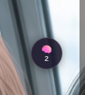

