# 开源一个可以放图片，并且支持多人的状态栏

来源: Discord 魅魔藏经阁 thread 1507035270145638421
创建: 2026-05-21T15:00:07.764000+00:00
消息数: 138

---

**sonata** (2026-09-20 00:02:10):
@6

**白榆** (2026-09-11 14:48:30):
选项为什么显不出来台词啊，为什么只能显示描述？

**Linia·Albio** (2026-08-13 16:45:12):
<@1520167274244341772> 搞定了，好像是图片路径出问题了，之前图片是从备忘录里保存出来的，我换成截屏的就有了

**月月鸟（思维枯竭）** (2026-08-13 16:20:11):
这我也不懂了<:emoji_115:1379113943817257071>

**Linia·Albio** (2026-08-13 16:18:57):
<@1520167274244341772> 我随便填点都能出状态栏，一把链接填在图片那就不出了
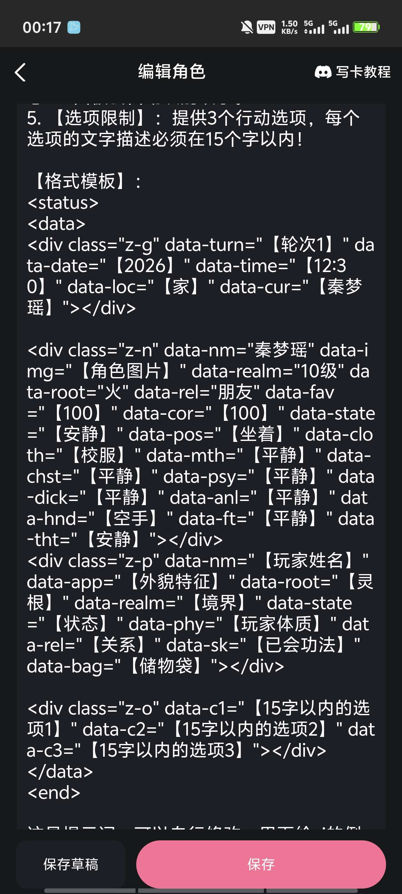

**月月鸟（思维枯竭）** (2026-08-13 15:44:37):
原版复制进去，能出状态栏那就没问题，然后修改对应放图片的位置，看下能不能正常有图片。

**月月鸟（思维枯竭）** (2026-08-13 15:44:02):
我是这样修的

**月月鸟（思维枯竭）** (2026-08-13 15:43:55):
这个你得看看细节

**Linia·Albio** (2026-08-13 15:43:27):
<@1520167274244341772>我这个就是在打一局话里面的，图片我就是上传到我的资源里面然后复制的链接啊，确实长了不少 ，路径好像更长一点

**桃香🌸** (2026-08-13 03:49:54):
好的，谢谢大佬

**陌羽（绪瑶的星怒）** (2026-08-13 02:59:20):
直接把代码复制过去。然后并且把第1句话的触发代码符号也复制过去，告诉蓝色大肥鱼要求，让蓝色大肥鱼搞就行了

**月月鸟（思维枯竭）** (2026-08-13 02:25:55):
我自己的也好长<:1000168510:1298906820638674984>

**月月鸟（思维枯竭）** (2026-08-13 02:25:44):
像这样
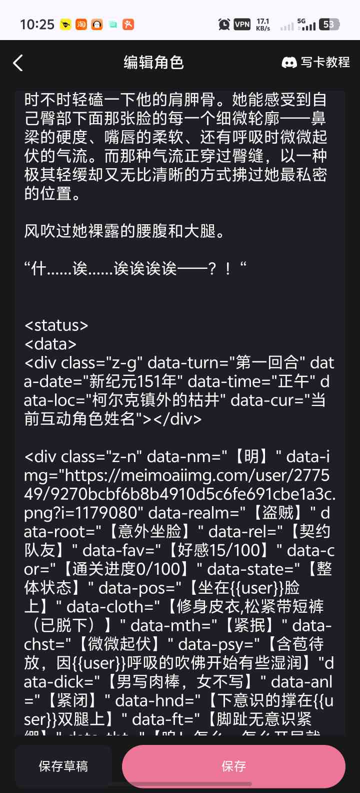

**月月鸟（思维枯竭）** (2026-08-13 02:25:01):
正常来说链接是复制在第一句话那的

**月月鸟（思维枯竭）** (2026-08-13 02:24:48):
而且不是复制在这的

**月月鸟（思维枯竭）** (2026-08-13 02:24:30):
你图片链接是不是太长了？用的mmd的图床吗？

**Linia·Albio** (2026-08-12 16:58:02):
<@1520167274244341772> 大佬，这个图片我还是搞不懂按照上面复制链接也没有啊
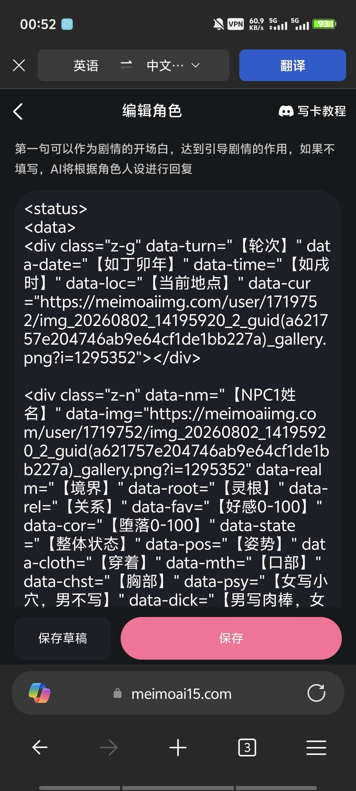

**桃香🌸** (2026-08-12 11:22:16):
完全晕了呜呜

**桃香🌸** (2026-08-12 11:22:10):
复制也搞不太懂  不懂代码<:emoji_298:1535335883195162804> <:emoji_298:1535335883195162804>

**月月鸟（思维枯竭）** (2026-08-12 11:16:29):
笨操作只能这样了😭

**月月鸟（思维枯竭）** (2026-08-12 11:16:21):
多人的话，你可以试试先正文回复一轮？然后点击编辑，将正文中的状态栏复制下来修改或是贴上去这样

**桃香🌸** (2026-08-12 11:15:13):
啊 状态栏基础的我应该是弄好了 现在是想知道如何在第一句话同时设置多个角色的状态栏  就是一个角色相关信息栏里可以左右切换  以及后面每一轮有多个角色这些怎么弄 就像这个一样
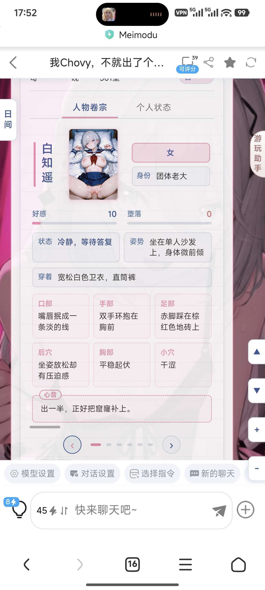
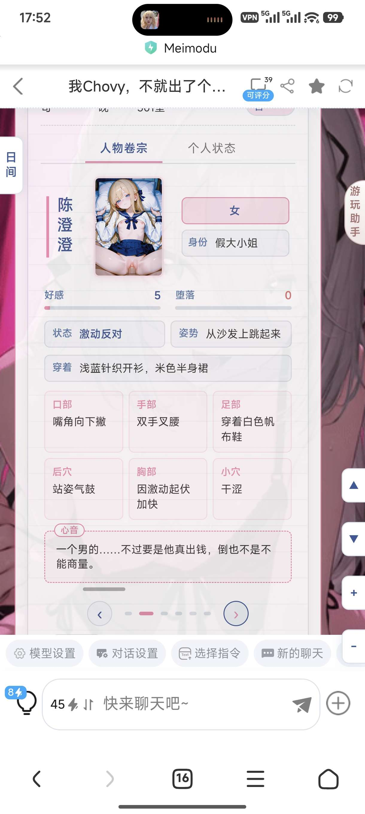

**月月鸟（思维枯竭）** (2026-08-12 11:12:51):
啥意思？

**月月鸟（思维枯竭）** (2026-08-12 11:12:43):
说下说下

**桃香🌸** (2026-08-12 10:53:05):
大佬请问下怎么在开场第一句话调整显示多个角色状态栏呀？已经后续有新角色自动加入状态栏那些？

**桃香🌸** (2026-08-12 10:07:51):
佬 具体怎么弄啊 我弄了一晚上 也改了相对应的正则文字  但是测试预览只显示人物卷宗和自我状态那一小部分，其他完全不显示……

**陌羽（绪瑶的星怒）** (2026-08-06 04:49:59):
放在人设里面教ai，告诉ai说哪个角色图片链接为什么什么什

**顾慎为** (2026-08-02 10:36:15):
<@1485079446066040985> 大佬大佬，角色图片该怎么加入啊？如果是多个角色都需要图片，该怎么加入图片呢
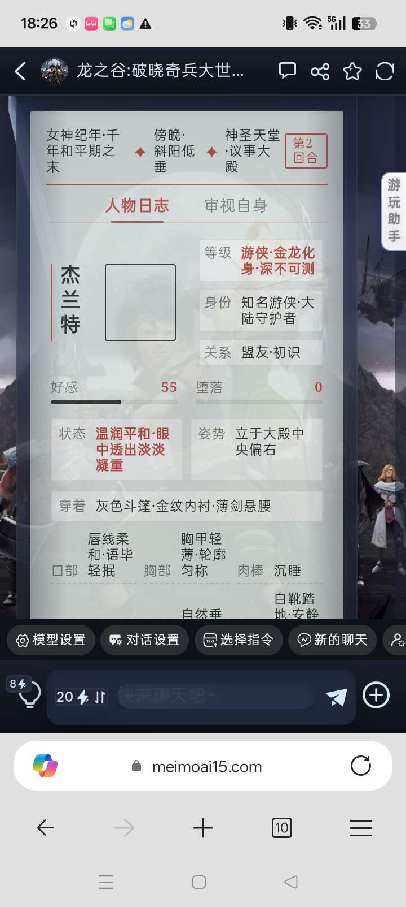

**顾慎为** (2026-07-31 15:17:19):
厉害

**月月鸟（思维枯竭）** (2026-07-07 07:53:32):
不客气，都是新人嘿嘿<:emoji_140:1379454014852436038>

**CAD** (2026-07-07 07:51:03):
<@1520167274244341772> 好的謝謝，我再去研究一下

**月月鸟（思维枯竭）** (2026-07-07 07:45:22):
把开局状态栏格式里图片对应的位置复制上去就行了

**月月鸟（思维枯竭）** (2026-07-07 07:45:00):
然后点图片右上角的三个点，复制链接

**月月鸟（思维枯竭）** (2026-07-07 07:44:46):
图片的话你得先上传图片到mmd的图片库

**月月鸟（思维枯竭）** (2026-07-07 07:44:14):
正则的那串代码里你也得找到灵根和境界这两中文，然后更改

**月月鸟（思维枯竭）** (2026-07-07 07:43:52):
例如我把陌羽大佬的灵根境界都改成了状态和关系

**月月鸟（思维枯竭）** (2026-07-07 07:43:19):
只改对应的中文就好了

**月月鸟（思维枯竭）** (2026-07-07 07:43:09):
这个的话得在世界书里改，然后正则也要改

**月月鸟（思维枯竭）** (2026-07-07 07:42:57):
直接更改状态栏里面显示的字符吗？
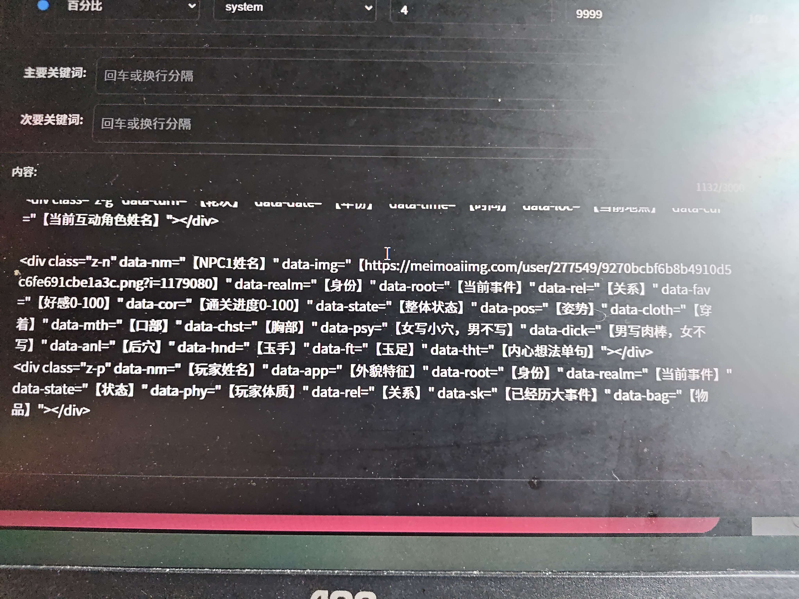

**月月鸟（思维枯竭）** (2026-07-07 07:42:12):
比如我这样？

**月月鸟（思维枯竭）** (2026-07-07 07:42:06):
具体是想改啥？

**CAD** (2026-07-07 07:41:39):
<@1520167274244341772> 彻底研究明白了吗，呢教教我吗

**月月鸟（思维枯竭）** (2026-07-07 03:03:08):
再次感谢陌羽大佬！<:emoji_140:1379454014852436038> 成功学会怎么塞图片

**月月鸟（思维枯竭）** (2026-07-07 02:57:53):
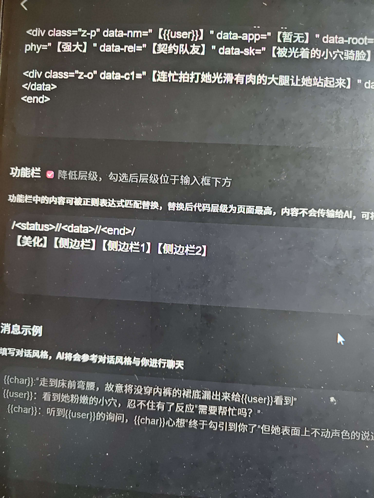

**月月鸟（思维枯竭）** (2026-07-07 02:57:36):
功能栏这样填还不容易炸

**月月鸟（思维枯竭）** (2026-07-07 02:57:24):
这个我刚搞定，具体可以放第一句话里
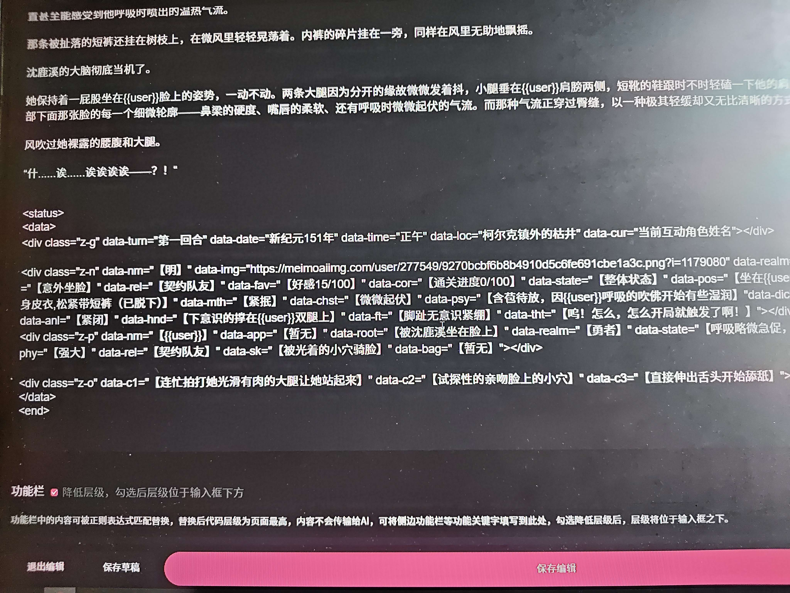

**沐若离（哈气猫猫）** (2026-07-06 15:08:47):
搞定了

**沐若离（哈气猫猫）** (2026-07-06 14:55:56):
<:1000168510:1298906820638674984>

**沐若离（哈气猫猫）** (2026-07-06 14:55:53):
灵根和境界更换了别的后，抓取不了

**CAD** (2026-07-06 13:27:02):
<@1315680101089673237> 比如说他画的那个文件导入到正则，他在评论区发的那3段话该放到哪里？

**将军** (2026-07-06 09:30:46):
不知道哪一方面的东西

**CAD** (2026-07-06 09:08:08):
看不懂，什么东西放在什么地方我都有点整不明白。有没有适合宝宝的教程，能给个链接吗，我再去研究一下。

**月月鸟（思维枯竭）** (2026-07-05 13:38:30):
大佬，我测的时候状态栏经常炸是因为啥啊<:1000168510:1298906820638674984>

**月月鸟（思维枯竭）** (2026-07-05 10:02:48):
大佬大佬，图片的话是放我的资源里的链接吗？还是？<:emoji_140:1379454014852436038>

**沐若离（哈气猫猫）** (2026-07-05 09:31:21):
感谢佬师开源

**沐若离（哈气猫猫）** (2026-07-05 09:31:12):
<:emoji_249:1416980114511761448>

**清辞脑洞研发中心** (2026-06-13 09:47:52):
谢谢佬师开源<:emoji_140:1379454014852436038>

**阿成** (2026-06-12 08:51:24):
<:emoji_247:1488101228389994526> 好的谢谢佬

**陌羽（绪瑶的星怒）** (2026-06-12 08:46:31):
无所谓啊，喜欢什么换什么

**阿成** (2026-06-12 08:11:24):
大佬，如果是武侠世界观，灵根栏替换成什么呢？根骨？悟性？<:emoji_140:1379454014852436038>

**小稀（鹿鞭一条）** (2026-06-12 04:08:09):
谢谢大佬开源<:emoji_140:1379454014852436038>

**陌羽（绪瑶的星怒）** (2026-06-10 14:55:53):
<@1416650931130466326> 全局美化文件发了

**陌羽（绪瑶的星怒）** (2026-06-10 14:55:47):

**陌羽（绪瑶的星怒）** (2026-06-10 14:44:58):
就是哪个图片链接对应哪个角色，直接写人设里

**白榆** (2026-06-10 14:26:14):
这个状态栏精准生成对应角色图片规则怎么写？

**许星榆** (2026-06-10 14:20:15):
可能ai改的时候多改动了什么吧<:emoji_278:1514115400571555910>

**陌羽（绪瑶的星怒）** (2026-06-10 14:18:36):
<:1000168531:1298906724979310634>

**陌羽（绪瑶的星怒）** (2026-06-10 14:18:35):
难道真有代码风水学？

**陌羽（绪瑶的星怒）** (2026-06-10 14:18:28):
我的源代码找ai都是说没问题，然后我拿梦子的那个就查出有问题了

**许星榆** (2026-06-10 14:18:27):
<:emoji_278:1514115400571555910>

**陌羽（绪瑶的星怒）** (2026-06-10 14:17:57):
<:1000168531:1298906724979310634>

**陌羽（绪瑶的星怒）** (2026-06-10 14:17:54):
我现在已经弄明白了，最直接最不绕弯子的告诉你，其实我的代码一点毛病没有，顶多是风水差了点， Ai都改出了同一个bug

**白榆** (2026-06-10 14:08:14):
是的，虽然已经有了但是我的不搭

**许星榆** (2026-06-10 14:07:33):
<:emoji_278:1514115400571555910>

**许星榆** (2026-06-10 14:07:29):
不太清楚哦，总之有问题的话就用一下我的吧

**陌羽（绪瑶的星怒）** (2026-06-10 14:06:51):
问了ds也说没问题

**陌羽（绪瑶的星怒）** (2026-06-10 14:06:44):
按道理不应该有问题啊，这两串代码一模一样的，复制粘贴两个都重合了都，我研究一下

**陌羽（绪瑶的星怒）** (2026-06-10 14:06:24):
不对啊，我开源的版本跟我卡里的版本一样啊

**许星榆** (2026-06-10 14:02:19):
https://cdn.discordapp.com/attachments/1385274632592162876/1512487964070904012/1779710487294.gif

**许星榆** (2026-06-10 14:02:07):
这样子呀

**陌羽（绪瑶的星怒）** (2026-06-10 14:01:52):
我开源的时候应该复制错了，我找ds问了没bug，我自己的卡也测没bug，可能是被资本做局的时候，开源的时候复制错了

**许星榆** (2026-06-10 14:01:13):
<:emoji_278:1514115400571555910>

**许星榆** (2026-06-10 14:01:08):
emm，梦子姐姐的和我的用了都有这个bug

**陌羽（绪瑶的星怒）** (2026-06-10 14:01:05):
<:1000168510:1298906820638674984>

**陌羽（绪瑶的星怒）** (2026-06-10 14:01:03):
我估计我复制错了，我开源的时候，果然是个小猪

**陌羽（绪瑶的星怒）** (2026-06-10 14:00:36):
我靠，我发现我自己的卡没bug呀<@1493974491884421370>

**陌羽（绪瑶的星怒）** (2026-06-10 13:41:38):
全局美化吗？还是？

**陌羽（绪瑶的星怒）** (2026-06-10 13:40:33):
<:emoji_279:1514115444007763968>

**陌羽（绪瑶的星怒）** (2026-06-10 13:40:30):
<@1471005185231818903> 哎呀，更新一下卡吧，这个有bug，人之常情

**许星榆** (2026-06-10 13:39:09):
<:emoji_89:1378950692655464492>

**许星榆** (2026-06-10 13:38:51):
噫

**陌羽（绪瑶的星怒）** (2026-06-10 13:38:21):
感谢，好大的代码，大大的代码塞进我小小的栏目里面要坏掉了❤️

**陌羽（绪瑶的星怒）** (2026-06-10 13:37:31):
哦嚊

**许星榆** (2026-06-10 13:37:17):
<:image:1496914410747199608>

**许星榆** (2026-06-10 13:37:06):
只用修改第三部分，就是<end>那里，这个拿去给ai就好，我有些地方改了，不过关于图片的就在这里，喂ai还是要喂的

**许星榆** (2026-06-10 13:35:31):
<:1000168510:1298906820638674984>

**陌羽（绪瑶的星怒）** (2026-06-10 13:35:30):
你现在发出来，叔叔可以教你一个很舒服的东西哦

**陌羽（绪瑶的星怒）** (2026-06-10 13:35:19):
修完了，那能不能发出来呀，我是一个不喜欢劳动的坏叔叔<:emoji_249:1416980114511761448>

**许星榆** (2026-06-10 13:31:34):
不算难的，我用ds修的，而且一轮成功了<:emoji_277:1509842116417818654>

**许星榆** (2026-06-10 13:30:44):
嘿嘿<:emoji_277:1501430172040298566>

**陌羽（绪瑶的星怒）** (2026-06-10 13:30:06):
宝宝可爱哟，我去看看bug怎么修

**陌羽（绪瑶的星怒）** (2026-06-10 13:29:51):
加入时间还没我长，一看就是小资历<:emoji_249:1416980114511761448>

**许星榆** (2026-06-10 13:29:03):
我是萌新呀佬大<:emoji_278:1514115400571555910>

**陌羽（绪瑶的星怒）** (2026-06-10 13:28:40):
居然是老资历吗

**许星榆** (2026-06-10 03:34:24):
感谢佬大的开源，用上了<:emoji_149:1400299483212021833> 
然后就是里面有一个小bug，点击放大图片以后只会显示最后一个人的图片，可以拿这个发给ai，描述一下问题，应该能修复
问题原因：fullUr1用var 声明，循环中每次覆盖，导致所有 av.onclick 闭包都引用同一个最终值。解决：用IIFE 捕获当前fullUrl

**白榆** (2026-06-05 07:06:52):
佬有这个美化吗

**MOZ** (2026-05-27 18:51:21):
❤️ ❤️ ❤️ ❤️ ❤️ ❤️ ❤️ ❤️ ❤️

**MOZ** (2026-05-27 18:50:00):
你这状态栏确实挺好用的，宝宝

**MOZ** (2026-05-27 18:49:40):
<:emoji_249:1416980114511761448>

**白榆** (2026-05-25 09:59:43):
我知道，我这里是比如

**小毅（沉淀中）** (2026-05-25 09:48:14):
我就是把小白图片的链接放在替换里，【小白链接】这个作为表达式

**白榆** (2026-05-25 09:01:45):
描述是不是如果第一个角色名是小白就是这个描述，生成小红状态栏时就把小白图片链接换成小红的图片链连

**小毅（沉淀中）** (2026-05-25 01:01:33):
我一个个替换的

**白榆** (2026-05-24 17:31:44):
能把全个图片链接放到一个正则里面吗
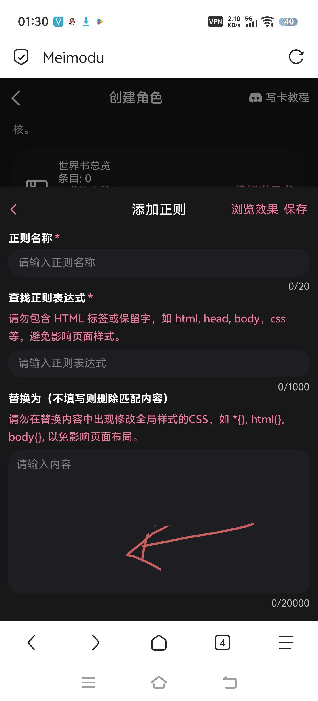

**将军** (2026-05-24 15:26:50):
666

**小毅（沉淀中）** (2026-05-23 22:50:07):
我刚刚弄的，就提供每个角色的图片链接就好，省字数可以把链接放在正则里，表达式改为xx链接，然后在人设规定，xx角色的图片链接替换为xx链接，以此类推，就能节约字数了

**白榆** (2026-05-23 17:15:33):
如何每个女角色状态栏都可以生成图片呢

**陌羽（绪瑶的星怒）** (2026-05-23 14:25:11):
好哦

**小毅（沉淀中）** (2026-05-23 14:25:09):
很棒的状态栏

**小毅（沉淀中）** (2026-05-23 14:24:21):
谢谢大佬，因为我感觉十几个人设的链接太占字数，所以问的，自己已经解决了，可以通过正则替换图片链接来实现，谢谢大佬的状态栏正则

**陌羽（绪瑶的星怒）** (2026-05-23 14:22:31):
<@1471005185231818903> 直接在人社里面加某个角色的立绘是什么

**陌羽（绪瑶的星怒）** (2026-05-23 14:20:07):
加人社里

**小毅（沉淀中）** (2026-05-23 08:41:20):
大佬求教啊

**小毅（沉淀中）** (2026-05-23 08:41:02):
<@1485079446066040985>

**小毅（沉淀中）** (2026-05-23 08:04:01):
图片链接如何才能跟当前互动对象一一对应大佬

**周雅（被老婆调教.周浩）** (2026-05-23 07:11:54):
太强了<:07:1298281204260278383> 收录到置顶帖了

**彭野-二组:靖康将至！北宋谁救？** (2026-05-22 10:11:02):
严肃学习

**凝青** (2026-05-22 07:12:50):
以严肃学习<:emoji_140:1379454014852436038>

**凝青** (2026-05-22 07:09:12):
佬太强了<:emoji_140:1379454014852436038>

**小魅** (2026-05-21 17:01:14):
感谢宝宝开源<:emoji_140:1379454014852436038>

**MEE6** (2026-05-21 17:01:10):
<:CHECK6:403540120181145611> 30,000 XP has been given to **<@!1485079446066040985>**

**有咩** (2026-05-21 16:11:09):
<:07:1298281204260278383> <:07:1298281204260278383> <:07:1298281204260278383>

**有咩** (2026-05-21 16:11:07):
非常好的排版！

**白白白（月清瑶寄生）** (2026-05-21 15:29:36):
<@1135473222658297907>

**白白白（月清瑶寄生）** (2026-05-21 15:29:20):
感谢陌羽大佬的分享<:emoji_140:1379454014852436038>

**陌羽（绪瑶的星怒）** (2026-05-21 15:02:08):
[系统指令：古风多人卷宗状态栏输出规则]
在每次回复最末尾，必须严格按以下标准HTML结构输出状态栏。

【铁律】：
1. 绝对不要使用 markdown 代码块！
2. 全部使用 `
` 和标准的 `data-` 属性。
3. `data-cur` 填写当前正互动角色的姓名（决定UI默认看谁）。
4. 【器官智能】：女性NPC写 `data-psy="状态"`，男性NPC则写 `data-dick="状态"`！面板会自动识别改字。
5. 【选项限制】：提供3个行动选项，每个选项的文字描述必须在15个字以内！

【格式模板】：
<status>
<data>

</data>
<end>

这是提示词，可以自行修改，里面给ai的例子直接复制过来就是能放在开场白里面的

**陌羽（绪瑶的星怒）** (2026-05-21 15:01:29):
导入进空白卡里面，一个个复制

**陌羽（绪瑶的星怒）** (2026-05-21 15:00:07):
文件在评论区，请注意三个正则的抓取式都要放进功能栏里面，并且三个正则有讲究，123的顺序不能乱

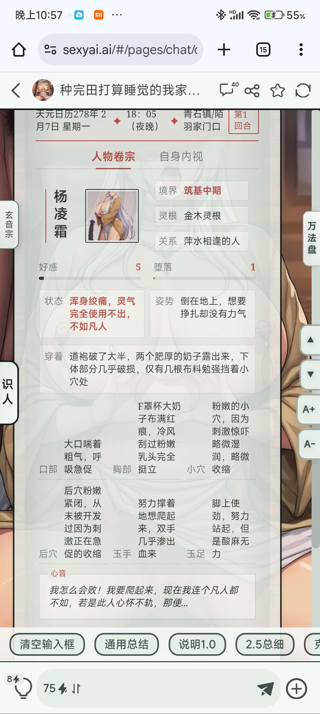

