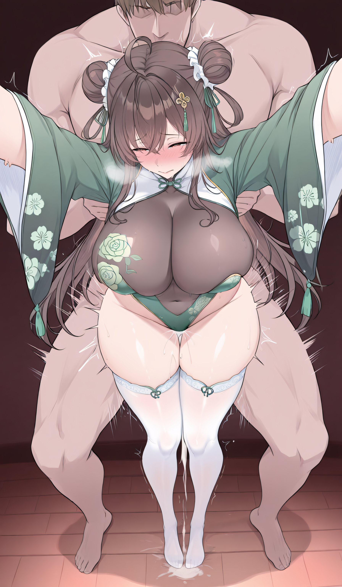

# 开源一个多人物世界书

创建时间: 2026-08-28T12:43:09.770000+00:00
消息数: 36

---

**luo2008a** (2026-09-05 02:33:09):
作者大大，这个开源的世界书怎么使用？真不会，求教程（本人纯新人）

**月月鸟（思维枯竭）** (2026-08-28 13:04:14):
蓝色形态!

**谢特** (2026-08-28 13:03:31):
<:emoji_115:1379113943817257071>

**谢特** (2026-08-28 13:03:30):
远远看着的威压都强的不行

**谢特** (2026-08-28 13:03:19):
<:emoji_115:1379113943817257071>

**谢特** (2026-08-28 13:03:16):
蓝色形态的sxs大人好强好厉害

**sxs** (2026-08-28 13:03:12):
<:emoji_115:1379113943817257071>

**谢特** (2026-08-28 13:03:05):
好厉害阿！sxs大人我们敬爱你阿！

**sxs** (2026-08-28 13:02:53):
我简单讲两句

**燚（被秋姐变性版）** (2026-08-28 13:02:52):
<:emoji_249:1416980114511761448>

**燚（被秋姐变性版）** (2026-08-28 13:02:50):
没绿就行

**sxs** (2026-08-28 13:02:49):
咳咳

**谢特** (2026-08-28 13:02:37):
sxs真的蓝了

**sxs** (2026-08-28 13:02:35):
我自己都没有过😞

**燚（被秋姐变性版）** (2026-08-28 13:02:35):
我多睡几觉试试

**燚（被秋姐变性版）** (2026-08-28 13:02:21):
<:1000168510:1298906820638674984>

**夏哥** (2026-08-28 13:02:08):
快去写个月榜第一给我发

**燚（被秋姐变性版）** (2026-08-28 13:01:46):
<:emoji_249:1416980114511761448>

**燚（被秋姐变性版）** (2026-08-28 13:01:44):
洞洞太小，会撕裂的

**夏哥** (2026-08-28 13:00:46):
撅撅小sxs

**燚（被秋姐变性版）** (2026-08-28 13:00:33):
你能肏飞mmd

**月月鸟（思维枯竭）** (2026-08-28 13:00:17):
假如给我三天sxs附体....

**月月鸟（思维枯竭）** (2026-08-28 12:59:59):
韩了韩了<:emoji_242:1459832161719943198>

**艾斯卡诺ദ്ദി˶•̀֊•́)✧** (2026-08-28 12:58:05):
上天对sxs竖起了中指，sxs笑着扶着中指坐了下去...

**Raska** (2026-08-28 12:56:28):
<:emoji_250:1459542480406970432>

**燚（被秋姐变性版）** (2026-08-28 12:55:55):
<:emoji_148:1382329938404839586>

**燚（被秋姐变性版）** (2026-08-28 12:55:52):
sxs起身，来到了讲台上，对着在坐的各位，冷笑一声:不是我说，在座的各位，都是乐色

**sxs** (2026-08-28 12:52:29):
我是喜欢你们的

**燚（被秋姐变性版）** (2026-08-28 12:51:40):
假如给我sxs佬三分技术力……<:emoji_277:1509842116417818654>

**谢特** (2026-08-28 12:51:23):
再给sxs留下一条痕迹...

**谢特** (2026-08-28 12:45:33):
假如给我sxs老婆的屁股……

**sxs** (2026-08-28 12:44:03):
怎么来这么快彳佬

**sxs** (2026-08-28 12:43:57):
不要不要啊！

**行樂** (2026-08-28 12:43:50):
假如给我sxs佬三分技术力……<:emoji_277:1509842116417818654>

**档案管理员** (2026-08-28 12:43:11):
[内容授权协议 · V1]()
本帖已经发布授权协议；当前卡片展示最新版本，历史版本仍可追溯。

**sxs** (2026-08-28 12:43:09):
蓝灯用于核心设定，绿灯用于触发该角色的特性，可以节省蓝灯字数，并且不会挤占核心设定，实在想不到什么能开源的了，就用目前正在尝试精简化的世界书来蹭一蹭了~

