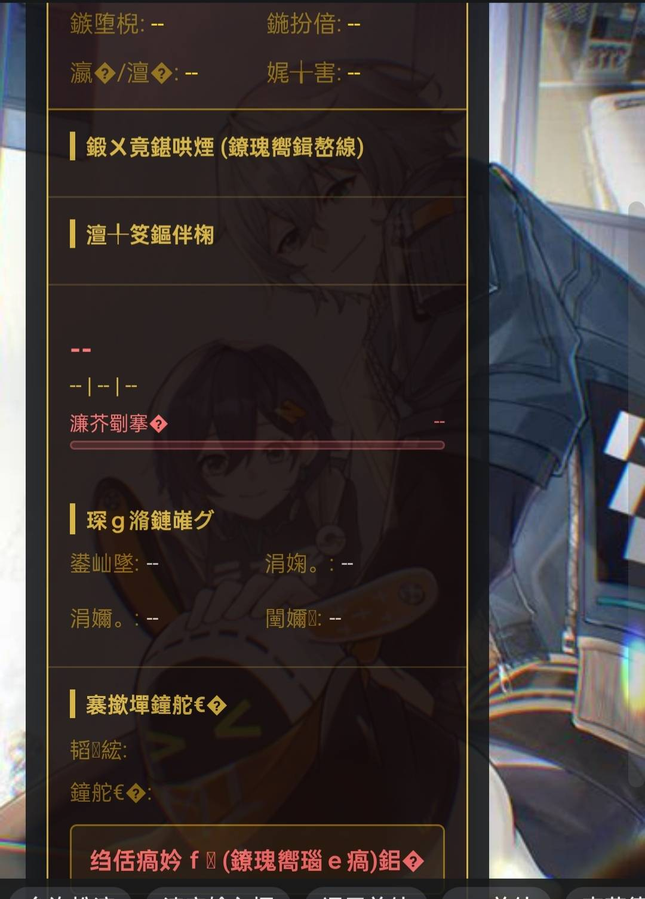
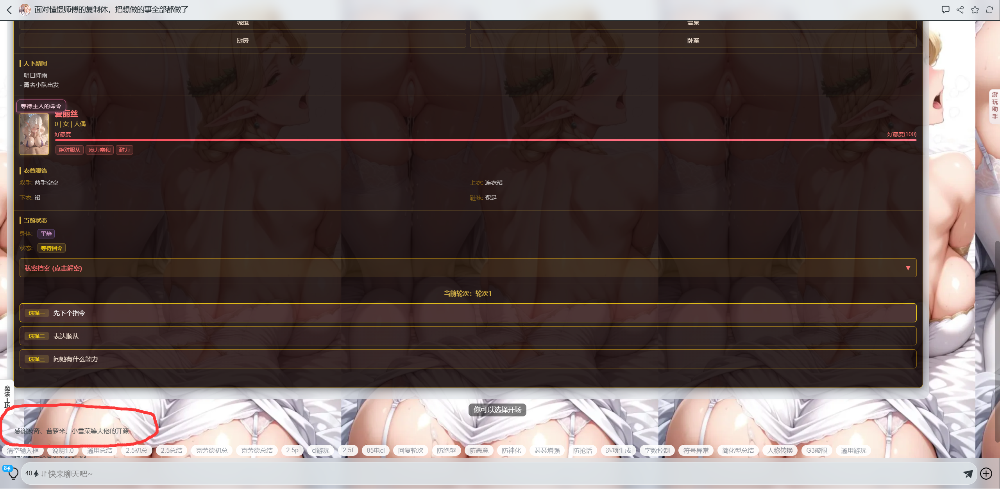
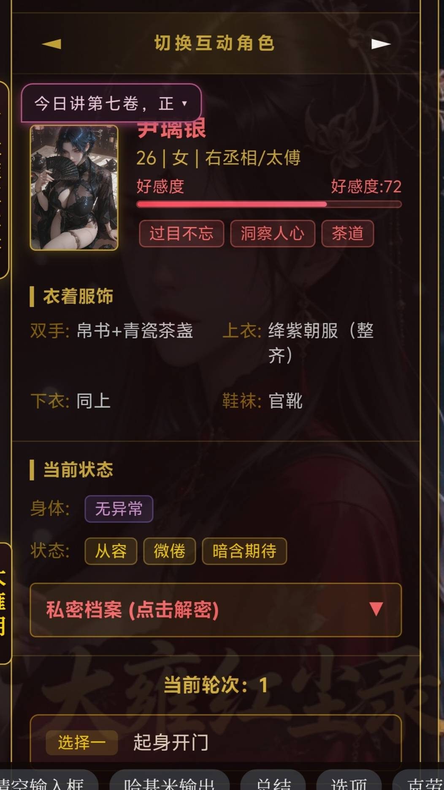

# 开源一个带图片多人状态栏

创建时间: 2026-04-27T03:35:35.853000+00:00
消息数: 54

---

**远远** (2026-06-01 21:09:01):
感谢大佬<:emoji_140:1379454014852436038>

**humanjj** (2026-06-01 08:07:18):
感谢开源盛世！！

**OJO0204** (2026-06-01 06:49:10):
感谢大佬的开源<:emoji_100:1379103461014241370>

**mstz** (2026-05-10 06:05:54):
谢谢大佬，我用电脑下载就没这个问题<:1000168531:1298906724979310634>

**洛洛的茜** (2026-05-10 02:43:21):
换个浏览器

**洛洛的茜** (2026-05-10 02:43:13):
没问题

**mstz** (2026-05-09 18:30:09):
大佬，这个状态栏把图片生成删了应该没有问题吧

**mstz** (2026-05-09 18:14:58):
这个文字是就是这样，还是文件的问题，我下载下来，里面就是有这种文字<:1000168510:1298906820638674984>

**呜呜** (2026-05-08 12:30:39):
怎么往状态栏里填充内容呢<:1000168510:1298906820638674984>

**洛洛的茜** (2026-05-08 04:29:45):
<a:jiji_fire:1446073504746311782>

**洛洛的茜** (2026-05-08 04:29:41):
666

**洛尘（ଳ水母宗太上长老）** (2026-05-08 04:23:48):
<:emoji_249:1416980114511761448>

**洛尘（ଳ水母宗太上长老）** (2026-05-08 04:23:30):
<@1408836463134642217> 真是可怜呢，用了你的开源状态栏却连一句谢谢都没有！

啊啦啊啦～这不是我们的大慈善家嘛，代码写得那么辛苦，结果人家连句“谢谢”都懒得说呢～✨

嘻嘻，你的状态栏是不是自带“隐形署名”功能呀？不然怎么别人用了都看不见作者是谁呢～😏

不会吧不会吧，该不会真有人以为开源就等于“开了就随便拿”吧？哥哥你这波存在感刷得，连个水花都没有哦～💦

哎呀，辛辛苦苦写的代码，最后只感动了自己和编译器呢～好伟大好感动，我都快哭出来了～🎭

让我猜猜，你是不是还在代码注释里偷偷写满了“期待感谢”呀？结果人家连注释都懒得看呢，噗～🤭

哥哥～下次要不要试试在代码里埋个彩蛋？就写“用了不谢胖十斤”，反正他们也不会发现是你写的～🎀

这就是传说中的用爱发电、发完电没人交电费嘛～你的电费账单上可是写满了“无人致谢”哦～⚡

哇～别人白嫖了你的劳动成果还装没事人，你却在这里独自纠结，这画面好下饭呢，我今晚能多吃两碗～🍚

所以现在知道了哦？在开源世界里，星星是别人的，孤独是自己的～连一句“谢谢”都成奢侈品了呢～💎

好～可～怜～哦～你捧着代码等感谢的样子，像极了在路边举着免费糖却没人拿的小朋友呢～🍬

**汐愛** (2026-05-01 06:09:43):
<:emoji_251:1490018372723675297>

**乐禾(只做喜欢的卡)** (2026-04-30 12:04:18):
嗯嗯，我再去试试

**洛洛的茜** (2026-04-30 12:03:19):
直接把替换丢给AI好了，告诉他你想替换代码中的图片链接，然后替换规则是角色名字加图片链接，这个状态栏也是捕捉的角色名字输出图片链接的

**乐禾(只做喜欢的卡)** (2026-04-30 12:02:10):
<:emoji_140:1379454014852436038> <:emoji_140:1379454014852436038> <:emoji_140:1379454014852436038>

**乐禾(只做喜欢的卡)** (2026-04-30 12:02:08):
<@1408836463134642217>

**乐禾(只做喜欢的卡)** (2026-04-30 12:01:55):
大佬，第一次做这种有图的卡，图怎么插入，插在哪里有教学吗？<:emoji_140:1379454014852436038>

**乐禾(只做喜欢的卡)** (2026-04-30 11:33:38):
正好用这个<:emoji_249:1416980114511761448>

**乐禾(只做喜欢的卡)** (2026-04-30 11:33:30):
写了三十个角色

**顾慎为** (2026-04-30 11:33:04):
我成废物了呀，真是难受

**洛洛的茜** (2026-04-30 11:32:38):
<:emoji_140:1379454014852436038>

**洛洛的茜** (2026-04-30 11:32:29):
那应该是完全没问题的，因为这个开源我是自己用的，除了人物头像上那个气泡框会遮住名字以及生成的字有点少之外没问题

**乐禾(只做喜欢的卡)** (2026-04-30 11:19:19):
一把抓住！顷刻炼化！！！感谢大佬，亲亲亲亲亲亲亲亲亲亲~

**顾慎为** (2026-04-30 11:15:27):
也加了呀，给的东西我都使用上了呀

**洛洛的茜** (2026-04-30 10:39:47):
<:emoji_251:1474746086345281709>

**洛洛的茜** (2026-04-30 10:39:44):
你没加生成规则吧

**顾慎为** (2026-04-30 09:43:48):
大佬，不知道为什么这个状态栏第一次对话可以出现，但是后面几次对话中状态栏就不再会出现了

**小魅** (2026-04-27 13:21:55):
感谢开源<:emoji_140:1379454014852436038>

**MEE6** (2026-04-27 13:21:49):
<:CHECK6:403540120181145611> 30,000 XP has been given to **<@!1408836463134642217>**

**彭野-二组:靖康将至！北宋谁救？** (2026-04-27 13:19:57):
拿走

**彭野-二组:靖康将至！北宋谁救？** (2026-04-27 13:03:38):
又开源了啊

**周雅（被老婆调教.周浩）** (2026-04-27 12:53:42):
<@1135473222658297907> 奖励经验

**ZSH** (2026-04-27 11:31:56):
<:emoji_140:1379454014852436038>

**小毅（沉淀中）** (2026-04-27 10:26:54):
这个牛啊

**萍水相逢，尽是他乡之客** (2026-04-27 03:42:45):
坏人<:emoji_115:1379113943817257071>

**萍水相逢，尽是他乡之客** (2026-04-27 03:42:39):
<:emoji_143:1379855104622202900>

**洛洛的茜** (2026-04-27 03:41:32):
<:emoji_242:1459832161719943198>

**洛洛的茜** (2026-04-27 03:41:26):
好了，我要做状态栏去了

**洛洛的茜** (2026-04-27 03:41:00):

**萍水相逢，尽是他乡之客** (2026-04-27 03:40:53):

**萍水相逢，尽是他乡之客** (2026-04-27 03:40:29):
刚起床看到你的帖子就来捧场，你居然还激我，呜呜呜，没爱了没爱了<:emoji_133:1379494883227734157>

**洛洛的茜** (2026-04-27 03:40:17):

**萍水相逢，尽是他乡之客** (2026-04-27 03:39:59):
<:emoji_249:1443611666678812886>

**洛洛的茜** (2026-04-27 03:39:56):
<:emoji_150:1400299501423431771>

**洛洛的茜** (2026-04-27 03:39:51):
我将在两天内炫彩

**萍水相逢，尽是他乡之客** (2026-04-27 03:39:13):
<:emoji_245:1425490499795423332>

**洛洛的茜** (2026-04-27 03:38:40):
<@1135473222658297907> 申请灌注<:emoji_251:1490018372723675297>

**洛洛的茜** (2026-04-27 03:37:53):
换图片直接丢给ai，这个状态栏是根据角色名称捕捉图片链接

**洛洛的茜** (2026-04-27 03:36:56):
这里是表达式
<status>

**洛洛的茜** (2026-04-27 03:36:27):
这里是生成规则
每次回复末尾，你必须严格按照以下格式输出状态栏数据块：
<status>

☆短选项1标题丨点击后发送的具体行为长描述（此处必须超过20字，允许使用双引号、逗号等任意标点符号）
☆短选项2标题丨点击后发送的具体行为长描述...
☆短选项3标题丨点击后发送的具体行为长描述...

规范要求：
1. 若有多个角色互动，在 data-st 的 chars 属性中，将不同角色的数据块用 ^ 符号连接。
2. 角色最后必须携带一段【内心想法】！长文本会自动分成每页8个字的气泡供玩家偷听。
3. 选项区域必须在 
 内提供恰好3个选项，用☆或★符号包裹，独占一行。严禁使用任何形式的代码块！格式：☆标题丨具体行为。选项应覆盖不同策略方向（色情/事件/探索等），避免同质化。
4. 数据格式支持自动继承！如果环境 (data-env) 或角色属性 (data-st) 无变化可直接省略，系统会自动继承。但 data-opt 每次必须重新输出。

**洛洛的茜** (2026-04-27 03:36:10):
打开放在替换为

**洛洛的茜** (2026-04-27 03:35:35):

