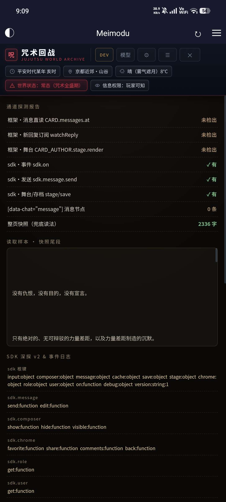
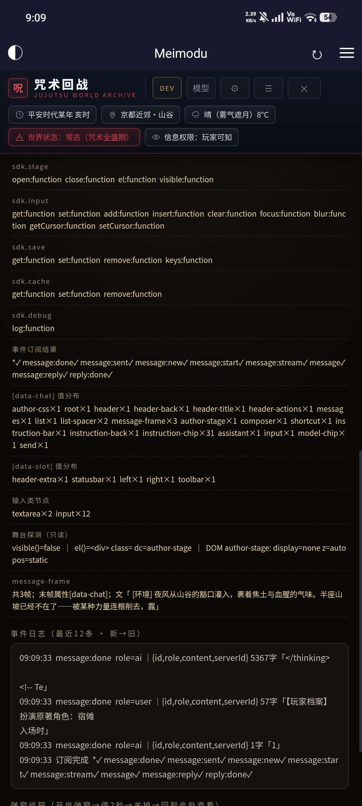
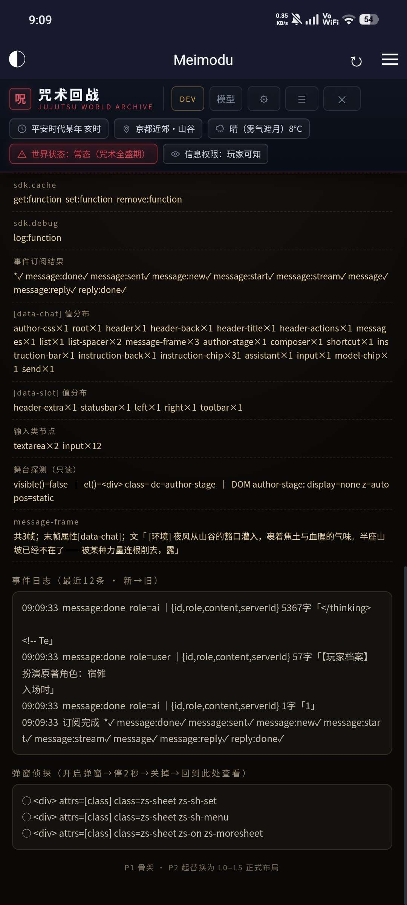

# 开源一个开发检测台

来源: Discord 魅魔藏经阁 thread 1556202540956262521

创建: 2026-10-04T07:13:18.609000+00:00
消息数: 13

---

**火树银花不夜天** (2026-10-04 09:12:39):
<:emoji_140:1379454014852436038>

**小魅** (2026-10-04 07:51:07):
感谢宝宝开源<:emoji_140:1379454014852436038>

**MEE6** (2026-10-04 07:51:00):
<:CHECK6:403540120181145611> 50,000 XP has been given to **<@!1311443615687512074>**

**曹可南** (2026-10-04 07:38:55):
🖐️ 😭 🖐️

**夏（区王·蘸豆模式）** (2026-10-04 07:27:40):
🖐️ 😭 🖐️

**黑白琴键（奥特曼参赛卡：残光）四组** (2026-10-04 07:25:58):
祝我80级一臂之力

**黑白琴键（奥特曼参赛卡：残光）四组** (2026-10-04 07:25:53):
咳咳

**黑白琴键（奥特曼参赛卡：残光）四组** (2026-10-04 07:25:51):
<@1135473222658297907>

**黑白琴键（奥特曼参赛卡：残光）四组** (2026-10-04 07:23:31):
直接导入就行

**黑白琴键（奥特曼参赛卡：残光）四组** (2026-10-04 07:23:25):

**黑白琴键（奥特曼参赛卡：残光）四组** (2026-10-04 07:13:37):
效果

**黑白琴键（奥特曼参赛卡：残光）四组** (2026-10-04 07:13:36):

**黑白琴键（奥特曼参赛卡：残光）四组** (2026-10-04 07:13:18):
DEV 开发探测台（原名Development ），是开发阶段装的"体检仪"：
• 
通道探测报告：第一轮锁通道时的体检（框架通道、sdk、消息选择器逐条打钩/未检出）；
• 
SDK 深捞 v2：sdk 全家桶结构 + 最近12条事件日志（每条消息的  message:done  /  message:stream ，带 role、字数、内容前几字）——当初就是靠它确认了"读回复"和"流式"两条通道、排查"HUD 不刷新"这类问题的；

