# 开源一个方便新手使用的状态栏及点击选项（大佬别进来了）

来源: Discord 魅魔藏经阁 thread 1493628535104082052

创建: 2026-04-14T15:06:33.045000+00:00
消息数: 66

---

**假装是s的m** (2026-09-20 17:10:55):
大佬，这个总是出现这串代码是我哪里出现问题了
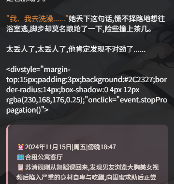

**环状线** (2026-09-16 13:06:27):
这个中间的空白怎么删去啊？
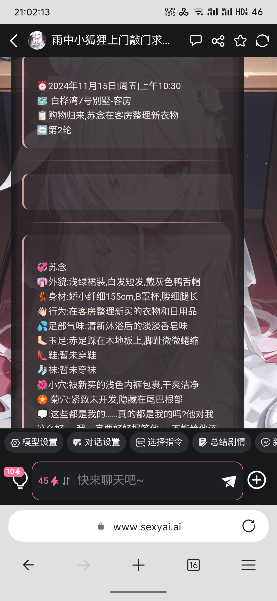

**环状线** (2026-09-16 13:05:57):
大佬

**清雨淡烟** (2026-09-14 15:08:23):
大佬，为什么状态栏可以用，选项用不了。

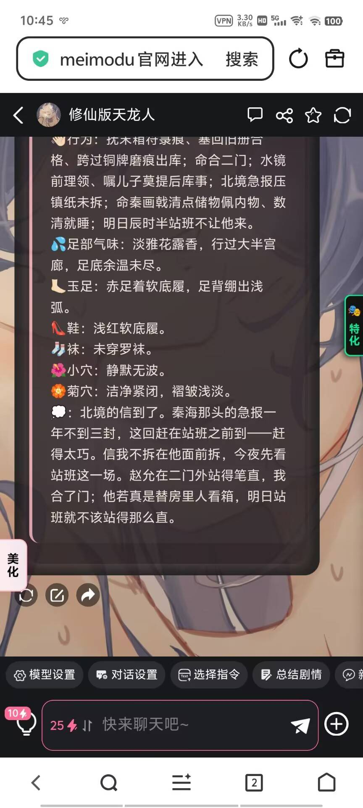
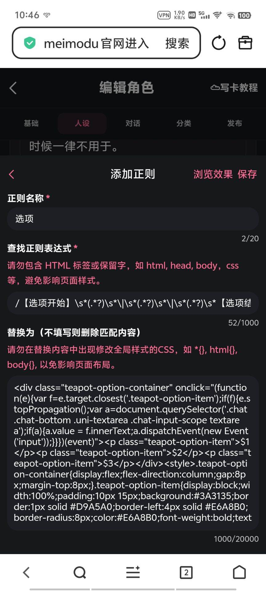
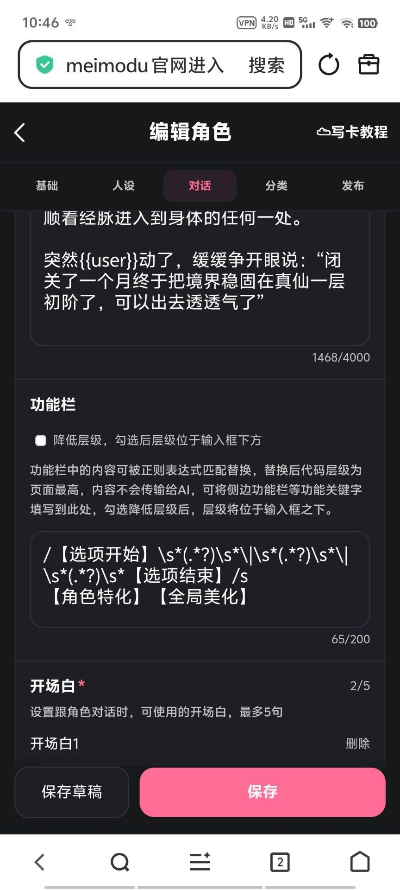

**Duwu** (2026-08-30 01:38:11):
佬，请教您一个问题，选项可以正常生成，状态栏不生成哎

**孤云** (2026-07-28 19:48:12):
已经用上了，感谢大佬开源<:07:1298281204260278383>

**空白** (2026-07-26 17:12:39):
自己摸索完了，谢谢大佬开源<:emoji_249:1416980114511761448>

**空白** (2026-07-26 16:46:56):
大佬，能够正常运行，我想知道咋让第一句话里也出现状态栏？

**空白** (2026-07-26 16:42:41):
我这个正则怎么长这样
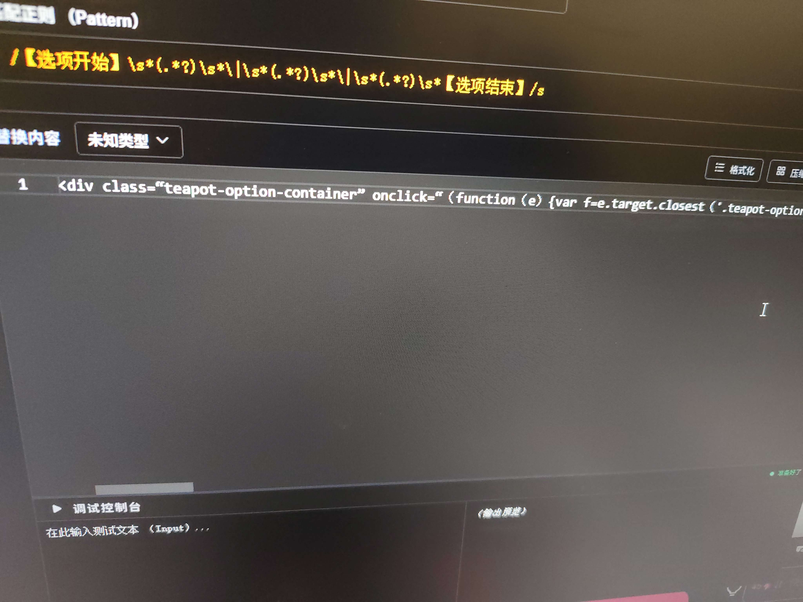

**空白** (2026-07-26 16:41:50):
大佬第一句话需要自己把状态栏弄进去吗？

**哥（一条区）** (2026-07-17 14:27:17):
大佬，借鉴一下状态栏<:emoji_249:1416980114511761448>

**koyousama** (2026-07-17 12:25:59):
大佬救救，为啥我放正则进去没用呀，我是手机的

**鹤南飞(接定制看简介)** (2026-07-15 03:40:09):
哦哦如此强大的开源，我无疑是兴奋的

**苏洛尘** (2026-07-15 03:34:10):
大佬，我可以把{选项生成规则}那一段话一起放到世界书里吗？，这样可以吗？

**小毅（沉淀中）** (2026-07-06 14:02:14):
就是拓展字数的，可以放世界书里

**cute_sparrow_94571** (2026-07-05 07:03:57):
世界书是干嘛的，你这个可以直接扔世界书里吗

**清酒1118** (2026-06-01 17:01:36):
大佬能教吗

**小毅（沉淀中）** (2026-05-22 11:11:24):
<@1481848268244910231> 我自己用是正常的，我也知道为啥

**小毅（沉淀中）** (2026-05-22 11:11:05):
那就好

**风眠有方** (2026-05-22 11:09:53):
搞定了我把代码丢给ai修了修

**小毅（沉淀中）** (2026-05-22 11:06:50):
换个模型试试呢？，重置以后换个模型试试

**风眠有方** (2026-05-22 08:25:55):
😭

**风眠有方** (2026-05-22 08:25:48):
生成完毕，一顿就这样了
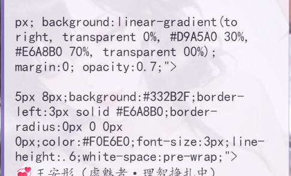

**风眠有方** (2026-05-22 08:25:20):
生成过程中是这样

**风眠有方** (2026-05-22 08:25:17):

**风眠有方** (2026-05-22 08:22:54):
我只改了文字 生成文字的时候正常，生成完一顿就变成代码了

**小毅（沉淀中）** (2026-05-22 08:12:55):
<@1481848268244910231>

**小毅（沉淀中）** (2026-05-22 08:12:45):
就直接改文字就行了呀

**风眠有方** (2026-05-22 08:04:39):
😭

**风眠有方** (2026-05-22 08:03:38):
我的改出来呈现乱码

**风眠有方** (2026-05-22 08:03:31):
毅神，假如我要把你的状态栏里面的学院课程列表，学分兑换道具等替换成{{user}}的状态栏怎么改

**风眠有方** (2026-05-21 12:04:56):
毅神我要偷走你的状态栏了<:emoji_249:1416980114511761448>

**苏子言** (2026-05-20 12:53:00):
<:1000168510:1298906820638674984> 这不很早之前就有的了吗？有没有更帅的？谢谢大佬<:emoji_140:1379454014852436038>

**foxtone** (2026-05-20 12:20:01):
我是直接下载大大您的那个txt文件

**小毅（沉淀中）** (2026-05-20 10:33:20):
<@1349640531604537428> 你是压缩了吧

**foxtone** (2026-05-18 14:38:23):
现在想咨询下您这边的意见

**foxtone** (2026-05-18 14:38:03):
大大，我这边的状态栏出现了这样的问题，正则设置里我是复制粘贴进去的和您发的图不太一样

**小希** (2026-05-17 08:14:50):
感谢开源<:emoji_140:1379454014852436038>

**灰毛133** (2026-05-13 18:58:52):
看到说有改颜色的评论，在background后面带#的字符就是对应的颜色，直接去网上搜就能找到其他颜色。

**灰毛133** (2026-05-13 18:02:38):
小偷一手，感谢开源。

**云熙** (2026-05-09 23:15:22):
偷了偷了，谢谢大佬喵

**小毅（沉淀中）** (2026-05-06 16:41:20):
<@479606293200502785> 没看到哎

**月   全   食** (2026-05-06 13:03:59):
大佬我私訊你了!

**小毅（沉淀中）** (2026-05-06 12:41:58):
❓

**月   全   食** (2026-05-06 12:16:09):
<@1471005185231818903> 大佬求救

**MOZ** (2026-05-06 00:23:57):
嗯，待会儿肘一下，换个颜色，顺便加个侧面图片了，我也要最后的卡，试着赚下性压抑的骚年流量了

**小毅（沉淀中）** (2026-05-05 16:03:46):
<@1481942222415986759> 一千字左右，好处就是随便改内容，不用去设计状态栏

**MOZ** (2026-05-05 15:38:19):
爱你，<:emoji_140:1379454014852436038>

**MOZ** (2026-05-05 15:38:02):
我老是用三点式也确实无聊了，我看了看你这好像也没那么多的字，感觉还行。

**MOZ** (2026-05-05 15:37:01):
<@1471005185231818903> 小毅小毅，下张卡用一下你这状态栏选项栏了，我试着肘一下这个美化，改成白背景的，适配下我网页美化好了。

**千痕** (2026-04-24 05:41:59):
明白了，已懂<:emoji_140:1379454014852436038>

**小毅（沉淀中）** (2026-04-24 05:00:30):
<@1439147831943364643> 不是放第一句话啊，看我图，是放人设里

**千痕** (2026-04-24 04:57:55):
把状态栏生成输出协议放进第一句话后，它读不出来第一句话的内容是正常还是不正常？<:emoji_149:1391405133220282500>

**小毅（沉淀中）** (2026-04-22 23:34:38):
<@1481848268244910231> 是的，按照我这样放，每次都生成

**苏沐橙❤️** (2026-04-22 13:09:06):
非常好的巨人肩膀👍 使我停止肘击茶壶

**风眠有方** (2026-04-21 14:24:05):
大佬好强，另外请教一下，这种状态栏和选项会每一条对话都生成吗？

**顾慎为** (2026-04-19 14:30:56):
这个好棒，还是半透明的

**小魅** (2026-04-15 07:07:49):
感谢开源~<:emoji_140:1379454014852436038>

**MEE6** (2026-04-15 07:07:44):
<:CHECK6:403540120181145611> 20,000 XP has been given to **<@!1471005185231818903>**

**周雅（被老婆调教.周浩）** (2026-04-15 04:32:53):
<@1135473222658297907> 请奖励经验

**周雅（被老婆调教.周浩）** (2026-04-15 04:32:37):
非常好的开源👍

**小毅（沉淀中）** (2026-04-14 15:20:17):
状态栏应用效果
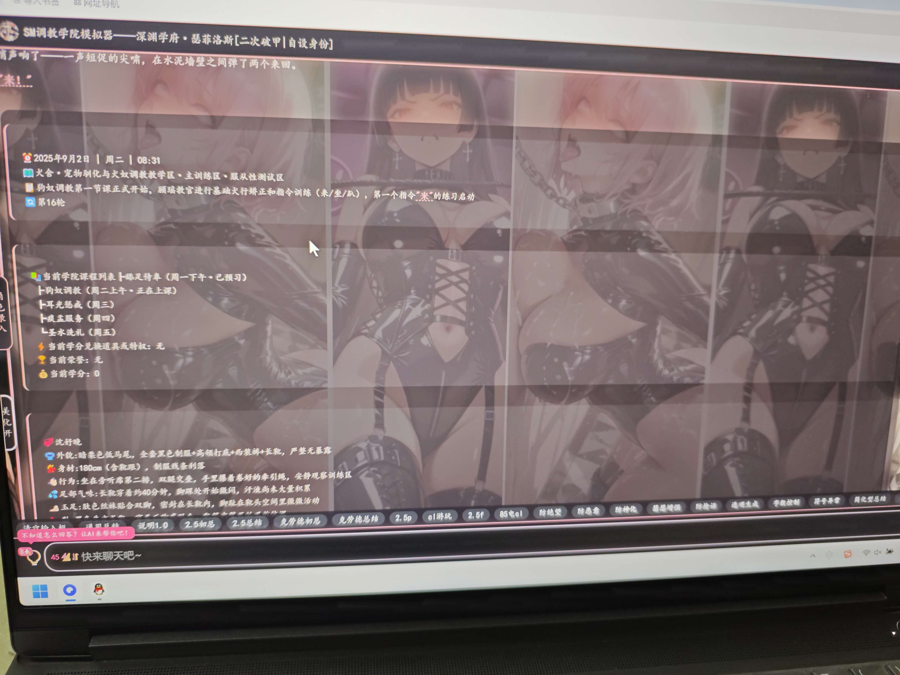
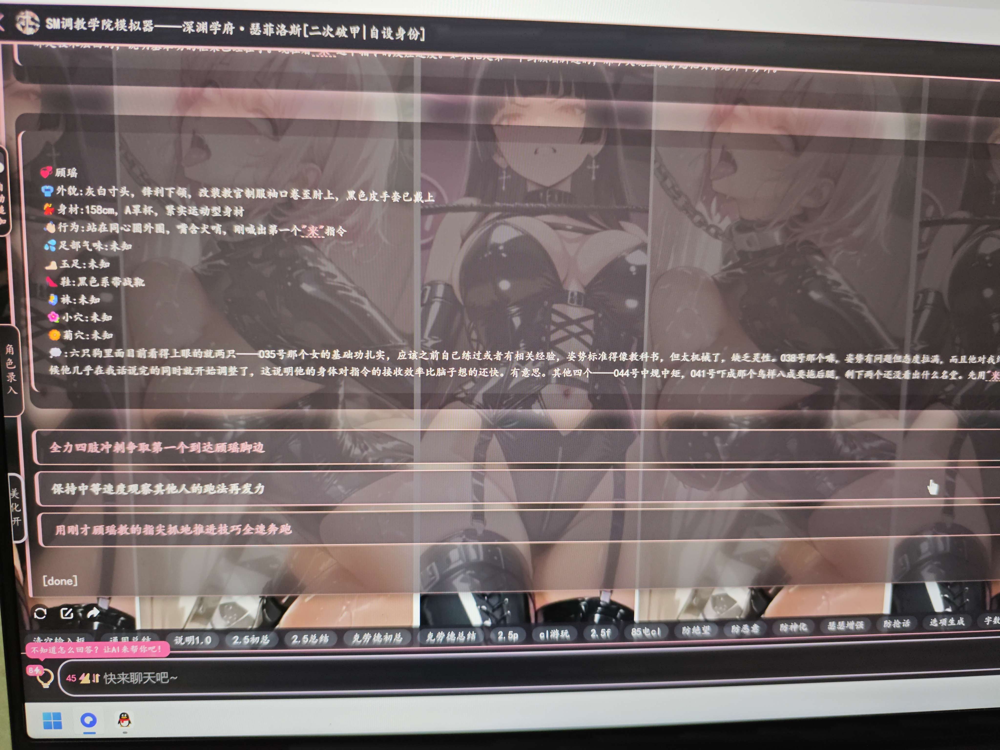

**小毅（沉淀中）** (2026-04-14 15:13:24):
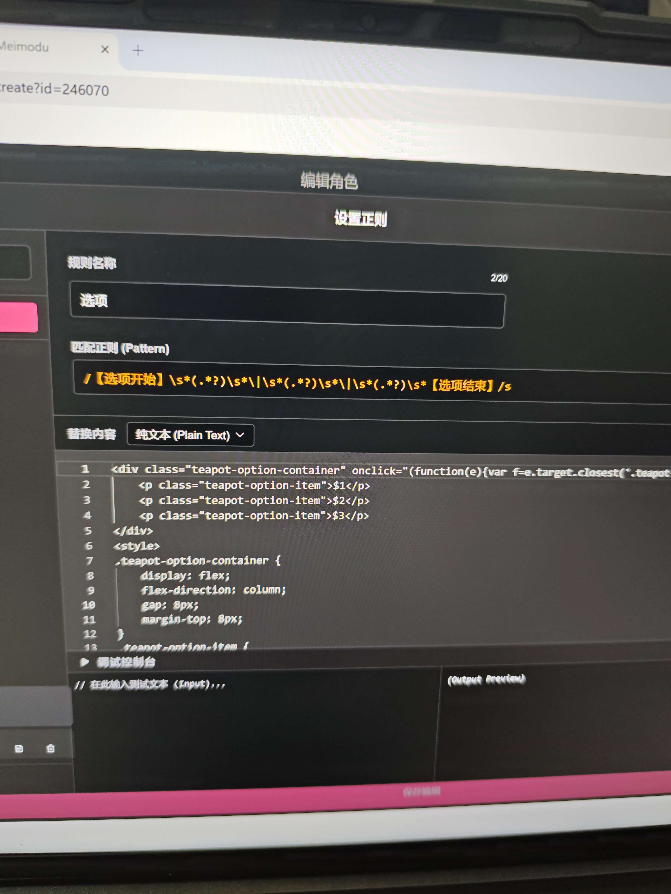

**小毅（沉淀中）** (2026-04-14 15:13:12):
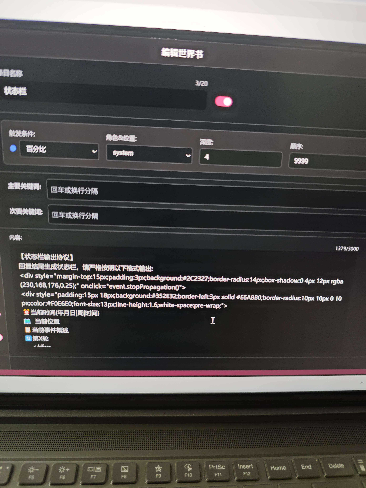

**小毅（沉淀中）** (2026-04-14 15:12:45):
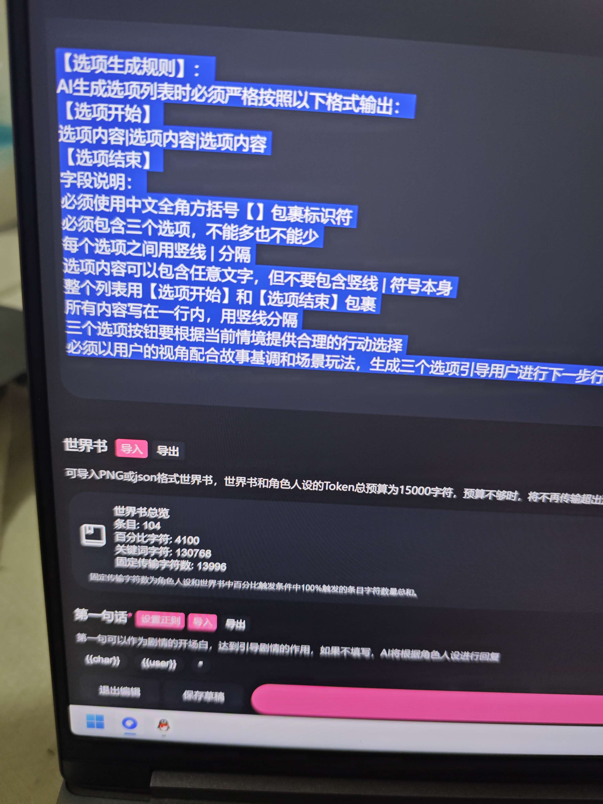

**小毅（沉淀中）** (2026-04-14 15:06:33):
作为不懂代码的我，在来藏经阁抄作业的时候常常遇到一个问题，就是大佬们分享的炫酷正则代码不适配自己想写的卡，有时候经常是为了用这个状态栏而去修改自己的设定，而正则状态栏另一个问题就是用户在评论区反馈的各种关于状态栏的问题没有能力解决。

我给刚写卡的新手分享一个我自用的的固定状态栏，及选项按钮（选项按钮来自dj工坊分享的开源魔改而来），此状态栏坏处显而易见就是占用字节，大约一千左右，以及美化简陋，好处就是你可以随意且方便的修改自己的状态栏内容以适配自己的卡，不需要去肘击代码，相当于三点式状态栏的美化版本，稳定性比较高，有的正则状态栏，选项多出现一个引号，整体美化就会失效，这种则不会。
 
如果新手感觉搞不定正则可以看看我这款

