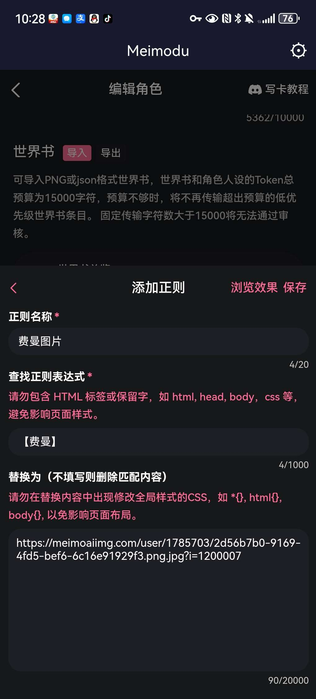
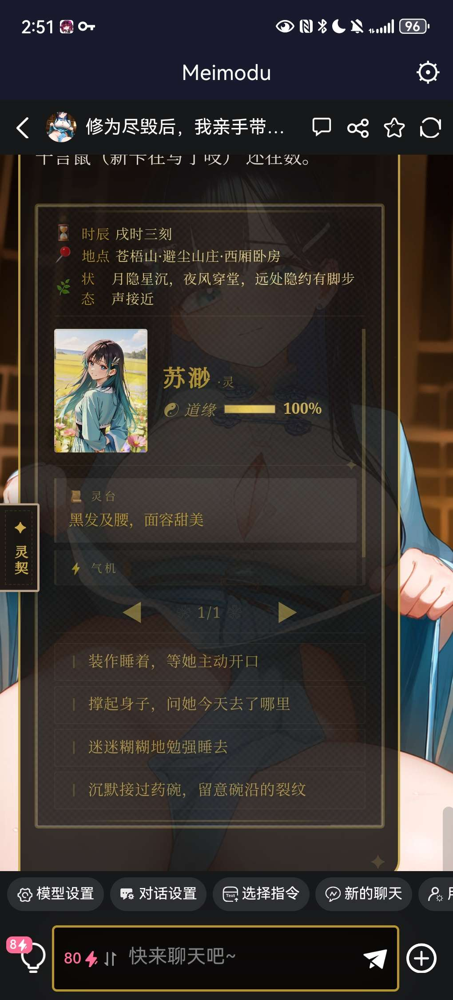

# 开源一个比较稳定，支持多人，带图，但是超级无敌丑的状态栏

创建时间: 2026-07-23T02:25:45.960000+00:00
消息数: 16

---

**寿衣** (2026-08-17 07:53:29):
感谢劳斯<:emoji_140:1379454014852436038>

**千言（鼠，现在是超级飞舞鼠鼠人格）** (2026-07-26 06:39:21):
这个我真的不知道哦，我都是修改后才看效果的<:emoji_248:1447214733718720663>

**qwer** (2026-07-26 06:03:10):
我想随时观看修改后的效果怎么办啊，有什么工具吗大佬

**洛尘（ଳ水母宗太上长老）** (2026-07-23 07:25:45):
<:1000168510:1298906820638674984>

**洛尘（ଳ水母宗太上长老）** (2026-07-23 07:25:42):
不丑啊，挺好看的

**小魅** (2026-07-23 06:59:40):
挺好看的呀

**小魅** (2026-07-23 06:59:25):
感谢宝宝开源<:emoji_140:1379454014852436038>

**MEE6** (2026-07-23 06:59:10):
<:CHECK6:403540120181145611> 30,000 XP has been given to **<@!1494361755248492706>**

**周雅（被老婆调教.周浩）** (2026-07-23 03:04:01):
<@1135473222658297907> 奖励经验

**周雅（被老婆调教.周浩）** (2026-07-23 03:03:52):
OK

**千言（鼠，现在是超级飞舞鼠鼠人格）** (2026-07-23 02:58:36):
<@1027244842629202020> 想要进集合贴捏<:emoji_140:1379454014852436038> 感觉虽然丑丑的但是还是有点用的

**千言（鼠，现在是超级飞舞鼠鼠人格）** (2026-07-23 02:47:01):
用笨笨DeepSeek跑了6、7轮状态栏都还在，哪怕一个选项生成错误（比如笨蛋AI多生成了个符号）只要其他选项生成对了正常生成的选项一样可以正常显示

**千言（鼠，现在是超级飞舞鼠鼠人格）** (2026-07-23 02:43:12):
如果要进行修改直接把状态栏3“替换为”那一块丢给AI告诉它要怎么改就行了

**千言（鼠，现在是超级飞舞鼠鼠人格）** (2026-07-23 02:29:09):
图片需要你提前进行如下替换

**千言（鼠，现在是超级飞舞鼠鼠人格）** (2026-07-23 02:27:20):
这段塞角色人设
【状态栏自动生成规则】

你在每次回复的末尾，必须生成一个状态栏数据块，格式如下：

<GC_UI>
[#角色1_姓名=角色名#]
[#角色1_好感=好感数字#]
[#角色1_头像=【角色名】#]
[#角色1_外貌=外貌描述#]
[#角色1_状态=当前状态描述#]

[#选项1=行动选项1#]
[#选项2=行动选项2#]
[#选项3=行动选项3#]
[#选项4=行动选项4#]

如果有多个角色，依次编号：角色1、角色2、角色3……

字段说明：
- 姓名：角色的名字（固定不变）
- 好感：0~100的整数，根据剧情推进合理增减（比如友好对话+5，冲突-10）
- 头像：固定为【角色名】（角色名即为姓名中角色的名字）
- 外貌：根据人物设定和当前场景进行简短描述
- 状态：根据当前情景写简短描述（如“情绪稳定，正在思考”“紧张地攥紧衣角”）

重要提醒：
1. 每次回复都必须包含这个<GC_UI>数据块，放在状态栏开头。
2. 头像和外貌字段保持不变，只更新好感和状态。
3. 如果有多个角色，每个角色都写对应的数据块。

示例：
<GC_UI>
[#角色1_姓名=费曼#]
[#角色1_好感=75#]
[#角色1_头像=【费曼】#]
[#角色1_外貌=灰白短发，左眼刀疤，灰色瞳孔，身高188cm#]
[#角色1_状态=情绪稳定，拒绝配合，正在审视你#]

[#角色2_姓名=洛丽塔#]
[#角色2_好感=90#]
[#角色2_头像=【洛丽塔】#]
[#角色2_外貌=金发蓝瞳，金丝眼镜，白衬衫一步裙#]
[#角色2_状态=专注工作，情绪平稳#]

[#选项1=装作睡着，等她主动开口#]
[#选项2=撑起身子，问她今天去了哪里#]
[#选项3=迷迷糊糊地勉强睡去#]
[#选项4=沉默接过药碗，留意碗沿的裂纹#]

**千言（鼠，现在是超级飞舞鼠鼠人格）** (2026-07-23 02:25:45):
效果如图，跟个火柴盒似的，但是笨蛋AI哪怕忘记写某一块，比如时间地点忘记写了，其他状态栏区域也能正常生成

