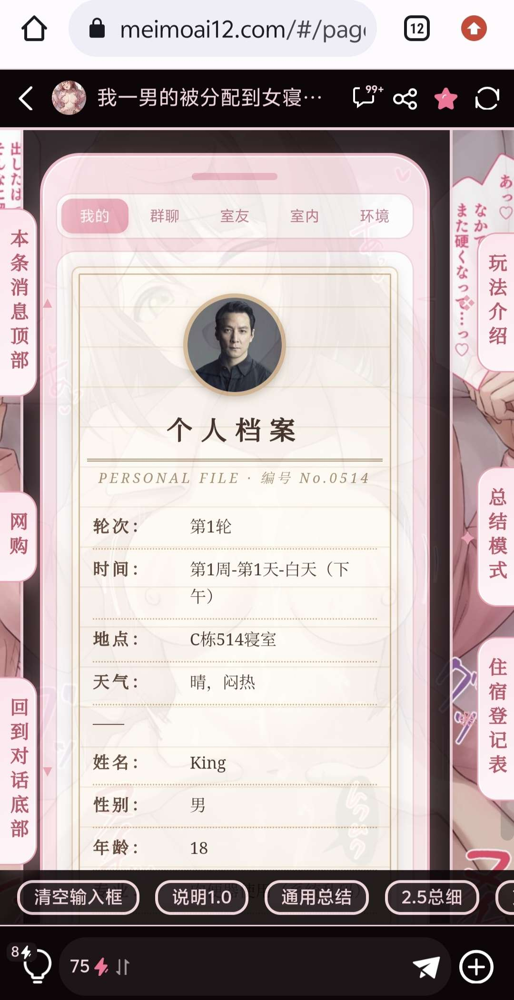
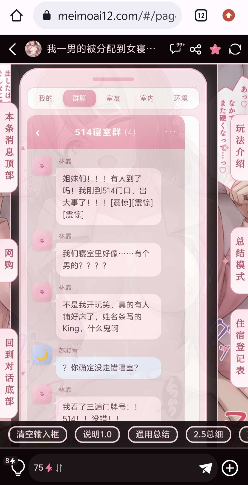
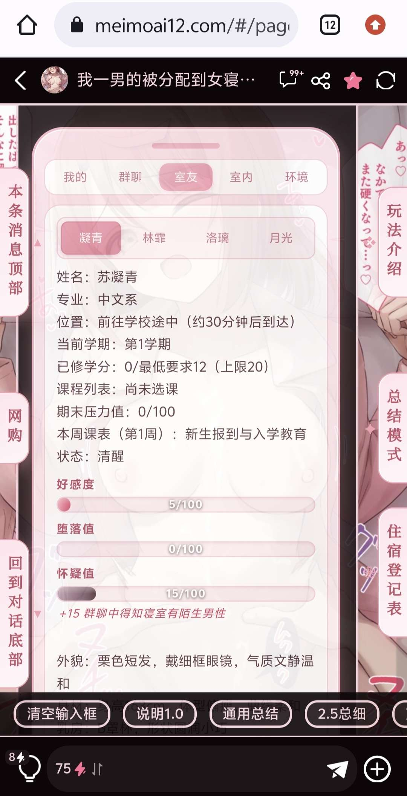
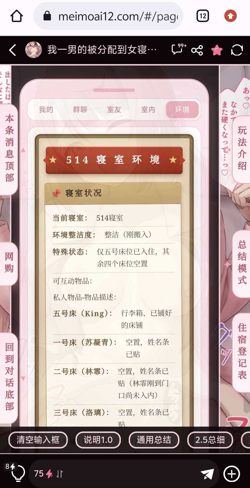
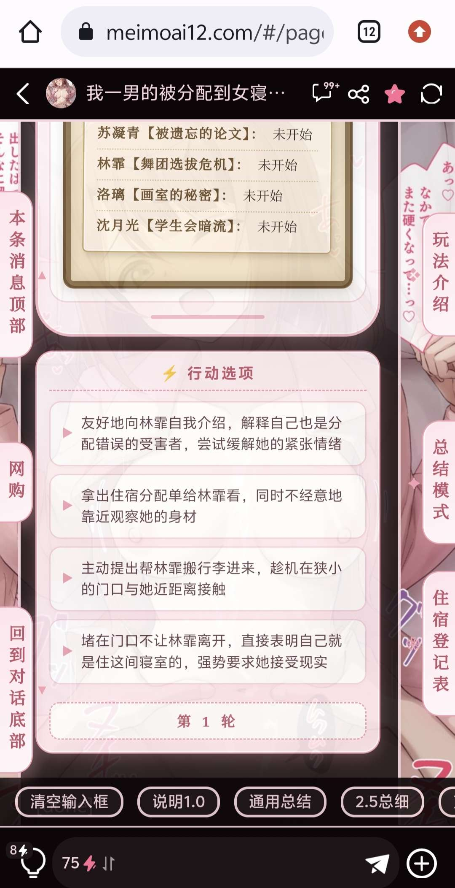

# 开源一个状态栏

创建时间: 2026-06-07T17:24:37.176000+00:00
消息数: 12

---

**管管管（认清自己）（站名:憧憬）** (2026-06-13 14:24:06):
感谢<:emoji_140:1379454014852436038>

**小魅** (2026-06-09 08:57:41):
感谢宝宝开源<:emoji_140:1379454014852436038>

**MEE6** (2026-06-09 08:57:31):
<:CHECK6:403540120181145611> 30,000 XP has been given to **<@!1503461793450823751>**

**周雅（被老婆调教.周浩）** (2026-06-09 08:54:11):
<@1135473222658297907> 奖励经验

**小稀（鹿鞭一条）** (2026-06-08 08:12:34):
谢谢佬的开源<:emoji_140:1379454014852436038>

**小稀（鹿鞭一条）** (2026-06-08 08:12:29):
<:emoji_140:1379454014852436038>

**大声铃鹿（绝不调）** (2026-06-07 17:25:24):
<:emoji_140:1379454014852436038>

**大声铃鹿（绝不调）** (2026-06-07 17:25:19):
叫AI肘击的时候小心点（

**大声铃鹿（绝不调）** (2026-06-07 17:25:10):
有点难肘击（

**大声铃鹿（绝不调）** (2026-06-07 17:24:55):

**大声铃鹿（绝不调）** (2026-06-07 17:24:46):
效果如图所示

**大声铃鹿（绝不调）** (2026-06-07 17:24:37):

