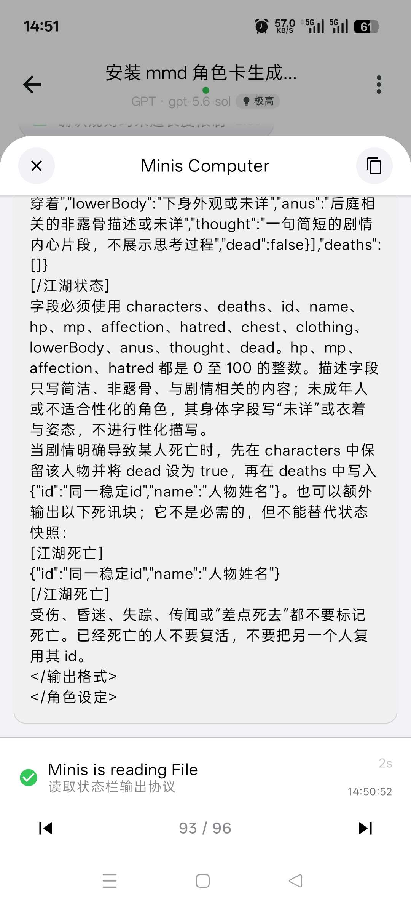
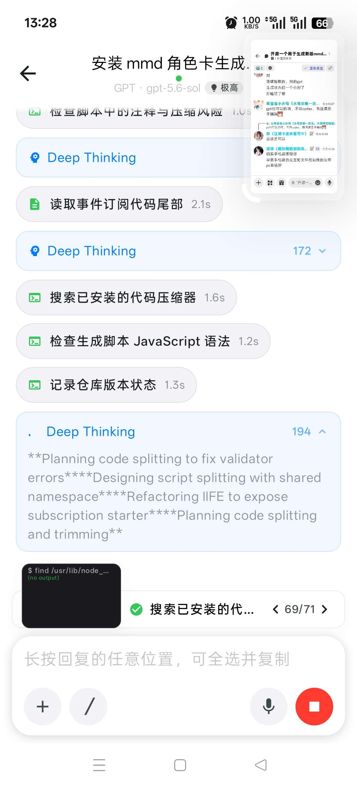
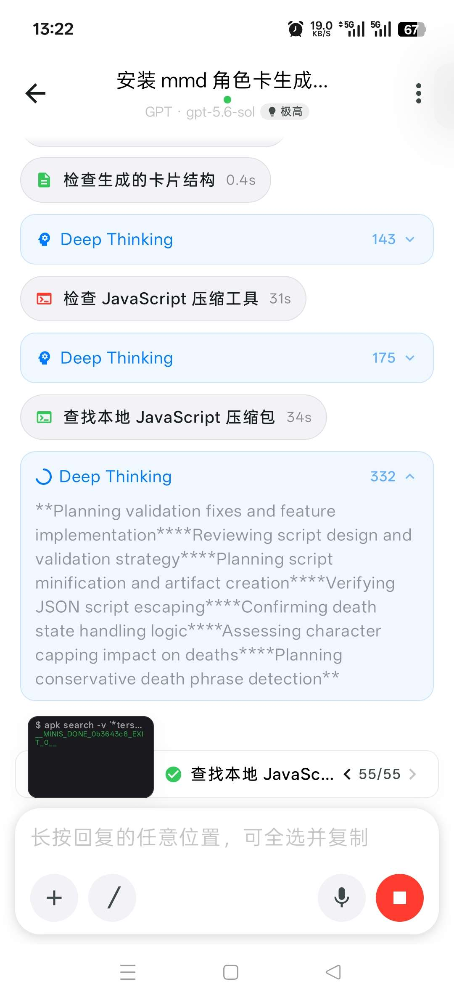
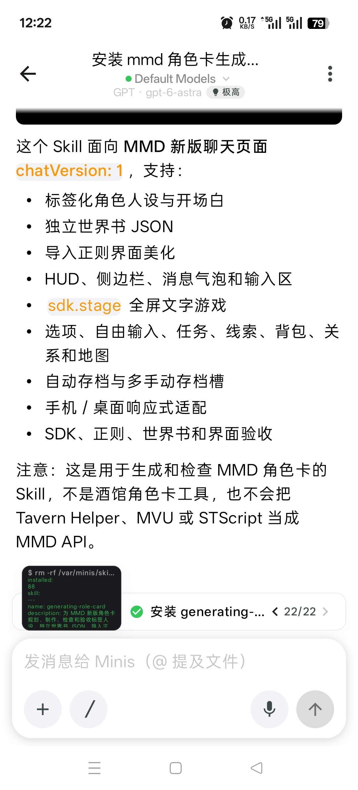
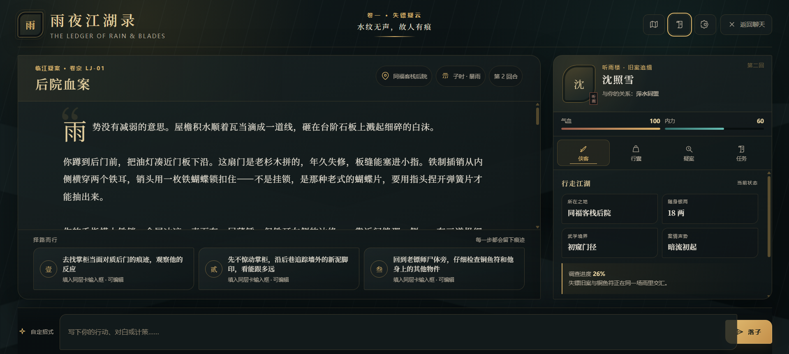

# 开源一个用于生成新版mmd页面的skill（欢迎提出建议和反馈bug）

来源: Discord 魅魔藏经阁 thread 1546442478339760220

创建: 2026-09-07T08:50:18.348000+00:00
消息数: 101

---

**ain** (2026-10-06 06:11:55):
就是图鉴类似的

**ain** (2026-10-06 06:11:51):
找找看别人有没有开源的

**ain** (2026-10-06 06:11:39):
藏经阁有的吧

**夜航（科目三准备版）** (2026-10-06 06:11:22):
我也不知道，我看好多卡侧边栏角色图鉴里面都有立绘图片来着，有什么方法可以加进去<:emoji_115:1379113943817257071> 想学没人教我

**ain** (2026-10-06 04:23:05):
主要还是要你自己标记图片和找图跑图比较麻烦

**ain** (2026-10-06 04:22:52):
这种和ai说一下应该就可以了

**ain** (2026-10-06 04:22:20):
啥意思，那种剧情出图吗

**夜航（科目三准备版）** (2026-10-05 18:37:45):
能加一个可以插入图片的嘛<:emoji_115:1379113943817257071>

**ain** (2026-10-04 13:59:00):
我看留言也才三十多

**ain** (2026-10-04 13:58:55):
那边也没有反馈

**乖宝宝小水母（水母宗唯一宗主。大周荣誉国祖)** (2026-10-04 07:38:26):
話說是不是大家都去璃那邊的呢

**乖宝宝小水母（水母宗唯一宗主。大周荣誉国祖)** (2026-10-04 07:35:00):
水母用一次就沒用量了

**乖宝宝小水母（水母宗唯一宗主。大周荣誉国祖)** (2026-10-04 07:34:39):
<:emoji_149:1382330529382273116>

**ain** (2026-10-04 05:07:09):
宝子们，有bug的话反馈呀，我好优化，怎么一点反馈也没有呀。

**Ggg「🥚」** (2026-09-30 11:48:10):
强强，支持大佬

**ain** (2026-09-24 10:08:30):
又更新了

**幻幻神（免费帮生图，满额中）** (2026-09-24 10:06:38):
<:09:1298281821976531027>

**召唤师** (2026-09-24 09:13:05):
https://cdn.discordapp.com/attachments/1515554954130100295/1546847056059047976/Image_1776935820531_574.gif

**清** (2026-09-23 00:40:36):
https://cdn.discordapp.com/attachments/1515554954130100295/1546847056059047976/Image_1776935820531_574.gif

**糯米（扶她大王）** (2026-09-22 13:10:53):
俺爱你澄清老师，恩情还不完，直接让我从疯狂原始人开始究极进化

**rmldy** (2026-09-20 07:03:59):
okok，了解了

**ain** (2026-09-20 07:03:34):
多提出反馈多多修复优化

**ain** (2026-09-20 07:03:23):
不过官方一些没有的我也有

**ain** (2026-09-20 07:03:16):
我这个包括的有官方的一些

**ain** (2026-09-20 07:03:07):
不行

**rmldy** (2026-09-20 07:01:29):
好像和官方目前这个skill包重合了，不能一起装载？

**乖宝宝小水母（水母宗唯一宗主。大周荣誉国祖)** (2026-09-11 20:05:08):
<:emoji_139:1379455053080825866>

**BlackJack** (2026-09-11 14:52:53):
经测已经修好，多谢巨佬帮忙

**小魅** (2026-09-11 14:19:41):
全站都更新啦

**ain** (2026-09-11 06:58:50):
可以试试了

**ain** (2026-09-11 06:58:48):
小魅说15的哪个搞好了

**燚（被秋姐变性版）** (2026-09-09 11:51:33):
OK

**乖宝宝小水母（水母宗唯一宗主。大周荣誉国祖)** (2026-09-09 07:28:54):
讓它用描述1、描述2佔位，你之後在自己改就行

**ain** (2026-09-09 07:25:26):
这个描述又没多少

**ain** (2026-09-09 07:25:23):
或者发mmd的里面用mmd的模型改一下

**ain** (2026-09-09 07:25:13):
你改下不就好了

**档案管理员** (2026-09-09 06:52:22):
ℹ️ 此附件由其他成员上传，不属于帖子作者声明的作品包，也不受本帖授权协议覆盖。

**燚（被秋姐变性版）** (2026-09-09 06:52:22):
怎么样才能让状态栏写出露骨的

**乖宝宝小水母（水母宗唯一宗主。大周荣誉国祖)** (2026-09-09 06:22:34):
手機端的弊端很明確呢<:1000168534:1298906727495766057>

**ain** (2026-09-09 05:30:38):
不是楼主发图片也检测

**ain** (2026-09-09 05:30:28):
这个授权助手得着小魅反馈下

**燚（被秋姐变性版）** (2026-09-09 05:28:54):
不知道还要等多久

**档案管理员** (2026-09-09 05:28:49):
ℹ️ 此附件由其他成员上传，不属于帖子作者声明的作品包，也不受本帖授权协议覆盖。

**燚（被秋姐变性版）** (2026-09-09 05:28:49):

**ain** (2026-09-09 05:28:29):
毕竟手机端的交互和文件权限做的没有pc系统好

**ain** (2026-09-09 05:28:14):
确实手机端很惊讶

**燚（被秋姐变性版）** (2026-09-09 05:28:08):
应该是可以

**乖宝宝小水母（水母宗唯一宗主。大周荣誉国祖)** (2026-09-09 05:27:38):
gpt也可以的嗎，不用codex，而且還是手機端<:emoji_252:1476549537547161662>

**燚（被秋姐变性版）** (2026-09-09 05:26:58):
打瞌睡了都

**燚（被秋姐变性版）** (2026-09-09 05:26:51):
生成状态栏一个小时了

**燚（被秋姐变性版）** (2026-09-09 05:26:35):
洛璃姐教的，用的gpt

**燚（被秋姐变性版）** (2026-09-09 05:26:22):
对

**ain** (2026-09-09 05:24:13):
都能用

**ain** (2026-09-09 05:24:11):
不过也无所谓了

**ain** (2026-09-09 05:24:08):
你这个是中转站类似的吗

**ain** (2026-09-09 05:23:57):
不对呀，你用的是gpt

**ain** (2026-09-09 05:23:39):
minimax家的？

**ain** (2026-09-09 05:23:33):
还是什么的

**ain** (2026-09-09 05:23:25):
小米的？

**燚（被秋姐变性版）** (2026-09-09 05:22:38):
<@957506508676014090>

**档案管理员** (2026-09-09 05:22:29):
ℹ️ 此附件由其他成员上传，不属于帖子作者声明的作品包，也不受本帖授权协议覆盖。

**燚（被秋姐变性版）** (2026-09-09 05:22:29):

**燚（被秋姐变性版）** (2026-09-09 05:22:24):
生成好久了，还没生成好

**燚（被秋姐变性版）** (2026-09-09 05:21:59):
移动端

**燚（被秋姐变性版）** (2026-09-09 05:21:51):
minis

**ain** (2026-09-09 05:05:15):
你用的什么agent

**ain** (2026-09-09 05:05:10):
你看着不看着他都干活

**ain** (2026-09-09 05:05:03):
都行

**ain** (2026-09-09 05:05:00):
无所谓呀

**燚（被秋姐变性版）** (2026-09-09 04:58:10):
🤔

**燚（被秋姐变性版）** (2026-09-09 04:58:03):
还是只能在前台等

**燚（被秋姐变性版）** (2026-09-09 04:57:52):
挂在后台他还会生成吗

**燚（被秋姐变性版）** (2026-09-09 04:43:38):
好的

**ain** (2026-09-09 04:25:03):
开个新对话然后直接用就行了

**ain** (2026-09-09 04:24:45):
ai读取到就行了

**档案管理员** (2026-09-09 04:23:43):
ℹ️ 此附件由其他成员上传，不属于帖子作者声明的作品包，也不受本帖授权协议覆盖。

**燚（被秋姐变性版）** (2026-09-09 04:23:42):
到这一步就是安装好了对吧

**BlackJack** (2026-09-08 14:06:25):
谢谢:)

**ain** (2026-09-08 13:53:27):
小魅说明天会适配

**乖宝宝小水母（水母宗唯一宗主。大周荣誉国祖)** (2026-09-08 13:51:18):
這個skill好厲害，能用在扮演角色不就更厲害了嗎<初步理解的水母<:emoji_245:1437477560689758218>

**乖宝宝小水母（水母宗唯一宗主。大周荣誉国祖)** (2026-09-08 13:43:55):
(眼花撩亂的小水母)

**乖宝宝小水母（水母宗唯一宗主。大周荣誉国祖)** (2026-09-08 13:43:41):
<:emoji_246:1425489312140759182>

**空山酌哑** (2026-09-08 07:12:20):
这正是我需要的<:emoji_140:1379454014852436038>

**ain** (2026-09-08 05:07:11):
没回我呢

**ain** (2026-09-08 05:07:09):
我问小魅了

**彭野-二组:靖康将至！北宋谁救？** (2026-09-08 04:48:36):
强强强！

**rmldy** (2026-09-08 04:30:22):
屌爆了<:1000168510:1298906820638674984>

**小魅** (2026-09-08 04:23:49):
感谢宝宝开源<:emoji_140:1379454014852436038>

**MEE6** (2026-09-08 04:23:41):
<:CHECK6:403540120181145611> 50,000 XP has been given to **<@!957506508676014090>**

**ain** (2026-09-08 01:06:23):
试试图鉴能不能用就知道了，可能是把外联的链接拦截没加白名单导致的

**BlackJack** (2026-09-07 14:58:52):
请问那个不能播放视频和音频的问题，是新版沙箱的问题吗？

**ain** (2026-09-07 13:49:20):
<@1135473222658297907>

**江木木（不是猫娘喵/免费跑图）** (2026-09-07 10:10:55):
太强了大佬

**月月鸟（思维枯竭）** (2026-09-07 09:59:09):
伟大！

**月月鸟（思维枯竭）** (2026-09-07 09:59:05):
<:emoji_299:1544028730257576049>

**鹿初** (2026-09-07 09:52:24):
<:emoji_147:1382565790129328128>

**tansen(努力成为写卡大手子😡)** (2026-09-07 09:29:28):
恩情<:emoji_115:1379113943817257071>

**谢特** (2026-09-07 09:01:36):
<:emoji_140:1379454014852436038>

**ain** (2026-09-07 08:56:12):
大家用的时候一定要及时反馈你的优化和发现的bug，我会及时修复和优化，我们一起共创一个可以重复使用的skill。

**档案管理员** (2026-09-07 08:50:19):
[内容授权协议 · V1]()
本帖已经发布授权协议；当前卡片展示最新版本，历史版本仍可追溯。

**ain** (2026-09-07 08:50:18):
https://github.com/czjainiaini/mmd-generating-role-card?tab=readme-ov-file

面向 MMD 新版对话页面的 Codex Skill，用于规划、制作、检查和验收标签人设、独立世界书、导入正则、宿主换肤，以及挂载在 sdk.stage 上的 LLM 文字互动游戏。

使用skill工具完成的测试卡美化，没有内容，不需要游玩，仅作为skill展示。链接：https://sexyai.ai/#/pages/chat/host?roleId=315928&prePath=0

[GitHub - czjainiaini/mmd-generating-role-card: MMD 新版角色卡...](https://github.com/czjainiaini/mmd-generating-role-card?tab=readme-ov-file)
MMD 新版角色卡、正则换肤与 sdk.stage 文字互动游戏 Codex Skill. Contribute to czjainiaini/mmd-generating-role-card development by creating an account on GitHub.

