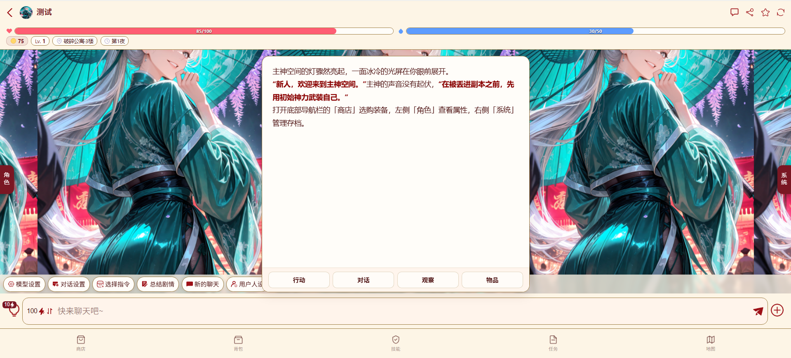

# 开源一个算是同层卡的基底美化吧

创建时间: 2026-09-02T07:26:59.590000+00:00
消息数: 6

---

**艾斯卡诺ദ്ദി˶•̀֊•́)✧** (2026-09-02 13:07:47):
大佬，请问这个适配现在的旧模式吗

**ain** (2026-09-02 11:46:12):
开源一个算是同层卡的基底美化吧

**ain** (2026-09-02 11:45:55):
开源一个算是基底美化吧

**乖宝宝小水母（水母宗唯一宗主。大周荣誉国祖)** (2026-09-02 07:44:56):
<:emoji_252:1478791303587299378>

**档案管理员** (2026-09-02 07:27:00):
[内容授权协议 · V1]()
本帖已经发布授权协议；当前卡片展示最新版本，历史版本仍可追溯。

**ain** (2026-09-02 07:26:59):
这勉强算是一个不算完整的同层思路吧，现在这个聊天框是只输出在这个气泡里面，但是同层卡还有需要需要考虑的地方，我并没有做完，比如存档系统方便回溯对话，有兴趣的可以再次基础上拓展，然后全局美化是在黑洞猫的基础上改的，然后又加了个剧情总结页面的美化。
正则直接放这里了，然后https://sexyai.ai/#/pages/chat/chat?roleId=221813&prePath=1 这个是角色卡可以简单体验一下，私密卡。

明确下，美化不是开源主要内容，美化主要还是黑洞猫的那个以及双引号修复，我主要分享的是同层卡这个，还有页面布局的问题。

