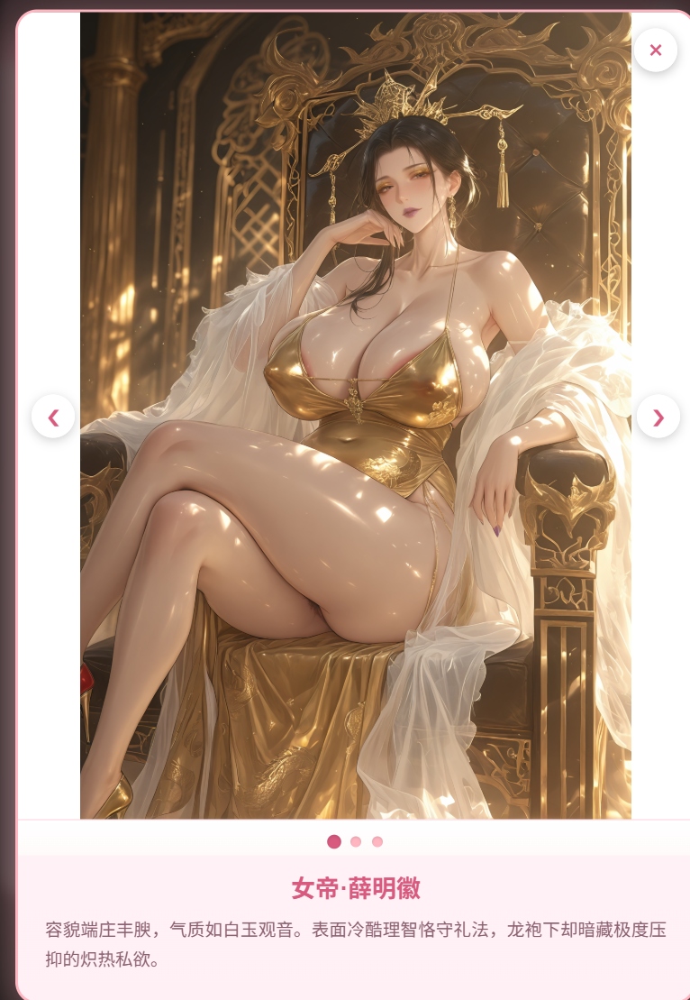

# 开源一个肉卡：我和女帝母亲的七日房中术:默许那以国事为名的乱伦性教育（图片不是V2角色卡）

创建时间: 2026-04-25T12:50:24.749000+00:00
消息数: 56

---

**小雪** (2026-08-15 13:14:07):
可以看下藏经阁置顶怎么发卡，，mmd发卡还蛮容易得<:emoji_250:1440756778487775303>

**GZRZG** (2026-08-09 18:51:03):
这是根据大佬的世界书和正则整合出自己的改版，有没有人能帮我改成角色卡啊？😩

**小雪** (2026-07-28 12:37:05):
有人做了视频和图文讲解

**小雪** (2026-07-28 12:36:48):
你可以先去写卡交流区，看一下，写卡地教程

**小雪** (2026-07-28 12:36:22):
正则，图鉴代码

**cute_sparrow_94571** (2026-07-28 08:25:03):
在哪改啊大佬，不是人设吗？第一次接触这些还不知道咋改

**小雪** (2026-07-28 07:46:31):
自己改就可以啦，包括图片链接都可以改

**cute_sparrow_94571** (2026-07-28 06:51:54):
大佬，图鉴里的人物名字和关系地位都是可以根据我的人设自己更改的吗

**小雪** (2026-06-19 05:20:13):
<:1000168510:1298906820638674984> 诡异

**许星榆** (2026-06-19 05:19:33):
其实你默许女友那张卡是能用的来着，刚才我看那张的时候是没出错的（

**小雪** (2026-06-19 05:18:56):
谢谢

**小雪** (2026-06-19 05:18:46):
好厉害

**许星榆** (2026-06-19 04:55:11):
https://cdn.discordapp.com/attachments/1385274632592162876/1516021167004061746/1781321298034.gif

**许星榆** (2026-06-19 04:55:04):
<@1330523940694790226> 给你修好了哦，只要把总结里的font旁边的<>换成转义符号就好了，刚才测试完能用了

**飞行雪绒** (2026-06-18 05:19:08):
我也不会<:1000168531:1298906724979310634>

**sj** (2026-06-17 04:58:56):
大佬解决了吗我的也是这个问题，更新后就点击特化库就变成总结了

**飞行雪绒** (2026-06-17 02:50:24):
大佬，请问一下工具栏的特化子项变成了总结内容是正则哪里出问题了，我除了替换图和状态栏信息片什么都没改

**foxtone** (2026-05-24 05:03:39):
大佬大佬，您这里有没有那种可以捏NPC的侧边啊

**五尾咸鱼（沉迷魅魔，无法自拔）** (2026-05-23 05:34:49):
好的好的，谢谢佬

**bcwer134** (2026-05-23 04:29:19):
大佬厉害<:07:1298281204260278383> <:07:1298281204260278383> <:07:1298281204260278383>

**bcwer134** (2026-05-23 04:29:08):
哇哇哇哇<:emoji_140:1379454014852436038> <:emoji_140:1379454014852436038> <:emoji_140:1379454014852436038>

**小雪** (2026-05-23 01:47:48):
自己传到mmd网页的我的资源里，然后改

**小雪** (2026-05-23 01:47:23):
图鉴代码里，每个角色对应的链接

**五尾咸鱼（沉迷魅魔，无法自拔）** (2026-05-22 21:18:40):
小雪佬，请问角色图鉴的图片要如何替换啊

**🐷辰少安🐷** (2026-05-01 08:37:28):
你就是神，我愿拜为义母

**jy** (2026-04-29 15:51:13):
太有石粒了 刚点开看了一秒就感觉要享福了 这就是古神的直视吗

**小魅** (2026-04-27 13:21:07):
感谢开源<:emoji_140:1379454014852436038>

**MEE6** (2026-04-27 13:20:59):
<:CHECK6:403540120181145611> 30,000 XP has been given to **<@!1330523940694790226>**

**周雅（被老婆调教.周浩）** (2026-04-27 00:04:35):
<@1135473222658297907> 奖励开源经验<:emoji_276:1497191644402028624>

**ZSH** (2026-04-26 15:12:33):
<:emoji_140:1379454014852436038> 太好了，又可以学啦

**小毅（沉淀中）** (2026-04-25 15:08:39):
<@1330523940694790226> 谢谢大佬开源，那个侧边栏改造也挺棒的👍 👍 👍

**小雪** (2026-04-25 15:07:03):
好，能帮到你就最好啦<:emoji_140:1379454014852436038>

**小毅（沉淀中）** (2026-04-25 15:06:14):
<@1330523940694790226> 弄出来的出错，到时候我还搞不定，我准备把你这个改改用，我不是说想做个妓院的嘛，风格还比较接近哎

**小雪** (2026-04-25 15:05:31):
要是不介意的话，这个状态栏就直接拿去用吧。。。

**小雪** (2026-04-25 15:04:35):
<:emoji_250:1440756778487775303> 豆包开专家，或者deepseek开深度思考勉强能用，但是有时候会出错。。。

**小毅（沉淀中）** (2026-04-25 15:03:31):
<@1330523940694790226> 这个要比较好的ai才用的上，我只有国内免费的傻子ai

**小雪** (2026-04-25 15:03:19):
然后提出你的要求，然后让他对照文件的规则输出你要的

**小雪** (2026-04-25 15:03:03):
然后把现在这个正则的代码丢给ai

**小雪** (2026-04-25 15:02:50):
用的话可以直接把文件丢给ai。

**小雪** (2026-04-25 15:02:01):
都是澄清佬的

**小雪** (2026-04-25 15:01:56):

**小雪** (2026-04-25 15:01:46):

**小雪** (2026-04-25 15:01:22):
这个状态栏用的是柑硕澄清混合规则的状态栏。（4.0）
有时候ai容易写出bug。

我一般喂ai用2.0的，版本老一点但是我作为代码新人理解起来简单一点。

**小毅（沉淀中）** (2026-04-25 14:14:50):
好棒，正纠结没有好的状态栏呢？

**波奇🎸** (2026-04-25 13:49:23):
# 小穴神✋🏻😭🤚🏻

**归去来兮** (2026-04-25 13:04:29):
灌注了<:emoji_661_:1467525717943255061>

**魔王大人·爆死大王（日暮宗空响长老）** (2026-04-25 12:57:39):
<:emoji_81:1378945805263831070> 小雪牛逼，也谢谢海报

**小雪** (2026-04-25 12:56:28):
在海豹基础上改的，请谢谢海豹，伟大的外星海豹

**小雪** (2026-04-25 12:56:14):
解锁图鉴代码

**小雪** (2026-04-25 12:53:01):
不会做V2角色卡，所以内容全在世界书和正则里了

**萍水相逢，尽是他乡之客** (2026-04-25 12:52:38):
现在出来了

**小雪** (2026-04-25 12:52:32):

**小雪** (2026-04-25 12:52:22):
难道文件没发出来？

**小雪** (2026-04-25 12:52:18):
啊，文件发出来了吗

**萍水相逢，尽是他乡之客** (2026-04-25 12:52:13):
<:emoji_245:1425490499795423332>

**小雪** (2026-04-25 12:50:24):
内容全部放在正则文件和世界书文件里了，唔，现在都是模拟器，估计角色卡的开源没什么人做了。给写卡的新人，提供一个参考模板吧。。。几个主要角色都是参考的红楼梦角色的人物形象写的~

