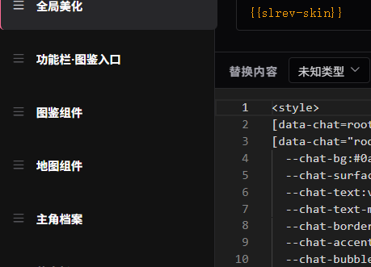
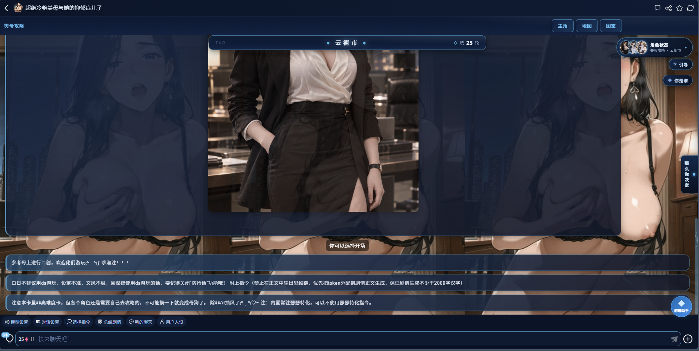

# 开源一套新页面的UI，带有可分级地图（可设地图钉）、人物图鉴、新页面状态栏和轮数计数器、游玩助手小球、配色设计、侧边选项功能、开局引导组件、新页面引号着色器。

来源: Discord 魅魔藏经阁 thread 1550401797158477865

创建: 2026-09-18T07:03:13.515000+00:00
消息数: 20

---

**一袭流云（红楼挽倾天制作：20％）** (2026-10-05 09:33:06):
未知类型是正常的，你重新进去都会显示这个，乱码指的是这些pattern式子吗

**K233** (2026-09-28 02:11:51):
感谢，我去看看

**燚（被秋姐变性版）** (2026-09-28 02:10:23):
你用这个去做吧

**燚（被秋姐变性版）** (2026-09-28 02:10:15):
他可能没睡醒

**燚（被秋姐变性版）** (2026-09-28 02:10:14):
https://discord.com/channels/1205870897769095229/1550846421198966886

**燚（被秋姐变性版）** (2026-09-28 02:10:14):
<@1442813052281159763>

**档案管理员** (2026-09-28 01:19:39):
ℹ️ 此附件由其他成员上传，不属于帖子作者声明的作品包，也不受本帖授权协议覆盖。

**K233** (2026-09-28 01:19:39):
佬，我用ai跑了一下，生成了 out/ddh.json，但是导入正则都是未知类型，就算我把他们保存成HTML类型，一保存就还是会变成未知类型，且有很多乱码，不知道问题出在哪，也问了很多次ai了（）

**一袭流云（红楼挽倾天制作：20％）** (2026-09-19 15:04:29):
可以让AI检查状态栏的只前进不后退结构是否出错了或者被误删了

**一袭流云（红楼挽倾天制作：20％）** (2026-09-19 15:03:42):
如果状态栏出现bug，可能是返回空值的逻辑出错了

**曹可南** (2026-09-19 11:47:18):
感谢大佬开源，爱你喵

**小白** (2026-09-19 09:34:00):
感谢分享，辛苦啦<:emoji_140:1379454014852436038> <:emoji_140:1379454014852436038> <:emoji_299:1544028730257576049>

**一袭流云（红楼挽倾天制作：20％）** (2026-09-19 03:36:06):
<:emoji_140:1379454014852436038>

**小魅** (2026-09-19 03:35:03):
感谢宝宝开源<:emoji_140:1379454014852436038>

**MEE6** (2026-09-19 03:34:57):
<:CHECK6:403540120181145611> 50,000 XP has been given to **<@!1528051474549182516>**

**汐愛** (2026-09-18 07:08:07):
<@1135473222658297907>

**一袭流云（红楼挽倾天制作：20％）** (2026-09-18 07:06:39):
以下为使用手册和一份示例json文件

**一袭流云（红楼挽倾天制作：20％）** (2026-09-18 07:05:31):
agent一键开发工具包，直接丢给AI就能使用

**档案管理员** (2026-09-18 07:03:14):
[本帖尚未声明授权]()
发帖人尚未完成授权设置，或已选择跳过。本状态不代表允许转载、二次创作、商业使用或重新分发。

**一袭流云（红楼挽倾天制作：20％）** (2026-09-18 07:03:13):
图中是我自己卡里的效果，分别适配了PC端和移动端。
文件：agent工具包、使用手册、一份中性示例json文件。

