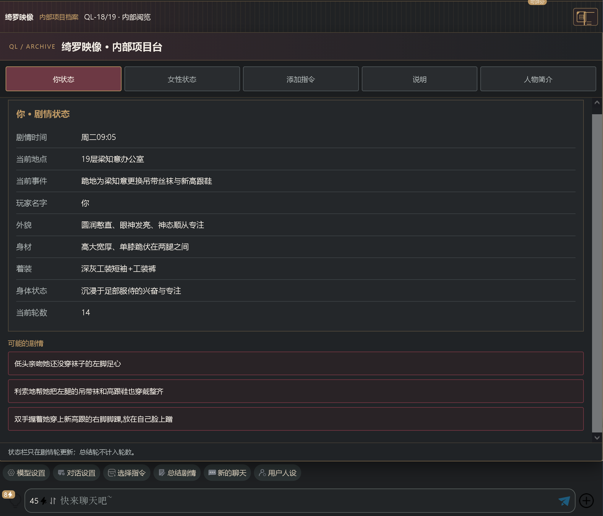

# 开源一套自用的整合（包含固定状态栏和指令，导航键，开局捏人面板）

来源: Discord 魅魔藏经阁 thread 1550790811023839263

创建: 2026-09-19T08:49:01.648000+00:00
消息数: 7

---

**小魅** (2026-09-19 13:10:02):
感谢宝宝开源<:emoji_140:1379454014852436038>

**MEE6** (2026-09-19 13:09:59):
<:CHECK6:403540120181145611> 15,000 XP has been given to **<@!1489511850415489145>**

**小白** (2026-09-19 09:31:42):
感谢分享，辛苦啦<:emoji_140:1379454014852436038> <:emoji_140:1379454014852436038>

**KING OF NAIWA👑** (2026-09-19 09:06:33):
<@1135473222658297907> 想被狠狠灌注<:emoji_150:1406265862410735707>

**KING OF NAIWA👑** (2026-09-19 09:00:44):

**档案管理员** (2026-09-19 08:49:03):
[本帖尚未声明授权]()
发帖人尚未完成授权设置，或已选择跳过。本状态不代表允许转载、二次创作、商业使用或重新分发。

**KING OF NAIWA👑** (2026-09-19 08:49:01):
已经用在两张卡里，基本上稳定不会有问题，把正则和规则直接扔给AI让它根据你自己的全局美化和内容进行修改就行。
# 注意
#  让AI改的时候一定要加上：保留原抓取与保护逻辑，只修改美化和内容
这套抓取逻辑改了非常多版，现在能抗住重新生成、刷新、换手机和电脑等，新版对话页面太难玩了<:emoji_115:1379113943817257071>

