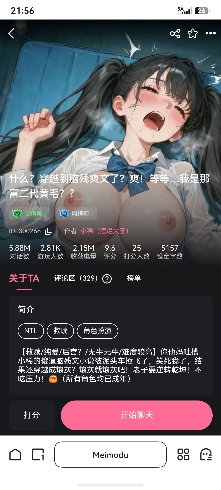

# 开源一张救赎卡将近6M成绩

创建时间: 2026-08-20T14:13:56.317000+00:00
消息数: 29

---

**K1te4** (2026-09-03 07:23:20):
老大，我不懂这个，我准备写卡，看到有开源的，这个是除了你自己写的世界和人物设定以外都可以搬吗？就是侧边按钮状态栏美化之类的，有什么不可以用什么可以用的呢？

**小稀（鹿鞭一条）** (2026-08-24 16:57:26):
<:emoji_150:1406265862410735707>

**czj** (2026-08-24 05:34:17):
谢谢老大

**花沁雅** (2026-08-24 05:27:47):
<:emoji_142:1379454037501673522> 我偷

**小稀（鹿鞭一条）** (2026-08-24 03:42:31):
https://cdn.discordapp.com/attachments/1385274632592162876/1532174199945302177/IMG_9558.gif

**小稀（鹿鞭一条）** (2026-08-24 03:42:20):
<:emoji_299:1538892045945671680>

**小稀（鹿鞭一条）** (2026-08-24 03:42:05):
人设＋输出指令

**小稀（鹿鞭一条）** (2026-08-24 03:41:57):
在这里

**小稀（鹿鞭一条）** (2026-08-24 03:40:08):
我单独发吧

**小稀（鹿鞭一条）** (2026-08-24 03:40:02):
是不是人设被清空了…

**小稀（鹿鞭一条）** (2026-08-24 03:39:46):
人设里面？不可能吧0.0

**Vincky** (2026-08-23 13:31:27):
状态栏协议是啥

**清清子** (2026-08-23 12:40:03):
老大，没有呢

**czj** (2026-08-23 11:25:35):
没找到啊

**小稀（鹿鞭一条）** (2026-08-23 09:27:18):
<:emoji_299:1538892045945671680>

**小稀（鹿鞭一条）** (2026-08-23 09:26:53):
咦？不是在世界书里嘛

**🐷辰少安🐷** (2026-08-23 03:19:57):
源神！

**清清子** (2026-08-22 08:55:06):
大佬，没有状态栏生成协议吗

**小稀（鹿鞭一条）** (2026-08-21 14:53:25):
<:emoji_149:1400299483212021833>

**小稀（鹿鞭一条）** (2026-08-21 14:53:12):
不亲<:emoji_299:1538892045945671680>

**小稀（鹿鞭一条）** (2026-08-21 14:53:01):
https://cdn.discordapp.com/attachments/1385274632592162876/1532174199945302177/IMG_9558.gif

**谢特** (2026-08-21 08:23:23):
小稀宝宝亲亲<:emoji_279:1523266492408529007>

**鹿初** (2026-08-21 01:04:44):
🦌

**花沁雅** (2026-08-21 01:01:20):
<:emoji_277:1501430172040298566> 戳戳

**小魅** (2026-08-20 14:40:14):
感谢宝宝开源<:emoji_140:1379454014852436038>

**MEE6** (2026-08-20 14:40:10):
<:CHECK6:403540120181145611> 30,000 XP has been given to **<@!1508708196041097226>**

**周雅（被老婆调教.周浩）** (2026-08-20 14:25:38):
<@1135473222658297907> 奖励经验

**小稀（鹿鞭一条）** (2026-08-20 14:16:29):
<@1135473222658297907> 狠狠灌注！

**小稀（鹿鞭一条）** (2026-08-20 14:13:56):
喜欢的可以看看哦

