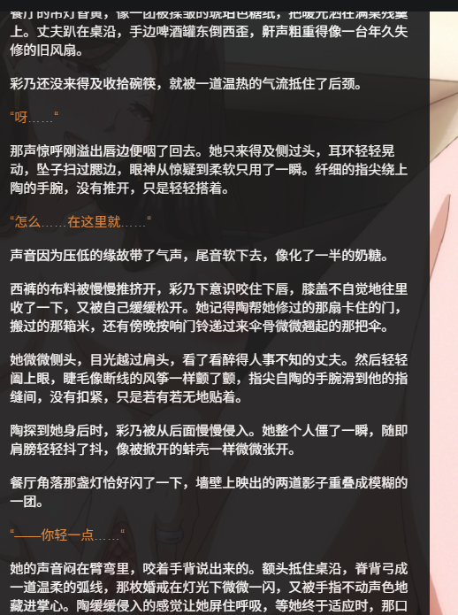
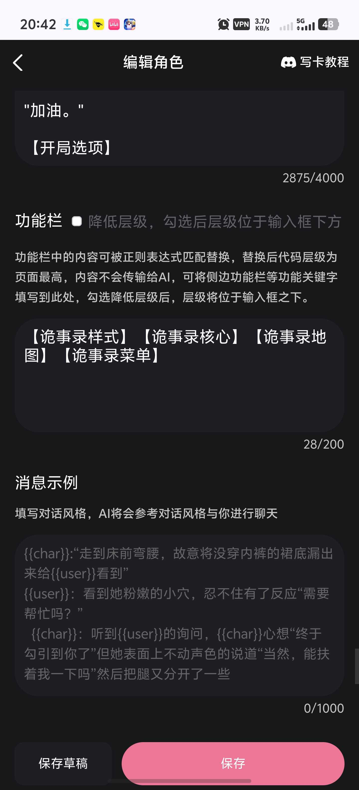
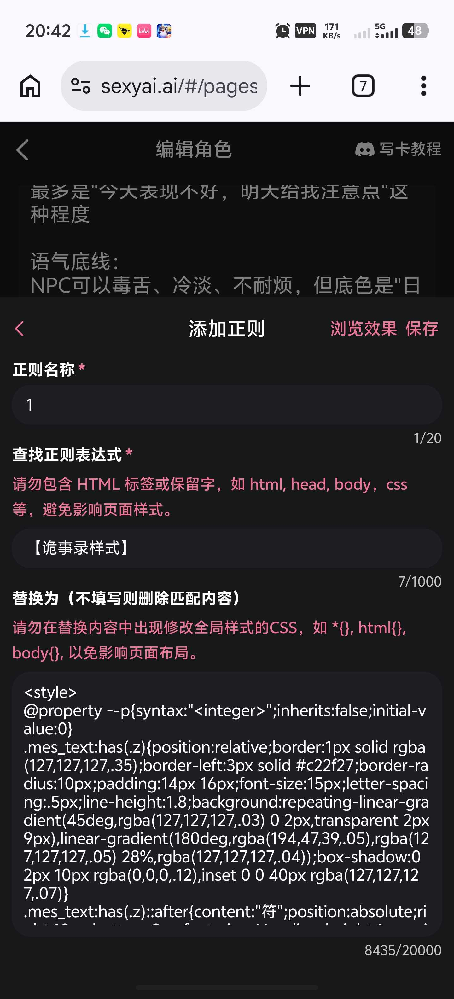
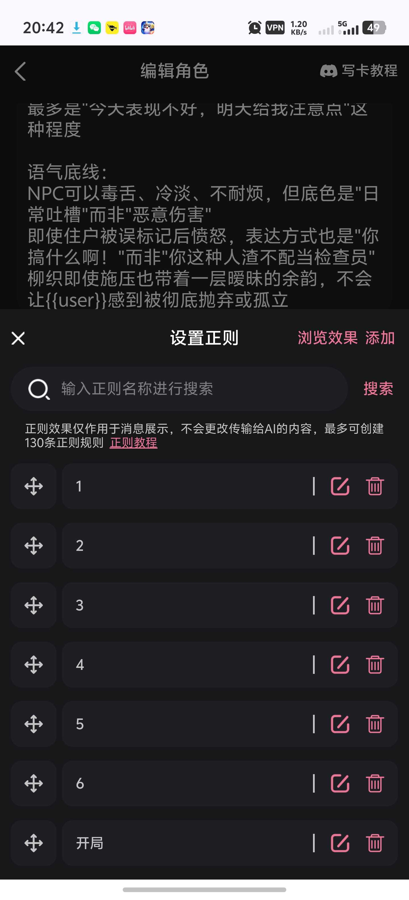

# 开源一张自己最近成绩不错的卡

创建时间: 2026-08-05T15:17:04.370000+00:00
消息数: 119

---

**月月鸟（思维枯竭）** (2026-08-06 19:37:53):

**月月鸟（思维枯竭）** (2026-08-06 19:37:37):
<:emoji_249:1416980114511761448>

**月月鸟（思维枯竭）** (2026-08-06 19:37:34):
新版状态栏

**月月鸟（思维枯竭）** (2026-08-06 19:37:28):
预告一下

**月月鸟（思维枯竭）** (2026-08-06 18:06:04):
这是输出词

**月月鸟（思维枯竭）** (2026-08-06 18:05:15):
这是通用版的，修改对应的中文即可

**月月鸟（思维枯竭）** (2026-08-06 18:04:59):

**月月鸟（思维枯竭）** (2026-08-06 12:50:00):
一样能触发地图和菜单

**月月鸟（思维枯竭）** (2026-08-06 12:49:53):
功能栏里对应的也改成这样

**月月鸟（思维枯竭）** (2026-08-06 12:49:44):
把诡事改成究极无敌暴龙战士

**月月鸟（思维枯竭）** (2026-08-06 12:49:34):
你可以试试

**可乐** (2026-08-06 12:48:36):
<:1000168510:1298906820638674984>

**月月鸟（思维枯竭）** (2026-08-06 12:48:27):
<:emoji_140:1379454014852436038>

**月月鸟（思维枯竭）** (2026-08-06 12:48:24):
只要你想你可以套个正则，直接改成究极无敌暴龙战士放进去

**月月鸟（思维枯竭）** (2026-08-06 12:47:52):
作用只是为了让你知道你的功能栏和正则对应的标签而已

**月月鸟（思维枯竭）** (2026-08-06 12:47:31):
正则替换式里的词你想写什么都行

**月月鸟（思维枯竭）** (2026-08-06 12:47:20):
有，你搜下特化就有了

**月月鸟（思维枯竭）** (2026-08-06 12:47:12):
看见正则替换式了吗？

**月月鸟（思维枯竭）** (2026-08-06 12:47:03):
就拿这个举例

**可乐** (2026-08-06 12:46:42):
这个有没有大佬开源的

**可乐** (2026-08-06 12:46:33):
顺便问下，我这边可能是回复规则里少了什么18+回复的规则。不会描述色情场景器官之类的

**月月鸟（思维枯竭）** (2026-08-06 12:45:57):
我可以改成究极无敌暴龙战士都行

**月月鸟（思维枯竭）** (2026-08-06 12:45:36):
这个的效果只是让地图和菜单能出来而已

**月月鸟（思维枯竭）** (2026-08-06 12:45:15):
我懒得改而已

**月月鸟（思维枯竭）** (2026-08-06 12:45:12):
和这没关系

**月月鸟（思维枯竭）** (2026-08-06 12:45:07):
错了

**月月鸟（思维枯竭）** (2026-08-06 12:45:06):
诶

**可乐** (2026-08-06 12:44:46):
那确实不是通用的，这是是诡异啥的

**月月鸟（思维枯竭）** (2026-08-06 12:43:40):
结合波奇大佬卡改的

**月月鸟（思维枯竭）** (2026-08-06 12:43:29):
会直接一条龙替换功能栏和第一句话

**月月鸟（思维枯竭）** (2026-08-06 12:43:14):
<:emoji_140:1379454014852436038>

**月月鸟（思维枯竭）** (2026-08-06 12:43:12):
对的

**月月鸟（思维枯竭）** (2026-08-06 12:43:06):

**月月鸟（思维枯竭）** (2026-08-06 12:42:49):

**可乐** (2026-08-06 12:42:48):
哦哦，下载导入啊

**月月鸟（思维枯竭）** (2026-08-06 12:42:36):

**月月鸟（思维枯竭）** (2026-08-06 12:41:50):
正常来说导入完后应该是这样

**月月鸟（思维枯竭）** (2026-08-06 12:41:42):
但不是这个格式

**月月鸟（思维枯竭）** (2026-08-06 12:41:28):
<:1000168531:1298906724979310634>

**月月鸟（思维枯竭）** (2026-08-06 12:41:26):
我给忘记了

**月月鸟（思维枯竭）** (2026-08-06 12:41:19):
也就是清纯度的

**月月鸟（思维枯竭）** (2026-08-06 12:41:14):
但是这张状态栏有个特化

**月月鸟（思维枯竭）** (2026-08-06 12:41:02):
是

**可乐** (2026-08-06 12:41:02):
<:emoji_249:1416980114511761448>

**可乐** (2026-08-06 12:40:55):
正则不是直接输这个吗

**月月鸟（思维枯竭）** (2026-08-06 12:40:38):
<:emoji_140:1379454014852436038>

**月月鸟（思维枯竭）** (2026-08-06 12:40:29):
晚上回去我给你整个通用的吧

**月月鸟（思维枯竭）** (2026-08-06 12:39:24):
还要改json的内容

**月月鸟（思维枯竭）** (2026-08-06 12:39:17):
单独改这个不行

**可乐** (2026-08-06 12:39:03):
<:emoji_249:1416980114511761448>

**可乐** (2026-08-06 12:39:01):
我试试

**月月鸟（思维枯竭）** (2026-08-06 12:38:50):
我忘记发这的这份是不是通用规则了

**月月鸟（思维枯竭）** (2026-08-06 12:38:37):
但是我不在电脑旁边

**月月鸟（思维枯竭）** (2026-08-06 12:38:29):
对的

**可乐** (2026-08-06 12:37:07):
要改的是这个吗

**月月鸟（思维枯竭）** (2026-08-06 12:34:56):
<:emoji_249:1416980114511761448>

**月月鸟（思维枯竭）** (2026-08-06 12:34:48):
如果财力可以的话用K3最好

**月月鸟（思维枯竭）** (2026-08-06 12:34:36):
然后和他说你的要求

**月月鸟（思维枯竭）** (2026-08-06 12:34:28):
也就是大胖鲸鱼

**月月鸟（思维枯竭）** (2026-08-06 12:34:23):
丢给dsp

**月月鸟（思维枯竭）** (2026-08-06 12:34:13):
把奶子啊色情的词删了

**月月鸟（思维枯竭）** (2026-08-06 12:34:03):
中文

**月月鸟（思维枯竭）** (2026-08-06 12:34:00):
找到里面的中午

**月月鸟（思维枯竭）** (2026-08-06 12:33:55):
你先点开我的开源json

**月月鸟（思维枯竭）** (2026-08-06 12:33:41):
我想想啊

**月月鸟（思维枯竭）** (2026-08-06 12:33:36):
我也是这样来的嘿嘿

**可乐** (2026-08-06 12:33:31):
额，怎么让ai改<:emoji_249:1416980114511761448>

**月月鸟（思维枯竭）** (2026-08-06 12:33:25):
小事小事

**可乐** (2026-08-06 12:33:07):
欧克，谢谢

**月月鸟（思维枯竭）** (2026-08-06 12:32:21):
<:emoji_140:1379454014852436038>

**月月鸟（思维枯竭）** (2026-08-06 12:32:19):
别客气

**月月鸟（思维枯竭）** (2026-08-06 12:32:16):
本来发出来就是让大家用的

**月月鸟（思维枯竭）** (2026-08-06 12:32:08):
晚点我整个通用版出来

**月月鸟（思维枯竭）** (2026-08-06 12:32:02):
你能改下最好

**月月鸟（思维枯竭）** (2026-08-06 12:31:56):
因为我这个是对应我那张卡的

**月月鸟（思维枯竭）** (2026-08-06 12:31:46):
不过最好还是让AI改改

**可乐** (2026-08-06 12:31:45):
这个我能用到公开角色里吗

**月月鸟（思维枯竭）** (2026-08-06 12:31:35):
然后把我的状态栏规则放在设定里就好了

**可乐** (2026-08-06 12:31:29):
欧克

**月月鸟（思维枯竭）** (2026-08-06 12:31:23):
就是这个

**月月鸟（思维枯竭）** (2026-08-06 12:31:12):
全套都配好的

**月月鸟（思维枯竭）** (2026-08-06 12:31:07):
你直接导入进去这个

**月月鸟（思维枯竭）** (2026-08-06 12:31:01):
匹配正则是代码哦

**可乐** (2026-08-06 12:30:45):
<@1520167274244341772>大佬匹配正则填什么，我小白

**小魅** (2026-08-05 18:38:13):
感谢宝宝开源<:emoji_140:1379454014852436038>

**MEE6** (2026-08-05 18:38:08):
<:CHECK6:403540120181145611> 30,000 XP has been given to **<@!1520167274244341772>**

**周雅（被老婆调教.周浩）** (2026-08-05 17:34:06):
<@1135473222658297907> 奖励经验

**月月鸟（思维枯竭）** (2026-08-05 15:36:58):
<:emoji_115:1379113943817257071>

**夜（中奖三次版）** (2026-08-05 15:36:28):
<:emoji_148:1382329938404839586>

**月月鸟（思维枯竭）** (2026-08-05 15:35:19):
就刚好一起开出来<:emoji_249:1416980114511761448>

**月月鸟（思维枯竭）** (2026-08-05 15:35:12):
主要是有人和我要开源

**月月鸟（思维枯竭）** (2026-08-05 15:35:05):
没办法，笨蛋只能走笨蛋的路子了

**花沁雅** (2026-08-05 15:34:04):
<:emoji_277:1501430172040298566> 满基础的，但是你这协议字数也不少

**月月鸟（思维枯竭）** (2026-08-05 15:30:02):
<:emoji_115:1379113943817257071>

**月月鸟（思维枯竭）** (2026-08-05 15:29:57):
泌雅大佬！

**月月鸟（思维枯竭）** (2026-08-05 15:29:45):
<:emoji_249:1416980114511761448>

**月月鸟（思维枯竭）** (2026-08-05 15:29:43):
补个规则协议

**月月鸟（思维枯竭）** (2026-08-05 15:29:32):
<状态栏与选项生成协议>
①在每次回复剧情后，必须在末尾附带状态栏与选项数据。每次回复必须确保以 <status> 开头，以 </status> 结束，中间包裹隐藏的数据区。
②每次回复必须更新状态栏与选项，状态要贴合当前剧情变化。
③绝对不要使用 markdown 代码块！属性值内部不要出现英文双引号。
④所有角色数据必须读取自当前剧情正文，严禁照抄本协议中的占位文字。
⑤当用户要求进行"剧情回顾/总结"或"修复"时，本轮不输出状态栏。

【状态栏与选项完整格式示范】
<status>

选项1

选项2

选项3

</status>

【标签字典与逻辑说明】
data-env：环境信息。
  turn：当前回合数；time：当前时间；loc：当前地点。
  news：小区公告，一句与剧情相关的公告（滚动播放）。公告内容禁止出现"大量住户排队等待检查"之类的描述，可写物业通知、提醒、个别可疑线索等。
  marked：已标记人数，纯数字；target：当前检查目标，无则填"暂无"。
data-char：角色信息。支持多名角色（1~3名），场景中有几名互动角色就生成几个 data-char 标签，第一名角色默认展示。
  n：女角色名。age：年龄。
  look：外貌描写。wear：衣装描写。pos：姿势描写。
  chest：胸部描写。foot：足腿描写。priv：小穴描写。rear：蜜臀描写。
  mind：内心想法，用 | 分隔，最多6条，每条简短。
  pure：清纯等级，1-5的整数。1级=初白，2级=微粉，3级=灰色，4级=可疑，5级=母猪。随剧情逐步变化，不得无依据跳级。
  ten：紧张度，0-100数字。love：好感度，0-100数字。atk：攻略值，0-100数字。
  （颜表情系统：状态栏会在清纯度位置显示动态颜表情，心情由数值自动决定——紧张度≥70显示"紧张"表情，好感度≥70显示"害羞"表情，攻略值≥70显示"开心"表情，否则显示该清纯等级的常态表情。因此这三项数值必须真实贴合剧情中角色的当前情绪状态，并随剧情及时更新，不要长期停留在同一数值。）
  （注意：每个属性名只能出现一次，同名属性会被浏览器丢弃，请勿重复书写。）
data-opt：必须生成 3 个 
 选项，每个选项控制在25字以内，不可省略。
</状态栏与选项生成协议>

**花沁雅** (2026-08-05 15:28:39):
<:emoji_277:1501430172040298566> ...

**月月鸟（思维枯竭）** (2026-08-05 15:24:38):
<:emoji_115:1379113943817257071>

**哥（一条区）** (2026-08-05 15:24:31):
<:emoji_115:1379113943817257071>

**月月鸟（思维枯竭）** (2026-08-05 15:24:30):
笨蛋有笨蛋的打发了属于是

**月月鸟（思维枯竭）** (2026-08-05 15:24:24):
我找不到图！

**月月鸟（思维枯竭）** (2026-08-05 15:24:19):
<:emoji_115:1379113943817257071>

**哥（一条区）** (2026-08-05 15:24:09):
太厉害了

**哥（一条区）** (2026-08-05 15:24:00):
<:emoji_115:1379113943817257071>

**月月鸟（思维枯竭）** (2026-08-05 15:23:50):
😋

**月月鸟（思维枯竭）** (2026-08-05 15:23:42):
我在搞新的状态栏，成了就能把图片当成颜表情模拟器辣！

**哥（一条区）** (2026-08-05 15:23:35):
<:emoji_115:1379113943817257071>

**月月鸟（思维枯竭）** (2026-08-05 15:23:09):
<:09:1298281821976531027>

**哥（一条区）** (2026-08-05 15:23:06):
是挚友啊！

**哥（一条区）** (2026-08-05 15:22:57):
<:emoji_249:1416980114511761448>

**月月鸟（思维枯竭）** (2026-08-05 15:22:42):
口瓜！挚友！

**哥（一条区）** (2026-08-05 15:20:13):
<:emoji_115:1379113943817257071>

**哥（一条区）** (2026-08-05 15:20:12):
先吃了再说

**月月鸟（思维枯竭）** (2026-08-05 15:18:38):
包含地图和简易侧边栏，适合喜欢简洁界面的<:emoji_249:1416980114511761448>

**月月鸟（思维枯竭）** (2026-08-05 15:18:08):
这是具体样式，

**月月鸟（思维枯竭）** (2026-08-05 15:17:30):
这是状态栏，从milo大佬那拿来改造的，感谢milo大佬！

**月月鸟（思维枯竭）** (2026-08-05 15:17:04):
开源下自己的状态栏给大伙，颜文字还是很可爱的！

