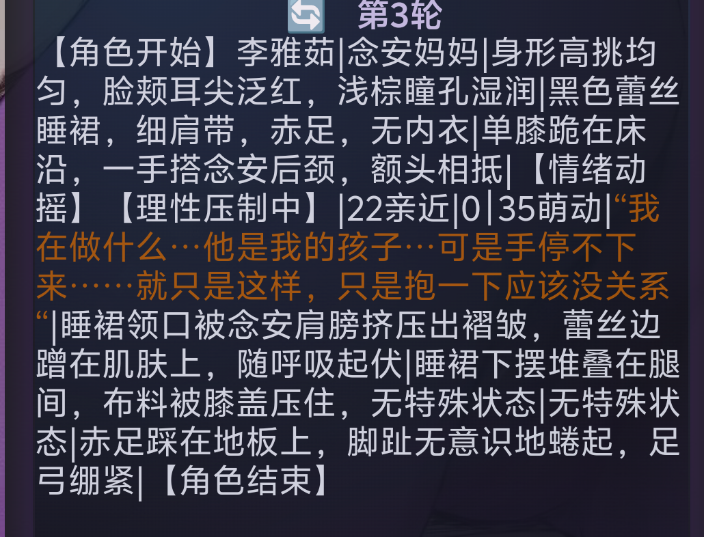
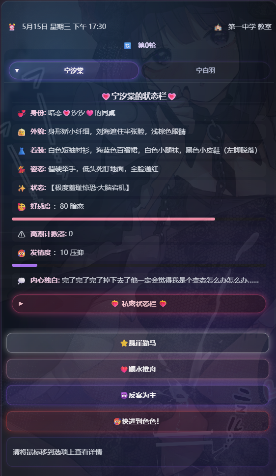

# 开源我最常用的状态栏（双版ui版本）

来源: Discord 魅魔藏经阁 thread 1545782030007271504

创建: 2026-09-05T13:05:55.195000+00:00
消息数: 43

---

**汐愛** (2026-10-02 21:56:33):
<:emoji_249:1416980128793104514> 难道是缓存又出bug了？我等下修修

**紫冥玄幽** (2026-10-02 17:32:23):
大佬，我用了你的状态栏正则数据v2.0，但是不知道为什么第一轮选项卡进入到输入框里还是正常的，但是第二轮选项卡进入到输入框里就是还是第一轮的那个，第三轮就是第二轮的。（我把第一句话里显示的那些删除了）。但是如果我不删除的话，每次进入到输入框里的示例的那四个选项。

**汐愛** (2026-10-01 15:01:31):
<:anonthink:1236166828951081052> 作者苏醒！解决了吗

**lnianan** (2026-10-01 06:09:23):
俺悟了

**lnianan** (2026-10-01 03:17:19):
然后俺这个卡主要想自己玩，并练一下怎么写卡，所以！俺准备狠狠堆料，侧边栏啊图库啊什么功能的，有啥写啥。无论谁看到消息的请提醒俺都有啥功能可以添加，最后厚积而成再开源喵。谢谢喵

**lnianan** (2026-10-01 03:13:04):
<:1000168531:1298906724979310634>

**lnianan** (2026-10-01 03:12:56):
正则里写的“衣着”“身材”这些都没有出现

**档案管理员** (2026-10-01 03:10:55):
ℹ️ 此附件由其他成员上传，不属于帖子作者声明的作品包，也不受本帖授权协议覆盖。

**lnianan** (2026-10-01 03:10:54):
佬，为什么我的角色栏没法像你图中那样喵，就像识别不到具体内容一样，只是文字

**汐愛** (2026-09-26 11:04:33):
<a:mutsumi_kyuri2:1371503706876674049>

**Raska** (2026-09-26 09:11:43):
<:emoji_250:1459542480406970432>

**Raska** (2026-09-26 09:11:38):
大佬，我可以用你的状态栏写ntr吗？

**瑆匯** (2026-09-25 00:19:28):
<:_20260601200459_219_3:1510978020750524549>

**汐愛** (2026-09-25 00:16:54):
已修改

**瑆匯** (2026-09-24 23:44:02):
谢谢大佬<:emoji_115:1379113943817257071>

**汐愛** (2026-09-24 23:39:42):
我测试了一下，确实有这个问题。应该是牢魅后面又改类名了，我修一下

**瑆匯** (2026-09-24 23:34:12):
就是点了之后无法进入到输入框里

**汐愛** (2026-09-24 23:06:47):
<:emoji_251:1474746086345281709> 不正常啊，你改了什么吗？这个发出来之前我测试过的

**瑆匯** (2026-09-24 22:53:50):
大佬有解决的办法吗？

**orange🍊** (2026-09-24 18:13:42):
那肯定是不正常的，如果点不了还叫选项吗

**瑆匯** (2026-09-24 15:49:08):
大佬，选项点不了是正常的吗？

**汐愛** (2026-09-17 16:22:14):
未开源过。而且那个功能实际状态已经被新的事件模块取代了

**压根全是托，不给人中** (2026-09-17 12:30:07):
大佬淫商助手开没开源过?

**千痕** (2026-09-13 11:33:14):
<:emoji_149:1400299483212021833> <:emoji_149:1400299483212021833>

**雨霖** (2026-09-13 08:34:23):
感谢分享，参考写卡了

**CAD** (2026-09-12 14:58:24):
更新了<:emoji_140:1379454014852436038>

**汐愛** (2026-09-08 08:15:12):
<:daroubangqingnichi:1411320597241139260>

**夏哥** (2026-09-08 07:10:52):
ntr专用状态栏

**白白白（月清瑶寄生）** (2026-09-07 06:36:47):
汐汐神！

**tt** (2026-09-06 09:29:02):
太好，有救了<:emoji_115:1379113943817257071>

**鹿初** (2026-09-06 05:35:00):
<:1000168528:1298906738761924722>

**汐愛** (2026-09-06 04:31:02):
<:emoji_253:1494328895120347247> 现在升级了

**汐愛** (2026-09-06 04:30:52):
<:emoji_140:1379454014852436038>

**小魅** (2026-09-06 04:21:22):
感谢宝宝开源<:emoji_140:1379454014852436038>

**MEE6** (2026-09-06 04:21:16):
<:CHECK6:403540120181145611> 20,000 XP has been given to **<@!1241360726728249354>**

**Raska** (2026-09-05 23:45:27):
<:emoji_150:1388140448731762790> ntr区指定状态栏

**汐愛** (2026-09-05 14:24:06):
<:emoji_253:1494328895120347247>

**艾斯卡诺ദ്ദി˶•̀֊•́)✧** (2026-09-05 13:42:51):
汐汐<:emoji_133:1379494883227734157>

**汐愛** (2026-09-05 13:12:18):
<:emoji_150:1400299501423431771> make assistant delete again<:emoji_150:1400299501423431771>

**orange🍊** (2026-09-05 13:11:08):
<@1135473222658297907>

**orange🍊** (2026-09-05 13:11:01):
汐神降临，make mmd great again！

**档案管理员** (2026-09-05 13:05:56):
[本帖尚未声明授权]()
发帖人尚未完成授权设置，或已选择跳过。本状态不代表允许转载、二次创作、商业使用或重新分发。

**汐愛** (2026-09-05 13:05:55):
顶层的新版ui版本有bug，新版本v2.0在底层
话说谁能教教我dc怎么编辑附件<:emoji_115:1379113943817257071> 

修正了旧帖子里反馈过的一些bug，适配了新版ui。顺带，集成了炸飞ai帮答<:emoji_150:1400299501423431771> 换了ui也炸给你看

状态栏世界书是新旧版本通用的。
注意，你要是卡里用新版ui就下新版的，用旧版ui就下旧版的。版本不匹配会导致模块错位

-----------以下是正文----------

『简单好改易理解，三段式状态栏，适配多人角色』
点击角色名标签可以切换角色面板，再点可以收回整个面板。

整体运行应该不太卡。
因为没有用太复杂的js，所以很多时候不需要ai也能轻松修改～

分成了三段式，尽可能保证轮数的正常生成。三个部分用了三种不同的引导，尽量避免ai混淆。

优点是相对比较省token，缺点如果ai蠢蠢，划错竖线可能会整体崩状态栏。

以上。

