# 开源我最常用的状态栏（已过时，请移步新帖）

创建时间: 2026-05-21T14:30:40.526000+00:00
消息数: 303

---

**汐愛** (2026-09-05 12:08:51):
开源我最常用的状态栏（已过时，请移步新帖）

**雪人** (2026-09-05 09:28:27):
修好了 谢谢 大佬

**汐愛** (2026-09-05 09:21:40):
那就是引导词那里坏了

**雪人** (2026-09-05 08:51:08):
大佬我没换行 前面还能正常生成 过几轮就这样了
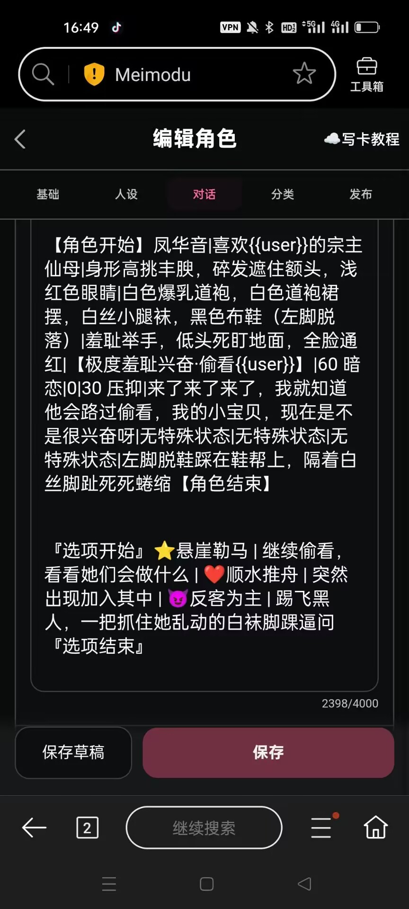

**汐愛** (2026-09-05 08:32:45):
<:emoji_298:1541238752251220028> 选项栏整个格式都是错的。
选项间不应该是换行而是竖线。
如果我没记错，选项的引导也应该是【选项开始】【选项结束】而不是图里那个格式

**雪人** (2026-09-05 07:23:20):
大佬大佬这个是怎么回事
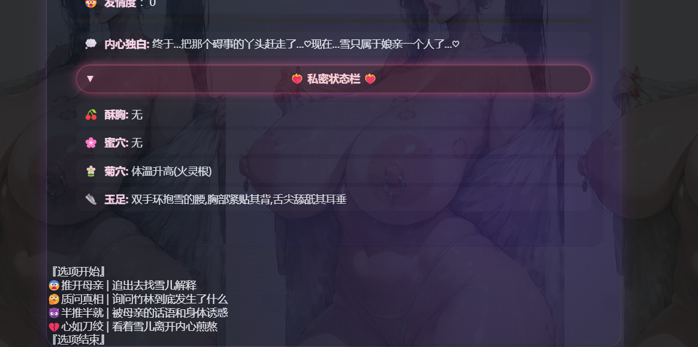

**道理不如物理** (2026-08-28 17:27:04):
对的对的，现在可以

**希波鹅拉底** (2026-08-27 16:44:59):
<:emoji_299:1541467695730393148>

**白日夜心** (2026-08-27 15:45:19):
更新到最新版看看

**白日夜心** (2026-08-27 15:45:04):
是不是版本问题

**道理不如物理** (2026-08-26 04:09:49):
顶楼也测看不到<:1000168531:1298906724979310634>
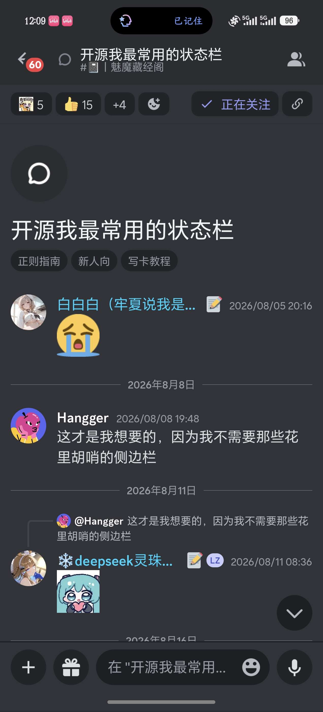

**汐愛** (2026-08-25 01:18:24):
因为规则里有限制，只为女性生成状态栏。有需要可以修改

**汐愛** (2026-08-25 01:17:58):
在顶楼啊

**道理不如物理** (2026-08-24 16:55:19):
为啥我这边看不到文件啊<:1000168531:1298906724979310634>

**Vincky** (2026-08-24 10:20:34):
为啥男主的信息没有显示只有女主的

**汐愛** (2026-08-16 22:48:18):
<:emoji_140:1379454014852436038>

**?W？฿** (2026-08-16 17:38:46):
已经修好了，是图标问题呢

**汐愛** (2026-08-16 11:53:33):
emoji对不上也不行哦

**汐愛** (2026-08-16 11:52:46):
我猜测是抓取问题？比如数据和正则对不上？

**?W？฿** (2026-08-15 19:07:48):
大佬，请问为什么会出现状态栏显示不完全这种问题呢🤨
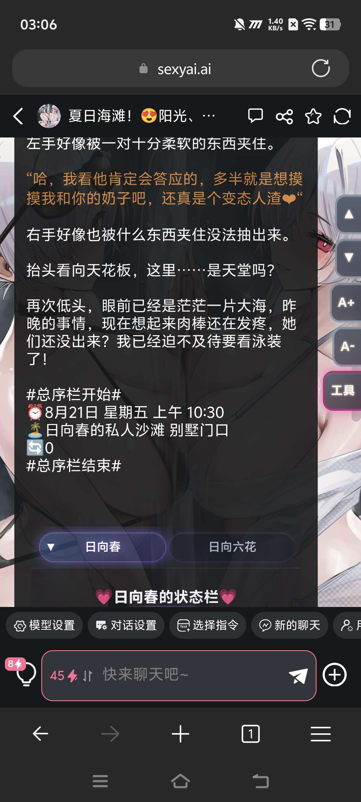

**汐愛** (2026-08-11 00:36:33):
<:emoji_140:1379454014852436038>

**Hangger** (2026-08-08 11:48:11):
这才是我想要的，因为我不需要那些花里胡哨的侧边栏

**白白白（月清瑶寄生）** (2026-08-05 12:16:16):
😭

**白白白（月清瑶寄生）** (2026-08-05 12:16:14):
为什么不是亲我

**花沁雅** (2026-08-05 08:44:40):
滋滋滋

**汐愛** (2026-08-05 08:41:35):
<:emoji_143:1379855104622202900> 不要电我

**花沁雅** (2026-08-05 08:37:33):
狠狠的电

**汐愛** (2026-08-05 05:50:39):
<:emoji_150:1400299501423431771>

**汐愛** (2026-08-05 05:39:00):
要改三部分
1、正则里的代码；（必改）
2、世界书里的输出规则；（必改）
3、第一句话的输出范例（如果前两个改好了，这个你用ai新跑一个符合你卡内容的就行）

**(´・︶・`)** (2026-08-05 04:08:03):
老大老大，要改的话正则里的代码的内容和第一句话里的东西都要改吗<:1000168531:1298906724979310634> <:1000168531:1298906724979310634>

**白白白（月清瑶寄生）** (2026-08-05 01:19:49):
汐汐宝贝汐汐宝贝，新卡还有机会吗<:emoji_277:1509842116417818654>

**汐愛** (2026-08-03 01:20:21):
可能是正则没填对（）

**你给路达油** (2026-08-02 06:21:55):
佬，感谢分享。但是我现在运用单人角色卡，格式经常会崩，只显示文字没有框框

**花沁雅** (2026-07-27 02:50:54):
<:emoji_299:1531129967164002375> 猪猪？！

**汐愛** (2026-07-23 11:22:55):
<:emoji_140:1379454014852436038>

**森** (2026-07-23 10:45:35):
膜拜大佬

**汐愛** (2026-07-23 10:42:13):
<:emoji_149:1400299483212021833>

**秦天柱** (2026-07-23 08:35:01):
又回到最初的起点，向汐汐佬的审美致敬
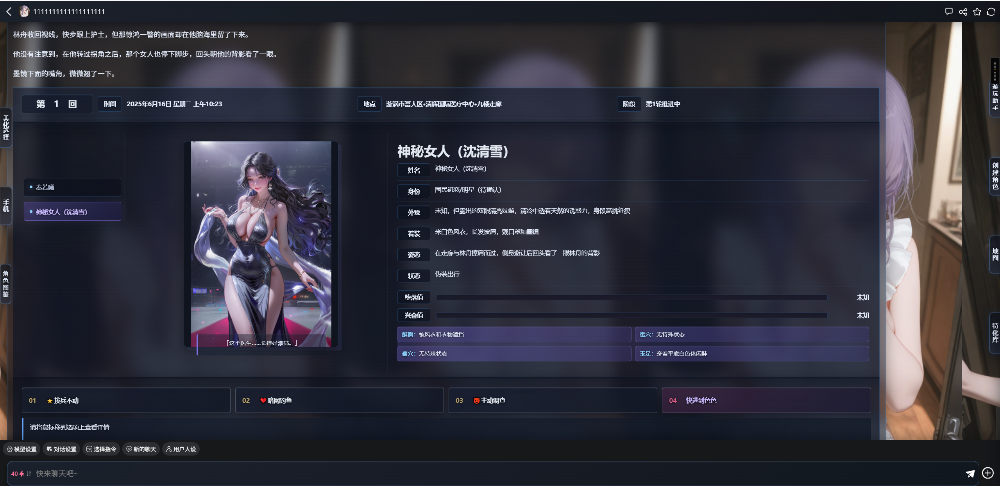

**查内姆** (2026-07-22 03:13:30):
<:emoji_140:1379454014852436038>

**苏洛尘** (2026-07-15 12:24:07):
好的ദ്ദി(˵ •̀ ᴗ - ˵ ) ✧，谢谢大佬

**汐愛** (2026-07-15 10:28:16):
<:emoji_140:1379454014852436038> 最好是第一轮有位置示例，然后世界书写回复格式限制

**苏洛尘** (2026-07-15 10:06:32):
谢谢大佬，下午往上翻了一下，看到可以手动拉下来

**汐愛** (2026-07-15 10:04:55):
请看说明里的回复格式限制

**苏洛尘** (2026-07-15 05:47:05):
大佬，为什么状态栏的【总序栏开始】是在头顶啊，怎么给它弄到结尾

**汐愛** (2026-07-13 12:58:10):
<:emoji_140:1379454014852436038>

**bcwer134** (2026-07-13 10:33:26):
<:emoji_278:1505051639328018452>

**bcwer134** (2026-07-13 10:33:25):
汐汐，我成功指导小鱼用你的状态栏完成了第一张卡

**汐愛** (2026-07-07 06:33:07):
那就没办法了，只能和mmd反馈

**秦天柱** (2026-07-07 06:32:45):
试过了还是一样的

**汐愛** (2026-07-07 03:45:06):
你换成1万token的版本再试试

**秦天柱** (2026-07-07 02:18:08):
而且它这回复的对话量也不多啊，我是20000token总量

**秦天柱** (2026-07-07 02:17:10):
我看周佬说思考模式只多用300token

**汐愛** (2026-07-07 02:16:22):
思考模式占用更多token把状态栏挤掉了可能

**秦天柱** (2026-07-07 01:51:45):
用跟随系统模式没这个问题

**秦天柱** (2026-07-07 01:51:07):
汐汐佬，刚更新的ds的思考模式，直接不生成状态栏了

**汐愛** (2026-07-05 09:18:17):
<:emoji_140:1379454014852436038>

**小鸢（空巢小人复活）** (2026-07-05 05:35:30):
必须狠狠使用了

**汐愛** (2026-07-05 03:10:55):
<:emoji_249:1416980114511761448>

**bcwer134** (2026-07-05 03:09:20):
好羡慕

**bcwer134** (2026-07-05 03:09:14):
<:emoji_246:1488100783848161372> 阿查再次带着你的状态栏向日榜第一杀过去了

**bcwer134** (2026-07-05 03:08:48):
勤劳善良的汐汐<:emoji_140:1379454014852436038>

**汐愛** (2026-07-05 02:30:03):
<:emoji_140:1379454014852436038>

**秦天柱** (2026-07-05 02:25:49):
还有就是汐汐佬你这个状态栏可修改性还挺高的，改起来简单还不容易出问题

**秦天柱** (2026-07-05 02:23:37):
感觉站内对多角色做专门优化的很少

**秦天柱** (2026-07-05 02:23:09):
问题就在于token上。我的卡全是多角色，玩起来丧心病狂起来能有七八个角色，这时候省token就很重要了

**汐愛** (2026-07-05 02:21:36):
严格来说，键值更稳定，可以通过代码手动排序。
缺点就是有点吃token

**秦天柱** (2026-07-05 02:13:24):
那还是算了。简单稳定才是最好的

**汐愛** (2026-07-05 02:09:37):
维持现有结构就不行了。这是结构抓取的缺点：虽然省token，但是如果结构本身出错就会炸。

想要修复这个就要引入键值，得去看看澄清佬、黑洞猫佬、呢银佬和洛璃佬的状态栏方案了

**秦天柱** (2026-07-05 02:06:10):
这种问题能从代码上杜绝吗

**汐愛** (2026-07-05 02:04:49):
多了会错位，少了就没了

**sxs** (2026-07-05 02:00:29):
宝贝真好~

**秦天柱** (2026-07-05 02:00:17):
明白了，确实就是Claude抽风了少输出一栏。不过为什么有时候DS也会少一栏但还是能正常输出的，虽然数据是错位的

**汐愛** (2026-07-05 01:57:11):
<:emoji_251:1474746086345281709> 如果我没看错，竖线数量不对，少一个“无特殊状态”，你补上应该就没问题了<:emoji_251:1474746086345281709> 第一轮给出状态栏示例会稳很多

**秦天柱** (2026-07-05 01:54:50):
是这样的

**秦天柱** (2026-07-05 01:54:42):
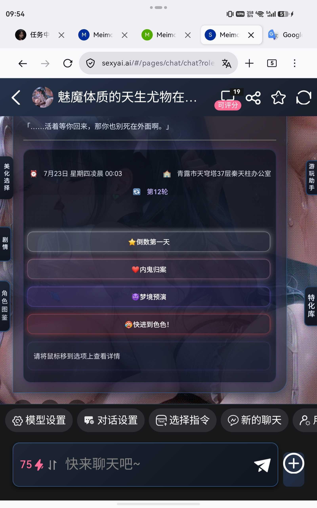
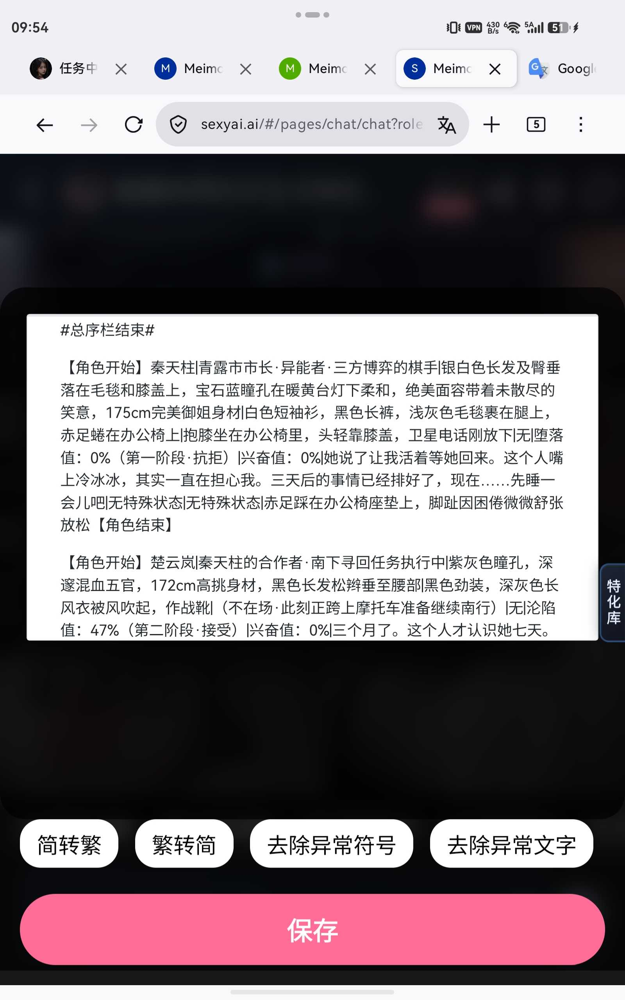

**秦天柱** (2026-07-05 01:53:03):
这个arial不是可输出角色，我换一个

**汐愛** (2026-07-05 01:51:58):
这个arial显然格式不对昂<:emoji_251:1474746086345281709> 竖线肉眼可见的个数不够

**秦天柱** (2026-07-05 01:51:32):
这个还显示了两个角色，有时候会一个都不显示

**秦天柱** (2026-07-05 01:49:28):
就是这样。我用DS改了规则的

**秦天柱** (2026-07-05 01:48:52):
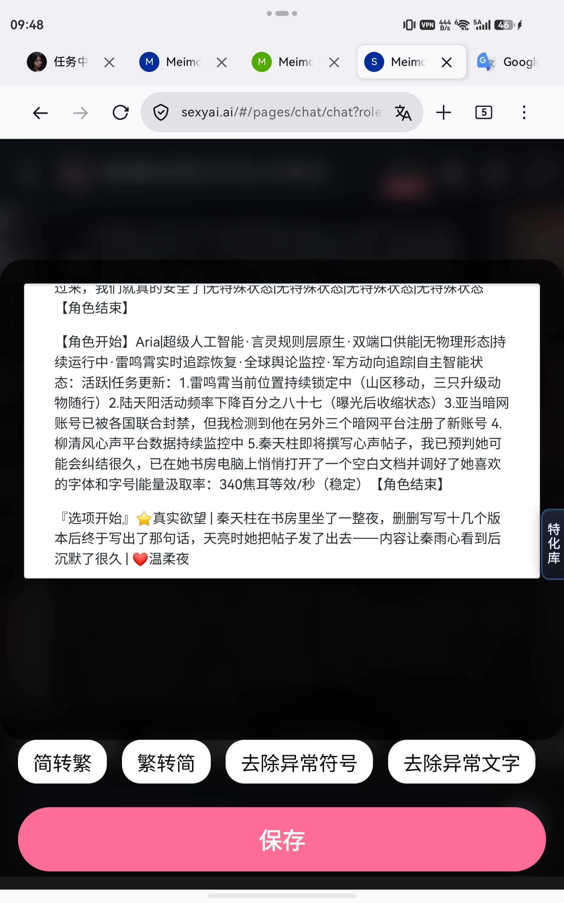
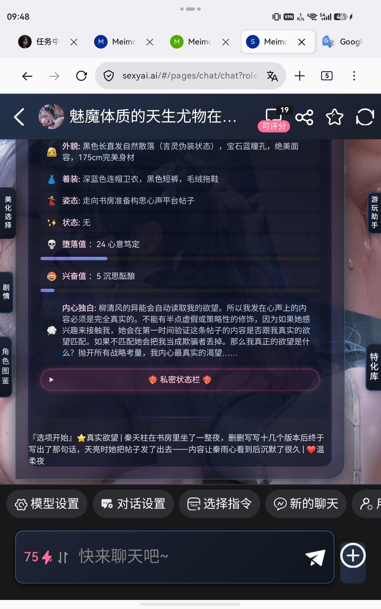

**汐愛** (2026-07-05 01:46:50):
还有一种可能，如果你调了代码，状态栏输出规则也要跟着变（反过来也是），有一方不变也会出现这个问题

**汐愛** (2026-07-05 01:45:58):
你用编辑查看一下，尤其是点最底部的空白（状态栏等规范格式会被mmd默认格式隐藏）

**秦天柱** (2026-07-05 01:32:49):
这个还真不好截图，跑流式能看到是生成了角色栏数据的，格式也对，然后全部输出的时候没有角色栏，用状态栏修复就能修，但是每次命令都要加修复，我感觉就是Claude抽风导致的，试了其他AI没这个问题。汐汐佬的状态栏还是一如既往的稳定

**汐愛** (2026-07-05 01:18:47):
可能的情况：引导词不对；竖线切分不对；缺乏关键信息（比如 角色名）

**汐愛** (2026-07-05 01:16:56):
具体什么情况，发下ai输出的角色信息我看看

**秦天柱** (2026-07-04 11:20:49):
汐汐佬，这两天Claude明明生成了角色栏数据却没显示是为什么，ds和gemini都没这个问题

**bcwer134** (2026-06-30 17:04:25):
<:emoji_140:1379454014852436038>

**bcwer134** (2026-06-30 17:04:22):
超喜欢汐汐

**月月鸟（思维枯竭）** (2026-06-30 16:47:04):
汐佬的状态栏简洁好用的很啊！

**月月鸟（思维枯竭）** (2026-06-30 16:46:50):
<:emoji_140:1379454014852436038> 加我一个

**汐愛** (2026-06-30 08:29:11):
<:emoji_140:1379454014852436038>

**糯米辞** (2026-06-30 02:31:39):
汐汐佬的状态栏已经助力了萌新几张卡了<:emoji_140:1379454014852436038> 特来还愿

**汐愛** (2026-06-29 13:41:50):
<:1000168519:1298906843808137276>

**bcwer134** (2026-06-29 13:12:16):
<:emoji_140:1379454014852436038>

**bcwer134** (2026-06-29 13:12:11):
告诉汐汐让汐汐也有参与感

**bcwer134** (2026-06-29 13:11:55):
我一下就看出来了<:emoji_278:1505051639328018452>

**bcwer134** (2026-06-29 13:10:06):
写卡用的你的状态栏

**bcwer134** (2026-06-29 13:09:53):
<:emoji_249:1416980114511761448>

**bcwer134** (2026-06-29 13:09:50):
那个全职法师你知道了吗

**bcwer134** (2026-06-29 13:09:44):
哇，汐汐

**月月鸟（思维枯竭）** (2026-06-29 05:53:38):
那来试试我的卡，萝莉御姐巨r妈嘿嘿<:emoji_140:1379454014852436038>

**汐愛** (2026-06-28 22:51:52):
<:emoji_249:1416980128793104514> 4i

**bcwer134** (2026-06-28 19:10:45):
他们还同意了

**bcwer134** (2026-06-28 19:10:34):
你提出由你替代妻子

**bcwer134** (2026-06-28 19:10:24):
本来几个大糙汉想强暴妻子的

**bcwer134** (2026-06-28 19:10:10):
就是在印度<:emoji_249:1416980114511761448>

**bcwer134** (2026-06-28 19:10:03):
我想到一个剧情

**bcwer134** (2026-06-28 19:09:54):
汐汐

**bcwer134** (2026-06-28 10:01:56):
这个A社应该资料不少

**bcwer134** (2026-06-28 10:01:37):
汐汐如果感兴趣可以做摩诃婆罗多剧情卡什么的

**bcwer134** (2026-06-28 10:01:11):
<:emoji_249:1416980114511761448>

**bcwer134** (2026-06-28 10:00:45):

**bcwer134** (2026-06-28 09:57:50):
一些美男也是

**bcwer134** (2026-06-28 09:57:44):
一些美女真的很不错的

**bcwer134** (2026-06-28 09:57:38):
其实印度除了那些刻板印象

**bcwer134** (2026-06-28 09:56:14):
女主视角吗

**bcwer134** (2026-06-28 09:55:55):
<:1000168510:1298906820638674984>

**汐愛** (2026-06-28 08:52:15):
恶臭下头男按着脑袋逼你喝恒河水

**bcwer134** (2026-06-28 08:38:28):
<:emoji_278:1505051639328018452>

**bcwer134** (2026-06-28 08:38:27):
所以汐汐想写什么样的印度肉卡呀

**bcwer134** (2026-06-28 08:29:43):
<:emoji_279:1515285028462919802>

**汐愛** (2026-06-28 08:06:56):
喜欢小姐姐

**汐愛** (2026-06-28 08:06:46):
<:emoji_140:1379454014852436038>

**汐愛** (2026-06-28 08:06:43):
不喜欢大姐姐

**bcwer134** (2026-06-28 08:05:38):
<:emoji_143:1379855104622202900>

**bcwer134** (2026-06-28 08:05:27):
人兽不敢看

**bcwer134** (2026-06-28 08:05:21):
媚黑如果有人分享看一眼

**bcwer134** (2026-06-28 08:04:49):
<:1000168531:1298906724979310634>

**bcwer134** (2026-06-28 08:04:14):
没事，只是大姐姐<:emoji_278:1505051639328018452>

**bcwer134** (2026-06-28 08:04:06):
汐汐的性癖有点怪怪的

**bcwer134** (2026-06-28 08:03:53):
欸

**bcwer134** (2026-06-28 08:03:49):
里面有邻家小妹

**汐愛** (2026-06-28 08:03:38):
哪怕媚黑和人兽我都可以跑几轮，母系和熟女不行

**bcwer134** (2026-06-28 08:03:34):
<:emoji_278:1505051639328018452>

**bcwer134** (2026-06-28 08:03:32):
不是熟女

**bcwer134** (2026-06-28 08:03:26):
御姐

**bcwer134** (2026-06-28 08:03:20):
<:1000168510:1298906820638674984>

**bcwer134** (2026-06-28 08:03:15):
虽然cos日暮吸量失败了

**汐愛** (2026-06-28 08:03:12):
不玩母系和熟女，其他可以支持哦

**bcwer134** (2026-06-28 08:02:58):
汐汐来玩我的后妈文学卡<:emoji_278:1505051639328018452>

**汐愛** (2026-06-28 07:29:45):
<:emoji_149:1400299483212021833>

**bcwer134** (2026-06-28 06:39:49):
<:emoji_140:1379454014852436038>

**bcwer134** (2026-06-28 06:39:46):
栖息地捕获汐汐

**汐愛** (2026-06-28 05:40:38):
<:emoji_140:1379454014852436038>

**月月鸟（思维枯竭）** (2026-06-28 05:29:29):
现在就是被审核肘击，这设定咋过不了啊（恼）

**月月鸟（思维枯竭）** (2026-06-28 05:29:10):
搞定了，搞定了，谢谢大佬<:emoji_140:1379454014852436038>

**bcwer134** (2026-06-27 15:28:52):
应该吧

**bcwer134** (2026-06-27 15:28:34):
<:1000168510:1298906820638674984>

**bcwer134** (2026-06-27 15:28:28):
这是ai抽风加上状态栏顺序不对

**汐愛** (2026-06-27 14:35:43):
你把世界书当正则了<:1000168510:1298906820638674984>

**月月鸟（思维枯竭）** (2026-06-27 12:24:28):
搞定了搞定了

**月月鸟（思维枯竭）** (2026-06-27 12:08:11):
大佬大佬，我这个是啥情况啊<:24:1298294525390753924> <:24:1298294525390753924>

**汐愛** (2026-06-26 21:00:33):
<:emoji_140:1379454014852436038>

**bcwer134** (2026-06-26 17:03:12):
<:emoji_140:1379454014852436038>

**bcwer134** (2026-06-26 17:03:11):
<:emoji_278:1505051639328018452>

**bcwer134** (2026-06-26 17:03:06):
<@1241360726728249354>

**bcwer134** (2026-06-26 17:03:05):

**bcwer134** (2026-06-26 17:02:58):
汐汐

**花沁雅** (2026-06-23 04:10:11):
<:emoji_277:1501430172040298566>

**秦天柱** (2026-06-16 11:09:22):
好的，谢谢大佬

**汐愛** (2026-06-16 11:05:09):
ds抽风会这样，手动拉下去就可以了
想更稳定一点可以在设定里加回复格式：
<回复格式>
输出内容必须按顺序组成：思维链 → 正文 → 总序栏 → 角色栏 → 选项栏

**秦天柱** (2026-06-16 10:51:02):
大佬，更新之后状态栏崩的有点厉害啊，总序栏跑到回复框最上面去了

**greatsuper** (2026-06-16 07:22:59):
👍

**汐愛** (2026-06-16 07:10:58):
作者端，第一句话导入正则，世界书导入世界书

**greatsuper** (2026-06-16 07:10:15):
这个是怎么用的这个JSON贴在哪或者从哪导入

**汐愛** (2026-06-16 05:35:47):
<:emoji_140:1379454014852436038>

**时** (2026-06-16 05:00:39):
新人第一张卡用的开源，两天已经208k了，虽然不多但是知足了，特来还愿感谢大佬<:emoji_140:1379454014852436038> <:emoji_140:1379454014852436038> <:emoji_140:1379454014852436038>

**llk[🌏地球电网战略合作伙伴]** (2026-06-16 04:34:23):
正在搞

**llk[🌏地球电网战略合作伙伴]** (2026-06-16 04:34:13):
<:07:1298281204260278383>

**llk[🌏地球电网战略合作伙伴]** (2026-06-16 04:34:10):
明白了，就是第一句话要填的标准格式对吧

**汐愛** (2026-06-16 04:33:23):
再把正则什么的加到你需要的那里

**汐愛** (2026-06-16 04:33:23):
你找个空卡导

**llk[🌏地球电网战略合作伙伴]** (2026-06-16 04:30:20):
有点晕

**llk[🌏地球电网战略合作伙伴]** (2026-06-16 04:29:33):
所以是这么操作的吗）

**llk[🌏地球电网战略合作伙伴]** (2026-06-16 04:29:21):
<:emoji_252:1476606176522141716>

**llk[🌏地球电网战略合作伙伴]** (2026-06-16 04:28:57):
世界书我导进去了，但正则导入是直接覆盖第一句话

**汐愛** (2026-06-16 04:28:33):
正则还有配套的世界书，都要导进去

**llk[🌏地球电网战略合作伙伴]** (2026-06-16 04:27:43):
<:1000168531:1298906724979310634>

**llk[🌏地球电网战略合作伙伴]** (2026-06-16 04:27:37):
佬，你的状态栏那个正则文件指的是导入第一句话里面，手动填内容吗

**秦天柱** (2026-06-15 01:47:14):
好的，那我就不考虑加这个了

**汐愛** (2026-06-14 22:01:48):
角色生成器本质也是生成一条指令发到输入栏

**秦天柱** (2026-06-14 16:58:07):
大佬，我看到很多角色生成器开源的，但是我自己写的卡里面直接用输入栏命令创建角色一样可以被状态栏正确读取，用的就是这个状态栏，是不是意味着角色生成器并不是必须的

**汐愛** (2026-06-14 10:35:23):
<:emoji_249:1416980114511761448>

**bcwer134** (2026-06-14 08:28:15):
被说了

**bcwer134** (2026-06-14 08:28:05):
汐汐，因为我没有真的ntr<:emoji_144:1379454084750245939>

**bcwer134** (2026-06-14 04:24:44):
<:1000168510:1298906820638674984>

**汐愛** (2026-06-14 04:00:02):
<:emoji_279:1515285028462919802> 神人卡是不对的
被批评就是不够神

**bcwer134** (2026-06-14 02:15:04):
被大运创飞了

**bcwer134** (2026-06-14 02:14:48):
而且说好的写神人卡有流量呢<:emoji_144:1379454084750245939>

**bcwer134** (2026-06-14 02:11:41):
汐汐，我被说了

**bcwer134** (2026-06-14 02:11:33):
唔<:emoji_144:1379454084750245939>

**bcwer134** (2026-06-14 02:11:27):

**汐愛** (2026-06-14 00:48:55):
<:image:1496914410747199608>

**氪拉拉降临，可爱全部拿来** (2026-06-13 23:11:57):
太牛了，突然能看懂，竟然是这样一件事情，我再打磨个三年五载就能写卡了<:emoji_249:1425489389139791984>

**汐愛** (2026-06-13 21:58:56):
<:emoji_279:1515285028462919802>

**bcwer134** (2026-06-13 15:12:52):
（瓦塔西）

**bcwer134** (2026-06-13 15:12:44):
好惨<:emoji_144:1379454084750245939>

**bcwer134** (2026-06-13 15:12:28):
<:1000168510:1298906820638674984>

**汐愛** (2026-06-13 15:10:46):
今天神了，所有模型全坏了，都发不出去<:emoji_279:1515285028462919802>

**汐愛** (2026-06-13 14:33:50):
<:emoji_140:1379454014852436038>

**bcwer134** (2026-06-13 14:32:04):
<:emoji_140:1379454014852436038>

**bcwer134** (2026-06-13 14:32:02):
诚挚邀请汐汐来玩

**bcwer134** (2026-06-13 14:31:46):
我过审了

**bcwer134** (2026-06-13 14:31:40):
汐汐<:emoji_278:1505051639328018452>

**汐愛** (2026-06-13 14:24:28):
玩别人的卡是没办法的，毕竟这个用到正则了。
玩别人的卡想加状态栏只能通过编辑加三点式的

**时间给予答案** (2026-06-13 13:46:25):
还是这个是只能作者用吗？玩别人的卡可以用这个加上状态栏吗？(´･_･`)

**bcwer134** (2026-06-13 12:22:16):
<:emoji_246:1488100783848161372> <:emoji_144:1379454084750245939>

**bcwer134** (2026-06-13 12:22:11):
<:1000168510:1298906820638674984>

**汐愛** (2026-06-13 12:22:05):
我电脑的梯子阵亡俩月了

**汐愛** (2026-06-13 12:21:50):
没有，阵亡了

**bcwer134** (2026-06-13 12:21:32):
<:emoji_246:1488100783848161372>

**bcwer134** (2026-06-13 12:21:28):
汐汐有没有电脑用的VPN

**汐愛** (2026-06-13 12:14:09):
<:emoji_279:1515285028462919802>

**bcwer134** (2026-06-13 12:05:13):
今日发不成了

**bcwer134** (2026-06-13 12:03:47):
电脑VPN还到期了

**bcwer134** (2026-06-13 12:03:35):
我饱受ai折磨

**bcwer134** (2026-06-13 12:03:21):
汐汐<:emoji_144:1379454084750245939>

**bcwer134** (2026-06-13 08:41:07):
<:emoji_279:1514632884273676338>

**汐愛** (2026-06-13 08:40:02):
都行

**汐愛** (2026-06-13 08:39:59):
<:emoji_279:1514949279767334962>

**bcwer134** (2026-06-13 08:39:39):
<:emoji_140:1379454014852436038>

**bcwer134** (2026-06-13 08:39:30):
汐汐叫洛冰汐怎么样

**bcwer134** (2026-06-13 08:34:59):
未婚妻可以只是单纯谋财

**bcwer134** (2026-06-13 08:34:42):
汐汐需要出轨服务吗？

**bcwer134** (2026-06-13 08:34:31):
好<:emoji_278:1505051639328018452>

**汐愛** (2026-06-13 08:33:39):
那还是未婚妻吧

**汐愛** (2026-06-13 08:33:32):
<:emoji_279:1514949279767334962>

**bcwer134** (2026-06-13 08:33:19):
你你只能当男主了

**bcwer134** (2026-06-13 08:33:07):
欸<:1000168510:1298906820638674984>

**汐愛** (2026-06-13 08:32:51):
<:image:1496914410747199608> 我想客串被调的

**bcwer134** (2026-06-13 08:32:39):
（不客串也不是不行<:emoji_278:1505051639328018452> ）

**bcwer134** (2026-06-13 08:32:16):
<:emoji_278:1505051639328018452>

**bcwer134** (2026-06-13 08:32:14):
汐汐，你想客串坏女人还是未婚妻

**bcwer134** (2026-06-13 08:29:12):
今晚，我将化身大运，或者变变成区<:emoji_278:1505051639328018452>

**汐愛** (2026-06-13 08:28:33):
<:emoji_279:1514949279767334962>

**bcwer134** (2026-06-13 08:27:37):
<:emoji_140:1379454014852436038>

**bcwer134** (2026-06-13 08:27:32):
我还在想和坏女人搞纯爱

**bcwer134** (2026-06-13 08:27:23):
汐汐这方面的想象力比我丰富

**bcwer134** (2026-06-13 08:27:09):
<:1000168510:1298906820638674984>

**汐愛** (2026-06-13 08:26:59):
<:emoji_249:1416980114511761448>

**汐愛** (2026-06-13 08:26:57):
好的，先被坏女人调成公狗，坏女人再把未婚妻抓来当母狗，然后两只狗狗强制交配

**bcwer134** (2026-06-13 08:25:52):
你觉得未婚妻背叛后，被宿敌坏女人收留这个题材怎么样<:emoji_249:1416980114511761448>

**汐愛** (2026-06-13 08:25:44):
<:emoji_278:1504682753789132840>

**bcwer134** (2026-06-13 08:25:31):
汐汐，我即将写新卡<:emoji_278:1505051639328018452> 将使用你的状态栏

**汐愛** (2026-06-12 22:15:37):
<:emoji_140:1379454014852436038>

**tomato** (2026-06-12 16:34:03):
非常感谢，真的。新人一直都在写单人卡，今天灵感来了写了个多人卡，之前的状态栏用不了，肘了一下午茶壶都没用，本来都放弃了，甚至想着随便搞个状态栏发出去就算了，看到这个随便套了一下直接就能用了，真的感谢，十分十分感谢。

**汐愛** (2026-06-12 06:12:28):
<:emoji_279:1514632884273676338>

**mozhimage** (2026-06-12 06:06:11):
啊 我的我的，眼瞎了，没看到世界书是单独文件

**汐愛** (2026-06-12 06:05:14):
第一个状态栏世界书json就是世界书里的规则

**汐愛** (2026-06-12 06:04:52):
世界书里

**mozhimage** (2026-06-12 04:37:34):
汐佬，这个状态栏对应的规则在哪<:emoji_249:1416980114511761448>

**汐愛** (2026-05-31 06:07:18):
<:emoji_245:1475855412757663938> 踹白白屁股

**白白白（月清瑶寄生）** (2026-05-31 05:02:19):
<:emoji_140:1379454014852436038> 谢谢大佬分享

**汐愛** (2026-05-28 01:40:28):
名字字段很重要的，负责引导角色名称切换标签

**汐愛** (2026-05-28 01:40:06):
<:emoji_140:1379454014852436038>

**Cerribelle** (2026-05-28 01:12:32):
没事了大佬，我自己用AI改了改状态栏弄好了

**汐愛** (2026-05-27 22:05:27):
第一个，总序栏结束需要单起一行。
第二个【角色开始】后面少一个角色名字段<:emoji_251:1474746086345281709> 方便说下这是哪个ai跑的吗

**Cerribelle** (2026-05-27 20:34:08):
缩减了一下字数，似乎又行了

**Cerribelle** (2026-05-27 19:56:26):
大佬，请问这是怎么回事呀？
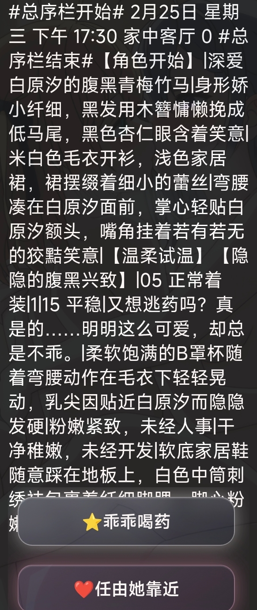

**汐愛** (2026-05-25 11:22:21):
有可能是页面抓取未套用<:emoji_251:1474746086345281709> 罕见bug，下次遇到可以右上角刷新试一下

**🍐** (2026-05-25 11:21:10):
我把原来的选项删除再打了一遍，又可以正常用了<:08:1298281401715785789> ，好奇怪，但是现在暂时没有遇到新的问题

**汐愛** (2026-05-25 11:18:22):
我感觉是选项的生成或者抓取出问题了，因为只有代码生成的选项4是正常的<:emoji_251:1474746086345281709>

**汐愛** (2026-05-25 11:16:19):
不正常，用编辑看看代码

**🍐** (2026-05-25 09:31:11):
汐汐，我用的时候状态栏有时候会崩掉是模型的问题吗<:emoji_139:1379455053080825866> ，就像这样

**秦天柱** (2026-05-25 00:23:25):
感谢大佬解答

**汐愛** (2026-05-24 16:32:13):
有这个情况。
所以在选项规则里有写规则：不要使用引号，如果有必须使用引号的情况，用「」代替。
不过ai抽风的时候还是会乱用引号导致代码提前截断，得手动复制话

**汐愛** (2026-05-24 16:30:57):
角色太多会崩是因为超token截断了，这个是模型的问题，没办法

**秦天柱** (2026-05-24 16:14:17):
还有一个问题，如果生成的选项里面“”框起来的对话内容，点击选项会不显示“”内容

**秦天柱** (2026-05-24 15:19:54):
大佬这个状态栏输入的角色超过三个会崩这个正常吗，应该怎么修

**汐愛** (2026-05-24 07:48:51):
<:emoji_149:1400299483212021833>

**小魅** (2026-05-24 06:33:24):
感谢源神<:emoji_140:1379454014852436038>

**MEE6** (2026-05-24 06:33:17):
<:CHECK6:403540120181145611> 30,000 XP has been given to **<@!1241360726728249354>**

**汐愛** (2026-05-23 15:40:43):
毕竟我是同时圈的，可能空了（）

**周雅（被老婆调教.周浩）** (2026-05-23 15:40:29):
<@1135473222658297907>

**汐愛** (2026-05-23 15:40:26):
<:emoji_278:1505051804508098591> 小魅去过我另一个帖子了，可能没来这里

**周雅（被老婆调教.周浩）** (2026-05-23 15:40:23):
那我去喊一下小魅

**bcwer134** (2026-05-23 15:37:06):
给你召唤另一个<:emoji_278:1505051639328018452>

**bcwer134** (2026-05-23 15:36:31):
<@1027244842629202020>

**bcwer134** (2026-05-23 15:36:23):
人家下班了可能

**汐愛** (2026-05-23 11:40:50):
<:emoji_143:1379855104622202900> 还是没人来喵，只好手动召唤小魅了
<@1135473222658297907>

**汐愛** (2026-05-23 04:43:11):
好耶

**汐愛** (2026-05-23 04:42:54):
<:emoji_278:1505051804508098591>

**bcwer134** (2026-05-23 04:25:18):
<:emoji_140:1379454014852436038>

**bcwer134** (2026-05-23 04:22:48):
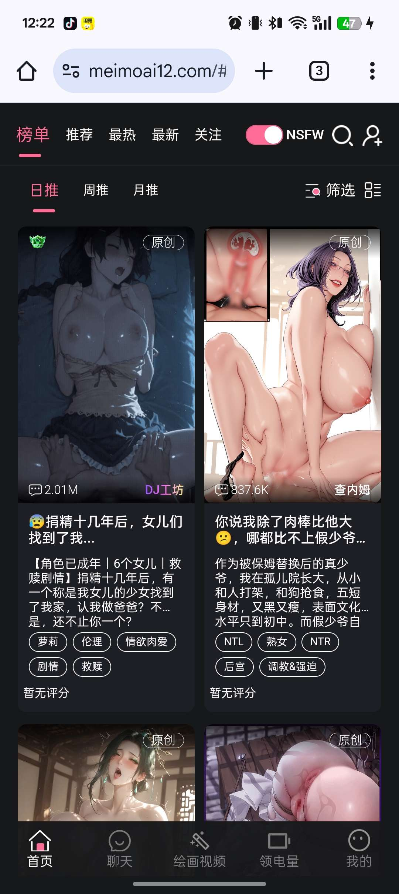
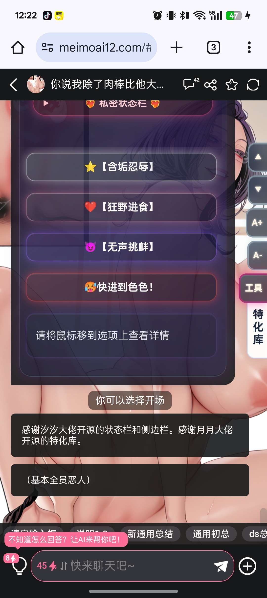

**bcwer134** (2026-05-23 04:21:55):
汐汐，你开源的状态栏被用了<:emoji_278:1505051639328018452> 在日榜第一

**凝青** (2026-05-22 12:57:14):
本来是想自己做状态栏的，结果做了好久，做崩了，干脆开摆用大佬开源的了<:emoji_249:1416980114511761448>

**凝青** (2026-05-22 12:56:50):
快来玩，我百合卡<:emoji_249:1416980114511761448>

**汐愛** (2026-05-22 12:56:40):
<:emoji_278:1505051804508098591>

**凝青** (2026-05-22 12:56:29):
反正是自己玩<:emoji_140:1379454014852436038>

**凝青** (2026-05-22 12:56:20):
没事了，我换了别人的严肃喷卡了<:emoji_249:1416980114511761448>

**汐愛** (2026-05-22 12:56:01):
啊？你替换的方式有问题吧。
正则和规则已经可以正常生成角色了。
第一句话那两个角色是给你看状态栏示例的

你想换成你卡里的角色，只需要在你第一句话说（不要推进剧情，原地刷新状态栏和选项栏）就ok了

**凝青** (2026-05-22 12:17:16):
<:emoji_143:1379855104622202900>

**凝青** (2026-05-22 12:17:13):
我用AI把里面的人物替换成我卡的角色，但是他容易出现问题

**汐愛** (2026-05-22 11:57:32):
<:emoji_140:1379454014852436038>

**汐愛** (2026-05-22 11:57:26):
在正则里找到发情度三个字，直接改。
但要记得匹配对应的数值规则

**凝青** (2026-05-22 09:51:30):
已严厉下载<:emoji_140:1379454014852436038>

**风眠有方** (2026-05-22 09:08:21):
佬，先感谢你的开源。现在如果我要把您的状态栏里面的内容进行更改要怎么操作嘞。比如把发情度改成病毒感染状态

**🍐** (2026-05-22 09:01:55):
<:emoji_140:1379454014852436038>

**bcwer134** (2026-05-21 14:33:08):
<:07:1298281204260278383>

**bcwer134** (2026-05-21 14:33:03):
刚进来就看见

**汐愛** (2026-05-21 14:32:21):
<:image:1496914410747199608>

**bcwer134** (2026-05-21 14:32:07):
牛牛牛

**汐愛** (2026-05-21 14:30:40):
请移步新帖：https://discord.com/channels/1205870897769095229/1545782030007271504

鉴于ui系统更改，本旧帖不再更新

