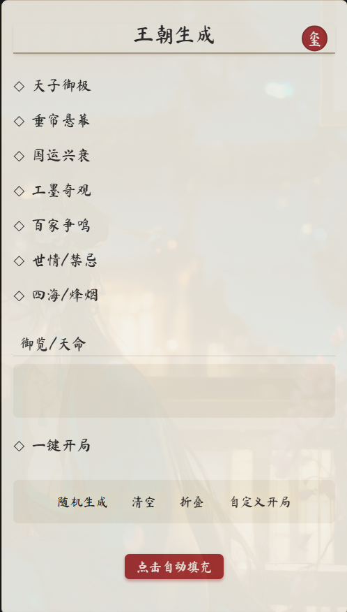

# 开源新卡的王朝生成状态栏（可随机生成词条）

创建时间: 2025-12-24T10:27:10.198000+00:00
消息数: 11

---

**清** (2025-12-24 12:48:06):
<:emoji_144:1379454084750245939>

**清** (2025-12-24 11:20:45):

**周雅（被老婆调教.周浩）** (2025-12-24 11:19:51):
暂时没有<:emoji_140:1379454014852436038> <:emoji_140:1379454014852436038> 我努力

**清** (2025-12-24 11:19:33):
新卡有没有需要我帮忙的雅

**清** (2025-12-24 11:19:17):

**周雅（被老婆调教.周浩）** (2025-12-24 11:19:03):
感谢清大佬 最近正好用上

**清** (2025-12-24 10:44:55):
<:emoji_140:1379454014852436038>

**羽然（正在杀出冥界……！）** (2025-12-24 10:44:26):
<:emoji_140:1379454014852436038>

**清** (2025-12-24 10:35:28):

**洛洛的茜** (2025-12-24 10:35:18):
吃

**清** (2025-12-24 10:27:10):
有一点小问题，那个填充是替换而不是添加，你们用的时候最好改一下，然后没有摄政的时候天子和国运中间有个小空白间隔。当成正常词条选项也行，不过用的话基本啥都要改一下（风格、内容）除非你也是古风历史卡hhh

