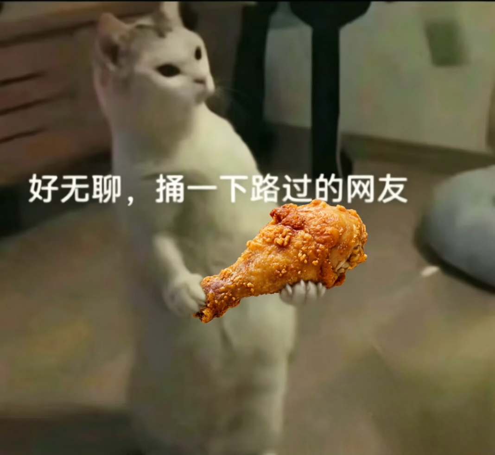
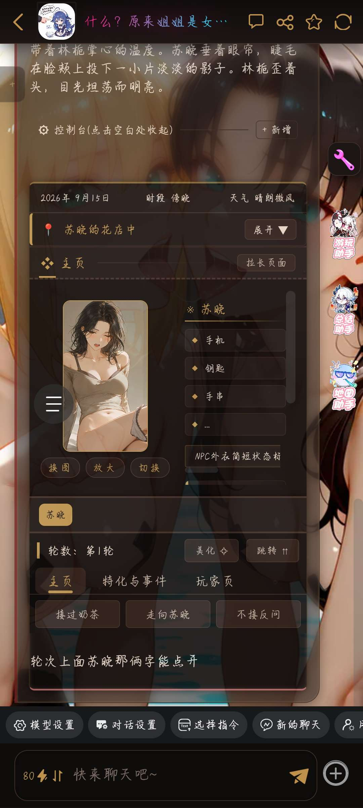
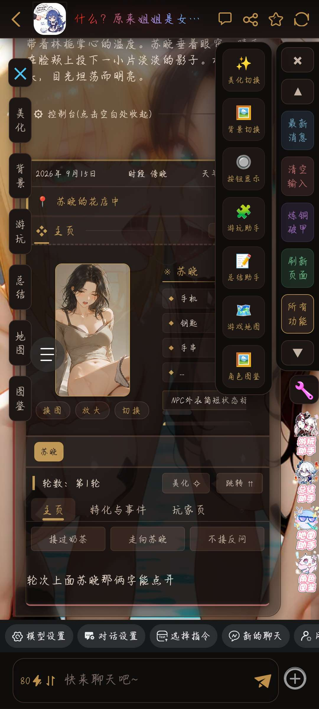

# 开源，单角色百合卡。

创建时间: 2026-08-08T02:24:22.162000+00:00
消息数: 8

---

**咎染** (2026-08-08 13:42:01):
其实这个状态栏是真的非常好用，汉字改成什么，最后生成出来的东西就是什么。
要的是心声，他就是心声，要的是背包，他就是背包，
这个状态栏我能用到死

**（猫娘萝莉妈妈)抱玖酒(捡小猫)** (2026-08-08 07:34:50):
很棒的开源

**（猫娘萝莉妈妈)抱玖酒(捡小猫)** (2026-08-08 07:34:41):
<:emoji_140:1379454014852436038>

**（猫娘萝莉妈妈)抱玖酒(捡小猫)** (2026-08-08 07:34:38):
<@1516862798502694946> 灌注轮椅姐姐喵～

**小魅** (2026-08-08 04:52:32):
感谢宝宝的开源<:emoji_140:1379454014852436038>

**MEE6** (2026-08-08 04:52:24):
<:CHECK6:403540120181145611> 30,000 XP has been given to **<@!1516862798502694946>**

**周雅（被老婆调教.周浩）** (2026-08-08 02:28:00):
<@1135473222658297907> 奖励经验

**咎染** (2026-08-08 02:24:22):
一张单角色百合卡的完全开源。
包括角色基础设定、正侧、世界书。
世界书包含80+百合特化，感谢大佬的百合特化开源。
下方为原帖https://discord.com/channels/1205870897769095229/1522530179778351194
美化还是崩铁大世界的美化，图标没有换，因为我挺喜欢的。
下图是状态栏基础状态与选项全开展示。

