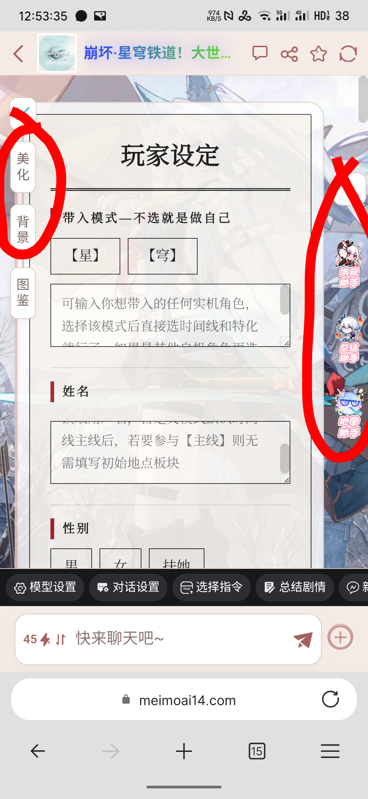
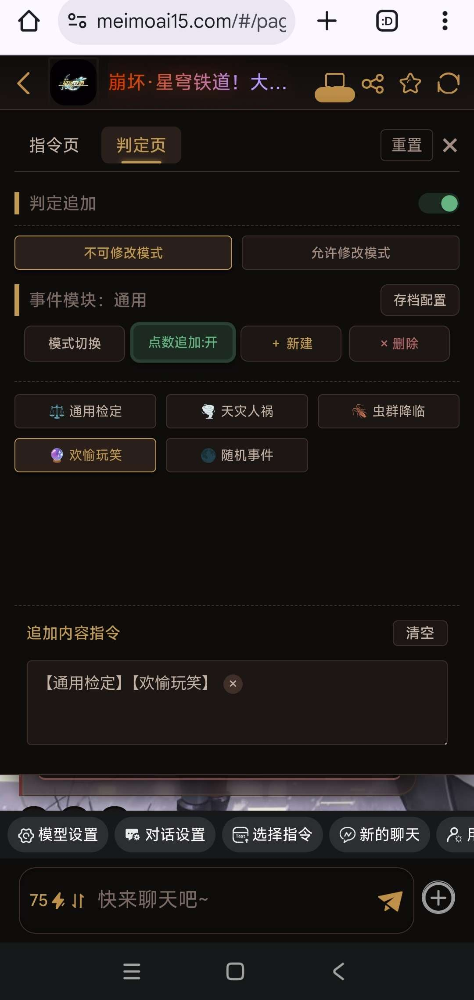
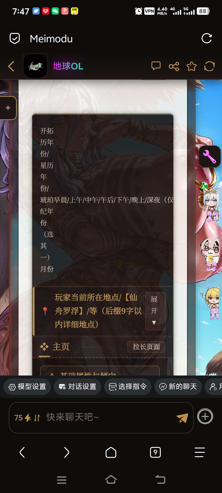
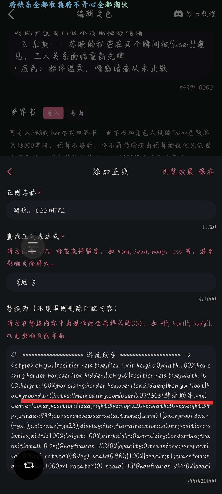
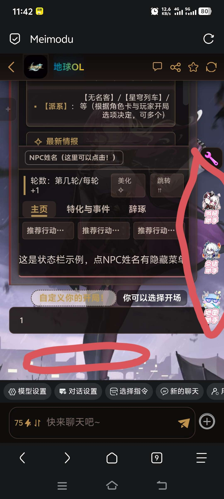
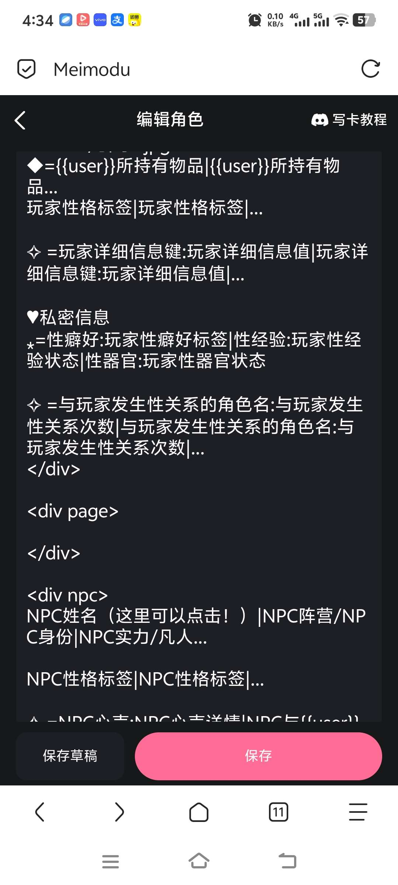
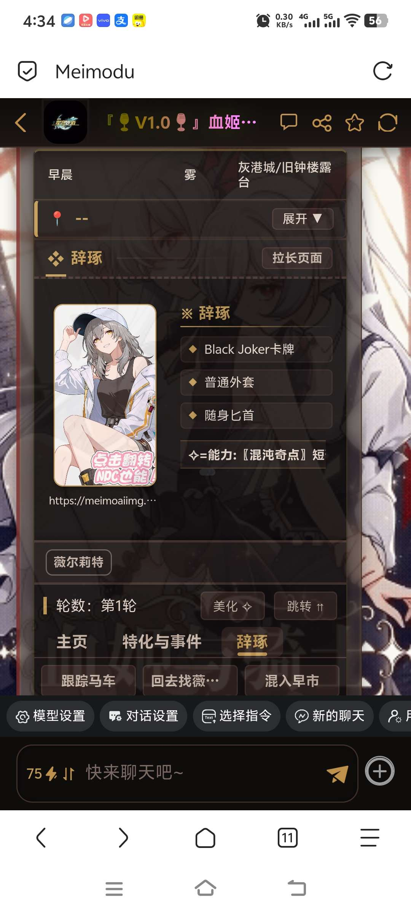

# 开源，崩铁大世界。

创建时间: 2026-07-19T08:43:58.317000+00:00
消息数: 120

---

**长风吹月** (2026-09-03 20:59:02):
做成世界书了喵

**档案管理员** (2026-09-03 20:58:55):
ℹ️ 此附件由其他成员上传，不属于帖子作者声明的作品包，也不受本帖授权协议覆盖。

**长风吹月** (2026-09-03 20:58:55):
喵喵喵，试一下，谢谢喵

**乖宝宝小水母（水母宗唯一宗主。大周荣誉国祖)** (2026-09-03 12:02:28):
<:emoji_249:1425489360958132385>

**乖宝宝小水母（水母宗唯一宗主。大周荣誉国祖)** (2026-09-03 12:02:18):
挖...誇張

**档案管理员** (2026-09-03 10:27:22):
ℹ️ 此附件由其他成员上传，不属于帖子作者声明的作品包，也不受本帖授权协议覆盖。

**长风吹月** (2026-09-03 09:09:38):
看看你用的到不喵

**长风吹月** (2026-09-03 09:09:33):
咕，等会儿给你一个东西

**咎染** (2026-09-03 09:09:13):
死了喵，被神人气到了

**长风吹月** (2026-09-03 08:35:15):
所以这个开源是死了喵？

**咎染** (2026-09-03 08:29:55):

**咎染** (2026-09-03 08:18:11):
气笑了，什么叫做开源卡一字不改，被二次发卡还过审了！！！？

**乖宝宝小水母（水母宗唯一宗主。大周荣誉国祖)** (2026-09-01 04:26:38):
<:emoji_252:1486379020487626943>

**咎染** (2026-09-01 04:13:55):
这条帖子我以后大概率不会有后续回复了

**咎染** (2026-08-28 10:11:05):
看正侧，都有分段，直接删就行

**一只鱼🐾** (2026-08-25 04:56:52):
我只想要这两个，怎么裁切其他功能？

**档案管理员** (2026-08-25 04:56:43):
ℹ️ 此附件由其他成员上传，不属于帖子作者声明的作品包，也不受本帖授权协议覆盖。

**一只鱼🐾** (2026-08-25 04:56:42):

**一只鱼🐾** (2026-08-25 04:56:31):
<@1516862798502694946> 老师~

**一只鱼🐾** (2026-08-22 15:59:27):
好的，大致我明白了。

**一只鱼🐾** (2026-08-22 15:41:44):
在哪里参考呀？

**档案管理员** (2026-08-22 08:09:02):
[本帖尚未声明授权]()
发帖人尚未完成授权设置，或已选择跳过。本状态不代表允许转载、二次创作、商业使用或重新分发。

**咎染** (2026-08-22 08:08:03):
给忘归人在世界书单开一张角色页，关键词就用忘归人，那我之前写的，参考一下格式，让AI自己识别就行了

**一只鱼🐾** (2026-08-21 08:26:48):

**一只鱼🐾** (2026-08-21 08:26:42):
我这边做在忘归人都识别不出来。

**一只鱼🐾** (2026-08-21 08:26:19):
老师怎么在状态栏新增人物呀！

**一只鱼🐾** (2026-08-20 16:43:18):
那个大世界基本设定是写在人设吗？

**一只鱼🐾** (2026-08-20 16:42:33):
老师

**咎染** (2026-08-20 02:01:11):
实际上随便写，因为很多时候AI压根不读取，大框架定在基础设定里面就行，我那些条目我甚至都没有设定优先级

**夙月** (2026-08-16 14:08:12):
大佬，我想问一下，什么时候要选择百分比触发，什么时候选择关键词触发，这个星神和命途行者我看也不算是底层逻辑吧

**夙月** (2026-08-15 12:25:26):
感谢大佬<:emoji_140:1379454014852436038> <:emoji_140:1379454014852436038>

**yuayzyz（claude 4.6o魂兮归来）** (2026-08-11 10:33:36):
主要是老用言灵推进剧情太没意思，想戏剧性点玩儿

**士酱** (2026-08-11 08:45:58):
<:emoji_299:1535540582137593866>

**士酱** (2026-08-11 08:45:53):
我以为这个是炫技的

**咎染** (2026-08-11 04:20:45):
因为判定失效了，但是用处不大，就没管，虽然我知道坏了，但你还是第一个反馈的

**yuayzyz（claude 4.6o魂兮归来）** (2026-08-10 10:37:14):

**yuayzyz（claude 4.6o魂兮归来）** (2026-08-10 10:36:52):
<@1516862798502694946> 老大，这个判定追加怎么用哇，打开了也不管用

**士酱** (2026-08-10 10:24:22):
<:emoji_249:1416980114511761448>

**士酱** (2026-08-10 10:24:19):
对了，老大你怎么每天一个头像

**士酱** (2026-08-10 10:24:07):
明白了老大

**士酱** (2026-08-10 10:24:02):
奥

**咎染** (2026-08-09 16:56:00):
顺带一提，其实状态栏开局也不放也无所谓

**咎染** (2026-08-09 16:55:05):
把开局面板删了，用这个https://discord.com/channels/1205870897769095229/1479798902659088405
从头生成

**士酱** (2026-08-09 11:47:48):
<:1000168531:1298906724979310634>

**士酱** (2026-08-09 11:47:44):
对了老大，这个问题怎么解决

**士酱** (2026-08-09 11:47:37):

**咎染** (2026-08-09 04:16:26):
其实你还可以直接让AI帮你查找正侧里面的user字段，就都出来了，因为我链接放的全是完整的

**士酱** (2026-08-09 01:14:01):
<:1000168531:1298906724979310634>

**士酱** (2026-08-09 01:14:00):
嘿嘿

**士酱** (2026-08-09 01:13:49):
奥，原来在这

**咎染** (2026-08-08 16:30:47):
举个栗子

**咎染** (2026-08-08 16:30:43):

**咎染** (2026-08-08 16:05:14):
正侧都是带注解的

**咎染** (2026-08-08 16:03:03):
在对应的正侧里面找，背景全局里面，其他的就是对应的功能

**士酱** (2026-08-08 15:45:00):
<:emoji_150:1388484246607499324>

**士酱** (2026-08-08 15:44:30):
没找到喵

**士酱** (2026-08-08 15:44:16):

**士酱** (2026-08-08 15:44:09):
这个背景图和按钮图标我该怎么改

**士酱** (2026-08-08 15:43:51):
老大老大

**咎染** (2026-08-05 11:33:49):
<status>

第几轮|年份 月份号数|时段 时刻|天气 温度|玩家当前所在地点
附近地点名/交通工具和时间（简短）|附近地点名/交通工具和时间（简短）
周围可互动事物名|周围可互动事物名

推荐行动标题|推荐行动指令内容
推荐行动标题|推荐行动指令内容
推荐行动标题|推荐行动指令内容

【页面按钮名和页面标题（例如主页）】
📊卡片标题（例如经营状况）
▪=键（例如营业状态）:值（例如产业是否营业中）|键:值|键:值|...
📰卡片标题（例如最新情报）
⇒=近期的情报与传闻|近期的情报与传闻|...

【页面按钮名和页面标题（例如背包）】
🎁卡片标题（例如个人资产）
¥=键（例如资产名称）:值（例如资产价值）|键:值|键:值|...
🎁卡片标题（例如妙妙背包）
↪=键（例如持有物名称）:值（例如持有物数量）|键:值|...

【页面按钮名和页面标题（例如我的）】
玩家姓名|玩家立绘标签/外链
◆=玩家属性键值对|玩家属性键值对|玩家属性键值对|玩家属性键值对...
玩家简短状态标签|玩家简短状态标签|...
✧ =玩家详细信息键:玩家详细信息值|玩家详细信息键:玩家详细信息值|...
♥卡片标题（例如私密信息）
⁎=性癖好:玩家性癖好标签|性经验:玩家性经验状态|性器官:玩家性器官状态
✧ =玩家详细信息键:玩家详细信息值|玩家详细信息键:玩家详细信息值|...

【页面】
====页面内容====

NPC姓名|NPC立绘标签/外链
◆=NPC属性键值对|NPC属性键值对|NPC属性键值对|NPC属性键值对...
NPC简短状态标签|NPC简短状态标签|...
✧ =NPC详细信息键:NPC详细信息值|NPC详细信息键:NPC详细信息值|...
♥卡片标题（例如私密信息）
⁎=性癖好:NPC性癖好标签|性经验:NPC性经验状态|性器官:NPC性器官状态
✧ =NPC详细信息键:NPC详细信息值|NPC详细信息键:NPC详细信息值|...

</status>

**咎染** (2026-08-05 11:33:47):
其实状态栏是完全自由的，里面的东西随便改，AI会自己匹配

**召唤师** (2026-08-04 04:15:25):
<:emoji_249:1416980114511761448> 好东西呀

**士酱** (2026-08-02 12:26:31):
奥，确实发现了。感觉像是模型问题

**不要殴打土木术士** (2026-08-02 10:22:01):
逼死

**不要殴打土木术士** (2026-08-02 10:21:58):
对，这个确实，所以我当时整理了挺久的，必死强迫症JPG

**咎染** (2026-08-02 06:41:52):
小概率事件，这个是唯一会炸的地方（玩家与角色页）目前我也不知道怎么修，

**咎染** (2026-08-02 06:40:23):
我最初写了时间的草稿，然后发现，太碎了，就放弃了

**不要殴打土木术士** (2026-08-01 21:27:15):
比较适合想玩在剧情开始前提前布局的（考究党搞的时候好痛苦，毕竟时间线太碎了）

**不要殴打土木术士** (2026-08-01 21:26:07):
大概是把能搜到的时间线筛选整理了一下

**不要殴打土木术士** (2026-08-01 21:25:37):
我去，感谢大佬开源，如此大度，我也分享一下之前整理的崩铁剧情开始之前到时间线，可能有点吃书，是去年整理的

**士酱** (2026-08-01 08:41:04):

**士酱** (2026-08-01 08:39:42):
<:emoji_249:1416980114511761448>

**士酱** (2026-08-01 08:39:40):
老大帮我肘肘这个

**士酱** (2026-07-30 03:32:53):
<:emoji_249:1416980114511761448>

**士酱** (2026-07-30 03:32:50):
我要给我每一个都使这个

**士酱** (2026-07-30 03:32:36):
老大，太好使了

**天星问** (2026-07-27 17:31:30):
哇，还有如此大度的开源，我也分享下我之前整理的翁法罗斯历史给大家参考下。当时整理这些废了不少劲，但褒姒后就没怎么更新了<:emoji_249:1416980114511761448>

**小稀（鹿鞭一条）** (2026-07-27 17:29:41):
直接开源了嘛宝宝<:emoji_140:1379454014852436038>

**哥（一条区）** (2026-07-27 07:31:56):
老大，这个美化，地图，图鉴是一起的吗

**贫穷** (2026-07-23 02:40:24):
好哦，谢谢大佬

**乖宝宝小水母（水母宗唯一宗主。大周荣誉国祖)** (2026-07-23 02:07:37):
（偷偷看一眼）

**乖宝宝小水母（水母宗唯一宗主。大周荣誉国祖)** (2026-07-23 02:07:21):
<:emoji_274:1496841224320057424>

**ASMODAY** (2026-07-23 01:45:10):
就是就是，动不动就爆，搞得我只能疯狂压缩所有设定，连破甲、ai演绎之类的规则也尽可能的压缩，结果就是角色一发情每句话都带♥，还他喵的旁白“我知道她又发情了，因为她每句话里都带上了♥符号”，只能加上非性行为期间不得带♥

**咎染** (2026-07-22 16:06:08):
目前好像也就只能做到让AI发挥固定角色预设的东西，完全服从还是没办法捏。
举个例子：
我：你要看这个，然后这样做！
AI：OK，懂了！
游玩时
AI：看我给用户整个活！

**咎染** (2026-07-22 16:02:27):
全局JS2里面后半截有侧边弹窗的通用正侧，然后就是游玩的CSS+HTML和游玩JS1234

**咎染** (2026-07-22 15:57:00):
是这样的捏，读取上限就那么点，而且我这个主要是同人，多少AI还是有同人库的。所以角色写细致一点就好。并且其实你说那种联动条目我是试过的，但是因为设定太过庞大之后，反而特别容易爆设定，我也是真没招了，所以只把一些通用的地方做了关键词联动

**ASMODAY** (2026-07-22 06:19:43):
好吧，谢谢大佬的解惑

**伊纯纯纯纯纯** (2026-07-22 06:19:03):
我也不太明白，不过设定大头基本都是角色，感觉也没什么关系了，反正到读取上限的时候也应该也读取不了更多角色

**ASMODAY** (2026-07-22 06:14:32):
对了，我看到大佬开源的卡里顺序都是0，这样真的没问题吗？

**伊纯纯纯纯纯** (2026-07-22 06:13:17):
啊这…这世界书读取设定的触发机制就在这，你只能尽可能的想办法让ai在需要的时候写出对应关键词

**ASMODAY** (2026-07-22 06:12:50):
唉，感谢咎染大大的开源，感谢伊纯大大的解答

**ASMODAY** (2026-07-22 06:11:36):
以为大佬发现了一种新式的检索方式，赶紧过来问问。。。这下可算是彻底死心了<:07:1298281204260278383>

**ASMODAY** (2026-07-22 06:08:58):
没办法自动触发吗？所以，咎染大佬开源的崩铁本质上也是通过玩家自行点击、说出到达地点，ai再进行关键词读取的，所以才能在条目里只加入角色名、地点、种族之类关键信息的关键词，而不用在固定触发里写简表

**伊纯纯纯纯纯** (2026-07-22 06:04:13):
emmmm，这有什么办法，设定这么多的话，固定触发肯定就只能写个世界观，然后种族、地区、人物啥的就只能写在正则里让玩家手动触发了

**ASMODAY** (2026-07-22 05:59:07):
而且每多一个关键词检索的设定，就需要在固定传输里加一个精简说明，更加挤占为数不多的字符上限

**ASMODAY** (2026-07-22 05:57:48):
可是设定内容实在是太多了，种族、地理、神系啥啥啥的，关键词特别容易交叉引用，导致很多条目读取不全

**伊纯纯纯纯纯** (2026-07-22 05:50:39):
如果不是要写几十万设定的大世界，你这样写才是比较合理的

**ASMODAY** (2026-07-22 03:34:46):
我也在构思一个模拟大世界，由于是第一次制作，几乎每个条目写满了密密麻麻各种可能的触发词，甚至还在角色人设版面写了大量的固定设定的简略信息，生怕AI不知道我设定了哪些可以触发关键词的内容，结果就是设定和各种条目越写越冗余，越写越复杂

**贫穷** (2026-07-22 03:33:09):
大佬大佬，我有个问题。我试着把总结助手单独拆开放在测试里面，但是只显示了总结助手的图片，却无法点击

我想问一下这个是不是因为还有其他的内容连在一起了，不止总结助手和存档与存档闭合的正则

**ASMODAY** (2026-07-22 03:32:01):
大佬，关于您的世界书：种族、地点、NPC等条目似乎没有简表，几乎都是通过关键词触发，您不担心ai无法触发关键词，捏造不存在的种族、地点，胡乱编造具体设定吗？还有NPC，那么多的NPC是如何确保其能正确出现？

**你表哥** (2026-07-20 09:29:43):
強韌！無敵！最強！

**归去来兮** (2026-07-20 03:55:31):
<:emoji_298:1526501165460881478>

**贫穷** (2026-07-20 00:52:57):
我去，感谢大佬开源，无敌了

**小魅** (2026-07-19 16:05:50):
感谢宝宝开源 <:emoji_140:1379454014852436038> 非常精品的卡

**MEE6** (2026-07-19 16:05:33):
<:CHECK6:403540120181145611> 50,000 XP has been given to **<@!1516862798502694946>**

**安安** (2026-07-19 13:00:25):
<:emoji_139:1379455053080825866> 哇~

**bcwer134** (2026-07-19 12:51:07):
<:emoji_140:1379454014852436038>

**ZSH** (2026-07-19 09:55:52):
<:emoji_140:1379454014852436038>

**阿成** (2026-07-19 09:36:00):
<:emoji_298:1526501165460881478> 太强了，无敌

**ehst** (2026-07-19 09:35:53):
<:emoji_298:1526501165460881478>

**镜（魅魔3组！纨绔模拟器~）** (2026-07-19 09:03:20):
<:emoji_298:1526501201703600188>

**斯娜静歌  -妖妖跋扈～紫之名不虚传 Fox！** (2026-07-19 08:48:06):
彼可取而代之

**蒙翰拉瑞** (2026-07-19 08:47:39):
大丈夫当如是也

**斯娜静歌  -妖妖跋扈～紫之名不虚传 Fox！** (2026-07-19 08:47:29):
不错

**🍐** (2026-07-19 08:47:14):
<:emoji_140:1379454014852436038> <:emoji_140:1379454014852436038> <:emoji_140:1379454014852436038>

**咎染** (2026-07-19 08:46:53):
在正侧里面

**周雅（被老婆调教.周浩）** (2026-07-19 08:46:39):
<@1135473222658297907> 奖励经验

**顾慎为** (2026-07-19 08:46:16):
我想要那个人物图鉴

**顾慎为** (2026-07-19 08:45:59):
牛逼，图鉴怎么搞的

**咎染** (2026-07-19 08:45:20):
<@1135473222658297907> <:emoji_140:1379454014852436038> <:emoji_140:1379454014852436038> <:emoji_140:1379454014852436038>

